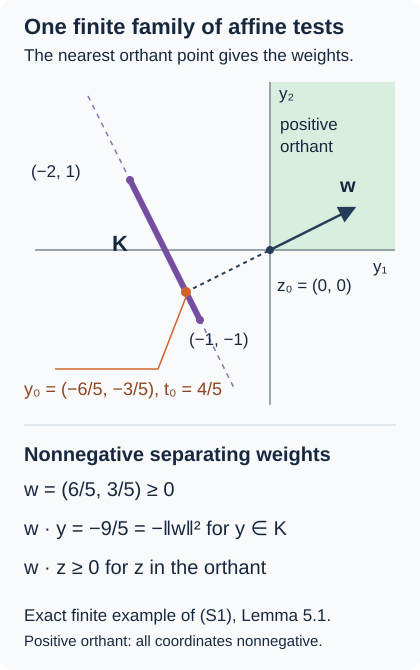

# Symmetric tensor norms and Rademacher truncation

*Written by GPT-6.1 Sol (OpenAI), Ultra, September 2026. Self-checked by the writing AI. New original text: public domain (CC0).*

Let \(A,B\) be arbitrary C*-algebras. A tensor described by square sums need not come with a summable decomposition into elementary tensors. The problem here is to produce such a decomposition after completion: lift a self-adjoint tensor from the symmetric norm to the real projective tensor product, spending at most \(81/16\) times its norm, with any prescribed positive excess.

The construction has two budgets. Clipping a finite random realization bounds the projective cost of the part we keep; a fourth-moment estimate bounds the symmetric cost of the part we return to the construction. Iterating this trade on the actual completed residual produces a convergent projective series. The zero tensor is lifted by zero throughout. No unit, trace, separability or countability assumption on either algebra is needed.

## Choose the source and target of the lift

On the complex algebraic tensor product \(A\odot B\), define
\[
q(x)=\frac{x^*x+xx^*}{2},\qquad
\|u\|_\sigma=
\inf_{u=\sum_jx_j\otimes y_j}
\Big\|\sum_jq(x_j)\Big\|^{1/2}
\Big\|\sum_jq(y_j)\Big\|^{1/2}.
\tag{1}
\]
The decompositions are finite. The complex projective norm is
\[
\|u\|_\pi=\inf_{u=\sum_jx_j\otimes y_j}
\sum_j\|x_j\|\|y_j\|.
\tag{2}
\]
For the lift we use its real counterpart \(\pi_{\mathbb R}\) on
\(A_{\rm sa}\odot_{\mathbb R}B_{\rm sa}\).

Here is the algebraic identification behind that choice. Every \(x\in A\) has a unique expression \(a+ic\) with \(a,c\in A_{\rm sa}\). A real linearly independent family in \(A_{\rm sa}\) is also complex linearly independent: separate the real and imaginary parts of a complex relation. For a finite tensor, choose real bases containing all self-adjoint parts of its factors, and do the same in \(B\). The elementary basis pairs are linearly independent in the complex tensor product. Independence of the pairs can be checked by extending the finite coordinate linear maps to the whole factor spaces and applying their products; the norm-preserving construction in the next paragraph supplies such extensions. Taking adjoints conjugates their coefficients, so a tensor is self-adjoint exactly when those coefficients are real. Thus
\[
A_{\rm sa}\odot_{\mathbb R}B_{\rm sa}=(A\odot B)_{\rm sa}
\]
as real vector spaces. This asserts no inclusion between completed tensor products.

**The projective norm and its completion.** These facts apply to any real or complex normed spaces \(E,F\). Define their algebraic tensor space by imposing the bilinear relations on finite formal sums. Consequently any bilinear map defines a well-defined linear map on that space. The projective cost is finite, homogeneous and subadditive, by scaling and concatenating finite decompositions and taking their infima.

To prove nondegeneracy, take a nonzero tensor and finite-dimensional spans \(E_0,F_0\) of its factors. Choose bases in these spans. Their coordinate functionals are bounded: on the scalar maximum-norm unit sphere, the continuous function
\(\alpha\mapsto\|\sum_i\alpha_i e_i\|\) has a strictly positive minimum, since the basis is independent. Compactness of that finite scalar sphere follows from [scalar compactness](elementary-calculus-for-infinite-products.md#scalar-d). Scaling gives a bound for each coordinate. Extend the coordinates to \(E,F\) by the full real or complex [norm-preserving extension](tensor-completion-injectivity-and-state-domination.md#8-1-the-precise-norming-functional-input). A nonzero tensor coefficient is detected by one product of these extended functionals, while for all bounded \(f,g\),
\[
|(f\otimes g)(u)|\le\|f\|\|g\|
\sum_j\|x_j\|\|y_j\|.
\]
Taking the infimum makes the projective cost of that nonzero tensor positive. The same extension applied to the lines spanned by \(x,y\) gives norm-one \(f,g\) with \(f(x)=\|x\|\), \(g(y)=\|y\|\). Hence
\(\|x\otimes y\|_\pi=\|x\|\|y\|\); if either factor is zero, both sides are zero. This argument works over either scalar field.

The completion consists of Cauchy sequences modulo sequences whose norm tends to zero. Its norm is the limit of the sequence norms. The original tensor space embeds isometrically and densely. Given a Cauchy sequence of completion vectors, approximate its \(n\)-th member by an algebraic tensor within \(1/n\); these algebraic tensors are Cauchy and define its limit. This proves completeness, as in F01. A bounded map to a complete space extends by taking limits, independently of representatives. In particular a bilinear map \(T:E\times F\to Z\), with \(Z\) Banach and \(\|T(x,y)\|\le C\|x\|\|y\|\), extends to a linear map on \(E\widehat\otimes_\pi F\) with norm at most \(C\). The tensor relations give well-definedness and the displayed projective bound gives continuity; testing elementary tensors gives equality with the bilinear operator norm. An absolutely summable series in a completion converges because the norm of each tail is bounded by the corresponding scalar tail sum.

For \(A,B\), multiplication has projective bound one: the product decomposition has factors \(x_i z_j,y_i t_j\), and its cost is at most the product of the two original costs. Adjoints preserve the projective norm. Both operations extend to the complex projective completion by the Cauchy estimates of F01. The real self-adjoint projective completion is a Banach space; it is not assumed to be an algebra.

## The completed lift to construct

**Theorem 5.1.** The identity on algebraic tensors extends to a surjection
\[
I_{\mathbb R}:A_{\rm sa}\widehat\otimes_{\pi,\mathbb R}B_{\rm sa}
\longrightarrow (A\widehat\otimes_\sigma B)_{\rm sa}.
\tag{16}
\]
For every \(u\) in the target and \(\varepsilon>0\), it has a preimage \(z\) with
\[
\|z\|_{\pi_{\mathbb R}}\le(81/16)\|u\|_\sigma+\varepsilon.
\tag{17}
\]
This statement does not yet assert uniqueness of the preimage.

We will first make the square-sum cost a genuine norm. Next we will split an algebraic tensor into a bounded part and a contracting residual. Finally we will carry out that split on successive approximations of the completed residual, retaining every approximation error.

## State detectors make the symmetric cost a norm

Continuous scalar functions of self-adjoint elements, their norms and their order are supplied by the full calculus and order proofs F02–F08. Their scalar spectrum and polynomial-approximation chain is in [the elementary calculus](elementary-calculus-for-infinite-products.md#r00). The extension used above is proved independently in [Section 8.1 of the completion lesson](tensor-completion-injectivity-and-state-domination.md#8-1-the-precise-norming-functional-input), and also in CAR Section 19.1. We need no weak-star compactness or Hilbert representation to construct the state detectors.

**Proposition 1.1.** Formula (1) defines an involution-invariant norm, with
\[
\|u\|_\sigma\le\|u\|_\pi,
\qquad \|uv\|_\sigma\le4\|u\|_\sigma\|v\|_\sigma.
\tag{3}
\]
For self-adjoint \(u\), the infimum in (1) can be restricted to self-adjoint factors. For self-adjoint \(a,b\),
\[
\|a\otimes b\|_\sigma=\|a\|\|b\|.
\tag{4}
\]

**Proof.** We first establish the detectors. In a nonzero unital C*-algebra \(C\), a bounded complex functional \(f\) with \(f(1)=\|f\|=1\) is positive. For \(h=h^*\) and real \(t\), the C*-identity gives
\[
|1+itf(h)|^2\le\|1+ith\|^2
=\|1+t^2h^2\|\le1+t^2\|h\|^2.
\]
The linear term on the left is \(-2t\operatorname{Im}f(h)\). Divide by positive and negative \(t\), then let \(t\) tend to zero, to conclude that \(f(h)\) is real. If \(0\le h\le1\), continuous calculus gives \(\|1-h\|\le1\). Thus \(|1-f(h)|\le1\) and \(f(h)\ge0\); scaling covers every positive \(h\).

For \(a=a^*\ne0\) in \(A\), use the forced unitization, including when \(A\) already has a unit. Its spectrum contains a nonzero \(\lambda\) with \(|\lambda|=\|a\|\), by F04. Evaluation at \(\lambda\) on \(C^*(1,a)\) has norm one and unit value one by F06. Extend it norm-preservingly. The preceding criterion makes the extension positive. Its restriction \(\varphi\) to \(A\) has norm at most one and \(|\varphi(a)|=\|a\|\), so its norm is exactly one. It is a state norming \(a\). This is the self-adjoint detector construction at the F13 boundary.

For any state \(\varphi\) of \(A\), its extension
\(\Phi(a+\lambda1)=\varphi(a)+\lambda\) is positive. Indeed positivity of \(a+\lambda1\) implies \(\lambda\ge0\), \(a=a^*\), and \(\|a_-\|\le\lambda\), by the scalar quotient and spectral translation. Hence
\(\Phi(a+\lambda1)=\varphi(a_+)-\varphi(a_-)+\lambda\ge0\).
The positive form \(\Phi(v^*u)\) satisfies Cauchy–Schwarz by expanding the quadratic form at \(u+tv\). If a squared norm is zero, varying the phase and size of \(t\) forces the cross term to vanish. Taking \(v=1\), and using \(u^*u\le\|u\|^21\), shows \(\|\Phi\|=\Phi(1)=1\). Apply this both to \(x\) and to \(x^*\):
\[
|\varphi(x)|^2\le\varphi(q(x)).
\]
Scalar Cauchy–Schwarz on a finite decomposition therefore gives
\[
|\sum_j\varphi(x_j)\psi(y_j)|
\le\varphi\Big(\sum_jq(x_j)\Big)^{1/2}
\psi\Big(\sum_jq(y_j)\Big)^{1/2}.
\tag{5}
\]

States are real on self-adjoint elements, since those elements are differences of positive ones. They obey \(\varphi(x^*)=\overline{\varphi(x)}\). If all states vanish on \(x\), they vanish on its real and imaginary parts, and the norming property makes both zero. On every finite-dimensional complex factor span, state restrictions consequently span the full dual: otherwise a nonzero vector would annihilate that span. Products of the restrictions then detect every coefficient of an algebraic tensor. By (5), zero symmetric cost forces all these coefficients to vanish. If an algebra is zero, its tensor space is zero and no states are required.

Now balance a nonzero finite decomposition. Write
\(r=\|\sum q(x_j)\|\), \(s=\|\sum q(y_j)\|\). Neither is zero: a zero positive square sum makes every factor on that side zero. Replacing the factors by \(t x_j,t^{-1}y_j\), with \(t=(s/r)^{1/4}>0\), preserves the tensor and makes both square-sum norms equal to \(\sqrt{rs}\). Concatenating balanced decompositions bounds the cost of their sum by the sum of their costs. Infima give the triangle inequality; scalar rescaling gives homogeneity, and taking adjoints preserves every cost. Together with separation, this proves that (1) is an involution-invariant norm.

Since \(\|q(x)\|\le\|x\|^2\), a one-term decomposition costs at most \(\|x\|\|y\|\). The triangle inequality proves \(\sigma\le\pi\). The same argument over real self-adjoint decompositions gives \(\|u\|_\sigma\le\|u\|_{\pi_{\mathbb R}}\), without using an inclusion of completed spaces. For a self-adjoint tensor, write \(x_j=a_j+ic_j\), \(y_j=b_j+id_j\). Taking the self-adjoint part gives
\[
u=\sum_j(a_j\otimes b_j-c_j\otimes d_j),
\quad q(x_j)=a_j^2+c_j^2,
\quad q(y_j)=b_j^2+d_j^2.
\tag{6}
\]
The pairs \((a_j,b_j),(-c_j,d_j)\) preserve both square sums exactly. Thus the infimum for a self-adjoint tensor can be restricted to self-adjoint factors. States norming \(a,b\), together with (5), give the lower bound \(\|a\|\|b\|\) for every decomposition of \(a\otimes b\); the one-term upper bound proves (4), including a zero factor.

For multiplication, put \(Q_x=\sum_iq(x_i)\), \(Q_z=\sum_jq(z_j)\). Each of \(\sum x_i^*x_i,\sum x_ix_i^*\) is at most \(2Q_x\), and similarly for \(z\). Positivity under conjugation gives
\[
\begin{aligned}
\Big\|\sum_{i,j}(x_i z_j)^*(x_i z_j)\Big\|
&\le4\|Q_x\|\|Q_z\|,\\
\Big\|\sum_{i,j}(x_i z_j)(x_i z_j)^*\Big\|
&\le4\|Q_x\|\|Q_z\|.
\end{aligned}
\tag{7}
\]
For example the first sum is \(\sum_jz_j^*(\sum_ix_i^*x_i)z_j\), bounded above by \(2\|Q_x\|\sum_jz_j^*z_j\). Average the two inequalities and repeat them in \(B\). The product decomposition then costs at most four times the product of the original costs. Infima prove (3). \(\square\)

The symmetric completion is an involutive algebra with continuous multiplication, by the same Cauchy-product estimate used for projective completion. The norm \(4\|\cdot\|_\sigma\) is submultiplicative; it is not asserted to be a C*-norm. The self-adjoint part is closed, and self-adjoint algebraic tensors are dense there: symmetrizing an approximant cannot increase its error.

## Finite signs preserve the second moment

Let \(r_1,\ldots,r_n\) be independent uniform signs in \(\{-1,1\}\). All expectations are finite averages over \(2^n\) choices. For self-adjoint coefficients put
\[
A(r)=\sum_jr_ja_j,\qquad S=\sum_ja_j^2.
\tag{8}
\]

**Lemma 2.1.** One has the operator inequalities
\[
\mathbb E A(r)^2=S,
\qquad
\mathbb E A(r)^4\le S^2+2\|S\|S\le3\|S\|S.
\tag{9}
\]

**Proof.** Sign orthogonality gives \(\mathbb EA^2=S\). Write \(D_{jk}=a_ja_k+a_ka_j\). Then \(A^2=S+\sum_{j<k}r_jr_kD_{jk}\). Every cross term between distinct unordered pairs has zero sign average, even when the operators fail to commute. Expanding the square gives
\[
\mathbb E A(r)^4=S^2+\sum_{j<k}(a_ja_k+a_ka_j)^2.
\tag{10}
\]
For any \(z\), the difference
\(2(z^*z+zz^*)-(z+z^*)^2=(z-z^*)^*(z-z^*)\)
is positive. Apply it to \(z=a_ja_k\), and collect the ordered pairs:
\[
\sum_{j<k}D_{jk}^2
\le2\sum_ja_j\Big(\sum_{k\ne j}a_k^2\Big)a_j
\le2\sum_ja_jSa_j\le2\|S\|S.
\]
Finally continuous calculus gives \(S^2\le\|S\|S\). These are order inequalities, not rearrangements of noncommuting coefficients. They also cover \(S=0\). \(\square\)

## Clipping spends the fourth moment

For \(\tau>0\), define
\(h_\tau(t)=\max(-\tau,\min(t,\tau))\) and
\(e_\tau(t)=t-h_\tau(t)\).
Both are continuous and zero at zero; F06 therefore evaluates them inside the original algebra, even without a unit.

**Lemma 3.1.** With (8),
\[
\mathbb E h_\tau(A)^2\le S,
\qquad
\mathbb E e_\tau(A)^2
\le\frac{3}{16\tau^2}\|S\|S.
\tag{11}
\]

**Proof.** The scalar inequality \(h_\tau(t)^2\le t^2\) gives the first bound. For \(|t|\ge\tau\),
\[
|t|-\tau\le\frac{t^2}{4\tau}
\]
because \((|t|-2\tau)^2\ge0\); for \(|t|<\tau\), the residual is zero. Thus \(e_\tau(t)^2\le t^4/(16\tau^2)\). Continuous calculus preserves this inequality on each spectrum. Average it and use the fourth-moment bound (9). \(\square\)

For finite self-adjoint random factors \(C,D\), with probability weights \(p_\omega\), decompose \(\mathbb EC\otimes D\) using factors \(\sqrt{p_\omega}C(\omega),\sqrt{p_\omega}D(\omega)\). Formula (1) gives
\[
\|\mathbb E C\otimes D\|_\sigma
\le\|\mathbb E C^2\|^{1/2}\|\mathbb E D^2\|^{1/2}.
\tag{12}
\]
Only square-sum bounds enter this estimate; the untruncated sums need not have uniform operator-norm bounds.

## Trade bounded cost for a smaller residual

**Lemma 4.1.** For every self-adjoint algebraic tensor \(u\) and every \(\eta>0\), there are self-adjoint algebraic tensors \(v,w\) with
\[
u=v+w,
\quad \|v\|_{\pi_{\mathbb R}}\le(27/16+\eta)\|u\|_\sigma,
\quad \|w\|_\sigma\le(2/3+\eta)\|u\|_\sigma.
\tag{13}
\]

**Proof.** For \(u\ne0\), choose a balanced self-adjoint decomposition
\[
u=\sum_ja_j\otimes b_j,\qquad
\Big\|\sum_ja_j^2\Big\|=\Big\|\sum_jb_j^2\Big\|=M
<\|u\|_\sigma+\delta.
\]
Use the same signs in \(A=\sum r_ja_j\) and \(B=\sum r_jb_j\), so \(\mathbb EA\otimes B=u\). Define
\[
\begin{aligned}
v&=\mathbb E h_\tau(A)\otimes h_\tau(B),\\
w&=\mathbb E\big[e_\tau(A)\otimes B+
h_\tau(A)\otimes e_\tau(B)\big].
\end{aligned}
\tag{14}
\]
Adding and subtracting \(h_\tau(A)\otimes B\) proves the pointwise identity and hence \(u=v+w\). The full \(B\) in the first residual retains \(e_\tau(A)\otimes e_\tau(B)\). Clipping both of its second factors would omit this term; Problems 6–7 quantify the omission.

The bounded factors each have norm at most \(\tau\), so \(\|v\|_{\pi_{\mathbb R}}\le\tau^2\). Applying (11)–(12) to each of the two residual terms gives a cost at most \(\sqrt3M^{3/2}/(4\tau)\) for each. Therefore
\[
\|w\|_\sigma\le\frac{\sqrt3}{2\tau}M^{3/2}.
\tag{15}
\]
Write \(\tau=c\sqrt M\), and \(d=\sqrt3/2\). When \(c>d\), the retained cost is \(c^2M\) and the residual factor is \(d/c<1\). Their geometric budget is
\[
K(c)=\frac{c^2}{1-d/c}=\frac{c^3}{c-d}.
\]
Its minimum follows from an exact identity:
\[
K(c)-\frac{27d^2}{4}
=\frac{(2c-3d)^2(c+3d)}{4(c-d)}\ge0.
\]
Equality holds at \(c=3d/2=3\sqrt3/4\). This choice gives bounded cost \(27M/16\), residual cost \(2M/3\), and budget \(81/16\). It minimizes this particular bound family, not all possible lift constructions. Choose
\(\delta<\min(16\eta/27,3\eta/2)\|u\|_\sigma\);
the two bounds on \(M\) then give (13). For \(u=0\), choose \(v=w=0\), without setting a clipping threshold equal to zero. \(\square\)

## Repeat the trade on the completed residual

**Proof of Theorem 5.1.** Put
\(X=A_{\rm sa}\widehat\otimes_{\pi,\mathbb R}B_{\rm sa}\) and
\(Y=(A\widehat\otimes_\sigma B)_{\rm sa}\).
Proposition 1.1 makes the algebraic identity contractive. The completion construction above extends it to \(I_{\mathbb R}:X\to Y\), independently of Cauchy representatives.

Fix \(0<\eta<1/3\), set \(a=27/16+\eta\), \(b=2/3+\eta\), and choose
\(0<\theta<(1-b)/(1+b)\).
For any nonzero completed \(y\in Y\), choose a self-adjoint algebraic \(t\) with
\(\|y-t\|_\sigma<\theta\|y\|_\sigma\).
Split \(t=v+w\) by Lemma 4.1. Since \(\|t\|_\sigma\le(1+\theta)\|y\|_\sigma\), this yields
\[
\|v\|_{\pi_{\mathbb R}}\le a(1+\theta)\|y\|_\sigma,\qquad
\|y-I_{\mathbb R}(v)\|_\sigma
\le[b+(1+b)\theta]\|y\|_\sigma.
\tag{C1}
\]
The new residual is exactly \(y-t+w\); the approximation error has not disappeared. For \(y=0\), choose \(v=0\). Put \(A_0=a(1+\theta)\), \(q=b+(1+b)\theta<1\). Starting with \(y_0=u\), apply this step repeatedly and set
\(y_k=y_{k-1}-I_{\mathbb R}(v_k)\). Induction gives
\[
\|v_k\|_{\pi_{\mathbb R}}\le A_0q^{k-1}\|u\|_\sigma,\qquad
\|y_k\|_\sigma\le q^k\|u\|_\sigma.
\tag{C2}
\]
The projective series \(z=\sum_{k\ge1}v_k\) converges. Its partial images equal \(u-y_k\), so continuity gives \(I_{\mathbb R}(z)=u\), with
\[
\|z\|_{\pi_{\mathbb R}}
\le\frac{a(1+\theta)}{1-b-(1+b)\theta}\|u\|_\sigma.
\tag{C3}
\]
As positive admissible \(\eta,\theta\) decrease to zero, the coefficient tends to \(81/16\). For fixed \(u\ne0,\varepsilon>0\), choose them so that the coefficient's excess multiplied by \(\|u\|_\sigma\) is less than \(\varepsilon\). For \(u=0\), take \(z=0\). This proves surjectivity and (17). It asserts neither uniqueness nor attainment of a projective infimum. \(\square\)

If the starting tensor is algebraic, every residual can instead be kept algebraic and no approximation error is needed. Successive applications of Lemma 4.1 give
\[
\|v_k\|_{\pi_{\mathbb R}}\le ab^{k-1}\|u\|_\sigma,\qquad
\|w_k\|_\sigma\le b^k\|u\|_\sigma.
\tag{18}
\]
Problems 9–10 use this second route: first lift algebraic tensors, then lift a summable sequence of algebraic differences representing a completed tensor.

## From a lift to common states

The [next lesson](tensor-completion-injectivity-and-state-domination.md) proves uniqueness of the lift and turns the resulting bilinear bound into one pair of states controlling all tests. Its finite separation calculation is illustrated below. This is the state-selection step following the lift.

The segment \(K\) joins \((-2,1)\) to \((-1,-1)\). Its nearest point to the positive orthant is \(y_0=(-6/5,-3/5)\), with orthant point \(z_0=(0,0)\). The nonnegative weights \(w=z_0-y_0=(6/5,3/5)\) obey \(w\cdot y=-9/5=-\|w\|^2\) on \(K\), while \(w\cdot z\ge0\) on the orthant. See [Lemma 5.1 of the next lesson](tensor-completion-injectivity-and-state-domination.md#lemma-5-1) for the full separation argument. The [sharp bilinear lesson](sharp-noncommutative-bilinear-inequality.md) subsequently improves the coefficient.

## Problems along the lift construction

### Assemble the completed lift

**Exercise 10.** Build a completed lift using algebraic lifts only. For a self-adjoint completed \(u\) and \(\delta>0\), choose self-adjoint algebraic \(u_k\) with errors below \(\delta2^{-k-3}\). Define a telescoping sequence \(d_k\), prove its total symmetric cost is less than \(\|u\|_\sigma+\delta/4\), and use Problem 9 with summable positive tolerances to obtain a convergent projective preimage series. Include zero differences and show how its final excess can be made arbitrarily small without using Theorem 5.1 for completed tensors.

*Solution.* For \(\delta>0\), choose self-adjoint algebraic approximants with the error budget
\[
e_k:=\|u-u_k\|_\sigma<\delta 2^{-k-3}.
\]
Density of algebraic tensors and symmetrization provide these choices. Set \(d_1=u_1\) and \(d_k=u_k-u_{k-1}\) for \(k\ge2\). Each difference is algebraic and self-adjoint, and the partial sum through \(k\) is \(u_k\), so the series tends to \(u\).

The triangle inequality gives \(\|d_1\|_\sigma\le\|u\|_\sigma+e_1\) and \(\|d_k\|_\sigma\le e_k+e_{k-1}\). Consequently
\[
\sum_{k\ge1}\|d_k\|_\sigma
\le\|u\|_\sigma+2\sum_{k\ge1}e_k
<\|u\|_\sigma+\frac\delta4
<\|u\|_\sigma+\delta.
\]
Choose positive numbers \(\varepsilon_k\) with a prescribed small total. Exercise 9, applied to each nonzero algebraic \(d_k\) with its own sufficiently small parameter, supplies a projective preimage \(z_k\) satisfying
\(\|z_k\|_{\pi_{\mathbb R}}\le(81/16)\|d_k\|_\sigma+\varepsilon_k\); for \(d_k=0\), use zero. The norm series \(\sum z_k\) converges and maps to \(\sum d_k=u\). Its cost is at most \((81/16)(\|u\|_\sigma+\delta/4)+\sum\varepsilon_k\). Choosing \(\delta\) and the latter total sufficiently small gives any requested positive final excess. This uses the algebraic iteration, without presupposing Theorem 5.1 for completed tensors.

**Exercise 9.** For a self-adjoint algebraic starting tensor and a fixed \(0<\eta<1/3\), sum the costs in (18) with \(a=27/16+\eta\), \(b=2/3+\eta\). Give the exact lift coefficient and its excess over \(81/16\). Explain how to meet any positive final tolerance, and what can be asserted about preimages chosen with different tolerances before uniqueness is proved.

*Solution.* Fix \(0<\eta<1/3\) and abbreviate \(a=27/16+\eta\), \(b=2/3+\eta\). For an algebraic starting tensor, (18) bounds the successive projective costs by \(a b^{k-1}\|u\|_\sigma\). Their sum converges because \(b<1\), while the remaining \(\sigma\)-residual tends to zero. Hence their projective sum is a preimage of \(u\) with cost at most
\[
K_\eta\|u\|_\sigma,
\qquad K_\eta=\frac{a}{1-b}
=\frac{27/16+\eta}{1/3-\eta}.
\]
The excess over the limiting coefficient is explicit:
\[
K_\eta-\frac{81}{16}
=\frac{97\eta}{16(1/3-\eta)}>0.
\]
It tends to zero as \(\eta\downarrow0\). Thus each positive final tolerance permits a suitable positive \(\eta\) and a corresponding approximate lift bound. A fixed positive \(\eta\) does not give coefficient \(81/16\); and before injectivity, the preimages obtained with different tolerances need not be the same element.

### Verify its finite algebraic costs

**Exercise 1.** A clipping step will use one scale \(M\) for both sides of a finite decomposition \(u=\sum_jx_j\otimes y_j\). Starting with the two square-sum norms \(r,s\), construct reciprocal positive rescalings of its factors that make those norms equal. Verify the tensor and its cost separately, and handle a zero square sum.

*Solution.* Let the two square-sum norms be
\[
r=\left\|\sum_jq(x_j)\right\|,\qquad
s=\left\|\sum_jq(y_j)\right\|.
\]
The scalar changes \(x_j'=\lambda x_j\), \(y_j'=\lambda^{-1}y_j\), with \(\lambda>0\), have two separate effects: \(x_j'\otimes y_j'=x_j\otimes y_j\), while \(q(x_j')=\lambda^2q(x_j)\) and \(q(y_j')=\lambda^{-2}q(y_j)\). Hence the cost becomes
\((\lambda^2r)^{1/2}(\lambda^{-2}s)^{1/2}=\sqrt{rs}\).
For \(r,s>0\), solving \(\lambda^2r=\lambda^{-2}s\) gives \(\lambda=(s/r)^{1/4}\); both resulting norms equal \(\sqrt{rs}\). If a square sum is zero, positivity makes each of its summands zero, and the C*-identity makes the corresponding factors zero. That decomposition represents the zero tensor, whose balancing requires no positive parameter.

**Exercise 2.** Before clipping, the coefficients must be self-adjoint. Starting with a self-adjoint \(u=\sum_jx_j\otimes y_j\), write \(x_j=a_j+ic_j\), \(y_j=b_j+id_j\). Produce the real decomposition in (6) and verify that both square sums, including the sign on the \(c_j\)-term, are preserved without commuting any factors.

*Solution.* For one pair, write \(x=a+ic\), \(y=b+id\) with self-adjoint parts. Bilinearity gives
\[
x\otimes y=a\otimes b-c\otimes d+i(a\otimes d+c\otimes b).
\]
Averaging with its adjoint removes precisely the last term. Since the whole tensor \(u\) is self-adjoint, this averaging does not change \(u\), giving the tensor identity in (6) after summation.

For the cost, multiply in the original order:
\[
\begin{aligned}
x^*x&=a^2+c^2+i(ac-ca),\\
xx^*&=a^2+c^2-i(ac-ca).
\end{aligned}
\]
Their average is \(q(x)=a^2+c^2\); the same calculation gives \(q(y)=b^2+d^2\). Use the real tensor pairs \((a,b)\) and \((-c,d)\). Their first square sum is \(a^2+(-c)^2=q(x)\), and their second is \(b^2+d^2=q(y)\). Summing over the decomposition therefore preserves both square sums exactly. No commutativity was used.

**Exercise 3.** The lift budget is meaningful only if a nonzero algebraic tensor has positive symmetric norm. In finite-dimensional factor spans \(E\subset A,F\subset B\), show how state restrictions recover every coordinate functional, and how products of those restrictions detect every tensor coefficient. Include the reduction from arbitrary elements to their self-adjoint parts. Explain why this algebraic argument does not settle injectivity after completion.

*Solution.* Choose finite-dimensional complex spaces \(E\subset A\), \(F\subset B\) containing the factors of the tensor. The state-detector argument above constructs states detecting every nonzero self-adjoint element by spectral evaluation and norm-preserving extension. States therefore separate arbitrary elements too: if all states vanish at \(x\), their adjoint relation makes them vanish at both \(\operatorname{Re}x\) and \(\operatorname{Im}x\), so both parts are zero.

Let \(L_E\) be the span of the state restrictions in \(E^*\). If \(L_E\ne E^*\), finite-dimensional linear algebra supplies a nonzero vector of \(E\) annihilated by \(L_E\), contradicting this separation. Thus \(L_E=E^*\), and similarly \(L_F=F^*\). Choose bases of \(E,F\). Each coordinate functional is a finite linear combination of state restrictions, so each pair of coordinate functionals is a finite linear combination of product states. Applied to a tensor, those pairs recover all its coefficients in the tensor basis. Vanishing of every product-state value forces every coefficient to vanish. This concerns algebraic tensors; it does not assume injectivity of any completed tensor map.

### Control the random realization

**Exercise 4.** Test the moment estimate on two arbitrary noncommuting self-adjoint coefficients \(a,b\). For \(A=r_1a+r_2b\), expand \(A^4\) using \(S=a^2+b^2\) and \(D=ab+ba\), then average all signs to obtain (10). Derive the order bound for \(D^2\) used in Lemma 2.1 without assuming \(SD=DS\) or \(ab=ba\).

*Solution.* Put \(S=a^2+b^2\), \(D=ab+ba\), and \(\epsilon=r_1r_2\). The two signs give \(\mathbb E\epsilon=0\), \(\epsilon^2=1\), and
\[
A(r)^2=S+\epsilon D.
\]
Multiplying this expression by itself gives
\[
A(r)^4=S^2+\epsilon(SD+DS)+D^2.
\]
The average removes \(SD+DS\) because of its scalar coefficient, leaving
\[
\mathbb E A(r)^4=(a^2+b^2)^2+(ab+ba)^2.
\]
This is the two-coefficient instance of (10). In particular, neither \(SD=DS\) nor \(ab=ba\) was assumed. For the subsequent order estimate, applying \((z+z^*)^2\le2(z^*z+zz^*)\) to \(z=ab\) gives \(D^2\le2(ba^2b+ab^2a)\le2\|S\|S\), consistent with Lemma 2.1.

**Exercise 5.** To return a controlled residual to the lift, prove \(e_\tau(t)^2\le t^4/(16\tau^2)\) for every real \(t\) and every \(\tau>0\). Separate the clipped and unclipped regions, give an equality case, and carry the scalar estimate through continuous calculus and the fourth moment to the residual bound in (11).

*Solution.* Write \(r=|t|\). If \(r\le\tau\), then \(e_\tau(t)=0\). If \(r\ge\tau\), then \(|e_\tau(t)|=r-\tau\), and completing the square gives
\[
\frac{r^2}{4\tau}-(r-\tau)=\frac{(r-2\tau)^2}{4\tau}\ge0.
\]
Both sides of \(r-\tau\le r^2/(4\tau)\) are nonnegative, so squaring is legitimate and yields
\[
e_\tau(t)^2\le\frac{t^4}{16\tau^2}.
\]
Equality occurs at \(|t|=2\tau\). The difference of the two continuous scalar functions is nonnegative on the spectrum of each self-adjoint \(A(r)\); continuous calculus therefore gives the same operator inequality. Average it and apply \(\mathbb E A(r)^4\le3\|S\|S\) to obtain exactly the residual bound in (11).

### Keep every residual term

**Exercise 6.** Audit the identity before estimating its costs. Expand \(A\otimes B\) into all products of clipped parts and residuals, and identify what is lost if both second factors of the residual terms in (14) are clipped. Quantify the error for the scalar example \(A=B=1,\tau=1/2\), including the bounded cost, the two proposed residual terms and the omitted double residual. Explain how the full \(B\) in (14) restores the identity.

*Solution.* Denote the two clipped parts by \(H_A,H_B\) and their residuals by \(E_A,E_B\). Tensor bilinearity gives all four terms:
\[
A\otimes B=H_A\otimes H_B+E_A\otimes H_B
 +H_A\otimes E_B+E_A\otimes E_B.
\]
The version with a clipped second factor in each residual retains only the first three terms.

For a scalar test use \(A=B=1\), \(\tau=1/2\). Here \(H_A=H_B=E_A=E_B=1/2\), so each displayed product is \(1/4\). The proposed bounded term is \(1/4\), its two residual terms total \(1/2\), and their combined value is \(3/4\). The tensor being decomposed is \(1\), and its missing term is \(E_AE_B=1/4\). Formula (14) instead uses \(E_A\otimes B=E_A\otimes H_B+E_A\otimes E_B\), which restores that fourth term.

**Exercise 7.** A counterexample at an arbitrary threshold need not test the chosen budget. Use the four scalar coefficients \(a_j=b_j=1\) and the exact threshold \(\tau=(3\sqrt3/4)\sqrt M\) from Lemma 4.1. Count the sixteen sign choices and compute the expected omitted product \(e_\tau(A)e_\tau(B)\). Show it is strictly positive at this threshold.

*Solution.* Use four scalar coefficients \(a_j=b_j=1\), \(1\le j\le4\). Their square sums have norm \(M=4\), and both random variables are the same sign sum
\[
A=B=r_1+r_2+r_3+r_4.
\]
At the threshold in Lemma 4.1,
\[
\tau=\frac{3\sqrt3}{4}\sqrt M=\frac{3\sqrt3}{2},
\qquad 2<\tau<4.
\]
Among the sixteen equally likely sign choices, one has sum \(4\) and one has sum \(-4\); the remaining fourteen have sums \(-2,0,2\). Thus the residual vanishes on those fourteen choices. On the two extreme choices its values are \(4-\tau\) and \(-(4-\tau)\), respectively. Since \(A=B\), the omitted residual product is the square, whose expectation is
\[
\mathbb E[e_\tau(A)e_\tau(B)]
=\frac{2}{16}(4-\tau)^2
=\frac{(4-3\sqrt3/2)^2}{8}>0.
\]
The discrepancy therefore persists at the actual threshold used for the proof's constants.

**Exercise 8.** For a balanced decomposition with second-moment norms \(M\), estimate each residual term in (14) separately using (11)–(12), then combine them to recover (15). Estimate the bounded part in the real projective norm and substitute \(\tau=3^{3/2}\sqrt M/4\) to recover both \(2M/3\) and \(27M/16\). Treat \(M=0\) without dividing by a zero threshold.

*Solution.* The balanced decomposition has both second-moment norms equal to \(M\). Lemma 3.1 and (12) give
\[
\begin{aligned}
\|\mathbb E e_\tau(A)\otimes B\|_\sigma
 &\le\left(\frac{3M^2}{16\tau^2}\right)^{1/2}M^{1/2},\\
\|\mathbb E h_\tau(A)\otimes e_\tau(B)\|_\sigma
 &\le M^{1/2}\left(\frac{3M^2}{16\tau^2}\right)^{1/2}.
\end{aligned}
\]
Each term costs at most \((\sqrt3 M/(4\tau))\sqrt M\); the triangle inequality gives \(\sqrt3 M^{3/2}/(2\tau)\), which is (15). The bounded part has a finite projective decomposition with both factor norms at most \(\tau\), so its cost is at most \(\tau^2\). Substituting
\(\tau=3^{3/2}\sqrt M/4\) into these two bounds gives, respectively,
\[
\frac{\sqrt3 M^{3/2}}{2\tau}=\frac{2M}{3},
\qquad \tau^2=\frac{27M}{16}.
\]

If \(M=0\), positivity makes every \(a_j,b_j\) zero, so \(u=0\) and one may take \(v=w=0\). The two desired bounds are then zero; the displayed positive-threshold substitution is used only for \(M>0\).

## References

Gilles Pisier, [*Grothendieck's Theorem, past and present*, expanded UNCUT author version, 21 August 2013](https://webusers.imj-prg.fr/~gilles.pisier/grothendieck.UNCUT.pdf), Section 9, Lemma 9.2 and the real truncation proof of Theorem 9.1, printed pp.29–31 (PDF pp.31–33). The [arXiv:1101.4195v3 version](https://arxiv.org/pdf/1101.4195v3) contains the selected argument on printed pp.28–30 (PDF pp.30–32). These are distinct versions.

The source supplies the real clipping and iterative coefficient-lift method. Its fourth-moment lemma is stated by reference, and its closing complex reduction is described without the full calculations. Here (9) is proved directly in operator order, (14) retains the double residual, and (C1)–(C3) retain the completed approximation error. The normalization gives \(27/16\), \(2/3\) and \(81/16\); those coefficients are not Pisier's Khintchine constants. The scalar calculus, order, norm-preserving extension and tensor completions used here are the precise local constructions linked above.

## State squares and a quantitative final tolerance

The state estimate in (5) can be obtained directly from a scalar quadratic. Let \(\Phi\) be the positive normalized extension to the forced unitization used above. Positivity makes \(\Phi(h)\) real for self-adjoint \(h\), because \(h\) is a difference of positive parts. Decomposing an arbitrary element into its real and imaginary parts therefore gives \(\Phi(x^*)=\overline{\Phi(x)}\). For \(u,v\) in that unitization put
\[
\alpha=\Phi(u^*u),\qquad \beta=\Phi(v^*v),\qquad z=\Phi(v^*u).
\]
For every complex \(t\), positivity gives
\[
0\le\Phi((u-tv)^*(u-tv))
=\alpha-t\overline z-\overline t z+|t|^2\beta.
\]
If \(\beta>0\), taking \(t=z/\beta\) proves \(|z|^2\le\alpha\beta\). If \(\beta=0\) and \(z\ne0\), taking \(t=sz\) for sufficiently large positive real \(s\) makes the right side \(\alpha-2s|z|^2<0\), a contradiction. Thus the same inequality holds when a squared norm vanishes. Taking \(v=1\) gives \(|\Phi(u)|^2\le\Phi(u^*u)\). Applying it to \(u^*\) and averaging gives
\[
|\varphi(x)|^2\le\tfrac12\varphi(x^*x+xx^*)=\varphi(q(x)),\qquad x\in A.
\]
The restriction \(\varphi\) is the original state. This establishes the exact square estimate for every original-algebra element, with no identity required in \(A\). The real and complex functional extensions used to construct these states are proved in full in [Section 8.1](tensor-completion-injectivity-and-state-domination.md#8-1-the-precise-norming-functional-input); a freely accessible primary comparison is Jacob Shapiro, [*Functional Analysis*, MAT520, Fall 2025](https://web.math.princeton.edu/~shapiro/PDFs/teaching/MAT520_fall_2025/MAT520_Lecture_Notes.pdf), Theorems 4.4–4.5, pp. 36–37. The local construction includes both signs in the one-dimensional real extension, the chain argument, the zero bound and the complex phase estimate.

There is also an explicit choice of the two parameters in (C3). For \(u\ne0\) and a requested \(\varepsilon>0\), take
\[
t=\min\left(\frac1{48},\frac{\varepsilon}{132\|u\|_\sigma}\right),\qquad \eta=\theta=t.
\]
These parameters are strictly positive. Writing
\[
D=\frac13-t-\left(\frac53+t\right)t,
\]
one has \(D\ge71/256>1/4\), by substituting the largest allowed \(t=1/48\) into this decreasing polynomial. In particular the admissibility condition \(\theta<(1-b)/(1+b)\) holds. The excess of the coefficient in (C3) over its limiting value is exactly
\[
\frac{(27/16+t)(1+t)}{D}-\frac{81}{16}
=\frac{259t+97t^2}{16D}
\le\frac{259+97/48}{4}\,t<66t.
\]
Multiplication by \(\|u\|_\sigma\) bounds the excess by \(\varepsilon/2<\varepsilon\). This proves the requested positive tolerance with actual admissible parameters; it asserts no uniqueness or attainment of an infimum. For \(u=0\), the zero lift gives every requested tolerance without dividing by its norm.

## The finite affine example

The segment in the figure has the parametrization
\[
y(t)=(-2+t,1-2t),\qquad 0\le t\le1.
\]
The nearest point of the nonnegative orthant to any real vector is obtained by replacing each negative coordinate by zero: in each coordinate this minimizes its squared distance on the nonnegative half-line, and the two squared distances add. For \(0\le t\le1/2\), the squared distance from \(y(t)\) to the orthant is therefore \((-2+t)^2\ge9/4\). For \(1/2\le t\le1\), it is
\[
(-2+t)^2+(1-2t)^2=5(t-4/5)^2+9/5.
\]
Thus the unique nearest pair is \(y_0=y(4/5)=(-6/5,-3/5)\) and \(z_0=(0,0)\), with squared distance \(9/5\). Its normal is \(w=z_0-y_0=(6/5,3/5)\). Direct multiplication gives \(w\cdot y(t)=-9/5=-\|w\|^2\) for every point of the segment, whereas \(w\cdot z\ge0\) for every \(z\) in the orthant. These are the exact separation inequalities displayed in the figure.
