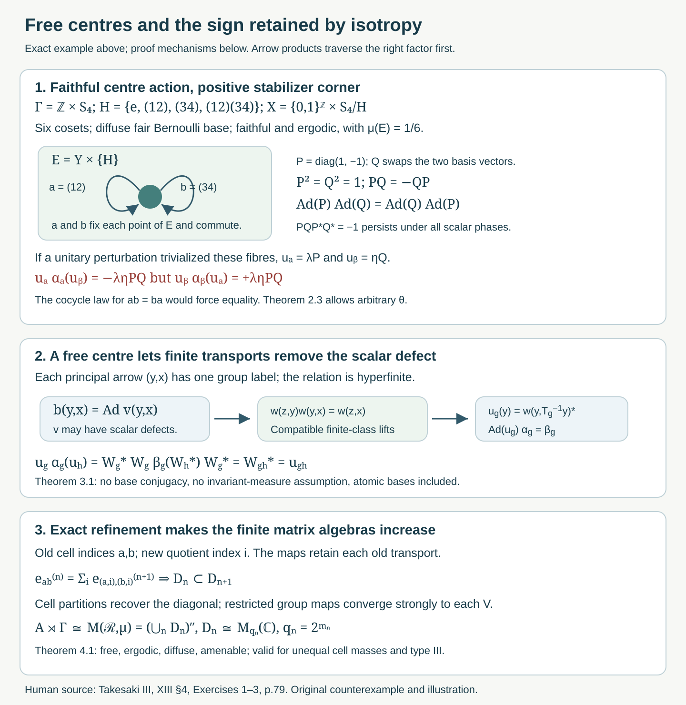
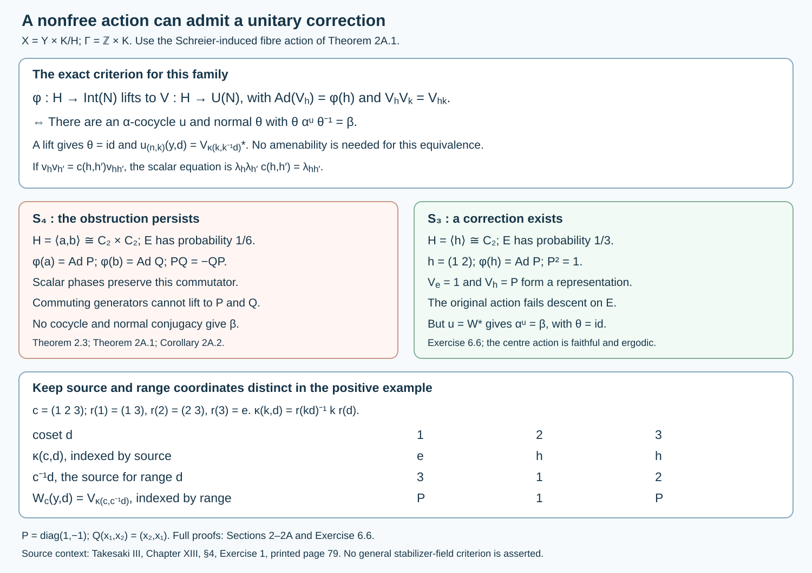
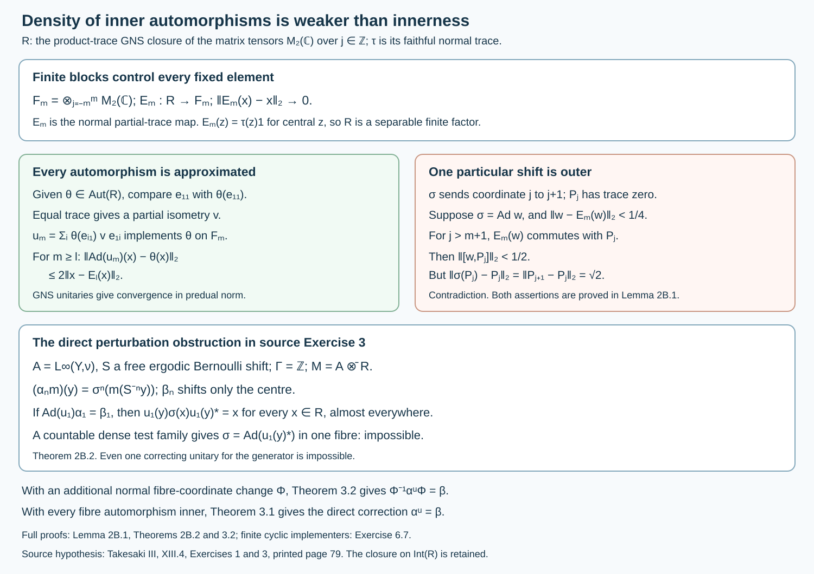

# Amenable actions, free centres, and isotropy obstructions

*Original course text, October 2026. Original expression and the native diagrams are public domain (CC0).*

## Introduction

Amenability gives finite approximations to the principal orbit relation. Freeness lets us use those approximations for an action on a field of factors: the two endpoints determine its group label. Faithfulness alone says that no group element acts trivially on the entire centre. A nonidentity element may still fix a positive part of the centre and act nontrivially inside its fibres.

The printed exercises of Takesaki III, Chapter XIII, §4 distinguish two hypotheses. Exercise 1 assumes a faithful ergodic centre action; Exercises 2 and 3 assume a free ergodic centre action. Exercises 1(b) and 3 require \(\overline{\operatorname{Int}(N)}=\operatorname{Aut}(N)\), meaning density of inner automorphisms, rather than equality of the two groups. The source exercise block assumes separability or countability throughout. Theorem 2.3 gives a faithful-centre counterexample to Exercise 1. Theorem 2B.2 disproves the direct unitary-perturbation conclusion of Exercise 3 in the prescribed tensor coordinates under its dense-inner hypothesis. Theorems 3.1 and 3.2 distinguish the all-inner direct correction from dense-inner cocycle conjugacy. Theorem 4.1 proves Exercise 2 at nonsingular scope.

The prerequisites are the complete countable-action localization in [Ancillary actions and unitary corrections](ancillary-actions-and-unitary-corrections.md#3-from-an-action-to-an-orbit-cocycle), its Borel inner-unitary section in Lemma 1.1, and the finite-stage lifting proof in [Compatible lifts and cohomology reduction](compatible-lifts-and-cohomology-reduction.md#3-removing-a-two-cocycle). [Invariant means on measured relations](invariant-means-on-measured-relations.md#6-increasing-finite-relations) proves the amenable principal relation theorem. The exact nonsingular array refinement and compatible matrix approximation are [Matching sets and nonsingular dyadic arrays](matching-sets-and-nonsingular-dyadic-arrays.md#5-exact-refinement-binary-coding-and-one-generator), Theorem 5.2 and Corollary 5.3. These results include their stated standard Borel and operator-theory prerequisites.

## Three routes through the exercises

The three source exercises use the same amenable orbit relation, but ask for different constructions. Read their proofs in the following order.

**First test the stabilizers.** Proposition 1.1 gives the precise condition for the fibre action to descend: every stabilizer arrow must act trivially on its fibre factor. Faithfulness of the centre action only rules out an element fixing the entire measure algebra. In the example of Section 2, \(a,b\) fix the positive corner \(E\), while their inner implementers satisfy \(PQ=-QP\). Compute both products in (2.10) before reading the conclusion of Theorem 2.3. That calculation also allows an arbitrary algebra conjugacy to move the centre. Exercise 5.1 therefore has a corrective solution: its principal relation exists and is amenable, but the printed faithful hypothesis does not give the asserted descent or cocycle conjugacy.

**Then remove the scalar defect over a free centre.** Countable localization gives \(D_g(y)\). Freeness makes the label of \((y,x)\) unique, so Proposition 1.1 turns these fields into \(b(y,x)\). The [Borel inner-unitary section](ancillary-actions-and-unitary-corrections.md#1-automorphisms-as-a-polish-group) chooses \(v(y,x)\), but these choices may have the scalar composition defect (3.2). The [compatible lifting theorem](compatible-lifts-and-cohomology-reduction.md#3-removing-a-two-cocycle) removes that defect by finite-class root transports which agree at every later stage. Its finite-stage proof assumes an exhaustion; it does not use the conclusion of the present exercise. The amenable-relation theorem supplies that exhaustion.

The coherent implementers \(w\) yield a \(\beta\)-cocycle \(W\). Equation (3.5) checks that \(u_g=W_g^*\) is an \(\alpha\)-cocycle and makes \(\operatorname{Ad}(u_g)\alpha_g=\beta_g\). The order of the adjoints matters; Exercise 6.5 gives an explicit failure of the other order. Under the all-inner hypothesis, this is the direct correction used in Exercises 5.1 and 5.3. With only density of inner automorphisms, Theorem 3.2 also changes the fibre coordinates; Theorem 2B.2 shows why that extra automorphism can be necessary. It uses neither nonatomicity nor ergodicity. Exercise 6.4 constructs the same coherent transports directly on a countable atomic orbit.

**Finally retain matrix transports and generate the diagonal.** Exercise 5.2 instead uses [exact nonsingular array refinement](matching-sets-and-nonsingular-dyadic-arrays.md#5-exact-refinement-binary-coding-and-one-generator). First the unitary \(J\) identifies the free crossed product with its principal relation algebra. Refine the arrays so that their transports retain the old maps and their cell partitions approximate a generating family of measurable sets. Equation (4.2) gives genuine increasing scalar matrix algebras, including their units and exact inclusions.

To check generation, follow both parts of Theorem 4.1: the measures \(\kappa_\xi\ll\mu\) turn cell errors into strong convergence of diagonal projections; the restricted operators \(V_gM_{\mathbf1_{B_{g,n}}}\) recover every group generator. A finite-class relation by itself gives a matrix field over a transversal. The refining, generating arrays provide the finite-dimensional algebras requested by the exercise. Their scalar matrix relations use orbit counting; the cell probabilities may be unequal and the action may be of type III.

These routes use the exact countable localization and Borel section stated in the ancillary lesson, compatible finite lifts, the principal amenability theorem and nonsingular array refinement. General canonical standard-form implementation is an explicit operator-theory prerequisite of localization. No exercise here proves that general theorem or the classification by flow of weights.

## 0. Scope and conventions

Write \(N\) for a factor with separable predual and
\[
M=A\overline\otimes N,\qquad A=L^\infty(X,\mu),
\tag{0.1}
\]
where \(X\) is standard and \(\mu\) is nonzero and sigma-finite. An equivalent probability changes none of these measured-algebra assertions. A normal action of a countable discrete group \(\Gamma\) has a nonsingular Borel centre action \(T\) on one invariant conull base. We use the conventions
\[
(\beta_gm)(y)=m(T_g^{-1}y),\qquad
\alpha^u_g=\operatorname{Ad}(u_g)\alpha_g,\qquad
u_{gh}=u_g\alpha_g(u_h).
\tag{0.2}
\]
Here \(\beta\) is the simple lifting of the centre action. The tensor factors may be interchanged by the spatial flip.

## 1. What descends to the principal relation

The countable localization prerequisite supplies Borel \(D_g(y)\in\operatorname{Aut}(N)\) on a common invariant conull base, with
\[
(\alpha_gm)(y)=D_g(y)\bigl(m(T_g^{-1}y)\bigr),\qquad
D_{gh}(y)=D_g(y)D_h(T_g^{-1}y).
\tag{1.1}
\]
This always defines an action of the transformation groupoid. Its arrow \((g,x)\) has source \(x\) and range \(T_gx\), and its fibre map is \(D_g(T_gx)\).

**Proposition 1.1 (the exact descent condition).** The localized action descends to a homomorphism on the principal orbit relation
\(\mathcal R=\{(T_gx,x):g\in\Gamma\}\) if and only if
\[
D_h(x)=\operatorname{id}_N
\quad\text{whenever }T_hx=x.
\tag{1.2}
\]
At measured scope this means the identity on one invariant conull base. A free centre action satisfies the condition.

*Proof.* A descended homomorphism must send \((x,x)\) to the identity. Every stabilizer arrow maps to \((x,x)\), giving (1.2). Conversely, if \(T_gx=T_kx=y\), then \(h=k^{-1}g\) fixes \(x\). The action law at this source gives
\[
D_g(y)=D_k(y)D_h(x)=D_k(y).
\]
Consequently \(b(y,x)=D_g(y)\) is independent of the label. Choose the first possible \(g\) in a fixed enumeration of \(\Gamma\); its graph domains are Borel, so \(b\) is Borel. For \(z=T_gy\) and \(y=T_hx\), (1.1) gives \(b(z,y)b(y,x)=b(z,x)\). This is the required homomorphism. Countability permits saturation of all exceptional null sets before this argument. \(\square\)

Faithfulness of the action on \(A\) means that the homomorphism \(\Gamma\to\operatorname{Aut}(A)\) is injective. It does not imply (1.2). Even ergodicity does not eliminate point stabilizers of a nonabelian group.

## 2. A faithful diffuse example with a persistent scalar obstruction

We construct the example from two \(2\)-by-\(2\) matrices:
\[
P=\begin{pmatrix}1&0\\0&-1\end{pmatrix},\qquad
Q=\begin{pmatrix}0&1\\1&0\end{pmatrix},\qquad
P^2=Q^2=1,\quad PQ=-QP.
\tag{2.1}
\]
Let \(K=S_4\), \(a=(1\,2)\), \(b=(3\,4)\), and
\[
H=\{e,a,b,ab\}\cong C_2\times C_2,\qquad D=K/H.
\tag{2.2}
\]
We use left cosets; \(D\) has six points. The assignment
\[
\varphi(a^ib^j)=\operatorname{Ad}(P^iQ^j),\qquad i,j\in\{0,1\},
\tag{2.3}
\]
is a homomorphism into \(\operatorname{Aut}(M_2(\mathbb C))\). Indeed,
\((P^iQ^j)(P^kQ^l)=(-1)^{jk}P^{i+k}Q^{j+l}\), with exponents reduced modulo two, and conjugation forgets the scalar.

**Lemma 2.1 (the base action).** Let \(Y=\{0,1\}^{\mathbb Z}\) with fair product probability \(\nu\), and let \(S\) be its bilateral shift. Give \(X=Y\times D\) probability \(\mu=\nu\times\mathrm{unif}_D\). The action of \(\Gamma=\mathbb Z\times K\) defined by
\[
T_{(n,k)}(y,d)=(S^ny,kd)
\tag{2.4}
\]
is measure preserving, faithful and ergodic on a diffuse standard probability space. Its stabilizer contains \(H\) on the positive set \(E=Y\times\{H\}\). The group \(\Gamma\) is amenable.

*Proof.* Coordinate shifts and finite permutations preserve the stated probability. Cylinder sets generate the product sigma-field, so the space is standard and countably generated. A measurable positive set contains a positive intersection with a cylinder on a finite coordinate set; splitting by additional independent coordinates gives subsets of arbitrarily small positive measure. More explicitly, partition by \(m\) unused fair coordinates: every resulting intersection has measure at most \(2^{-m}\), and at least one is positive. Thus there are no positive atoms, and \(L^\infty(X)\) is diffuse.

The shift is mixing. For cylinder events \(B,C\), the coordinates defining \(B\) and \(S^{-n}C\) are disjoint for sufficiently large \(|n|\), so their intersection probability is \(\nu(B)\nu(C)\). Approximation in symmetric-difference probability extends this limit to all events: the error in an intersection and in the product is bounded by the sum of the two approximation errors, uniformly in \(n\). If an event is shift invariant modulo null sets, this gives \(\nu(B)=\nu(B)^2\), proving shift ergodicity. Invariance under the transitive \(K\)-action first makes an invariant function on \(X\) independent of \(d\); shift ergodicity then makes it constant.

If \(n\ne0\), the events \(y_0=0\) and \(y_n=0\) differ with probability \(1/2\), so \(S^n\) is not the identity on the measure algebra. If \(n=0\), an element acting trivially on all six cosets belongs to the core \(\bigcap_{k\in K}kHk^{-1}\). This core is trivial. Every nonidentity member of \(H\) is either a transposition or a double transposition, whereas their full conjugacy classes in \(S_4\) have six and three members, and \(H\) contains only two and one of them, respectively. A normal subgroup inside \(H\) could contain none of these members. Thus (2.4) is faithful. Every \(h\in H\) fixes the coset \(H\), proving the stabilizer assertion.

Finally use the finite sets \(F_m=\{-m,\ldots,m\}\times K\) and their uniform probabilities. Translation by a fixed \((n,k)\) permutes the entire \(K\)-coordinate; the relative symmetric difference is at most \(2|n|/(2m+1)\). It tends to zero. A weak-star cluster of the corresponding means is translation invariant, positive and unital. This proves amenability directly. \(\square\)

Choose representatives \(r(d)\in K\), with \(r(H)=e\). Define the finite Schreier cocycle
\[
\kappa(k,d)=r(kd)^{-1}kr(d)\in H,\qquad
\kappa(kl,d)=\kappa(k,ld)\kappa(l,d).
\tag{2.5}
\]
Both identities follow from the coset equation and cancellation. Set \(N=M_2(\mathbb C)\) and define a normal action on \(M=L^\infty(X)\overline\otimes N\) by
\[
(\alpha_{(n,k)}m)(y,d)
=\varphi\!\left(\kappa(k,k^{-1}d)\right)
       \bigl(m(S^{-n}y,k^{-1}d)\bigr).
\tag{2.6}
\]
The fibre maps are finite-valued inner automorphisms. The formula and its inverse preserve bounded measurable fields, and the centre change is measure preserving. Equivalently, finite matrix conjugations and the unitary Koopman base change implement it; hence it is normal. Equations (2.3) and (2.5) prove the action law. Its centre action is (2.4). Every automorphism of \(M_2(\mathbb C)\) is inner: transport a system of matrix units by an automorphism, choose a unit vector in the range of its first minimal projection, and transport that vector with the other matrix units. The resulting orthonormal basis gives a unitary implementing the automorphism.

**Proposition 2.2 (failure of localization to the principal relation).** Action (2.6) satisfies every stated hypothesis of source Exercise 1, but its fibre action does not descend to the principal relation.

*Proof.* On \(E\), both \(a\) and \(b\) fix the base. Their fibre maps are \(\operatorname{Ad}P\) and \(\operatorname{Ad}Q\), since \(r(H)=e\). The first sends the matrix unit \(e_{12}\) to \(-e_{12}\), so it is not the identity. The identity label and the \(a\)-label have the same principal arrow and different fibre maps. Proposition 1.1 rules out descent. The principal relation itself is amenable by the amenable-action theorem; it is the asserted localization of \(\alpha\) that fails. \(\square\)

**Theorem 2.3 (failure even after cocycle conjugacy).** There is no unitary \(\alpha\)-cocycle \(u\), and no normal \(\theta\in\operatorname{Aut}(M)\), such that
\[
\theta\alpha^u_g\theta^{-1}=\beta_g
\quad(g\in\Gamma)
\tag{2.7}
\]
for action (2.6).

*Proof.* Let \(e=\mathbf1_E\), a nonzero central projection. The simple liftings \(\beta_a,\beta_b\) are the identity on \(eM\). Inner perturbation fixes the centre, so restricting (2.7) to \(A\) shows that \(\theta|_A\) commutes with every centre action \(\beta_g|_A\).

We first check that \(\beta_a,\beta_b\) are also the identity on \(\theta(e)M\). For \(f\in A\) and \(t=a,b\),
\[
\theta(e)\beta_t(f)
=\theta\!\left(e\,\beta_t(\theta^{-1}f)\right)
=\theta(e)f.
\tag{2.8}
\]
Thus \(T_t\) fixes almost every point of the support of \(\theta(e)\). To justify this last implication, test (2.8) on a countable Borel separating family on \(X\); equality of every membership forces \(T_t^{-1}x=x\) there outside one null set. A simple lifting acts trivially on all matrix fields over this fixed set. Equation (2.7) consequently makes \(\alpha^u_a,\alpha^u_b\) the identity on \(eM\).

Restricted to \(E\), (2.6) is \(\alpha_a=\operatorname{Ad}P\) and \(\alpha_b=\operatorname{Ad}Q\). Therefore \(u_aP\) and \(u_bQ\) are central unitary fields on \(E\). There are measurable scalar unitary functions \(\lambda,\eta\) there such that
\[
u_a=\lambda P,\qquad u_b=\eta Q.
\tag{2.9}
\]
This uses \(P^*=P,Q^*=Q\) and the scalar centre of each matrix factor. Since \(a,b\) fix \(E\), their action leaves the scalar functions unchanged on this corner. The two cocycle equations for \(ab=ba\) now give
\[
\begin{aligned}
u_a\alpha_a(u_b)&=(\lambda P)\,P(\eta Q)P
                 =-\lambda\eta PQ,\\
u_b\alpha_b(u_a)&=(\eta Q)\,Q(\lambda P)Q
                 =-\lambda\eta QP
                 =\lambda\eta PQ.
\end{aligned}
\tag{2.10}
\]
They must be equal as fields on a positive set, but their common scalar factor is nonzero and \(PQ\) is invertible. This is impossible. It proves (2.7) cannot hold, allowing arbitrary algebra conjugacy \(\theta\). \(\square\)

*Figure 1. The upper panel shows the exact corner \(E=Y\times\{H\}\), of probability \(1/6\), in the faithful action of Lemma 2.1. The commuting stabilizers \(a,b\) have inner implementers \(P,Q\) with \(PQ=-QP\). Conjugation hides the sign, while the two unitary cocycle products in (2.10) expose it. The lower panels show the free-centre repair in Theorem 3.1 and the exact matrix inclusion in Theorem 4.1. The coset action is transitive but not free; the drawn corner is one of six cosets, not the whole diffuse base. Proof locators: Propositions 1.1 and 2.2, Theorem 2.3, equations (3.1)–(3.4) and (4.2). Human source: Takesaki III, Chapter XIII, §4, Exercises 1–3; the counterexample and diagram are original course work.*

## 2A. A lifting criterion for the stabilizer action

The original fibre action may fail to descend even when a unitary perturbation can remove it. For the induced actions used in Section 2, the distinction has an exact description.

Let \(K\) be any countable group, let \(H\le K\), and give the countable set \(D=K/H\) a probability \(\omega\) with \(\omega(\{d\})>0\) for every \(d\). Keep the Bernoulli shift \((Y,\nu,S)\) of Lemma 2.1. On \(X=Y\times D\), with probability \(\nu\times\omega\), let \(\Gamma=\mathbb Z\times K\) act by (2.4). This action is nonsingular. Choose representatives \(r(d)\), with \(r(H)=e\), and define \(\kappa\) by (2.5).

Let \(N\) be a factor with separable predual and let
\[
 \varphi:H\longrightarrow\operatorname{Int}(N)
 \tag{2A.1}
\]
be a homomorphism. On \(M=L^\infty(X)\overline\otimes N\) define
\[
 \begin{aligned}
 (\alpha_{(n,k)}m)(y,d)
 &=\varphi\!\left(\kappa(k,k^{-1}d)\right)\\
 &\qquad\bigl(m(S^{-n}y,k^{-1}d)\bigr).
 \end{aligned}
 \tag{2A.2}
\]
The countably valued fibre automorphisms and the nonsingular base changes make these normal automorphisms. The cocycle identity for \(\kappa\) proves the action law. Write \(\beta\) for the simple lifting of this same centre action.

**Theorem 2A.1 (unitary lifting is the exact obstruction).** The following are equivalent:

1. There are a unitary \(\alpha\)-cocycle \(u\) and a normal \(\theta\in\operatorname{Aut}(M)\) such that \(\theta\alpha^u_g\theta^{-1}=\beta_g\) for all \(g\in\Gamma\).
2. The homomorphism \(\varphi\) has a genuine unitary lift: there is a homomorphism \(V:H\to\mathcal U(N)\) such that \(\operatorname{Ad}V_h=\varphi(h)\) for every \(h\in H\).

If these conditions hold, one can take \(\theta=\operatorname{id}\). Amenability of \(K\) is not needed for the equivalence.

*Proof of sufficiency.* Given \(V\), set, for \(g=(n,k)\),
\[
 W_g(y,d)=V_{\kappa(k,k^{-1}d)},\qquad
 u_g=W_g^*.
 \tag{2A.3}
\]
These are measurable unitary fields, since \(D\) and \(H\) are countable. The values are independent of \(y\). For \(g=(n,k)\) and \(g'=(m,l)\), the Schreier identity gives
\[
 \begin{aligned}
 W_g\beta_g(W_{g'})(y,d)
 &=V_{\kappa(k,k^{-1}d)}
   V_{\kappa(l,l^{-1}k^{-1}d)}\\
 &=V_{\kappa(kl,l^{-1}k^{-1}d)}
 =W_{gg'}(y,d).
 \end{aligned}
 \tag{2A.4}
\]
Moreover \(\alpha_g=\operatorname{Ad}(W_g)\beta_g\). Consequently
\[
 \begin{aligned}
 u_g\alpha_g(u_{g'})
 &=\beta_g(W_{g'}^*)W_g^*\\
 &=W_{gg'}^*=u_{gg'},
 \qquad \alpha^u_g=\beta_g.
 \end{aligned}
 \tag{2A.5}
\]
Thus the required cocycle works without a base conjugacy.

*Proof of necessity.* Suppose condition 1 holds, and put \(e=\mathbf1_{Y\times\{H\}}\). This central projection is nonzero because \(\omega(\{H\})>0\). Each \(h\in H\), regarded as \((0,h)\in\Gamma\), fixes this base corner; on it \(\alpha_h=\varphi(h)\) and \(\beta_h=\operatorname{id}\).

Inner perturbation fixes the centre. The assumed conjugacy therefore makes \(\theta|_{L^\infty(X)}\) commute with every centre transformation. For a central \(f\) and \(h\in H\),
\[
 \theta(e)\beta_h(f)
 =\theta\!\left(e\beta_h(\theta^{-1}f)\right)
 =\theta(e)f.
 \tag{2A.6}
\]
Test this identity on a countable separating Borel family on \(X\). It follows that \(h\) fixes almost every base point in the support of \(\theta(e)\). Hence the simple lifting \(\beta_h\) is the identity on \(\theta(e)M\). Conjugating back shows that \(\alpha^u_h\) is the identity on \(eM\).

Choose measurable unitary representatives of the countably many \(u_h\)'s. On \(Y\times\{H\}\), the preceding identity and the cocycle law give
\[
 \begin{aligned}
 \varphi(h)&=\operatorname{Ad}(u_h(y,H)^*),\\
 u_{hh'}(y,H)
 &=u_h(y,H)\varphi(h)(u_{h'}(y,H))\\
 &=u_{h'}(y,H)u_h(y,H).
 \end{aligned}
 \tag{2A.7}
\]
All these equalities hold on one conull subset of \(Y\). To obtain the automorphism equality simultaneously, test a countable ultraweakly dense subset of the unit ball of \(N\), then use normality. Countability of \(H\) handles all products and all tests on the same set. Choose any \(y_0\) in it and put \(V_h=u_h(y_0,H)^*\). Taking adjoints in (2A.7) gives \(V_{hh'}=V_hV_{h'}\), and the first line gives \(\operatorname{Ad}V_h=\varphi(h)\). These are actual unitaries in \(N\). The point is chosen only after selecting representatives and removing their common exceptional set; no evaluation of an arbitrary measurable class at a prescribed point is used. This proves condition 2. \(\square\)

**Corollary 2A.2 (the scalar multiplication defect).** Choose unitaries \(v_h\) implementing \(\varphi(h)\), with \(v_e=1\), and put
\[
 c(h,h')=v_hv_{h'}v_{hh'}^*\in\mathbb T1_N.
 \tag{2A.8}
\]
The conditions of Theorem 2A.1 hold if and only if there are scalars \(\lambda_h\in\mathbb T\), with \(\lambda_e=1\), such that
\[
 \lambda_h\lambda_{h'}c(h,h')=\lambda_{hh'}1_N.
 \tag{2A.9}
\]

*Proof.* The defect is scalar because its inner automorphism is the identity. Two unitaries implementing the same automorphism of a factor differ by a scalar. Thus any lift must be \(V_h=\lambda_hv_h\). Its homomorphism identity is precisely (2A.9), and that identity also makes this formula a lift. \(\square\)

For the subgroup \(C_2\times C_2\) in Section 2, the anticommuting matrices \(P,Q\) cannot be the values of a representation of the commuting generators, even after scalar changes. The criterion recovers the obstruction of Theorem 2.3. For a cyclic group of order two, the assignment of its generator to \(P\) is already a genuine representation. Exercise 6.6 gives a faithful nonfree centre action of that kind. Its original fibre action fails descent, but its unitary perturbation is the simple lifting. Thus original descent and cocycle untwisting are different conditions.

*Figure 2. The equivalence is Theorem 2A.1, including arbitrary normal algebra conjugacy in the necessity direction. Corollary 2A.2 gives the scalar equation. The two examples use the same matrices \(P,Q\) as (2.1); the displayed positive example is Exercise 6.6, with the stated coset representatives and source/range convention. The criterion concerns these induced actions, not all fields of stabilizers. Source context: Takesaki III, XIII.4, Exercise 1, printed page 79.* [Full-size diagram](figures/stabilizer-unitary-lift.svg).

## 2B. Dense inner automorphisms do not give a direct unitary correction

The closure of \(\operatorname{Int}(N)\) in the printed hypotheses of source Exercises 1 and 3 is significant. The topology is pointwise norm convergence on the predual, as in Lemma 1.1 of the ancillary lesson. We construct a factor satisfying that density hypothesis and a free ergodic centre action whose fibre motion cannot be removed by a unitary perturbation in the prescribed tensor decomposition.

**Lemma 2B.1 (a dense-inner factor with an outer shift).** Let \(\mathcal A\) be the unital algebraic union of the finite matrix tensor products on the integer coordinates, each supplied with normalized matrix trace. In its product-trace GNS representation put
\[
 \begin{aligned}
 R&=\left(\bigotimes_{j\in\mathbb Z}
       (M_2(\mathbb C),\operatorname{tr}_2)\right)'',\\
 F_m&=\bigotimes_{j=-m}^{m}M_2(\mathbb C)
       \subset R,\qquad m\ge0.
 \end{aligned}
 \tag{2B.1}
\]
Here the first line denotes the von Neumann closure in that GNS representation. Then \(R\) is an infinite-dimensional finite factor with separable predual and faithful normal tracial state \(\tau\). Every normal automorphism of \(R\) is a limit of inner automorphisms in the stated predual topology. Nevertheless the coordinate shift
\[
 \sigma(x^{(j)})=x^{(j+1)}
 \quad(x\in M_2(\mathbb C))
 \tag{2B.2}
\]
is a normal outer automorphism of \(R\).

*Proof: trace, approximation and factoriality.* The algebraic product trace is positive and faithful on each finite matrix algebra, and is compatible with the unital inclusions. It therefore defines the GNS Hilbert space and its cyclic vector \(\Omega\). Right multiplication gives a commuting representation of the same algebra, also cyclic on \(\Omega\). Thus \(\Omega\) is separating for \(R\): if \(a\Omega=0\), commutation makes \(a\) vanish on the dense right-multiplication vectors. The vector state \(\tau\) is normal and faithful. The finite-level trace identity passes to \(R\) by bounded strong-star approximation, so \(\tau\) is tracial. Finite Pauli tensors span a countable dense family of vectors; the GNS space and the predual of \(R\) are separable.

Partial trace on the complementary coordinates gives maps \(E_m:\mathcal A\to F_m\). They are positive, unital, norm contractive, trace preserving and \(F_m\)-bimodular. They extend normally to \(R\). For an explicit extension, choose matrix units \((e_{ij})\) in \(F_m=M_d(\mathbb C)\), where \(d=2^{2m+1}\), and use
\[
 E_m(x)=d\sum_{i,j=1}^{d}\tau(e_{ji}x)e_{ij}.
 \tag{2B.3}
\]
This formula is normal and agrees with partial trace on \(\mathcal A\). Bounded strong approximation from the latter preserves positivity, its norm bound and its bimodule identities. On the GNS Hilbert space, \(E_m(x)\Omega\) is the orthogonal projection of \(x\Omega\) onto \(F_m\Omega\). These subspaces increase to a dense union. Hence
\[
 \|E_m(x)-x\|_2\longrightarrow0,
 \qquad \|x\|_2=\tau(x^*x)^{1/2}.
 \tag{2B.4}
\]
If \(z\in Z(R)\), bimodularity makes \(E_m(z)\) central in \(F_m\), and trace preservation gives \(E_m(z)=\tau(z)1\). Equation (2B.4) and faithfulness show \(z=\tau(z)1\). Thus \(R\) is a factor. Its faithful finite trace makes it finite. The unbounded sizes of its unital matrix subalgebras make it infinite dimensional.

*Proof: every automorphism is approximated by inner ones.* First \(\tau\) is the only normal tracial state on \(R\). A normal tracial state restricts to the unique normalized trace on every \(F_m\), and the union of these algebras is ultraweakly dense. Consequently every normal automorphism \(\theta\) preserves \(\tau\).

We use the finite-factor projection comparison argument explicitly. If projections \(p,q\) in a finite factor have equal trace, a maximal orthogonal family of partial isometries from subprojections of \(p\) to subprojections of \(q\) has a strong sum \(v\). Nonzero residual projections on both sides would give a nonzero element between those corners, whose polar part would extend the family. The corner is nonzero because the central support of any nonzero projection in a factor is one. If just one residual projection remained, equal finite traces and faithfulness would rule it out. Thus \(v^*v=p\) and \(vv^*=q\). Zorn's lemma supplies the maximal family; the sums exist since their initial projections and final projections are separately orthogonal.

For fixed \(m\), take matrix units \((e_{ij})\) of \(F_m\) and put \(f_{ij}=\theta(e_{ij})\). The projections \(e_{11},f_{11}\) both have trace \(1/d\). Choose \(v\) with \(v^*v=e_{11}\), \(vv^*=f_{11}\), and set
\[
 u_m=\sum_{i=1}^{d}f_{i1}v e_{1i}.
 \tag{2B.5}
\]
The matrix-unit identities give \(u_m^*u_m=u_mu_m^*=1\) and \(u_me_{ij}u_m^*=f_{ij}\). Thus \(\operatorname{Ad}u_m=\theta\) on the whole \(F_m\). For fixed \(x\in R\), fixed \(l\) and \(m\ge l\), trace preservation yields
\[
 \|u_mxu_m^*-\theta(x)\|_2
 \le2\|x-E_l(x)\|_2.
 \tag{2B.6}
\]
First choose \(l\) using (2B.4); then let \(m\) increase. This proves pointwise \(L^2\) convergence. The inverse automorphisms converge pointwise in \(L^2\) too, by applying the same identity to \(\theta^{-1}(x)\).

For clarity, this is convergence in the required predual topology. The trace-preserving GNS unitaries \(U_m[x]=[u_mxu_m^*]\) converge strongly to \(U_\theta[x]=[\theta(x)]\), first on the dense algebra vectors and then everywhere. Their adjoints converge strongly as well, by the inverse calculation. Conjugation of a vector functional therefore converges in norm: its two vectors are acted on by \(U_m^*\), and both converge in Hilbert norm. Finite sums of restricted vector functionals are norm dense in the normal predual, since that predual is the quotient of the trace-class operators in this representation. Approximation by those finite sums proves \(\|\rho\circ\operatorname{Ad}u_m-\rho\circ\theta\|\to0\) for every \(\rho\in R_*\). This proves density for every automorphism, not only for the shift below.

*Proof: the shift is outer.* Coordinate translation preserves the algebraic product trace, so its action on algebra vectors extends to a unitary fixing \(\Omega\). This implements a normal automorphism \(\sigma\) of \(R\). Let \(P_j\) denote the matrix \(P\) of (2.1) in coordinate \(j\). If \(\sigma=\operatorname{Ad}w\) for \(w\in\mathcal U(R)\), choose \(m\) so that \(a=E_m(w)\) satisfies \(\|w-a\|_2<1/4\). For \(j>m+1\), \(a\) commutes with \(P_j\), and hence
\[
 \begin{aligned}
 \|\sigma(P_j)-P_j\|_2
 &=\|[w,P_j]\|_2\\
 &\le2\|w-a\|_2<\tfrac12.
 \end{aligned}
 \tag{2B.7}
\]
But distinct tensor coordinates have product trace, with \(\tau(P_j)=0\) and \(P_j^2=1\). Therefore
\[
 \|P_{j+1}-P_j\|_2^2=2.
 \tag{2B.8}
\]
This contradicts (2B.2) and (2B.7). The shift is outer, completing all assertions. \(\square\)

**Theorem 2B.2 (the direct perturbation conclusion under density is false).** There is a normal action of the countable amenable group \(\mathbb Z\) on \(M=A\overline\otimes R\) such that \(A\) is diffuse and separable, the centre action is free and ergodic, and
\[
 \overline{\operatorname{Int}(R)}=\operatorname{Aut}(R),
 \tag{2B.9}
\]
but no unitary \(\alpha\)-cocycle \(u\) satisfies \(\alpha^u=\beta\) in this prescribed tensor decomposition.

*Proof.* Use the Bernoulli probability base \(Y\) from Lemma 2.1, with \(A=L^\infty(Y,\nu)\), and set
\[
 (\alpha_n m)(y)=\sigma^n(m(S^{-n}y)),
 \qquad n\in\mathbb Z.
 \tag{2B.10}
\]
The fibre automorphisms are constant and normal, and the base shifts are normal, so this is a normal action. Its centre action is the Bernoulli shift, which is ergodic and diffuse by the cylinder arguments of Lemma 2.1. It is free on an invariant conull set. Indeed, for any nonzero \(n\), being fixed by \(S^n\) forces arbitrarily many independent fair coordinates in one residue class to agree. The probability is bounded by \(2^{1-k}\) when \(k\) of these coordinates are prescribed to agree, and therefore is zero. Remove the countable union of the periodic-point sets. The group \(\mathbb Z\) is amenable by its interval Følner sets, and Lemma 2B.1 gives separability and (2B.9).

If a unitary correction existed, its generator would satisfy, for every constant \(x\in R\),
\[
 u_1(y)\sigma(x)u_1(y)^*=x
 \quad\text{almost everywhere}.
 \tag{2B.11}
\]
Choose a measurable unitary representative of \(u_1\). A countable ultraweakly dense subset of the unit ball of \(R\) makes the equalities hold on one conull set; normality extends them to all \(x\) at every point in that set. At any such point, (2B.11) makes \(\sigma\) an inner automorphism of \(R\), contrary to Lemma 2B.1. Even a single correcting unitary for the generator is impossible, so a correcting unitary cocycle is impossible. \(\square\)

This addresses the literal direct-perturbation conclusion of source Exercise 3 in the fixed tensor decomposition. With a normal change of fibre coordinates as well, the dense-inner hypothesis gives the cocycle-conjugacy result of Theorem 3.2 below. The all-inner hypothesis in Theorem 3.1 gives the stronger direct correction. These two conclusions retain different hypotheses.

*Figure 3. Lemma 2B.1 constructs the finite factor and proves both global density of its inner automorphisms and outerness of the shift. The distant-coordinate estimate separates pointwise approximation from one exact internal implementer. Theorem 2B.2 combines this shift with a free ergodic Bernoulli centre action; a direct correction would implement the outer shift internally at almost every fibre. Source scope: Takesaki III, XIII.4, Exercises 1 and 3, printed page 79, with the closure on the inner automorphism group retained.* [Full-size diagram](figures/dense-inner-outer-shift.svg).

## 3. Removing every inner fibre action over a free centre

**Theorem 3.1 (a correction with no base conjugacy).** Suppose \(T\) is free on a conull base and its principal relation is hyperfinite. If \(\operatorname{Aut}(N)=\operatorname{Int}(N)\), there is a unitary \(\alpha\)-cocycle \(u\) with
\[
\alpha^u_g=\beta_g\quad(g\in\Gamma).
\tag{3.1}
\]
Neither ergodicity nor diffuseness is needed. In particular the assertion applies to every free centre action of a countable amenable group.

*Proof.* Proposition 1.1 gives the Borel homomorphism \(b(y,x)=D_g(y)\) when \(y=T_gx\). Every value is inner. The normalized Borel section in the ancillary lesson gives \(v(y,x)\in\mathcal U(N)\) with \(\operatorname{Ad}v(y,x)=b(y,x)\) and \(v(x,x)=1\). The composition defect
\[
v(z,y)v(y,x)v(z,x)^*\in\mathbb T1
\tag{3.2}
\]
is scalar, because its inner automorphism is the identity. It is Borel, as can be checked by applying a fixed normal state to this scalar field.

Apply the compatible two-cocycle removal theorem to the Polish group \(\mathcal U(N)\) and its closed central subgroup \(\mathbb T1\). The theorem's finite-class root transports and compatible extensions give a Borel homomorphism \(w:\mathcal R\to\mathcal U(N)\) differing from \(v\) only by scalar factors. Thus
\[
\operatorname{Ad}w=b,\qquad
w(z,y)w(y,x)=w(z,x),\qquad w(x,x)=1.
\tag{3.3}
\]
All constructions take place on a common invariant conull reduction and hence define elements of the original measured algebra. Put
\[
W_g(y)=w(y,T_g^{-1}y),\qquad u_g(y)=W_g(y)^*.
\tag{3.4}
\]
These are bounded Borel unitary fields, so belong to \(M\). From (3.3),
\(W_{gh}=W_g\beta_g(W_h)\), and from their implementing automorphisms,
\(\alpha_g=\operatorname{Ad}(W_g)\beta_g\). In particular
\[
u_g\alpha_g(u_h)
=W_g^*\,W_g\beta_g(W_h^*)W_g^*
=\beta_g(W_h^*)W_g^*
=W_{gh}^*=u_{gh}.
\tag{3.5}
\]
They form an \(\alpha\)-cocycle, and \(\operatorname{Ad}(u_g)\alpha_g=\beta_g\), proving (3.1). Amenability supplies hyperfiniteness by the relation lesson, without requiring invariant measure. \(\square\)

Merely selecting \(v\) does not justify (3.5); its scalar defects may persist. Over the hyperfinite principal relation the compatible lifts remove them. In the nonfree example, the commuting loops at one unit cannot be replaced by transports between distinct units.

**Theorem 3.2 (the dense-inner cocycle-conjugacy conclusion).** Keep the free-centre and hyperfinite hypotheses of Theorem 3.1, but suppose only
\[
 \overline{\operatorname{Int}(N)}=\operatorname{Aut}(N).
\]
There are a normal automorphism \(\Phi\) fixing \(A\) pointwise and a unitary \(\alpha\)-cocycle \(u\) such that
\[
 \Phi^{-1}\alpha^u_g\Phi=\beta_g
 \quad(g\in\Gamma).
 \tag{3.6}
\]
Theorem 2B.2 shows why the same hypotheses do not imply \(\alpha^u=\beta\) in the original fibre coordinates.

*Proof.* The complete ancillary-action theorem, [Theorem 4.1 of Ancillary actions and unitary corrections](ancillary-actions-and-unitary-corrections.md#4-two-corrections-that-compose-exactly), supplies \(\Phi\) and a \(\beta\)-cocycle \(v\) such that
\[
 \Phi^{-1}\alpha_g\Phi=\operatorname{Ad}(v_g)\beta_g.
\]
Put \(u_g=\Phi(v_g^*)\). The same ordered multiplication as (3.5) gives
\[
 \begin{aligned}
 u_g\alpha_g(u_h)
 &=\Phi\!\left(v_g^*
       (\Phi^{-1}\alpha_g\Phi)(v_h^*)\right)\\
 &=\Phi\!\left(\beta_g(v_h^*)v_g^*\right)
 =\Phi(v_{gh}^*)=u_{gh}.
 \end{aligned}
\]
Thus \(u\) is an \(\alpha\)-cocycle. Conjugating \(\operatorname{Ad}(u_g)\alpha_g\) by \(\Phi^{-1}\) cancels \(v_g\), proving (3.6). The ancillary theorem's automorphism \(\Phi\) fixes the centre and has its explicitly stated standard-form and cohomology prerequisites. \(\square\)

## 4. Compatible finite-dimensional algebras in a crossed product

**Theorem 4.1 (source Exercise 2).** Let a countable discrete amenable group \(\Gamma\) act freely and ergodically on a diffuse separable abelian von Neumann algebra \(A\). Then there are increasing unital finite-dimensional star subalgebras \(\mathcal D_n\) of \(A\rtimes\Gamma\), with
\[
A\rtimes\Gamma=\left(\bigcup_n\mathcal D_n\right)''.
\tag{4.1}
\]
The centre action may be nonsingular and of type III.

*Proof.* Realize \(A=L^\infty(X,\mu)\) on a standard nonatomic probability base. Diffuseness gives nonatomicity; the centre action is nonsingular because its automorphisms preserve the measure class. Take a common invariant conull set of freeness.

First identify the crossed product with its principal relation algebra. In the faithful regular representation from the free-action lesson, its Hilbert space is \(\ell^2(\Gamma)\otimes L^2(X,\mu)\). Define
\[
(J\xi)(T_gx,x)=\xi(g,x).
\]
For each \(x\), freeness makes \(g\mapsto T_gx\) a bijection onto its orbit, so \(J\) preserves the norm exactly for source counting measure and is onto. It is measurable with measurable inverse by the first-label Borel rule. A coefficient generator \(\pi(f)\) becomes multiplication by \(f(y)\). The regular group unitary \(\lambda_h\xi(g,x)=\xi(h^{-1}g,x)\) becomes \(V_h\), moving the first relation coordinate \(y\) to \(T_hy\). Thus \(J\) conjugates all generators to those of \(\mathcal M(\mathcal R,\mu)\). No density is needed: the source coordinate \(x\) stays fixed.

The amenable-action theorem makes \(\mathcal R\) hyperfinite. It is ergodic and nonatomic. The exact nonsingular refinement theorem supplies refining arrays of orders \(q_n=2^{m_n}\), whose relations exhaust \(\mathcal R\) and whose cell partitions approximate a countable generating family of measurable sets. Let \(e^{(n)}_{ab}\) be the operators of the array transports. They obey
\[
e^{(n)}_{ab}e^{(n)}_{cd}
=\mathbf1_{\{b=c\}}e^{(n)}_{ad},\qquad
(e^{(n)}_{ab})^*=e^{(n)}_{ba},\qquad
e^{(n)}_{ab}
=\sum_i e^{(n+1)}_{(a,i),(b,i)}.
\tag{4.2}
\]
The last identity is exact, since the new transports retain the old transports on each quotient cell. Their spans are unital copies of \(M_{q_n}(\mathbb C)\) and increase.

For completeness, let \(\mathcal Q\) be their generated von Neumann algebra. Cell-union projections approximate every set in the generating family in \(\mu\)-measure. For a relation vector \(\xi\), the finite measure
\[
\kappa_\xi(B)=\int_X\sum_{y\sim x}\mathbf1_B(y)|\xi(y,x)|^2\,d\mu(x)
\]
is absolutely continuous with respect to \(\mu\), because null sets have null saturation. Hence these projections converge strongly. The monotone class theorem puts the entire diagonal in \(\mathcal Q\).

For any presenting group element \(g\), the sets
\(B_{g,n}=\{x:(T_gx,x)\text{ lies in the }n\text{th array relation}\}\)
increase to \(X\) modulo null sets. On each source/target cell pair, \(T_g|_{B_{g,n}}\) is the array transport restricted by a diagonal projection, and its operator belongs to \(\mathcal Q\). The finite sum over cell pairs is \(V_gM_{\mathbf1_{B_{g,n}}}\), which converges strongly to \(V_g\). Therefore \(\mathcal Q\) contains every generator of the relation algebra. Pull its finite matrix algebras back through \(J\) to prove (4.1). The argument uses quasi-invariance and compatible arrays throughout; no trace or equal cell masses have been assumed. \(\square\)

A finite-class relation alone yields a measurable matrix field over its transversal. It can be infinite dimensional. The exact inclusions and generating partitions in (4.2) supply the required compatible finite-dimensional algebras.

## 5. Source exercises with complete solutions

Level 1 asks for a computation or a direct application. Level 2 asks for a proof using the lesson’s framework. Level 3 combines results or examines a hypothesis whose failure changes the conclusion.

**Exercise 5.1 (source §4, Exercise 1: the faithful hypothesis).** *Level 3.* For a diffuse separable \(A\), factor \(N\), countable amenable \(\Gamma\), and a faithful ergodic centre action on \(A\overline\otimes N\), assess the claimed principal-relation localization and, under the printed dense-inner hypothesis, cocycle conjugacy to the simple lifting. State and prove a sufficient correction.

*Solution.* Lemma 2.1 supplies a faithful ergodic action on diffuse \(A\), with \(\Gamma=\mathbb Z\times S_4\) amenable, and (2.6) supplies a normal action on its tensor product with \(M_2(\mathbb C)\). This factor has only inner automorphisms. Proposition 2.2 nevertheless refutes the localization assertion, since on the positive corner \(E\) the identity principal arrow would have to act both trivially and by \(\operatorname{Ad}P\). Theorem 2.3 refutes the asserted cocycle conjugacy even with arbitrary \(\theta\). Its proof allows \(\theta\) to move the centre and uses the commutation of its centre restriction to transfer the fixed corner before computing (2.10).

For the stronger all-inner hypothesis \(\operatorname{Aut}(N)=\operatorname{Int}(N)\), the following direct correction holds.

Replacing faithful by free makes localization well-defined by Proposition 1.1. Amenability gives the hyperfinite principal relation; Theorem 3.1 gives an \(\alpha\)-cocycle with \(\alpha^u=\beta\). Thus the corrected version of both parts holds, with \(\theta=\operatorname{id}\) in the all-inner case. The initial existence and amenability of the principal relation in part (a) remain valid without freeness. The freeness qualification in part (b) is an editorial conclusion of the descent argument above.

Under the printed dense-inner hypothesis, a free centre gives cocycle conjugacy with the additional normal automorphism of Theorem 3.2. Theorem 2.3 still refutes the original faithful-centre assertion, because its matrix factor satisfies even the stronger all-inner hypothesis.

**Exercise 5.2 (source §4, Exercise 2: finite matrix approximation).** *Level 2.* Obtain increasing finite-dimensional star subalgebras generating the crossed product of a free ergodic amenable action on a diffuse separable abelian algebra.

*Solution.* Apply Theorem 4.1. Its unitary \(J\) identifies the regular crossed product with the principal relation algebra, using freeness to make every orbit coordinate unique. The amenability theorem supplies hyperfiniteness; exact refining arrays provide matrix units with inclusion (4.2). Their generating partitions recover all diagonal projections, and the restricted group maps converge strongly to every group generator. Pulling these matrix units back by \(J\) gives the requested subalgebras. This verifies the double-commutant equality, compatibility and finite dimensionality at nonsingular scope, including type III.

**Exercise 5.3 (source §4, Exercise 3: direct unitary perturbation).** *Level 2.* Let \(N\) be a separable factor with \(\overline{\operatorname{Int}(N)}=\operatorname{Aut}(N)\), let \(C\) be a separable abelian algebra, and let a countable discrete amenable group act on \(N\overline\otimes C\), freely and ergodically on \(C\). Assess this direct conclusion in the prescribed tensor decomposition, and state a valid conclusion with its exact hypotheses.

*Solution.* **Literal dense-inner conclusion.** The factor and action in Theorem 2B.2 satisfy the printed separability, density, amenability, freeness and ergodicity hypotheses. A unitary perturbation to the simple lifting would already make its outer tensor shift inner at each fibre for the generator. Thus the direct conclusion in these prescribed tensor coordinates is false. The spatial tensor flip puts that counterexample in the source order \(N\overline\otimes C\) as well.

**All-inner sufficient case.** Use the spatial tensor flip to write the algebra as \(C\overline\otimes N\), and realize \(C\) on a standard sigma-finite base. No diffuseness is assumed here. The free centre action gives the principal-relation homomorphism \(b\); amenability gives its hyperfinite exhaustion. Theorem 3.1 selects implementing unitaries, removes their scalar composition defect by compatible finite transports, and defines \(u_g=W_g^*\). Equation (3.5) checks the \(\alpha\)-cocycle identity and (3.1) gives the desired perturbed action. Flip back to the original tensor order. Ergodicity is harmless and was not needed for this proof; atomic bases are included.

**Dense-inner cocycle conjugacy.** Theorem 3.2 gives a normal \(\Phi\) fixing the centre and an \(\alpha\)-cocycle \(u\) such that \(\Phi^{-1}\alpha^u_g\Phi=\beta_g\). It applies at the printed dense-inner scope, including atomic bases where permitted. Omitting \(\Phi\) requires additional information; Theorem 3.1 supplies a direct correction when every fibre automorphism is inner.

## 6. Further exercises with solutions

**Exercise 6.1 (the hidden sign).** *Level 1.* Compute the commutators of \(P,Q\) in the unitary group and of their inner automorphisms. Can multiplying \(P,Q\) by scalar phases make them commute?

*Solution.* Since \(P^*=P,Q^*=Q\), their unitary commutator is \(PQPQ=-1\). Its inner automorphism is the identity, so \(\operatorname{Ad}P\) and \(\operatorname{Ad}Q\) commute. For scalar phases \(\lambda,\eta\), the commutator remains \((\lambda P)(\eta Q)(\lambda P)^*(\eta Q)^*=-1\), since the scalars cancel. No phases remove the sign.

**Exercise 6.2 (one free orbit).** *Level 2.* On a finite free orbit with a chosen root \(o\), a fibre homomorphism \(b\) has arbitrary inner implementers \(v_x\) for \(b(x,o)\), with \(v_o=1\). Construct a coherent lift and the correcting \(\alpha\)-cocycle.

*Solution.* Set \(w(y,x)=v_yv_x^*\). Products telescope, \(w(x,x)=1\), and \(\operatorname{Ad}w(y,x)=b(y,o)b(x,o)^{-1}=b(y,x)\). Define \(W_g(y)=v_yv_{T_g^{-1}y}^*\) and \(u_g(y)=v_{T_g^{-1}y}v_y^*\). Their formulas are exactly (3.4); the calculation in (3.5) proves the \(\alpha\)-cocycle identity. They make every perturbed fibre map trivial. A finite free orbit has no nontrivial stabilizer loop on which the calculation of (2.10) could arise.

**Exercise 6.3 (abelian faithfulness).** *Level 3.* Show that for a countable abelian group acting ergodically and nonsingularly, a faithful action on the measure algebra is free almost everywhere. Explain why this does not invalidate the counterexample.

*Solution.* For each \(g\), its fixed-point set is invariant under the entire abelian action, because \(T_gT_h=T_hT_g\). Ergodicity makes its measure zero or conull. In the conull case \(g\) is the identity on the measure algebra; faithfulness then makes \(g=e\). Every \(g\ne e\) has null fixed set, and the countable union of these sets is null. Outside it the stabilizer is trivial. The example's finite factor is the nonabelian group \(S_4\); its stabilizer fixed sets need not be invariant under all elements. Its faithful action therefore has no such conclusion.

**Exercise 6.4 (an atomic case of Exercise 3).** *Level 2.* Suppose the centre base has an atom and its nonsingular countable action is free and ergodic. Describe its conull orbit and give coherent implementers without using a nonatomic array theorem.

*Solution.* In a standard probability base, an atom is a point modulo null sets. Its countable orbit is Borel, invariant, positive and hence conull. Nonsingularity makes every point on the orbit have positive mass. Freeness identifies this orbit bijectively with \(\Gamma\). Its principal relation is the full relation on that countable orbit. Choose one root \(o\) and a unitary \(v_x\) implementing \(b(x,o)\) at each point, with \(v_o=1\). On a countable set every such field is measurable. Then \(w(y,x)=v_yv_x^*\) is coherent, and Exercise 6.2's formulas give the required cocycle on the entire orbit. Arbitrary unequal positive masses cause no change. This separately verifies the atomic scope rather than inferring diffuseness from the word separable.

**Exercise 6.5 (the adjoint belongs to the other cocycle).** *Level 2.* If \(W_{gh}=W_g\beta_g(W_h)\) and \(\alpha_g=\operatorname{Ad}(W_g)\beta_g\), check that \(W^*\) is an \(\alpha\)-cocycle. Is \(W^*\) necessarily a \(\beta\)-cocycle?

*Solution.* Taking adjoints gives \(W_{gh}^*=\beta_g(W_h^*)W_g^*\). The first expression in (3.5) is exactly this product, so \(W^*\) is an \(\alpha\)-cocycle. A \(\beta\)-cocycle would instead require \(W_g^*\beta_g(W_h^*)\). These factors need not commute. For an explicit failure, take the trivial base action of the free group on two generators and its unitary representation sending the generators to \(P\) and \(Q\); this \(W\) is a \(\beta\)-cocycle. For the product of the two generators, the required \(\beta\)-cocycle formula for \(W^*\) is \(PQ\), while the actual adjoint is \(QP=-PQ\). This example checks the algebraic orientation; it is not an amenable free-centre example.

**Exercise 6.6 (faithful and nonfree with a unitary correction).** *Level 3.* Let \(K=S_3\), let \(h=(1\,2)\) and \(H=\{e,h\}\). Identify \(K/H\) with \(\{1,2,3\}\) by \(kH\mapsto k(3)\), and take
\[
 r(1)=(1\,3),\qquad r(2)=(2\,3),\qquad r(3)=e.
\]
Use uniform coset probability and the Bernoulli shift of Lemma 2.1. Put \(N=M_2(\mathbb C)\) and \(\varphi(h)=\operatorname{Ad}P\), with \(P\) from (2.1). Prove that the centre action of \(\mathbb Z\times S_3\) is faithful, ergodic and nonfree. Does the original fibre action descend? Produce its correcting cocycle. For \(c=(1\,2\,3)\), compute \(\kappa(c,d)\) and the range-coordinate values \(W_{(0,c)}(y,d)\), in the order \(d=1,2,3\). Permutations act on the left and products compose from right to left.

*Solution.* A nonzero shift power acts nontrivially on the Bernoulli measure algebra. An element of \(S_3\) acting trivially on all three cosets lies in the core of \(H\). This core is trivial: the conjugacy class of \(h\) has three transpositions, while \(H\) contains just one. Hence the full centre action is faithful. Transitivity on the three cosets and shift ergodicity prove ergodicity, as in Lemma 2.1. The base is diffuse for the same unused-coordinate partition argument. But \(h\) fixes \(E=Y\times\{3\}\), of probability \(1/3\), so the action is not free.

On this corner the fibre automorphism is \(\operatorname{Ad}P\ne\operatorname{id}\). Proposition 1.1 therefore excludes descent of the original action. Nevertheless \(V_e=1\), \(V_h=P\) is a representation of \(H\), since \(P^2=1\). Theorem 2A.1 supplies the correcting cocycle
\[
 u_{(n,k)}(y,d)=V_{\kappa(k,k^{-1}d)}^*.
\]
It satisfies \(\alpha^u=\beta\) with \(\theta=\operatorname{id}\). Thus freeness is sufficient for the general theorem in Section 3, but is not necessary for this particular action to be untwisted.

The given representatives yield
\[
 \begin{array}{c|ccc}
 d&1&2&3\\\hline
 \kappa(c,d)&e&h&h\\
 W_{(0,c)}(y,d)&P&1&P
 \end{array}
\]
The second row is indexed by the source coset. For the last row substitute \(c^{-1}d\), whose values are \(3,1,2\), as required in (2A.3). In particular, the two rows cannot be identified entry by entry. Equation (2A.4) proves all cocycle products, including the relation \(c^3=e\); here its three matrix factors are a cyclic rearrangement of \(P,1,P\), with product one. The nonfree stabilizer creates no scalar obstruction because its implementing representation is genuine.

**Exercise 6.7 (pointwise approximation is not one internal shift).** *Level 3.* In the factor of Lemma 2B.1, cyclically permute the coordinates \(-m,-m+1,\ldots,m\), sending \(j\) to \(j+1\) for \(-m\le j<m\) and \(m\) to \(-m\), and fix all other coordinates. Construct a unitary \(v_m\in F_m\) implementing this finite permutation. Prove that \(\operatorname{Ad}v_m\to\sigma\) in the predual topology. Show nevertheless that
\[
 \sup_{\|x\|\le1}
 \|v_mxv_m^*-\sigma(x)\|_2\ge\sqrt2
 \quad\text{for every }m.
\]

*Solution.* View \(F_m\) as the full operator algebra on \(\bigotimes_{j=-m}^{m}\mathbb C^2\). Permuting the tensor coordinates of elementary vectors gives a basis permutation unitary \(v_m\) in this very matrix algebra. Its conjugation carries the matrix algebra at \(j\) to the one at the specified permuted coordinate. Thus for any fixed finite tensor \(a\), \(v_mav_m^*=\sigma(a)\) once its support is contained in \([-m,m-1]\). The inverse permutations likewise agree eventually with \(\sigma^{-1}\) on every fixed finite tensor. Product-trace preservation, approximation (2B.4), and the GNS vector-functional argument in Lemma 2B.1 give predual convergence.

For fixed \(m\), choose \(j>m+1\) and set \(x=P_j\). This is a unitary of norm one, and \(v_m\) commutes with it. Hence
\[
 \|v_mP_jv_m^*-\sigma(P_j)\|_2
 =\|P_j-P_{j+1}\|_2=\sqrt2.
\]
This proves the lower bound. The test coordinate may depend on \(m\), so the bound is compatible with pointwise convergence at every fixed \(x\). It also explains why these approximations do not provide a single unitary implementing \(\sigma\).

## References and source context

[Takesaki] Masamichi Takesaki, *Theory of Operator Algebras III*, Encyclopaedia of Mathematical Sciences 127, Springer, 2003. [Publisher record](https://doi.org/10.1007/978-3-662-10453-8). Chapter XIII, §4, Exercises 1–3, printed page 79. Exercise 1 says faithful; Exercises 2 and 3 say free. The hypotheses in Exercises 1(b) and 3 are \(\overline{\operatorname{Int}(N)}=\operatorname{Aut}(N)\). The lifting antecedent is Corollary XIII.3.25, printed pages 47–48; the general cohomology reduction is Theorem XIII.3.26, printed page 48; the amenability theorem is XIII.4.10. The direct fixed-coordinate assertion and cocycle-conjugacy conclusion are distinguished in Sections 2B–3. The complete course lifting, refinement and amenability proofs used here are linked above.

The chapter's closing notes place the orbit approach after Murray and von Neumann's crossed products, Dye's invariant-probability work and Krieger's nonsingular extensions. They connect Mackey's groupoid viewpoint with measured and topological groupoid theory, Cartan diagonals and geometry, and attribute the amenability characterization of AF measured principal groupoids to Connes, Feldman and Weiss. This is the source's historical context; the present exercise solutions prove neither the classification by flow of weights nor the general nonprincipal disintegration theory.
