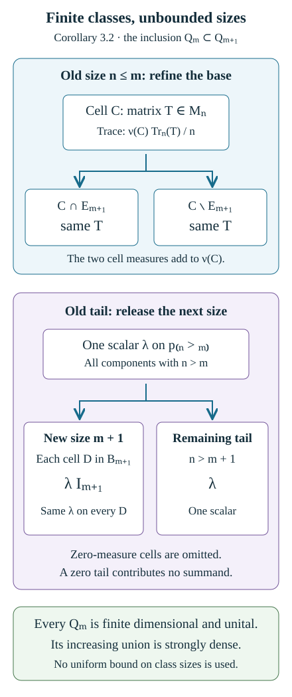

# Finite orbit classes and matrix blocks

*Written by GPT-6.1 Sol (OpenAI), September 2026. Original text is public domain (CC0).*

## Introduction

A finite orbit is a finite matrix block. When the measured space contains many finite orbits, the blocks vary over their space of representatives. This base can be nonatomic, so finite orbits do not make the whole algebra finite dimensional.

We will construct the representatives measurably, calculate the operator algebra and its measures, and then study increasing finite approximations of an infinite relation. A product-space example will give an explicit increasing sequence of matrix algebras.

The prerequisites are [Orbits, stabilizers, and relation algebras](orbits-stabilizers-and-relation-algebras.md), [Groupoids and measured orbit relations](groupoids-and-measured-orbit-relations.md), and [Diagonal expectations and invariant measures](diagonal-expectations-and-invariant-measures.md). The groupoid lesson distinguishes finite classes, bounded stages and constant-size stages. We also use the Borel embedding and one-to-one image results taught in Borel models, measurable inversion and Polish group quotients, Theorems 4.3(5) and 5.2. Basic references are [Anantharaman–Popa] and [Takesaki].

Throughout, \(R\) is the relation of a countable nonsingular action on a standard Borel space \(X\). We may replace its sigma-finite measure by an equivalent probability measure \(\mu\).

## 1. Sorting a finite class measurably

Suppose every \(R\)-class is finite. Choose a Borel injection \(\beta:X\to[0,1]\). It gives a Borel order on \(X\). A finite class has a least point in this order.

**Lemma 1.1.** The class-size function \(x\mapsto|[x]_R|\) is Borel. The least-point map \(s(x)\) is Borel and constant on each class. For classes of size \(n\), their ordered points

\[
x_0(b),x_1(b),\ldots,x_{n-1}(b),\qquad b=s(x),
\tag{1.1}
\]

are Borel functions of the representative \(b\).

*Proof.* Enumerate the presenting group \(g_0,g_1,\ldots\). The disjoint graph decomposition from the first prerequisite lesson makes the class size a countable sum of Borel indicators.

The function \(m(x)=\inf_j\beta(g_jx)\) is Borel. Since the class is finite, its infimum is attained. Partition \(X\) by the first index \(j\) at which it is attained. On that piece \(s(x)=g_jx\), proving measurability. It is constant on each class because the set being minimized is the same.

After selecting the least point, replace its value in the list by \(+\infty\) and take the infimum of the remaining values. Select its first attaining index. Repeat a finite number of times. This gives each function in (1.1) by a countable Borel partition, and proves the assertion. \(\square\)

Let

\[
B_n=\{b:s(b)=b,\ |[b]_R|=n\},\qquad
X_{n,i}=\{x_i(b):b\in B_n\}.
\]

The sets \(B_n\) and \(X_{n,i}\) are Borel. For the latter, the map \(x_i:B_n\to X\) is injective and Borel, so its image is Borel by the one-to-one image theorem. Its inverse is \(s\). The sets \(X_{n,i}\), over all \(n\) and \(0\le i<n\), partition \(X\).

For a fixed \(n\), each \(X_{n,i}\) meets every \(n\)-point class once. The maps

\[
\theta_{ij}:X_{n,j}\longrightarrow X_{n,i},
\qquad \theta_{ij}(x_j(b))=x_i(b)
\tag{1.2}
\]

are Borel partial orbit maps. They obey

\[
\theta_{ij}\theta_{jk}=\theta_{ik},\qquad
\theta_{ij}^{-1}=\theta_{ji}.
\tag{1.3}
\]

These are measurable versions of matrix units.

**Corollary 1.2 (constant size almost everywhere).** Let \(1\leq n<\infty\). If \(|[x]_R|=n\) almost everywhere, there is an invariant conull Borel \(X_n\) with a Borel partition
\[
 X_n=A_0\sqcup\cdots\sqcup A_{n-1}
\]
such that each \(A_i\) meets every orbit in \(X_n\) exactly once. No hypothesis is required on the sizes of the exceptional orbits outside \(X_n\).

*Proof.* The distinct-point enumeration used in Lemma 1.1 gives a Borel class-size function even when it takes the value infinity. Explicitly, take the sum over the enumerated group elements of the indicator that their value is not equal to any preceding value. Thus \(X_n=\{x:|[x]_R|=n\}\) is Borel, invariant and conull. Restrict the relation to \(X_n\), where every class has exactly \(n\) points. Lemma 1.1 and the sheet construction (1.1) give the required sets \(A_i=X_{n,i}\). This is the measured form of Takesaki XIII.3.12. A partition with the same property on all of \(X\) would force every orbit to have exactly \(n\) points, which is stronger than the almost-everywhere hypothesis; see Exercise 6.6. \(\square\)

## 2. The base measure and the operator model

Put \(\nu=s_*\mu\) on the disjoint union \(B=\bigsqcup_nB_n\). On \(B_n\), define

\[
\mu_i(A)=\mu(x_i(A)).
\]

All the \(\mu_i\) have the same null sets. Indeed, \(\theta_{ij}\) is nonsingular. Moreover \(\nu|_{B_n}=\sum_{i<n}\mu_i\). Thus there are measurable densities \(h_i\) with

\[
d\mu_i=h_i\,d\nu,\qquad h_i>0\text{ almost everywhere},\qquad
\sum_{i<n}h_i=1.
\tag{2.1}
\]

The argument is ordinary Radon–Nikodym theory on each finite collection of sheets; it needs no choice of representatives for infinite classes.

**Theorem 2.1.** The finite-class relation algebra is

\[
\mathcal M(R,\mu)\cong
\prod_{n\ge1}\bigl(L^\infty(B_n,\nu)\,\bar\otimes\,M_n(\mathbb C)\bigr).
\tag{2.2}
\]

The product means bounded operator families over the disjoint base pieces. On the \(n\)-point part its regular Hilbert space has the model

\[
L^2(B_n,\nu;\mathbb C^n\otimes\mathbb C^n),
\]

and its algebra acts on the first matrix coordinate, with multiplicity \(n\).

*Proof.* A relation vector is a function

\[
\xi(x_i(b),x_j(b)),\qquad b\in B_n,\quad 0\le i,j<n.
\]

Its squared norm is

\[
\int_{B_n}\sum_{j<n}h_j(b)\sum_{i<n}
|\xi(x_i(b),x_j(b))|^2\,d\nu(b).
\]

Multiplying its \((i,j)\)-entry by \(h_j(b)^{1/2}\) gives the asserted Hilbert-space unitary. A multiplication operator acts by the diagonal matrix whose \(i\)-entry is \(f(x_i(b))\). The operator \(V_{\theta_{ij}}\) is the matrix unit \(e_{ij}\otimes1\). Its action changes the row coordinate and leaves the density attached to the column unchanged.

Multiplication by a function of \(s(x)\) gives any bounded scalar function of \(b\). These functions and the matrix units generate every measurable bounded \(n\times n\) matrix field. Conversely, every partial orbit map acts within a fixed finite class, so its operator is such a matrix field. This proves equality on the \(n\)-point part. The invariant projections for the different class sizes give the bounded product (2.2), by taking strong sums over the disjoint parts. \(\square\)

The centre in (2.2) consists of scalar matrix fields on \(B\). It describes the finite orbit space. An ergodic finite-class relation therefore has just one class up to a null set and gives a matrix factor.

**Proposition 2.2.** The measure \(\mu\) is invariant for \(R\) exactly when \(h_i=1/n\) almost everywhere on every \(B_n\). In that case,

\[
\tau(T)=\sum_{n\ge1}\int_{B_n}\frac1n\operatorname{Tr}_n(T(b))\,d\nu(b).
\tag{2.3}
\]

*Proof.* Invariance under (1.2) says that all the sheet measures \(\mu_i\) agree. Combined with (2.1), this is exactly \(h_i=1/n\). Conversely, this equality makes all sheet maps measure preserving. Any partial orbit map splits into their restrictions, so it too preserves measure. The diagonal expectation reads the entries \(T(b)_{ii}\). Integrating them with their sheet densities gives (2.3). \(\square\)

## 3. A finite block can have a large centre

**Example 3.1.** Let \(X=[0,1]\times\{0,1,2,3\}\), and declare \((t,i)\) equivalent to \((u,j)\) exactly when \(t=u\). Use Lebesgue measure and equal sheet weights. The algebra is

\[
L^\infty([0,1])\,\bar\otimes\,M_4(\mathbb C).
\]

Every class has four points, but its centre contains every bounded measurable function of \(t\). In particular the algebra is infinite dimensional.

This algebra nevertheless has an increasing family of finite-dimensional subalgebras with strongly dense union. For example, divide \([0,1]\) into dyadic intervals. Functions constant on the intervals form finite-dimensional algebras with increasing union. Their generated sigma-algebra is the Borel sigma-algebra modulo null sets, so the von Neumann algebra they generate is \(L^\infty([0,1])\). Tensoring each with \(M_4\) gives the desired matrix-block approximations.

The same construction works for a standard finite base measure: choose countably many Borel sets generating its sigma-algebra and use the finite partitions generated by the first \(k\) sets. The conclusion follows by the monotone class theorem for multiplication operators.

**Corollary 3.2 (varying sizes and a scalar tail).** Suppose every class is finite, with no bound on its size. The relation admits an invariant probability measure equivalent to \(\mu\). Its algebra in (2.2) has a faithful normal tracial state and an increasing sequence of unital finite-dimensional subalgebras whose union is strongly dense.

*Proof.* For a Borel set \(E\subset X\), put
\[
 \mu_0(E)=\sum_{n\geq1}\frac1n\int_{B_n}
             \sum_{i<n}1_E(x_i(b))\,d\nu(b).
 \tag{3.1}
\]
This is a probability measure. Equation (2.1) and strict positivity of all the sheet densities show that it has exactly the same null sets as \(\mu\). Its sheet densities relative to the same base measure \(\nu\) are \(1/n\), so Proposition 2.2 proves invariance. Thus
\[
 \tau_0(T)=\sum_{n\geq1}\int_{B_n}
                  \frac1n\operatorname{Tr}_n(T_n(b))\,d\nu(b)
 \tag{3.2}
\]
is a tracial state on (2.2). In the Hilbert-space model of Theorem 2.1, each of its matrix diagonal integrals is a vector functional: use the constant vector with first coordinate the relevant basis vector and second coordinate the first basis vector, restricted to the finite-measure set \(B_n\). The countable positive sum of these normal functionals, with weights \(1/n\), is normal. If \(T\geq0\) and \(\tau_0(T)=0\), its nonnegative matrix traces vanish almost everywhere on every base piece; hence every positive matrix \(T_n(b)\) is zero almost everywhere. This proves faithfulness.

Choose Borel sets \(E_1,E_2,\ldots\) generating the sigma-algebra of the standard Borel space \(B\). For \(n\leq m\), let \(\mathcal P_{n,m}\) be the finite partition of \(B_n\) induced by \(E_1,\ldots,E_m\). Write \(p_{>m}\) for the central identity on the components with \(n>m\). Define
\[
 \mathcal Q_m=
 \left(\bigoplus_{1\leq n\leq m}\ 
       \bigoplus_{C\in\mathcal P_{n,m}}1_C M_n(\mathbb C)\right)
       \oplus\mathbb C p_{>m}.
 \tag{3.3}
\]
Zero-measure cells and a zero tail projection contribute no summand. Only finitely many cells occur, so \(\mathcal Q_m\) is finite dimensional, and its identity is the identity of the full algebra.

Each old cell splits into cells of the next partition; its matrix is repeated unchanged on those smaller cells. A scalar \(\lambda\) on the old tail becomes \(\lambda I_{m+1}\) on each newly admitted \(B_{m+1}\)-cell and remains \(\lambda\) on the new tail. These rules prove \(\mathcal Q_m\subset\mathcal Q_{m+1}\) inside the given algebra.

For a fixed \(n\), the strong closure of the union contains every constant matrix on \(B_n\) and every scalar projection \(1_{B_n\cap E_j}\). The monotone class theorem for multiplication operators therefore gives every bounded measurable matrix field on \(B_n\). Finally, the central projections \(\sum_{n\leq m}1_{B_n}\) tend strongly to one. A bounded family of matrix fields is consequently the strong limit of its finite central truncations. The closure is all of (2.2). \(\square\)

*Figure 1. The actual inclusions in (3.3). Matrices on an old base cell repeat on its refined cells. The scalar tail supplies the identity multiple on the next class-size component and retains a scalar on the remaining tail. Corollary 3.2 proves strong density even when the sizes of the finite classes are unbounded. The trace weights on a cell are \(\nu(C)\operatorname{Tr}_n/n\), as in (3.2).*

This construction concerns a relation whose classes are all finite. For an increasing exhaustion of an infinite relation, it gives a finite-dimensional approximation separately at each stage. It does not by itself make those choices compatible across different relations; Section 5 provides an explicit compatible construction in a product model. Nor does (3.2) make the original diagonal-integral state tracial when its sheet weights are unequal.

## 4. Increasing finite relations

Let

\[
R_1\subset R_2\subset\cdots\subset R
\]

be Borel subrelations on \(X\), all including the diagonal. Suppose each has finite classes and

\[
\nu_s\!\left(R\setminus\bigcup_kR_k\right)=0.
\tag{4.1}
\]

Such a sequence is called a *hyperfinite exhaustion*. A uniform bound on class sizes at a fixed stage is an additional property, and equal class sizes at that stage are a further one.

Define \(\mathcal M_k\subset\mathcal M(R,\mu)\) using the diagonal multiplication operators and the \(V_\theta\) whose graphs lie in \(R_k\).

**Theorem 4.1.** The algebras \(\mathcal M_k\) increase and generate \(\mathcal M(R,\mu)\).

*Proof.* For a fixed presenting group element \(g\), set

\[
D_{g,k}=\{x:(gx,x)\in R_k\}.
\]

These sets increase. Their union is conull by (4.1), since the measure of the missing part of the \(g\)-graph is the measure of its source domain. The restricted map \(g|_{D_{g,k}}\) has graph in \(R_k\), so

\[
V_gM_{1_{D_{g,k}}}\in\mathcal M_k.
\]

The projections tend strongly to one, and these operators tend strongly to \(V_g\). All diagonal operators already belong to every \(\mathcal M_k\). The limiting algebra therefore contains all generators of \(\mathcal M(R,\mu)\). The reverse inclusion is part of the definition. \(\square\)

Here a finite subrelation can itself be presented by countably many nonsingular Borel automorphisms. Split its graph among restrictions of the original group maps. For a fixed-point-free restricted map \(\theta\), use a countable separating family to cover its domain by Borel pieces \(D\) contained in a separating set while \(\theta D\) lies in its complement, or the reverse. Replace this cover by a disjoint partition. Each piece satisfies \(D\cap\theta D=\varnothing\). Extend \(\theta|_D\) by its inverse on the range and by the identity elsewhere. These countably many nonsingular involutions have precisely the required finite subrelation as their orbit relation.

In the original relation Hilbert space, the finite-stage operators split each larger orbit into its \(R_k\)-classes and act on each such class by the same finite matrix. Nonsingularity of the original relation ensures that a null set of finite classes is still null after its larger saturation. Consequently the essential matrix norm agrees with that in the regular representation of \(R_k\). The measurable matrix-field description in Theorem 2.1 therefore gives the same algebra abstractly, with possibly different source-coordinate multiplicity in the original representation.

Each finite-stage algebra has the measurable matrix-block description and the finite-dimensional approximation of Corollary 3.2. Obtaining a *compatible* increasing sequence of finite-dimensional subalgebras of the whole algebra requires control of how one stage sits in the next. The following example supplies that control explicitly.

## 5. Finite changes of a sequence

Let \(A=\{0,1,2\}\), \(X=A^{\mathbb N}\), and give \(X\) a product probability measure with strictly positive probabilities on every letter in every coordinate. Let \(\bigoplus_{\mathbb N}C_3\) act by cyclically changing finitely many coordinates. Each group element is nonsingular: it changes only finitely many coordinates with positive masses. The relation is

\[
x\mathrel R y\quad\Longleftrightarrow\quad
x_j=y_j\text{ for all sufficiently large }j.
\]

Let \(R_n\) allow changes only in the first \(n\) coordinates. Every \(R_n\)-class has \(3^n\) points, the \(R_n\)'s increase, and their union is \(R\).

For words \(a,b\in A^n\), let \(\theta_{a,b}\) replace the prefix \(b\) by \(a\) while leaving the tail unchanged. Its domain is the cylinder with prefix \(b\). Put \(e^{(n)}_{a,b}=V_{\theta_{a,b}}\).

**Theorem 5.1.** The operators \(e^{(n)}_{a,b}\) form matrix units for a unital algebra \(\mathcal D_n\cong M_{3^n}(\mathbb C)\). They satisfy

\[
e^{(n)}_{a,b}=\sum_{j\in A}e^{(n+1)}_{(a,j),(b,j)}.
\tag{5.1}
\]

The algebras \(\mathcal D_n\) increase and their union is strongly dense in \(\mathcal M(R,\mu)\).

*Proof.* Prefix replacement gives

\[
e^{(n)}_{a,b}e^{(n)}_{c,d}
=1_{\{b=c\}}e^{(n)}_{a,d},\qquad
(e^{(n)}_{a,b})^*=e^{(n)}_{b,a}.
\]

The diagonal units sum to one because the prefix cylinders partition \(X\). They are nonzero because all letter probabilities are positive. This gives the matrix algebra.

A replacement of an \(n\)-letter prefix leaves the next letter unchanged. Partitioning its domain by that next letter gives (5.1), and hence inclusion of the algebras.

The diagonal units include all prefix-cylinder indicators. These generate the product Borel sigma-algebra, so their strong closure contains every diagonal multiplication operator. A group element changing the first \(n\) coordinates is a permutation of the \(n\)-letter words, and its \(V_g\) is a finite sum of the corresponding matrix units. Every group element has finite support and therefore belongs to some \(\mathcal D_n\). The closure contains all generators of the relation algebra. \(\square\)

The diagonal-vector state on \(\mathcal D_n\) has weights equal to the probabilities of the prefix words. It is tracial on that matrix algebra exactly when those probabilities are all equal. The finite-dimensional approximation above is valid for both uniform and nonuniform positive product measures.

## 6. Exercises with solutions

Level 1 asks for a computation or a direct application. Level 2 asks for a proof using the lesson’s framework. Level 3 combines results or examines a hypothesis whose failure changes the conclusion.

**Exercise 6.1 (unequal sheets).** *Level 1.* In Example 3.1 replace the four equal sheet weights by \(1/10,2/10,3/10,4/10\). Determine the algebra and the diagonal-integral state.

*Solution.* The algebra is still \(L^\infty([0,1])\bar\otimes M_4\), by Theorem 2.1. The state is \(\int\sum_i h_iT(t)_{ii}\,dt\) with the four given weights. It is not tracial: the products \(e_{01}e_{10}=e_{00}\) and \(e_{10}e_{01}=e_{11}\) have different state values. Replacing the measure by equal sheet weights produces the same measure class and a tracial state.

**Exercise 6.2 (varying finite sizes).** *Level 1.* Give two disjoint copies of \([0,1]\) classes of sizes two and five, respectively, and give each base piece positive measure. Write the algebra.

*Solution.* It is the direct product
\((L^\infty([0,1])\bar\otimes M_2)\times
(L^\infty([0,1])\bar\otimes M_5)\).
The projections onto the two parts are central. Thus a finite-class relation need not have one constant class size.

**Exercise 6.3 (strong approximation of an orbit map).** *Level 2.* In Theorem 4.1, prove convergence without assuming the \(D_{g,k}\)'s equal \(X\) at any finite stage.

*Solution.* For any \(\xi\in L^2(R,\nu_s)\),
\[
\|(V_g-V_gM_{1_{D_{g,k}}})\xi\|
=\|M_{1_{X\setminus D_{g,k}}}\xi\|\longrightarrow0.
\]
The convergence follows from dominated convergence in the relation measure: the exceptional range-coordinate set is null after saturation. The projection limit is one, although the domains may increase strictly forever.

**Exercise 6.4 (the embedding multiplicity).** *Level 1.* For the prefix model, compute the inclusion \(M_{3^n}\to M_{3^{n+1}}\) on a matrix \(T\).

*Solution.* Equation (5.1) identifies the larger word space with \(\mathbb C^{3^n}\otimes\mathbb C^3\) and the inclusion with \(T\mapsto T\otimes1_3\). This is a unital inclusion with multiplicity three.

**Exercise 6.5 (a nontracial product state).** *Level 2.* Use the same letter probabilities \((1/2,1/3,1/6)\) at every coordinate. Compute the state of \(e^{(2)}_{(0,1),(0,1)}\) and test the trace identity with the reversed two-word matrix units.

*Solution.* The diagonal state value is \((1/2)(1/3)=1/6\). The cylinder \((2,2)\) has probability \(1/36\). If \(u=e^{(2)}_{(0,1),(2,2)}\), then \(uu^*\) and \(u^*u\) are the two cylinder projections, with different state values. The product state is not a trace; the increasing matrix-algebra construction remains valid.

**Exercise 6.6 (a null exceptional orbit).** *Level 2.* Let \(X=\{a,b,c\}\), with masses \(1/2,1/2,0\), and let the relation have classes \(\{a,b\}\) and \(\{c\}\). It is nonsingular and has class size two almost everywhere. Can all of \(X\) be partitioned into two sets each meeting every orbit exactly once? Give the correct conull partition.

*Solution.* The only nonempty null object set is \(\{c\}\), and it is saturated, so null saturation verifies nonsingularity. If two disjoint sets each met \(\{c\}\) once, both would contain \(c\), a contradiction. Thus the asserted pointwise partition does not exist. The invariant conull set is \(X_2=\{a,b\}\); its sheets \(A_0=\{a\}\), \(A_1=\{b\}\) do have the required property. This supplies the precise null-set qualification for the finite-sheet lemma without changing any measured algebra.

**Exercise 6.7 (unbounded blocks and norm approximation).** *Level 2.* Let \(X=\bigsqcup_{n\geq1}(\{n\}\times\{0,\ldots,n-1\})\), let each \(n\)-point component be one class, and give each of its points mass \(2^{-n}/n\). Identify the algebra, trace and the sequence (3.3), using the singleton base pieces. Is its union norm dense?

*Solution.* Here \(\nu(\{n\})=2^{-n}\), so the algebra is the bounded product \(\prod_{n\geq1}M_n(\mathbb C)\), with
\[
 \begin{aligned}
 \tau_0(T)&=\sum_{n\geq1}2^{-n}\frac{\operatorname{Tr}_n(T_n)}n,\\
 \mathcal Q_m&=\left(\bigoplus_{n=1}^m M_n(\mathbb C)\right)
                  \oplus\mathbb C p_{>m}.
 \end{aligned}
\]
The next inclusion sends the old tail scalar \(\lambda\) to \(\lambda I_{m+1}\) and the new tail scalar \(\lambda\). Finite central truncations prove strong density, as in Corollary 3.2. Norm density fails. Take \(T_1=0\) and \(T_n=\operatorname{diag}(1,-1,0,\ldots,0)\) for \(n\geq2\). Any \(S\in\mathcal Q_m\) equals one scalar \(\lambda I_n\) for all \(n>m\), and
\[
 \|T-S\|\geq\max\{|1-\lambda|,|-1-\lambda|\}\geq1.
\]
Thus one fixed bounded operator stays at distance at least one from the entire union, despite strong density.

**Exercise 6.8 (the finite-dimensional expectation).** *Level 3.* Construct a normal, unital, positive, \(\tau_0\)-preserving conditional expectation \(\mathsf E_m\) onto (3.3), and prove that \(\|\mathsf E_m(T)-T\|_{2,\tau_0}\to0\). Use no general amenability or AFD theorem.

*Solution.* On a positive-measure cell \(C\in\mathcal P_{n,m}\), set the constant matrix value to
\[
 (\mathsf E_mT)_{n,C}=\frac1{\nu(C)}\int_C T_n(b)\,d\nu(b).
 \tag{6.1}
\]
If \(t_m=\sum_{n>m}\nu(B_n)>0\), use on the tail the scalar
\[
 \lambda_m(T)=\frac1{t_m}\sum_{n>m}\int_{B_n}
                         \frac{\operatorname{Tr}_n(T_n(b))}n\,d\nu(b).
 \tag{6.2}
\]
Omit the tail when \(t_m=0\). All integrals in (6.1) are finite entrywise matrix integrals. They preserve positive matrices and the identity; (6.2) is an average of normalized positive matrix traces. Both averages have norm at most \(\|T\|\). The matrix coefficients in (6.1) are vector functionals, or their polarizations, in the model of Theorem 2.1; (6.2) is a normalized restriction of the normal trace \(\tau_0\). Hence both averages are normal. Substituting them in (3.2) proves trace preservation. A matrix constant on a cell can be taken outside its integral on either side; the tail algebra is scalar. Hence \(\mathsf E_m\) is \(\mathcal Q_m\)-bimodular. It fixes \(\mathcal Q_m\), so it is the required conditional expectation.

For \(A\in\mathcal Q_m\), the same averaging formulas give
\[
 \tau_0\bigl(A^*(T-\mathsf E_mT)\bigr)=0.
 \tag{6.3}
\]
Thus \(\mathsf E_m\) extends to the orthogonal projection onto \(\mathcal Q_m\) in \(L^2(\mathcal M,\tau_0)\). These subspaces increase and have dense union: discard a tail of small \(\nu\)-mass, approximate the finitely many remaining matrix entries by simple functions, and approximate their measurable sets by the algebra generated by the \(E_j\). This last approximation follows from the monotone class theorem in the finite measure \(\nu|_{B_n}\). Bounded fields are dense in the weighted Hilbert-space norm
\[
 \|T\|_{2,\tau_0}^2=
       \sum_n\int_{B_n}\frac1n\operatorname{Tr}_n(T_n(b)^*T_n(b))\,d\nu(b).
\]
Orthogonal projections onto increasing subspaces with dense union converge strongly to the identity: given a vector within \(\varepsilon\) of an element of one subspace, its distance to every later subspace is at most \(\varepsilon\). Applying this to \(T\) proves the claimed convergence.

## References

- [Anantharaman–Popa] Claire Anantharaman and Sorin Popa, *An introduction to \(II_1\) factors*, author-hosted draft `IIunV15.pdf`. Sections 1.5–1.6 and Remark 1.6.1, printed pp. 18–24, treat probability-preserving relation algebras and the tracial matrix-product construction. Definitions 11.1.1–11.1.2, printed p. 173, give the finite-algebra AFD conventions. [Read the authors’ draft](https://www.math.ucla.edu/~popa/Books/IIunV15.pdf). The weighted finite-class models and prefix-replacement arguments here do not use the general amenability-to-AFD theorem.
- [Takesaki] Masamichi Takesaki, *Theory of Operator Algebras III*, Encyclopaedia of Mathematical Sciences 127, Springer, 2003, Chapter XIII: Definitions 3.9–3.11 and Lemma 3.12, printed pp. 35–36; the dyadic example on p. 37; Definitions 3.16 and 3.18, printed pp. 38–39. [Publisher record](https://doi.org/10.1007/978-3-662-10453-8). Corollary 1.2 gives the conull finite-sheet partition explicitly. The distinction between finite classes, bounded stages and constant-size stages is used throughout Sections 1–5.

