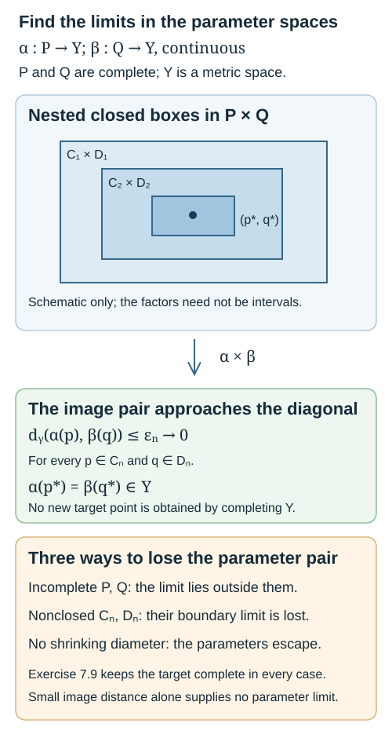
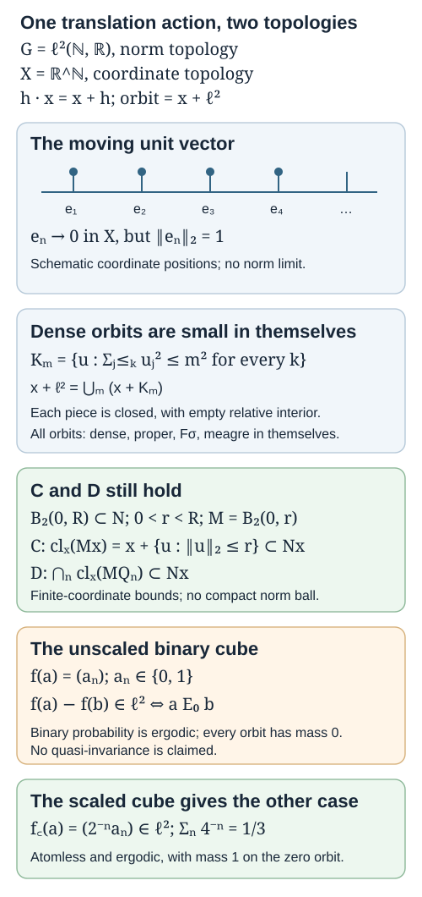

# Polish orbits and their quotient topology

*Written by GPT-6.1 Sol (OpenAI), Ultra, October 2026; the alternative proof by Borel separation by Claude Opus 5.5 (Anthropic). Original text: CC0.*

## Introduction

An orbit carries two natural topologies. One comes from its position inside the space on which the group acts. The other comes from the homogeneous space obtained by dividing the group by a stabilizer. A continuous bijection relates them, but its inverse need not be continuous. Effros's theorem identifies exactly when the two topologies agree, and explains what this says about the whole orbit space.

Throughout, a Polish group acts continuously on a Polish space. The group may fail to be locally compact, and the orbits may be uncountable. We prove the four equivalent conditions in Takesaki III, Exercise XIII.2(1)(b), at this full scope. The Borel-patch proof of orbit-map openness uses a measurable section and category. The analytic-overlap proof uses a finite-neighborhood test whose common-value input has two proofs: Borel separation and a complete-parameter construction credited to Jan van Mill. A separate closed-box lemma and its counterexamples explain why parameter completeness suffices even when the orbit is not yet known to be complete. The results and mathematical methods are attributed below.

We use The Effros Borel structure, Theorem 2.1(1), for the complete metrization of relatively open and countable-intersection-of-open subspaces, and Theorem 2.2 for Borel subspaces. Its reciprocal-distance metric applies without a measure hypothesis. Borel models, measurable inversion and Polish group quotients, Theorem 4.3(5), supplies the injective Borel image theorem; its Theorem 2.4 supplies analytic separation in a Hausdorff target. The Baire category theorem and elementary metric topology are prerequisites. The earlier lesson [Orbits, stabilizers and relation algebras](orbits-stabilizers-and-relation-algebras.md) gives the algebraic orbit conventions.

The last section introduces the closure conditions used by the stronger locally closed orbit criterion. The next lesson, [Locally closed orbits and measurable representatives](locally-closed-orbits-and-measurable-representatives.md), proves the complete Glimm equivalence, including the converse for ergodic measures and a Borel representative construction.

## 1. Quotients, stabilizers and category

Let \(G\curvearrowright X\) be a continuous action, with \(G,X\) Polish. Write \(\pi:X\to X/G\) for the orbit map. The quotient topology is defined by declaring \(A\subset X/G\) open exactly when \(\pi^{-1}(A)\) is open. Thus \(\pi\) is continuous. It is also open: for open \(U\subset X\),
\[
\pi^{-1}(\pi(U))=GU=\bigcup_{g\in G}gU
\tag{1.1}
\]
is open. If \(U_n\) is a countable base of \(X\), the sets \(\pi(U_n)\) form a countable base of \(X/G\). This assertion requires no Hausdorff separation of the quotient.

For \(x\in X\), the stabilizer \(H_x=\{g:gx=x\}\) is closed, by continuity of \(g\mapsto gx\). The map \(q:G\to G/H_x\), \(g\mapsto gH_x\), is continuous and open: \(q^{-1}(q(V))=VH_x\) for open \(V\subset G\). The canonical map
\[
\phi_x:G/H_x\longrightarrow Gx,\qquad gH_x\longmapsto gx
\tag{1.2}
\]
is a continuous bijection, where \(Gx\) has its relative topology in \(X\). Continuity follows from the definition of the quotient topology. In this lesson, saying that the action is *microtransitive on an orbit* means that \(Vx\) contains a relative neighborhood of \(x\) for every identity neighborhood \(V\subset G\).

**Lemma 1.1.** The map \(g\mapsto gx\) is open onto \(Gx\) exactly when the action is microtransitive at every point of that orbit. In that case \(\phi_x\) is a homeomorphism.

*Proof.* Openness gives the neighborhood condition immediately. Conversely, let \(A\subset G\) be open and \(gx\in Ax\), with \(g\in A\). Choose an identity neighborhood \(V\) such that \(gV\subset A\). The set \(Vx\) contains a neighborhood of \(x\), so \(gVx\subset Ax\) contains a neighborhood of \(gx\). Hence \(Ax\) is open in the orbit. For an open set \(B\subset G/H_x\), the identity \(\phi_x(B)=q^{-1}(B)x\) then proves that \(\phi_x\) is open. The reverse implication also follows by composing the open map \(q\) with a homeomorphism \(\phi_x\). \(\square\)

A set is *meagre* in a space if it is a countable union of nowhere dense sets there. A nonempty space is of the second category in itself if it is not meagre in itself. A Baire space is one in which a countable intersection of open dense sets is dense.

**Lemma 1.2.** A continuous open surjection from a nonempty Baire space has a Baire target.

*Proof.* Let \(f:Y\to Z\) be such a surjection and let \(D_n\subset Z\) be open dense. Each \(f^{-1}(D_n)\) is open dense in \(Y\): an open nonempty \(A\subset Y\) has an open nonempty image meeting \(D_n\). For an open nonempty \(W\subset Z\), the Baire property in \(Y\) gives a point in \(f^{-1}(W)\cap\bigcap_n f^{-1}(D_n)\). Its image lies in \(W\cap\bigcap_nD_n\). \(\square\)

In particular, every \(G/H_x\) is Baire, because \(G\) is completely metrizable and \(q\) is open. This suffices for the implication from homogeneous-space topology to second category below; no unproved complete metrization of the coset space is needed.

**Lemma 1.3 (Open images inside a Polish space).** Suppose \(P\) is Polish, \(Y\subset X\) with \(X\) Polish, and \(f:P\to Y\) is a continuous open surjection for the relative topology of \(Y\). Then \(Y\) is \(G_\delta\) in \(X\).

*Proof.* We give the metric-cover argument, including its refinement step. Every countable open cover \(A_j\) of a metric space has a countable locally finite open refinement. To see this, choose a point \(y_0\), put \(T_n=\bigcup_{j\leq n}A_j\), and set
\[
\begin{gathered}
F_n=\big\{y:d(y,y_0)\leq n,\\
\min(1,d(y,Y\setminus T_n))\geq\tfrac{1}{n+1}\big\},\\
F_0=\varnothing.
\end{gathered}
\tag{1.3}
\]
The minimum is defined as one when the complement is empty. These closed sets exhaust the space and satisfy \(F_n\subset\operatorname{int}F_{n+1}\). The open bands \(\operatorname{int}F_{n+1}\setminus F_{n-1}\), \(n\geq1\), cover it and are locally finite: a neighborhood inside \(F_k\) misses every band with \(n\geq k+1\). Each band is contained in \(T_{n+1}\). Intersecting it with \(A_1,\ldots,A_{n+1}\) gives the desired refinement. An arbitrary open cover has a countable subcover in a second countable space, so the same construction applies.

Here is a useful extension of this refinement. For a nonempty relatively open \(C\subset Y\), put
\[
\widetilde C=\{x\in X:d(x,C)<\tfrac13d(x,Y\setminus C)\},
\tag{1.4}
\]
using \(\widetilde C=X\) when \(C=Y\). This is open and \(\widetilde C\cap Y=C\). If \(C_j\) is locally finite in \(Y\), its extensions are locally finite on some open neighborhood \(L\) of \(Y\) in \(X\). Indeed, near each \(y\in Y\) all but finitely many \(C_j\) miss a relative ball of radius \(r>0\). For those indices and \(d(x,y)<r/2\), one has \(d(x,C_j)\geq r-d(x,y)>r/2\) and \(d(x,Y\setminus C_j)\leq d(x,y)<r/2\), excluding \(x\) from \(\widetilde C_j\). The union of these ambient neighborhoods supplies \(L\).

Use a complete metric on \(P\) and a compatible metric on \(X\). We build a countable tree of pairs \((V_s,O_s)\), where \(V_s\) is a nonempty open parameter set and \(O_s\) is ambient open. Start with \((P,X)\). At every positive depth \(n\), the \(O_s\cap Y\) cover \(Y\), and the \(O_s\) are locally finite on an ambient open neighborhood \(L_n\) of \(Y\). Each child has
\[
\overline{V_{sj}}\subset V_s,\quad
\operatorname{diam}V_{sj}<2^{-n},\quad O_{sj}\subset O_s.
\tag{1.5}
\]
In addition, both \(f(V_{sj})\) and \(O_{sj}\) lie in the same ambient ball of radius \(2^{-n}\), and \(O_s\cap Y\subset f(V_s)\) for every node.

To construct a level, for each \(y\in O_s\cap Y\) choose \(p\in V_s\) with \(f(p)=y\). By continuity choose a small open parameter ball \(V\) with closure in \(V_s\), diameter less than \(2^{-n}\), and image in \(O_s\cap B(y,2^{-n})\). Openness of \(f\) makes \(f(V)\) relatively open and containing \(y\). These target sets, over all nodes at the preceding level, cover \(Y\). Choose a countable locally finite open refinement \(C_j\) of that cover, and assign each member to one covering set and its parameter ball \(V\). Extend it by (1.4), then intersect that extension with its parent \(O_s\), the ball \(B(y,2^{-n})\), and an ambient neighborhood \(L_n\) on which all extensions are locally finite. Call the result \(O_{sj}\), and use the assigned \(V\) as \(V_{sj}\). Its intersection with \(Y\) is exactly \(C_j\), so it is nonempty. All required properties follow. The parameter balls need not be disjoint.

Define the ambient \(G_\delta\) set
\[
Z=\bigcap_{n\geq1}\left(L_n\cap\bigcup_{|s|=n}O_s\right).
\tag{1.6}
\]
It contains \(Y\). For \(x\in Z\), finitely many nodes at each depth contain \(x\), by local finiteness at \(x\in L_n\); there is at least one at every depth, and every such child's parent also contains \(x\). This finitely branching tree has an infinite branch: recursively choose a child with descendants at arbitrarily large depths, which exists since there are only finitely many children. Along the branch the nonempty closed parameter sets \(\overline{V_s}\) are nested with diameters tending to zero. Completeness gives a point \(p\) in their intersection, lying in every open \(V_s\) by the next closure inclusion. At depth \(n\), the points \(f(p)\) and \(x\) lie in the same ball of radius \(2^{-n}\). Hence they coincide. Thus \(x\in Y\), proving \(Y=Z\). Empty \(Y\) is already \(G_\delta\). \(\square\)

**Lemma 1.4 (Borel sections of open maps).** Let \(P\) be a nonempty Polish space and let \(f:P\to Y\) be an open surjection whose fibres are closed. Give \(Y\) its Borel sigma-algebra. There is a Borel map \(s:Y\to P\) with \(f(s(y))=y\). No complete metrization of \(Y\) is assumed.

*Proof.* Fix a complete compatible metric on \(P\) and enumerate a base \((B_j)\) of nonempty open balls, recording a centre \(b_j\) for each. For each \(y\), first choose the least \(j_1(y)\) such that \(y\in f(B_{j_1(y)})\) and \(\operatorname{diam}B_{j_1(y)}<1/2\). Having chosen \(j_n(y)\), choose the least \(j_{n+1}(y)\) satisfying
\[
\begin{gathered}
y\in f(B_{j_{n+1}(y)}),\qquad
\overline{B_{j_{n+1}(y)}}\subset B_{j_n(y)},\\
\operatorname{diam}B_{j_{n+1}(y)}<2^{-(n+1)}.
\end{gathered}
\tag{1.7}
\]
These choices exist: select a point of the fibre in the previous ball and then a sufficiently small base ball around it. Every set \(f(B_j)\) is open. At each stage, therefore, the set on which a particular index is the first admissible choice is Borel; induction on the previously chosen index proves that every \(j_n\) is Borel.

The nested nonempty closed balls in (1.7) have diameters tending to zero, so completeness gives a unique point \(s(y)\) in their intersection. Their centres converge to it. For each \(n\), a point of \(f^{-1}(y)\cap B_{j_n(y)}\) lies within \(2^{-n}\) of \(s(y)\); the fibre is closed, so \(f(s(y))=y\). Finally the centre maps \(y\mapsto b_{j_n(y)}\) are Borel and converge pointwise to \(s\). For each nonempty closed \(F\subset P\), the functions \(d(b_{j_n(y)},F)\) converge to \(d(s(y),F)\). Thus \(s^{-1}(F)=\{y:d(s(y),F)=0\}\) is Borel. Closed sets generate the Borel sigma-algebra of \(P\), proving measurability of \(s\). \(\square\)

**Corollary 1.5 (Borel orbit patches).** For every open \(A\subset G\) and every \(x\in X\), the subset \(Ax\) is Borel in \(X\).

*Proof.* The empty case is immediate. Otherwise \(A\) is Polish by the open-subspace prerequisite. Put \(H=H_x\) and let \(q:G\to G/H\) have its quotient topology. The map \(q|_A:A\to q(A)\) is open: an open subset of \(A\) is open in \(G\), and \(q\) is open. Its fibres are intersections with closed cosets, hence closed in \(A\). Lemma 1.4 supplies a Borel section \(s:q(A)\to A\). The composite \(s\circ q|_A\) is Borel, so its fixed-point set
\[
T_A=\{g\in A:s(q(g))=g\}
\tag{1.8}
\]
is Borel in \(A\): the map \(g\mapsto(g,s(q(g)))\) is Borel into \(A\times A\), whose diagonal is closed. It is therefore standard Borel, by the Borel-subspace theorem, *Effros Borel structure*, Theorem 2.2. The set \(T_A\) contains exactly one point from each coset that meets \(A\). The continuous map \(g\mapsto gx\) is consequently injective on \(T_A\), with image \(Ax\). The written injective-image theorem, *Borel models, measurable inversion and Polish group quotients*, Theorem 4.3(5), makes that image Borel in \(X\). This use requires only a Borel subset of a Polish domain and a Polish target; it assumes no openness of \(G\to Gx\). \(\square\)

## 2. Intersecting two analytic sets

For this section, let \(Y\) be a separable metrizable space, which need not be complete. Call \(A\subset Y\) *analytic* if \(A=\alpha(P)\) for a continuous map from a Polish space \(P\). Say that \(A\) is everywhere nonmeagre in \(Y\) if \(A\cap W\) is nonmeagre in \(Y\) for every nonempty open \(W\subset Y\). Such a set is dense. Removing a meagre set preserves this property, since otherwise the original intersection with some open set would also be meagre.

**Lemma 2.1.** Two analytic sets that are everywhere nonmeagre in a nonempty separable metrizable space intersect.

*Proof by Borel separation.* We prove the following stronger statement, in which only one of the two sets has to be everywhere nonmeagre: *if \(A,B\subset Y\) are analytic, \(A\) is nonmeagre in \(Y\), and \(B\) is everywhere nonmeagre in \(Y\), then \(A\cap B\ne\varnothing\).* Lemma 2.1 is the case in which \(A\) is everywhere nonmeagre as well, because in a nonempty space such a set is nonmeagre: take \(W=Y\).

The argument runs through the Baire property. A subset \(E\) of a topological space \(Y\) has the *Baire property* if the symmetric difference \(E\mathbin{\triangle}U\) is meagre for some open set \(U\subset Y\). Two general facts about this property are needed.

*Borel sets have the Baire property.* An open set \(E\) has it, with \(U=E\). Next suppose that \(E\mathbin{\triangle}U\) is meagre, with \(U\) open. The set \(\overline U\setminus U\) is closed, and its interior is empty: an open subset of it misses \(U\), hence misses \(\overline U\), and so is empty. So \(Y\setminus E\) differs from the open set \(Y\setminus\overline U\) only inside \((E\mathbin{\triangle}U)\cup(\overline U\setminus U)\), which is meagre. If \(E_n\mathbin{\triangle}U_n\) is meagre for every \(n\), with each \(U_n\) open, then \(\bigcup_nE_n\) differs from the open set \(\bigcup_nU_n\) only inside the meagre set \(\bigcup_n(E_n\mathbin{\triangle}U_n)\). Hence the sets with the Baire property form a sigma-algebra. It contains every open set, and therefore every Borel set.

*An everywhere nonmeagre set with the Baire property has meagre complement.* Let \(E\) be such a set, with \(E\mathbin{\triangle}U\) meagre and \(U\) open. If some nonempty open \(W\) missed \(U\), then \(E\cap W\subset E\setminus U\) would be meagre, which the hypothesis excludes. So \(U\) meets every nonempty open set. Its complement \(Y\setminus U\) is therefore closed with empty interior, and \(Y\setminus E\subset(Y\setminus U)\cup(U\setminus E)\) is meagre.

Now suppose that \(A\cap B=\varnothing\). The sets \(A\) and \(B\) are continuous images of Polish spaces in the metrizable, hence Hausdorff, space \(Y\). By *Borel models, measurable inversion and Polish group quotients*, Theorem 2.4, there are disjoint Borel sets \(C\supset A\) and \(D\supset B\). For every nonempty open \(W\), the set \(D\cap W\) contains the nonmeagre set \(B\cap W\), so \(D\) is everywhere nonmeagre. Being Borel, \(D\) has the Baire property, and the second fact makes \(Y\setminus D\) meagre. But \(A\subset C\subset Y\setminus D\), so \(A\) would be meagre, contrary to the hypothesis. Therefore \(A\cap B\ne\varnothing\).

In this proof the Polish parameter spaces enter only through the separation theorem, whose proof in that lesson is a tree argument over the sequence space \(\mathbb N^{\mathbb N}\). The complete-parameter alternative below constructs a common point directly from nested open sets in \(P_0\) and \(Q_0\). The sigma-algebra of sets with the Baire property is used again in the next lesson, Lemma 2.2.

**Alternative proof by complete parameters.** The elementary shrinking method is credited to van Mill. Write \(A=\alpha(P)\), \(B=\beta(Q)\), with \(P,Q\) Polish. First remove parameter regions whose images are meagre. For \(\alpha\), let \(D\) be the union of all open \(V\subset P\) for which \(\alpha(V)\) is meagre in \(Y\). A countable base supplies a countable subfamily with the same union, so \(\alpha(D)\) is meagre. The closed space \(P_0=P\setminus D\) is Polish. Its image contains \(A\setminus\alpha(D)\), so it is still everywhere nonmeagre. Every nonempty relatively open \(V\subset P_0\) has nonmeagre image: write \(V=V'\cap P_0\) with \(V'\) open in \(P\). Since \(V'\) meets \(P_0\), its image is not meagre, and
\[
\alpha(V')\subset\alpha(V)\cup\alpha(D).
\tag{2.1}
\]
The desired assertion follows. Apply the same operation to \(\beta\), obtaining \(Q_0\). Restrict both maps to these closed spaces.

Choose complete compatible metrics on \(P_0,Q_0\) and a compatible metric on \(Y\). We construct nonempty open parameter sets \(U_n\subset P_0\), \(V_n\subset Q_0\), and nonempty open sets \(W_n\subset Y\), starting with \(U_0=P_0,V_0=Q_0,W_0=Y\). The induction preserves
\[
W_n\subset\overline{\alpha(U_n)}\cap\overline{\beta(V_n)}.
\tag{2.2}
\]
For \(n\geq0\), it also arranges
\[
\begin{gathered}
\overline{U_{n+1}}\subset U_n,\quad\overline{V_{n+1}}\subset V_n,\\
\alpha(U_{n+1})\subset W_n,\quad\beta(V_{n+1})\subset W_n,\\
W_{n+1}\subset W_n,\\
\operatorname{diam}U_{n+1}<2^{-(n+1)},\\
\operatorname{diam}V_{n+1}<2^{-(n+1)},\\
\operatorname{diam}W_{n+1}<2^{-(n+1)}.
\end{gathered}
\tag{2.3}
\]
All closures in (2.2) are in \(Y\); the parameter closures in (2.3) use their respective complete metrics.

Suppose the sets at stage \(n\) have been chosen. Density in (2.2) lets us choose a nonempty open \(U_{n+1}\) of small diameter, with closure in \(U_n\cap\alpha^{-1}(W_n)\). Its image is nonmeagre, by the parameter property just established. Consequently its closure has nonempty interior, and there is a nonempty open

\[
Z\subset W_n\cap\operatorname{int}\overline{\alpha(U_{n+1})}.
\tag{2.4}
\]
To justify the intersection with \(W_n\), the image is contained in \(W_n\); the boundary of an open set is nowhere dense, so a nonempty interior of its closure cannot live entirely on that boundary. The set \(\beta(V_n)\) is dense in \(W_n\), hence meets \(Z\). Choose a nonempty open \(V_{n+1}\) of small diameter whose closure lies in \(V_n\cap\beta^{-1}(Z)\). Its image is again nonmeagre. Choose a nonempty open \(W_{n+1}\) of diameter less than \(2^{-(n+1)}\), contained in \(Z\cap\operatorname{int}\overline{\beta(V_{n+1})}\). The same boundary argument makes this possible. This set lies in both closures required in (2.2), and all of (2.3) holds.

Here is the precise limit test for this construction. For \(n\geq1\), set \(C_n=\overline{U_{n+1}}\) and \(D_n=\overline{V_{n+1}}\). These sets are nonempty, closed and nested in the complete spaces \(P_0,Q_0\), with diameters tending to zero. Continuity and (2.3) put both \(\alpha(C_n)\) and \(\beta(D_n)\) in \(\overline{W_n}^{\,Y}\). The diameter of that closure is at most \(2^{-n}\), so (2.6) below holds with \(\varepsilon_n=2^{-n}\). Lemma 2.2 supplies a parameter pair with equal images, giving a point of \(A\cap B\). Its proof states explicitly where completeness and closedness enter. \(\square\)

This distinction matters: in the next section \(Y\) is an orbit with its relative topology, and its completeness is part of what we are trying to understand. Assuming that orbit is Polish at the start would make the proof circular.

**Lemma 2.2 (Coincidence from complete boxes).** Let \(P,Q\) be complete metric spaces, let \(Y\) be a metric space, and let \(\alpha:P\to Y\) and \(\beta:Q\to Y\) be continuous. Suppose \(C_n\subset P\) and \(D_n\subset Q\) are nonempty closed sets with
\[
\begin{gathered}
C_{n+1}\subset C_n,\qquad D_{n+1}\subset D_n,\\
\operatorname{diam}C_n\longrightarrow0,\qquad
\operatorname{diam}D_n\longrightarrow0.
\end{gathered}
\tag{2.5}
\]
If numbers \(\varepsilon_n\to0\) satisfy
\[
\begin{gathered}
d_Y(\alpha(p),\beta(q))\leq\varepsilon_n\\
(p\in C_n,\ q\in D_n),
\end{gathered}
\tag{2.6}
\]
there is a unique pair \((p_*,q_*)\in\bigcap_n(C_n\times D_n)\), and \(\alpha(p_*)=\beta(q_*)\). Completeness of \(Y\) is unnecessary.

*Proof.* Choose \(p_n\in C_n\) and \(q_n\in D_n\). For \(m,n\geq N\), both \(p_m,p_n\) belong to \(C_N\), so their distance is at most its diameter; the same statement holds in \(Q\). The two sequences are Cauchy. Completeness gives limits \(p_*,q_*\), and closedness puts them in every respective set. Any two possible limits have distance at most every shrinking diameter, hence coincide. Applying (2.6) to this pair for every \(n\) proves that the two images have distance zero. The limit points were obtained in the parameter spaces. No Cauchy sequence in \(Y\) was used to construct a new target point. \(\square\)

*Figure 2. The rectangles are a schematic of nested closed sets in the product of the complete parameter spaces. Their images need not be nested rectangles in the target. The uniform distance bound (2.6) identifies the two images of the parameter limits; it does not complete the target space. Exercise 7.9 tests completeness, closedness and shrinking parameter diameters separately. [Open the editable diagram at full size](figures/complete-parameter-coincidence.svg).*

## 3. Second category makes orbit maps open

**Theorem 3.1.** If an orbit \(O=Gx\) is of the second category in itself, then the action on \(O\) is microtransitive, and every orbit map \(g\mapsto gz\), \(z\in O\), is open onto \(O\).

*Proof using Borel orbit patches.* Work in the relative topology of \(O\). Any nonempty open \(A\subset G\) has a nonmeagre image \(Az\) for every \(z\in O\). Indeed, countably many left translates of \(A\) cover \(G\), so the corresponding translates of \(Az\) cover \(O\). Each translation is a homeomorphism of \(O\). Meagreness of \(Az\) would therefore make \(O\) meagre in itself.

Let \(V\) be an identity neighborhood. Choose an open symmetric identity neighborhood \(W\) with \(W^3\subset V\). By Corollary 1.5, \(Wx\) is Borel in \(X\), and hence Borel in \(O\). Borel sets have the Baire property in every topological space, as proved in Section 2. Thus there is a relatively open \(D\subset O\) such that \(Wx\mathbin{\triangle}D\) is meagre in \(O\). The preceding paragraph makes \(Wx\) nonmeagre, so \(D\) is nonempty and meets \(Wx\).

For any \(y\in D\), continuity of \(g\mapsto gy\) gives an open identity neighborhood \(T\subset W\) with \(Ty\subset D\). The set \(Ty\) is nonmeagre, whereas \(D\setminus Wx\) is meagre. Some point of \(Ty\) therefore belongs to \(Wx\): write it as \(ty=wx\), where \(t\in T,w\in W\). It follows that
\[
y=t^{-1}wx\in W^2x,\qquad D\subset W^2x.
\tag{3.0a}
\]
Choose \(h\in W\) with \(hx\in D\). Then
\[
x\in h^{-1}D\subset W^3x\subset Vx.
\tag{3.0b}
\]
The set \(h^{-1}D\) is an open neighborhood of \(x\) in \(O\). Repeating the argument at any \(z\in O\) proves microtransitivity on the orbit, and Lemma 1.1 makes all its orbit maps open. The orbit was never assumed to be Polish or Baire. \(\square\)

**Proposition 3.2 (A finite-neighborhood overlap test).** Let a separable topological group act continuously and transitively on a nonempty separable metrizable space \(O\). Assume \(O\) is of the second category in itself and that every set \(Az\), for \(A\subset G\) open and \(z\in O\), is analytic in \(O\). For a symmetric open identity neighborhood \(W\), put \(J_W(z)=\operatorname{int}_O\overline{Wz}^{\,O}\). Then \(z\in J_W(z)\subset W^2z\). In particular the action is microtransitive. A Polish topology on the acting group is sufficient for the analytic-image hypothesis, but is not assumed in this proposition.

*Proof.* We first record the local category information needed for the overlap test. Every nonempty open group set \(A\) has nonmeagre image \(Az\). A countable dense subset of \(G\) supplies a countable cover by left translates of \(A\). Their images cover \(O\), and each translate acts homeomorphically, so meagreness of \(Az\) would make \(O\) meagre in itself.

If a relatively open set \(U\subset O\) meets \(Az\), choose \(az\in U\), with \(a\in A\). Continuity supplies an open identity neighborhood \(T\) such that \(Ta\subset A\) and \(T(az)\subset U\). Thus
\[
T(az)\subset U\cap Az.
\tag{3.1}
\]
The left side is nonmeagre by the preceding argument. Consequently every open set meeting an orbit patch meets it nonmeagrely. This statement applies to all open group sets at every point of \(O\).

Next fix the single neighborhood \(W\) in the statement. Choose a symmetric open identity neighborhood \(P\) with \(P^2\subset W\). Since \(Pz\) is nonmeagre, \(I=\operatorname{int}_O\overline{Pz}^{\,O}\) is nonempty. It meets \(Pz\), so choose \(p\in P\) with \(pz\in I\). Translation gives
\[
z\in p^{-1}I\subset\overline{P^2z}^{\,O}
\subset\overline{Wz}^{\,O}.
\tag{3.2}
\]
The set \(p^{-1}I\) is open, so \(z\in J_W(z)\). This argument works at every point and uses only the second-category and separability assumptions.

Now let \(y\in J_W(z)\). The preceding conclusion at \(y\) makes
\[
E=J_W(z)\cap J_W(y)
\tag{3.3}
\]
an open neighborhood of \(y\). Each nonempty relatively open subset of \(E\) meets both \(Wz\) and \(Wy\), because \(E\) lies in the interiors of their closures. Formula (3.1) makes both intersections nonmeagre. These are category statements in \(E\) as well: for a subset of an open subspace, meagreness in that subspace is equivalent to meagreness in the whole space. Indeed, extending the closure of a relatively nowhere dense set can add points only on the boundary of the open subspace, which is nowhere dense; restriction gives the other direction.

By assumption \(Wz\) and \(Wy\) are analytic. Their intersections with \(E\) are analytic in \(E\): restrict each Polish parametrization to the inverse image of this open set, which is again Polish. Lemma 2.1 therefore supplies a common point \(az=by\), with \(a,b\in W\). It follows that \(y=b^{-1}az\in W^2z\). Together with (3.2), this gives
\[
z\in J_W(z)\subset W^2z.
\tag{3.4}
\]

Finally, if \(V\) is any identity neighborhood, choose symmetric open \(W\) with \(W^2\subset V\). The open set \(J_W(z)\) contains \(z\) and is contained in \(Vz\). This is microtransitivity at every point. The proof of Lemma 1.1 then makes every orbit map open. \(\square\)

*Analytic-intersection proof of Theorem 3.1.* Apply Proposition 3.2 to the relative orbit \(O\). For \(G\) Polish, every open \(A\subset G\) is Polish, and its continuous image \(Az\) is analytic in \(O\). The orbit is separable and metrizable as a subspace of \(X\), and its second-category hypothesis is exactly the one in Theorem 3.1. The proposition gives microtransitivity and openness without first assuming that \(O\) is Polish. The overlap method is the one credited to van Mill; the finite-neighborhood statement also records the precise analytic-patch assumption used by the argument.

**Remark 3.3 (Density inside an orbit patch).** The local category argument also proves that \(\operatorname{int}_O\overline{Az}^{\,O}\) is dense in \(Az\), for every nonempty open \(A\subset G\). Indeed, if an open \(U\subset O\) meets \(Az\), formula (3.1) makes \(U\cap Az\) nonmeagre. Its closure therefore has nonempty interior. Because that intersection lies in \(U\), some nonempty part of this interior lies in \(U\): it cannot lie entirely on the nowhere dense boundary of the open set. This open part is contained in \(\operatorname{int}_O\overline{Az}^{\,O}\) and meets \(Az\), by density in its closure. Thus every relative neighborhood of a point of \(Az\) meets that interior inside \(Az\). The assertion needs no analytic assumption; second category, separability and continuity already give the local category argument.

## 4. The four orbit criteria

**Theorem 4.1 (Effros's orbit criterion).** For a continuous action of a Polish group on a Polish space, the following are equivalent:

1. For every \(x\in X\), the canonical map \(G/H_x\to Gx\) is a homeomorphism.
2. Every orbit is of the second category in its relative topology.
3. Every orbit is a \(G_\delta\) subset of \(X\).
4. The quotient \(X/G\) is \(T_0\): distinct points are distinguished by an open set containing one of them.

*Proof.* Condition 1 implies condition 2 by Lemma 1.2: the homogeneous space is a nonempty Baire space, and a nonempty Baire space cannot be meagre in itself. Condition 2 implies condition 1 by Theorem 3.1. Condition 3 implies condition 2 because a \(G_\delta\) subset of a Polish space is Polish in its relative topology, by the exact written prerequisite in the introduction, and hence is Baire.

Condition 2 also implies condition 3: Theorem 3.1 makes \(G\to Gx\) a continuous open surjection, and Lemma 1.3 shows that its image is \(G_\delta\) in \(X\). We prove condition 4 implies condition 3 directly. With a countable base \(U_n\) of \(X\), define
\[
c(x)_n=\mathbf 1_{GU_n}(x),\qquad c:X\to\{0,1\}^{\mathbb N}.
\tag{4.1}
\]
This is a Borel map constant on each orbit. The sets \(\pi(U_n)\) form a quotient base. Under \(T_0\), their membership patterns distinguish distinct quotient points, so \(c(x)=c(y)\) exactly when \(Gx=Gy\). Consequently
\[
\begin{aligned}
Gx&=\left(\bigcap_{n:c(x)_n=1}GU_n\right)\\
&\quad\cap\left(\bigcap_{n:c(x)_n=0}(X\setminus GU_n)\right).
\end{aligned}
\tag{4.2}
\]
The first intersection is \(G_\delta\); the second is closed. Every closed subset of a metric space is \(G_\delta\), using its distance neighborhoods. Formula (4.2) proves condition 3. Empty intersections mean \(X\).

For the converse, suppose every orbit is \(G_\delta\). Distinct orbits cannot have the same closure \(F\) in \(X\). If they did, they would be disjoint dense \(G_\delta\) subsets of the nonempty closed Polish space \(F\), contrary to its Baire property. If the closures of two orbits differ, a point of one lies outside the closure of the other, after exchanging their roles if necessary. An open neighborhood of that point misses the latter closed set. Its saturation also misses the latter orbit, because each orbit closure is invariant under every group element. The image of this saturation in \(X/G\) is an open set distinguishing the two quotient points. Thus condition 3 implies condition 4. Combining the implications proves all four equivalences. For \(X=\varnothing\), all four conditions are vacuous and the quotient is \(T_0\). \(\square\)

The countable code in (4.1) is also an explicit countable Borel separation of the orbit space when these conditions hold. It does not by itself prove that its image is a Borel subset of the Cantor space, nor that every invariant Borel set is generated by the invariant open sets. Those are different assertions.

## 5. Three orbit spaces

**Example 5.1 (Rotating the circle).** Let \(\mathbb Z\) act on \(\mathbb T\) by \(n\cdot z=e^{2\pi i n\theta}z\), with \(\theta\) irrational. Every orbit is dense. For completeness, the fractional parts of \(0,\theta,\ldots,N\theta\) place two points within \(1/N\). Their difference gives a nonzero multiple of \(\theta\) modulo one at distance less than \(1/N\) from zero. Taking its sign gives a step \(0<t<1/N\) in the generated subgroup. The points \(0,t,2t,\ldots,\lfloor1/t\rfloor t\) come within \(t\) of every point of \([0,1]\). Arbitrarily small such steps prove density.

An invariant closed nonempty set therefore contains a dense orbit and equals the circle. Taking complements shows that the only invariant open sets are the empty set and the whole circle. Thus the quotient topology is indiscrete. There are distinct orbits, since each orbit is countable and the circle is uncountable; the quotient fails \(T_0\). Each orbit is countable without isolated points, so it is meagre in itself and is not \(G_\delta\) in the circle. Its stabilizer is trivial, and the continuous bijection from the discrete group \(\mathbb Z\) onto the orbit is not a homeomorphism.

Irrationality is essential. The printed Exercise XIII.2(1)(a) does not state it. For \(\theta=p/q\) in lowest terms, the orbits have \(q\) points. The map \(z\mapsto z^q\) has exactly these fibres and identifies the quotient homeomorphically with a circle: it is a continuous open surjection with those fibres. For \(\theta=0\), the action is trivial and the quotient is the original circle. These are complete counterexamples to the unqualified assertion.

**Example 5.2 (Rational translation).** The countable discrete Polish group \(\mathbb Q\) acts continuously on \(\mathbb R\) by translation. Each orbit \(x+\mathbb Q\) is countable and dense, with no isolated point, and is meagre in itself. A nonempty invariant closed subset is all of \(\mathbb R\), so the quotient is again indiscrete and fails \(T_0\). The bijection from \(\mathbb Q\), in its discrete topology, to one of these orbits, in its relative topology, is not a homeomorphism. This is a locally compact group action already exhibiting the failure.

**Example 5.3 (Scaling through zero).** The Polish group \(\mathbb R_{>0}\) acts on \(\mathbb R\) by multiplication. The three orbits are \(P=(0,\infty)\), \(N=(-\infty,0)\), and \(Z=\{0\}\). The first two are open, and the third is closed, so every orbit is \(G_\delta\). The quotient's open sets are exactly
\[
\varnothing,\quad\{P\},\quad\{N\},\quad\{P,N\},\quad\{P,N,Z\}.
\tag{5.1}
\]
It is \(T_0\), but not \(T_1\): the closure of \({P}\) is \({P,Z}\), and similarly for \(N\). The canonical orbit maps are homeomorphisms. At a positive or negative point the stabilizer is trivial and scaling parametrizes its half-line; at zero the homogeneous space is a singleton. Thus Effros's conclusion does not require a Hausdorff orbit space.

**Example 5.4 (One set, two very different translation topologies).** Let \(G=\ell^2(\mathbb N,\mathbb R)\), with its norm topology, act on \(X=\mathbb R^{\mathbb N}\), with its product topology, by coordinatewise addition. Both spaces are Polish. For the product, the complete metric \(d(x,y)=\sum_{n\geq1}2^{-n}\min(1,|x_n-y_n|)\) gives coordinatewise convergence, and sequences of rational numbers with finite support are dense. For the Hilbert space, completeness follows by taking coordinate limits of a norm-Cauchy sequence: finite sums of squares pass to the limit and bound the norm of the difference from any sufficiently late term. The same rational finite-support sequences give separability. Coordinate evaluation is norm-continuous on \(G\), so addition defines a jointly continuous action on \(X\).

The group is not locally compact. Every norm neighborhood of zero contains a sequence \(r e_n\), for some fixed \(r>0\), whose pairwise distances are \(r\sqrt2\). No compact set in the norm topology can contain that sequence. Every stabilizer is trivial, and the orbit of \(x\) is \(x+\ell^2\). Finite-support changes make it dense in \(X\), but it is proper: \(x+(1,1,\ldots)\) is outside it. Thus every invariant open set is either empty or all of \(X\), since its closed invariant complement, if nonempty, contains a dense orbit. The quotient is indiscrete and has more than one point.

For an integer \(m\geq1\), write
\[
\begin{gathered}
K_m=\left\{u\in\mathbb R^{\mathbb N}:\right.\\
\left.\sum_{j=1}^{k}u_j^2\leq m^2\text{ for every }k\right\}.
\end{gathered}
\tag{5.2}
\]
This is closed in the product topology, by the finite-coordinate inequalities, and \(\ell^2=\bigcup_{m\geq1}K_m\). Each \(K_m\) has empty interior even in the relative product topology of \(\ell^2\). In any nonempty relative cylinder, keep its finitely constrained coordinates and change one unconstrained coordinate to a value larger than \(m\). The result is still in \(\ell^2\) and outside \(K_m\). Translation gives the same assertion for \(x+K_m\) in each orbit. Hence every orbit is an \(F_\sigma\) subset of \(X\) and is meagre in itself. It is also meagre in \(X\), since the same cylinder argument gives empty ambient interior for \(K_m\). A dense \(G_\delta\) orbit would be comeagre in the Baire space \(X\), contradicting this meagreness. All four conditions of Theorem 4.1 therefore fail.

The continuous bijection from \(G\) onto the zero orbit is not a homeomorphism: \(e_n\to0\) coordinatewise, whereas \(\|e_n\|_2=1\). This is a failure at a free action of a complete group; it does not arise from a nonclosed stabilizer or an incomplete acting group. The next lesson's [Hilbert translation model](locally-closed-orbits-and-measurable-representatives.md#hilbert-translations-and-closure-conditions) proves that this action nevertheless satisfies both C and D and constructs an ergodic probability giving every orbit mass zero.

*Figure 1. The coordinate topology forgets the moving unit vector while the Hilbert norm keeps its length one. Finite sums of squares make the closed orbit pieces explicit. The binary cube meets each translation orbit in an eventual-equality class, which explains the probability model in the next lesson. [Open the editable diagram at full size](figures/hilbert-translation-orbits.svg).*

## 5A. A Baire group with non-Borel orbits

**Example 5A.1.** The Polish hypothesis cannot be replaced by the assumption that the acting group is separable, metrizable and Baire. [Countable generation and isotropy topologies](countable-generation-and-isotropy-topologies.md#4-no-compatible-locally-compact-group-topology), Proposition 4.3 and Example 4.4, constructs such a group \(H\subset\mathbb R\) and proves all details of its translation action on \(\mathbb R\).

Each canonical map \(H/\{0\}\to t+H\) is a homeomorphism, and each orbit is Baire. Nevertheless the orbits are non-Borel, hence not \(G_\delta\), and the orbit quotient is indiscrete with at least two points. Conditions 1 and 2 of Theorem 4.1 hold while conditions 3 and 4 fail. The nested-interval proof that \(H\) is Baire is supplied in the cited proposition; no completeness of \(H\) is asserted.

## 6. Quotient Borel sets and the stronger criterion

The *quotient Borel structure* is
\[
\begin{gathered}
\mathscr B_q(X/G)=\{A\subset X/G:\\
\pi^{-1}(A)\text{ is Borel in }X\}.
\end{gathered}
\tag{6.1}
\]
It is a sigma-algebra containing the Borel sets generated by the quotient topology. A countable family separates it if it distinguishes each pair of distinct orbits. The code (4.1) gives such a family under Theorem 4.1, but identifying the entire sigma-algebra requires an additional proof.

Here are the exact regularity assumptions in Exercise XIII.2(2). Condition C says that for every identity neighborhood \(N\) there is an identity neighborhood \(M\subset N\) with \(\overline{Mx}\subset Nx\) for every \(x\in X\). Condition D says that \(M\) can be chosen so that, for every \(x\) and every open neighborhood base \(Q_n\) at \(x\),
\[
\bigcap_n\overline{M Q_n}\subset Nx.
\tag{6.2}
\]
These are closures of the orbit image and the product image, respectively, in \(X\). They must not be replaced by group closures or omitted.

**Proposition 6.1.** Every continuous action of a locally compact Polish group on a Polish space satisfies both C and D.

*Proof.* For a given identity neighborhood \(N\), choose a compact identity neighborhood \(M\subset N\). Continuity makes \(Mx\) compact, hence closed in the Hausdorff space \(X\); this proves C. For D, fix \(y\in\bigcap_n\overline{M Q_n}\), choose a compatible metric on \(X\), and choose indices \(n(k)\) with \(Q_{n(k)}\) contained in the radius \(1/k\) ball about \(x\). There are \(m_k\in M,z_k\in Q_{n(k)}\) with \(d(m_kz_k,y)<1/k\). Compactness gives a convergent subsequence of \(m_k\), with limit \(m\in M\), while \(z_k\to x\). Joint continuity gives \(y=mx\in Nx\). This works for an arbitrary neighborhood base, which need not be nested. \(\square\)

**Proposition 6.2.** If the quotient Borel structure is countably separated, every nonzero ergodic sigma-finite Borel measure on \(X\) is concentrated on one orbit. Quasi-invariance is unnecessary.

*Proof.* Pull back a separating family to invariant Borel sets \(A_n\subset X\). Ergodicity means \(\mu(A_n)=0\) or \(\mu(X\setminus A_n)=0\). Choose the full-measure side \(C_n\) for each \(n\). The Borel set \(C=\bigcap_n C_n\) has full measure. It is nonempty because \(\mu\) is nonzero. All of its points have the same membership pattern, so separation puts them in one orbit \(O\). In fact the same pattern's fibre is exactly \(O\), making \(O\) Borel as a countable intersection of the \(A_n\) or their complements. Hence \(\mu(X\setminus O)=0\). The proof uses neither a Radon property nor quasi-invariance; even sigma-finiteness is unnecessary for this implication. \(\square\)

The full Glimm criterion relates locally closed orbits to equality of the two quotient Borel structures, countable separation and ergodic concentration under C, with standardness and a Borel transversal under D. All these implications are proved in [Locally closed orbits and measurable representatives](locally-closed-orbits-and-measurable-representatives.md), Theorem 1.1 and Sections 2–6. Its closed-set selector construction in fact gives the six-way equivalence already under C.

## 7. Exercises with solutions

**Exercise 7.1.** *Level 1.* Prove that the sets \(\pi(U_n)\) in Section 1 form a base, rather than just a family generating the quotient topology.

*Solution.* If \(A\subset X/G\) is open and \(\pi(x)\in A\), choose a base element \(U_n\) with \(x\in U_n\subset\pi^{-1}(A)\). Since \(\pi^{-1}(A)\) is invariant, \(GU_n\subset\pi^{-1}(A)\). Therefore \(\pi(x)\in\pi(U_n)\subset A\). This is exactly the base condition.

**Exercise 7.2.** *Level 2.* In Lemma 2.1, explain why removing the bad parameter region must use a countable base. Explain also why completeness of \(Y\) is unnecessary.

*Solution.* An uncountable union of meagre images need not be meagre. Each point of the union of bad open parameter sets has a base neighborhood contained in one such set; its image is still meagre. The union is thus the union of countably many bad base neighborhoods, so its image is meagre. The only completeness step is the intersection of nested closed sets in \(P_0\) and \(Q_0\). The two resulting images already exist in \(Y\) by continuity. Their distance is at most the diameter of \(W_n\) for every \(n\), hence is zero; no limit needs to be constructed by completing \(Y\).

**Exercise 7.3.** *Level 2.* In the analytic-intersection proof of Theorem 3.1, locate the step that would fail if \(\mathbb Q\), with its usual topology, replaced the Polish acting group. Use its action on \(\mathbb R\) by translation.

*Solution.* The orbit is \(\mathbb Q\) with its usual topology, which is meagre in itself, so the second-category assumption fails before any conclusion can be drawn. There is also no justification that an open subset of the acting group is Polish; this is needed when applying Lemma 2.1. Thus this action does not contradict the theorem. Its orbit map is actually a homeomorphism from the usual-topology \(\mathbb Q\) onto that orbit, showing why the implication from homogeneous-space topology to category also needs the Polish, hence Baire, acting group. With the discrete topology the group is Polish, but the orbit map is no longer a homeomorphism, as Example 5.2 shows.

**Exercise 7.4.** *Level 1.* For rotation by \(\theta=2/5\), find the stabilizer of a point and a continuous quotient coordinate. Decide whether the quotient is indiscrete.

*Solution.* The equality \(e^{4\pi i n/5}=1\) holds exactly when \(5\mid n\), so every stabilizer is \(5\mathbb Z\). The orbit has five points. The coordinate \(z\mapsto z^5\) is constant precisely on each orbit and is an open continuous surjection to the circle, so it identifies the quotient with the circle. For example, the inverse image of a proper open arc is a nonempty proper invariant open set. The quotient is therefore not indiscrete.

**Exercise 7.5.** *Level 2.* In the scaling example, use the base of rational open intervals to distinguish \(P,N,Z\) by the code (4.1), and compute their quotient closures.

*Solution.* The saturation of \((1,2)\) is the positive half-line, giving a coordinate whose value is one only on \(P\). The saturation of \((-2,-1)\) is the negative half-line, giving a coordinate whose value is one only on \(N\). These distinguish all three points, since \(Z\) has value zero for both coordinates. Every quotient neighborhood of \(Z\) is the whole quotient, whereas \(P\) and \(N\) each have their own singleton open neighborhood. Therefore \(\overline{\{P\}}=\{P,Z\}\), \(\overline{\{N\}}=\{N,Z\}\), and \(\overline{\{Z\}}=\{Z\}\). The quotient is \(T_0\) and fails \(T_1\).

**Exercise 7.6.** *Level 3.* Suppose two disjoint orbits are both \(G_\delta\) in \(X\) and have the same closure \(F\). Give the Baire contradiction with all density assertions justified.

*Solution.* Write the orbits as \(\bigcap_n V_n\) and \(\bigcap_n W_n\), with \(V_n,W_n\) open in \(X\). Each \(V_n\cap F\) contains the first orbit, which is dense in \(F\), and is therefore open dense in \(F\); the same holds for \(W_n\cap F\). The space \(F\) is nonempty, closed in a Polish space, and hence Baire. The intersection of all these open dense sets is nonempty. A point in it belongs to both orbits, contradicting disjointness.

**Exercise 7.7.** *Level 2.* Produce an ergodic Borel probability measure which is not quasi-invariant under the whole scaling group, and verify Proposition 6.2 for it.

*Solution.* The point mass \(\delta_1\) is ergodic: an invariant Borel set either contains \(1\), giving full mass, or does not, giving zero mass. It is not quasi-invariant under multiplication by \(2\), since the null set \(\{2\}\) has inverse image \(\{1\}\), which has mass one. Nevertheless its mass is concentrated on the positive orbit \(P\). The countable orbit-separating family in Exercise 7.5 applies, exactly as Proposition 6.2 requires.

**Exercise 7.8.** *Level 3.* In Proposition 6.1, explain why taking a convergent subsequence of group elements without choosing \(z_k\to x\) would not prove D. Give the correct construction for an arbitrary, nonnested base.

*Solution.* Joint continuity yields \(m_kz_k\to mx\) only when the point sequence also tends to \(x\); compactness of \(M\) alone controls no \(z_k\). For each \(k\), select a base member \(Q_{n(k)}\subset B(x,1/k)\). Since \(y\in\overline{M Q_{n(k)}}\), select \(m_k\in M,z_k\in Q_{n(k)}\) with \(d(m_kz_k,y)<1/k\). Then \(z_k\to x\), independently of nesting. A subsequence \(m_{k_j}\to m\in M\) gives \(m_{k_j}z_{k_j}\to mx\), and the error estimate forces the same limit to be \(y\). Thus \(y=mx\in Mx\subset Nx\).

**Exercise 7.9.** *Level 3.* Test the hypotheses of Lemma 2.2 in the following three models. In each case the two image sets approach one another arbitrarily closely. Identify exactly why the parameter limit conclusion fails.

1. Take \(P=Q=(0,1)\), with Euclidean distance, \(\alpha(t)=t\), \(\beta(t)=-t\), and \(C_n=D_n=(0,2^{-n}]\).
2. Keep the same maps and sets, but take \(P=Q=\mathbb R\).
3. Take \(P=Q=\mathbb R\), \(\alpha(t)=e^{-t}\), \(\beta(t)=-e^{-t}\), and \(C_n=D_n=[n,\infty)\).

*Solution.* In the first model the sets are nonempty, nested and closed in their respective parameter spaces. Their diameters are \(2^{-n}\), and \(|\alpha(p)-\beta(q)|=p+q\leq2^{1-n}\). Nevertheless their intersections are empty: a positive real number eventually exceeds \(2^{-n}\). The missing hypothesis is completeness of \((0,1)\); its Cauchy sequence \(2^{-n}\) has its Euclidean limit at zero outside the space. The target \(Y=\mathbb R\) is complete, which cannot supply a missing parameter point. The two whole map images are disjoint.

In the second model the parameter spaces are complete but the sets \((0,2^{-n}]\) are not closed in them. Their intersections are still empty. The continuous maps do have the common value zero at the parameter pair \((0,0)\), but that pair is in none of the prescribed boxes. Lemma 2.2 promises a pair in their intersection, so this example tests the role of closedness rather than denying that particular common value.

In the third model all sets are nonempty, closed and nested in complete spaces, and \(|\alpha(p)-\beta(q)|=e^{-p}+e^{-q}\leq2e^{-n}\) for points in the \(n\)-th box. Both image sets therefore approach zero. The parameter sets have infinite diameter and empty intersection. A sequence chosen one point per successive box need not be Cauchy: the choices \(p_n=q_n=n\) escape every bounded interval. The positive and negative exponential images are disjoint, so there is no coincidence pair. Thus small distance between images does not replace shrinking diameters in the complete parameter spaces.

## References and provenance

- [Takesaki III] Masamichi Takesaki, *Theory of Operator Algebras III* (2003), Exercise XIII.2(1)–(2), printed pp. 30–31. [Publisher record](https://doi.org/10.1007/978-3-662-10453-8). The exercise supplies the orbit criteria and closure conditions. Its circle example needs the irrationality qualification in Example 5.1. The historical attribution is Edward G. Effros, *Transformation Groups and C\*-Algebras*, *Annals of Mathematics* 81 (1965), 38–55, [publisher record](https://doi.org/10.2307/1970381).
- [Van Mill] Jan van Mill, [*A Note on the Effros Theorem*](https://staff.fnwi.uva.nl/j.vanmill/papers/papers2004/monthly.pdf), *American Mathematical Monthly* 111 (2004), 801–806, Proposition 2.2 and Lemmas 3.1–3.4/Proposition 3.5. The complete-parameter alternative to Lemma 2.1 and the analytic-overlap method of Proposition 3.2 use those mathematical methods. The finite-neighborhood test states the analytic-patch assumption separately; Remark 3.3 gives the patch-density consequence. Lemma 2.2 isolates the complete-box limit and Exercise 7.9 distinguishes the three ways its parameter conclusion can fail. The note attributes the complete-open-image theorem to Hausdorff; Lemma 1.3 gives a metric-cover proof. The first proof of Theorem 3.1 instead uses a Borel section, Borel orbit patches and a category argument.
- [Wengenroth] Jochen Wengenroth, [*Effros' theorem on transitive group actions with a glimpse into descriptive set theory*](https://arxiv.org/abs/2512.00910v1), arXiv:2512.00910v1, 30 November 2025, Theorems 3.3–3.4. Theorem 3.4 treats the stronger intersection statement used in the Borel-separation alternative: one analytic set is nonmeagre and the other meets every nonempty open set nonmeagrely, in a Hausdorff ambient space. The result is attributed there to van Mill. The Borel-separation proof of Lemma 2.1 takes a separator containing the second set and uses its meagre complement.
- [Programme Polish subspaces] The Effros Borel structure, Theorems 2.1(1) and 2.2, gives complete subspace metrics and standard Borel subspaces.
- [Programme Borel maps] Borel models, measurable inversion and Polish group quotients, Theorem 2.4 and Theorem 4.3(5), gives the separation and injective-image inputs. The quotient code, rational-angle and scaling analyses, Hilbert translation model and solved diagnostics develop their consequences for the present action questions.

