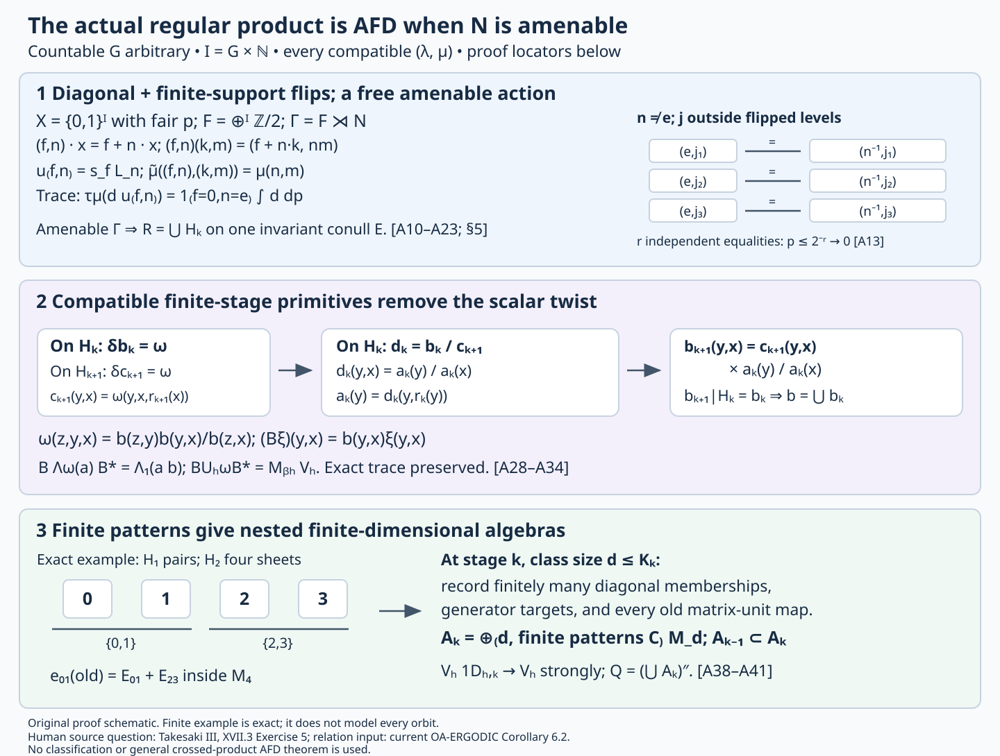

# Amenable regular products and prescribed inner kernels

*Original exposition, proofs and diagram: CC0-1.0 to the extent of rights held. Cited publications and existing components retain their own terms. Figure and reproducible source: component terms.*

The regular product constructed in [Twisted regular products and prescribed inner kernels](OA-FLOW-TRP.md) is approximately finite-dimensional whenever its prescribed normal subgroup is amenable. The ambient countable group can be nonamenable, and every normalized compatible scalar pair is allowed. We identify the actual tensor base with its diagonal and finite-support flips, verify the twisted regular representation, remove the relation cocycle by compatible finite-stage primitives, and construct increasing finite-dimensional algebras in the same product. Each comparison retains the original trace and the full ambient-group action, including its characteristic phases.

The finite-subgroup, trace, Fourier, factor, inner-kernel and characteristic-pair arguments of that lesson remain the inputs to this construction. The site set here is \(G\times\mathbb N_{>0}\). The separate [Bernoulli construction](OA-FLOW-NB.md) uses the site set \(G\) and every \(0<\lambda\leq1\). An explicit compatible class for a proper nonamenable normal subgroup has no AFD II1 realization, as proved in [the irrational-class obstruction](OA-FLOW-NNR.md#nnr-nonrealization). A characterization of all realizable nonamenable classes remains separate. The present argument is tracial and asserts no type-III branch.

## 1. The exact regular product and the theorem

Let \(G\) be countable discrete, let \(N\triangleleft G\) be infinite and amenable, and let \((\lambda,\mu)\) be a normalized compatible pair. In the convention of [compatible lifts](OA-FLOW-CPP.md#cp-compatible), the functions \(\mu:N^2\to\mathbb T\) and \(\lambda:N\times G\to\mathbb T\) satisfy all five identities

\[
\begin{aligned}
\mu(a,b)\mu(ab,c)&=\mu(a,bc)\mu(b,c),\\
\lambda(a,gh)&=\lambda(a,g)\lambda(g^{-1}ag,h),\\
\frac{\lambda(a,g)\lambda(b,g)}{\lambda(ab,g)}
 &=\frac{\mu(g^{-1}ag,g^{-1}bg)}{\mu(a,b)},\\
\lambda(m,n)&=\frac{\mu(n,n^{-1}mn)}{\mu(m,n)},\\
\mu(e,a)=\mu(a,e)&=\lambda(e,g)=\lambda(a,e)=1.
\end{aligned}\tag{ARP0}
\]

Write \(I=G\times\mathbb N_{>0}\). At each site use \(M_2(\mathbb C)\) with its normalized trace. Let \((P,\tau)\) and \(\beta\) be the represented tensor factor and the left site action constructed in TRP Section 8: an observable at \((h,j)\) moves to \((gh,j)\).

Let \(M_\mu\) be the concrete regular product of TRP Sections 2–4, with original implementing unitaries \(L_n\), and let \(\alpha\) be the \(G\)-action of Sections 5–6. Thus

\[
L_nL_m=\mu(n,m)L_{nm},\qquad
L_n\pi(a)L_n^*=\pi(\beta_n(a)),
\tag{A1}
\]

\[
\alpha_g(\pi(a))=\pi(\beta_g(a)),\qquad
\alpha_g(L_n)=\lambda(gng^{-1},g)L_{gng^{-1}}.
\tag{A2}
\]

**Theorem.** There are increasing unital finite-dimensional star algebras \(A_k\subset M_\mu\) such that

\[
M_\mu=\left(\bigcup_k A_k\right)''.
\tag{A3}
\]

Consequently this actual regular construction realizes \([\lambda,\mu]\) on an AFD \(\mathrm{II}_1\) factor, with inner kernel exactly \(N\). No amenability hypothesis is imposed on \(G\). The proof also works for finite \(N\); TRP Section 9 gives its direct finite-subgroup proof. The proof of the theorem is completed in Section 7 below.

TRP Section 3 supplies the faithful normal tracial state \(\tau_\mu\), Section 6 proves factoriality and the entire inner kernel from the outer action, and Section 8 proves that \(P\) is infinite-dimensional and every \(\beta_g\), \(g\ne e\), is outer. The new conclusion needed here is (A3).

Our measured input is [Invariant means on measured relations](../../OA-ERGODIC/reader/invariant-means-on-measured-relations.html), Proposition 2.1, Theorem 6.1 and Corollary 6.2: the principal orbit relation of a countable amenable Borel nonsingular action has, on one invariant conull Borel unit space, an increasing exhaustion by Borel equivalence relations with a uniform finite class-size bound at each stage. Every orbit endpoint pair on that common space is captured. The retained foundations are standard Borel injection and one-to-one Borel images, Radon–Nikodym theory and change of variables, \(L^\infty/L^1\) duality and integral-state approximation as proved in [REL Section 1](OA-FLOW-REL.md#rel-counting-predual), convex separation and weak-star compactness as proved in [CV-1](OA-FLOW-CV.md#cv-1) and [CV-3](OA-FLOW-CV.md#cv-3), Tonelli as proved in [PI2–3](../../OA-MOD/notes/analytic-programme/scalar-product-integration.html#pi2-construction-of-the-sigma-finite-product), and finite-measure continuity. [REL (REL1.s)–(REL1.z)](OA-FLOW-REL.md#rel-weighted-cuts) gives the weighted layer and finite-patch deductions with their Borel and null-set conventions. Section 2 obtains countable product probability and cylinder density from the earlier MIV construction, and proves the finite-coordinate expectations and bounded multiplier convergence used here. Section 8 gives the exact proof locators and their roles.

The direct finite-pattern argument of Section 7 requires neither dyadic balancing and coding nor a general crossed-product AFD theorem or factor-classification theorem. A uniform bound on finite relation-class sizes alone does not make its diagonal algebra finite-dimensional.

## 2. The tensor diagonal and finite-support flips

Put \(X=\{0,1\}^I\). Use the [complete finite-alphabet product construction](OA-FLOW-MIV.md#miv-product-relation) with two letters at every site, each of probability \(1/2\). It supplies the fair probability \(p\) and its cylinder-approximation theorem. We now give the resulting coordinate formulas and the finite averaging argument.

Enumerate \(I=\{i_1,i_2,\ldots\}\) and put \(J_n=\{i_1,\ldots,i_n\}\). The metric
\(d(x,y)=\sum_{n\ge1}2^{-n}|x_{i_n}-y_{i_n}|\)
has the product topology. A Cauchy sequence eventually stabilizes each coordinate; those stabilized values define its limit, since the remaining metric tail is at most \(2^{-n}\). The sequences that are zero outside a finite initial segment form a countable dense set. Thus \(X\) is Polish, and its Borel sets are generated by the countable family of finite cylinders. Compactness follows as in MIV §23 by the nested-cylinder open-cover argument.

For a finite \(J\subset I\) and \(u\in\{0,1\}^J\), write
\[
 C_{J,u}=\{x:x|_J=u\},\qquad
 p(C_{J,u})=2^{-|J|}.
 \tag{A3a}
\]
These are the cylinder masses of the MIV construction. For disjoint finite coordinate sets, multiplication of these masses proves independence. Each point lies in a cylinder of mass \(2^{-n}\) for every \(n\), so every singleton has measure zero. Coordinate permutations and bit flips are homeomorphisms and preserve all the cylinder masses. Their pushforward probabilities remain Radon: compact and open approximating sets transport through the homeomorphism. To see that these probabilities equal the original one, let two Radon probabilities agree on cylinders. Cylinder simple functions are uniformly dense in \(C(X)\), by the same compactness argument; the two integrals therefore agree on \(C(X)\). The uniqueness in the measure construction in MIV §23 makes the probabilities equal. This also shows that choosing a different enumeration of \(I\) does not change \(p\).

For \(f\in L^2(X,p)\), define its finite-coordinate average by
\[
 \mathbb E_J f
 =\sum_{u\in\{0,1\}^J}
       \left(2^{|J|}\int_{C_{J,u}}f\,dp\right)
                        \mathbf1_{C_{J,u}}.
 \tag{A3b}
\]
Each integral exists by the \(L^2\) Cauchy–Schwarz inequality from [SC-06](OA-FLOW-SC.md#sc-06), since \(p(X)=1\). The formula respects equality almost everywhere. It is positive, fixes the constant function one, and satisfies
\(\|\mathbb E_J f\|_\infty\le\|f\|_\infty\) for bounded \(f\), by applying the integral triangle inequality on each cell.

If \(h\) is constant on the \(J\)-cylinders, summing its cellwise constants gives
\[
 \int_X(\mathbb E_Jf)\overline h\,dp
       =\int_X f\overline h\,dp.
 \tag{A3c}
\]
The image of \(\mathbb E_J\) is exactly that finite-dimensional space. Equation (A3c) makes \(f-\mathbb E_Jf\) orthogonal to it in the Hilbert space supplied by [SC-07](OA-FLOW-SC.md#sc-07). Taking \(h=\mathbb E_Jf\) and applying Cauchy–Schwarz gives
\(\|\mathbb E_Jf\|_2\le\|f\|_2\), including the case of zero norm. The same cellwise identity proves the defining conditional-expectation equality on every set determined by \(J\), because each such set is a union of its finitely many cells.

If \(J\subset K\), the \(K\)-cells refine the \(J\)-cells. Adding the integrals over the finer cells and noting that a \(J\)-constant function is also \(K\)-constant prove
\[
 \mathbb E_J\mathbb E_K=\mathbb E_J,\qquad
 \mathbb E_K\mathbb E_J=\mathbb E_J.
 \tag{A3d}
\]
Cylinder functions are dense in \(L^2(X,p)\) by the proved cylinder-approximation result in MIV §23, including after measure completion. Given \(f\in L^2\) and \(\varepsilon>0\), choose a cylinder function \(g\) with \(\|f-g\|_2<\varepsilon\). For all sufficiently large \(n\), every coordinate of \(g\) belongs to \(J_n\), so \(\mathbb E_{J_n}g=g\). The contraction just proved gives
\[
 \|\mathbb E_{J_n}f-f\|_2
 \le\|\mathbb E_{J_n}(f-g)\|_2+\|g-f\|_2
 <2\varepsilon.
 \tag{A3e}
\]
Thus the finite-coordinate averages converge in \(L^2\) for every \(f\), without an appeal to a martingale convergence theorem.

For bounded \(f\), these uniformly bounded averages also converge strongly as multiplication operators on all of \(L^2(X,p)\). Put \(r_n=\mathbb E_{J_n}f-f\). For any \(\xi\in L^2(X,p)\) and \(K>0\), splitting at \(|\xi|=K\) gives
\[
 \|r_n\xi\|_2^2
 \le K^2\|r_n\|_2^2+
       4\|f\|_\infty^2
           \int_{\{|\xi|>K\}}|\xi|^2\,dp .
 \tag{A3f}
\]
The last integral tends to zero as \(K\to\infty\), by [SC-04's monotone convergence theorem](OA-FLOW-SC.md#sc-04) applied to
\(|\xi|^2\mathbf1_{\{|\xi|\le K\}}\). First choose \(K\), then use (A3e) to increase \(n\). This proves the asserted strong limit for every vector. Conjugation commutes with (A3b), so the adjoint multiplication operators converge strongly as well. These are the bounded approximation facts needed to pass from local tensor diagonals to the full measurable diagonal below.

Let

\[
F=\bigoplus_{i\in I}\mathbb Z/2\mathbb Z.
\tag{A4}
\]

An element \(f\in F\) is a finitely supported bit function, with coordinatewise addition modulo two. It acts on \(X\) by \(x\mapsto f+x\). Its tensor flip \(s_f\) uses \(\begin{pmatrix}0&1\\1&0\end{pmatrix}\) at a site where \(f_i=1\), and the identity at every other site. Different-site flips commute, \(s_fs_k=s_{f+k}\), and \(s_f^*=s_f\).

At a finite site set \(E\), the diagonal matrices are functions of \(x|_E\). Every matrix in its local algebra has a unique expression

\[
a=\sum_{f\in F_E}d_f s_f,\qquad
F_E=\{f:\operatorname{supp}f\subset E\},
\tag{A5}
\]

with each \(d_f\) a diagonal function of \(x|_E\). For existence, index the standard matrix basis by binary words \(u,v\) on \(E\). The matrix unit is \(e_{u,v}=\mathbf1_{\{x|_E=u\}}s_{u+v}\), since the flip takes column \(v\) to row \(u\). These matrix units span the local algebra. Uniqueness follows from their distinct flip diagonals, or from the trace computation

\[
\tau((d_f s_f)^*d'_k s_k)
=\mathbf1_{\{f=k\}}\int_X\overline{d_f(x)}d'_f(x)\,dp(x).
\tag{A6}
\]

A nonzero flip has no diagonal matrix entry, so \(\tau(d s_f)=0\) when \(f\ne0\); for \(f=0\) the trace is the uniform bit average. When \(f=k\), move \(s_f\) through the trace and use \(s_f^2=1\). This proves (A6).

The weak closure \(D\) of the local diagonals in \(P\) is the represented copy of \(L^\infty(X,p)\), with trace integral. The averages (A3b)–(A3f) provide uniformly bounded cylinder approximants to every bounded measurable function, converging in \(L^2\) and strongly in the multiplication representation. Applying (A6) to every finite flip yields the unitary

\[
L^2(P,\tau)\cong\bigoplus_{f\in F}L^2(X,p),
\qquad d s_f\longmapsto d\text{ in component }f.
\tag{A7}
\]

Its range is dense because it contains a cylinder function in each component. A local diagonal \(d\) acts there by multiplication by \(d\) on every component. The identical-copy multiplication representation of \(L^\infty(X,p)\) is faithful and normal. Its norm is the essential supremum, tested on the component \(f=0\); its vector coefficient functions belong to \(L^1(X,p)\), by Cauchy–Schwarz and summation over components. Its represented bounded balls are weakly compact by \(L^\infty/L^1\) weak-star compactness, and hence weakly closed. The bounded approximation lemma in TRP Section 1 makes its full image a von Neumann algebra.

The uniformly bounded cylinder expectations converge strongly to every bounded multiplication operator. Indeed \(L^2\) convergence implies convergence in measure, and integration against the \(L^1\) density of any squared vector gives strong convergence. Sum over components, using the square-summable tail and the uniform bound. Thus every bounded measurable function belongs to \(D\), while the weakly closed full multiplication image contains \(D\). This proves the exact diagonal identification.

Both generators lie in the actual \(P\), and (A5) gives

\[
P=(D\cup\{s_f:f\in F\})'',\qquad
s_fd s_f^*(x)=d(f+x).
\tag{A8}
\]

For \(n\in N\), set \((n.x)_i=x_{n^{-1}i}\), where \(n.(h,j)=(nh,j)\), and \((n.f)_i=f_{n^{-1}i}\). The constructed \(\beta_n\) satisfies

\[
\beta_n(d)(x)=d(n^{-1}.x),\qquad
\beta_n(s_f)=s_{n.f}.
\tag{A9}
\]

These formulas hold at every tensor site and pass to \(D\) and \(P\) by normality. All site permutations and flips preserve \(p\), because they preserve every finite-cylinder probability.

## 3. A free amenable action on the actual sites

Use the semidirect product

\[
\Gamma=F\rtimes N,\qquad
(f,n)(k,m)=(f+n.k,nm),\qquad
(f,n).x=f+n.x.
\tag{A10}
\]

The inverse of \((f,n)\) is \((n^{-1}.f,n^{-1})\), since addition in \(F\) is modulo two. The product law proves the action identity directly. The group is countable, the action is Borel and probability preserving, and \(q:\Gamma\to N\), \(q(f,n)=n\), is a homomorphism.

**Amenability.** Enumerate \(I\) and average uniformly on the finite subgroup of flips supported at its first \(j\) sites. Choose an ultrafilter containing every tail of \(\mathbb N_{>0}\), and take the pointwise scalar limit of those averages. Interval bisection gives the limit of every bounded real sequence; real and imaginary parts give the complex limit. Finite sums, positivity and the unit pass to that limit. Every fixed flip belongs to every sufficiently late finite subgroup, where its translation permutes the averaging set. The resulting mean \(m_F\) on \(\ell^\infty(F)\) is left invariant.

Let \(m_N\) be a left-invariant mean expressing the amenability of \(N\). For bounded \(\Phi\) on \(\Gamma\), set

\[
A\Phi(n)=m_F\bigl(f\mapsto\Phi((0,n)(f,e))\bigr),
\qquad m_\Gamma(\Phi)=m_N(A\Phi).
\tag{A11}
\]

This is a positive normalized linear functional. For \(t=(k,m)\),

\[
t(0,n)(f,e)=(0,mn)((mn)^{-1}.k+f,e).
\tag{A12}
\]

The inner mean removes the fixed \(F\)-translation, giving \(A(\Phi\circ L_t)(n)=A\Phi(mn)\), where \(L_t\) denotes left multiplication by \(t\). The outer mean removes that \(N\)-translation. Thus \(m_\Gamma\) is left invariant. This proof of amenability requires no invariance of \(m_F\) under the \(N\)-automorphisms.

**Freeness.** If \((f,e)\) fixes \(x\), then \(f+x=x\), so \(f=0\). If \(n\ne e\), choose infinitely many levels \(j\) outside the second-coordinate projection of the finite set \(\operatorname{supp}f\subset G\times\mathbb N_{>0}\). A fixed point of \((f,n)\) must satisfy

\[
x_{(e,j)}=x_{(n^{-1},j)}.
\tag{A13}
\]

The two sites are distinct. Different \(j\)'s give disjoint pairs, so any \(r\) such equalities have probability \(2^{-r}\). The fixed-point set therefore has measure zero. This covers finite-order and infinite-order \(n\). Remove the fixed-point sets of all nonidentity elements of the countable group \(\Gamma\). Their union is Borel and null; its complement \(X_0\) is \(\Gamma\)-invariant. It is also \(G\)-invariant, since the \(G\) site action conjugates \((f,n)\) to \((g.f,gng^{-1})\), which belongs to \(\Gamma\) because \(N\) is normal.

The action is also ergodic, although the finite-relation exhaustion does not require this. A \(\Gamma\)-invariant function in \(L^2\) is \(F\)-invariant. Its conditional expectation onto a finite bit set commutes with every flip of those bits, and is therefore constant on that finite binary cube. Cylinder density makes these expectations converge to the original function, which must be constant. Invariant indicators consequently have measure zero or one.

## 4. The same regular algebra, trace and full group action

Suppress \(\pi\) on the tensor-base generators and set

\[
u_{(f,n)}=s_fL_n,\qquad
\widetilde\mu((f,n),(k,m))=\mu(n,m).
\tag{A14}
\]

Equations (A1) and (A9) give

\[
u_hu_k=\widetilde\mu(h,k)u_{hk},\qquad
u_hd u_h^*(x)=d(h^{-1}.x).
\tag{A15}
\]

The normalized cocycle \(\widetilde\mu\) is the pullback of \(\mu\) along \(q\). The actual trace satisfies

\[
\tau_\mu(d u_{(f,n)})
=\mathbf1_{\{n=e\}}\mathbf1_{\{f=0\}}\int_Xd\,dp.
\tag{A16}
\]

For \(n\ne e\), use the original identity Fourier coefficient; for \(n=e\), use the local flip trace (A6), extended normally to \(D\). Distinct \(h\)-monomials are therefore orthogonal, with squared norm \(\|d\|_2^2\).

Apply (A7) at every \(N\)-coordinate of the coefficient Hilbert space in TRP Section 2. This gives an onto unitary from the same trace GNS space onto

\[
\mathcal K=\ell^2(\Gamma,L^2(X,p)),\qquad
\sum_{f,n}d_{f,n}s_f[n]\longmapsto(d_{f,n})_{(f,n)}.
\tag{A17}
\]

In these coefficient coordinates the left generators are

\[
(M_d\xi)(k,x)=d(x)\xi(k,x),\qquad
(U_h\xi)(k,x)=\widetilde\mu(h,h^{-1}k)
\xi(h^{-1}k,h^{-1}.x).
\tag{A18}
\]

They are bounded, \(U_h\) is unitary, and (A15) verifies their product and adjoint laws on dense finite monomials. Thus (A17) intertwines their actual bounded extensions. The generated algebra is exactly the original \(M_\mu\): it contains \(D,s_f,L_n\), which generate \(P\) and the original group implementers by (A8), and every displayed generator already lies in \(M_\mu\). The vacuum is the constant function one in component \(e\); (A16) identifies the original faithful normal trace.

Put \(R=\{(y,x)\in X_0^2:y=h.x\text{ for some }h\in\Gamma\}\). Freeness gives a unique label \(h_{(y,x)}\). It is Borel: each label level set is the Borel graph of that label, and these graphs are countable and disjoint. Give \(R\) source counting measure

\[
\nu(A)=\int_{X_0}\sum_{y\sim x}\mathbf1_A(y,x)\,dp(x).
\tag{A19}
\]

Because every group element preserves \(p\), source and range counting measures agree. The endpoint-coordinate unitary is

\[
(T\xi)(y,x)=\xi(h_{(y,x)},y),\qquad
\mathcal K\cong L^2(R,\nu).
\tag{A20}
\]

Its squared norm is \(\sum_h\int_X|\xi(h,h.x)|^2\,dp(x)=\sum_h\int_X|\xi(h,y)|^2\,dp(y)\). Its inverse is \(\xi(h,y)=\zeta(y,h^{-1}.y)\), proving surjectivity.

For composable relation points put

\[
\omega(z,y,x)=\widetilde\mu(h_{(z,y)},h_{(y,x)}).
\tag{A21}
\]

Endpoint uniqueness gives \(h_{(z,y)}h_{(y,x)}=h_{(z,x)}\); the multiplier identity therefore gives

\[
\omega(w,z,y)\omega(w,y,x)
=\omega(w,z,x)\omega(z,y,x).
\tag{A22}
\]

It is normalized whenever adjacent points coincide. Transporting (A18), diagonal functions multiply the range coordinate and

\[
(U_h^\omega\zeta)(z,x)
=\omega(z,h^{-1}.z,x)\zeta(h^{-1}.z,x).
\tag{A23}
\]

For a kernel \(a\) supported on a finite union of partial-bijection graphs, its left action is

\[
(\Lambda_\omega(a)\zeta)(z,x)
=\sum_{y\sim x}a(z,y)\omega(z,y,x)\zeta(y,x).
\tag{A24}
\]

Equation (A23) is the one-graph case. The vacuum becomes the indicator of the diagonal of \(R\). These formulas identify the precise trace and twisted regular representation.

The full \(G\)-equivariance retains the \(\lambda\)-phase. Define \(\theta_g(f,n)=(g.f,gng^{-1})\). By (A2),

\[
\alpha_g(d)=d\circ g^{-1},\qquad
\alpha_g(u_h)=\lambda(gq(h)g^{-1},g)u_{\theta_g(h)}.
\tag{A25}
\]

The coefficient-space unitary is

\[
(C_g\xi)(h,y)=\lambda(q(h),g)
\xi(\theta_g^{-1}(h),g^{-1}.y).
\tag{A26}
\]

On the dense algebra vacuum orbit it agrees with the original trace-preserving action unitary. Equation (A16), or invariance of \(p\), proves unitarity. In relation coordinates it is

\[
(C_g^R\zeta)(y,x)=\lambda(q(h_{(y,x)}),g)
\zeta(g^{-1}.y,g^{-1}.x).
\tag{A27}
\]

Thus both the characteristic convention and the complete group action are retained.

## 5. Finite relations and a compatible primitive

Apply the measured-relation theorem from Section 1 to this \(\Gamma\)-action. All its hypotheses have been supplied: \(\Gamma\) is countable amenable, \(X\) is standard probability, and the maps are Borel probability-preserving bijections. It gives a \(\Gamma\)-invariant conull Borel set \(E\subset X_0\) and increasing finite Borel relations \(H_k\) on \(E\), with class-size bound \(K_k\), whose union is \(R|_E\).

Replace \(E\) by \(\bigcap_{g\in G}g.E\). This is Borel and conull, and is both \(G\)-invariant and \(\Gamma\)-invariant because \(G\) normalizes \(\Gamma\). Restrict every \(H_k\) to that set. The restrictions retain the bounds \(K_k\), nesting and every \(R\)-pair. Hereafter \(R\) denotes this restriction. Discarding the invariant null set changes neither the represented operators nor their traces: its source-counting and range-counting subsets are null. Adjoin \(H_0\) equal to the diagonal if needed.

The finite representatives and sheets used below can be constructed directly in the coordinate model. We first prove their Borel and measure properties.

**Finite selectors and their measures.** Fix an enumeration \(I=\{i_1,i_2,\ldots\}\) and put
\[
 t(x)=\sum_{m\geq1}2\,3^{-m}x_{i_m}\quad(x\in E).
\tag{A27a}
\]
This is the restriction of a continuous function on \(X\): its partial sums converge uniformly. If \(x\) and \(y\) first differ at \(i_m\), the contribution \(2\,3^{-m}\) at that coordinate exceeds the total possible contribution \(3^{-m}\) of the later coordinates. Thus \(t(x)\ne t(y)\). It gives a concrete Borel injection on the actual conull space, and hence a strict order on each finite class.

For the next formulas fix one \(H=H_k\), with class bound \(K=K_k\). For \(h\in\Gamma\), set
\[
 S_h=\{x\in E:(h.x,x)\in H\},\qquad
 d_H(x)=\sum_{h\in\Gamma}\mathbf1_{S_h}(x),\qquad
 \rho_H(x)=\sum_{h\in\Gamma}\mathbf1_{S_h}(x)
                    \mathbf1_{\{t(h.x)<t(x)\}}.
\tag{A27b}
\]
The maps and sets in these expressions are Borel. The action is free on \(E\), so its distinct labels give distinct points: \(d_H(x)\) is exactly the class size, not a count of repeated group descriptions. The second sum is the rank of \(x\) in that class, starting at zero. Both sums are limits of finite sums of Borel functions, and
\(1\leq d_H(x)\leq K\), \(0\leq\rho_H(x)<d_H(x)\).
In particular
\[
 T_d=\{x:d_H(x)=d,\ \rho_H(x)=0\},\qquad 1\leq d\leq K,
\tag{A27c}
\]
is a Borel transversal for the classes of size \(d\).

There is exactly one \(h\) with \(x\in S_h\) and \(\rho_H(h.x)=0\). On that Borel set define \(r(x)=h.x\). These sets form a countable Borel partition of \(E\), so \(r\) is Borel. It is the \(t\)-least point of the class and is constant on the whole class. For \(0\leq a<d\), similarly partition \(T_d\) into
\[
 D_{a,h}=\{z\in T_d:z\in S_h,\ \rho_H(h.z)=a\},\qquad
 \theta_a(z)=h.z\quad(z\in D_{a,h}).
\tag{A27d}
\]
Every class has exactly one point of rank \(a\); thus these are disjoint sets covering \(T_d\), and \(\theta_a\) is Borel. It is injective, since two equal image points have the same class representative. For every Borel \(C\subset T_d\),
\[
 \theta_a(C)=\bigcup_{h\in\Gamma}h.(C\cap D_{a,h}).
\tag{A27e}
\]
Each term is Borel: a group map on \(E\) is a Borel bijection with Borel inverse, so its image of a Borel set is the inverse image under that inverse. Hence the displayed union is Borel. The image \(\theta_a(T_d)\) is precisely
\(\{x:d_H(x)=d,\rho_H(x)=a\}\), and the inverse of \(\theta_a\) there is \(r\). This proves all image and inverse assertions needed for the finite sheets directly from the given action. In particular \(\theta_a\theta_b^{-1}\) on \(\theta_b(C)\) is a Borel partial orbit bijection with Borel domain and range.

Every such partial bijection preserves \(p\). More generally, let \(\psi:D\to E\) be a Borel injection whose graph lies in \(R\), with \(D\) Borel. The sets \(D_h=\{x\in D:\psi(x)=h.x\}\) form a Borel partition. Their images are disjoint by injectivity. For any Borel \(C\subset D\), the image is Borel by the same union as (A27e), and countable additivity and invariance under each \(h\) give
\[
 p(\psi(C))=\sum_{h\in\Gamma}p(h.(C\cap D_h))
           =\sum_{h\in\Gamma}p(C\cap D_h)=p(C).
\tag{A27f}
\]
The identity first for indicators, then simple functions, and then increasing nonnegative simple approximants gives
\[
 \int_{\psi(D)} f(y)\,dp(y)=\int_D f(\psi(x))\,dp(x)\qquad(f\geq0).
\tag{A27g}
\]
The last passage is [SC-04](OA-FLOW-SC.md#sc-04). Integrable complex functions follow by their four nonnegative parts. A completed-measure null modification has the same formulas: put the modification inside a Borel null set and apply (A27f) to that set on each group piece.

Consequently the \(d\) disjoint sheets above \(C\subset T_d\) have equal measure \(p(C)\), and
\[
 p([C]_H)=d\,p(C),\qquad
 \int_{[C]_H}f\,dp=\sum_{a=0}^{d-1}\int_C f(\theta_a(z))\,dp(z),
 \qquad \sum_{d=1}^{K}d\,p(T_d)=1.
\tag{A27h}
\]
Here the middle identity holds for nonnegative or integrable \(f\). Thus a sheet has mass \(p(C)\), rather than \(p(C)/d\); the matrix block over \(C\) has total mass \(d\,p(C)\). These are the weights used in Section 7.

The two counting measures on the full relation also agree without a density calculation. For nonnegative Borel \(F\) on \(R\), freeness, (A27g) for group maps and monotone convergence give
\[
 \begin{aligned}
 \nu_s(F)&=\sum_{h\in\Gamma}\int_E F(h.x,x)\,dp(x)\\
 &=\sum_{h\in\Gamma}\int_E F(y,h^{-1}.y)\,dp(y)
 =\nu_r(F).
 \end{aligned}
\tag{A27i}
\]
Each individual group graph has measure one, so these measures are sigma-finite. Their common value is the \(\nu\) in (A19), and the relation density is the constant \(1\). This also holds on every restricted relation over a Borel subset of \(E\), using the restricted measure. The general nonsingular density and chain-rule construction used in the measured theorem is proved in [REL Section 1](OA-FLOW-REL.md#rel-1). Its strict convex separation and compact dual-ball inputs are [CV-1](OA-FLOW-CV.md#cv-1) and [CV-3](OA-FLOW-CV.md#cv-3). For this probability-preserving construction, (A27f)–(A27i) supply the precise specializations. The same earlier section proves (REL1.l)–(REL1.r): the scalar predual, the integral-state approximation and the simultaneous norm-small partial-map defects required in the finite-patch argument. Equations (REL1.s)–(REL1.z) then pass from those density errors to a finite level set and the exact patch-boundary estimate. Here their density factors are all \(1\) by (A27i).

We now write \(r_k\) for the preceding \(r\) associated to \(H_k\). The primitive construction uses these representatives on the same invariant conull domain at every stage.

On \(H_k\) define

\[
c_k(y,x)=\omega(y,x,r_k(x)).
\tag{A28}
\]

For \(z\mathrel{H_k}y\mathrel{H_k}x\), the three representatives agree. Applying (A22) to \((z,y,x,r_k(x))\) proves

\[
\frac{c_k(z,y)c_k(y,x)}{c_k(z,x)}=\omega(z,y,x).
\tag{A29}
\]

Each \(c_k\) is normalized on the diagonal. The independently chosen \(c_k\)'s need not agree on preceding stages; we now construct compatible primitives.

Suppose \(b_k\) is a normalized primitive on \(H_k\), starting with \(b_0=1\) on the diagonal. On \(H_k\) let \(d_k=b_k/c_{k+1}\). The two primitive equations imply

\[
d_k(z,y)d_k(y,x)=d_k(z,x).
\tag{A30}
\]

Set \(a_k(y)=d_k(y,r_k(y))\) for \(y\in E\). Equation (A30) gives \(d_k(y,x)=a_k(y)/a_k(x)\) on \(H_k\). On all of \(H_{k+1}\) put

\[
b_{k+1}(y,x)=c_{k+1}(y,x)\frac{a_k(y)}{a_k(x)}.
\tag{A31}
\]

This is Borel and normalized. It remains a primitive because the extra ratio has trivial coboundary, and it agrees exactly with \(b_k\) on \(H_k\). Their union is a single Borel function \(b:R\to\mathbb T\), with \(b(x,x)=1\), satisfying

\[
\omega(z,y,x)=\frac{b(z,y)b(y,x)}{b(z,x)}.
\tag{A32}
\]

Every composable triple belongs to some \(H_k\): its two adjacent pairs belong to a common sufficiently late stage, and that stage is transitive. Thus (A32) holds for every triple on the chosen common domain. This proves the global primitive, including compatibility and all conull quantifiers.

## 6. The regular intertwiner and its sign

Define the unitary \((B\zeta)(y,x)=b(y,x)\zeta(y,x)\) on \(L^2(R,\nu)\). It fixes the trace vacuum because \(b(x,x)=1\). Substitution in (A24) gives

\[
\begin{aligned}
(B\Lambda_\omega(a)B^*\zeta)(z,x)
&=\sum_y a(z,y)\frac{b(z,x)}{b(y,x)}
\omega(z,y,x)\zeta(y,x)\\
&=\sum_y a(z,y)b(z,y)\zeta(y,x).
\end{aligned}
\tag{A33}
\]

Thus \(B\) sends a twisted kernel \(a\) to the ordinary kernel \(ab\). Multiplication by \(b\), rather than its inverse, is the Hilbert-space intertwiner for (A32) and (A24).

Let \((V_h\zeta)(y,x)=\zeta(h^{-1}.y,x)\) be the ordinary group graph operator. Then

\[
BU_h^\omega B^*=M_{b_h}V_h,\qquad
b_h(y)=b(y,h^{-1}.y).
\tag{A34}
\]

The diagonal is fixed by \(B\), and each \(b_h\) is a bounded measurable unit-modulus diagonal function. The conjugated algebra is exactly

\[
Q=(L^\infty(E,p)\cup\{V_h:h\in\Gamma\})''.
\tag{A35}
\]

For the reverse inclusion, \(V_h=M_{\overline{b_h}}(M_{b_h}V_h)\), so all graph generators remain available. Unitary conjugation gives a normal faithful trace-preserving isomorphism from the original \(M_\mu\) onto \(Q\).

The primitive need not be \(G\)-invariant. The transported \(G\)-action is implemented exactly by

\[
(Z_g\zeta)(y,x)=b(y,x)\lambda(q(h_{(y,x)}),g)
\overline{b(g^{-1}.y,g^{-1}.x)}
\zeta(g^{-1}.y,g^{-1}.x).
\tag{A36}
\]

This is \(BC_g^RB^*\). It fixes the vacuum and preserves \(Q\) because it transports the original action. An equivariant primitive is unnecessary. The original implementers for \(N\) are still the transported \(u_{(0,n)}\), and (A25) retains their characteristic phases exactly.

## 7. Increasing finite-dimensional algebras from finite patterns

We prove (A3) inside \(Q\). A bounded finite relation \(H_k\) does not by itself yield a finite-dimensional von Neumann algebra, since its transversal can carry a diffuse function algebra. Finite patterns on that transversal give the required finite-dimensional subalgebras.

Every Borel partial orbit bijection \(\psi:D\to E'\) has an ordinary partial graph operator \(V_\psi\in Q\). Its action moves the first relation coordinate from \(\psi^{-1}.y\) to \(y\) on \(E'\), and is zero off \(E'\). Partition \(D\) by the unique \(\Gamma\)-label of \(\psi\). The pieces \(D_h\) have disjoint images \(h.D_h\), and

\[
V_\psi=\sum_{h\in\Gamma}V_h M_{\mathbf1_{D_h}}.
\tag{A37}
\]

Every finite partial sum has norm at most one, since its domains and ranges are both disjoint and it is a partial isometry. The squared norm of its omitted action on a vector is the sum of that vector's squared masses on the omitted domain pieces, which tends to zero. The sum converges strongly, proving \(V_\psi\in Q\). These maps are nonsingular because each is a countable disjoint union of restrictions of \(p\)-preserving group maps. No density factor enters the first-coordinate counting action.

Sort each \(H_k\)-class by \(t\). Use the Borel transversals \(T_{k,d}\), rank maps \(\theta_a:T_{k,d}\to E\), and their Borel inverses \(r_k\) constructed in (A27b)–(A27e), with \(0\leq a<d\leq K_k\) and \(\theta_0\) the identity. Their images partition the class-size-\(d\) part, and (A27f)–(A27h) prove that every sheet has the same measure as its transversal. For Borel \(C\subset T_{k,d}\), the transports \(\theta_a\theta_b^{-1}\) on \(\theta_b(C)\) have graphs in \(H_k\) and lie in \(Q\) by (A37). Denote their operators by \(e_{ab}^C\). First-coordinate counting gives

\[
e_{ab}^C e_{cl}^C=\mathbf1_{\{b=c\}}e_{al}^C,
\qquad (e_{ab}^C)^*=e_{ba}^C,
\qquad\sum_a e_{aa}^C=M_{\mathbf1_{[C]_{H_k}}}.
\tag{A38}
\]

Disjoint transversal pieces have orthogonal operator supports. If \(C\) has positive measure, all these matrix units are nonzero: the sheets are nonsingular, and a nonzero sheet projection acts nontrivially on the diagonal vacuum. Their scalar span is a copy of \(M_d(\mathbb C)\). Null pieces give zero operators, since their countable orbit saturations are null.

**Finite-pattern lemma.** Fix \(H_k\), finitely many Borel sets \(B_1,\ldots,B_r\), and partial orbit bijections \(\psi_1,\ldots,\psi_s\) whose graphs lie in \(H_k\). For \(z\in T_{k,d}\), record:

1. for every \(a,i\), whether \(\theta_a(z)\in B_i\);
2. for every \(a,j\), whether \(\psi_j\) is defined at \(\theta_a(z)\) and, if so, its unique target rank \(c\), where \(\psi_j(\theta_a(z))=\theta_c(z)\).

There are finitely many records: \(d\) is bounded, membership is binary, and each map target is one of \(d\) ranks or is undefined. Each record is Borel. Partition each \(T_{k,d}\) into its finitely many pattern sets \(C\) and take the scalar spans of all \(e_{ab}^C\). This yields a unital finite-dimensional algebra

\[
\mathcal A(H_k;\text{patterns})\cong
\bigoplus_{d,C\text{ nonnull}}M_d(\mathbb C).
\tag{A39}
\]

It is a star algebra by (A38), and is weakly closed: finitely many vector coefficient functionals separating a basis reconstruct its coordinates and preserve each weak limit. Every specified diagonal projection is a sum of diagonal \(e_{aa}^C\). Each specified \(V_{\psi_j}\) is the sum of the \(e_{ca}^C\) prescribed by its record. This is a finite sum because patterns and ranks are finite. The lemma therefore gives exact containment of every specified projection and partial graph operator.

Enumerate \(\Gamma\) as \(h_1,h_2,\ldots\), and enumerate a countable cylinder algebra generating the Borel sets of \(X\) as \(B_1,B_2,\ldots\). Restrict the sets to \(E\). For each \(k\), let

\[
D_{j,k}=\{x\in E:(h_j.x,x)\in H_k\},\qquad
\psi_{j,k}=h_j|_{D_{j,k}}.
\tag{A40}
\]

They are Borel partial bijections with graphs in \(H_k\). For fixed \(j\), the sets \(D_{j,k}\) increase to \(E\), since every orbit pair on \(E\) belongs to some \(H_k\).

Start with \(A_0=\mathbb C1\). At stage \(k\), apply the finite-pattern lemma to \(H_k\), the sets \(B_1,\ldots,B_k\), the maps \(\psi_{1,k},\ldots,\psi_{k,k}\), and every partial map underlying a matrix unit in the chosen finite matrix-unit basis of \(A_{k-1}\). Those old maps have graphs in \(H_{k-1}\subset H_k\), and there are finitely many. Let \(A_k\) be the full pattern algebra (A39). Then

\[
A_{k-1}\subset A_k,\qquad
M_{\mathbf1_{B_j}}\in A_k\ (j\leq k),\qquad
V_{h_j}M_{\mathbf1_{D_{j,k}}}\in A_k\ (j\leq k).
\tag{A41}
\]

Every old matrix unit belongs exactly, since its underlying map was included in the pattern record. Thus the inclusion uses no approximation or change of phase, even when old classes have different sizes or merge. Every \(A_k\) is unital and finite-dimensional.

Put \(Q_0=(\bigcup_k A_k)''\). It contains the full diagonal. Indeed it contains every generating cylinder projection, and the measurable sets whose projections lie in \(Q_0\) form a sigma algebra by complements, finite unions and strong limits of increasing unions. Bounded simple approximation then gives all of \(L^\infty(E,p)\), modulo null sets. For fixed \(j\), dominated convergence in (A19) gives \(M_{\mathbf1_{D_{j,k}}}\to1\) strongly. Equation (A41) therefore places \(V_{h_j}\) in \(Q_0\) by a strong limit. All generators in (A35) belong to \(Q_0\), so \(Q_0=Q\).

Finally pull these algebras back through the explicit unitaries (A17), (A20) and \(B\). Their inverse images are increasing unital finite-dimensional algebras in the same original \(M_\mu\), and generate it. This proves (A3). The earlier factor, trace, infinite-dimensionality, exact-kernel and characteristic-pair arguments now prove the theorem of Section 1 at the stated measure and operator foundations. \(\square\)

### Explicit trace-preserving approximants and their errors

The matrix units above determine approximation maps, not just a dense union. Write \(\tau_Q\) for the trace transported to \(Q\), and \(\|x\|_2=\tau_Q(x^*x)^{1/2}\). At stage \(k\), index the nonnull pattern blocks by \(C\), with matrix size \(d_C\). Traciality and (A38) give
\[
 m_C=\tau_Q(e_{aa}^C)=p(C)>0,\qquad
 \tau_Q((e_{ab}^C)^*e_{cl}^{C'})
   =\mathbf1_{\{C=C',\,a=c,\,b=l\}}m_C .
 \tag{A42}
\]
The equality with \(p(C)\) uses \(\theta_0(C)=C\); all diagonal matrix units in a block have equal trace. In particular every sheet \(\theta_a(C)\) has measure \(m_C\). There are only finitely many blocks, and their diagonal units sum to one.

For \(x\in Q\), define
\[
 \mathcal E_k(x)=
 \sum_C\sum_{a,b=0}^{d_C-1}
       \frac{\tau_Q(e_{ba}^C x)}{m_C}\,e_{ab}^C .
 \tag{A43}
\]
All coefficients are normal bounded linear functionals. Thus \(\mathcal E_k\) is normal. Formula (A42) proves that it fixes \(A_k\) pointwise, and summing its diagonal coefficients proves
\(\tau_Q(\mathcal E_k(x))=\tau_Q(x)\). Multiplication by a matrix unit on either side in (A43), using (A38) and traciality to move a right factor to the left, gives
\[
 \mathcal E_k(a x b)=a\,\mathcal E_k(x)\,b
        \qquad(a,b\in A_k).
 \tag{A44}
\]

Here is positivity at every matrix level. Suppose \([x_{ij}]\ge0\) in \(M_n(Q)\), fix one block \(C\), and choose scalars \(\zeta_{i,a}\). Put \(v_i=\sum_a\zeta_{i,a}e_{a0}^C\). Then
\[
 \begin{aligned}
 &\sum_{i,j,a,b}\overline{\zeta_{i,a}}\zeta_{j,b}
       \frac{\tau_Q(e_{ba}^C x_{ij})}{m_C}\\
 &\qquad=\frac1{m_C}
       \tau_Q\!\left(\sum_{i,j}v_i^*x_{ij}v_j\right)\ge0 .
 \end{aligned}
 \tag{A45}
\]
The equality follows by expanding \(v_jv_i^*\) and cycling under the trace. The last operator is positive by the assumed positivity of \([x_{ij}]\). Hence every matrix block of \([\mathcal E_k(x_{ij})]\) is positive. This proves complete positivity. Together with \(\mathcal E_k(1)=1\) and (A44), it makes \(\mathcal E_k\) a trace-preserving conditional expectation onto the actual \(A_k\).

Applying its two-by-two positivity to
\(\begin{pmatrix}x^*x&x^*\\x&1\end{pmatrix}\)
gives
\[
 \mathcal E_k(x)^*\mathcal E_k(x)
       \le\mathcal E_k(x^*x),\qquad
 \|\mathcal E_k(x)\|\le\|x\|,\qquad
 \|\mathcal E_k(x)\|_2\le\|x\|_2 .
 \tag{A46}
\]
For the first inequality, test the resulting positive block matrix on vectors \((\xi,-\mathcal E_k(x)\xi)\). Positivity and unitality bound its upper-left entry by \(\|x\|^2 1\), giving the operator-norm bound; taking the trace gives the \(2\)-norm bound.

Moreover, for every \(a\in A_k\), (A44) and trace preservation give
\[
 \tau_Q(a^*\mathcal E_k(x))=\tau_Q(a^*x).
 \tag{A47}
\]
Thus \(\mathcal E_k\) is the orthogonal projection onto \(A_k\) in trace \(L^2\). In particular it gives the best \(2\)-norm approximation from \(A_k\). The nested ranges also give
\(\mathcal E_j\mathcal E_k=\mathcal E_k\mathcal E_j=\mathcal E_j\) for \(j\le k\): a vector orthogonal to \(A_k\) is orthogonal to \(A_j\), and \(\mathcal E_k\) fixes \(A_j\).

On the diagonal, the formula is an ordinary finite-partition average. If \(f\in L^\infty(E,p)\), all off-diagonal coefficients in (A43) vanish, since a nonidentity partial graph has zero diagonal trace. Therefore
\[
 \begin{aligned}
 \mathcal E_k(M_f)&=M_{\mathcal D_k f},\\
 \mathcal D_k f
   &=\sum_{C,a}
       \left(\frac1{m_C}\int_{\theta_a(C)} f\,dp\right)
                      \mathbf1_{\theta_a(C)} .
 \end{aligned}
 \tag{A48}
\]
The finitely many sheets partition \(E\) modulo null sets. Consequently
\(\|\mathcal D_kf\|_\infty\le\|f\|_\infty\). Every fixed cylinder simple function is fixed by \(\mathcal D_k\) for all sufficiently large \(k\), by (A41). Cylinder \(L^2\) density and the contraction in (A46) imply
\(\|\mathcal D_kf-f\|_2\to0\) for every bounded measurable \(f\).

For an explicit error bound, take a finite Fourier sum in the untwisted algebra,
\[
 x=\sum_{h\in S}M_{f_h}V_h,\qquad f_h\in L^\infty(E,p),
 \tag{A49}
\]
with distinct \(h\)'s. Choose \(k\) at least as large as the indices of all \(h\in S\) in the enumeration of (A40), and write
\(D_{h,k}=\{y:(h.y,y)\in H_k\}\). The operator
\[
 x_k=\sum_{h\in S}
       M_{\mathcal D_k f_h}V_hM_{\mathbf1_{D_{h,k}}}
       \quad\hbox{belongs to }A_k .
 \tag{A50}
\]
Both factors of each summand belong to \(A_k\), by (A41) and (A48).
Since \(V_hM_{\mathbf1_D}=M_{\mathbf1_{h.D}}V_h\), Fourier orthogonality from (A16), transported through \(B\), gives the exact identity and estimate
\[
 \begin{aligned}
 \|x-x_k\|_2^2
 &=\sum_{h\in S}\left(
       \int_{h.D_{h,k}}|f_h-\mathcal D_kf_h|^2\,dp
       +\int_{E\setminus h.D_{h,k}}|f_h|^2\,dp\right)\\
 &\le\sum_{h\in S}\left(
       \|f_h-\mathcal D_kf_h\|_2^2
       +\|f_h\|_\infty^2\,p(E\setminus D_{h,k})\right).
 \end{aligned}
 \tag{A51}
\]
Measure preservation by \(h\) gives the last boundary mass. Each mass tends to zero because \(D_{h,k}\uparrow E\). This separates the two errors: averaging the coefficient on finitely many sheets, and omitting the part of its group graph not yet in \(H_k\). No estimate requires the primitive \(b\) to be constant on those sheets. For an original twisted sum \(\sum_hM_{a_h}U_h^\omega\), simply use \(f_h=a_h b_h\), as prescribed by (A34).

By (A47), \(\|x-\mathcal E_k(x)\|_2\le\|x-x_k\|_2\). Finite Fourier sums with bounded coefficients are dense in trace \(L^2\), by the onto model (A17) and the trace-preserving unitaries (A20) and \(B\). For any \(x\in Q\), choose such a sum \(y\); the contraction in (A46) gives
\[
 \|x-\mathcal E_k(x)\|_2
 \le 2\|x-y\|_2+\|y-\mathcal E_k(y)\|_2 .
 \tag{A52}
\]
after first making \(\|x-y\|_2\) arbitrarily small and then increasing \(k\).

This is also strong-star convergence in the actual trace representation. If \(\Omega_Q\) is its cyclic trace vector and \(z_k=\mathcal E_k(x)-x\), then for \(a\in Q\)
\[
 \|z_k a\Omega_Q\|^2
   =\tau_Q(z_k^*z_k aa^*)\le\|a\|^2\|z_k\|_2^2 .
 \tag{A53}
\]
The same estimate holds for \(z_k^*\), since traciality gives
\(\|z_k^*\|_2=\|z_k\|_2\). The set \(Q\Omega_Q\) is dense and
\(\|z_k\|\le2\|x\|\), so these estimates extend to every vector. Pulling back (A43) through (A17), (A20) and \(B\) supplies normal unital completely positive, trace-preserving expectations onto the finite-dimensional algebras in the original \(M_\mu\), converging strongly-star to the identity on every bounded operator.

## 8. Illustration, prerequisites and sources

*Figure. Proof schematic for (A10), (A13), (A28)–(A34) and (A38)–(A41). The site pairs are the actual independent coordinates \((e,j),(n^{-1},j)\), with \(n\ne e\) and \(j\) outside the flipped levels, namely the second-coordinate projection of \(\operatorname{supp}f\). Each equality has probability \(1/2\). This is not a geometric ordering of \(G\). The cocycle panel gives the exact primitive and multiplication-by-\(b\) convention. The matrix panel gives an exact four-sheet example and the general block formula; it does not assert that every \(H_k\)-class has four points. Each arrow is labelled by its map or inclusion. The diagram and its reproducible source are original.*

| Prerequisite | Exact proof locator and use |
|---|---|
| Compatible scalar pairs | [CPP Section 1](OA-FLOW-CPP.md#cp-compatible), (CP1), and [TRP Section 1](OA-FLOW-TRP.md#trp-setting), (TR1): all five identities, including inner compatibility, in the convention (ARP0). |
| Bounded completion and ultrafilter limits | [TRP Section 1](OA-FLOW-TRP.md#trp-setting): bounded approximation, weak compactness, trace GNS realization and interval-bisection ultrafilter proof. These support Sections 2–4 here. Its Hilbert, continuous-calculus, normality, support and polar-decomposition inputs are listed in [TRP Section 12](OA-FLOW-TRP.md#trp-input-boundary). |
| Concrete regular product and trace | [TRP Sections 2–4](OA-FLOW-TRP.md#trp-two-actions): both bounded multiplication actions, faithful normal trace, normal expectation and Fourier uniqueness. They identify the same represented \(M_\mu\), rather than an abstract substitute. |
| Full ambient action and inner kernel | [TRP Sections 5–6](OA-FLOW-TRP.md#trp-symmetry): the exact \(\lambda\)-phase, factor proof, entire inner kernel and characteristic pair. |
| Actual tensor base and outerness | [TRP Section 8](OA-FLOW-TRP.md#trp-bernoulli): the represented fair tracial tensor on \(G\times\mathbb N_{>0}\), its infinite-dimensional factor property and the outer left \(G\)-action. |
| Countable product probability and finite averaging | [MIV Section 23](OA-FLOW-MIV.md#miv-product-relation) constructs the finite-alphabet product measure, finite-coordinate independence, and cylinder approximation; specialize every site probability to \(1/2\). Section 2, (A3a)–(A3f), proves the finite-coordinate expectation formula, its \(L^2\) contraction and convergence, and bounded strong-star multiplier convergence. [SC-04](OA-FLOW-SC.md#sc-04), [SC-06](OA-FLOW-SC.md#sc-06) and [SC-07](OA-FLOW-SC.md#sc-07) supply monotone convergence, Cauchy–Schwarz and the complete \(L^2\) space. |
| Standard Borel injection and images | Section 5, (A27a)–(A27e), constructs the injection, finite representatives, ranks, Borel images and inverses for this action. The general standard-Borel input to the measured theorem is [Borel models, measurable inversion and Polish group quotients](../../NCG-FOLIATIONS/companions/polish-spaces-and-standard-borel-spaces.html#oa-fnd-pb-06), Theorem 4.3(5), with its topology-refinement and injective-image proofs in Sections 3–4. |
| Amenable action to finite relations | [Invariant means on measured relations](../../OA-ERGODIC/reader/invariant-means-on-measured-relations.html#2-means-from-amenable-groups-and-finite-classes), Proposition 2.1; [Theorem 6.1 and Corollary 6.2](../../OA-ERGODIC/reader/invariant-means-on-measured-relations.html#6-increasing-finite-relations), with the density, weighted-patch, residual-covering, tail-intersection and null-saturation proofs in Sections 1–6. The output is one invariant conull domain and every endpoint pair, with bounded finite stages. |
| Mean approximation and scalar layers | [Means, Følner sets, and regular representations](../../OA-ERGODIC/reader/means-folner-sets-and-regular-representations.html), Sections 1–3: the Reiter and layer arguments used by the measured-relation proof. |
| Measure and convex foundations | [REL Section 1](OA-FLOW-REL.md#rel-1) proves the sigma-finite counting-measure density, change of variables, chain rule and common null saturation from its stated finite Radon–Nikodym input. [CV-1](OA-FLOW-CV.md#cv-1) proves strict convex separation; [CV-3](OA-FLOW-CV.md#cv-3) proves compactness of arbitrary dual balls from the earlier product-compactness proof. Section 5, (A27f)–(A27i), computes sheet measures and the density \(1\) for the present action. [REL (REL1.j)–(REL1.r)](OA-FLOW-REL.md#rel-counting-predual) proves \(L^\infty/L^1\) duality, normal integral states, their weak-star density, and the norm-small finite defects with their exact pushforward factors. [SC-04](OA-FLOW-SC.md#sc-04) proves finite-measure continuity; [PI2–3](../../OA-MOD/notes/analytic-programme/scalar-product-integration.html#pi2-construction-of-the-sigma-finite-product) proves the sigma-finite product and Tonelli theorem, including completed representatives. [REL (REL1.s)–(REL1.z)](OA-FLOW-REL.md#rel-weighted-cuts) proves the layer selection and exact weighted finite-patch masses and boundary. |

Masamichi Takesaki, *Theory of Operator Algebras III*, XVII.3 Exercise 5, printed pp.293–294, motivates the prescribed-kernel regular-product question. The amenable-to-finite-relation theorem is due to Alain Connes, Jacob Feldman and Benjamin Weiss. The diagonal/flip identification, compatible-primitive construction and finite-pattern exhaustion used here have been proved above. No crossed-product AFD theorem, factor classification or dyadic conversion is used.

For this actual regular recipe the amenable branch is now proved for infinite as well as finite \(N\). TRP Section 10's \(F_2\) obstruction remains valid for the nonamenable regular recipe, and does not rule out every possible different AFD realization. The separate [irrational-class obstruction](OA-FLOW-NNR.md#nnr-nonrealization) excludes every AFD II1 realization for one explicit class with nonamenable \(N\). It does not characterize all realizable nonamenable classes; factor uniqueness, action classification and a type-III branch remain outside the present result.

[Takesaki] Masamichi Takesaki, *Theory of Operator Algebras III*, Encyclopaedia of Mathematical Sciences 127, Springer, 2003. [Publisher record](https://doi.org/10.1007/978-3-662-10453-8).

[Connes–Feldman–Weiss] Alain Connes, Jacob Feldman and Benjamin Weiss, “An amenable equivalence relation is generated by a single transformation,” *Ergodic Theory and Dynamical Systems* 1 (1981), 431–450. [Freely readable full paper](https://www.cambridge.org/core/services/aop-cambridge-core/content/view/B3AB853E37B8B8C77565C2AABC7E47F1/S014338570000136Xa.pdf/an-amenable-equivalence-relation-is-generated-by-a-single-transformation.pdf); [publisher record](https://doi.org/10.1017/S014338570000136X).
