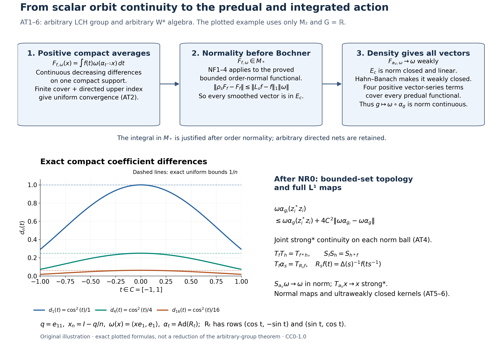
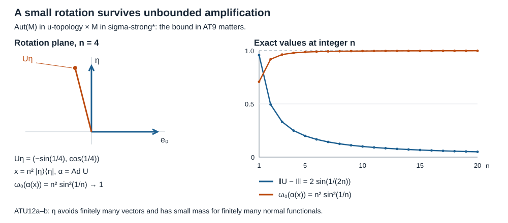
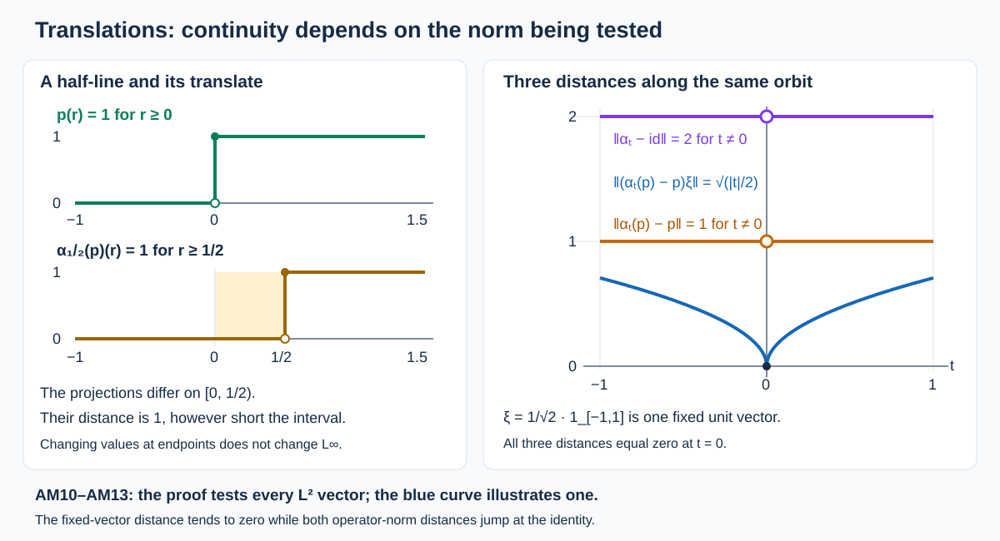

# General normal actions: predual continuity and the integrated maps

*CC0-1.0 to the extent of rights held.*

Let $G$ be an arbitrary locally compact Hausdorff group, $M\subseteq B(H)$ an arbitrary von Neumann algebra, and $\alpha:G\to\operatorname{Aut}(M)$ a homomorphism into normal unital $*$-automorphisms. Normal means ultraweakly continuous. We initially assume only point-ultraweak continuity:

\[
 g\longmapsto\omega(\alpha_g(x))\text{ is continuous}
 \quad(x\in M,\ \omega\in M_*).
 \tag{AT0}
\]
There is no abelian, second-countable, separable-predual, faithful-state, sigma-finite-algebra or unimodular hypothesis. The proof includes the zero algebra.

The actual earlier inputs are [CF1](OA-FLOW-CF.md#oa-flow.cf.1), [CF6–8](OA-FLOW-CF.md#oa-flow.cf.6), [CP1–6](OA-FLOW-CP.md#oa-flow.cp.1), [ST1–2](OA-FLOW-ST12.md#oa-flow.st.1), the complete finite-functional bridge [NF1](OA-FLOW-NF.md#oa-flow.nf.1), [NF2](OA-FLOW-NF.md#oa-flow.nf.2), [NF3](OA-FLOW-NF.md#oa-flow.nf.3) and [NF4](OA-FLOW-NF.md#oa-flow.nf.4), and [HR3](OA-FLOW-HR.md#hr-03), [HR5](OA-FLOW-HR.md#hr-05), [HR8](OA-FLOW-HR.md#hr-08) and [HR9](OA-FLOW-HR.md#hr-09) with L24 [Section2](OA-FLOW-L24.md#oa-flow.grp.haarconventions), [Section3](OA-FLOW-L24.md#oa-flow.grp.translations), [Section4](OA-FLOW-L24.md#oa-flow.grp.vectorintegration) and [Section5](OA-FLOW-L24.md#oa-flow.grp.algebra) for the Haar conventions, norm-continuous translations, Bochner integrals and approximate identities. NF1–4 proves exactly that a bounded positive functional preserving bounded increasing positive suprema belongs to $M_*$, and that positive members of $M_*$ preserve those suprema. No statement about unrestricted extended-valued weights is used.

## AT1. Point-ultraweak and point-strong* continuity

Every $\alpha_g$ is isometric, by CF6's contractivity applied also to its inverse. For a vector $\xi\in H$ and $x\in M$, expansion gives

\[
 \begin{aligned}
 \|(\alpha_g(x)-x)\xi\|^2
 &=\langle\alpha_g(x^*x)\xi,\xi\rangle+\|x\xi\|^2
   -2\operatorname{Re}\langle\alpha_g(x)\xi,x\xi\rangle.
 \end{aligned}
 \tag{AT1}
\]
The single-vector coefficients are in the CP predual, so (AT0) makes this tend to zero as $g\to e$. Repeat for $x^*$ to obtain strong* convergence. For an arbitrary positive normal functional $\omega$, the same expansion is

\[
 \omega((\alpha_g(x)-x)^*(\alpha_g(x)-x))
 =\omega(\alpha_g(x^*x))+\omega(x^*x)
  -2\operatorname{Re}\omega(x^*\alpha_g(x)).
 \tag{AT2}
\]
Multiplication by fixed $x^*$ is ultraweakly continuous: CP4's vector series is transformed by multiplying one of its square-summable vector sequences by that bounded operator. Thus (AT2) proves intrinsic $\sigma$-strong* continuity directly. Translating the group parameter proves continuity at every $g_0$. Normal automorphisms preserve these seminorms by pulling back positive normal functionals. ST2 identifies the bounded intrinsic and concrete topologies in every faithful normal representation.

Conversely point-strong* continuity implies (AT0). For fixed $x$ the orbit is uniformly norm bounded, and each CP vector-series functional is a convergent finite initial sum plus a uniformly small Cauchy–Schwarz tail. Thus strong convergence of that orbit gives ultraweak convergence. This converse uses bounded orbits, not a false global identification of the strong and ultraweak topologies.

## AT2. A compact-support average is genuinely in the predual

Define the isometric predual representation

\[
 \rho_g\omega=\omega\circ\alpha_{g^{-1}},\qquad
 \rho_g\rho_h=\rho_{gh}.
 \tag{AT3}
\]
Its orbit is weakly continuous in the Banach space $M_*$: CP6 identifies its dual with all of $M$, and evaluating the orbit at $x\in M$ is continuous by (AT0) and inversion in $G$. At this stage a Bochner integral of that orbit has not been asserted.

Fix $\omega\in M_*^+$ and $f\in C_c(G)_+$. With left Haar measure, define by ordinary scalar integration

\[
 F_{f,\omega}(x)=\int_G f(t)\omega(\alpha_{t^{-1}}(x))\,dt.
 \tag{AT4}
\]
The continuous coefficient is bounded by $\|\omega\|\|x\|$. Hence $F_{f,\omega}$ is a bounded positive complex-linear functional, with

\[
 \|F_{f,\omega}\|=F_{f,\omega}(1)
 =\|f\|_1\|\omega\|.
 \tag{AT5}
\]
The positive-functional norm identity is part of NF1; the inequality also follows directly from (AT4). Equality remains valid when either factor is zero.

We prove arbitrary-net order normality before claiming that (AT4) is a predual integral. Suppose $0\le x_i\uparrow x$ in $M$, with a bounded increasing net. For $t$ in the compact set $C=\operatorname{supp}f$, put

\[
 d_i(t)=\omega(\alpha_{t^{-1}}(x-x_i))\ge0.
 \tag{AT6}
\]
Each $d_i$ is continuous by (AT0). They decrease, and their pointwise infimum is zero: an order isomorphism carries the supremum $x$ to the supremum of $\alpha_{t^{-1}}(x_i)$, and $\omega$ is order normal by NF1–4. For any $\varepsilon>0$, the sets $\{t\in C:d_i(t)<\varepsilon\}$ are open and cover $C$. Compactness gives finitely many indices covering $C$; directedness supplies an index above all of them. For this index and all later ones, $\sup_C d_i\le\varepsilon$. Therefore

\[
 0\le F_{f,\omega}(x)-F_{f,\omega}(x_i)
 \le\|f\|_1\sup_C d_i\longrightarrow0.
 \tag{AT7}
\]
This proves the required order normality for arbitrary nets by a local finite-cover argument, rather than an exchange theorem for arbitrary monotone nets of measurable functions. NF1–4 now puts $F_{f,\omega}$ in $M_*$. Only this bounded finite-functional bridge has been applied.

For a general $f\in C_c(G)$, split its real and imaginary parts into their positive and negative continuous parts, and use (AT4) linearly. The resulting $F_{f,\omega}\in M_*$ still has the scalar formula and the exact estimate

\[
 \|F_{f,\omega}-F_{h,\omega}\|
 \le\|f-h\|_1\|\omega\|\qquad(f,h\in C_c(G)).
 \tag{AT8}
\]
Indeed evaluate at $\|x\|\le1$, use isometry of $\alpha_t$, and take the supremum; CP6 identifies this functional norm with its predual norm. No separable range or vector integral has yet been needed.

## AT3. The local weak-to-norm argument

Let $E_c\subseteq M_*$ consist of the vectors whose $\rho$-orbit is norm continuous at $e$. It is a linear subspace and norm closed. For the latter, if $\omega_n\to\omega$ in norm with $\omega_n\in E_c$, then

\[
 \|\rho_s\omega-\omega\|
 \le2\|\omega-\omega_n\|+\|\rho_s\omega_n-\omega_n\|,
 \tag{AT9}
\]
and choose $n$ before a neighbourhood of $e$. Norm continuity at every group element follows from isometry and the group law.

For positive $\omega$ and any $f\in C_c(G)$, left Haar substitution in the scalar formula gives

\[
 \rho_s F_{f,\omega}=F_{L_s f,\omega},\qquad
 L_s f(t)=f(s^{-1}t).
 \tag{AT10}
\]
In fact the integrand on the left evaluates $\omega\circ\alpha_{t^{-1}s^{-1}}=\rho_{st}\omega$. L24 Section3 proves $\|L_s f-f\|_1\to0$ for arbitrary LCH groups, without unimodularity. Equation (AT8) proves that $F_{f,\omega}\in E_c$.

Choose the nonnegative compactly supported normalized bumps $a_V$ from L24 Section5, supported in shrinking identity neighbourhoods $V$. The net need not be a sequence. For each fixed $x$,

\[
 |F_{a_V,\omega}(x)-\omega(x)|
 \le\sup_{t\in V}|\omega(\alpha_{t^{-1}}(x))-\omega(x)|
 \longrightarrow0.
 \tag{AT11}
\]
Thus these vectors converge to $\omega$ weakly in $M_*$. A norm-closed linear subspace is weakly closed: if a point is outside it, CF1's Hahn–Banach proof applied to its quotient distance supplies a bounded linear functional vanishing on that subspace and nonzero at the point. CP6 makes this functional an element of $M=(M_*)^*$, so it is exactly a weak test. Since every $F_{a_V,\omega}$ belongs to $E_c$, the positive $\omega$ belongs to $E_c$.

To cover every predual vector, use its actual CP4 series $\varphi(x)=\sum_j\langle x\xi_j,\eta_j\rangle$, with both vector sequences square summable. Put

\[
 \omega_k(x)=\sum_j\langle x(\xi_j+i^k\eta_j),\xi_j+i^k\eta_j\rangle
 \quad(0\le k\le3).
 \tag{AT12}
\]
Each is a positive predual functional; its summed squared vector norms are at most $2\sum_j(\|\xi_j\|^2+\|\eta_j\|^2)$. Expansion with the linear-first convention gives $\varphi=\frac14\sum_{k=0}^3 i^k\omega_k$. Thus $\varphi\in E_c$. We have proved

\[
 g\longmapsto\omega\circ\alpha_g\text{ is norm continuous in }M_*
 \qquad(\omega\in M_*).
 \tag{AT13}
\]
Here inversion changes $\rho_g$ to the displayed map, so no abelian-group reordering is used. Conversely (AT13) implies (AT0) by the functional norm estimate at each fixed $x$. This discharges precisely the NR0 equivalence for arbitrary LCH groups. Positivity, compact support, the predual norm estimate and the Hahn–Banach passage occurred before any general Bochner integration.

## AT4. Joint continuity on bounded sets

Suppose $g_i\to g$, $x_i\to x$ in the intrinsic $\sigma$-strong* topology, and $\|x_i\|,\|x\|\le C$. Write $z_i=x_i-x$. For $\omega\in M_*^+$,

\[
 \begin{aligned}
 \omega(\alpha_{g_i}(z_i)^*\alpha_{g_i}(z_i))
 &=(\omega\circ\alpha_g)(z_i^*z_i)
   +((\omega\circ\alpha_{g_i})-(\omega\circ\alpha_g))(z_i^*z_i)\\
 &\le (\omega\circ\alpha_g)(z_i^*z_i)
      +4C^2\|\omega\circ\alpha_{g_i}-\omega\circ\alpha_g\|
 \longrightarrow0.
 \end{aligned}
 \tag{AT14}
\]
The first test is positive normal and the second tends to zero by AT3. Repeat with $z_i^*$, and combine with AT1 for the fixed $x$, to get $\alpha_{g_i}(x_i)\to\alpha_g(x)$ strongly*. Thus the action is jointly $\sigma$-strong* continuous on every fixed norm ball. ST2 gives the same assertion in any faithful normal concrete realization. No joint continuity on unbounded nets is claimed.

It is also jointly ultraweakly continuous on each norm ball. If instead $x_i\to x$ ultraweakly, then for any $\omega\in M_*$,

\[
 |\omega(\alpha_{g_i}(z_i))|
 \le |(\omega\circ\alpha_g)(z_i)|
       +2C\|\omega\circ\alpha_{g_i}-\omega\circ\alpha_g\|\longrightarrow0,
 \tag{AT15}
\]
and the fixed-$x$ term is (AT0). These are arbitrary-net statements; local compactness entered the AT2–3 integration argument, not a hidden first-countability step.

## AT5. The full $L^1$ integrated action

Use the locally determined completed Haar convention and its finite-exponent identification with outer regular Radon classes, proved in HR8–9 and L24 Section2. Every $L^1$ scalar class has a Borel representative on a sigma compact carrier, extended by zero, with compact-local null equality. After AT3, the map $t\mapsto\omega\circ\alpha_t$ is norm continuous. Its image on each such carrier has separable norm range: each compact image in a metric Banach space has finite $1/n$-nets, and the countable union of the compact pieces has separable image. L24 Section4 therefore supplies the genuine Bochner integral

\[
 S_f\omega=\int_G f(t)(\omega\circ\alpha_t)\,dt\in M_*;
 \qquad\|S_f\omega\|\le\|f\|_1\|\omega\|.
 \tag{AT16}
\]
There is no separability assumption on the whole predual. Bounded-map compatibility of that integral makes $S_f$ a bounded linear operator on $M_*$. Define its adjoint $T_f=S_f^*:M\to M$. It is ultraweakly continuous on all of $M$, with

\[
 \omega(T_f x)=\int_G f(t)\omega(\alpha_t(x))\,dt,
 \qquad\|T_f\|\le\|f\|_1.
 \tag{AT17}
\]
It depends only on the $L^1$ class and is linear in $f$. For $f\ge0$, $T_f$ is positive because all positive normal vector tests of $T_f x$ are nonnegative for $x\ge0$, and the CF8 concrete positivity criterion detects positivity. Also $T_f(1)=(\int f)1$ and

\[
 (T_f x)^*=T_{\overline f}(x^*).
 \tag{AT18}
\]
The latter follows from the scalar formula by conjugating vector coefficients; it is not a Hilbert-operator adjoint formula involving the $L^1$ involution.

For convolution in L24's convention,

\[
 T_fT_h=T_{f*h},\qquad
 \alpha_s T_f=T_{L_s f},\qquad
 T_f\alpha_s=T_{R_s f},\qquad
 R_s f(t)=\Delta(s)^{-1}f(ts^{-1}).
 \tag{AT19}
\]
Indeed normality of the first map allows the other scalar integral to be evaluated using its predual functional. The resulting double integral is $\iint f(s)h(t)\omega(\alpha_{st}(x))\,dt\,ds$. Its absolute bound is $\|f\|_1\|h\|_1\|\omega\|\|x\|$; HR5 and L24 Sections4–5 justify Fubini on the sigma compact Radon carriers. Substitution $r=st$ gives convolution. Left Haar invariance gives the second formula. For the third substitute $r=ts$ and use L24 Section3's exact convention $\mu(Es)=\Delta(s)\mu(E)$; this gives the displayed $\Delta(s)^{-1}$ factor. Thus no unimodular factor has been discarded. On the predual, $S_s\omega=\omega\circ\alpha_s$ is an antirepresentation: $S_sS_t=S_{ts}$, and consequently $S_fS_h=S_{h*f}$, consistently with (AT19).

## AT6. Kernel topologies and approximate identities

For each $f\in L^1(G)$, the kernel of $T_f$ is an ultraweakly closed linear subspace on all of $M$, with the exact annihilator description

\[
 \ker T_f=(S_f(M_*))^\perp.
 \tag{AT20}
\]
This is the scalar duality in (AT17); norm closure of the range does not change its annihilator. The map $f\mapsto T_f$ is norm continuous into the bounded operators on $M$ by $\|T_f-T_h\|\le\|f-h\|_1$. Hence $I_\alpha=\{f:T_f=0\}$ is a norm-closed two-sided convolution ideal by (AT19), and is invariant under both normalized translations. No spectral-synthesis or involutive-ideal conclusion is assumed. For a fixed $x$, $I_x=\{f:T_f x=0\}$ is norm closed and a left convolution ideal; it is also invariant under $L_s$. These statements do not silently promote it to a two-sided ideal for nonabelian $G$.

Each $T_f$ is strong* continuous on each norm ball. To see this, first note that for any fixed $x$ and $\xi$, $t\mapsto\alpha_t(x)\xi$ is norm continuous by AT1. Its Bochner integral against $f$ has vector coefficients equal to (AT17), so it is exactly $(T_f x)\xi$. If a uniformly bounded net $x_i$ tends to zero strongly*, AT4 and compactness make $\sup_{t\in C}\|\alpha_t(x_i)\xi\|\to0$ on every compact $C$. Explicitly, joint continuity at each $(t,0)$ gives a neighbourhood of $t$ and a strong* neighbourhood of zero controlling the norm; a finite cover of $C$ and the intersection of those finitely many neighbourhoods control the whole compact set. Choose $C$ carrying all but an arbitrarily small amount of $|f|$ by HR3/9. Outside $C$ use $\|\alpha_t(x_i)\xi\|\le C_0\|\xi\|$. The vector integral estimate then gives $(T_f x_i)\xi\to0$. Apply the same argument to $x_i^*$ and $\overline f$ using (AT18). Translation handles a nonzero limit. Thus its kernel intersected with any fixed norm ball is strong* closed. Ultraweak closedness on all of $M$ is distinct from such a bounded-set topology assertion.

For the nonnegative bumps $a_V$ of L24 Section5,

\[
 S_{a_V}\omega\longrightarrow\omega\text{ in predual norm},\qquad
 T_{a_V}x\longrightarrow x\text{ in }\sigma\text{-strong*},\qquad
 \|T_{a_V}x\|\le\|x\|.
 \tag{AT21}
\]
The first estimate is $\|S_{a_V}\omega-\omega\|\le\sup_{t\in V}\|\omega\circ\alpha_t-\omega\|$, which tends to zero by AT3. For each vector, the second is bounded by $\sup_{t\in V}\|(\alpha_t(x)-x)\xi\|$, and the same estimate for $x^*$ gives strong* convergence; boundedness and ST2 give the intrinsic version. It follows that $\bigcap_{f\in L^1}\ker T_f=\{0\}$. Operator norm convergence in (AT21) is asserted only for $x$ with a norm-continuous orbit, when the analogous supremum norm estimate applies.

Finally every smoothed element has a norm-continuous orbit, since

\[
 \|\alpha_s(T_f x)-T_f x\|
 \le\|L_s f-f\|_1\|x\|\longrightarrow0.
 \tag{AT22}
\]
This is the exact smoothing estimate needed by subsequent coefficient constructions. It does not prove a crossed-product commutant, spectral synthesis, induction or disintegration theorem. Those subsequent chapters use AT13 as their NR0 input; their regular and standard-form constructions are separate proofs.

## AT7. Exercises with solutions

**Exercise 1.** Locate the point at which local compactness is used to prove predual norm continuity. **Solution.** It supplies left Haar measure, nonnegative compactly supported normalized bumps and norm continuity of their left translates. AT2's Dini step uses compact support; AT3's density step uses these bumps. Merely weak convergence of arbitrary orbit vectors does not imply norm convergence.

**Exercise 2.** Why cannot (AT7) be replaced by an unqualified interchange of an arbitrary decreasing net and a scalar integral? **Solution.** Arbitrary directed nets do not have the sequence monotone-convergence theorem. Here the differences are continuous on one compact support and decrease pointwise to zero, so the finite-cover and directed-upper-index argument proves uniform convergence and the integral estimate directly.

**Exercise 3.** Explain the nonabelian order in (AT19). **Solution.** The action has $\alpha_s\alpha_t=\alpha_{st}$, so the operator integrals use $f*h$. Composition on functionals is reversed: $(\omega\circ\alpha_t)\circ\alpha_s=\omega\circ\alpha_{ts}$, which gives $S_fS_h=S_{h*f}$. The right covariance additionally uses the normalized right translate and its modular scalar; it is not a left-translation formula.

**Exercise 4.** May (AT21) be promoted to operator norm convergence for every $x\in M$? **Solution.** The proof supplies vector seminorms for arbitrary $x$. Its norm estimate tends to zero only when the orbit of $x$ is norm continuous. The earlier weak-to-predual-norm theorem concerns vectors of $M_*$, and is not point-norm continuity of the action on all of $M$.

## The normality step that makes smoothing a predual argument

The diagram shows the actual order of [AT2](OA-FLOW-AT.md#oa-flow.at.2), [AT3](OA-FLOW-AT.md#oa-flow.at.3) and [AT4–6](OA-FLOW-AT.md#oa-flow.at.4). For $\omega\in M_*^+$ and $f\in C_c(G)_+$, the scalar formula for $F_{f,\omega}$ is first shown to be a bounded positive order-normal functional. On $C=\operatorname{supp}f$, the continuous differences $d_i(t)=\omega(\alpha_{t^{-1}}(x-x_i))$ decrease pointwise to zero for any bounded increasing net $x_i\uparrow x$. A finite open cover and one directed upper index give uniform convergence on $C$. Thus the integral difference is at most $\|f\|_1\sup_C d_i$, and the exact earlier [NF1–4](OA-FLOW-NF.md#oa-flow.nf.1) proofs put this functional in $M_*$. No predual Bochner integral or general interchange for arbitrary nets has been assumed.

Next $\rho_sF_{f,\omega}=F_{L_sf,\omega}$ and $\|\rho_sF_{f,\omega}-F_{f,\omega}\|\leq\|L_sf-f\|_1\|\omega\|$ put all smoothed positive vectors in the norm-closed linear space $E_c$ of vectors with continuous norm orbit. The normalized compact-support bumps make those vectors weakly approach $\omega$. The complete [CF1](OA-FLOW-CF.md#oa-flow.cf.1) Hahn–Banach proof shows that $E_c$ is weakly closed. Four positive vector-series functionals then span every element of $M_*$. This yields (AT13), the full arbitrary-group NR0 conclusion.

The plotted example is exact in $M=M_2(\mathbb C)$, with $G=\mathbb R$, and uses

\[
 q=\begin{pmatrix}1&0\\0&0\end{pmatrix},\qquad
 R_t=\begin{pmatrix}\cos t&-\sin t\\\sin t&\cos t\end{pmatrix},\qquad
 \alpha_t(x)=R_txR_t^*,\qquad
 \omega(x)=\langle xe_1,e_1\rangle.
 \tag{AT-F1}
\]
The norm-series identities in [CF1](OA-FLOW-CF.md#oa-flow.cf.1) and the unitary exponential argument in [CF3](OA-FLOW-CF.md#oa-flow.cf.3) also give $R_t=e^{tK}$ for $K=\begin{pmatrix}0&-1\\1&0\end{pmatrix}$: separate the even and odd terms using $K^2=-I$. The scalar series define $\cos$ and $\sin$, and the commuting exponential product proves $R_{t+s}=R_tR_s$ and $R_tR_t^*=I$. Thus this really is a continuous normal action. With $x_n=I-q/n$, the sequence is increasing in $M_+$ with supremum $I$. Direct multiplication yields

\[
 d_n(t)=\omega(\alpha_{-t}(I-x_n))=\frac{\cos^2 t}{n},
 \qquad \sup_{[-1,1]}d_n=\frac1n.
 \tag{AT-F2}
\]
The three curves use $n=1,4,16$, and the dashed lines are their exact uniform bounds. With the nonnegative continuous compact-support function

\[
 f(t)=\begin{cases}\frac34(1-t^2),&|t|\leq1,\\0,&|t|>1,\end{cases}
 \qquad\int_{\mathbb R}f(t)\,dt=1,
 \tag{AT-F3}
\]
the integral is evaluated by the polynomial primitive from CF1, or directly by its Riemann sums. Consequently

\[
 0\leq F_{f,\omega}(I)-F_{f,\omega}(x_n)
 =\frac1n\int_{-1}^1f(t)\cos^2t\,dt\leq\frac1n.
 \tag{AT-F4}
\]
This example illustrates the uniform compact estimate. It does not replace the arbitrary-directed-net finite-cover proof or reduce the group or algebra generality of AT1–6.

The last panel retains the norm-ball factor $4C^2$ in (AT14), both different multiplication orders $T_fT_h=T_{f*h}$ and $S_fS_h=S_{h*f}$, and the nonunimodular factor $\Delta(s)^{-1}$ in the right translate. Here $\mu(Es)=\Delta(s)\mu(E)$ is precisely [L24 Section3](OA-FLOW-L24.md#oa-flow.grp.translations)'s convention. The two approximate-identity limits occur in different spaces and topologies: predual norm for $S_{a_V}\omega$ and bounded strong* convergence for $T_{a_V}x$. They are the full conclusions of AT5–6, not operator norm convergence on every orbit.

The arbitrary-group action setting is treated in Haagerup, [*On the dual weights for crossed products of von Neumann algebras I: Removing separability conditions*](https://journals.msp.org/mscand/article/view/1879), Math. Scand. 43 (1978), §§1.1–1.2. The local AT arguments supply their own proofs from the earlier programme sections; the paper's standard-implementation imports are not premises of this diagram.

The native figure is $3200\times2200$ pixels. [Editable SVG](../assets/general-action-topology/figures/action-topology.svg), [exact sample data](../assets/general-action-topology/figures/action-topology-data.json) and [reproduction source](../assets/general-action-topology/render_action_topology.py) accompany the original PNG. All new illustration and caption expression is CC0-1.0 to the extent of rights held.

## AT8. The full automorphism group with its predual topology

Let \(M\) be an arbitrary von Neumann algebra. Give \(\operatorname{Aut}(M)\) the topology determined by
\[
 \alpha_i\longrightarrow\alpha
 \quad\Longleftrightarrow\quad
 \|\omega\circ\alpha_i-\omega\circ\alpha\|\longrightarrow0
                      \quad(\omega\in M_*).
 \tag{ATU1}
\]
This is the \(u\)-topology. It uses only the forward predual orbits. The limits below are arbitrary nets.

**Theorem.** This topology is Hausdorff, composition and inversion are continuous, and the predual evaluation
\[
 \operatorname{Aut}(M)\times M_*\longrightarrow M_*,
                \qquad(\alpha,\omega)\longmapsto\omega\circ\alpha
 \tag{ATU2}
\]
is jointly norm continuous in its second coordinate and \(u\)-continuous in its first. No local compactness or separability is required.

**Proof.** A normal automorphism carries \(M_*\) onto itself by composition; composition is isometric because the automorphism maps the unit ball of \(M\) onto that ball. The predual separates elements of \(M\), by [CP6](OA-FLOW-CP.md#oa-flow.cp.6). If \(\alpha\ne\beta\), choose \(x\) with \(\alpha(x)\ne\beta(x)\), and then \(\omega\) separating these two elements. The normed-space coordinates in (ATU1) distinguish \(\alpha,\beta\), proving Hausdorffness.

If \(\alpha_i\to\alpha\) and \(\beta_i\to\beta\), the exact order of composition gives
\[
 \begin{aligned}
 \|\omega\circ\alpha_i\circ\beta_i
                  -\omega\circ\alpha\circ\beta\|
 &\leq\|\omega\circ\alpha_i-\omega\circ\alpha\|\\
 &\quad+\|(\omega\circ\alpha)\circ\beta_i
                         -(\omega\circ\alpha)\circ\beta\|
 \longrightarrow0 .
 \end{aligned}
 \tag{ATU3}
\]
The first summand uses isometry of composition by \(\beta_i\), and the second tests the fixed normal functional \(\omega\circ\alpha\). This proves continuity of multiplication.

For inverses, composing the difference with \(\alpha_i\) gives
\[
 \|\omega\circ\alpha_i^{-1}-\omega\circ\alpha^{-1}\|
 =\|\omega-(\omega\circ\alpha^{-1})\circ\alpha_i\|
 \longrightarrow0.
 \tag{ATU4}
\]
Thus inverse convergence is a consequence of (ATU1), not an additional defining condition. Finally, if \(\omega_i\to\omega\) in norm, then
\[
 \|\omega_i\circ\alpha_i-\omega\circ\alpha\|
 \leq\|\omega_i-\omega\|
       +\|\omega\circ\alpha_i-\omega\circ\alpha\|\longrightarrow0,
 \tag{ATU5}
\]
proving joint predual evaluation.

There is also uniform convergence on every norm-compact set \(K\subset M_*\):
\[
 \sup_{\omega\in K}
       \|\omega\circ\alpha_i-\omega\circ\alpha\|\longrightarrow0.
 \tag{ATU6}
\]
For \(\varepsilon>0\), cover \(K\) by finitely many norm balls of radius \(\varepsilon\), with centers in \(K\). Choose an index above the finitely many indices for convergence at these centers. Isometry bounds the error at any point of a ball by the error at its center plus \(2\varepsilon\). Letting \(\varepsilon\downarrow0\) proves (ATU6).

For the locally compact group action of AT1–3, point-ultraweak continuity is therefore equivalent to continuity of the homomorphism \(G\to\operatorname{Aut}(M)\) for (ATU1). One implication is exactly AT3; the other follows by evaluating a norm-convergent predual orbit at a fixed element. The topological-group theorem above itself does not require a locally compact parameter group.

## AT9. Joint evaluation on every bounded operator ball

For \(0\leq C<\infty\), put \(B_C(M)=\{x\in M:\|x\|\leq C\}\). The map
\[
 \operatorname{Aut}(M)\times B_C(M)\longrightarrow B_C(M),
                 \qquad(\alpha,x)\longmapsto\alpha(x)
 \tag{ATU7}
\]
is jointly continuous when the first coordinate has the \(u\)-topology and the second has either the ultraweak or the intrinsic sigma-strong* topology. The latter is also the bounded strong* topology in every faithful normal representation, by [ST2](OA-FLOW-ST12.md#oa-flow.st.2).

**Proof.** First, \(u\)-convergence of \(\alpha_i\) to \(\alpha\) gives
\(\alpha_i(x)\to\alpha(x)\) ultraweakly for each fixed \(x\).
For \(\omega\in M_*^+\), expansion gives
\[
 \begin{aligned}
 &\omega((\alpha_i(x)-\alpha(x))^*
                         (\alpha_i(x)-\alpha(x)))\\
 &\quad=\omega(\alpha_i(x^*x))
       +\omega(\alpha(x)^*\alpha(x))
       -2\operatorname{Re}\omega(\alpha(x)^*\alpha_i(x))
       \longrightarrow0 .
 \end{aligned}
 \tag{ATU8}
\]
Every coefficient here is a fixed normal-functional test; fixed multiplication is normal: a CP6 vector-series test of axb is the vector-series test with vectors bξ_j and a*η_j, still square summable. The limit of the first term is the second term, and the mixed term has that same limit. Applying the argument to \(x^*\) proves pointwise sigma-strong* convergence.

Now let \(x_i\to x\) sigma-strong*, with \(x_i,x\in B_C(M)\), and put \(z_i=x_i-x\). For every positive normal \(\omega\),
\[
 \begin{aligned}
 \omega(\alpha_i(z_i)^*\alpha_i(z_i))
 &=(\omega\circ\alpha)(z_i^*z_i)
       +(\omega\circ\alpha_i-\omega\circ\alpha)(z_i^*z_i)\\
 &\leq(\omega\circ\alpha)(z_i^*z_i)
       +4C^2\|\omega\circ\alpha_i-\omega\circ\alpha\|
       \longrightarrow0 .
 \end{aligned}
 \tag{ATU9}
\]
The fixed functional \(\omega\circ\alpha\) is positive normal. Apply the same calculation to \(z_i^*\), and combine it with (ATU8) for the fixed \(x\). This proves joint sigma-strong* continuity.

For the ultraweak assertion, if instead \(x_i\to x\) ultraweakly in the same ball, then for each \(\omega\in M_*\),
\[
 |\omega(\alpha_i(z_i))|
 \leq |(\omega\circ\alpha)(z_i)|
        +2C\|\omega\circ\alpha_i-\omega\circ\alpha\|
        \longrightarrow0.
 \tag{ATU10}
\]
Add the fixed-\(x\) limit. This proves the ultraweak claim. All these arguments apply to arbitrary directed nets. They extend AT4 from locally compact action parameters to the entire topological group \(\operatorname{Aut}(M)\).

## AT10. Why an operator bound is essential for nets

The norm bound in AT9 cannot be removed, even when the automorphisms converge to the identity in operator norm as maps on the algebra.

Take \(H=\ell^2(\mathbb N_0)\), fix its first unit vector \(e_0\), and let
\(M=B(H)\). Index a net by pairs \((F,n)\), where \(F\) is a finite subset of \(H\) containing \(e_0\), \(n\geq1\), and
\((F,n)\leq(F',n')\) means \(F\subseteq F'\) and \(n\leq n'\).
This set is directed by finite unions and maxima. Choose a unit vector
\(\eta_F\perp\operatorname{span}F\), possible because that span is finite dimensional and \(H\) is infinite dimensional. Let
\[
 q_F=|\eta_F\rangle\langle\eta_F|,\qquad
 x_{F,n}=n^2q_F .
 \tag{ATU11}
\]
For each fixed \(\xi\in H\), all sufficiently large \(F\) contain \(\xi\), so
\(x_{F,n}\xi=0\), independently of \(n\). Since these operators are selfadjoint,
\[
 x_{F,n}\longrightarrow0\quad\text{strongly*},\qquad
 \|x_{F,n}\|=n^2 .
 \tag{ATU12}
\]
This is an unbounded strongly* convergent net, not a sequence.

To make the example converge even in the intrinsic sigma-strong* topology, refine the index to \((F,\Omega,n)\), where \(\Omega\) is a finite subset of \(M_*^+\), ordered by inclusion as well. For each index choose a unit vector \(\eta=\eta_{F,\Omega,n}\) orthogonal to \(\operatorname{span}F\) such that
\[
 \varphi(|\eta\rangle\langle\eta|)\leq n^{-6}
                         \qquad(\varphi\in\Omega).
 \tag{ATU12a}
\]
Here is why such a choice exists. Construct an infinite orthonormal sequence in the infinite-dimensional complement of \(\operatorname{span}F\). For its rank-one projections \(q_j\), every finite sum is at most \(1\), so positivity gives \(\sum_{j=1}^N\varphi(q_j)\leq\varphi(1)\). Thus \(\varphi(q_j)\to0\) for each of the finitely many \(\varphi\in\Omega\), and one sufficiently large \(j\) satisfies all the inequalities. With \(x=n^2|\eta\rangle\langle\eta|\), each fixed positive normal \(\varphi\), once included in \(\Omega\), satisfies
\[
 \varphi(x^*x)=\varphi(xx^*)\leq n^{-2}\longrightarrow0.
 \tag{ATU12b}
\]
This proves intrinsic sigma-strong* convergence. It also proves ultraweak convergence: for a positive normal functional, Cauchy–Schwarz gives \(|\varphi(x)|^2\leq\varphi(1)\varphi(x^*x)\); an arbitrary normal functional is a linear combination of positive ones, by the vector-series polarization (AT12) in AT3. The refined net still has (ATU12) and norm \(n^2\). In the following formulas, use this refined choice of \(\eta\), with the additional index \(\Omega\) suppressed.

Let \(\theta_n=1/n\), and let \(U_{F,n}\) act as the identity on
\(\operatorname{span}\{e_0,\eta_F\}^{\perp}\) and as the following real rotation on that plane:
\[
 \begin{aligned}
 U_{F,n}e_0&=\cos\theta_n\,e_0+\sin\theta_n\,\eta_F,\\
 U_{F,n}\eta_F&=-\sin\theta_n\,e_0+\cos\theta_n\,\eta_F.
 \end{aligned}
 \tag{ATU13}
\]
It is unitary and \(\|U_{F,n}-1\|=2\sin(1/(2n))\leq1/n\).
Set \(\alpha_{F,n}=\operatorname{Ad}U_{F,n}\).
For \(a\in M\),
\[
 \|\alpha_{F,n}(a)-a\|
 \leq2\|U_{F,n}-1\|\,\|a\|,
 \qquad
 \|\omega\circ\alpha_{F,n}-\omega\|
 \leq 2\|\omega\|/n .
 \tag{ATU14}
\]
The first inequality follows by writing
\(UaU^*-a=(U-1)aU^*+a(U^*-1)\); the second takes the supremum over the unit ball. Hence \(\alpha_{F,n}\to\operatorname{id}\) in \(u\), and even in operator norm as bounded maps on \(M\).

Nevertheless, for the fixed normal vector state
\(\omega_0(a)=\langle ae_0,e_0\rangle\),
\[
 \omega_0(\alpha_{F,n}(x_{F,n}))
       =n^2|\langle e_0,U_{F,n}\eta_F\rangle|^2
       =n^2\sin^2(1/n)\longrightarrow1 .
 \tag{ATU15}
\]
Thus the evaluated net does not converge to zero ultraweakly, and it does not converge to zero strongly*. Every input \(x_{F,n}\) is positive.

The left panel uses \(n=4\) and draws the unit vectors \(e_0,\eta_F,U_{F,4}\eta_F\) to scale. The right panel plots the exact scalar quantities in (ATU13) and (ATU15) at integer \(n=1,\ldots,20\); line segments connect those samples. The operator displacement tends to zero while the amplified vector-state value tends to one. Equations (ATU12) and (ATU12b), using the finite-set and functional parts of the directed index, supply simultaneous concrete strong* and intrinsic sigma-strong* convergence of the inputs.

**Solved question.** Why cannot the same construction be carried by a strongly convergent sequence with unbounded operator norms?

For a strongly convergent sequence \((T_k)\), each sequence \((T_k\xi)\) converges and is therefore bounded for every \(\xi\). Uniform boundedness on the Banach space \(H\), proved in the earlier [Banach-space foundations](../../foundations-of-von-neumann-algebras/hahn-banach-baire-and-the-basic-theorems-on-banach-spaces.html#oa-fnd-hb-04), gives \(\sup_k\|T_k\|<\infty\). A general convergent net need not have all of its values bounded at each vector: convergence controls a tail for that vector, whereas the indices outside that tail need not be finite. In (ATU11), inclusion of the tested vector in \(F\) supplies its own eventual zero tail. There is no single finite \(F\) containing every vector. This is precisely why AT9 states its uniform norm bound.

## AT11. The multiplication algebra and its exact Lebesgue predual

Fix Lebesgue measure \(dr\) on \(\mathbb R\), normalized so that \([0,1]\) has measure one. It is translation invariant, nonzero, regular, and finite on compact sets, so it is the chosen Haar measure for the additive group. Represent
\[
 M=L^\infty(\mathbb R,dr)\quad\text{on}\quad
 H=L^2(\mathbb R,dr),\qquad (M_f\xi)(r)=f(r)\xi(r).
 \tag{AM1}
\]
The norm of \(M_f\) is \(\|f\|_\infty\): the upper bound is the integral inequality, while an indicator of a finite positive-measure subset where
\(|f|>\|f\|_\infty-\varepsilon\), normalized in \(L^2\), gives the lower bound. Such a subset exists by intersecting that level set with the bounded intervals covering \(\mathbb R\).

Here is a direct verification that these multipliers form a von Neumann algebra. Suppose \(T\in B(H)\) commutes with every \(M_f\). Partition \(\mathbb R\) into \(I_n=[n,n+1)\), \(n\in\mathbb Z\). Commutation with \(M_{1_{I_n}}\) shows that \(h_n=T1_{I_n}\) is supported in \(I_n\). For every bounded \(f\) supported there,
\[
 Tf=T M_f1_{I_n}=M_fT1_{I_n}=fh_n.
 \tag{AM2}
\]
For a measurable \(A\subset I_n\), the same identity gives
\[
 \int_A|h_n|^2\,dr=\|T1_A\|_2^2\leq\|T\|^2|A|.
 \tag{AM3}
\]
If \(|h_n|>\|T\|+\varepsilon\) on a set of positive measure, taking that set as \(A\) contradicts (AM3). Hence \(\|h_n\|_\infty\leq\|T\|\).
Define \(h\) by \(h|_{I_n}=h_n\). Then \(\|h\|_\infty\leq\|T\|\), and (AM2) gives \(T=M_h\) on bounded functions supported in finitely many of the intervals. Truncating the support and the magnitude shows that these functions are dense in \(H\), so \(T=M_h\) on all of \(H\). Thus the multiplier algebra equals its commutant and therefore its bicommutant. BD1 proves that it is a von Neumann algebra.

Every \(h\in L^1(\mathbb R)\) defines the normal functional
\[
 \omega_h(M_f)=\int_{\mathbb R} f(r)h(r)\,dr.
 \tag{AM4}
\]
To prove normality directly, write \(h=v|h|\), where \(|v|=1\) on the nonzero set and \(v=0\) elsewhere. The \(L^2\) vectors
\(\xi=v|h|^{1/2}\) and \(\eta=|h|^{1/2}\) give
\(\omega_h(M_f)=\langle M_f\xi,\eta\rangle\), in the linear-first convention.

Conversely CP6 writes any normal functional as a vector series
\[
 \omega(M_f)=\sum_j\langle M_f\xi_j,\eta_j\rangle,\qquad
 \sum_j\|\xi_j\|_2^2<\infty,\quad
 \sum_j\|\eta_j\|_2^2<\infty.
\]
Scalar Cauchy–Schwarz gives
\[
 \sum_j\|\xi_j\overline{\eta_j}\|_1
 \leq
 \left(\sum_j\|\xi_j\|_2^2\right)^{1/2}
 \left(\sum_j\|\eta_j\|_2^2\right)^{1/2}<\infty.
 \tag{AM5}
\]
The series therefore converges in \(L^1\) to \(h=\sum_j\xi_j\overline{\eta_j}\).
Its integrals against any bounded \(f\) converge absolutely, and (AM4) gives \(\omega=\omega_h\).
Finally \(\|\omega_h\|\leq\|h\|_1\), and the test \(f=\overline v\) gives equality. This proves the onto isometric identification
\[
 M_*=L^1(\mathbb R,dr)
 \tag{AM6}
\]
with the exact pairing (AM4), rather than assuming it as a model-specific prerequisite.

## AT12. A translation orbit with three different norm behaviors

On the multiplication algebra above define
\[
 (\alpha_t f)(r)=f(r-t).
 \tag{AM7}
\]
These automorphisms are implemented by the unitary translations
\((V_t\xi)(r)=\xi(r-t)\). Translation invariance proves unitarity, and direct substitution gives
\(V_tM_fV_t^*=M_{\alpha_t f}\); vector-series tests prove normality.

First recall why left translation is norm continuous in \(L^1\) on every locally compact group. For \(h\in L^1(G)\), choose \(k\in C_c(G)\) with
\(\|h-k\|_1<\varepsilon\), using the density proved in L24. Left Haar invariance gives
\[
 \|L_sh-h\|_1
 \leq2\varepsilon+\|L_sk-k\|_1,\qquad
 \|L_sh\|_1=\|h\|_1.
 \tag{AM8}
\]
For \(s\) near the identity, the two compactly supported functions in the last difference have support in one compact set. The finite-cover argument of L24 gives uniform convergence there, hence \(L^1\) convergence because that compact set has finite measure. Let \(\varepsilon\) tend to zero. The group law gives continuity at any group point. This proves the assertion without requiring unimodularity: the change of variables is a left translation, so no modular multiplier appears.

On \(\mathbb R\), substitution in (AM4) yields
\[
 \omega_h\circ\alpha_t=\omega_{h(\,\cdot+t)},\qquad
 \|\omega_h\circ\alpha_t-\omega_h\|
       =\|h(\,\cdot+t)-h\|_1\longrightarrow0.
 \tag{AM9}
\]
Thus \(t\mapsto\alpha_t\) is continuous in the predual norm topology and is point-ultraweakly continuous. AT1 also makes every fixed bounded multiplication operator orbit strong* continuous.

Now take \(p=1_{[0,\infty)}\). For \(t>0\), its translate is
\(\alpha_t p=1_{[t,\infty)}\), and the difference is \(-1\) on \([0,t)\). For \(t<0\), the difference is \(1\) on \([t,0)\). Consequently
\[
 \|\alpha_t(p)-p\|_\infty=1\quad(t\ne0).
 \tag{AM10}
\]
The function \(2p-1\) has norm one, and its translated difference has norm two. Since each \(\alpha_t\) has operator norm one on \(M\), the upper bound is also two. Therefore
\[
 \|\alpha_t-\mathrm{id}_M\|_{B(M)}=2\quad(t\ne0).
 \tag{AM11}
\]
Both quantities are zero at \(t=0\).

The same projection orbit is strongly* continuous. If \(I_t\) is the interval between \(0\) and \(t\), then for every \(\xi\in L^2(\mathbb R)\),
\[
 \|(\alpha_t(p)-p)\xi\|_2^2=\int_{I_t}|\xi(r)|^2\,dr\longrightarrow0.
 \tag{AM12}
\]
For a direct estimate, choose \(N\) so that
\(\int_{\{|\xi|^2>N\}}|\xi|^2<\varepsilon/2\); scalar integrability gives this tail bound. Then the last integral is at most
\(N|t|+\varepsilon/2\), which is less than \(\varepsilon\) for sufficiently small \(|t|\). The operators are selfadjoint, so the adjoint test is identical. Their uniform norm bound also gives intrinsic sigma-strong* convergence by ST2.

For the particular unit vector
\(\xi=2^{-1/2}1_{[-1,1]}\), the exact value on \(|t|\leq1\) is
\[
 \|(\alpha_t(p)-p)\xi\|_2=\sqrt{|t|/2}.
 \tag{AM13}
\]
This one-vector curve illustrates (AM12); the preceding estimate proves the convergence for every \(L^2\) vector.

The left panel draws \(p\) and \(\alpha_{1/2}p\) on a finite coordinate window. The right panel shows (AM10), (AM11) and (AM13) for \(-1\leq t\leq1\). Open circles at heights one and two mark the missing values at \(t=0\); both norm distances actually equal zero there. The blue curve is the exact parabola parametrization \(t=\pm2y^2\) of the fixed-vector norm, and the proof of strong* continuity uses every vector as in (AM12).

## AT13. Local coefficient tests and the strong integral

**Problem.** In the general Banach representation theorem, assume scalar continuity only at the group identity. Recover continuity everywhere, explain the quantifiers, and identify the scalarly constructed average with a strong integral.

**Solution.** Let \(E\) be a Banach space and \(U:G\to\mathrm{GL}(E)\) a homomorphism, where \(G\) is locally compact Hausdorff and each \(U_g\) is bounded. Assume that
\(g\mapsto\ell(U_gx)\) is continuous at \(e\) for every \(x\in E\) and \(\ell\in E^*\). For any fixed \(g_0\),
\[
 \ell(U_gx)=(\ell\circ U_{g_0})(U_{g_0^{-1}g}x).
 \tag{AM14}
\]
The new functional \(\ell\circ U_{g_0}\) is bounded, and \(g_0^{-1}g\to e\).
Thus the original hypothesis gives continuity at \(g_0\). The complete general theorem GBAC now gives norm continuity of every orbit, retaining its arbitrary Banach space and its local compact-parameter operator bounds.

Both universal quantifiers matter. One fixed nonzero vector, or one fixed nonzero functional, can miss a discontinuous invariant summand. Here is an explicit algebraic example. Extend the rationally independent set \(\{1,\sqrt2\}\) to a basis of \(\mathbb R\) over \(\mathbb Q\), as follows. Order the rationally independent supersets by inclusion. The union of a chain is independent, because every finite relation already lies in one member of that chain. CF1 gives a maximal independent superset. If its rational span omitted a real number, adjoining that number would preserve independence, contradicting maximality. Thus it is a basis. Define the rational-linear map \(a:\mathbb R\to\mathbb R\) by
\[
 a(1)=0,\qquad a(\sqrt2)=1,
\]
and give every other chosen basis vector value zero. It is additive. If it were continuous at zero, additivity would make it continuous everywhere; its zero values on the dense rationals would then force \(a=0\), a contradiction. On \(E=\mathbb C^2\), put
\[
 U_t=\begin{pmatrix}1&0\\0&e^{a(t)}\end{pmatrix}.
 \tag{AM15}
\]
Each is a bounded invertible operator, and additivity gives the representation law.
For the vector \(e_1\), all functional coefficients are constant. For the first-coordinate functional, the coefficients of every vector are constant. Yet the second-coordinate coefficient at \(e_2\) is \(e^{a(t)}\), which is not continuous at zero: otherwise composing with the continuous real logarithm would make \(a\) continuous. This example verifies exactly what either restricted set of tests fails to detect.

Return to the full hypotheses. For \(f\in C_c(G)\) and \(x\in E\), GBAC constructed an actual vector \(A(f)x\in E\) from the scalar identities
\[
 \ell(A(f)x)=\int_G f(t)\ell(U_tx)\,dt.
 \tag{AM16}
\]
After norm continuity is known, \(F(t)=f(t)U_tx\) is norm continuous and has compact support \(K\). Its range together with zero is a compact metric set. For each \(n\), choose a finite \(2^{-n}\)-net in that range and partition \(K\) by the first net point within \(2^{-n}\) of \(F(t)\). The partition sets are Borel, since \(F\) is norm continuous. Let \(F_n\) be the resulting finite-valued simple function, zero outside \(K\). Then
\[
 \|F_n-F\|_{L^1(G,E)}\leq2^{-n}m(K).
 \tag{AM17}
\]
The triangle inequality for finite simple integrals makes their integrals Cauchy in \(E\), and completeness gives a limit. This is exactly L24's strong, or Bochner, integral \(\int F\). Evaluating a bounded \(\ell\) commutes with each finite sum and with the norm limit, so that integral satisfies (AM16). The norm-separation theorem CF1 makes the representing vector unique. Hence
\[
 A(f)x=\int_G f(t)U_tx\,dt
 \quad\text{as a Bochner integral}.
 \tag{AM18}
\]
The compact-range argument uses the orbit norm continuity just proved. The earlier weak-average construction in GBAC supplied the vector before that conclusion was available; the reasoning here is applied in that order and assumes no separability of all of \(E\).

## AT14. Unitary representations and implemented actions without Haar measure

**Problem.** Let \(G\) be any topological group and let \(V:G\to\mathcal U(H)\) be a unitary representation on an arbitrary Hilbert space. Assume its scalar coefficients are continuous at the identity. Prove strong continuity directly. If \(V\) normalizes a concrete von Neumann algebra \(M\), prove predual norm continuity of its implemented action and joint bounded strong* evaluation.

**Solution.** For each \(\xi\in H\), unitarity gives
\[
 \|V_g\xi-\xi\|^2
 =2\|\xi\|^2-2\operatorname{Re}\langle V_g\xi,\xi\rangle
 \longrightarrow0\qquad(g\to e).
 \tag{AM19}
\]
For any \(g_0\), the group law and unitarity give
\[
 \|V_g\xi-V_{g_0}\xi\|
 =\|V_{g_0^{-1}g}\xi-\xi\|\longrightarrow0.
 \tag{AM20}
\]
This proves strong continuity everywhere. Also \(V_g^*=V_{g^{-1}}\), so continuous inversion gives strong continuity of the adjoints. The proof uses no Haar measure, local compactness, countable base or separable Hilbert space. Diagonal coefficients at the identity already suffice for (AM19).

Suppose \(V_gMV_g^*=M\), and put
\(\beta_g(x)=V_gxV_g^*\).
These are normal star automorphisms. The implementing unitaries may lie outside \(M\), so innerness in \(M\) is not asserted. Normality follows because a vector functional pulls back to a vector functional, and the same is true of the CP6 vector series. For
\(\omega_{\xi,\eta}(x)=\langle x\xi,\eta\rangle\),
\[
 \omega_{\xi,\eta}\circ\beta_g
       =\omega_{V_g^*\xi,V_g^*\eta}.
 \tag{AM21}
\]
The operator-norm definition of a functional and the triangle inequality imply
\[
 \begin{aligned}
 \|\omega_{\xi,\eta}\circ\beta_g
       -\omega_{\xi,\eta}\circ\beta_{g_0}\|
 &\leq
   \|V_g^*\xi-V_{g_0}^*\xi\|\,\|\eta\|\\
 &\quad+\|\xi\|\,\|V_g^*\eta-V_{g_0}^*\eta\|
 \longrightarrow0.
 \end{aligned}
 \tag{AM22}
\]
For an arbitrary normal functional
\(\omega=\sum_j\omega_{\xi_j,\eta_j}\) as in CP6, both square sums are finite and
\[
 \sup_g\left\|
 \sum_{j>N}\bigl(\omega_{\xi_j,\eta_j}\circ\beta_g
                -\omega_{\xi_j,\eta_j}\circ\beta_{g_0}\bigr)
 \right\|
 \leq2\sum_{j>N}\|\xi_j\|\,\|\eta_j\|\longrightarrow0.
 \tag{AM23}
\]
The finite initial sum converges by (AM22), and its uniformly small tail proves
\(\|\omega\circ\beta_g-\omega\circ\beta_{g_0}\|\to0\).
Thus \(g\mapsto\beta_g\) is continuous in the full \(u\)-topology, directly from unitary continuity.

AT9 now applies to every net \(g_i\to g\) and every uniformly norm-bounded net \(x_i\to x\) strongly* in \(M\):
\[
 V_{g_i}x_iV_{g_i}^*\longrightarrow V_gxV_g^*
 \quad\text{strongly*}.
 \tag{AM24}
\]
The same assertion holds intrinsically in sigma-strong* topology, and joint ultraweak continuity holds on the same norm balls. In particular each fixed-element orbit is point-ultraweakly continuous. These conclusions use the arbitrary-automorphism-net theorem AT9, so they retain the present arbitrary topological group. The vector series in (AM23) belongs to the one functional being tested; no countable dense set in \(H\) has been selected.
