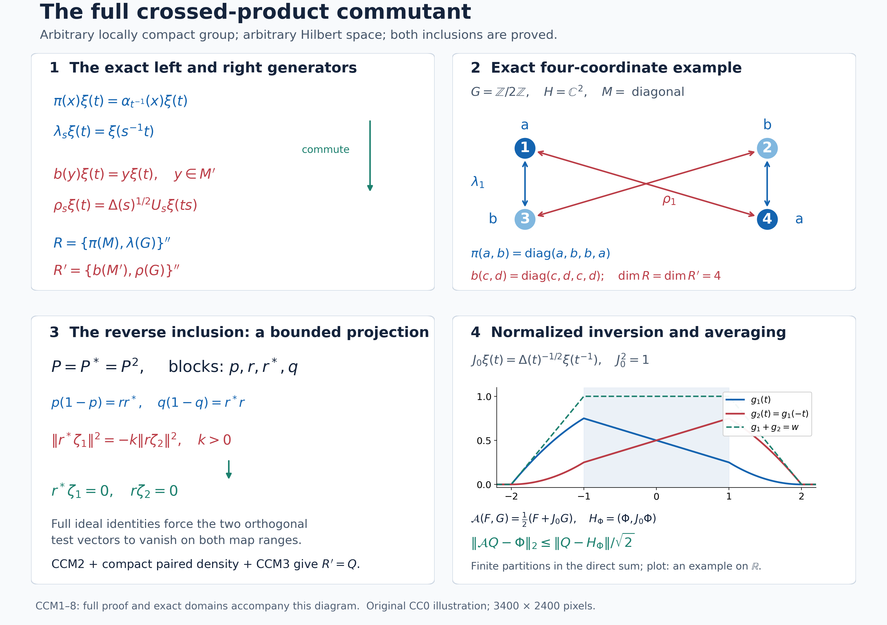

# The normal crossed-product commutant for arbitrary locally compact groups

*New expression: CC0-1.0 to the extent of rights held.*

Throughout, \(G\) is an arbitrary locally compact Hausdorff group. Its left Haar measure satisfies \(\mu(Es)=\Delta(s)\mu(E)\); consequently \(\int f(ts)\,dt=\Delta(s)^{-1}\int f\) and \(\int f(t^{-1})\,dt=\int f(t)\Delta(t)^{-1}\,dt\). We use scalar products linear in the first variable. No countability, separability, finite weight, or invariant state is assumed.

The earlier inputs are [NR1–4](OA-FLOW-NR.md#oa-flow.nr.1) for standard implementation and normal representation comparison, [BD1/4](OA-FLOW-BD.md#oa-flow.bd.1) for bounded operator approximation, [L24](OA-FLOW-L24.md#oa-flow.grp.haarconventions) for Haar conventions and vector integration, and [CP](OA-FLOW-CP.md#oa-flow.cp.4) for concrete normality. The standard case uses the full modular conjugation already constructed in [GDW5–6](OA-FLOW-GDW.md#gdw-5) and the [MW1 modular commutation theorem](OA-FLOW-MW.md#oa-flow.mw.1). We first prove a transfer principle through reducing projections, then establish its standard-model premise. No cyclic-vector or countability assumption is added.

## CCM0. The exact statement and the two concrete models

First suppose \(M\subseteq B(H)\) and a strongly continuous unitary representation \(s\mapsto U_s\) implements \(\alpha_s(x)=U_sxU_s^*\). On \(K=L^2(G,H)\), the completed space of compactly supported continuous vector fields, put

\[
 (\pi(x)\xi)(t)=\alpha_{t^{-1}}(x)\xi(t),\qquad
 (\lambda_s\xi)(t)=\xi(s^{-1}t),\qquad
 R=\{\pi(M),\lambda(G)\}'' .                         \tag{CCM1}
\]
The normal crossed-product commutant theorem is

\[
 R'=\{b(M'),\rho(G)\}'',\qquad
 (b(y)\xi)(t)=y\xi(t),\quad
 (\rho_s\xi)(t)=\Delta(s)^{1/2}U_s\xi(ts).             \tag{CCM2}
\]
Both representations of the coefficient algebras are faithful and normal. In particular, the right generators use \(U_s\), the order \(ts\), and the positive half power of \(\Delta(s)\).

An arbitrary point-ultraweakly continuous normal action on an arbitrary concretely represented \(M\) need not have an implementation on that particular \(H\). Its regular representation still exists by NR3. In this case CCM8 gives its commutant as an explicit compressed amplification of (CCM2) in the standard model. Thus (CCM2) does not conceal an extra spatiality assumption on the original representation. When an implementation on \(H\) is given, it holds directly on that \(H\).

CCM0 is the theorem statement. Its proof consists of the transport lemma, the standard-model calculation, and CCM7–8.

## CCM5. The right generators and their elementary inclusion

Put \(\alpha'_s(y)=U_syU_s^*\) on \(M'\), and let \((\pi'(y)\xi)(t)=\alpha'_{t^{-1}}(y)\xi(t)\). These are the normal regular coefficients for the commutant action. The linear unitary

\[
 (Z\xi)(t)=\Delta(t)^{-1/2}U_t^*\xi(t^{-1})             \tag{CCM19}
\]
is isometric by inversion, and \(Z^2=1\). Direct substitution gives

\[
 Z\pi'(y)Z=b(y),\qquad Z\lambda_sZ=\rho_s.
                                                               \tag{CCM20}
\]
These generators commute with \(\pi(x)\) and \(\lambda_t\). For example \(\rho_s\pi(x)\rho_s^*\xi(t)=U_s\alpha_{(ts)^{-1}}(x)U_s^*\xi(t)=\alpha_{t^{-1}}(x)\xi(t)\), and left and right translations commute. Normality of \(b\) is the constant amplification; normality of \(\pi'\) is NR3 applied to \(M'\). The factors in \(\rho\) are unitary by the right Haar identity, and \(\rho_s\rho_t=\rho_{st}\).

Write \(Q=\{b(M'),\rho(G)\}''\). The preceding computations prove \(Q\subseteq R'\). Strong continuity of \(\rho\) follows from strong continuity of \(U\) and of normalized right translations on the compact tensor core, then on its completion. The reverse inclusion is established below.

## Transport through a reducing projection

We first isolate a representation-theoretic fact. Suppose a faithful normal model \(\sigma:M\to B(H_0)\) in standard form, with strongly continuous implementation \(U^0\), has already satisfied the commutant formula
\[
 R_0'=\{b(\sigma(M)'),\rho^0(G)\}'',
 \qquad \rho_s^0\xi(t)=\Delta(s)^{1/2}U_s^0\xi(ts).
 \tag{CCM-T1}
\]
We prove that the same formula holds in any faithful normal representation \(\tau:M\to B(H)\) with a given strongly continuous implementation \(U\). This is an implication with (CCM-T1) as hypothesis; the next section establishes that hypothesis in a standard model.

[NR4](OA-FLOW-NR.md#oa-flow.nr.4) gives an arbitrary index set \(I\), the Hilbert space \(H_a=H_0\otimes\ell^2(I)\), a projection \(e\) in
\[
 D=(\sigma(M)\otimes1)',\qquad N=\sigma(M)\otimes1,
\]
and a unitary \(V:H\to eH_a\) intertwining \(\tau(x)\) with \(x_a|_{eH_a}\), where \(x_a=\sigma(x)\otimes1\). We regard \(V\) as an isometry into \(H_a\), so \(VV^*=e\). Write \(U_s^a=U_s^0\otimes1\).

On \(L^2(G,H_a)\), the amplified left algebra is \(R_a=R_0\otimes1\). Its commutant is
\[
 Q_a=R_a'=\{b(D),\rho^a(G)\}'',\qquad
 \rho_s^a\xi(t)=\Delta(s)^{1/2}U_s^a\xi(ts).
 \tag{CCM-T2}
\]
Indeed an operator commuting with \(R_0\otimes1\) has every matrix entry in \(R_0'\). Its finite matrix compressions belong to \(R_0'\bar\otimes B(\ell^2(I))\), are uniformly bounded, and converge strongly with their adjoints as the finite subsets of \(I\) increase. The reverse inclusion follows on generators. The same matrix-entry proof gives \(D=\sigma(M)'\bar\otimes B(\ell^2(I))\). Using (CCM-T1), these two identities prove (CCM-T2). Only finite coordinate tests and their bounded limits are used; \(I\) need not be countable.

Let \(E=b(e)\), and let \(\mathcal V\) be the constant fibre isometry induced by \(V\). The projection \(E\) commutes with \(R_a\): it commutes with every value of its left coefficient fields and with left translation. NR4 identifies \(R_H=\{\pi_\tau(M),\lambda(G)\}''\) normally with \(ER_aE\) on \(EL^2(G,H_a)\). For any represented von Neumann algebra \(A\) and \(E\in A'\),
\[
 (EAE)'_{E\mathcal K}=EA'E.
 \tag{CCM-T3}
\]
To prove the nontrivial inclusion, extend an operator on \(E\mathcal K\) by zero on \((1-E)\mathcal K\). Both summands reduce \(A\), so the extension commutes with \(A\) exactly when its restriction commutes with \(EAE\). Thus
\[
 R_H'=\mathcal V^*E Q_a E\mathcal V .
 \tag{CCM-T4}
\]
The compression in this formula is a corner of the entire commutant.

We now identify its generators when \(U\) is given. Put
\[
 e_s=U_s^a e(U_s^a)^*,\qquad
 T_s=V U_sV^*,\qquad w_s=T_s(U_s^a)^*.
 \tag{CCM-T5}
\]
The operator \(T_s\) is unitary on \(eH_a\), extended by zero on its orthogonal complement. Covariance on that subspace gives, for every \(x\in M\),
\[
 T_s x_a=(\alpha_s(x))_a T_s,\qquad
 w_s x_a=x_a w_s.
\]
For the second equality, move \(x_a\) through \((U_s^a)^*\) as \((\alpha_{s^{-1}}(x))_a\), then use the first equality. Hence \(w_s\in D\), and multiplication gives the exact support identities
\[
 w_sw_s^*=e,\qquad w_s^*w_s=e_s.
 \tag{CCM-T6}
\]
No invariance of \(e\) under \(U_s^a\) has been assumed.

On \(EL^2(G,H_a)\), the transported original right unitary is
\[
 \widetilde\rho_s=\mathcal V\rho_s\mathcal V^*
      =b(w_s)\rho_s^a E .
 \tag{CCM-T7}
\]
Both sides send \(\xi(t)\) to \(\Delta(s)^{1/2}T_s\xi(ts)\). For \(d\in D\), use \(\rho_s^aE=b(e_s)\rho_s^a\) and (CCM-T6) to obtain
\[
 E\,b(d)\rho_s^a E
   =b(edw_s^*)\,\widetilde\rho_s,\qquad edw_s^*\in eDe.
 \tag{CCM-T8}
\]
The coefficient membership follows from \(ew_s=w_s=w_se_s\), so \(w_s^*=e_sw_s^*e\). Applying (CCM-T3) to \(N\) on \(H_a\) identifies \(eDe\) with \(\tau(M)'\) under \(V\).

It remains to pass from these words to the whole corner. Covariance of \(\rho^a\) with \(b(D)\) makes the linear span of \(b(d)\rho_s^a\) a unital *-algebra with double commutant \(Q_a\). [BD1 and BD4](OA-FLOW-BD.md#oa-flow.bd.1) approximate every member of \(Q_a\) strongly by a uniformly bounded net from that span: apply bounded density to its norm closure, then approximate the chosen elements in norm by words. Compression preserves strong convergence and the common bound. Equation (CCM-T8) therefore puts \(EQ_aE\) inside the von Neumann algebra generated by \(b(eDe)\) and \(\widetilde\rho(G)\). The reverse inclusion holds because these transported generators commute with \(ER_aE\), by CCM5. Combining this with (CCM-T4) proves the asserted transfer of the complete commutant formula.

## The standard model from its modular conjugation

Choose a faithful normal semifinite weight by [CR9](OA-FLOW-CR.md#oa-flow.cr.9). Its normal GNS representation and standard form are supplied by [NF5](OA-FLOW-NF.md#oa-flow.nf.5), [WR](OA-FLOW-WR.md#oa-flow.wr.1), [NC](OA-FLOW-NC.md#oa-flow.nc.1), and [NR1](OA-FLOW-NR.md#oa-flow.nr.1). Write \(M_0\subset B(H_0)\) for its standard representation, \(J\) for its modular conjugation, and \(U^0\) for the canonical implementation of \(\alpha\). In particular
\[
 JM_0J=M_0',\qquad JU_s^0=U_s^0J .
\]
These are the earlier modular and standard-form theorems, with complete programme proofs.

[GDW5–6](OA-FLOW-GDW.md#gdw-5) construct a faithful normal semifinite weight on \(R_0\), identify its GNS space with \(L^2(G,H_0)\), and prove on that entire Hilbert space that its modular conjugation is
\[
 (\widehat J\xi)(t)=\Delta(t)^{-1/2}(U_t^0)^*J\xi(t^{-1}).
 \tag{CCM-S1}
\]
Those sections obtain the full closed involution and its adjoint from compact graph approximation; they do not use a crossed-product commutant theorem. Their compact coefficient input is the earlier [coefficient integration lesson](OA-FLOW-CAI.md#ccm-4). Thus [MW1](OA-FLOW-MW.md#oa-flow.mw.1), applied to the full Hilbert algebra in GDW6, gives
\[
 R_0'=\widehat J R_0\widehat J .
 \tag{CCM-S2}
\]

We compute this algebra on its actual generators. On compact continuous fields, (CCM-S1) gives
\[
 \begin{aligned}
 (\widehat J\pi(x)\widehat J\xi)(t)
  &=(U_t^0)^*J\alpha_t(x)U_t^0J\xi(t)
    =JxJ\xi(t),\\
 (\widehat J\lambda_s\widehat J\xi)(t)
  &=\Delta(s)^{1/2}(U_t^0)^*U_{ts}^0\xi(ts)
    =\Delta(s)^{1/2}U_s^0\xi(ts).
 \end{aligned}
 \tag{CCM-S3}
\]
In the first line the two positive scalar factors multiply to one. In the second line the inner argument is \(s^{-1}t^{-1}=(ts)^{-1}\), so those factors multiply to \(\Delta(t)^{-1/2}\Delta(ts)^{1/2}=\Delta(s)^{1/2}\). Commutation of \(J\) with the implementing unitaries and the group law give the displayed operator factors. Each operator is bounded, so the equalities extend from the dense compact core to the whole Hilbert space.

Conjugation by an antiunitary preserves products and adjoints and sends strong limits to strong limits. It is conjugate-linear on scalars, which leaves the generated complex algebra unchanged. Equations (CCM-S2)–(CCM-S3), together with \(JM_0J=M_0'\), prove
\[
 R_0'=\{b(M_0'),\rho^0(G)\}'' .
 \tag{CCM-S4}
\]
This is the hypothesis required by the preceding transport argument. The modular-conjugation computation also appears in Haagerup, [Theorem 2.1, printed pp.111–112](https://www.mscand.dk/article/download/11768/9784/30722#page=13); all modular and representation-comparison premises used here are the earlier local proofs.

## CCM7. The commutant, its normality and a useful twist

The standard-model calculation proves (CCM-T1), and the transport lemma proves the same equality on the original spatial representation. Together with the unitary identities (CCM20), this gives

\[
 R'=Q=Z\{\pi'(M'),\lambda(G)\}''Z.                    \tag{CCM30}
\]
This proves the reverse inclusion, not only the commuting generators. The right covariant system has
\(\rho_s b(y)\rho_s^*=b(\alpha'_s(y))\), and (CCM30) identifies its entire generated von Neumann algebra normally and faithfully with the normal regular crossed product of \(M'\) for \(\alpha'\). The identification is unitary conjugation; its normality and that of its inverse hold for every ultraweak net by CP, rather than only for increasing sequences.

The unitary \((W\xi)(t)=U_t\xi(t)\) gives the equivalent formulas

\[
 W\pi(x)W^*=x\otimes1,\quad W\lambda_sW^*=U_s\lambda_s,
 \quad Wb(y)W^*\xi(t)=\alpha'_t(y)\xi(t),\quad
 W\rho_sW^*=r_s,\quad r_s\xi(t)=\Delta(s)^{1/2}\xi(ts).
                                                               \tag{CCM31}
\]
Substitute \(U_{s^{-1}t}=U_s^*U_t\) and \(U_{ts}=U_tU_s\) to verify the two group formulas. Thus the constant-left-coefficient model and the twisted-right-coefficient model are the same theorem with explicit coordinates.

## CCM8. Arbitrary original representations, without a hidden spatial action

For an arbitrary normal action on a concrete \(M\subseteq B(H)\), take NR1's standard representation \(M_0\subseteq B(H_0)\) and canonical strongly continuous implementation \(U^0\). NR4 explicitly realizes the original faithful normal representation as a reducing full-central-support subspace \(EH\!_{\rm amp}\) of \(H\!_{\rm amp}=H_0\otimes\ell^2(I)\), with \(E\in(M_0\otimes1)'\). Denote the intertwining unitary by \(V:H\to EH\!_{\rm amp}\). All index sets may be arbitrary. On the regular spaces, the constant fibre map \(\mathcal V\xi(t)=V\xi(t)\) identifies the original regular crossed product with the compression of \(R_0\otimes1\) to \(\mathcal E=E\otimes1_{L^2(G)}\). The projection \(\mathcal E\) commutes with all left generators because it commutes with every \(\alpha_{t^{-1}}(M_0)\otimes1\) and is constant in \(t\).

For completeness, matrix entries prove the exact amplification commutant

\[
 (R_0\otimes1_{\ell^2(I)})'=Q_0\,\overline\otimes\,B(\ell^2(I)),
 \quad Q_0=\{b(M_0'),\rho^0(G)\}''.                    \tag{CCM32}
\]
An operator commutes with \(R_0\otimes1\) precisely when all its matrix entries belong to \(R_0'=Q_0\), by testing coordinate vectors. Its finite matrix compressions then belong to the right-hand algebra, are uniformly bounded by its norm, and converge strongly, as do their adjoints. Conversely each right-hand generator commutes. This works with the net of all finite subsets of \(I\).

If \(N\) is any represented algebra and \(e\in N'\), every operator on \(eK\) commuting with \(eNe\) extends by zero on \((1-e)K\) to an operator commuting with \(N\). Therefore \((eNe)'_{eK}=eN'e\); both inclusions follow from this extension, with no unjustified compression homomorphism on \(N'\). Hence the arbitrary concrete regular commutant is

\[
 R_H'=\mathcal V^*\,
 \mathcal E\bigl(Q_0\,\overline\otimes\,B(\ell^2(I))\bigr)\mathcal E
 \,\mathcal V.                                        \tag{CCM33}
\]
This is an exact normal represented corner, including all its compressed finite matrix entries and their bounded strong limits. It is not a claim that individual \(\rho_s^0\) preserve \(E\), nor that compressing just individual generators is a homomorphism. NR4 proves that the compressed left representation is faithful and normally identifies the original crossed product; unitary transfer and the zero-extension argument prove the precise right commutant on its actual Hilbert space. If a spatial implementation on the original \(H\) exists, the transport lemma identifies this whole corner with the right generators in (CCM2). If \(H=0\), both regular spaces and algebras are zero and all assertions have their empty interpretation.

## CCM9. Exact finite examples and exercises

On \(H=\mathbb C^2\), \(M\) is the diagonal algebra. Let \(G=\mathbb Z/2\mathbb Z=\{0,1\}\), counting Haar measure, and \(U_1=\begin{pmatrix}0&1\\1&0\end{pmatrix}\). On \(K=H\oplus H\), ordered by \(t=0,1\),

\[
 \pi(\operatorname{diag}(a,b))=\operatorname{diag}(a,b,b,a),\quad
 \lambda_1=\begin{pmatrix}0&I_2\\I_2&0\end{pmatrix},\quad
 b(\operatorname{diag}(c,d))=\operatorname{diag}(c,d,c,d),\quad
 \rho_1=\begin{pmatrix}0&U_1\\U_1&0\end{pmatrix}.        \tag{CCM34}
\]
The left invariant subspaces spanned by coordinates \((1,3)\), \((2,4)\) carry two equivalent full \(M_2(\mathbb C)\) representations, related by swapping their two coordinates. Thus \(R\) has complex dimension four, and its commutant has dimension four with multiplicity two. The displayed right diagonal and flip generate that whole commutant. This is a finite exact illustration, not a reduction of the arbitrary-group theorem to a finite group.

1. Check (CCM20) directly, including the modular function. **Solution.** In \(Z\pi'(y)Z\), the factors \(\Delta(t)^{-1/2}\Delta(t^{-1})^{-1/2}\) cancel and \(U_t^*\alpha'_t(y)U_t=y\). For \(Z\lambda_sZ\), the second argument is \(s^{-1}t^{-1}=(ts)^{-1}\); its scalar factor is \(\Delta(t)^{-1/2}\Delta(ts)^{1/2}=\Delta(s)^{1/2}\), and \(U_t^*U_{ts}=U_s\). These give exactly (CCM20).

2. Can one obtain the commutant by compressing its generating unitaries individually? **Solution.** Not in general: \(EAE\,EBE\) need not equal \(EABE\). In the transport proof, \(\rho_s^a\) carries \(E\) to \(b(e_s)\). The correction \(b(w_s)\), with initial projection \(b(e_s)\) and final projection \(E\), gives the actual unitary on the corner. Formula (CCM-T8) then handles every word before bounded strong limits are taken.

3. In (CCM34), solve the commutant equations directly. **Solution.** Commutation with all \(\pi(a,b)\) leaves matrix entries only within equal-label coordinate classes \(\{1,4\}\), \(\{2,3\}\). Commutation with \(\lambda_1\) identifies the corresponding entries under \(1\leftrightarrow3\), \(2\leftrightarrow4\). The four independent resulting matrices are \(b(E_{11}),b(E_{22}),b(E_{11})\rho_1,b(E_{22})\rho_1\). They are precisely the right algebra in (CCM34).

4. Explain why an arbitrary action does not supply a unitary \(U_s\) on an arbitrary chosen faithful representation. **Solution.** Spatiality depends on the representation. NR1 supplies a canonical implementation in standard form; NR4 transports the left crossed product to the original representation by a reducing amplification corner. Formula (CCM33), whose zero-extension proof is local, gives the commutant in that representation without assuming an unavailable \(U_s\).

The proved scope is the arbitrary-LCH normal regular commutant theorem. The dual weight used in the standard case is proved earlier in GDW. No general group duality, spectral synthesis, induction theorem, or classification statement is asserted here.

## How the complete commutant passes to another representation

The upper left panel records the operators in [CCM0](OA-FLOW-CCM.md#ccm-0). Right translation is normalized by \(\Delta(s)^{1/2}\), because \(\int\|\xi(ts)\|^2dt=\Delta(s)^{-1}\|\xi\|_2^2\). The lower left panel proves the reverse inclusion in the standard representation: [GDW5–6](OA-FLOW-GDW.md#gdw-5) supply \(\widehat J\), and (CCM-S3) computes its conjugation of both generator families. The full modular theorem gives \(R_0'=\widehat J R_0\widehat J\).

The lower right panel depicts the two different subspaces involved in [transport](OA-FLOW-CCM.md#ccm-transport). The amplified unitary sends \(eH_a\) to \(e_sH_a\). The partial isometry \(w_s\in D=N'\) sends \(e_sH_a\) back to \(eH_a\); its initial and final projections are \(e_s\) and \(e\). Their product realizes the original implementing unitary on its actual Hilbert space. Equation (CCM-T8) rewrites every compressed word as a coefficient from \(eDe\) times this transported right unitary. Uniformly bounded strong approximation then gives the entire corner \(EQ_aE\). The diagram does not assume that \(e_s=e\), nor that compression is multiplicative on \(Q_a\).

The upper right panel is the exact finite example of [CCM9](OA-FLOW-CCM.md#ccm-9). Coordinates \(1,2,3,4\) mean \((0,e_1),(0,e_2),(1,e_1),(1,e_2)\). Blue vertical arrows are \(\lambda_1\); red diagonal arrows are \(\rho_1\). The coefficient labels are \((a,b,b,a)\) and \((c,d,c,d)\). The four independent operators
\[
 b(E_{11}),\quad b(E_{22}),\quad b(E_{11})\rho_1,\quad b(E_{22})\rho_1
\]
span the full right algebra; both represented algebras have complex dimension four. This finite illustration is separate from the arbitrary-group proof.

Human mathematical context: Haagerup, [*On the dual weights for crossed products of von Neumann algebras I*, Theorem 2.1](https://journals.msp.org/mscand/article/view/1879). The complete mathematical argument and exact proof locators accompany the schematic. Original diagram expression: CC0-1.0 to the extent of rights held. Native PNG: 3400×2400; [editable SVG](../assets/general-group-crossed-product-commutant/assets/crossed-product-commutant.svg), [exact data](../assets/general-group-crossed-product-commutant/assets/crossed-product-commutant-data.json), and [reproduction source](../assets/general-group-crossed-product-commutant/render_commutant.py).
