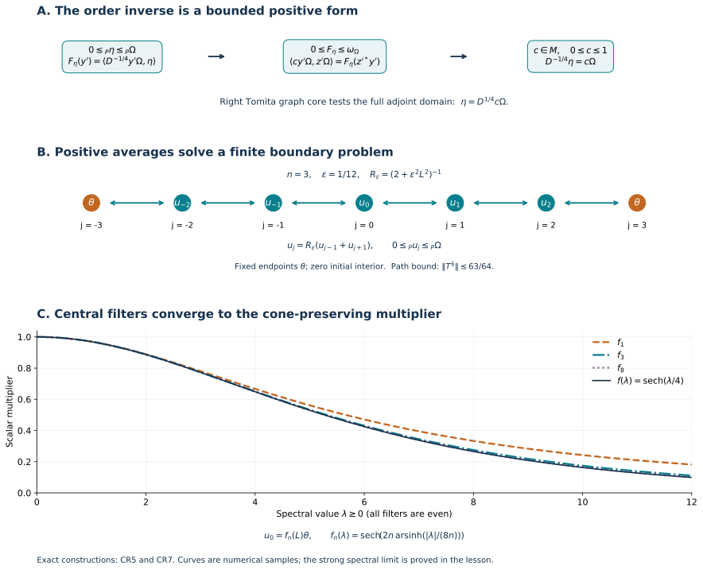

# Projection corners and canonical positive-functional vectors

*CC0-1.0 to the extent of rights held.*

Let \((M,H,J,P)\) be any standard form: \(JMJ=M'\), \(JzJ=z^*\) on the center, \(J\) fixes the self-dual closed cone \(P\), and \(xJxJ\) preserves \(P\). The preceding [NC-1–5](OA-FLOW-NC.md) constructs it from an arbitrary faithful n.s.f. weight. We use no faithful-state hypothesis on \(M\). Write \(j(x)=JxJ\) and \(\omega_\xi(a)=\langle a\xi,\xi\rangle\), with the linear-first convention.

Additional exact local inputs are [PC-1](OA-FLOW-PC.md#oa-flow.projection.pc1)'s polar partial isometry, the maximal principle in [CF-1](OA-FLOW-CF.md#oa-flow.cf.1), [CP](OA-FLOW-CP.md#oa-flow.cp.1) and [ST-1/2](OA-FLOW-ST12.md#oa-flow.st.1) for predual/topology/compactness, [EP-1](OA-FLOW-EP.md#oa-flow.ep.1)'s positive vector series, [WR/MW](OA-FLOW-WR.md#oa-flow.wr.4) for the full faithful-state graphs, and [SF-3](OA-FLOW-SF.md#oa-flow.sf3.improper-vector-integral) for continuous vector integrals. All remaining steps, including the projection commutant and center statements, are proved here.

The free human route is [Hiai, Propositions 3.7–3.10 and Lemmas 3.14–3.19, printed pp.23–31](https://arxiv.org/pdf/2004.02383v1#page=23). The statements and cone setting are compared with that source. Here the order inverse is constructed from a dominated functional on the commutant; finite Dirichlet grids and cone-order minimality construct the representing vectors. The arbitrary-algebra corner reduction and full form/domain arguments are proved explicitly.

Exact additional locators: [ST-2 faithful normal transport](OA-FLOW-ST12.md#oa-flow.st.2), [HA-R7 right graph core](OA-FLOW-HA-R.md#oa-flow.ha-r.7), [EP-2 vector-functional norm bound](OA-FLOW-EP.md#oa-flow.ep.2), [GNS positive-form Cauchy–Schwarz](OA-FLOW-GNS.md#gns-lemma-2-1), [CF-8 Riesz representation](OA-FLOW-CF.md#OA-FLOW.CF.8).

## CR-1. Cone geometry and vector supports

Self-duality makes \(P\) pointed: if \(\xi,-\xi\in P\), then \(-\|\xi\|^2\geq0\). If \(Jv=v\), the closest point \(v_+\) of \(P\) to \(v\) exists. To recall the elementary proof, a minimizing sequence is Cauchy by the parallelogram identity and convexity; its limit lies in the closed cone. The same identity proves uniqueness. Put \(v_-=v_+-v\). Variations \(v_++t\eta\), \(t\geq0,\eta\in P\), show \(\langle v_-,\eta\rangle\geq0\): these inner products are real because both vectors are \(J\)-fixed. Hence \(v_-\in P\). Variations \((1-t)v_+\) show \(\langle v_-,v_+\rangle\leq0\); self-duality gives equality. Thus

\[
 v=v_+-v_-,\qquad v_\pm\in P,\qquad v_+\perp v_-.
 \tag{CR1}
\]
If also \(v=w_+-w_-\) is such a decomposition, then
\(\|v_+-w_+\|^2=-\langle v_+,w_-\rangle-\langle w_+,v_-\rangle\leq0\).
Splitting any vector into its \(J\)-real and \(J\)-imaginary parts proves that the complex span of \(P\) is all \(H\).

For any \(\xi\in H\), let \(p_\xi\) be the projection onto \(\overline{M'\xi}\). This subspace is reducing for \(M'\), so \(p_\xi\in M\). It is the least projection in \(M\) fixing \(\xi\). Indeed, any such projection commutes with \(M'\) and fixes \(M'\xi\). For a projection \(e\in M\),
\(\omega_\xi(e)=0\) is equivalent to \(e\xi=0\), and then \(ep_\xi=0\). Consequently

\[
 p_\xi=s(\omega_\xi).
 \tag{CR2}
\]
The restriction of \(\omega_\xi\) to \(p_\xi M p_\xi\) is faithful: if \(a\geq0\) there and \(a^{1/2}\xi=0\), then \(a^{1/2}M'\xi=0\), forcing \(a=0\).

For \(\xi\in P\), \(j(p_\xi)\) is the projection onto \(\overline{M\xi}\), by applying \(J\). Thus

\[
 \xi=p_\xi j(p_\xi)\xi.
 \tag{CR3}
\]
Two further support facts will prevent a hidden faithfulness assumption in the norm estimate.

First, if \(e\in M\) is a projection and \(ej(e)\xi=0\) for \(\xi\in P\), then \(e\xi=0\). Put \(r=1-e\). For real \(t\), cone invariance gives
\[
 (e+tr)j(e+tr)\xi
 =t\{ej(r)+rj(e)\}\xi+t^2rj(r)\xi\in P.
\]
Divide by \(|t|\) and approach zero from both sides. Pointedness implies
\(\{ej(r)+rj(e)\}\xi=0\).
Its two terms are in orthogonal projection ranges, so each vanishes; hence \(e\xi=0\).
It follows that \(0\leq_P\xi\leq_P\zeta\) implies \(p_\xi\leq p_\zeta\). Apply \(rj(r)\), \(r=1-p_\zeta\), to \(\xi\) and \(\zeta-\xi\). Their images are in \(P\) and sum to zero; the just proved fact then gives \(r\xi=0\). In particular

\[
 p_{\xi+\eta}=p_\xi\vee p_\eta\quad(\xi,\eta\in P).
 \tag{CR4}
\]

Second, if \(\xi,\eta\in P\) and \(\langle\xi,\eta\rangle=0\), positivity of
\(\langle(1+ta)j(1+ta)\xi,\eta\rangle\)
for every complex \(t\) forces its linear coefficient to vanish. Since \(J\xi=\xi,J\eta=\eta\), that coefficient is \(2\operatorname{Re}(t\langle a\xi,\eta\rangle)\). Hence \(\langle a\xi,\eta\rangle=0\) for every \(a\in M\). Thus \(j(p_\xi)\eta=0\), and applying \(J\) gives \(p_\xi\eta=0\). Formula ([CR2](OA-FLOW-CR.md#equation-cr2)) yields

\[
 \xi\perp\eta\quad\Longleftrightarrow\quad p_\xi p_\eta=0
 \qquad(\xi,\eta\in P).
 \tag{CR5}
\]
The reverse implication is immediate from their left supports.

## CR-2. The projection commutant and center, proved locally

For an arbitrary concrete von Neumann algebra \(L\) and projection \(e\in L\), the central support \(c(e)\) is the projection onto \(\overline{\operatorname{span}LeH}\). This subspace is invariant under \(L,L^*,L',L'^*\); hence \(c(e)\in Z(L)\), and it is the least central projection majorizing \(e\).

Choose a maximal family \(v_i\in L\) of partial isometries with \(v_i^*v_i\leq e\), pairwise orthogonal final projections \(q_i=v_iv_i^*\), and include \(v_0=e\) when \(e\ne0\). Then

\[
 \sum_iq_i=c(e).
 \tag{CR6}
\]
If the residual projection \(r\leq c(e)\) were nonzero, \(rLe\ne0\); otherwise \(r\) annihilates \(LeH\) and hence \(c(e)H\). A nonzero polar partial isometry of \(rxe\) has initial projection at most \(e\), final projection at most \(r\), and enlarges the family, a contradiction. Orthogonal sums mean strong limits over finite subsets.

If \(b\) is in the commutant of \(eLe\) on \(eH\), define \(B=\sum_i v_i b v_i^*\) on \(c(e)H\), and zero on its complement. These are orthogonal diagonal blocks of norm at most \(\|b\|\), so the sum exists strongly and is bounded. Each \(v_i^*v_i\in eLe\) commutes with \(b\). For \(x\in L\), the matrix coefficients of \(Bx\) and \(xB\) between the ranges of \(q_i,q_j\) agree because \(v_i^*xv_j\in eLe\) commutes with \(b\). Equation ([CR6](OA-FLOW-CR.md#equation-cr6)) and centrality of \(c(e)\) give \(B\in L'\). Also \(B|_{eH}=b\), using \(v_0=e\). Therefore

\[
 (eLe)'_{\,eH}=eL'.
 \tag{CR7}
\]
If \(b\in Z(eLe)\), the same bounded strong sum belongs to \(L\) as well, hence to \(Z(L)\). Thus

\[
 Z(eLe)=eZ(L).
 \tag{CR8}
\]
Zero projections are included separately with the zero Hilbert space.

Apply ([CR7](OA-FLOW-CR.md#equation-cr7)) a second time to the commutant algebra. If \(q\in L'\), it gives
\((qL'q)'_{qH}=Lq\).
Taking commutants proves that \(Lq\) is a von Neumann algebra on \(qH\), with commutant \(qL'q\). This justifies reduction by a commuting projection without presuming that an arbitrary compressed image is closed.

## CR-3. Every projection corner is a standard form

Let \(p\in M\), \(q=pj(p)\). The map

\[
 pMp\longrightarrow B:=qMq,\qquad a\longmapsto aq
 \tag{CR9}
\]
is a faithful normal \(*\)-isomorphism onto a von Neumann algebra on \(qH\). To check faithfulness, if \(a\in pMp\) and \(aq=0\), then \(aj(p)=0\). The operator \(a\), commuting with \(M'\), annihilates \(\overline{M'j(p)H}\). Its projection is \(c_{M'}(j(p))=Jc_M(p)J=c_M(p)\), by the central axiom. Since \(a=ap\) and \(p\leq c_M(p)\), we get \(a=0\). Normality is concrete vector-series continuity; ST-2 gives the normal inverse.

For the algebra/commutant assertion, first use ([CR7](OA-FLOW-CR.md#equation-cr7)) on \(pH\), then reduce by \(q\in(pMp)'=pM'\) as proved after ([CR8](OA-FLOW-CR.md#equation-cr8)). This gives

\[
 B'=qM'q=J_q B J_q,\qquad J_q=J|_{qH}.
 \tag{CR10}
\]
Here \(qJ=Jq\) because \(p,j(p)\) commute. Also

\[
 P_q=qP=P\cap qH
 \tag{CR11}
\]
is self-dual on \(qH\): \(qP\subseteq P\) by cone invariance, and for \(\eta\in qH\) positivity against \(qP\) is exactly positivity against \(P\). This also proves its closedness. \(J_q\) fixes it. By ([CR8](OA-FLOW-CR.md#equation-cr8))/([CR9](OA-FLOW-CR.md#equation-cr9)), every central element of \(B\) is \(zq\) for a central \(z\in M\); thus \(J_q(zq)J_q=z^*q\). Finally for \(a\in pMp\), the operator \((aq)J_q(aq)J_q\) on \(qH\) is the restriction of \(aj(a)\), which preserves \(P_q\). Hence

\[
 (B,qH,J_q,P_q)
 \tag{CR12}
\]
is a standard form of \(pMp\), for every projection \(p\), without a modular-invariance assumption.

If \(\xi\in P\) and \(p=p_\xi\), then \(\xi\in qH\) is cyclic and separating for this corner algebra. Indeed \(\overline{M'\xi}=pH\), and projecting onto \(qH\) gives \(\overline{qM'q\,\xi}=qH\). Thus it is cyclic for \(B'\) and separating for \(B\). Applying \(J_q\), which fixes \(\xi\), makes it cyclic for \(B\) as well.

## CR-4. A faithful cone vector gives exactly the existing conjugation and cone

In any standard form suppose \(\Omega\in P\) is cyclic and separating. Its vector functional is faithful and normal, and its GNS map \(a\mapsto a\Omega\) is onto the given Hilbert completion. Apply the already proved faithful-weight construction to obtain \(S_\Omega\) and \(F_\Omega=S_\Omega^*\). Their full cores are respectively \(M\Omega\) and \(M'\Omega\), with actions \(a\Omega\mapsto a^*\Omega\) and \(b\Omega\mapsto b^*\Omega\). Here the right-core assertion follows from the full right algebra: \(R_{b\Omega}=b\) for every \(b\in M'\), the full adjoint-intersection criterion puts \(b\Omega\) in \(D(F_\Omega)\), and the unit \(\Omega\) makes its product algebra a graph core, by [HA-R7](OA-FLOW-HA-R.md#oa-flow.ha-r.7)/WH-04.

Since \(J\Omega=\Omega\), conjugating the right core by \(J\) gives the left core with exactly its involution. Thus \(JF_\Omega J=S_\Omega\) on their full closed domains. It follows that \(JS_\Omega\) is self-adjoint:
\[
 (JS_\Omega)^*=F_\Omega J=JS_\Omega.
\]
It is positive. On its core \(M\Omega\),

\[
 \langle JS_\Omega a\Omega,a\Omega\rangle
 =\langle a^*j(a^*)\Omega,\Omega\rangle\geq0
 \tag{CR13}
\]
by the cone action and self-duality. Graph approximation extends positivity to its full domain. Uniqueness of the polar decomposition of the closed conjugate-linear involution therefore gives \(J_\Omega=J\) and \(JS_\Omega=\Delta_\Omega^{1/2}\).

[NC-5](OA-FLOW-NC.md#oa-flow.nc.5) constructs \(P_\Omega=\overline{\{aj(a)\Omega:a\in M\}}\), which is contained in \(P\). Both cones are self-dual, so inclusion reverses on taking duals and they are equal. We have proved

\[
 J_\Omega=J,\qquad P_\Omega=P
 \tag{CR14}
\]
with equality of the full \(S,F,\Delta\) domains supplied by the faithful GNS construction. By [CR-3](OA-FLOW-CR.md#oa-flow.cr.3) this statement applies in particular to every supported cone vector on its support corner.

## CR-5. The faithful-vector order interval

Keep the hypotheses of [CR-4](OA-FLOW-CR.md#oa-flow.cr.4), and write \(D=\Delta_\Omega\). The map

\[
 A(x)=D^{1/4}x\Omega,\qquad x=x^*\in M,                           \tag{CR15}
\]
is an order isomorphism onto the \(P\)-order-bounded real vectors
\(\{\eta:J\eta=\eta,\ -c\Omega\leq_P\eta\leq_P c\Omega\text{ for some }c\geq0\}\). Positivity preservation follows from [NC-5](OA-FLOW-NC.md#oa-flow.nc.5). It is reflected: if \(A(x)\in P\), then for \(y'\in M'\),
\[
 \langle xy'\Omega,y'\Omega\rangle
 =\langle D^{1/4}x\Omega,D^{-1/4}y'^*y'\Omega\rangle\geq0.
\]
The second vector lies in \(P\) by [NC-3](OA-FLOW-NC.md#oa-flow.nc.3); both spectral domains follow from the left and right Tomita cores. Density of \(M'\Omega\) gives \(x\geq0\). The spectral inverse and separation of \(\Omega\) make \(A\) injective.

We construct the inverse on \(0\leq_P\eta\leq_P\Omega\) directly. For \(y'\in M'\), define
\[
 F_\eta(y')=\langle D^{-1/4}y'\Omega,\eta\rangle .
\]
This is defined on all of \(M'\), since \(M'\Omega\subset D(D^{-1/2})\). For \(y'\geq0\), NC-3 and the two cone inequalities give
\[
 0\leq F_\eta(y')\leq
 \langle D^{-1/4}y'\Omega,\Omega\rangle
 =\langle y'\Omega,\Omega\rangle.
\]
Here \(D\Omega=\Omega\). Thus \(F_\eta\) is a positive linear functional dominated by \(\omega_\Omega\) on \(M'\).

The form \(F_\eta(z'^*y')\) on \(M'\Omega\) is positive and bounded by the Hilbert norm. [Positive-functional Cauchy–Schwarz](OA-FLOW-GNS.md#gns-lemma-2-1) and [Riesz representation](OA-FLOW-CF.md#OA-FLOW.CF.8) give a positive contraction \(c\) with
\[
 \langle c y'\Omega,z'\Omega\rangle=F_\eta(z'^*y').
\]
For \(a'\in M'\), the form identity gives
\[
 \langle ca'y'\Omega,z'\Omega\rangle
 =F_\eta(z'^*a'y')
 =\langle cy'\Omega,a'^*z'\Omega\rangle
 =\langle a'cy'\Omega,z'\Omega\rangle .
\]
Density shows that \(c\) commutes with \(M'\), so \(c\in M\). Taking \(y'=1\), and using positivity to conjugate \(F_\eta\), yields
\[
 \langle c\Omega,z'\Omega\rangle
 =F_\eta(z'^*)=\langle\eta,D^{-1/4}z'\Omega\rangle .
\]

The right Tomita core \(M'\Omega\) is a graph core for \(D^{-1/2}\), and also for \(D^{-1/4}\). Indeed spectral truncation away from zero and infinity first approximates every vector in the latter domain by vectors in the former; approximation in the half-power graph norm then implies approximation in the quarter-power graph norm, since
\[
 \|D^{-1/4}v\|^2\leq\|v\|^2+\|D^{-1/2}v\|^2.
\]
The displayed pairing therefore tests the full self-adjoint adjoint domain. It proves
\(\eta\in D(D^{-1/4})\) and \(D^{-1/4}\eta=c\Omega\).
The spectral inverse gives \(\eta=D^{1/4}c\Omega=A(c)\), with \(0\leq c\leq1\).

The map also has the bounded formula

\[
 A(x)=D^{1/4}(1+D^{1/2})^{-1}(x\Omega+Jx^*\Omega).                \tag{CR16}
\]
It follows from \(D^{1/2}x\Omega=Jx^*\Omega\). The spectral multiplier has norm at most \(1/2\), so normal vector coefficients show that \(A\) is ultraweak-to-weak continuous.

Translation and scaling now give the whole claimed order interval, in particular

\[
 -\Omega\leq_P\eta\leq_P\Omega
 \ \Longrightarrow\ \eta=D^{1/4}x\Omega
 \quad(x=x^*,\ \|x\|\leq1).                                    \tag{CR17}
\]

## CR-6. The exact square-root estimate, with nonfaithful supports

For all \(\xi,\eta\in P\),

\[
 \|\xi-\eta\|^2\leq\|\omega_\xi-\omega_\eta\|
 \leq\|\xi-\eta\|\,\|\xi+\eta\|.
 \tag{CR18}
\]
The upper bound follows by expanding the difference as half the sum of the two mixed coefficients of \(\delta=\xi-\eta\) and \(\zeta=\xi+\eta\). For the lower bound, take \(p=p_\zeta\). By [CR-1](OA-FLOW-CR.md#oa-flow.cr.1), both \(\xi,\eta\) belong to \(qH\), \(q=pj(p)\), where \(\zeta\) is cyclic and separating for the standard corner ([CR-3](OA-FLOW-CR.md#oa-flow.cr.3)). The zero case is immediate. Apply ([CR17](OA-FLOW-CR.md#equation-cr17)) there to \(\delta\), obtaining a self-adjoint contraction \(x\in pMp\) with \(\delta=D^{1/4}x\zeta\), where \(D\) is that corner's modular operator. In particular \(\delta\in D(D^{-1/4})\). Since \(J_q\delta=\delta\), reciprocal spectral transport also puts it in \(D(D^{1/4})\), with equal real quadratic values of these two powers. Hence

\[
 \begin{split}
 \|\omega_\xi-\omega_\eta\|
 &\geq(\omega_\xi-\omega_\eta)(x)
  =\operatorname{Re}\langle x\zeta,\delta\rangle\\
 &=\tfrac12\langle(D^{-1/4}+D^{1/4})\delta,\delta\rangle
 \geq\|\delta\|^2.
 \end{split}
 \tag{CR19}
\]
The last inequality is the pointwise scalar inequality
\((t^{-1/4}+t^{1/4})/2\geq1\), integrated on the two already verified domains. Testing the original functional on \(x\in pMp\subset M\) gives the original norm bound. No faithful approximation of the two input functionals is needed.

It follows that \(\xi\mapsto\omega_\xi\) is injective and a homeomorphism onto a norm-closed subset of \(M_*^+\). Indeed a norm-Cauchy sequence of its functionals gives a Hilbert-Cauchy sequence of cone vectors by the first inequality, and the second inequality identifies its limit.

## CR-7. Dominated functionals from a cone-order minimum

Every \(0\leq\psi\leq\omega_\Omega\), with \(\Omega\in P\), has a representing vector \(\xi\in P\) satisfying \(0\leq_P\xi\leq_P\Omega\).

**A linear representation of a dominated functional.**
First let \(\Omega\in P\) be cyclic and separating and \(0\leq\psi\leq\omega_\Omega\). The bounded positive form \(\psi(b^*a)\) on \(M\Omega\) gives a positive contraction \(B\in M'\) such that
\(\psi(a)=\langle a\Omega,B\Omega\rangle\).
Indeed positive-functional Cauchy–Schwarz bounds the form, Riesz represents it, and moving left multipliers proves commutation.

Put \(D=\Delta_\Omega\). The vectors \(B\Omega,(1-B)\Omega\) lie in the right cone \(C_r\), so NC-3 gives
\(\theta=D^{-1/4}B\Omega\) with \(0\leq_P\theta\leq_P\Omega\).
Set

\[
 \eta=f(\log D)\theta
      =2(1+D^{1/2})^{-1}B\Omega.                               \tag{CR20}
\]
Here \(f(t)=1/\cosh(t/4)\); the two expressions agree by scalar spectral calculus on \(B\Omega\in D(D^{-1/4})\). We next prove that \(f(\log D)\) preserves the cone interval, and hence \(0\leq_P\eta\leq_P\Omega\).

**Positive averaging by finite Dirichlet grids.** Suppose \(U_t=e^{itL}\) is a strongly continuous unitary group preserving a closed convex cone \(P\), and \(U_t\Omega=\Omega\). We claim that
\[
 f(L)[0,\Omega]_P\subseteq[0,\Omega]_P,\qquad
 f(\lambda)=\frac1{\cosh(\lambda/4)}.
\]
We prove this claim by a finite boundary problem.

For \(\varepsilon>0\), put \(R_\varepsilon=(2+\varepsilon^2L^2)^{-1}\). The elementary integral
\(\int_0^\infty e^{-s}\cos(as)\,ds=(1+a^2)^{-1}\), obtained by integrating \(e^{-(1-ia)s}\), gives

\[
 R_\varepsilon
 =\frac14\int_0^\infty e^{-s}
       (U_{\varepsilon s/\sqrt2}+U_{-\varepsilon s/\sqrt2})\,ds.
                                                                    \tag{CR21}
\]
The [strong vector integrals](OA-FLOW-SF.md#oa-flow.sf3.improper-vector-integral) exist because the unitary orbits are continuous and bounded and the scalar weight is integrable. Pairing with vectors and applying [scalar interchange](OA-FLOW-FF.md#oa-flow.ff.1) to their finite spectral measures proves the displayed operator identity. Thus \(R_\varepsilon\) preserves \(P\), has norm at most \(1/2\), and maps \(\Omega\) to \(\Omega/2\).

Fix \(0\leq_P\theta\leq_P\Omega\), an integer \(n\geq1\), and \(\varepsilon=1/(4n)\). On the indices \(-n,\ldots,n\), hold \(u_{-n}=u_n=\theta\) fixed and solve
\[
 u_j=R_\varepsilon(u_{j-1}+u_{j+1})\qquad(-n<j<n).
\]
Starting with zero interior vectors and repeatedly applying this rule keeps every interior vector in \([0,\Omega]_P\). The iteration converges in norm. To see this, let \(T\) be its linear part on the finite product of interior Hilbert spaces, equipped with the maximum norm. Then \(\|T\|\leq1\). A term in \(T^{2n}\) corresponds to a length-\(2n\) nearest-neighbour path that stays inside the interval, with operator factor \(R_\varepsilon^{2n}\). From any starting index at least the all-right path exits. Thus at most \(2^{2n}-1\) paths remain, giving
\[
 \|T^{2n}\|\leq1-2^{-2n}<1.
\]
Grouping the operator geometric series in blocks of length \(2n\) proves convergence to the unique solution.

For a scalar spectral value \(\lambda\), set
\[
 a_n(\lambda)=\operatorname{arcosh}
            \!\left(1+\frac{\lambda^2}{32n^2}\right).
\]
The functions \(\cosh(j a_n)/\cosh(n a_n)\) solve the scalar recurrence, have boundary value \(1\), and lie between \(0\) and \(1\). Bounded spectral calculus and uniqueness therefore identify the central vector as
\[
 u_0=f_n(L)\theta,\qquad
 f_n(\lambda)=\frac1{\cosh(n a_n(\lambda))}.
\]
Since \(\cosh r-1\sim r^2/2\) at zero,
\(n a_n(\lambda)\to|\lambda|/4\). Spectral dominated convergence, with \(|f_n|\leq1\), gives \(u_0\to f(L)\theta\). Closedness of the cone order interval proves the claim.

**The linear equation and its support corner.**
For \(L=\log D\), the modular group \(D^{it}\) preserves \(P\) by NC-3 and fixes \(\Omega\). The preceding averaging result therefore applies to the vector in CR20.

The bounded spectral expression puts \(\eta\) in \(D(D^{1/2})\). Since \(J\eta=\eta\), reciprocal spectral transport also puts it in \(D(D^{-1/2})\), and \(F_\Omega\eta=D^{1/2}\eta\). Thus
\(B\Omega=(\eta+F_\Omega\eta)/2\).
Pairing with \(a\Omega\) and using the full anti-linear adjoint identity gives

\[
 \psi(a)=\tfrac12\{\langle a\Omega,\eta\rangle+
                         \langle a\eta,\Omega\rangle\}
 \qquad(a\in M).                                               \tag{CR22}
\]

For a general nonzero \(\Omega\in P\), perform this construction in its standard support corner from CR-3. Domination gives
\(\psi(1-p_\Omega)=0\), and positive-functional Cauchy–Schwarz gives
\(\psi(a)=\psi(p_\Omega a p_\Omega)\).
The corner formula is therefore CR22 on every \(a\in M\), with \(0\leq_P\eta\leq_P\Omega\). If \(\Omega=0\), both \(\psi\) and \(\eta\) are zero.

**A minimal upper vector represents the functional exactly.**
For \(\psi\leq\omega_\Omega\), consider
\[
 \mathcal S=\{\xi\in P:\xi\leq_P\Omega,\ \psi\leq\omega_\xi\}.
\]
This set contains \(\Omega\). Every chain in \(\mathcal S\) has a lower bound there. Order the chain downwards. For comparable \(0\leq_P\eta\leq_P\xi\), self-duality gives
\[
 \|\xi-\eta\|^2\leq\|\xi\|^2-\|\eta\|^2.
\]
For a nonempty chain, the norms decrease to their infimum, so this decreasing chain is a norm-Cauchy net: in a tail where the squared norms lie within \(\delta\) of their infimum, the squared distance between any two comparable vectors is at most \(\delta\). To obtain its limit from Hilbert completeness, choose increasing net indices in tails of diameter at most \(1/k\). The selected sequence is Cauchy and converges; for each such tail, every later net member is within its diameter of the selected point. Thus the entire net converges to the same limit. No cofinal sequence is required. The limit \(\zeta\) is in \(P\), below every chain member, and below \(\Omega\). Vector-functional norm continuity shows \(\psi\leq\omega_\zeta\). Hence \(\zeta\in\mathcal S\). The empty chain has the lower bound \(\Omega\in\mathcal S\).

The [maximal principle](OA-FLOW-CF.md#OA-FLOW.CF.1) applied to the reversed order gives a minimal \(\xi\in\mathcal S\). If the positive defect \(d=\omega_\xi-\psi\) were nonzero, apply CR22 to \(d\leq\omega_\xi\) and divide its resulting vector by two. This gives a nonzero \(0\leq_P\eta\leq_P\xi/2\) with
\[
 d(a)=\langle a\xi,\eta\rangle+\langle a\eta,\xi\rangle.
\]
Expansion then yields

\[
 \omega_{\xi-\eta}-\psi=\omega_\eta\geq0,\qquad
 0\leq_P\xi-\eta<_P\xi\leq_P\Omega.                             \tag{CR23}
\]
Thus \(\xi-\eta\) is a strictly smaller member of \(\mathcal S\), a contradiction. The defect is zero, so \(\psi=\omega_\xi\), as required.

The first panel shows the full adjoint-domain construction of [CR-5](OA-FLOW-CR.md#oa-flow.cr.5). The second uses \(n=3\), \(\varepsilon=1/12\), fixed endpoints \(\theta\), and the proved bound \(\|T^6\|\leq63/64\). The third plots the exact scalar formulas \(f_n(\lambda)=\operatorname{sech}(2n\operatorname{arsinh}(|\lambda|/(8n)))\) for \(n=1,3,8\), alongside their limit. These curves are numerical samples; the finite-grid proof above establishes the strong spectral limit for the full operator.

[Figure source](../assets/cone-representation/render_cone_representation.py) · [Scalar checks and samples](../assets/cone-representation/cone-order-numerics.json) · [PNG](../assets/cone-representation/cone-order-dirichlet.png)

## CR-8. Surjectivity on all normal positive functionals

Let \(f\in M_*^+\), \(p=s(f)\). Its support exists directly from [EP-1](OA-FLOW-EP.md#oa-flow.ep.1): write \(f=\sum_n\omega_{\zeta_n}\) and take \(p=\bigvee_n p_{\zeta_n}\). The positive series shows that \(f\) vanishes on \(1-p\), is compressed by \(p\), and is faithful on \(pMp\). Treat \(f=0\) separately by the zero vector.

We first construct some cyclic separating cone vector for this corner. Work in its standard form \(qH\), \(q=pj(p)\), from [CR-3](OA-FLOW-CR.md#oa-flow.cr.3). Take a maximal family of nonzero cone vectors \(\eta_i\in P_q\) with pairwise orthogonal supports \(p_i\leq p\). Their supports sum to \(p\): otherwise the nonzero residual corner has, by [CR-3](OA-FLOW-CR.md#oa-flow.cr.3) and [CR-1](OA-FLOW-CR.md#oa-flow.cr.1), a nonzero cone vector, which enlarges the family. The family is countable, because \(f(p_i)>0\), while every finite sum is at most \(f(p)<\infty\). Explicitly, for each positive integer \(n\) only finitely many \(i\) can have \(f(p_i)\geq1/n\), and the union of these finite sets contains all indices.

Choose strictly positive \(c_i\) with \(\sum_i c_i\|\eta_i\|<\infty\). Then
\(\Omega=\sum_i c_i\eta_i\in P_q\).
The right supports \(j(p_i)\) are orthogonal and commute with every \(a\in M\), so all mixed coefficients between distinct summands vanish. Consequently
\(\omega_\Omega=\sum_i c_i^2\omega_{\eta_i}\), and its support is \(p\). [CR-3](OA-FLOW-CR.md#oa-flow.cr.3) makes \(\Omega\) cyclic and separating on \(qH\).

Every positive normal functional of the corner can be approximated in norm by ones dominated by \(C\omega_\Omega\) for finite \(C\). In fact [EP-1](OA-FLOW-EP.md#oa-flow.ep.1) supplies a summable positive vector series on \(qH\). Truncate that series, and approximate its finitely many vectors by \(b_i'\Omega\), \(b_i'\in B'\), using the cyclicity of \(\Omega\) for the commutant. The vector-functional norm estimate in [EP-2](OA-FLOW-EP.md#oa-flow.ep.2) gives the required convergence, while

\[
 \sum_{i=1}^k\omega_{b_i'\Omega}(a)
 \leq\left(\sum_{i=1}^k\|b_i'\|^2\right)\omega_\Omega(a)
 \qquad(a\geq0).
 \tag{CR24}
\]
[CR-7](OA-FLOW-CR.md#oa-flow.cr.7) applies after scaling \(\Omega\). Thus all approximating functionals have cone vectors. Their norm limit has a cone vector by [CR-6](OA-FLOW-CR.md#oa-flow.cr.6). Apply this to the faithful corner restriction of \(f\), and regard the resulting vector in \(P_q\subseteq P\). Compression of \(f\) proves that it represents \(f\) on every element of \(M\).

We have proved existence and uniqueness for all \(f\in M_*^+\), with

\[
 \|\xi_f\|^2=f(1),\quad p_{\xi_f}=s(f),\quad
 \xi_f\in s(f)j(s(f))H,\quad
 \|\xi_f-\xi_g\|^2\leq\|f-g\|.
 \tag{CR25}
\]
Its support-corner functional is faithful, its corner vector is cyclic and separating, and [CR-4](OA-FLOW-CR.md#oa-flow.cr.4) identifies its full Tomita polar data with the restricted \(J\) and cone. Nonfaithful and zero functionals are included.

## CR-9. Every von Neumann algebra has a faithful n.s.f. weight

For completeness, the initial weight hypothesis of NC does not restrict the algebras covered by existence of a standard form. In any concrete \(M\), choose a maximal orthogonal family \(p_i\) of supports of normal states \(f_i\), each supported on \(p_i\). They sum to \(1\): a nonzero residual projection contains a nonzero Hilbert vector, whose normalized vector functional has nonzero support beneath that projection. The weight

\[
 \varphi(a)=\sum_i f_i(a),\qquad a\in M_+,
 \tag{CR26}
\]
is normal, additive and homogeneous by interchanging the suprema over finite subsums and bounded increasing positive nets. It is faithful because each \(f_i\) is faithful on its support corner. More explicitly, zero value at \(a\geq0\) implies \(a^{1/2}p_i=0\) for all \(i\), hence \(a=0\). Finally \(\varphi(p_i)=1\), so their finite sums are finite-weight projections increasing strongly to \(1\); GW-4 proves semifiniteness. NC therefore supplies a standard form for every von Neumann algebra, on an arbitrary Hilbert space.
