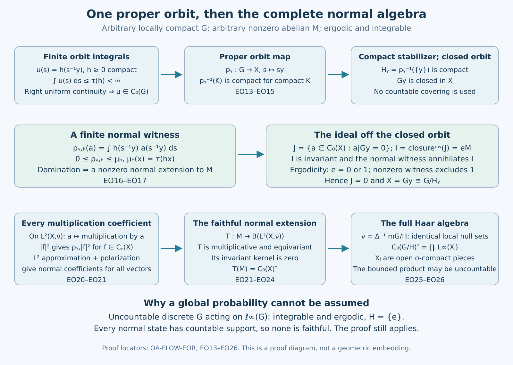

# Integrability makes an ergodic abelian action homogeneous

## The statement and the measure convention

Let \(G\) be an arbitrary locally compact Hausdorff group with left Haar measure \(ds\), and let \(M\ne0\) be an abelian von Neumann algebra. Let \(\alpha:G\to\operatorname{Aut}(M)\) be point-ultraweakly continuous. For compact \(K\subset G\), set
\[
 E_K(x)=\int_K\alpha_s(x)\,ds,\qquad
 P_b=\{x\in M_+:\sup_K\|E_K(x)\|<\infty\}.
 \tag{EO1}
\]
Assume integrability, meaning that \(\operatorname{span}_{\mathbb C}P_b\) is ultraweakly dense in \(M\), and ergodicity, meaning \(M^\alpha=\mathbb C1\).

**Theorem.** There is a compact subgroup \(H\subseteq G\) and a normal equivariant isomorphism, with normal inverse,
\[
 (M,G,\alpha)\cong
 \bigl(L^\infty(G/H,m_{G/H}),G,\text{left translation}\bigr).
 \tag{EO2}
\]
No countability, separability, sigma-finiteness or faithful normal state is assumed. Conversely, translation on \(L^\infty(G/H)\) is ergodic and integrable for every compact \(H\).

For arbitrary \(G\), \(L^\infty\) means bounded locally measurable classes modulo local Haar null sets, with the completions of [HR9](OA-FLOW-HR.md#hr-09). Equivalently it is the scalar multiplication von Neumann algebra of [IW1](OA-FLOW-IW.md#iw-1). On a disjoint union of open sigma-compact pieces it is the bounded product of their \(L^\infty\) algebras. This convention is essential when the group has uncountably many open components.

The proof constructs finite normal orbit functionals. They force a continuous spectrum to be one orbit and then extend its multiplication representation to all of \(M\). The earlier inputs are the general bounded-average argument of [MODEL.DOMAIN](OA-FLOW-L72.md#oa-flow.model.domain), [CF's calculus, Gelfand and Hilbert representation proofs](OA-FLOW-CF.md#oa-flow.cf.6), [GNS](OA-FLOW-GNS.md#gns-positive-form), [the concrete predual](OA-FLOW-CP.md#oa-flow.cp.4), [bounded density](OA-FLOW-BD.md#oa-flow.bd.4), [normal images](OA-FLOW-ST12.md#oa-flow.st.2), [normal action smoothing](OA-FLOW-AT.md#oa-flow.at.3), and the local Haar, cutoff and quotient proofs in [HR](OA-FLOW-HR.md#hr-03), [TOPOLOGY](OA-FLOW-TOPOLOGY.md#l138-h0) and [L43](OA-FLOW-L43.md#oa-flow.qm.rho).

## A scalar orbit weight and a dense continuous algebra

MODEL.DOMAIN proves, for arbitrary \(G\) and \(M\), that a bounded increasing net of positive operators has its supremum in \(M\), and that \(P_b\) is hereditary. For \(x\in P_b\) write \(E(x)=\sup_KE_K(x)\). Left translation of the compact sets gives \(\alpha_t(E(x))=E(x)\). Ergodicity therefore gives a number \(\tau(x)\ge0\) with
\[
 E(x)=\tau(x)1\quad(x\in P_b),\qquad
 \tau(x)=\infty\quad(x\in M_+\setminus P_b).
 \tag{EO3}
\]
Heredity shows that a sum belongs to \(P_b\) precisely when both its positive summands do. Consequently \(\tau\) is additive and positively homogeneous, with the usual extended-positive conventions. It is faithful: if \(x>0\), a positive normal vector functional is positive on \(x\); continuity gives a positive lower bound on an identity neighborhood of positive Haar measure, so some \(E_K(x)\ne0\).

For completeness, \(\tau\) is normal. If \(0\le x_i\uparrow x\) in \(M\), normality of every \(\alpha_s\) makes each positive normal scalar test of \(\alpha_s(x_i)\) increase to its test of \(\alpha_s(x)\). On a fixed compact set the continuous differences decrease uniformly to zero: their strict sublevel open sets cover that compact set, and directedness combines a finite subcover. Thus compact integration preserves this supremum. If \(C=\sup_i\tau(x_i)<\infty\), then \(E_K(x)\le C1\) for every \(K\), so \(x\in P_b\) and \(\tau(x)\le C\). The reverse inequality is monotonicity; the infinite case is immediate. Semifiniteness is precisely the given dense finite cone, or MODEL.DOMAIN's equivalent increasing finite-cone contractions.

Our Haar convention is \(\int F(st)\,ds=\Delta(t)^{-1}\int F(s)\,ds\). Cofinality of right-translated compact sets gives
\[
 \tau(\alpha_t(x))=\Delta(t)^{-1}\tau(x).
 \tag{EO4}
\]
In the abelian algebra, for every \(h\in P_b\), the positive linear functional
\[
 \mu_h(x)=\tau(hx),\qquad x\in M_+,
 \quad\text{has norm }\tau(h)\text{ and belongs to }M_*.
 \tag{EO5}
\]
Here is a direct predual proof, without an order-normality shortcut. Choose any normal state \(\omega\) on nonzero \(M\). The compact-integral functionals \(x\mapsto\omega(E_K(hx))\) belong to \(M_*\): [AT3](OA-FLOW-AT.md#oa-flow.at.3) makes the predual orbit norm continuous, its compact vector integral is in the norm-closed predual, and multiplication by \(h\) is normal by CP4. These functionals increase; their norms are their values at \(1\), which increase to \(\tau(h)<\infty\). They are therefore a norm-Cauchy net of normal positive functionals. Their norm limit is (EO5), since \(hx\in P_b\) for bounded positive \(x\).

Put
\[
 B=\{a\in M:\|\alpha_t(a)-a\|\longrightarrow0\text{ as }t\to e\},\qquad
 D=B\cap\{a:\tau(|a|)<\infty\},\qquad A=\overline D^{\|\cdot\|}.
 \tag{EO6}
\]
The product estimate makes \(B\) a unital C* algebra. Commutativity gives \(|a+b|\le|a|+|b|\) and \(|ca|\le\|c\||a|\), so \(D\) is a star ideal in \(B\); \(A\) is an invariant C* ideal by (EO4). Its action is point-norm continuous.

The algebra \(A\) is ultraweakly dense in \(M\). For \(p\in P_b\), \(0\le f\in C_c(G)\), let \(p_f=\int f(s)\alpha_s(p)\,ds\). The compact scalar-vector Fubini theorem of HR5 and AT3 gives
\[
 \tau(p_f)=\tau(p)\int f(s)\Delta(s)^{-1}\,ds,
 \qquad
 \|\alpha_t(p_f)-p_f\|\le\|p\|\,\|f(t^{-1}\,\cdot)-f\|_1.
 \tag{EO7}
\]
The second assertion follows by a left change of variable and the L1 translation theorem. To justify the first on a group that need not be sigma-compact, write \(L=\operatorname{supp}f\). For every compact \(K\),
\(E_K(\alpha_s(p))=\Delta(s)^{-1}E_{Ks}(p)\le\Delta(s)^{-1}\tau(p)1\).
After integration this bounds all \(E_K(p_f)\). Conversely, given compact \(C\), take \(K\supset CL^{-1}\); then \(Ks\supset C\) for every \(s\in L\), giving the matching lower bound with \(E_C(p)\) in place of \(\tau(p)1\). Supremizing over \(C\) proves (EO7). Only compact-carrier Fubini was used. Integral-one positive bumps on the net of identity neighborhoods have \(p_f\to p\) ultraweakly, by the continuity of every normal scalar test. Thus \(p_f\in D\), and integrability gives the asserted density of \(A\).

By the nonunital Gelfand construction in CF6 and CF9, write \(A=C_0(X)\), with \(X\) locally compact Hausdorff. A character \(x\) is sent to \(gx=x\circ\alpha_{g^{-1}}\). The estimate
\[
 |x_i(\alpha_{g_i^{-1}}a)-x(\alpha_{g^{-1}}a)|
 \le\|\alpha_{g_i^{-1}}a-\alpha_{g^{-1}}a\|
       +|x_i(\alpha_{g^{-1}}a)-x(\alpha_{g^{-1}}a)|
 \tag{EO8}
\]
proves joint continuity of this action, testing every \(a\in A\). No countability of \(X\) is asserted.

Every \(f\in C_c(X)\) has finite \(\tau(|f|)\). For its compact support \(K\), choose \(u\in C_c(X)\) equal to one on \(K\), and \(d\in D\) with \(\|u-d\|<1/2\). Then \(|d|^2\in D\) and
\[
 |f|\le4\|f\|_\infty |d|^2,
 \qquad C_c(X)\subset D.
 \tag{EO9}
\]
This proves the needed finite compact functions directly.

## Extending a dominated functional normally

We need one bounded lemma. Suppose a C* subalgebra \(A\subseteq M\) is ultraweakly dense, \(\mu\in M_*^+\), and \(\rho\) is a positive functional on \(A\) satisfying \(\rho(a)\le\mu(a)\) for all \(a\in A_+\). Then \(\rho\) has a unique positive normal extension \(\widetilde\rho\in M_*\), with \(\widetilde\rho\le\mu\).

If \(\mu=0\), everything is zero. Otherwise take its GNS representation \((\pi,K,\xi)\). It is unital and normal even when \(\mu\) is not faithful. Indeed
\(\langle\pi(x)\pi(a)\xi,\pi(b)\xi\rangle=\mu(b^*xa)\)
is a normal coefficient by CP4. Contractivity and density of cyclic vectors extend this to every vector coefficient in the norm-closed predual. Square-summable vector-series tails then prove full ultraweak continuity, exactly by [ST-C's coefficient proof](OA-FLOW-STC.md#oa-flow.st.coefficient); faithfulness is needed only for that lesson's separate injectivity conclusion.

The subspace \(\pi(A)\xi\) is dense: a vector orthogonal to it defines a normal coefficient vanishing on ultraweakly dense \(A\), hence on all of \(M\). On this dense subspace set
\[
 q(\pi(a)\xi,\pi(b)\xi)=\rho(b^*a).
 \tag{EO10}
\]
Positivity, Cauchy–Schwarz for a positive functional, and \(\rho(a^*a)\le\mu(a^*a)\) make the form well defined and bounded by the Hilbert norms. CF8 represents it by a positive contraction \(0\le C\le1\). For \(c\in A\),
\(q(\pi(c)\pi(a)\xi,\pi(b)\xi)=q(\pi(a)\xi,\pi(c^*)\pi(b)\xi)\);
thus \(C\) commutes with \(\pi(A)\), and by normality and ultraweak density also with \(\pi(M)\). Consequently
\[
 \widetilde\rho(x)=\langle\pi(x)C^{1/2}\xi,C^{1/2}\xi\rangle
 \tag{EO11}
\]
is normal, positive, and at most \(\mu\). A contractive approximate identity \((a_j)\) of \(A\) converges strongly to \(1\) in this representation: its support is the closure of \(\pi(A)K\), which contains the dense \(\pi(A)\xi\). In (EO10) take the limit of \(a_j^*aa_j\) for fixed \(a\in A\). Its norm limit is \(a\), while the vectors converge to \(\xi\); this proves \(\widetilde\rho|_A=\rho\). Normal extensions are unique by density.

We shall also use the norm equality
\[
 \|\varphi\|_{M_*}=\|\varphi|_A\|_{A^*}\qquad(\varphi\in M_*).
 \tag{EO12}
\]
Nondegeneracy of \(A\subset M\) follows from its ultraweak density, and BD3–5 gives contractive strong, hence ultraweak, approximants from \(A\) to the unit ball of \(M\). Apply \(\varphi\) to these approximants; the reverse norm inequality is restriction. This also proves the assertion when the functional is not positive.

## Finite orbit integrals make every orbit map proper

Fix \(y\in X\). For \(0\le h\in C_c(X)\), compact integration in the norm-continuous algebra \(A\) and (EO3) give
\[
 c_y(h):=\int_Gh(s^{-1}y)\,ds\le\tau(h)<\infty.
 \tag{EO13}
\]
Indeed each compact integral is at most \(\tau(h)1\) in \(M\); evaluating in a character of the unitization of \(A\) preserves this inequality. Supremizing over compact group sets proves (EO13). We use this inequality, not an interchange of an unbounded orbit integral with a character.

Here is the elementary decay fact that turns (EO13) into topology. If a continuous \(u:G\to\mathbb C\) is in \(L^1(G)\) and
\(\sup_s|u(st)-u(s)|\to0\) as \(t\to e\), then \(u\in C_0(G)\). Fix \(\varepsilon>0\) and a relatively compact identity neighborhood \(V\) for which the displayed difference is below \(\varepsilon/2\). If \(S=\{|u|\ge\varepsilon\}\) were not relatively compact, recursively choose \(s_n\in S\) outside the finite union of \(s_j\overline V\overline V^{-1}\). The sets \(s_nV\) are disjoint, have the same positive finite Haar measure, and on each \(|u|\ge\varepsilon/2\). This contradicts integrability. Thus \(S\) is relatively compact; it is closed, hence compact. This proves the decay assertion.

For \(u(s)=h(s^{-1}y)\), right uniform continuity follows from
\[
 |u(st)-u(s)|
 \le\|\alpha_t(h)-h\|\longrightarrow0.
 \tag{EO14}
\]
Therefore \(u\in C_0(G)\). Given compact \(K\subset X\), choose \(0\le h\in C_c(X)\) equal to one on \(K\). The closed inverse image of \(K\) under \(s\mapsto s^{-1}y\) is contained in the compact level set \(\{u\ge1\}\). Inversion shows that
\[
 p_y:G\longrightarrow X,\qquad s\longmapsto sy
 \quad\text{is proper}.
 \tag{EO15}
\]
In particular \(H_y=\{s:sy=y\}\) is compact.

The image \(Gy\) is closed. More generally a continuous map with compact inverse images of compact sets, into a locally compact Hausdorff target, is closed: for a closed domain set \(F\) and a target point outside its image, choose a compact neighborhood \(K\). The set \(F\cap p_y^{-1}(K)\) is compact, so its image is closed; the interior of \(K\) minus that image is a neighborhood missing \(p_y(F)\). No Baire or countable-cover argument is involved.

## A normal orbit functional rules out a second orbit

Fix \(y\in X\) and \(0\le h\in C_c(X)\) with \(h(y)>0\). Define on \(A=C_0(X)\)
\[
 \rho_{y,h}(a)=\int_Gh(s^{-1}y)a(s^{-1}y)\,ds.
 \tag{EO16}
\]
It is a bounded positive functional by (EO13). For \(a\in A_+\), the function \(ha\) is compactly supported, so
\[
 0\le\rho_{y,h}(a)=c_y(ha)\le\tau(ha)=\mu_h(a).
 \tag{EO17}
\]
The preceding extension lemma gives a positive normal functional \(\widetilde\rho_{y,h}\) on \(M\). It is nonzero: choose \(a\in C_c(X)\) equal to one on \(\operatorname{supp}h\); continuity near the identity and \(h(y)>0\) give \(\rho_{y,h}(a)=c_y(h)>0\).

Let \(J=\{a\in C_0(X):a|_{Gy}=0\}\). This is an invariant closed star ideal. Its ultraweak closure \(I\) in \(M\) is an invariant ideal of \(M\): first multiply by members of \(A\), then use ultraweak density and separate ultraweak continuity of multiplication to multiply by every member of \(M\).

We spell out the ideal-to-projection step. For \(z\in I\), continuous functions \(t/(t+\varepsilon)\) of \(z^*z\) lie in \(I\), since they vanish at zero and are norm limits of such polynomials. Their bounded strong limit is the support of \(z^*z\), hence belongs to \(I\). Finite joins of these supports are the supports of their finite sums and also lie in \(I\). Their increasing strong limit \(e\) lies in \(I\). Every \(z\in I\) satisfies \(ez=z\); conversely \(eM\subset I\), so \(I=eM\). Invariance gives \(\alpha_g(e)=e\), hence ergodicity makes \(e=0\) or \(1\).

The nonzero normal functional \(\widetilde\rho_{y,h}\) annihilates \(J\), thus \(I\). Therefore \(e\ne1\), and \(J=I=0\). If the closed orbit \(Gy\) were not all of \(X\), a nonzero compact bump in its open complement would belong to \(J\). This contradiction proves
\[
 X=Gy.
 \tag{EO18}
\]
Let \(H=H_y\). The orbit map induces a continuous bijection \(G/H\to X\). It is a homeomorphism: the proper map \(p_y\) is closed, hence a quotient map, and its fibers are exactly the right cosets of \(H\). We have proved homogeneity and compactness before using any measure decomposition.

## Extending multiplication to the complete normal algebra

Identify \(X=G/H\) as above. Since the orbit map is proper, the functional \(h\mapsto c_y(h)\) on \(C_c(X)\) is integration against a locally finite inner-regular Radon measure \(\nu\). This also follows directly from HR2's positive-functional representation: preimages of compact sets are compact, so the functional has a finite bound on each compact support. The local change-of-variable formula gives
\[
 \nu(gE)=\Delta(g)^{-1}\nu(E).
 \tag{EO19}
\]
It holds first on compact continuous tests, then by local Radon uniqueness. We use local completions as stated at the start.

Let \(\lambda(a)\) denote multiplication by \(a\in A\) on \(\mathcal H=L^2(X,\nu)\). For every \(f\in C_c(X)\), its positive vector functional is \(\rho_{y,|f|^2}\), so it extends normally to \(M\) by (EO17). HR3 gives norm density of \(C_c(X)\) in \(\mathcal H\). If \(f_n\to\xi\) in this Hilbert norm, then on the unit ball of \(A\)
\[
 |\langle\lambda(a)f_n,f_n\rangle-
   \langle\lambda(a)f_m,f_m\rangle|
 \le(\|f_n\|+\|f_m\|)\|f_n-f_m\|.
 \tag{EO20}
\]
By (EO12) the same bound holds for their normal extensions. Norm closure of \(M_*\) gives a unique normal extension \(\varphi_\xi\) of the positive coefficient of \(\xi\). Polarization gives normal extensions \(\varphi_{\xi,\eta}\) of all coefficients, with
\(\|\varphi_{\xi,\eta}\|\le\|\xi\|\|\eta\|\), again by (EO12). The sesquilinear identities hold on \(A\) and hence on \(M\) by normality. CF8 therefore defines operators \(T(x)\), \(x\in M\), by
\[
 \langle T(x)\xi,\eta\rangle=\varphi_{\xi,\eta}(x),
 \qquad \|T(x)\|\le\|x\|.
 \tag{EO21}
\]
This linear map is positive and unital. For the unit assertion, a contractive approximate identity of \(A\) converges strongly to \(1\) in \(M\) and under scalar multiplication; normality of the extended coefficients identifies \(T(1)=1\). It is ultraweakly continuous for the full topology: pulling back a square-summable vector series gives a norm-convergent sum in \(M_*\), with tail at most the product of its two square-sum tails.

It is multiplicative. For fixed \(a\in A\), approximate \(x\in M\) ultraweakly by a bounded net \(b_i\in A\), using BD. Normality and separate ultraweak continuity of multiplication give
\(T(ax)=\lambda(a)T(x)\) and \(T(xa)=T(x)\lambda(a)\).
Next approximate an arbitrary first factor by such a net from \(A\). The same argument gives \(T(xz)=T(x)T(z)\) for all \(x,z\in M\). Adjoint preservation follows either from the forms or from positivity. Thus \(T\) is a normal unital star representation extending \(\lambda\).

Define
\[
 (U_g\xi)(z)=\Delta(g)^{1/2}\xi(g^{-1}z).
 \tag{EO22}
\]
Equation (EO19) makes these operators unitary. Their representation law is direct. They are strongly continuous: on compact continuous vectors, joint continuity gives uniform convergence on a common compact carrier for \(g\) in a compact identity neighborhood, whose measure is finite; density and unitarity then treat every vector. On \(A\), \(U_g\lambda(a)U_g^*=\lambda(\alpha_g(a))\). Both sides extend normally, so
\[
 U_gT(x)U_g^*=T(\alpha_g(x))\qquad(x\in M).
 \tag{EO23}
\]
The kernel of \(T\) is an invariant ultraweakly closed ideal, hence \(eM\) for an invariant projection by the ideal proof above. Since \(T\) is unital on a nonzero Hilbert space, \(e\ne1\). Ergodicity forces \(e=0\). Thus \(T\) is faithful. ST2 now gives a von Neumann image and a normal inverse. Ultraweak density of \(A\) shows
\[
 T(M)=\lambda(C_0(X))''.
 \tag{EO24}
\]
This establishes the whole algebra, rather than only its continuous functions.

## The Haar multiplier algebra and the converse

Normalize Haar measure on compact \(H\) to mass one. Both \(\Delta_H\) and \(\Delta_G|_H\) equal one, since a compact subgroup of the positive multiplicative reals is trivial after taking logarithms. The quotient formula of L43 with density one gives invariant \(m=m_{G/H}\). Haar inversion then gives, on compact continuous functions,
\[
 d\nu(gH)=\Delta(g)^{-1}\,dm(gH).
 \tag{EO25}
\]
The density is well defined because \(\Delta|_H=1\), is continuous and strictly positive, and the equality follows by first integrating on \(G\) and then on \(H\). Consequently \(\nu\) and \(m\) have identical local null sets. Multiplication by the square root of this density identifies their L2 multiplication representations.

To check the cardinality convention directly, choose a symmetric relatively compact open identity neighborhood \(V\). The subgroup \(G_0\) generated by \(H\cup V\) is open and sigma-compact: it is the union of the finite words in the compact set \(H\cup\overline V\cup\overline V^{-1}\). Its left cosets are open and closed. Since \(H\subset G_0\), they give disjoint open-and-closed sigma-compact pieces \(X_j=g_jG_0/H\) of \(G/H\). A compact set meets only finitely many pieces. On each piece the measures are sigma-finite, and
\[
 L^2(G/H,\nu)=\bigoplus_jL^2(X_j,\nu),\qquad
 L^\infty(G/H,\nu)=\prod_jL^\infty(X_j,\nu).
 \tag{EO26}
\]
IW1 proves with compact indicator approximations and matrix entries that \(C_0(G/H)\) generates exactly this scalar multiplication algebra, including arbitrary index sets and its full L1 predual. Apply that result to (EO24), then (EO25), to obtain the normal isomorphism (EO2). Equation (EO23) proves its equivariance. No global probability or countable enumeration of the pieces was used.

For the converse, let \(H\) be compact. The quotient map is proper: for compact \(K\subset G/H\), finitely many images of relatively compact open subsets \(V_i\subset G\) cover \(K\); its inverse image is closed and contained in \(\bigcup_i\overline V_iH\), a compact set. Thus for \(f\in C_c(G/H)_+\), \(f(s^{-1}H)\) has compact support. If \(z=tH\), left substitution \(s=tk\) gives
\[
 \int_Gf(s^{-1}z)\,ds=\int_Gf(k^{-1}H)\,dk<\infty.
 \tag{EO27}
\]
These equalities on compact tests also identify the normal compact orbit integrals, by the quotient formula and compact-carrier Fubini. IW1's bounded approximation makes the span of \(C_c(G/H)_+\) ultraweakly dense. Therefore the translation action is integrable.

It is ergodic. Here is the scalar continuity argument, including non-sigma-compact groups. Pull an invariant bounded locally measurable class back to a right-\(H\)-invariant class \(F\) on \(G\), using L43's null correspondence. For \(\phi\in C_c(G)\) with integral one, the convolution
\[
 u(t)=\int_G\phi(s)F(s^{-1}t)\,ds
     =\int_G\phi(tk^{-1})F(k)\Delta(k)^{-1}\,dk
 \tag{EO28}
\]
is continuous: for \(t\) in a compact neighborhood of a fixed point, the last integrands have one compact carrier, and the kernels vary uniformly there. This proves continuity without a convergence theorem for arbitrary measurable nets. The function is right-\(H\)-invariant. It represents the original class, since the normal averaging of an invariant class is itself; this identity is tested on finite compact carriers, by Haar Fubini and local null correspondence. Each left translate of its continuous representative agrees almost everywhere with it. A continuous function vanishing locally almost everywhere for full-support Haar measure is zero everywhere. Thus \(u(gt)=u(t)\) for all \(g,t\), and \(u\) is constant. The fixed algebra is \(\mathbb C1\), as asserted.

## An uncountable example and the proof mechanism

Let \(G\) be any uncountable discrete group, with counting Haar measure, acting on \(M=\ell^\infty(G)\) by left translation. This action is point-ultraweakly continuous because the group is discrete. It is ergodic: an invariant function has the same value at every point. Every nonnegative finitely supported function has the constant orbit average \(\sum_{s\in G}f(s)\); these functions are ultraweakly dense, since a predual element of \(\ell^1(G)\) has at most countable support and its tails tend to zero. Thus the system is integrable, with \(H=\{e\}\).

The algebra has no faithful normal state. Every such state would be a positive summable family, supported on at most countably many points, and would vanish on a nonzero point projection outside that support. Its predual is nonseparable: the unit point masses form an uncountable family at pairwise distance two. This example shows why the proof constructs finite normal orbit functionals instead of assuming a global faithful normal state.

The upper chain uses (EO13)–(EO18). The lower chain uses (EO16)–(EO26). The ideal is precisely the continuous functions vanishing on the closed orbit; the normal functional is nonzero and annihilates that ideal. Ergodicity forces its ultraweak closure to be zero. The final product over open sigma-compact pieces is an arbitrary bounded product, not a countable disintegration. [Editable vector figure](../assets/ergodic-orbit/ergodic-orbit.svg) and [reproduction source](../assets/ergodic-orbit/render_ergodic_orbit.py).

**Exercise.** Which part of the proof prevents a finite orbit integral from being passed directly through an arbitrary spectrum character?

**Solution.** Only compact norm integrals are evaluated at the character, giving the inequality (EO13). The full multiplication representation is extended normally later, through (EO17)–(EO21). No normality of the original character on \(M\) is assumed.

**Exercise.** Does the factor \(\Delta(g)^{1/2}\) in (EO22) contradict invariance of quotient Haar measure?

**Solution.** That unitary uses \(\nu\), obtained from the inverse orbit map. Equation (EO25) compares it with invariant quotient Haar \(m\); \(\nu(gE)=\Delta(g)^{-1}\nu(E)\). After the density unitary to \(L^2(m)\), the same action is ordinary left translation without the scalar.

The classical classification is Takesaki, [*Theory of Operator Algebras II*](https://doi.org/10.1007/978-3-662-10451-4), Lemma X.4.13, printed p.305. The proof here supplies the normal-functional and full-algebra steps explicitly and retains arbitrary locally compact groups. Original exposition, proof expression, figure and reproduction code are CC0-1.0 to the extent of rights held.
