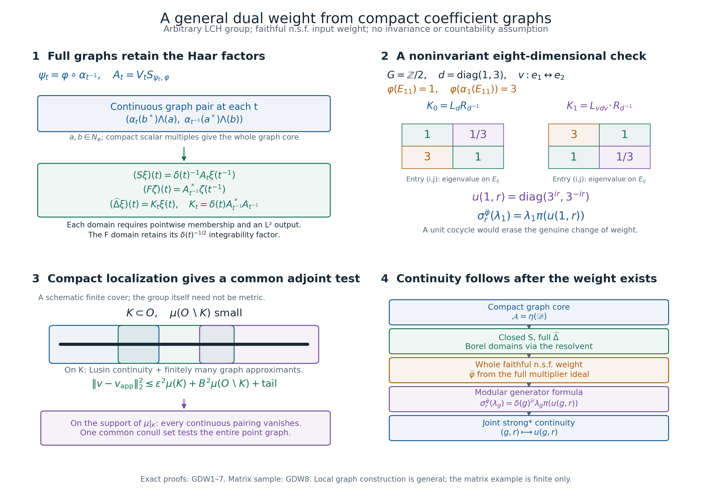
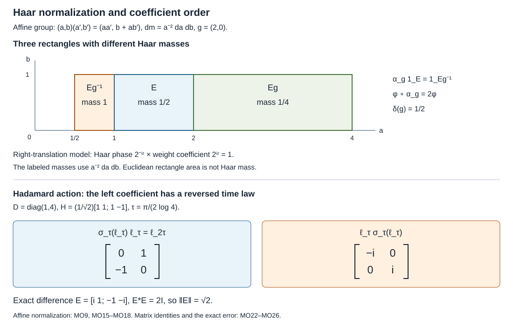

# A dual weight from compact coefficient graphs

*New expression: CC0-1.0 to the extent of rights held.*

Let \(G\) be an arbitrary locally compact Hausdorff group. Fix left Haar measure with \(\mu(Es)=\delta(s)\mu(E)\). Let \(\alpha\) be a point-ultraweak continuous action by normal automorphisms of an arbitrary von Neumann algebra \(M\), and let \(\varphi\) be faithful normal semifinite. There is no separability, countability, unimodularity, invariant-weight or finite-state hypothesis. Scalar products are linear in the first variable. The zero algebra has the zero Hilbert space and zero weight; below we discuss the nonzero case.

The existing arbitrary-weight proofs GW/NF/WR give the entire finite ideal \(N=N_\varphi\), its faithful normal GNS representation on \(H=H_\varphi\), and its full finite-star algebra. We identify \(M\) with that representation. The exact earlier inputs are [GW1–5](OA-FLOW-GW.md#oa-flow.gw.1), [NF5](OA-FLOW-NF.md#oa-flow.nf.5), [WR1–5](OA-FLOW-WR.md#oa-flow.wr.1), [BC1–5](OA-FLOW-BC.md#oa-flow.bc.1), [CI1–3](OA-FLOW-CI.md#oa-flow.ci.1), the pure completion proof [WH04 Sections2–4](OA-FLOW-WH04.md#oa-flow.wh04.2), [WF1–6](OA-FLOW-WF.md#oa-flow.wf.1), [MW1–4](OA-FLOW-MW.md#oa-flow.mw.1), [SF](OA-FLOW-SF.md#oa-flow.sf.sf0), and the actual [AT](OA-FLOW-AT.md#oa-flow.at.1), [NR](OA-FLOW-NR.md#oa-flow.nr.1), [CCM4](OA-FLOW-CAI.md#ccm-4), [HR](OA-FLOW-HR.md#hr-03) and [L24](OA-FLOW-L24.md#oa-flow.grp.haarconventions) integration and topology proofs. The scalar Borel and regularity arguments are [SC3–5](OA-FLOW-SC.md#sc-03) and [HR3](OA-FLOW-HR.md#hr-03); the compact finite partitions are [topology H0](OA-FLOW-TOPOLOGY.md#oa-flow.hr.topology). These are written programme proofs. Historical source context is Haagerup, *Dual weights I*, printed pp.102–114. His joint varying-weight cocycle continuity input is replaced here by compact graph approximation and is subsequently derived from the constructed modular action.

## GDW0. What is constructed

We construct a left Hilbert algebra on \(K=L^2(G,H)\), prove its whole closed involution and adjoint domains, complete it without changing that involution, and obtain a faithful normal semifinite weight \(\widehat\varphi\) on the normal crossed product

\[
R=\{\pi(M),\lambda(G)\}'',\qquad
(\pi(a)\xi)(t)=\alpha_{t^{-1}}(a)\xi(t),\quad
(\lambda_s\xi)(t)=\xi(s^{-1}t).
\tag{GDW1}
\]
The theorem is proved in GDW1–8; this forward statement is not an earlier proved premise. Averaging operator-valued weights and comparison of dual weights for two different input weights are further statements, not conclusions inferred from this construction.

## GDW1. The compact algebra and its finite coefficient ideal

Let \(\mathscr K\) be the algebra of strongly* continuous compactly supported \(M\)-valued functions with an operator norm bound included in the definition. The already proved CCM4 formulas are

\[
\begin{aligned}
(x*y)(t)&=\int_G\alpha_u(x(tu))y(u^{-1})\,du,\\
x^\#(t)&=\delta(t)^{-1}\alpha_{t^{-1}}(x(t^{-1})^*),\\
L_x&=\int_G\lambda_s\pi(x(s))\,ds,\\
(L_x\xi)(t)&=\int_G\alpha_u(x(tu))\xi(u^{-1})\,du.
\end{aligned}
\tag{GDW2}
\]
These give \((x*y)^\#=y^\#*x^\#\), \(x^{\#\#}=x\), \(L_{x*y}=L_xL_y\), \(L_{x^\#}=L_x^*\), and \(\|L_x\|\leq\int\|x(s)\|ds\). All integrals are tested on vectors or the predual; Radon product integration is used only on the actual compact or sigma compact carriers. The tensor/function model is the completion of compact continuous vector fields.

For \(a\in M\), distinguish the pointwise right operation and the covariant left operation:

\[
(x\cdot a)(t)=x(t)a,\qquad (a\cdot x)(t)=\alpha_{t^{-1}}(a)x(t).
\tag{GDW3}
\]
Then \(L_{x\cdot a}=L_x\pi(a)\) and \(L_{a\cdot x}=\pi(a)L_x\), by substituting in (GDW2). Put

\[
\mathscr B=\operatorname{span}\{z\cdot a:z\in\mathscr K,\ a\in N\},
\qquad\mathscr D=\mathscr B\cap\mathscr B^\#.
\tag{GDW4}
\]
Every \(x\in\mathscr B\) takes values in \(N\), and

\[
\eta(x)(t)=\Lambda_\varphi(x(t))
\tag{GDW5}
\]
is a continuous compact vector field. For \(z\cdot a\), it is \(z(t)\Lambda(a)\). The left-ideal inequality and AT's strong continuity prove this assertion for each summand. Faithfulness makes \(\eta\) injective: if its \(L^2\) class is zero, continuity and positivity of Haar measure on nonempty open sets make \(\Lambda(x(t))=0\) for every \(t\), whence \(x(t)=0\).

Associativity and the right operation give \(y*(z\cdot a)=(y*z)\cdot a\); thus \(\mathscr B\) is a left ideal of \(\mathscr K\). Hence \(\mathscr D\) is a star algebra. For \(x\in\mathscr K,y\in\mathscr B\),

\[
\eta(x*y)=L_x\eta(y).
\tag{GDW6}
\]
For \(y=z\cdot a\), substitute in (GDW2) and move bounded operators through the vector integral. This gives (GDW6) with \(\Lambda(a)\). Finite linear sums finish it; no unbounded weight is passed through an operator integral.

For \(x=z\cdot a,y=w\cdot b\), direct substitution gives

\[
(y^\#*x)(e)=b^*\left(\int_G w(t)^*z(t)\,dt\right)a\in\mathfrak m_\varphi.
\tag{GDW7}
\]
The bounded functional \(c\mapsto\varphi_0(b^*ca)=\langle c\Lambda(a),\Lambda(b)\rangle\) is normal, so its passage through this integral is justified. Consequently, for all \(x,y\in\mathscr B\),

\[
\langle\eta(x),\eta(y)\rangle
=\varphi_0((y^\#*x)(e)).
\tag{GDW8}
\]

## GDW2. Density in both the Hilbert space and the represented algebra

GW4 gives positive finite contractions \(c_i\uparrow1\). They lie in \(N\cap N^*\), and converge strongly to one. For \(f\in C_c(G),a,b\in N\),

\[
x_{f,b,a}(t)=f(t)\alpha_{t^{-1}}(b^*)a
\tag{GDW9}
\]
belongs to \(\mathscr D\): it belongs to \(\mathscr B\), while

\[
x_{f,b,a}^\#(t)=\delta(t)^{-1}\overline{f(t^{-1})}\alpha_{t^{-1}}(a^*)b
\tag{GDW10}
\]
has the same right-ideal form. Its operator is \(\pi(b^*)\lambda(f)\pi(a)\), where \(\lambda(f)=\int f(s)\lambda_sds\).

In particular \(\eta(x_{f,c_i,a})=\pi(c_i)(f\Lambda(a))\to f\Lambda(a)\) in \(K\). NR3 normality and [ST2](OA-FLOW-ST12.md#oa-flow.st.2) give strong convergence of these bounded coefficient operators. Such scalar tensors span a dense subspace by L24, so \(\eta(\mathscr D)\) is dense.

Let \(W=\{L_x:x\in\mathscr D\}''\). Every operator \(\pi(c_i)\lambda(f)\pi(c_j)\) belongs to its generating algebra. First let the two finite cutoffs tend strongly to one; then \(\lambda(f)\in W\). Normalized compact bumps, and their translates, converge strongly to every \(\lambda_s\), so these group operators belong to \(W\). For any \(a\in N\), the operators \(\pi(c_i)\lambda(f)\pi(a)\) belong to \(W\); let \(i\) tend to infinity and then let a normalized bump shrink to \(e\), obtaining \(\pi(a)\in W\). GW4 gives ultraweak density of \(N\) in \(M\), and NR3 is normal, hence \(\pi(M)\subseteq W\). The reverse inclusion follows from (GDW2), so

\[
W=R.
\tag{GDW11}
\]
The generating star algebra is nondegenerate: its cutoff/bump approximants converge strongly to the identity. Its products on \(\eta(\mathscr D)\) span densely. Indeed, if \(v\) is orthogonal to every \(L_x\eta(y)\), density of \(\eta(\mathscr D)\) gives \(L_x^*v=0\) for every \(x\). Its common kernel is zero by nondegeneracy. Finally the Hilbert adjoint identity is
\(\langle\eta(x*y),\eta(z)\rangle=\langle\eta(y),\eta(x^\#*z)\rangle\), by (GDW6) and \(L_x^*=L_{x^\#}\).

## GDW3. The pointwise relative graph

For each fixed \(t\), put \(\psi_t=\varphi\circ\alpha_{t^{-1}}\). This is faithful normal semifinite: a normal isomorphism transports the whole positive cone, normal increasing suprema and the finite definition algebra. Its finite ideal is \(\alpha_t(N)\). The map

\[
V_t:H_{\psi_t}\to H,\qquad
V_t\Lambda_{\psi_t}(a)=\Lambda_\varphi(\alpha_{t^{-1}}(a))
\tag{GDW12}
\]
is a unitary by norm equality and surjectivity of the finite-ideal transport. This uses a distinct GNS space for each fixed \(t\); no measurable-field theorem is being presumed.

BC2 gives the full closed relative anti-linear operator \(S_{\psi_t,\varphi}\), the closure of \(\Lambda_\varphi(a)\mapsto\Lambda_{\psi_t}(a^*)\) on \(N_\varphi\cap N_{\psi_t}^*\). Set

\[
A_t=V_tS_{\psi_t,\varphi}.
\tag{GDW13}
\]
It is closed, densely defined, injective and has dense range. BC2 gives its full adjoint/polar domains. A graph core consists of the span of

\[
\left(\alpha_t(b^*)\Lambda(a),\ \alpha_{t^{-1}}(a^*)\Lambda(b)\right),
\qquad a,b\in N.
\tag{GDW14}
\]
To justify the product core precisely, apply WR4's finite-algebra graph-core statement to the faithful balanced weight of \(\varphi,\psi_t\). Its finite algebra has off-diagonal entries \(\operatorname{span}N_{\psi_t}^*N_\varphi\), by BC1. Project its whole graph core onto that coordinate, using BC2's reducing row/column graph projections, and apply \(V_t\). The displayed pairs result. Both coordinates in (GDW14) depend continuously on \(t\), by AT and the fixed vectors \(\Lambda(a),\Lambda(b)\).

On \(\eta(\mathscr D)\) define \(S_0\eta(x)=\eta(x^\#)\). It is well defined by injectivity of \(\eta\), and \(S_0^2=1\). Its pointwise formula is

\[
(S_0\eta(x))(t)=\delta(t)^{-1}A_t\eta(x)(t^{-1}).
\tag{GDW15}
\]
This already proves closability without a varying-weight cocycle theorem. If \(\eta(x_n)\to0\) and \(\eta(x_n^\#)\to v\) in \(L^2\), take a subsequence with summable squared errors for both convergences. Countable scalar monotone convergence on their sigma compact carriers implies pointwise convergence almost everywhere. Inversion preserves compact-local null sets, by its Haar formula and positive continuous \(\delta\). At every remaining \(t\), closedness of \(A_t\) applied to (GDW15) gives \(v(t)=0\). Thus \(v=0\). The sequence criterion for closability suffices because the graph norm ambient Hilbert space is metric. With GDW2, \(\mathcal A=\eta(\mathscr D)\) is a left Hilbert algebra.

## GDW4. Compact graph approximation without a countable field hypothesis

We prove the local field fact needed for the *entire* graph. Let \(T_t:H\supset D(T_t)\to H\) be closed anti-linear operators. Suppose a family of continuous sections of their graphs spans a graph-dense subspace at every point. Treat a graph as a complex closed subspace of \(H\oplus\overline H\). Define \(\mathfrak T\) on \(L^2(G,H)\) by the maximal condition: \(h(t)\in D(T_t)\) almost everywhere, and \(T_th(t)\) has a strongly measurable \(L^2\) representative. Its graph is closed. Indeed, take summable-error subsequences from any pair of \(L^2\) convergences, and use each closed point graph as in GDW3.

The compact continuous graph sections are a graph core. Here are the regularity details that prevent an uncountable exceptional-set shortcut. A strongly measurable \(L^2\) field \(v\) in any Hilbert space has, for every positive error, a compact subset \(K\) of a finite-measure carrier on which it is bounded and continuous, and the squared-norm integral outside \(K\) is arbitrarily small. To prove this, first truncate its norm and choose a compact carrier with small squared-norm tail, using HR's finite-exponent Radon convention. On that finite-measure set, measurable simple approximants converge uniformly outside a set of arbitrarily small measure: choose the approximants with errors exceeding \(2^{-n}\) on sets of measure at most \(\varepsilon2^{-n}\), and discard their union. Replace each of their finitely many level sets by disjoint compact subsets with total discarded measure at most \(\varepsilon2^{-n}\). On the intersection of these compact unions, each simple approximant is continuous in the relative topology; uniform convergence makes \(v\) continuous there. Boundedness turns the discarded measure into a squared-norm estimate. This proves the stated Lusin assertion from scalar regularity, without metrizability of \(G\).

Apply it to \(v(t)=(h(t),\overline{T_th(t)})\). At each point of \(K\), a finite linear combination of the given graph sections approximates \(v(t)\). Continuity on \(K\) and of that combination gives an open relative neighbourhood with the same error bound. Finitely many suffice by compactness. Fix a precompact open neighbourhood \(O_0\) of \(K\), small enough that the finitely many chosen sections remain bounded there. Outer regularity gives an open \(O\), \(K\subset O\subset O_0\), with \(\mu(O\setminus K)\) arbitrarily small. H0's compact finite partition supplies scalar continuous cutoffs supported in \(O\) and in the selected neighbourhoods, whose sum is one on \(K\) and is at most one everywhere. Their combination of the sections approximates \(v\) uniformly on \(K\). Its bound on \(O\setminus K\), the arbitrarily small measure of that set, and the original squared-norm tail give graph-norm approximation. No countable fundamental sequence of the whole Hilbert space or all point graphs is assumed.

The adjoint is also the maximal pointwise adjoint. To see the difficult direction, a vector field \(w\) orthogonal to the global graph pairs is orthogonal almost everywhere to each compact scalar multiple of each continuous graph section, by scalar test-function uniqueness from HR/L24. Take countably many Lusin compact subsets on which \(w\) is continuous, covering its finite-exponent carrier up to a null set. On one such \(K\), each pairing with a continuous graph section is continuous. Since it vanishes \(\mu|_K\)-almost everywhere, it vanishes at every point of the measure support of \(\mu|_K\): a nonzero value there would persist on a relative open set of positive measure. The complement of this support is null, by Radon regularity and finite covers of compact subsets of that open complement. Thus at every point of one *common* conull subset of \(K\), all section pairings vanish, even if the family is uncountable. Their pointwise graph density proves orthogonality to the entire point graph. The ordinary graph-orthogonal-complement formula now identifies \(\mathfrak T^*\) with the maximal pointwise \(T_t^*\), including its \(L^2\) domain. The converse follows by integration and Cauchy–Schwarz. This proves the field fact locally.

## GDW5. Full involution, adjoint and positive-operator domains

The linear inversion unitary is

\[
(Ih)(t)=\delta(t)^{-1/2}h(t^{-1}),\qquad I^*=I,\quad I^2=1.
\tag{GDW16}
\]
Its norm identity is exactly the Haar inversion formula. Apply GDW4 to \(B_t=\delta(t)^{-1/2}A_t\). Its continuous graph sections are (GDW14) with the second coordinate multiplied by \(\delta(t)^{-1/2}\). Compact scalar multiples of these sections correspond under \((Ih,S_0h)\) to the elements (GDW9): choose \(f(t^{-1})=\delta(t)^{1/2}r(t)\). Therefore the closed involution \(S=\overline{S_0}\) is exactly \(\mathfrak B I\), not merely a restriction of a pointwise operator.

Its complete domain and action are

\[
\begin{split}
D(S)&=\{\xi:\xi(t^{-1})\in D(A_t)\text{ a.e.},\ 
 t\mapsto\delta(t)^{-1}A_t\xi(t^{-1})\text{ is strongly measurable and in }L^2\},\\
(S\xi)(t)&=\delta(t)^{-1}A_t\xi(t^{-1}).
\end{split}
\tag{GDW17}
\]
GDW4 and \(S^*=I\mathfrak B^*\) give the complete adjoint:

\[
\begin{split}
D(F)&=\{\zeta:\zeta(t)\in D(A_t^*)\text{ a.e.},\ 
 t\mapsto\delta(t)^{-1/2}A_t^*\zeta(t)\text{ is strongly measurable and in }L^2\},\\
(F\zeta)(t)&=A_{t^{-1}}^*\zeta(t^{-1}),\qquad F=S^*.
\end{split}
\tag{GDW18}
\]
The disappearance of the Haar factor in the last action follows from \(\delta(t)^{-1/2}\delta(t^{-1})^{-1/2}=1\); it does not remove the domain's integrability factor. CI gives \(S^2=F^2=1\) on their exact domains.

Let \(\Delta_{\psi,\varphi}=S_{\psi,\varphi}^*S_{\psi,\varphi}\) be BC2's relative positive operator on \(H_\varphi\), and set

\[
K_t=\delta(t)A_{t^{-1}}^*A_{t^{-1}}
=\delta(t)\Delta_{\varphi\circ\alpha_t,\varphi}.
\tag{GDW19}
\]
Then \(\widehat\Delta=F S\) has the exact domain

\[
D(\widehat\Delta)=\{\xi:\xi(t)\in D(K_t)\text{ a.e.},\ 
 t\mapsto K_t\xi(t)\text{ is strongly measurable and in }L^2\},
\qquad (\widehat\Delta\xi)(t)=K_t\xi(t).
\tag{GDW20}
\]
The forward implication follows by substituting (GDW17) into (GDW18). For the converse, suppose the displayed condition holds, and put \(v(t)=K_t\xi(t)\). The already constructed positive selfadjoint operator \(\widehat\Delta=S^*S\) has the bounded everywhere-defined resolvent from CI/SF. Set \(u=(\widehat\Delta+1)^{-1}(v+\xi)\). The proved forward implication gives \((K_t+1)u(t)=v(t)+\xi(t)=(K_t+1)\xi(t)\) almost everywhere. Each positive selfadjoint \(K_t\) has injective \(K_t+1\); hence \(u=\xi\). Thus \(\xi\in D(\widehat\Delta)\). This argument proves the full reverse domain inclusion without assuming measurability of an unbounded intermediate field.

Every Borel function \(q\) has the exact spectral domain

\[
D(q(\widehat\Delta))=
\left\{\xi:\xi(t)\in D(q(K_t))\text{ a.e.},\ 
\int_G\|q(K_t)\xi(t)\|^2dt<\infty\right\},
\quad(q(\widehat\Delta)\xi)(t)=q(K_t)\xi(t).
\tag{GDW21}
\]
The fields on this domain are strongly measurable. For detail, the unique solution of \((\widehat\Delta+1)u=\xi\) from (GDW20) is \(u(t)=(K_t+1)^{-1}\xi(t)\). Hence this bounded resolvent acts pointwise. Polynomial and uniform continuous approximation on its compact spectrum give every bounded continuous function of this resolvent pointwise. Increasing continuous approximations of interval indicators give their spectral projections. The class of sets for which this pointwise spectral identity holds is closed under complements and finite intersections: use one minus a projection, and the product of two commuting spectral projections. It is closed under countable disjoint unions by the strong sums of the orthogonal projections and scalar monotone convergence. Disjointifying a general countable union with finite intersections and complements therefore makes this class a sigma algebra containing the intervals, hence every Borel set. Bounded Borel functions are uniform limits of simple functions obtained by partitioning their bounded range, so they also act pointwise. Finally truncate an arbitrary \(q\) by bounded values. SF's spectral squared-norm criterion and scalar monotone convergence give exactly (GDW21), including strong measurability of the limit. This argument concerns each individual field; it never unions exceptional sets over all Hilbert vectors.

In particular (GDW21) includes every real/complex power and the logarithm. Since each relative operator is injective, there is no zero eigenspace. For the antiunitary polar factor, write \(C_t=V_tJ_{\psi_t,\varphi}\), the antiunitary polar factor of \(A_t\) from BC2. Then

\[
(\widehat J\xi)(t)=\delta(t)^{-1/2}C_t\xi(t^{-1}),
\qquad S=\widehat J\widehat\Delta^{1/2}.
\tag{GDW22}
\]
First verify the formula on the spectral cutoffs of (GDW21), using \(A_t=C_t(A_t^*A_t)^{1/2}\), and then pass to their dense union. CI's polar factor is defined on all \(K\), and this proves the full formula and its measurability.

### Canonical conjugation in the regular weight space

Let \((H_\omega,J_\omega,P_\omega)\) be the standard form of a faithful n.s.f. weight \(\omega\), furnished by [NC](OA-FLOW-NC.md#oa-flow.nc.3). Write \(U_\varphi(t)\) for [NR1's canonical strongly continuous implementation](OA-FLOW-NR.md#oa-flow.nr.1) of \(\alpha_t\) on \(H_\varphi\). For each fixed \(t\), put \(\psi_t=\varphi\circ\alpha_{t^{-1}}\), and let \(W_t:H_{\psi_t}\to H_\varphi\) be [MC1's canonical standard-form transport](OA-FLOW-MC.md#oa-flow.mc.1) implementing the identity of the abstract algebra \(M\). No measurability of this family \(W_t\) is assumed.

Apply [MC17](OA-FLOW-MC.md#equation-mc17) to the balanced pair \((\varphi,\psi_t)\), with reference form \(H_\varphi\). Column one has \(H_\varphi\), column two has \(H_{\psi_t}\), and the canonical transports in that formula are \(I,W_t\). The antiunitary from input coordinate \((2,1)\) to output coordinate \((1,2)\) is therefore

\[
 J_{\psi_t,\varphi}=W_t^{-1}J_\varphi.
 \tag{GDW-C1}
\]

This identifies the relative polar conjugation on its entire source and target Hilbert spaces, by [BC2's exact coordinate graph and polar restrictions](OA-FLOW-BC.md#oa-flow.bc.2). It does not identify two different weights' modular positive operators.

The GNS unitary \(V_t\) of (GDW12) implements \(\alpha_{t^{-1}}\). It also carries the ordinary standard form of \(\psi_t\) to that of \(\varphi\). To check the latter assertion from the full domains, take \(a\in N_{\psi_t}\cap N_{\psi_t}^*\). Since \(N_{\psi_t}=\alpha_t(N_\varphi)\), \(\alpha_{t^{-1}}\) maps this entire finite-star algebra bijectively onto \(N_\varphi\cap N_\varphi^*\), and

\[
 V_t\Lambda_{\psi_t}(a^*)
 =\Lambda_\varphi(\alpha_{t^{-1}}(a)^*)
 =S_\varphi V_t\Lambda_{\psi_t}(a).
\]

[WR3](OA-FLOW-WR.md#oa-flow.wr.3) proves that these entire finite-star ranges are the initial graph cores. Closing the transported graphs in both directions gives \(V_tS_{\psi_t}V_t^*=S_\varphi\), with equality of domains. Unitary transport of the adjoint pairing and [CI3's polar uniqueness](OA-FLOW-CI.md#oa-flow.ci.3) then give \(V_tJ_{\psi_t}V_t^*=J_\varphi\) and \(V_t\Delta_{\psi_t}^zV_t^*=\Delta_\varphi^z\), with their complete spectral domains. Moreover \(V_t\) maps the positive finite-weight generators \(\Lambda_{\psi_t}(a)\) onto the positive finite-weight generators \(\Lambda_\varphi(\alpha_{t^{-1}}(a))\). Thus it maps \(C_{l,\psi_t}\) onto \(C_{l,\varphi}\), and [NC10's quarter-power construction](OA-FLOW-NC.md#equation-nc10) gives \(V_tP_{\psi_t}=P_\varphi\).

Consequently \(V_tW_t^{-1}\) implements \(\alpha_{t^{-1}}\) on \(H_\varphi\) and preserves \(P_\varphi\). MC1's uniqueness and NR1's exact group law identify it with \(U_\varphi(t^{-1})=U_\varphi(t)^*\). Since \(C_t=V_tJ_{\psi_t,\varphi}\), we obtain

\[
 C_t=U_\varphi(t)^*J_\varphi.
 \tag{GDW-C2}
\]

Substitution into the already proved whole-space formula (GDW22) gives

\[
 (\widehat J\xi)(t)
 =\delta(t)^{-1/2}U_\varphi(t)^*J_\varphi\xi(t^{-1})
 \qquad(\xi\in L^2(G,H_\varphi)).
 \tag{GDW-C3}
\]

All the involution, adjoint and positive-power domains remain those of (GDW17)–(GDW21). This argument is pointwise for each fixed \(t\); the resulting canonical expression is strongly continuous on fixed Hilbert vectors by NR1. It introduces no varying-GNS measurable-field premise, no faithful-state reduction and no equality between modular positive operators of unrelated weights.

## GDW6. The complete constructed weight and finite coefficient normalization

Apply pure WH04 Sections2–4 to \(\mathcal A\). Its full second dual \(\mathcal C\) has the same entire \(S\), graph core \(\mathcal A\), and represented algebra \(R\), by (GDW11). Let \(\mathcal E\) be its complete first right algebra. Define, on the whole \(K\),

\[
B_l=\{\xi:\eta\mapsto R_\eta\xi\text{ is bounded on all }\mathcal E\},
\qquad I_l=\{\lambda_\xi:\xi\in B_l\},\quad
\theta(\lambda_\xi)=\xi.
\tag{GDW23}
\]
[HA-R1–7](OA-FLOW-HA-R.md#oa-flow.ha-r.1) and WH04 prove injectivity of this *full* multiplier map; this is distinct from any auxiliary commutation-system map. WF1–6 now construct, on the entire positive cone of \(R\),

\[
\widehat\varphi(X)=
\begin{cases}\|\theta(X^{1/2})\|^2,&X^{1/2}\in I_l,\\
\infty,&X^{1/2}\notin I_l.
\end{cases}
\tag{GDW24}
\]
The weight is faithful, preserves arbitrary bounded increasing positive suprema, and is semifinite. These are precisely WF's proved whole-domain conclusions, not an extrapolation from compact coefficients. Its exact finite ideal is \(I_l\), its finite algebra is \(\lambda(\mathcal C^2)\), and its finite-star algebra is \(\lambda(\mathcal C)=I_l\cap I_l^*\). Its GNS unitary sends \(\Lambda_{\widehat\varphi}(\lambda_\xi)\) to \(\xi\); its entire closed involution and adjoint are (GDW17)–(GDW18). Its modular operator and powers are (GDW19)–(GDW22).

For every \(x\in\mathscr B\), \(\eta(x)\in B_l\) and \(\lambda_{\eta(x)}=L_x\). Indeed \(y_i=c_i\cdot x\) lies in \(\mathscr D\): its involution has right finite factor \(c_i\), as (GDW3) shows. The vectors \(\eta(y_i)=\pi(c_i)\eta(x)\) converge in norm to \(\eta(x)\), and the bounded multipliers \(L_{y_i}=\pi(c_i)L_x\) converge strongly to \(L_x\). For every \(\zeta\in\mathcal E\), the original mixed identity gives \(R_\zeta\eta(y_i)=L_{y_i}\zeta\). Passing to limits shows \(R_\zeta\eta(x)=L_x\zeta\). This is the whole defining test in (GDW23), not a test only on a compact subalgebra. Hence

\[
L_x\in N_{\widehat\varphi},\qquad
\Lambda_{\widehat\varphi}(L_x)\longleftrightarrow\eta(x),\qquad
\widehat\varphi(L_x^*L_x)=\|\eta(x)\|_2^2
=\varphi_0((x^\#*x)(e)).
\tag{GDW25}
\]
It is not asserted that \(L(\mathscr B)\) is the entire finite ideal; its actual entire ideal is (GDW23). The compact algebra is a graph core, not a surreptitious replacement for the full finite-star domain. NR4's normal representation-independence isomorphism transports this whole weight to the normal crossed product in any other faithful normal initial representation; its positive-cone map and inverse carry the complete finite ideals and GNS data. An implementation of \(\alpha\) on that original Hilbert space is not assumed.

## GDW7. Modular formulas and joint cocycle continuity

Write \(u(t,r)=(D(\varphi\circ\alpha_t):D\varphi)_r\), with BC4's balanced-weight definition. BC3's whole-Hilbert formula at entry one gives

\[
\Delta_{\varphi\circ\alpha_t,\varphi}^{ir}
=u(t,r)\Delta_\varphi^{ir}.
\tag{GDW26}
\]
Thus (GDW21) gives \((\widehat\Delta^{ir}\xi)(t)=\delta(t)^{ir}u(t,r)\Delta_\varphi^{ir}\xi(t)\). Measurability here has been proved from the full graph/resolvent, before assuming anything about joint cocycle continuity.

MW supplies the modular group of the constructed faithful n.s.f. weight. Its generator formulas are

\[
\begin{aligned}
\sigma_r^{\widehat\varphi}(\pi(a))&=\pi(\sigma_r^\varphi(a)),\\
\sigma_r^{\widehat\varphi}(\lambda_g)
&=\delta(g)^{ir}\lambda_g\pi(u(g,r)).
\end{aligned}
\tag{GDW27}
\]
For the first formula, conjugate pointwise with the relative imaginary powers in (GDW26). BC3 identifies the resulting group with \(\sigma_r^{\varphi\circ\alpha_t}\); BC5 normal-isomorphism covariance gives \(\sigma_r^{\varphi\circ\alpha_t}(\alpha_{t^{-1}}a)=\alpha_{t^{-1}}(\sigma_r^\varphi a)\). For the second, set \(s=g^{-1}t\). Pointwise the scalar ratio is \(\delta(g)^{ir}\), and the remaining factor is \(u(t,r)u(s,r)^*\). BC4's chain rule followed by BC5 covariance gives

\[
u(t,r)u(g^{-1}t,r)^*
=\alpha_{t^{-1}g}(u(g,r)).
\tag{GDW28}
\]
Indeed \(t=gs\), so the two weights on the left are \((\varphi\circ\alpha_g)\circ\alpha_s\) and \(\varphi\circ\alpha_s\), and their cocycle is \(\alpha_{s^{-1}}(u(g,r))\). This is exactly the coefficient of \(\lambda_g\pi(u(g,r))\) in the regular model. Each fixed \(g,r\) gives equality of bounded operators on all of \(K\); no common exceptional set over the whole group is required.

Finally (GDW27) also gives joint cocycle continuity:

\[
(g,r)\longmapsto u(g,r)
\quad\text{is strongly* continuous in }M.
\tag{GDW29}
\]
Rearrange its second formula as \(\pi(u(g,r))=\delta(g)^{-ir}\lambda_g^*\sigma_r^{\widehat\varphi}(\lambda_g)\). The left regular group is strongly continuous, and the modular action is a point-ultraweak continuous normal real action. AT4 gives joint strong* continuity of that action on the unit ball, so the right side is jointly strong* continuous. The regular coefficient representation is faithful normal with normal inverse on its image, by NR3 and [ST2](OA-FLOW-ST12.md#oa-flow.st.2). Its inverse transports this bounded strong* continuity to \(M\). This argument establishes joint continuity *after* the weight construction and introduces no circular prerequisite.

## GDW7A. Modular time on the compact coefficient algebra

For the classical antecedent see Takesaki, *Theory of Operator Algebras II*, Chapter X, Lemma 1.12, printed p.247. The following compact-coefficient argument uses the completed graph-first construction above.

Use the completed construction of GDW1–7, and write \(\sigma_r=\sigma_r^\varphi\) and

\[
 c_r(t)=(D(\varphi\circ\alpha_t):D\varphi)_r,\qquad
 d_r(t)=\delta(t)^{ir},\qquad
 (\rho_rx)(t)=d_r(t)c_r(t)\sigma_r(x(t)).
 \tag{GDW-R1}
\]

**Theorem.** The \(\rho_r\) form a one-parameter group of star automorphisms of \((\mathscr K,*,\#)\). They preserve supports and the coefficient \(L^1\) norm. For every \(x\in\mathscr K\) and \(a\in M\), the pointwise right operation and covariant left operation of (GDW3) satisfy

\[
 \rho_r(x\cdot a)=\rho_r(x)\cdot\sigma_r(a),\qquad
 \rho_r(a\cdot x)=\sigma_r(a)\cdot\rho_r(x).
 \tag{GDW-R2}
\]

Both \(\mathscr B\) and \(\mathscr D=\mathscr B\cap\mathscr B^\#\) are invariant. On their full coefficient/GNS domains and on the represented compact algebra the intertwining identities are

\[
 \eta(\rho_rx)=\widehat\Delta^{ir}\eta(x)\quad(x\in\mathscr B),\qquad
 L_{\rho_rx}=\sigma_r^{\widehat\varphi}(L_x)\quad(x\in\mathscr K).
 \tag{GDW-R3}
\]

**Proof.** First record the factor order that makes the coefficient algebra work. [BC4's time and chain identities](OA-FLOW-BC.md#oa-flow.bc.4), [BC5's normal-isomorphism covariance](OA-FLOW-BC.md#oa-flow.bc.5), and the modular transport used in GDW7 give

\[
 \begin{aligned}
 c_{r+s}(t)&=c_r(t)\sigma_r(c_s(t)),\\
 c_r(tu)&=\alpha_{u^{-1}}(c_r(t))c_r(u),\\
 c_r(t^{-1})&=\alpha_t(c_r(t)^*),\\
 \alpha_{t^{-1}}\sigma_r\alpha_t
 &=\operatorname{Ad}(c_r(t))\sigma_r.
 \end{aligned}
 \tag{GDW-R4}
\]

For the second identity, insert the intermediate weight \(\varphi\circ\alpha_u\) in the chain rule. The first derivative compares \((\varphi\circ\alpha_t)\circ\alpha_u\) with \(\varphi\circ\alpha_u\), so covariance makes it \(\alpha_{u^{-1}}(c_r(t))\); the second is \(c_r(u)\). Taking \(u=t^{-1}\) and using the self-cocycle normalization gives the third identity. The last identity is the modular action of the pullback weight \(\varphi\circ\alpha_t\), identified both by ordinary GNS graph transport and by BC19. These identities hold for every group element and every real parameter, with the full faithful n.s.f. hypotheses. In particular \(c_0(t)=c_r(e)=1\).

(GDW29) proves joint strong\* continuity of \(c_r(t)\). [MW4](OA-FLOW-MW.md#oa-flow.mw.4) supplies the point-continuous normal action \(\sigma\), and [AT4](OA-FLOW-AT.md#oa-flow.at.4), applied to this real action on bounded sets, makes \((t,r)\mapsto\sigma_r(x(t))\) jointly strong\* continuous. Products are jointly strong\* continuous on bounded sets: for vectors, split \(a_ib_i-ab=a_i(b_i-b)+(a_i-a)b\), and apply the same estimate to adjoints. Thus (GDW-R1) belongs to \(\mathscr K\), and it is complex linear in \(x\). Since \(c_r(t)\) and \(d_r(t)\) are unitary and \(\sigma_r\) is isometric, \(\|(\rho_rx)(t)\|=\|x(t)\|\). This proves support and \(L^1\)-norm preservation. The first identity in (GDW-R4) gives \(\rho_r\rho_s=\rho_{r+s}\), and the normalizations give \(\rho_0=1\); hence \(\rho_{-r}\) is its inverse.

For convolution, fix \(r\), and abbreviate \(c=c_r,d=d_r\). The scalar character satisfies \(d(tu)d(u^{-1})=d(t)\). Without commuting any coefficient factors, the integrand is

\[
 \begin{aligned}
 &\alpha_u((\rho_rx)(tu))(\rho_ry)(u^{-1})\\
 &=d(t)\alpha_u(c(tu))\alpha_u(\sigma_r(x(tu)))
          c(u^{-1})\sigma_r(y(u^{-1}))\\
 &=d(t)c(t)\alpha_u\!\left(c(u)\sigma_r(x(tu))c(u)^*\right)
          \sigma_r(y(u^{-1}))\\
 &=d(t)c(t)\sigma_r\!\left(\alpha_u(x(tu))y(u^{-1})\right).
 \end{aligned}
 \tag{GDW-R5}
\]

The middle equality uses the group and inverse identities of (GDW-R4). The last uses \(\sigma_r\alpha_u=\alpha_u\operatorname{Ad}(c(u))\sigma_r\). The actual compact integrals are the normal weak integrals of [CCM4](OA-FLOW-CAI.md#ccm-4). Normality allows \(\sigma_r\) to pass through them: test on a normal functional and compose it with \(\sigma_r\). Integrating (GDW-R5) proves \((\rho_rx)*(\rho_ry)=\rho_r(x*y)\). Only compact carriers are used.

For the involution put \(a=x(t^{-1})^*\). Complex conjugation changes \(d(t^{-1})\) to \(d(t)\), while the positive real Haar factor remains. The inverse and naturality identities give

\[
 \begin{aligned}
 (\rho_rx)^\#(t)
 &=\delta(t)^{-1}d(t)\alpha_{t^{-1}}\!\left(\sigma_r(a)c(t^{-1})^*\right)\\
 &=\delta(t)^{-1}d(t)\alpha_{t^{-1}}(\sigma_r(a))c(t)\\
 &=\delta(t)^{-1}d(t)c(t)\sigma_r(\alpha_{t^{-1}}(a))
 =\rho_r(x^\#)(t).
 \end{aligned}
 \tag{GDW-R6}
\]

The right module identity in (GDW-R2) is immediate from multiplicativity of \(\sigma_r\). For the left one, rearrange the last identity in (GDW-R4) as

\[
 c_r(t)\sigma_r(\alpha_{t^{-1}}(a))
 =\alpha_{t^{-1}}(\sigma_r(a))c_r(t).
\]

Multiply this equality on the right by \(\sigma_r(x(t))\), and include \(d_r(t)\). Since MW12 proves \(\sigma_r(N_\varphi)=N_\varphi\) on the entire finite ideal, the right module identity carries every finite sum \(z\cdot a\), \(z\in\mathscr K,a\in N_\varphi\), into \(\mathscr B\). The inverse \(\rho_{-r}\) gives equality. The involution identity then gives \(\rho_r\mathscr D=\mathscr D\).

For each \(x\in\mathscr B\), every value \(x(t)\) is in \(N_\varphi\). Left multiplication and MW12 give the following continuous field, identified in \(L^2\) by the spectral formula:

\[
 \begin{aligned}
 \eta(\rho_rx)(t)
 &=d_r(t)c_r(t)\Lambda_\varphi(\sigma_r(x(t)))\\
 &=\delta(t)^{ir}c_r(t)\Delta_\varphi^{ir}\eta(x)(t)
 =(\widehat\Delta^{ir}\eta(x))(t),
 \end{aligned}
 \tag{GDW-R7}
\]

The first two equalities hold at every \(t\); the last is the equality of \(L^2\) classes supplied by (GDW26) and the entire spectral formula (GDW21). The displayed continuous field is a representative of that modular-unitary image. No exceptional set common to all vectors is needed. Thus \(\eta(\mathscr D)\) is invariant under the whole modular unitary group, and its inner product is preserved.

Finally (GDW27) gives, for \(x\in\mathscr K\),

\[
 \sigma_r^{\widehat\varphi}(\lambda_t\pi(x(t)))
 =\delta(t)^{ir}\lambda_t\pi(c_r(t))\pi(\sigma_r(x(t)))
 =\lambda_t\pi((\rho_rx)(t)).
\]

Integrate this identity over the compact support. Testing on normal functionals passes the normal automorphism through the weak integral, so it proves the second identity in (GDW-R3), equivalently \(L_{\rho_rx}=\widehat\Delta^{ir}L_x\widehat\Delta^{-ir}\). No injectivity of the compact coefficient operator map is needed. This completes the coefficient-flow theorem after the graph-first dual-weight construction. The map at one fixed group location need not be a unital star automorphism of \(M\); the proved automorphism acts on the whole twisted convolution algebra. \(\square\)

## GDW8. A finite noninvariant check and the remaining statements

Take \(G=\mathbb Z/2\mathbb Z\) with counting measure, \(M=M_2(\mathbb C)\), \(\alpha_1(a)=vav^*\), \(v=\begin{pmatrix}0&1\\1&0\end{pmatrix}\), and \(\varphi(a)=\operatorname{Tr}(da)\), \(d=\operatorname{diag}(1,3)\). This weight is faithful and finite, but is not invariant: \(\varphi(E_{11})=1\), \(\varphi(\alpha_1(E_{11}))=3\). Here \(N=M\), \(\Lambda(a)=ad^{1/2}\) in Hilbert–Schmidt space, and the construction has the full eight-dimensional Hilbert space \(K=H\oplus H\).

The relative operators in (GDW19) are

\[
K_0=L_dR_{d^{-1}},\qquad K_1=L_{vdv^*}R_{d^{-1}}.
\tag{GDW30}
\]
On the matrix units \(E_{ij}\), their eigenvalues are respectively \(d_i/d_j\) and \((vdv^*)_i/d_j\): the multisets are \(\{1,1/3,3,1\}\) and \(\{3,1,1,1/3\}\). Also \(u(1,r)=\operatorname{diag}(3^{ir},3^{-ir})\), so \(\sigma_r^{\widehat\varphi}(\lambda_1)=\lambda_1\pi(u(1,r))\). Replacing this factor by one would incorrectly impose weight invariance.

For \(x(0)=a,x(1)=b\), (GDW25) reads \(\widehat\varphi(L_x^*L_x)=\operatorname{Tr}(da^*a)+\operatorname{Tr}(db^*b)\). Direct finite summation of (GDW2) gives \((x^\#*x)(0)=a^*a+b^*b\), checking the normalization. This finite example illustrates the formulas; all arbitrary-group/domain proofs are above.

The completed layer is the general dual-weight Hilbert algebra, full graph/adjoint and spectral domains, the whole faithful n.s.f. constructed weight, finite coefficient normalization, both modular generator formulas and joint varying-weight cocycle continuity. Still separate are the construction of a faithful normal semifinite operator-valued averaging map on the whole extended positive cone, equality \(\widehat\varphi=\varphi\circ T\) for all input weights with exact extended domains, and comparison of two dual weights' balanced cocycles. Nothing here claims induction, disintegration, normal LCA recognition or whole C2/course closure.

## Compact graphs, full domains and a noninvariant example

The four panels explain [GDW1–8](OA-FLOW-GDW.md#gdw-1). The group and Hilbert space in the proof are arbitrary; only the second panel is a finite numerical example. The third panel is a schematic finite cover of a compact subset, not a coordinate model or a metric assumption on the group.

For the first panel, put \(\psi_t=\varphi\circ\alpha_{t^{-1}}\), let \(V_t:H_{\psi_t}\to H_\varphi\) be the GNS unitary in (GDW12), and set \(A_t=V_tS_{\psi_t,\varphi}\). For \(a,b\in N_\varphi\), the pair
\[
\bigl(\alpha_t(b^*)\Lambda_\varphi(a),\ \alpha_{t^{-1}}(a^*)\Lambda_\varphi(b)\bigr)
\]
belongs to the graph of \(A_t\). Its span is a pointwise graph core by the balanced finite-algebra argument in [GDW3](OA-FLOW-GDW.md#gdw-3), and both coordinates vary continuously. Compact scalar multiples give a global graph core after the Haar inversion unitary. The full operators are
\[
(S\xi)(t)=\delta(t)^{-1}A_t\xi(t^{-1}),\quad
(F\zeta)(t)=A_{t^{-1}}^*\zeta(t^{-1}),\quad
(\widehat\Delta\xi)(t)=K_t\xi(t),\quad
K_t=\delta(t)A_{t^{-1}}^*A_{t^{-1}}.
\]
These are whole-domain statements: [GDW5](OA-FLOW-GDW.md#gdw-5) requires the stated pointwise domain memberships and strongly measurable square-integrable outputs. In particular, the missing scalar in the displayed action of \(F\) does **not** remove the domain requirement \(\delta(t)^{-1/2}A_t^*\zeta(t)\in L^2\). Every Borel power and logarithm has the full squared-norm domain (GDW21).

The second panel uses counting Haar measure on \(G=\mathbb Z/2\mathbb Z\), \(M=M_2(\mathbb C)\),
\[
d=\operatorname{diag}(1,3),\qquad
v=\begin{pmatrix}0&1\\1&0\end{pmatrix},\qquad
\alpha_1(a)=vav^*,\qquad \varphi(a)=\operatorname{Tr}(da).
\]
Thus \(\varphi(E_{11})=1\) whereas \(\varphi(\alpha_1(E_{11}))=3\); the faithful finite input weight is not invariant. Its GNS model is the four-dimensional Hilbert–Schmidt space with \(\Lambda_\varphi(a)=ad^{1/2}\). The crossed-product GNS space has dimension eight. The two grids display, in row/column order \((i,j)\), the exact eigenvalues on \(E_{ij}\) of
\[
K_0=L_dR_{d^{-1}},\qquad K_1=L_{vdv^*}R_{d^{-1}}:
\qquad
\begin{pmatrix}1&1/3\\3&1\end{pmatrix},\quad
\begin{pmatrix}3&1\\1&1/3\end{pmatrix}.
\]
The relative cocycle and the modular group on the flip generator are
\[
u(1,r)=\operatorname{diag}(3^{ir},3^{-ir}),\qquad
\sigma_r^{\widehat\varphi}(\lambda_1)=\lambda_1\pi(u(1,r)).
\]
These equalities hold for every real \(r\); the grid entries are exact rationals, not numerical approximations. Replacing the cocycle by one would impose a false invariance assumption. For a coefficient with values \(x(0)=a,x(1)=b\), the finite normalization is exactly
\[
\widehat\varphi(L_x^*L_x)
=\operatorname{Tr}(da^*a)+\operatorname{Tr}(db^*b)
=\varphi_0((x^\#*x)(0)).
\]
The last equality follows directly from \((x^\#*x)(0)=a^*a+b^*b\); [GDW8](OA-FLOW-GDW.md#gdw-8) explains the calculation.

For the third panel, [GDW4](OA-FLOW-GDW.md#gdw-4) first obtains a compact Lusin subset \(K\) on which a square-integrable graph field is continuous and bounded. Finitely many continuous point-graph approximants and a compact finite partition then give a global continuous graph section supported in an open precompact \(O\supset K\). Choose \(B\) to be \(\sqrt2\) times a bound for that approximating section on \(O\), and let \(\mathrm{tail}=2\int_{G\setminus K}\|v(t)\|^2dt\). An error at most \(\varepsilon\) on \(K\) gives the displayed estimate
\[
\|v-v_{\rm app}\|_2^2
\leq \varepsilon^2\mu(K)+B^2\mu(O\setminus K)+\mathrm{tail}.
\]
Regularity makes the last two terms arbitrarily small. For the adjoint, each pairing with a continuous graph section is continuous on a Lusin compact set. Scalar test-function orthogonality makes it zero almost everywhere there, hence zero at every point of the support of \(\mu|_K\). This single support is independent of the choice of section. Countably many such compact sets cover the field's finite-exponent carrier up to a null set; they therefore give a common conull set testing the whole point graph, even when the family of graph sections is uncountable.

The fourth panel records the proved logical order. The compact graph core gives the full closed involution and positive operator. The global resolvent proves the reverse positive-domain inclusion, and then the Borel functional calculus. Pure Hilbert-algebra completion and the earlier full multiplier construction produce the entire faithful normal semifinite weight. Only afterward does the modular generator identity imply joint strong* continuity of \((g,r)\mapsto(D(\varphi\circ\alpha_g):D\varphi)_r\), by [GDW7](OA-FLOW-GDW.md#gdw-7). There is no joint varying-weight continuity premise in the construction. Averaging on the whole extended positive cone and comparison of two constructed dual weights remain separate statements.

For context see Uffe Haagerup, [*On the dual weights for crossed products of von Neumann algebras I*](https://journals.msp.org/mscand/article/view/1879), Math. Scand. 43 (1978), §§2–3. The local compact-graph, common-support adjoint and global-resolvent arguments are fully proved in this chapter; the source citation replaces none of them.

Native size: 3200×2200 pixels. Editable [SVG](../assets/general-dual-weight-hilbert-algebra/assets/general-dual-weight.svg), exact [data](../assets/general-dual-weight-hilbert-algebra/assets/general-dual-weight-data.json) and [reproduction source](../assets/general-dual-weight-hilbert-algebra/render_general_dual_weight.py). New diagram, caption and code: CC0-1.0 to the extent of rights held.

## GDW9. An invariant reference weight controls a varying-weight cocycle

Let \(\beta:G\to\operatorname{Aut}(N)\) be a point-ultraweak continuous action on a nonzero von Neumann algebra. Suppose that \(\psi,\chi\) are faithful normal semifinite weights and that
\(\chi\circ\beta_s=\chi\) for every \(s\in G\).
Set
\[
 v_r=(D\psi:D\chi)_r,\qquad
 d(s,r)=(D(\psi\circ\beta_s):D\psi)_r .
 \tag{HRW1}
\]
Then
\[
 \boxed{d(s,r)=\beta_s^{-1}(v_r)v_r^*.}
 \tag{HRW2}
\]
In particular \(d\) is jointly strongly* continuous on \(G\times\mathbb R\). No finiteness of either weight at \(1\) is needed.

**Proof.** Apply the ordered chain identity [BC4](OA-FLOW-BC.md#oa-flow.bc.4) with middle weight \(\chi\):
\[
 d(s,r)=(D(\psi\circ\beta_s):D\chi)_r(D\chi:D\psi)_r .
\]
Invariance lets us replace the denominator of the first derivative by
\(\chi\circ\beta_s\). The normal-isomorphism covariance proved in
[BC5](OA-FLOW-BC.md#oa-flow.bc.5) says
\[
 (D(\psi\circ\beta_s):D(\chi\circ\beta_s))_r
       =\beta_s^{-1}((D\psi:D\chi)_r).
\]
The second derivative is \(v_r^*\), by BC4. This proves (HRW2), with its displayed factor order.

BC4 also proves strong* continuity of \(r\mapsto v_r\); all these operators are unitaries. [AT4](OA-FLOW-AT.md#oa-flow.at.4) proves joint continuity of a continuous automorphism action on bounded strongly* convergent inputs. Apply it to \((s^{-1},v_r)\), and then use joint strong* continuity of multiplication on bounded sets. Thus (HRW2) proves joint continuity, including on a group which has no countable local base. The assertion is about nets and the intrinsic bounded strong* topology, not just sequences in a chosen representation.

This lemma separates two tasks. Once an invariant reference weight is available, continuity follows from a fixed one-parameter cocycle. The next two sections construct such a weight after adjoining a Haar coordinate.

## GDW10. Removing an action by a Haar coordinate

Let \(G,M,\alpha,\varphi\) have the standing hypotheses of this lesson. Write
\(A=L^\infty(G,\mu)\), acting by multiplication on \(L^2(G,\mu)\), and
\[
 N=M\bar\otimes A,\qquad
 (\ell_s f)(t)=f(s^{-1}t),\qquad
 \beta_s=\alpha_s\bar\otimes\ell_s .
 \tag{HRW3}
\]
Here \(\mu\) is left Haar measure. Use the locally determined Haar multiplication algebra of [L24](OA-FLOW-L24.md#oa-flow.grp.haarconventions): equality of measurable functions is tested on finite-measure pieces. We do not assume that \(\mu(G)\) is finite, that \(G\) is sigma-compact, or that its Haar measure is sigma-finite.

There is a normal automorphism \(\gamma\) of \(N\) such that
\[
 \boxed{\gamma\beta_s\gamma^{-1}
       =\operatorname{id}_M\bar\otimes\ell_s \quad(s\in G).}
 \tag{HRW4}
\]
We prove both the existence of the automorphism on the whole tensor algebra and this identity.

**A multiplier test for continuous operator fields.**
Represent \(M\) faithfully and normally on a Hilbert space \(H\). Suppose
\(a:G\to M\) is bounded and strongly* continuous. Multiplication by \(a(t)\) defines a bounded operator \(T_a\) on \(L^2(G,H)\), and
\[
 T_a\in M\bar\otimes A,\qquad \|T_a\|\leq\sup_t\|a(t)\|.
 \tag{HRW5}
\]
To define it, first multiply a vector \(h(t)\xi\), with \(h\in C_c(G)\) and \(\xi\in H\). The continuous vector function \(a(t)\xi\) has separable image on each compact set, so its product with \(h\) is strongly measurable and square integrable. The pointwise norm bound extends multiplication from finite sums of these vectors to all of \(L^2(G,H)\). The same construction for \(a(t)^*\) gives its adjoint. The density used here is the compact-tensor density proved in [NR3](OA-FLOW-NR.md#oa-flow.nr.3).

For membership in the spatial tensor algebra, fix finitely many such test vectors and their adjoint tests, and let \(K\) contain their compact scalar supports. Given \(\varepsilon>0\), continuity provides a finite cover of \(K\) such that, on each member, both \(a(t)\xi_j\) and \(a(t)^*\xi_j\) vary by less than \(\varepsilon\), for every vector \(\xi_j\) used in the tests. Refine this cover to a finite measurable partition \(E_1,\ldots,E_m\) of \(K\), and choose sample points \(t_i\) from the corresponding cover members. The operator
\[
 T_{K,\varepsilon}=\sum_{i=1}^m a(t_i)\otimes 1_{E_i}
       \ \in M\odot A
 \tag{HRW6}
\]
has norm at most \(\sup_t\|a(t)\|\). On a test vector \(h\xi_j\) its error, and the analogous adjoint error, have norm at most \(\varepsilon\|h\|_2\). Direct the approximations by finite sets of tests and decreasing errors. They converge strongly* to \(T_a\) on the dense compact-tensor subspace, hence on every vector by the common norm bound. The spatial tensor algebra is strongly closed, proving (HRW5). This proof uses finite tests on an arbitrary \(H\); it does not select a countable basis or a global separable field.

**The unitary and both normalizer inclusions.**
Take the standard representation supplied by [SF](OA-FLOW-SF.md#oa-flow.sf.sf0). By [NR1](OA-FLOW-NR.md#oa-flow.nr.1), the canonical implementers \(U_s\) form a strongly continuous unitary representation, with
\[
 U_sxU_s^*=\alpha_s(x),\qquad U_sU_t=U_{st}.
\]
On compact tensor vectors put
\[
 (W\xi)(t)=U_t\xi(t),\qquad (L_s\xi)(t)=\xi(s^{-1}t).
 \tag{HRW7}
\]
The compact-image argument just used makes these vectors measurable. Pointwise unitarity shows that \(W\) is isometric. Multiplication by \(U_t^*\) is an isometric inverse: the same argument constructs it, and the two products are the identity on the dense compact-tensor subspace. Thus \(W\) is a unitary on the entire \(L^2(G,H)\). Left invariance of \(\mu\) makes each \(L_s\) unitary; [L24](OA-FLOW-L24.md#oa-flow.grp.haarconventions) proves its strong continuity, which passes from scalar compact tensors to this Hilbert-valued space by density.

For \(x\in M\), the fields \(t\mapsto\alpha_{t^{-1}}(x)\) and \(t\mapsto\alpha_t(x)\) are bounded strongly* continuous. This follows directly from strong continuity of \(U_t,U_t^*\), or from NR1. Hence (HRW5) gives
\[
 \begin{aligned}
 W^*(x\otimes1)W&=T_{\,t\mapsto\alpha_{t^{-1}}(x)}\in N,\\
 W(x\otimes1)W^*&=T_{\,t\mapsto\alpha_t(x)}\in N .
 \end{aligned}
 \tag{HRW8}
\]
Both \(W\) and \(W^*\) commute with every scalar multiplier \(1\otimes f\).
Since constants and scalar multipliers generate \(N\), normality of unitary conjugation gives
\(W^*NW\subseteq N\) and \(WNW^*\subseteq N\).
Conjugating the second inclusion by \(W^*\) gives the reverse of the first. Thus
\[
 W^*NW=N,\qquad \gamma=\operatorname{Ad}W^*|_N
 \tag{HRW9}
\]
is a normal automorphism with normal inverse. An inclusion in only one direction would not suffice for this conclusion.

The unitary \(V_s=(U_s\otimes1)L_s\) implements \(\beta_s\): check separately on \(x\otimes1\) and \(1\otimes f\), then on their generated von Neumann algebra. The two factors commute, and their strong continuity proves point-strong* continuity of this action. On compact tensor vectors,
\[
 (W^*V_sW\xi)(t)
   =U_t^*U_sU_{s^{-1}t}\xi(s^{-1}t)
   =\xi(s^{-1}t).
 \tag{HRW10}
\]
The equality uses \(s(s^{-1}t)=t\), with exactly this order. It holds for nonabelian \(G\). All the operators are bounded, so density extends it to the whole Hilbert space. Conjugation by \(L_s\) on \(N\) is \(\operatorname{id}_M\bar\otimes\ell_s\), proving (HRW4) on all of \(N\).

## GDW11. The invariant weight on the whole positive cone

We first spell out the Haar weight on \(A\), rather than presuming a finite measure. For \(f\in A_+\), define
\[
 m(f)=\sup_{\mu(E)<\infty}\langle f1_E,1_E\rangle
     =\sup_{\mu(E)<\infty}\int_E f(t)\,d\mu(t).
 \tag{HRW11}
\]
Sets are understood in the locally determined Haar measure algebra. Finite-measure sets are directed by union. Every summand in (HRW11) is a bounded normal positive vector functional. Monotonicity in \(E\), followed by a common finite union for two indices, gives additivity and positive homogeneity of the supremum. If \(f_i\uparrow f\) in \(A_+\), normality of each vector functional permits exchanging the two suprema:
\[
 m(f)=\sup_E\sup_i\langle f_i1_E,1_E\rangle
     =\sup_i m(f_i).
\]
Thus \(m\) is a normal weight, including at infinite values.

The projections \(1_E\), for finite-measure \(E\), increase strongly to \(1\).
Indeed a scalar \(L^2\) vector is approximated by its bounded truncations on sets where its magnitude is bounded away from zero; these sets have finite measure by the \(L^2\) bound. Equivalently one may use the compact-support density in L24. Since \(m(1_E)=\mu(E)<\infty\), the finite-positive-contraction criterion [GW4](OA-FLOW-GW.md#oa-flow.gw.4) proves semifiniteness. If \(m(f)=0\), then \(\|f^{1/2}1_E\|_2^2=0\) for every such \(E\). Every scalar function of finite-measure support is approximated by bounded simple functions on these sets; they are dense in \(L^2\). It follows that \(f^{1/2}=0\) as a multiplier. Hence \(m\) is faithful.

A change of variables by left translation gives
\[
 m(\ell_s f)=m(f)\quad(f\in A_+).
 \tag{HRW12}
\]
More explicitly the integral over \(E\) on the left is the integral of \(f\) over \(s^{-1}E\); left translation permutes the finite-measure sets and preserves their measure. No modular-function factor occurs.

**Transport of a tensor weight, including infinite values.**
We use the earlier programme's full tensor-weight construction
[TG4–5](../../OA-MOD/OA-MOD-TG.html#oa-mod-tg-04).
The following transport property is part of its Hilbert-algebra construction and is useful here:
\[
 (\rho\bar\otimes\nu)\circ(\theta\bar\otimes\kappa)
       =(\rho\circ\theta)\bar\otimes(\nu\circ\kappa).
 \tag{HRW13}
\]
Here \(\rho,\nu\) are faithful normal semifinite weights, and \(\theta,\kappa\) are normal isomorphisms into their respective algebras, with normal inverses. Tensor isomorphisms are the normal spatial maps of [TG3](../../OA-MOD/OA-MOD-TG.html#oa-mod-tg-03). The equality in (HRW13) is on the entire positive cone.

Here is a proof of that full equality. The GNS unitary
\[
 \Lambda_{\rho\circ\theta}(a)\longmapsto\Lambda_\rho(\theta(a))
 \tag{HRW14}
\]
is defined on the whole finite left ideal. Its norm identity is the definition of the pullback weight; it is onto because \(\theta\) maps that ideal onto the finite left ideal of \(\rho\). It also maps the full finite-star algebra onto that of \(\rho\), preserving multiplication and the involution on its initial domain. The same assertions hold for \(\nu,\kappa\). Their tensor unitary consequently identifies the two algebraic tensor Hilbert algebras used in TG4, intertwining their left representations by \(\theta\bar\otimes\kappa\).

This identification persists through full completion, not just through the elementary vectors. The closed involution is the closure of the initial graph in TG4, so an onto unitary that preserves that graph also preserves its closure and adjoint. The left-bounded and right-bounded vectors used in the completion are defined by bounded multiplication inequalities; the unitary preserves these inequalities, their operator norms, and their adjoint relations. It therefore carries the completed Hilbert algebra onto the completed Hilbert algebra. The full weight-recovery formula
[WH11](../../OA-MOD/OA-MOD-WH.html#oa-mod-wh-11) assigns to a positive operator \(X\) the value \(\|\xi\|^2\) when \(X^{1/2}\) is the left multiplication operator of a left-bounded vector \(\xi\), and assigns infinity when there is no such vector. Our unitary carries left multiplication operators to the transported left multiplication operators, preserves positive square roots, and preserves \(\|\xi\|\). Existence of the required vector is therefore equivalent on the two sides. This proves (HRW13), including every infinite value. Agreement only on elementary positive tensors would not supply this argument.

Now set
\[
 \psi=\varphi\bar\otimes m,\qquad
 \chi=\psi\circ\gamma
       \quad\text{on }N=M\bar\otimes A.
 \tag{HRW15}
\]
The tensor theorem makes \(\psi\) faithful normal semifinite, and pullback by the normal automorphism \(\gamma\) has the same properties. For clarity, normality and faithfulness are preserved by an order isomorphism; a net of finite positive contractions increasing to \(1\) for \(\psi\) pulls back to such a net for \(\chi\), proving semifiniteness by GW4.

Equations (HRW12) and (HRW13) give, on every positive element of \(N\),
\[
 \psi\circ(\operatorname{id}_M\bar\otimes\ell_s)=\psi.
 \tag{HRW16}
\]
Using the full automorphism identity (HRW4), for every \(X\in N_+\) we obtain
\[
 \begin{aligned}
 \chi(\beta_s(X))
  &=\psi(\gamma\beta_s(X))\\
  &=\psi((\operatorname{id}_M\bar\otimes\ell_s)(\gamma(X)))\\
  &=\psi(\gamma(X))=\chi(X).
 \end{aligned}
 \tag{HRW17}
\]
Thus \(\chi\) is a faithful normal semifinite invariant weight for the diagonal action \(\beta\), even when \(\varphi\) is not invariant for \(\alpha\).

Applying GDW9 now gives the normalized identity on this enlarged algebra:
\[
 (D(\psi\circ\beta_s):D\psi)_r
   =\beta_s^{-1}((D\psi:D\chi)_r)(D\psi:D\chi)_r^*.
 \tag{HRW18}
\]
This is jointly strongly* continuous in \((s,r)\). It is a derivative of weights on \(N\); the weights and the automorphism on its right side also live on \(N\). The original varying-weight derivative on \(M\) has already been treated in [GDW7](OA-FLOW-GDW.md#gdw-7) by the dual-weight modular formula.

The construction here corresponds to the Haar-coordinate argument in Takesaki, *Theory of Operator Algebras II*, Lemma X.1.11, printed pp.245–246. GDW9 isolates the invariant-reference identity first; GDW10 proves both normalizer inclusions by bounded finite tests; GDW11 proves full weight transport and invariance through the tensor Hilbert algebra.

## GDW12. A three-point model and a solved covariance check

Let \(G=\mathbb Z/3\mathbb Z\), written additively, with counting Haar measure. On \(H=\mathbb C^3\), index the basis by \(0,1,2\), let \(Ue_j=e_{j+1}\), and put
\[
 M=M_3(\mathbb C),\qquad
 \alpha_k=\operatorname{Ad}U^k,\qquad
 D=\operatorname{diag}(1,2,5),\qquad
 \varphi(x)=\operatorname{Tr}(Dx).
 \tag{HRW19}
\]
The weight is not \(\alpha\)-invariant:
\(\varphi(E_{00})=1\) whereas \(\varphi(\alpha_1(E_{00}))=2\).
Identify \(N\) with three copies of \(M\), writing \(X=(X_0,X_1,X_2)\).
Then
\[
 (\beta_kX)_j=\alpha_k(X_{j-k}),\qquad
 (\gamma X)_j=\alpha_{-j}(X_j),\qquad
 \psi(X)=\sum_{j=0}^2\operatorname{Tr}(DX_j).
 \tag{HRW20}
\]
All indices are taken modulo \(3\). Cyclicity of the finite-dimensional trace gives
\[
 \chi(X)=\sum_{j=0}^2\operatorname{Tr}(D_jX_j),\qquad
 \begin{array}{c|ccc}
 j&0&1&2\\ \hline
 D_j=\alpha_j(D)&\operatorname{diag}(1,2,5)&
 \operatorname{diag}(5,1,2)&\operatorname{diag}(2,5,1).
 \end{array}
 \tag{HRW21}
\]
This displays the invariant weight explicitly: its density changes with the Haar coordinate.

**Problem.** Check invariance and the inverse in (HRW18) directly. Why cannot one replace \(\chi\) by \(\psi\)?

**Solution.** For \(X\geq0\),
\[
 \begin{aligned}
 \chi(\beta_kX)
 &=\sum_j\operatorname{Tr}(D_j\,\alpha_k(X_{j-k}))\\
 &=\sum_j\operatorname{Tr}(\alpha_{-k}(D_j)X_{j-k})
   =\sum_j\operatorname{Tr}(D_{j-k}X_{j-k})=\chi(X).
 \end{aligned}
 \tag{HRW22}
\]
By contrast, take \(X_0=E_{00}\), \(X_1=X_2=0\). Then
\(\psi(X)=1\) and \(\psi(\beta_1X)=2\), so \(\psi\) is not invariant.

The matrix-density calculation in [BC6](OA-FLOW-BC.md#oa-flow.bc.6) works in every finite matrix size: the Hilbert–Schmidt GNS model for density \(d\) has modular action \(x\mapsto d^{ir}xd^{-ir}\), and the balanced block density gives the derivative of two weights with densities \(d_1,d_0\) as \(d_1^{ir}d_0^{-ir}\). For a finite direct sum, its GNS space, closed involution and modular operator are the corresponding orthogonal direct sums, so the formula applies separately to each summand. Therefore \(v_r=(D\psi:D\chi)_r\) has components
\[
 (v_r)_j=D^{ir}D_j^{-ir}.
\]
Since \(\beta_k^{-1}=\beta_{-k}\), its action on a field is
\((\beta_k^{-1}v_r)_j=\alpha_{-k}((v_r)_{j+k})\). Consequently
\[
 \begin{aligned}
 (\beta_k^{-1}(v_r)v_r^*)_j
 &=\alpha_{-k}(D)^{ir}
     \alpha_{-k}(D_{j+k})^{-ir}\,D_j^{ir}D^{-ir}\\
 &=\alpha_{-k}(D)^{ir}D^{-ir}.
 \end{aligned}
 \tag{HRW23}
\]
The middle two factors cancel because
\(\alpha_{-k}(D_{j+k})=D_j\). This is the derivative for the density
\(\alpha_{-k}(D)\) of \(\varphi\circ\alpha_k\), and it is independent of \(j\).
For \(k=1\), its three diagonal entries are
\[
 2^{ir},\qquad (5/2)^{ir},\qquad (1/5)^{ir}.
 \tag{HRW24}
\]
At \(r=0\) they are all \(1\); their product is \(1\) for every real \(r\).
These checks distinguish the pullback density \(\alpha_{-k}(D)\) from the transported density \(\alpha_k(D)\) used in (HRW21).

## GDW13. Finite analytic cutoffs that converge on every GNS vector

We will compare two constructions of a tensor weight by their actual GNS maps. The required approximation must control right multiplication as well as convergence in the algebra.

Let \(\theta\) be a faithful normal semifinite weight on an arbitrary nonzero von Neumann algebra \(P\). Write \(\Lambda_\theta,H_\theta,J_\theta,\sigma^\theta\) for its full GNS and modular data. There is a net of positive contractions \(a_i\) in the full finite-star algebra such that each \(a_i\) is entire for \(\sigma^\theta\), and
\[
 a_i\longrightarrow1\ \text{strongly*},\qquad
 \sigma^\theta_z(a_i)\longrightarrow1\ \text{strongly*}
       \quad(z\in\mathbb C),
 \qquad
 \|\sigma^\theta_z(a_i)\|\leq e^{(\operatorname{Im}z)^2}.
 \tag{NTC1}
\]
For every \(x\in\mathfrak n_\theta\), these cutoffs satisfy
\[
 xa_i\in\mathfrak n_\theta,\qquad
 \Lambda_\theta(xa_i)=Q_i\Lambda_\theta(x),\qquad
 Q_i=J_\theta\sigma^\theta_{-i/2}(a_i)J_\theta,
 \quad \|Q_i\|\leq e^{1/4},\quad Q_i\to1\ \text{strongly}.
 \tag{NTC2}
\]
The directed set need not be countable.

We use two exact earlier results. The [normal-weight GNS graph theorem](../../OA-MOD/OA-MOD-NW.html#oa-mod-nw-12) says that sigma-strong convergence of algebra elements and weak convergence of their GNS vectors have a limit in the full GNS graph. The [entire right-multiplier theorem](../../OA-MOD/OA-MOD-CX.html#oa-mod-cx-03), equation (CX.13), proves on the entire finite left ideal that
\[
 \Lambda_\theta(xa)
  =J_\theta\sigma^\theta_{-i/2}(a^*)J_\theta\Lambda_\theta(x)
 \tag{NTC3}
\]
for an entire element \(a\); membership of \(xa\) in that ideal is part of the theorem.

**Proof of the cutoff construction.**
Choose finite positive contractions \(u_i\uparrow1\) using [GW4](OA-FLOW-GW.md#oa-flow.gw.4). They belong to the finite-star algebra because
\(u_i^2\leq u_i\). Set
\[
 a_i=\pi^{-1/2}\int_{\mathbb R}e^{-t^2}\sigma^\theta_t(u_i)\,dt .
 \tag{NTC4}
\]
The integral is a strong* operator integral, equivalently its normal-functional integral. Positivity and the integral of the scalar kernel show that \(0\leq a_i\leq1\).

Modular GNS covariance gives the norm-continuous Hilbert orbit
\(\Delta_\theta^{it}\Lambda_\theta(u_i)\). Finite Riemann sums on compact intervals, followed by control of the Gaussian tails, converge in both the strong* operator topology and GNS Hilbert norm. Indeed the operator orbit is bounded by \(1\), and the Hilbert orbit has constant norm \(\|\Lambda_\theta(u_i)\|\). The GNS graph theorem therefore gives
\[
 \Lambda_\theta(a_i)
  =\pi^{-1/2}\int_{\mathbb R}e^{-t^2}
                    \Delta_\theta^{it}\Lambda_\theta(u_i)\,dt .
 \tag{NTC5}
\]
Since \(a_i=a_i^*\), it is in the full finite-star algebra.

For \(z\in\mathbb C\), put
\[
 a_i(z)=\pi^{-1/2}\int_{\mathbb R}
                 e^{-(t-z)^2}\sigma^\theta_t(u_i)\,dt .
 \tag{NTC6}
\]
The scalar kernel is entire with values in \(L^1(\mathbb R)\); on compact sets of \(z\), its derivatives are bounded by an integrable Gaussian times a polynomial. Consequently (NTC6) is operator-norm entire. For real \(z\), a change of variable identifies it with \(\sigma^\theta_z(a_i)\). Analytic continuation identifies the whole function with that complex modular orbit. The absolute integral of the kernel equals \(e^{(\operatorname{Im}z)^2}\), proving the bound in (NTC1). The same Riemann-sum and GNS argument applies to every complex kernel and its adjoint, so these complex translates also have their stated finite-star domains.

Here is the convergence argument for nets. In the faithful normal GNS representation,
\[
 \sigma^\theta_t(u_i)-1
   =\Delta_\theta^{it}(u_i-1)\Delta_\theta^{-it}.
\]
For fixed \(\xi\) and compact interval \(K\), the set
\(\{\Delta_\theta^{-it}\xi:t\in K\}\) is norm compact. A uniformly bounded strongly convergent net of operators converges uniformly on a norm-compact set: cover that set by finitely many sufficiently small balls and choose an index above the finitely many indices for their centers. Thus
\(\sup_{t\in K}\|(\sigma^\theta_t(u_i)-1)\xi\|\to0\).
Outside \(K\), the integral is bounded by the \(L^1\) tail of the fixed complex Gaussian, independently of \(i\). Its integral on the entire real line is \(1\); this follows from shifting the Gaussian contour, whose vertical sides tend to zero. Hence \(a_i(z)\xi\to\xi\). The conjugate kernel gives adjoint convergence. This proves (NTC1) without applying a sequence-only dominated-convergence assertion to a net.

Finally apply (NTC3) to \(a_i=a_i^*\). Conjugating the strong convergence at \(z=-i/2\) by the fixed antiunitary \(J_\theta\) gives (NTC2). In particular
\(\Lambda_\theta(xa_i)\to\Lambda_\theta(x)\) for every \(x\) in the full finite left ideal.

## GDW14. Tensoring the entire balanced weight

Let \(\theta_0,\theta_1\) be faithful normal semifinite weights on \(M\), and let \(\nu\) be such a weight on another von Neumann algebra \(Q\). Both algebras are nonzero and arbitrary; there is no trace, finite-mass or countability assumption. Set
\[
 B=M\bar\otimes Q,\qquad \rho_j=\theta_j\bar\otimes\nu\quad(j=0,1).
\]
The full tensor construction and its GNS, closed-graph and modular identities are
[TG3–5](../../OA-MOD/OA-MOD-TG.html#oa-mod-tg-03).

Let \(\Theta\) be the balanced weight on \(M_2(M)\):
\[
 \Theta([x_{ij}])=\theta_0(x_{00})+\theta_1(x_{11})
                    \quad([x_{ij}]\geq0).
\]
Let \(\mathcal B\) be the balanced weight of \(\rho_0,\rho_1\) on \(M_2(B)\). A fixed permutation of Hilbert tensor factors gives a normal isomorphism with normal inverse
\[
 \mathcal R:M_2(M\bar\otimes Q)\longrightarrow M_2(M)\bar\otimes Q,
 \qquad
 \mathcal R([x_{ij}\otimes y])=[x_{ij}]\otimes y .
 \tag{NTC7}
\]
The unitary permutation defines the map on the entire algebras, and the formula on elementary matrices identifies its generators.

**Theorem.** On the whole positive cone of \(M_2(B)\),
\[
 \boxed{(\Theta\bar\otimes\nu)(\mathcal R X)
       =\rho_0(X_{00})+\rho_1(X_{11})=\mathcal B(X).}
 \tag{NTC8}
\]
In particular all infinite values agree.

**Proof.**
Write \(\Xi=(\Theta\bar\otimes\nu)\circ\mathcal R\).
The balanced GNS construction [BC1](OA-FLOW-BC.md#oa-flow.bc.1) and the tensor GNS construction give onto identifications of both GNS Hilbert spaces with
\[
 \mathcal K=\bigoplus_{i,j=0}^1
                    (H_{\theta_j}\otimes H_\nu).
 \tag{NTC9}
\]
Use these specified identifications throughout. For both weights the left representation on this space is
\[
 (\pi(X)\xi)_{ij}
       =\sum_{r=0}^1(\pi_{\theta_j}\bar\otimes\pi_\nu)(X_{ir})\xi_{rj}.
 \tag{NTC10}
\]
For \(\Xi\) this follows from BC1 followed by TG's tensor representation; for \(\mathcal B\) it follows by first applying TG to each \(\rho_j\) and then BC1. The representations agree on elementary matrices and therefore on the full algebra by normality. We have not yet identified their GNS maps on every finite element.

Choose the net of GDW13 separately for \(\theta_0,\theta_1,\nu\), denoting the cutoffs by \(a_{0,i_0},a_{1,i_1},b_l\). On their product directed set put
\[
 q_{j,\lambda}=a_{j,i_j}\otimes b_l,\qquad
 D_\lambda=\operatorname{diag}(q_{0,\lambda},q_{1,\lambda})
                                  \in M_2(B).
 \tag{NTC11}
\]
These are positive contractions converging strongly* to the identity. Each is finite-star for both constructions, and the two GNS vectors are exactly the same: the diagonal \((j,j)\) coordinate is
\(\Lambda_{\theta_j}(a_{j,i_j})\otimes\Lambda_\nu(b_l)\), and the other coordinates vanish. This assertion uses the elementary tensor GNS formula, not an unproved equality of weights.

For every bounded \(X\in M_2(B)\), the left-ideal property now gives
\[
 XD_\lambda\in\mathfrak n_\Xi\cap\mathfrak n_{\mathcal B},
 \qquad
 \Lambda_\Xi(XD_\lambda)
       =\pi(X)\Lambda_\Xi(D_\lambda)
       =\Lambda_{\mathcal B}(XD_\lambda).
 \tag{NTC12}
\]
Also \(XD_\lambda\to X\) strongly*, with norms bounded by \(\|X\|\).

We must prove convergence of these common vectors when \(X\) belongs to either full finite ideal. For \(\Xi\), TG and [BC3](OA-FLOW-BC.md#oa-flow.bc.3) give
\[
 \mathcal R\,\sigma^\Xi_t\,\mathcal R^{-1}
      =\sigma^\Theta_t\bar\otimes\sigma^\nu_t,\qquad
 \sigma^\Theta_t(xE_{jj})=\sigma^{\theta_j}_t(x)E_{jj}.
 \tag{NTC13}
\]
Thus \(D_\lambda\) is entire for \(\sigma^\Xi\). Its complex translate has diagonal entries
\(\sigma^{\theta_j}_z(a_{j,i_j})\otimes\sigma^\nu_z(b_l)\). At \(z=-i/2\) these are uniformly bounded by \(e^{1/2}\) and converge strongly to \(1\), by (NTC1). Applying the full right-multiplier theorem to \(\Xi\) gives
\[
 \Lambda_\Xi(XD_\lambda)\longrightarrow\Lambda_\Xi(X)
                    \quad(X\in\mathfrak n_\Xi).
 \tag{NTC14}
\]

For \(\mathcal B\), its exact finite domain from BC1 says
\(X_{ij}\in\mathfrak n_{\rho_j}\) for every \(i,j\).
The tensor modular group of \(\rho_j\) is
\(\sigma^{\theta_j}\bar\otimes\sigma^\nu\), so the same entire right-multiplier argument for \(q_{j,\lambda}\) gives
\[
 \Lambda_{\rho_j}(X_{ij}q_{j,\lambda})
       \longrightarrow\Lambda_{\rho_j}(X_{ij}).
\]
There are only four coordinates. Their Hilbert direct sum therefore gives
\[
 \Lambda_{\mathcal B}(XD_\lambda)
          \longrightarrow\Lambda_{\mathcal B}(X)
                    \quad(X\in\mathfrak n_{\mathcal B}).
 \tag{NTC15}
\]
This argument uses the known modular groups of the two tensor weights \(\rho_j\); it does not assume a modular formula for \(\mathcal B\).

If \(X\in\mathfrak n_\Xi\), equations (NTC12), (NTC14) and the closed GNS graph of \(\mathcal B\) imply
\(X\in\mathfrak n_{\mathcal B}\) and equality of its two GNS vectors.
Conversely, (NTC12), (NTC15) and the closed graph of \(\Xi\) prove the reverse inclusion and vector equality. Consequently
\[
 \mathfrak n_\Xi=\mathfrak n_{\mathcal B},
 \qquad \Lambda_\Xi(X)=\Lambda_{\mathcal B}(X)
                  \quad(X\text{ in this entire ideal}).
 \tag{NTC16}
\]
For \(Y\geq0\), finiteness of either weight is equivalent to membership of \(Y^{1/2}\) in its finite left ideal. When finite, its value is the squared norm of that GNS vector. Equation (NTC16) makes the finiteness conditions and these norms identical. Otherwise both values are infinite. This proves (NTC8).

The same identity also identifies the entire finite-star domains, their involutions \(X\mapsto X^*\), their graph closures, adjoints and polar data. Thus their actual modular groups agree under (NTC9); the argument retains the normalization of the weights as well as their modular automorphisms.

## GDW15. Normalized tensor derivatives and their full relative domains

Retain the notation of GDW14 and put
\(u_t=(D\theta_1:D\theta_0)_t\), with the balanced normalization of [BC4](OA-FLOW-BC.md#oa-flow.bc.4). Then
\[
 \boxed{(D(\theta_1\bar\otimes\nu):
                D(\theta_0\bar\otimes\nu))_t=u_t\otimes1.}
 \tag{NTC17}
\]
Indeed the scalar lower-left matrix unit of \(M_2(B)\) becomes
\(E_{10}\otimes1\) under \(\mathcal R\).
GDW14 identifies its actual balanced modular group with
\(\sigma^\Theta_t\bar\otimes\sigma^\nu_t\). Since
\(\sigma^\Theta_t(E_{10})=u_tE_{10}\) and
\(\sigma^\nu_t(1)=1\), its image is \((u_tE_{10})\otimes1\).
The defining corner coefficient on \(B\) is exactly the derivative in (NTC17).
Neither matrix unit nor identity has been assumed to have finite weight.

For faithful normal semifinite weights \(\nu_0,\nu_1\) on \(Q\), this also gives
\[
 \boxed{(D(\theta_1\bar\otimes\nu_1):
                D(\theta_0\bar\otimes\nu_0))_t
   =(D\theta_1:D\theta_0)_t\otimes(D\nu_1:D\nu_0)_t.}
 \tag{NTC18}
\]
Use the intermediate weight \(\theta_0\bar\otimes\nu_1\) in BC4's ordered chain rule. The first factor is \(u_t\otimes1\) by (NTC17); the second is \(1\otimes(D\nu_1:D\nu_0)_t\), by the same theorem after the normal tensor flip and [BC5](OA-FLOW-BC.md#oa-flow.bc.5)'s covariance. Operators from the two different tensor factors commute. No two factors within a single cocycle have been reordered.

The relative unbounded operators can also be identified without leaving their domains implicit. Let
\[
 S_{1,0}:H_{\theta_0}\supset D(S_{1,0})\longrightarrow H_{\theta_1},
 \quad S_{1,0}=J_{1,0}\Delta_{1,0}^{1/2}
\]
be the full closed relative map of [BC2](OA-FLOW-BC.md#oa-flow.bc.2). Let
\(S_\nu=J_\nu\Delta_\nu^{1/2}\). With the onto tensor GNS identifications,
\[
 S_{\rho_1,\rho_0}
   =\overline{S_{1,0}\odot S_\nu}
   =(J_{1,0}\otimes J_\nu)
                    (\Delta_{1,0}\bar\otimes\Delta_\nu)^{1/2}.
 \tag{NTC19}
\]
Here the bar on the positive tensor operator denotes the closed spectral tensor, and the first closure is from the algebraic tensor of the two full operator domains.

To justify that this is the whole relative graph, the full Tomita operator of
\(\Theta\bar\otimes\nu\) is the closure of \(S_\Theta\odot S_\nu\), by [TG1–4](../../OA-MOD/OA-MOD-TG.html#oa-mod-tg-01). The row-column projections of BC2, tensored with \(1\), preserve its graph domain and exchange the corresponding source and target coordinates under the involution. They also preserve a tensor graph core. Projecting that core to the \((1,0)\) coordinate gives
\(D(S_{1,0})\odot D(S_\nu)\) as a graph core for this coordinate part: BC2 first gives the whole scalar relative graph core, and TG's closed tensor theorem gives its tensor graph density. By (NTC16) this is the same complete balanced graph as that of \(\rho_0,\rho_1\). Its coordinate part is, by BC2 applied to those weights, the entire \(S_{\rho_1,\rho_0}\). This proves (NTC19), not merely an identity on elementary finite elements.

For explicit maximal domains, let \(E\) be the joint product spectral measure of \(\Delta_{1,0}\) and \(\Delta_\nu\), on \((0,\infty)^2\), and write
\[
 B_0=\Delta_{1,0}\bar\otimes\Delta_\nu,\qquad
 J_0=J_{1,0}\otimes J_\nu .
\]
Both factors are injective, so zero has no spectral mass. The precise assertions are
\[
 \begin{aligned}
 D(S_{\rho_1,\rho_0})
   &=\{\xi:\int\lambda\mu\,d\langle E(\lambda,\mu)\xi,\xi\rangle<\infty\},\\
 S_{\rho_1,\rho_0}^*&=B_0^{1/2}J_0^*,\qquad
 D(S_{\rho_1,\rho_0}^*)
       =\{\eta:J_0^*\eta\in D(B_0^{1/2})\},\\
 S_{\rho_1,\rho_0}^*S_{\rho_1,\rho_0}&=B_0,\qquad
 D(B_0)=\{\xi:\int(\lambda\mu)^2
                       \,d\langle E(\lambda,\mu)\xi,\xi\rangle<\infty\}.
 \end{aligned}
 \tag{NTC20}
\]
These follow from (NTC19), the onto antiunitarity of \(J_0\), and the full spectral tensor theorem. In particular the product has the maximal product domain; it does not require the separate lifted operators to be defined on the vector.

For every \(z\in\mathbb C\),
\[
 \begin{aligned}
 D(B_0^z)
    &=\{\xi:\int(\lambda\mu)^{2\operatorname{Re}z}
                    \,d\langle E(\lambda,\mu)\xi,\xi\rangle<\infty\},\\
 B_0^{it}&=\Delta_{1,0}^{it}\otimes\Delta_\nu^{it}
                  \quad(t\in\mathbb R).
 \end{aligned}
 \tag{NTC21}
\]
The second equality acts on the whole Hilbert space. The balanced implementation
\(\Delta_{1,0}^{it}=\pi_{\theta_0}(u_t)\Delta_{\theta_0}^{it}\)
from BC3 then agrees exactly with (NTC17) and the modular tensor formula for \(\rho_0\).

## GDW16. The Haar identity and two normalization tests

Return to the action \(\alpha\) of \(G\) on \(M\), and to GDW10–11:
\[
 N=M\bar\otimes L^\infty(G),\quad
 \beta_s=\alpha_s\bar\otimes\ell_s,\quad
 \psi=\varphi\bar\otimes m,\quad
 \chi=\psi\circ\gamma,\quad v_t=(D\psi:D\chi)_t .
\]
The full tensor-weight transport (HRW13) and Haar invariance give
\[
 \psi\circ\beta_s=(\varphi\circ\alpha_s)\bar\otimes m.
\]
Consequently (NTC17) and the invariant-reference identity (HRW18) prove
\[
 \boxed{(D(\varphi\circ\alpha_s):D\varphi)_t\otimes1
               =\beta_s^{-1}(v_t)v_t^*.}
 \tag{NTC22}
\]
This includes the weight normalization on both sides. All weights on the right are weights on \(N\); the derivative before the tensor sign on the left is a derivative on \(M\).

The right side is jointly strongly* continuous by GDW9. To pass back to \(M\), choose a fixed unit vector \(\eta\in L^2(G)\), which exists because Haar measure is nonzero and has nonzero finite compactly supported \(L^2\) functions. For every \(\xi\in H_\varphi\),
\[
 \|((x-x_0)\otimes1)(\xi\otimes\eta)\|
           =\|(x-x_0)\xi\|,
\]
and the same equation holds for adjoints. Hence the tensor embedding reflects bounded strong* convergence. Formula (NTC22) proves joint strong* continuity of the original varying-weight cocycle on \(M\), by this invariant-reference construction as well as by GDW7's dual-weight argument.

The normalized identity in Takesaki II, Lemma X.1.11, printed p.246, uses precisely this tensor step. The earlier tensor Hilbert-algebra construction is VIII.4.1–3, printed pp.133–134. GDW14 supplies an identification on the entire positive cone through common analytic finite cutoffs; the conclusion does not depend on treating equal modular groups as equal weights.

**Problem 1: equal modular groups do not fix a normalized derivative.**
For faithful normal semifinite \(\theta,\nu\), replace them by \(a\theta,b\nu\), with \(a,b>0\). Determine the tensor derivative and exhibit equal modular groups with a nontrivial derivative.

**Solution.** [BC5](OA-FLOW-BC.md#oa-flow.bc.5) gives
\((D(a\theta):D\theta)_t=a^{it}1\) and
\((D(b\nu):D\nu)_t=b^{it}1\). Equation (NTC18) yields
\[
 (D((a\theta)\bar\otimes(b\nu)):
                    D(\theta\bar\otimes\nu))_t=(ab)^{it}1.
 \tag{NTC23}
\]
Multiplying a weight by a positive scalar leaves its modular group unchanged, as follows from the scalar GNS rescaling in BC5. For \(a=2,b=3\), the tensor modular groups are identical, but at \(t=\pi/\log6\) their normalized derivative is \(-1\). If both sides instead use the same rescaled Haar weight \(c\,m\), its two scalar factors cancel, and (NTC22) is unchanged.

**Problem 2: a nontracial second factor.**
Let \(\theta_j(x)=\operatorname{Tr}(D_jx)\) on \(M_m(\mathbb C)\) and
\(\nu_j(y)=\operatorname{Tr}(C_jy)\) on \(M_n(\mathbb C)\), where all four density matrices are positive definite and the pairs need not commute. Prove (NTC18) directly, retaining the order of every factor.

**Solution.** Matrix units, their GNS norms and linearity identify the tensor weight with the density \(D_j\otimes C_j\). Eigenvectors of the two positive matrices give an orthonormal tensor eigenbasis; on each eigenvector,
\((d c)^{it}=d^{it}c^{it}\). Hence
\((D_j\otimes C_j)^{it}=D_j^{it}\otimes C_j^{it}\).
The balanced matrix-density calculation of BC6 now gives
\[
 \begin{aligned}
 (D(\theta_1\bar\otimes\nu_1):
                 D(\theta_0\bar\otimes\nu_0))_t
 &=(D_1\otimes C_1)^{it}(D_0\otimes C_0)^{-it}\\
 &=(D_1^{it}D_0^{-it})\otimes(C_1^{it}C_0^{-it}).
 \end{aligned}
 \tag{NTC24}
\]
Only operators in distinct tensor factors were interchanged. This checks the normalized formula with a nontracial second factor; the proof of GDW14–15 gives the arbitrary semifinite case.

## GDW17. Right and left modular coefficients have different time orders

Retain the arbitrary locally compact group, normal action and faithful n.s.f. weight of GDW1–7. Write \(\sigma_r=\sigma_r^\varphi\) and
\[
 c_r(g)=(D(\varphi\circ\alpha_g):D\varphi)_r,\qquad
 \ell_r(g)=\alpha_g(c_r(g)),\qquad d_r(g)=\delta(g)^{ir}.
 \tag{MO1}
\]
Covariance \(\lambda_g\pi(a)=\pi(\alpha_g(a))\lambda_g\) converts GDW27 into the two exact forms
\[
 \sigma_r^{\widehat\varphi}(\lambda_g)
 =d_r(g)\lambda_g\pi(c_r(g))
 =d_r(g)\pi(\ell_r(g))\lambda_g.
 \tag{MO2}
\]
Thus the coefficient on the left of the translation is \(\alpha_g(c_r(g))\), with no interchange of noncommuting factors.

The time laws are
\[
 \begin{aligned}
 c_{r+s}(g)&=c_r(g)\sigma_r(c_s(g)),\\
 \ell_{r+s}(g)&=\sigma_r(\ell_s(g))\ell_r(g).
 \end{aligned}
 \tag{MO3}
\]
For the right coefficient, apply \(\sigma_r^{\widehat\varphi}\) to
\(d_s(g)\lambda_g\pi(c_s(g))\), use GDW27 on each factor, and cancel
\(d_{r+s}(g)\lambda_g\). Faithfulness of \(\pi\) gives the first equality.
For the left coefficient, start instead from
\(d_s(g)\pi(\ell_s(g))\lambda_g\). Its image is
\[
 d_{r+s}(g)\pi(\sigma_r(\ell_s(g))\ell_r(g))\lambda_g,
\]
which proves the second equality by the same cancellation. The order follows from the side on which the coefficient is placed. GDW20 below checks that reversing it can change the answer.

The group laws, at fixed modular time, are
\[
 \begin{aligned}
 c_r(gh)&=\alpha_{h^{-1}}(c_r(g))c_r(h),\\
 \ell_r(gh)&=\ell_r(g)\alpha_g(\ell_r(h)).
 \end{aligned}
 \tag{MO4}
\]
The first is the chain-and-covariance identity already proved in GDW-R4. Applying \(\alpha_{gh}\) to it gives
\[
 \alpha_{gh}(c_r(gh))
 =\alpha_g(c_r(g))\alpha_g(\alpha_h(c_r(h))),
\]
which is precisely the second equality. The calculation uses \(gh\) in this order and applies to nonabelian groups. In particular
\[
 \ell_r(e)=1,\qquad
 \ell_r(g^{-1})=\alpha_{g^{-1}}(\ell_r(g)^*).
 \tag{MO5}
\]
Joint strong* continuity of \((g,r)\mapsto c_r(g)\) is GDW29. Since these coefficients are unitary, AT4 applied to the bounded evaluation
\(\alpha_g(c_r(g))\) proves the same continuity for \(\ell\).

There is a corresponding distinction for integrated coefficients. For a bounded strongly* continuous compactly supported \(f:G\to M\), put
\[
 F_R(f)=\int_G\lambda_g\pi(f(g))\,dg,\qquad
 F_L(f)=\int_G\pi(f(g))\lambda_g\,dg.
 \tag{MO6}
\]
The first integral is the actual compact weak integral of CCM4. The second is the same construction applied to
\(g\mapsto\alpha_{g^{-1}}(f(g))\), because
\(\pi(f(g))\lambda_g=\lambda_g\pi(\alpha_{g^{-1}}(f(g)))\).
AT4 proves that this coefficient is strongly* continuous; its norm bound and compact support are preserved. Hence both integrals exist on the entire regular Hilbert space. Normal-functional tests pass the modular automorphism through each integral and give
\[
 \begin{aligned}
 \sigma_r^{\widehat\varphi}(F_R(f))
   &=F_R\bigl(g\mapsto d_r(g)c_r(g)\sigma_r(f(g))\bigr),\\
 \sigma_r^{\widehat\varphi}(F_L(f))
   &=F_L\bigl(g\mapsto d_r(g)\sigma_r(f(g))\ell_r(g)\bigr).
 \end{aligned}
 \tag{MO7}
\]
These are whole bounded-operator identities. The complete finite-coefficient GNS compatibility for \(F_R\), including the larger ideal \(\mathscr B\), remains the equality of entire domains proved in GDW7A.

## GDW18. The affine group leaves a scalar modular phase

Let
\[
 G=\{(a,b):a>0,\ b\in\mathbb R\},\qquad
 (a,b)(a',b')=(aa',\,b+ab').
 \tag{MO8}
\]
This is a locally compact group in the usual half-plane topology, with identity \((1,0)\) and inverse \((a^{-1},-b/a)\). Its left Haar measure and modular function in our convention are
\[
 dm(a,b)=a^{-2}\,da\,db,\qquad \delta(a,b)=a^{-1}.
 \tag{MO9}
\]
For a compactly supported continuous function \(F\) on the half-plane, set \(H(r)=\int_{\mathbb R}F(r,w)\,dw\). The support of \(F\) lies in some rectangle \([\varepsilon,R]\times[-S,S]\) with \(\varepsilon>0\). Integrating on the fixed interval \([-S,S]\) and using uniform continuity shows that \(H\) is continuous and compactly supported in \((0,\infty)\). The product integral [HR5](OA-FLOW-HR.md#hr-05) and the one-variable substitution theorem [SC8](OA-FLOW-SC.md#sc-08) give the following two calculations, for \(g=(c,d)\), \(c>0\):
\[
 \begin{aligned}
 \int_G F(gs)\,dm(s)
 &=\int_0^\infty\frac{da}{a^2}
                  \int_{\mathbb R}F(ca,d+cb)\,db\\
 &=\frac1c\int_0^\infty H(ca)\frac{da}{a^2}
 =\int_0^\infty H(r)\frac{dr}{r^2}
 =\int_G F(s)\,dm(s).
 \end{aligned}
 \tag{MO9a}
\]
Here the inner substitution is \(w=d+cb\), and the outer one is \(r=ca\). For right translation, the inner substitution is instead the translation \(w=b+ad\), with \(a\) fixed:
\[
 \begin{aligned}
 \int_G F(sg)\,dm(s)
 &=\int_0^\infty\frac{da}{a^2}
                  \int_{\mathbb R}F(ac,b+ad)\,db\\
 &=\int_0^\infty H(ac)\frac{da}{a^2}
 =c\int_0^\infty H(r)\frac{dr}{r^2}
 =c\int_G F(s)\,dm(s).
 \end{aligned}
 \tag{MO9b}
\]
The positive product integral defines a nonzero Radon measure, finite on compact sets and positive on nonempty open sets, as proved in [L24, Exercise 14.1](OA-FLOW-L24.md#oa-flow.grp.problems). Left and right translation are homeomorphisms, so their pushforward measures are Radon. Uniqueness of the representing measure in [HR2](OA-FLOW-HR.md#hr-02) extends (MO9a)–(MO9b) from compact continuous tests to equality of Borel measures. The first is left invariance. The second says \(m(Eg^{-1})=c\,m(E)\); replacing \(E\) by \(Eg\) gives \(m(Eg)=c^{-1}m(E)\). Thus \(\delta(c,d)=c^{-1}\), with the convention in (MO9). These identities also hold for the completed Haar measure, since each translation preserves null sets in both directions.

Take \(M=\mathbb C\), the trivial action, and \(\varphi(z)=z\) on the nonnegative scalars. Its GNS Hilbert space is \(\mathbb C\), its modular operator is one, and its normalized derivative against itself is one by BC4. The regular crossed product is \(\operatorname{VN}(G)\) on \(L^2(G,m)\). Formula (MO2) becomes
\[
 \sigma_r^{\widehat\varphi}(\lambda_{(a,b)})
       =a^{-ir}\lambda_{(a,b)}.
 \tag{MO10}
\]
For \(g=(2,0)\) and \(r=\pi/\log2\), the scalar is \(-1\). Since \(\lambda_g\) is a nonzero unitary, the modular group is nontrivial. By the whole-cone criterion [KT5](OA-FLOW-KT.md#oa-flow.kt.5), this dual weight is not a trace. The group's Haar factor supplies this phase even though the original scalar weight is invariant.

The full-domain formula is equally explicit. GDW19 gives the scalar fiber \(K_{(a,b)}=a^{-1}\), so for every complex \(z\),
\[
 \begin{aligned}
 (\widehat\Delta^z\xi)(a,b)&=a^{-z}\xi(a,b),\\
 D(\widehat\Delta^z)
 &=\left\{\xi\in L^2(G,m):
       \int_0^\infty\!\int_{\mathbb R}
       a^{-2\operatorname{Re}z}|\xi(a,b)|^2\,\frac{db\,da}{a^2}
          <\infty\right\}.
 \end{aligned}
 \tag{MO11}
\]
This is the complete spectral domain from GDW21. For example
\[
 \xi(a,b)=a\,1_{(0,1)}(a)1_{(0,1)}(b)
 \tag{MO12}
\]
has squared \(L^2(G,m)\) norm one, while its proposed image under
\(\widehat\Delta^{1/2}\) has squared norm
\(\int_0^1a^{-1}\,da=\infty\). Thus this concrete vector is outside that half-power domain. Imaginary powers have modulus-one multipliers and are defined on all of \(L^2(G,m)\).

## GDW19. Right Haar translation cancels the modular phase

There is a second model on the same affine group, and the calculation works on any locally compact group. Let
\[
 M=L^\infty(G,m),\qquad
 (\alpha_gf)(t)=f(tg),\qquad
 \varphi(f)=\int_G f(t)\,dm(t)\quad(f\geq0).
 \tag{MO13}
\]
Use the locally determined multiplication algebra and Haar integration of GDW11. That proof establishes faithfulness, arbitrary-net normality and semifiniteness of this weight on the entire positive cone. The formula for \(\alpha\) is an action in the stated order:
\((\alpha_g\alpha_hf)(t)=f(tgh)\).
Right translation preserves null classes and measurable representatives because its measure is a fixed positive multiple of Haar measure. The operator \((W_g\xi)(t)=\delta(g)^{1/2}\xi(tg)\) is unitary by the Haar change-of-variables identity, with inverse \(W_{g^{-1}}\). Direct substitution gives \(W_g M_f W_g^*=M_{\alpha_gf}\). Vector-series tests therefore prove that this star automorphism and its inverse are normal.

For completeness, the normal continuity is visible in the predual. Each normal functional on this multiplication algebra has a density \(h\in L^1(G,m)\): a vector series in CP6 sums products of \(L^2\) functions absolutely in \(L^1\), and conversely an \(L^1\) density factors into two \(L^2\) functions by its modulus and phase. For \(\omega_h(f)=\int fh\,dm\), change of variables gives
\[
 \omega_h\circ\alpha_g=\omega_{R_gh},\qquad
 (R_gh)(t)=\delta(g)^{-1}h(tg^{-1}).
 \tag{MO14}
\]
L24 proves that \(g\mapsto R_gh\) is norm continuous in \(L^1\), with
\(\|R_gh\|_1=\|h\|_1\). Since \(\|\omega_h\|\leq\|h\|_1\), this proves (NR0) for every normal functional, including on groups without a countable base.

The same change of variables on nonnegative functions, allowing infinite integrals, gives the exact normalization
\[
 \varphi\circ\alpha_g=\delta(g)^{-1}\varphi.
 \tag{MO15}
\]
The original weight is tracial because the algebra is commutative. One can see its modular operator directly: the GNS map identifies
\(\mathfrak n_\varphi=L^\infty\cap L^2\) with its dense subspace in \(L^2(G,m)\), and the finite-star involution is complex conjugation. Its closure is the everywhere-defined conjugation, so \(\Delta_\varphi=1\) and \(\sigma_r^\varphi=\mathrm{id}\).

BC5's normalized scalar rule applied to (MO15) now yields
\[
 c_r(g)=\delta(g)^{-ir}1,\qquad
 d_r(g)c_r(g)=1.
 \tag{MO16}
\]
Consequently GDW27 fixes both generator families:
\[
 \sigma_r^{\widehat\varphi}(\pi(f))=\pi(f),\qquad
 \sigma_r^{\widehat\varphi}(\lambda_g)=\lambda_g.
 \tag{MO17}
\]
Normality and generation make this the identity automorphism on the entire crossed product. KT5 proves that \(\widehat\varphi\) is a faithful normal semifinite trace, with the trace equality holding also at infinite values.

In the affine group, (MO15) reads
\(\varphi\circ\alpha_{(a,b)}=a\varphi\).
For \(g=(2,0)\), the two factors in (MO16) are \(2^{-ir}\) and \(2^{ir}\).
The rectangle
\[
 E=\{(a,b):1\leq a\leq2,\ 0\leq b\leq1\}
 \tag{MO18}
\]
has Haar mass \(1/2\); its right translate \(Eg\) has mass \(1/4\), whereas
\(Eg^{-1}\) has mass one. The function \(\alpha_g1_E=1_{Eg^{-1}}\) therefore has twice the original integral. All three values follow by integrating \(a^{-2}\) over their displayed intervals. This gives a direct check of both the inverse in the function support and the reciprocal in (MO15).

## GDW20. A Hadamard action detects the reversed time order

Let \(G=\{e,g\}\) have two elements and counting Haar measure, and set
\[
 H=\frac1{\sqrt2}\begin{pmatrix}1&1\\1&-1\end{pmatrix},\qquad
 M=M_2(\mathbb C),\qquad
 \alpha_g=\operatorname{Ad}H,\qquad
 \varphi(x)=\operatorname{Tr}(Dx),\quad D=\operatorname{diag}(1,4).
 \tag{MO19}
\]
Since \(H^*=H\) and \(H^2=1\), this is an action. The pulled-back weight has positive definite density
\[
 D'=HDH=\frac12\begin{pmatrix}5&-3\\-3&5\end{pmatrix}.
 \tag{MO20}
\]
The finite weighted-trace GNS and balanced-density computation in BC6 gives
\[
 \sigma_r(x)=D^{ir}xD^{-ir},\qquad
 c_r(g)=HD^{ir}HD^{-ir},\qquad
 \ell_r(g)=D^{ir}HD^{-ir}H=c_r(g)^*.
 \tag{MO21}
\]
The two densities do not commute; for example the \((1,2)\) entries of \(DD'\) and \(D'D\) are \(-3/2\) and \(-6\).

Put \(q=\log4\) and \(\tau=\pi/(2q)\). Then
\(D^{i\tau}=\operatorname{diag}(1,i)\). Multiplying the two-by-two matrices gives
\[
 c_\tau(g)=\frac12
  \begin{pmatrix}1+i&-1-i\\1-i&1-i\end{pmatrix},\qquad
 \ell_\tau(g)=\frac12
  \begin{pmatrix}1-i&1+i\\-1+i&1+i\end{pmatrix},
 \tag{MO22}
\]
and
\[
 \sigma_\tau(\ell_\tau(g))
 =\frac12\begin{pmatrix}1-i&1-i\\-1-i&1+i\end{pmatrix},
 \qquad
 \ell_{2\tau}(g)=\begin{pmatrix}0&1\\-1&0\end{pmatrix}.
 \tag{MO23}
\]
The correct time order from (MO3) gives
\[
 \sigma_\tau(\ell_\tau(g))\,\ell_\tau(g)
 =\begin{pmatrix}0&1\\-1&0\end{pmatrix}
 =\ell_{2\tau}(g).
 \tag{MO24}
\]
Putting the factors in the opposite order instead gives
\[
 \ell_\tau(g)\,\sigma_\tau(\ell_\tau(g))
   =\begin{pmatrix}-i&0\\0&i\end{pmatrix}.
 \tag{MO25}
\]
The exact difference between (MO24) and (MO25) is
\[
 E=\begin{pmatrix}i&1\\-1&-i\end{pmatrix},\qquad
 E^*E=2I,\qquad \|E\|=\sqrt2.
 \tag{MO26}
\]
Each displayed identity follows by entrywise multiplication; \(E^*E=2I\) proves the norm without a numerical approximation. Meanwhile
\(c_{2\tau}(g)=c_\tau(g)\sigma_\tau(c_\tau(g))\) retains the right-coefficient order. The example tests the two distinct formulas for the same modular action.

The upper panel draws the three rectangles in (MO18) and its right translates in the \((a,b)\) half-plane, with their exact Haar masses; Euclidean area is not Haar mass. For the right-translation action, the coefficient indicator occupies the inverse-translated rectangle. The lower panel displays the exact matrices in (MO24) and (MO25), together with the norm of their difference. These finite pictures illustrate the whole-group and whole-domain arguments proved above.
