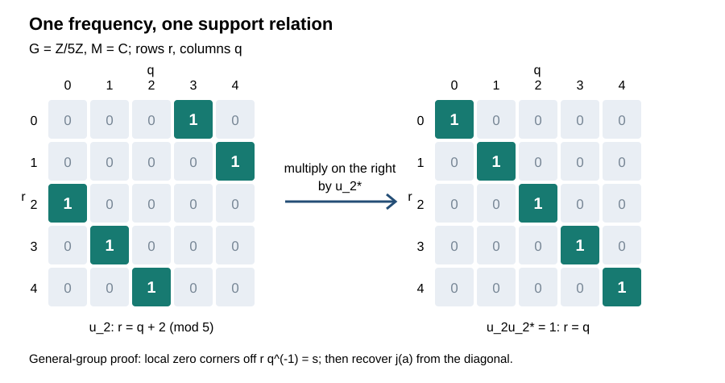

# Fourier modules and spectral fibers in crossed products

Fourier coefficients turn a crossed product into a module over the Fourier algebra of its group. We construct the module, prove the localization facts it needs, and identify every singleton spectral subspace. The group may be nonabelian, nonunimodular and nonmetrizable.

*Original expression: CC0-1.0 to the extent of rights held.*

## The Fourier algebra and the spatial coproduct

Let \(G\) be a locally compact Hausdorff group with identity \(e\) and left Haar measure. Use the locally determined Haar convention and the finite-exponent identifications proved in [L24](OA-FLOW-L24.md#oa-flow.grp.haarconventions). In particular, \(L^2\) vectors have sigma compact carriers modulo null sets. All multiple integrals below use [HR5's Radon product](OA-FLOW-HR.md#hr-05); compactly supported tests and then \(L^2\) approximation supply its integrability hypotheses. Inner products are linear in the first variable.

Write
\[
 (\lambda_s\xi)(r)=\xi(s^{-1}r),\qquad
 \operatorname{VN}(G)=\{\lambda_s:s\in G\}'',\qquad
 A(G)=\operatorname{VN}(G)_*.
 \tag{FM1}
\]
The left regular representation is strongly continuous by [L24](OA-FLOW-L24.md#oa-flow.grp.translations). We identify \(\varphi\in A(G)\) with the function
\[
 \varphi(s)=\varphi(\lambda_s).
 \tag{FM2}
\]
This identification is injective: the linear span of the \(\lambda_s\) is a unital star algebra, ultraweakly dense in its bicommutant by [BD1–5](OA-FLOW-BD.md#oa-flow.bd.1). A normal functional zero on that span is zero everywhere.

[CP4–6](OA-FLOW-CP.md#oa-flow.cp.4) gives, for every \(\epsilon>0\), vectors \(\xi,\eta\) in \(L^2(G)\otimes\ell^2(\mathbb N)\) such that
\[
 \varphi(s)=\langle(\lambda_s\otimes1)\xi,\eta\rangle,\qquad
 \|\xi\|\|\eta\|\leq\|\varphi\|_A+\epsilon.
 \tag{FM3}
\]
Indeed extend the functional in the predual quotient within \(\epsilon\) of its quotient norm, write a summable vector series, and rescale each pair to equal norms before taking their Hilbert direct sums. Conversely every such coefficient is normal, with norm at most \(\|\xi\|\|\eta\|\). Thus the functions are continuous and \(\|\varphi\|_\infty\leq\|\varphi\|_A\).

On \(L^2(G\times G)\) set
\[
 (W\zeta)(r,t)=\zeta(r,rt),\qquad
 (W^*\zeta)(r,t)=\zeta(r,r^{-1}t).
 \tag{FM4}
\]
Left invariance in the second variable proves unitarity, first on compact tests and then on the completed Hilbert space. Direct substitution gives
\[
 W^*(\lambda_s\otimes1)W=\lambda_s\otimes\lambda_s.
 \tag{FM5}
\]
Consequently
\[
 \Delta_G(x)=W^*(x\otimes1)W
\]
is a faithful normal star homomorphism from \(\operatorname{VN}(G)\) into
\(\operatorname{VN}(G)\bar\otimes\operatorname{VN}(G)\). The inclusion follows on the generating span from (FM5), then on its ultraweak closure by normality. The amplification is normal: approximate vectors by finite tensor sums in each vector-series functional, using the uniform operator norm bound. This is also the construction proved in [NCF1](OA-FLOW-NCF.md#ncf-1).

For normal functionals, the tensor functional is defined by summable tensor-vector series; its norm is at most the product of the two norms. Define multiplication in \(A(G)\) by
\[
 (\varphi\psi)(x)=(\varphi\otimes\psi)(\Delta_G(x)).
 \tag{FM6}
\]
Equations (FM2) and (FM5) show that this is pointwise multiplication. Hence it is associative and commutative, and
\(\|\varphi\psi\|_A\leq\|\varphi\|_A\|\psi\|_A\). Completeness is CP6's completeness of the predual. Complex conjugation of the coefficient vectors, since left translation commutes with scalar conjugation, gives \(\overline\varphi\in A(G)\). No commutativity of \(G\) has been used.

## Compact cutoffs and density

Put \(A_c(G)=\{\varphi\in A(G):\operatorname{supp}\varphi\text{ is compact}\}\), with support meaning closed support. This subspace is dense in \(A(G)\). To see this, truncate the summable coefficient series in (FM3), then approximate each of its finitely many vectors by \(C_c(G)\) in \(L^2\), using [HR3](OA-FLOW-HR.md#hr-03). The estimate
\[
 \|\omega_{\xi,\eta}-\omega_{\xi',\eta'}\|_A
 \leq\|\xi-\xi'\|\|\eta\|+\|\xi'\|\|\eta-\eta'\|
 \tag{FM7}
\]
controls the error. For compactly supported vectors the coefficient is zero unless
\(s\in\operatorname{supp}\eta\,(\operatorname{supp}\xi)^{-1}\), a compact set. Since the A-norm bounds the uniform norm, this also proves that every Fourier-algebra function vanishes at infinity.

We need cutoffs equal to one, not just nonzero at a point. If \(K\subset U\), with \(K\) compact and \(U\) open, there is
\[
 b\in A_c(G),\qquad 0\leq b\leq1,\qquad b|_K=1,\qquad
 \operatorname{supp}b\subset U.
 \tag{FM8}
\]
For nonempty \(K\), choose a relatively compact open identity neighborhood \(V\) so small that
\(K\overline V\,\overline V^{-1}\subset U\). This choice follows by continuity of multiplication and a finite cover of \(K\). Set
\[
 b(s)=\frac{\mu(sV\cap KV)}{\mu(V)}
     =\left\langle
        \lambda_s\frac{1_V}{\sqrt{\mu(V)}},
        \frac{1_{KV}}{\sqrt{\mu(V)}}\right\rangle.
 \tag{FM9}
\]
The set \(KV\) is open with compact closure, so both vectors are in \(L^2\). Haar positivity gives \(0<\mu(V)<\infty\). Intersection measure is at most \(\mu(sV)=\mu(V)\), and \(sV\subset KV\) for \(s\in K\); thus the asserted values and bounds hold. Nonzero values require
\(s\in KVV^{-1}\), so closed support is contained in
\(K\overline V\,\overline V^{-1}\). Continuity follows from (FM3). For \(K=\varnothing\), take \(b=0\).

In particular, distinct points are separated by these functions, and every point has a cutoff supported in any prescribed neighborhood. These statements prove the regularity and compact-support density that will be used below.

## Multipliers on the whole operator algebra

Let \(\mathcal H\) be any Hilbert space and put \(\mathcal K=L^2(G,\mathcal H)\). A coefficient (FM3) has values
\[
 \varphi(rq^{-1})=\langle a(q),b(r)\rangle,\qquad
 a(q)=(\lambda_{q^{-1}}\otimes1)\xi,\quad
 b(r)=(\lambda_{r^{-1}}\otimes1)\eta.
 \tag{FM10}
\]
These are strongly continuous Hilbert-valued functions of constant norms \(\|\xi\|\), \(\|\eta\|\). Define
\[
 (V_a\zeta)(q)=\zeta(q)\otimes a(q),\qquad
 \mathcal S_\varphi(X)=V_b^*(X\otimes1)V_a,\quad X\in B(\mathcal K).
 \tag{FM11}
\]
The vector functions are strongly measurable on the sigma compact carriers of \(\zeta\): continuous images of each compact set are separable, and a countable union remains separable. The integral norm estimate therefore proves
\(\|V_a\|\leq\|\xi\|\), and similarly for \(V_b\). The map is normal by the amplification and vector-series argument above, and
\[
 \|\mathcal S_\varphi\|\leq\|\varphi\|_A
 \tag{FM12}
\]
after taking the infimum in (FM3).

Here are the kernel identities, used only to prove bounded-operator identities. For a finite-rank operator with a kernel \(K_X(r,q)\) obtained from compactly supported continuous vector functions, Fubini in (FM11) gives
\[
 K_{\mathcal S_\varphi(X)}(r,q)=\varphi(rq^{-1})K_X(r,q).
 \tag{FM13}
\]
Such finite-rank operators are ultraweakly dense in \(B(\mathcal K)\): compact vector functions are dense by L24's vector-integration construction, and finite-dimensional compressions converge strongly with a uniform bound. CP's summable-vector tails give ultraweak convergence. Thus (FM13) proves independence of the coefficient representation in (FM3) and proves
\[
 \mathcal S_\varphi\mathcal S_\psi=\mathcal S_{\varphi\psi}.
 \tag{FM14}
\]
For clarity, composition in this step may be checked directly by replacing the two feature spaces in (FM11) by their tensor product: the feature coefficient becomes
\(\varphi(rq^{-1})\psi(rq^{-1})\). This avoids assuming that the first multiplier preserves finite rank.

For an open set \(U\), write \(P_U\) for multiplication by \(1_U\). The features commute with these scalar projections, so
\[
 P_U\mathcal S_\varphi(X)P_V
   =\mathcal S_\varphi(P_UXP_V).
 \tag{FM15}
\]
If \(\varphi(rq^{-1})=0\) on \(U\times V\), this corner is zero for every \(X\), by (FM13) and normal density of finite ranks within the corner. No kernel representation of a general bounded operator is asserted.

There is also an exact slice interpretation. Use (FM4) on the two group coordinates of \(\mathcal K\otimes L^2(G)\). A finite-rank kernel calculation gives
\[
 \mathcal S_\varphi(X)
   =(\mathrm{id}\otimes\varphi)\bigl(W^*(X\otimes1)W\bigr)
 \tag{FM16}
\]
whenever the expression on the right is sliced against a normal extension of \(\varphi\) to \(B(L^2(G))\). Indeed its second-coordinate operator in the \((r,q)\) entry is
\(\lambda_{rq^{-1}}\). Vector-series extension and normal density give the formula for every \(X\). In particular this slice is independent of the extension, as (FM13) already proved.

## Local invertibility detects the support relation

A nonzero value of \(\varphi\) yields a stronger conclusion than pointwise multiplication of kernels. Suppose
\(c=\varphi(r_0q_0^{-1})\ne0\). On the operator corner
\(P_U B(\mathcal K)P_V\), (FM10)–(FM11) give
\[
 \|\mathcal S_\varphi-c\,\mathrm{id}\|
 \leq
 \|\eta\|\sup_{q\in V}\|a(q)-a(q_0)\|
 +\|\xi\|\sup_{r\in U}\|b(r)-b(r_0)\|.
 \tag{FM17}
\]
To verify this, subtract the constant-feature map
\(X\mapsto\langle a(q_0),b(r_0)\rangle X\) and expand the difference in its two feature factors. Strong continuity lets us choose neighborhoods \(U\ni r_0\), \(V\ni q_0\) making the bound less than \(|c|\). The Neumann-series proof in [CF2](OA-FLOW-CF.md#oa-flow.cf.2) then makes this corner map invertible. Consequently
\[
 \mathcal S_\varphi(X)=0,\quad \varphi(r_0q_0^{-1})\ne0
 \quad\Longrightarrow\quad P_UXP_V=0
 \ \text{for some such }U,V.
 \tag{FM18}
\]

We will repeatedly use the following patching argument. If a bounded operator \(Z\) has a zero rectangular corner near each pair in \(K_1\times K_2\), where \(K_1,K_2\) are compact, then \(P_{K_1}ZP_{K_2}=0\). For a fixed \(r\in K_1\), cover \(K_2\) by finitely many of the second neighborhoods and intersect their first neighborhoods. Partition \(K_2\) measurably into finitely many subsets subordinate to that cover; the corresponding corner is zero on their sum. Cover \(K_1\) by finitely many resulting first neighborhoods and partition it in the same way. This proves the assertion. Compact truncations are dense in \(L^2\), by HR3 and L24, so zero corners near every pair imply \(Z=0\).

Define
\[
 I_X=\{\varphi\in A(G):\mathcal S_\varphi(X)=0\},\qquad
 E_X=\{s:\varphi(s)=0\text{ for every }\varphi\in I_X\}.
 \tag{FM19}
\]
Equation (FM14) makes \(I_X\) a closed ideal. If \(rq^{-1}\notin E_X\), (FM18) supplies a zero corner of \(X\) near \((r,q)\). It follows that
\[
 E_X=\varnothing\Longrightarrow X=0.
 \tag{FM20}
\]
Also, if \(\psi\in A(G)\) is zero on an open neighborhood of \(E_X\), then
\[
 \mathcal S_\psi(X)=0.
 \tag{FM21}
\]
Indeed, near a pair with ratio outside \(E_X\), \(X\) has a zero corner and (FM15) applies. Near a pair with ratio in \(E_X\), the function \(\psi(rq^{-1})\) is identically zero, and the last conclusion following (FM15) applies. Patching proves (FM21). This is an operator proof valid without spectral synthesis of arbitrary closed sets.

## Closed ideals and local division

For a closed set \(E\subset G\), define
\[
 I(E)=\{\varphi:\varphi|_E=0\},\qquad
 j(E)=\overline{\{\varphi\in A_c(G):
                    \operatorname{supp}\varphi\cap E=\varnothing\}}^{\,\|\cdot\|_A}.
 \tag{FM22}
\]
The set inside the closure is a linear ideal: a finite union of compact supports avoiding \(E\) still avoids \(E\), and multiplication can only shrink support. Every closed ideal \(J\subset A(G)\), with hull
\(hJ=\{s:\varphi(s)=0\text{ for all }\varphi\in J\}\), satisfies
\[
 j(hJ)\subset J\subset I(hJ).
 \tag{FM23}
\]

Here is a proof of the substantive first inclusion. If \(S\in J^\perp\subset A(G)^*=\operatorname{VN}(G)\), then for \(\varphi\in J\) and \(\psi\in A(G)\),
\[
 \langle\mathcal S_\varphi(S),\psi\rangle
       =\langle S,\varphi\psi\rangle=0
 \tag{FM24}
\]
by (FM6) and (FM16). Thus \(E_S\subset hJ\). If \(\varphi\in A_c(G)\) has support disjoint from \(hJ\), it vanishes near \(E_S\); (FM21) gives \(\mathcal S_\varphi(S)=0\). Choose \(b\in A_c(G)\) equal to one on its support by (FM8). Then
\[
 \langle S,\varphi\rangle
  =\langle S,\varphi b\rangle
  =\langle\mathcal S_\varphi(S),b\rangle=0.
\]
Hahn–Banach separation of the closed subspace \(J\), proved in [CF1](OA-FLOW-CF.md#oa-flow.cf.1), puts \(\varphi\) in \(J\). Taking closures proves (FM23). In particular, a closed ideal with empty hull is all of \(A(G)\), by compact-support density.

We now prove the local division property as well. First every nonzero complex character of \(A(G)\) is evaluation at a point. Use the formal unitization \(A(G)^\#=A(G)\oplus\mathbb C1\), with norm \(\|a+c1\|=\|a\|_A+|c|\) and the usual expanded product. Such a character extends to this unital Banach algebra by sending the adjoined identity to one. Its values are bounded by the Banach-algebra norm, because the Neumann series makes \(\lambda1-a\) invertible for \(|\lambda|>\|a\|\), and a character cannot send an invertible element to zero. Its kernel is therefore a closed proper maximal ideal. Its hull is nonempty by the preceding paragraph. For a point \(s\) in that hull, the kernel is contained in \(I(\{s\})\), which has codimension one by (FM8); maximality makes them equal. Multiplicativity, evaluated on a function with value one at \(s\), then makes the character exactly evaluation at \(s\).

An element of \(A(G)^\#\) is invertible if all its characters are nonzero on it. To justify this implication, a noninvertible element generates a proper ideal, contained in a maximal ideal by CF1's maximal principle. That ideal is closed: otherwise its closure contains the identity, so the ideal contains an element within distance less than one of the identity, an invertible element. The quotient is a complex Banach division algebra; [CF2's nonempty-spectrum argument](OA-FLOW-CF.md#oa-flow.cf.2) makes it \(\mathbb C\). Its quotient map supplies a character vanishing on the element, a contradiction. The characters of the unitization are the point evaluations just found and the augmentation character that vanishes on \(A(G)\).

Suppose \(\varphi\in A(G)\) and a compact set \(K\) contains no zero of \(\varphi\). For each point of \(K\), choose an open neighborhood \(U_i\) and a nonzero value \(c_i\) such that
\(|\varphi-c_i|<|c_i|/2\) on \(U_i\). A finite choice suffices. Using (FM8), choose \(0\leq h_i\leq1\) with compact support in \(U_i\), each equal to one on a smaller neighborhood, these smaller neighborhoods covering \(K\). Set
\[
 \rho_i=h_i\prod_{j<i}(1-h_j).
\]
Each \(\rho_i\) belongs to \(A_c(G)\), is supported in \(\operatorname{supp}h_i\), and
\(\sum_i\rho_i=1-\prod_i(1-h_i)=1\) on \(K\). Choose another cutoff \(e_i\) equal to one on \(\operatorname{supp}h_i\), with \(0\leq e_i\leq1\) and support in \(U_i\). The unitized element
\[
 a_i=\varphi e_i+c_i(1-e_i)
\]
has no zero character value: at a point in \(U_i\) it is within \(|c_i|/2\) of \(c_i\), elsewhere it equals \(c_i\), and its augmentation value is \(c_i\). Thus \(a_i^{-1}\in A(G)^\#\).

For any \(\psi\in A(G)\) supported in \(K\), put
\[
 b=\sum_i\rho_i\psi a_i^{-1}\in A(G).
\]
On \(\operatorname{supp}\rho_i\), \(a_i=\varphi\), and therefore \(\varphi b=\psi\) pointwise. Injectivity in (FM2) gives equality in \(A(G)\). This proves compact local division, including the finite partition needed to combine the local inverses.

## The crossed-product module

For the zero algebra, \(N=0\) and every spectral subspace below is zero. The nonempty spectrum assertion for group unitaries concerns the nonzero case.

Let \(M\ne0\) be a von Neumann algebra and let
\(\alpha:G\to\operatorname{Aut}(M)\) be a normal point-ultraweakly continuous action. [AT3](OA-FLOW-AT.md#oa-flow.at.3) and [NR1](OA-FLOW-NR.md#oa-flow.nr.1) give a faithful normal representation on \(\mathcal H\) and a strongly continuous unitary implementation \(U_s\) of \(\alpha_s\). [NR3–4](OA-FLOW-NR.md#oa-flow.nr.3) proves the normal independence of the regular crossed product from this choice. On \(\mathcal K=L^2(G,\mathcal H)\), set
\[
 (j(a)\zeta)(r)=\alpha_{r^{-1}}(a)\zeta(r),\qquad
 (u_s\zeta)(r)=\zeta(s^{-1}r),\qquad
 N=\{j(M),u_s:s\in G\}''.
 \tag{FM25}
\]
These are the faithful normal coefficient map and regular unitaries constructed in NR. Covariance \(u_sj(a)u_s^*=j(\alpha_s(a))\) makes the linear span of \(j(a)u_s\) a unital star algebra, hence ultraweakly dense in \(N\).

Use \(W\) from (FM4), now leaving the \(\mathcal H\) coordinate unchanged. Direct substitution gives
\[
 \delta(x)=W^*(x\otimes1)W,\qquad
 \delta(j(a))=j(a)\otimes1,\qquad
 \delta(u_s)=u_s\otimes\lambda_s.
 \tag{FM26}
\]
Normality and generating-span density imply
\(\delta(N)\subset N\bar\otimes\operatorname{VN}(G)\). Thus \(\delta\) is a faithful normal star homomorphism. It obeys
\[
 (\delta\bar\otimes\mathrm{id})\delta
      =(\mathrm{id}\bar\otimes\Delta_G)\delta.
 \tag{FM27}
\]
The normal tensor extensions exist by NCF1, restricting the extension with a full \(B(L^2)\) factor to the generated tensor subalgebras. Both sides send \(j(a)u_s\) to
\(j(a)u_s\otimes\lambda_s\otimes\lambda_s\), so normal density proves equality everywhere.

Define the normal map
\[
 T_\varphi(x)=(\mathrm{id}\otimes\varphi)\delta(x).
 \tag{FM28}
\]
Slices belong to \(N\): test a summable vector representation of \(\varphi\); the slice commutes with \(N'\), and \(N=N''\). The norm bound is
\(\|T_\varphi\|\leq\|\varphi\|_A\). Equation (FM16) identifies it with the restriction of \(\mathcal S_\varphi\), so
\[
 T_\varphi T_\psi=T_{\varphi\psi},\qquad
 T_\varphi(j(a)u_s)=\varphi(s)j(a)u_s.
 \tag{FM29}
\]
This constructs the Fourier-algebra action with its topology and norm bound.

## Hull spectra and closed spectral subspaces

For \(x\in N\), define
\[
 I_x=\{\varphi:T_\varphi(x)=0\},\qquad
 \operatorname{Sp}(x)=hI_x,\qquad
 N(E)=\{x:\operatorname{Sp}(x)\subset E\}
 \tag{FM30}
\]
for closed \(E\subset G\). The ideal \(I_x\) is closed by (FM29). Its hull is closed, as an intersection of zero sets of continuous functions. Equations (FM20) and (FM8) give
\[
 \operatorname{Sp}(x)=\varnothing\ \Longleftrightarrow\ x=0.
 \tag{FM31}
\]
For the reverse implication, \(I_0=A(G)\), whose hull is empty because every point has a function with value one.

The ideal sandwich (FM23) supplies the exact test
\[
 N(E)=\bigcap_{\substack{\varphi\in A_c(G)\\
                      \operatorname{supp}\varphi\cap E=\varnothing}}
                 \ker T_\varphi.
 \tag{FM32}
\]
If \(\operatorname{Sp}(x)\subset E\), each function displayed belongs to
\(j(\operatorname{Sp}(x))\subset I_x\). Conversely, for \(s\notin E\), (FM8) supplies a displayed function with value one at \(s\); its membership in \(I_x\) excludes \(s\) from the hull. Hence \(N(E)\) is an ultraweakly closed linear subspace.

For a group unitary, (FM29) gives \(I_{u_s}=I(\{s\})\), since \(u_s\ne0\). Point separation by cutoffs yields
\[
 \operatorname{Sp}(u_s)=\{s\},\qquad j(M)u_s\subset N(\{s\}).
 \tag{FM33}
\]
The reverse inclusion requires recovering the coefficient algebra; it does not follow merely from the displayed eigenvalue calculation.

## Diagonal locality and invariant multiplication operators

We first prove two spatial facts. Say that \(Z\in B(L^2(G,\mathcal H))\) is diagonally local if it has a zero rectangular corner near every pair \(r\ne q\). Then \(Z\) commutes with every scalar multiplication projection. Indeed disjoint compact sets \(K,L\) have \(P_KZP_L=0\) by the patching argument. For a measurable set \(E\), compact approximation to finite-exponent functions supported in \(E\) and its complement gives
\(P_EZP_{G\setminus E}=P_{G\setminus E}ZP_E=0\); HR3 and L24 justify these approximations on their sigma compact carriers. Thus \(P_EZ=ZP_E\).

In the scalar case \(\mathcal H=\mathbb C\), every operator commuting with these projections is multiplication by an element of the locally determined \(L^\infty(G)\). Here is the measure-space detail. Partition each open sigma compact coset from L24 into countably many disjoint measurable sets \(E_i\) of finite measure; allow all cosets in this index set. Commutation restricts the operator to each \(L^2(E_i)\). On a nonnull finite piece put \(h_i=Z1_{E_i}\). Commutation with simple multipliers gives \(Zf=fh_i\) for bounded simple \(f\), hence for bounded \(f\) by uniform approximation. Testing indicators \(1_A\), \(A\subset E_i\), gives
\[
 \|1_Ah_i\|_2\leq\|Z\|\mu(A)^{1/2}.
\]
The sets where \(|h_i|>\|Z\|+\epsilon\) must therefore be null. Bounded truncation extends \(Z=M_{h_i}\) to all \(L^2(E_i)\). Assemble the \(h_i\), with the uniform essential bound, into a locally measurable \(h\). Each \(L^2\) vector occupies only countably many pieces, so \(Z=M_h\) on the full Hilbert direct sum.

Use the modular convention from L24,
\(\mu(Et)=\Delta(t)\mu(E)\), and the right regular unitaries
\[
 (\rho_t\xi)(r)=\Delta(t)^{1/2}\xi(rt).
 \tag{FM34}
\]
If \(M_h\) commutes with every \(\rho_t\), then \(h(rt)=h(r)\) as locally almost-everywhere classes for each fixed \(t\). Such an \(h\) is constant. Choose a nonnegative \(\kappa\in C_c(G)\) of integral one and set
\[
 H(r)=\int h(rt)\kappa(t)\,dt
     =\int h(v)\kappa(r^{-1}v)\,dv.
 \tag{FM35}
\]
The second expression and \(L^1\)-continuity of left translations show that \(H\) is continuous. It represents the same \(L^\infty\) class as \(h\): on each compact set of \(r\)'s, Fubini with the compact carrier of \(\kappa\) applies to the equality \(h(rt)=h(r)\), which holds for almost every \(r\) for each \(t\). Locally measurable functions have Borel representatives on these sigma compact carriers by L24. There is no interchange of an uncountable family of exceptional sets. For a fixed \(t\), the continuous function \(H(rt)-H(r)\) is zero almost everywhere and hence everywhere, since Haar measure is positive on every nonempty open set. Taking \(r=e\) proves \(H(t)=H(e)\), and therefore \(h\) is constant.

Finally, if an operator \(Z\) on \(L^2(G,\mathcal H)\) is diagonally local and commutes with every \(\rho_t\otimes1\), then
\[
 Z=1\otimes a\quad\text{for a unique }a\in B(\mathcal H).
 \tag{FM36}
\]
Choose any orthonormal basis of \(\mathcal H\). Each scalar matrix entry of \(Z\) is a multiplier by the first fact and is constant by the second. The constant matrices on finite coordinate sets have norms at most \(\|Z\|\): test them on a common scalar unit vector in \(L^2(G)\). They define a bounded sesquilinear form on the finite-coordinate vectors, hence a unique bounded operator \(a\). Equality of matrix entries gives (FM36). This uses finite-subset nets and imposes no separability assumption.

## The exact singleton fibers

We claim that, for every \(s\in G\),
\[
 \boxed{\,N(\{s\})=j(M)u_s\,}.
 \tag{FM37}
\]
Let \(x\in N(\{s\})\). Whenever \(rq^{-1}\ne s\), the local-invertibility argument (FM18) supplies a zero corner of \(x\) near \((r,q)\). Set \(y=xu_s^*\). If \(r\ne v\), then
\[
 r(s^{-1}v)^{-1}=rv^{-1}s\ne s.
\]
Choose the zero corner of \(x\) with second neighborhood \(s^{-1}V\) near \(s^{-1}v\). The identity
\(u_s^*P_V=P_{s^{-1}V}u_s^*\) gives \(P_UyP_V=0\).
Thus \(y\) is diagonally local and commutes with scalar multipliers.

Let \(U_t\) be the strongly continuous implementation of \(\alpha_t\) used in (FM25). The unitaries
\[
 (V_t\zeta)(r)=\Delta(t)^{1/2}U_t\zeta(rt)
 \tag{FM38}
\]
commute with both \(j(M)\) and every \(u_s\), hence belong to \(N'\).
For the first commutation use
\[
 U_t\alpha_{t^{-1}r^{-1}}(a)
     =\alpha_{r^{-1}}(a)U_t;
\]
for the second use that left and right translations commute.

Define \(Q\) on \(L^2(G,\mathcal H)\) by
\((Q\zeta)(r)=U_r\zeta(r)\). Strong continuity and the same measurable-carrier argument used for (FM11) make this a unitary with inverse
\((Q^*\zeta)(r)=U_r^*\zeta(r)\). It commutes with every scalar multiplier, and
\[
 QV_tQ^*=\rho_t\otimes1,\qquad Qj(a)Q^*=1\otimes a.
 \tag{FM39}
\]
The identity \(U_rU_tU_{rt}^*=1\) proves the first formula; covariance proves the second. Since \(y\in N\) commutes with all \(V_t\), (FM36) gives
\(QyQ^*=1\otimes a\) for some \(a\in B(\mathcal H)\).

It remains to show \(a\in M\). Every constant operator \(1\otimes b'\), \(b'\in M'\), commutes with \(N\): each coefficient \(\alpha_{r^{-1}}(m)\) belongs to \(M\), and translations leave the constant operator unchanged. Consequently \(1\otimes a\) commutes with the multiplication operator having values \(U_rb'U_r^*\). For fixed vectors \(\xi,\eta\in\mathcal H\), the scalar function
\[
 r\longmapsto
 \langle[a,U_rb'U_r^*]\xi,\eta\rangle
\]
is continuous and is locally almost everywhere zero. Haar positivity makes it zero everywhere. Evaluation at \(r=e\) gives \([a,b']=0\), separately for every \(b'\). Therefore \(a\in M''=M\). Formula (FM39) gives \(y=j(a)\) and \(x=j(a)u_s\). The inclusion in (FM33) proves the converse and completes (FM37).

It also proves the coaction characterizations
\[
 \{x\in N:\delta(x)=x\otimes\lambda_s\}=j(M)u_s,\qquad
 \{x\in N:\delta(x)=x\otimes1\}=j(M).
 \tag{FM40}
\]
Indeed the displayed coaction identity gives \(T_\varphi x=\varphi(s)x\); cutoffs at every other point put its spectrum inside \(\{s\}\). Conversely (FM26) gives the identity on \(j(M)u_s\). For a nonzero element of this fiber its spectrum is exactly \(\{s\}\), by (FM31).

## Points are sets of synthesis

For completeness, the closed ideals in (FM22) agree when \(E\) is a point:
\[
 j(\{s\})=I(\{s\}).
 \tag{FM41}
\]
Let \(J=j(\{s\})\). Cutoffs show \(hJ=\{s\}\). For \(S\in J^\perp\subset\operatorname{VN}(G)\), (FM24) gives \(\mathcal S_\varphi S=0\) for \(\varphi\in J\), hence \(E_S\subset\{s\}\). Apply (FM37) to the scalar crossed product \(\mathbb C\rtimes G=\operatorname{VN}(G)\): it gives \(S\in\mathbb C\lambda_s\). Conversely evaluation at \(\lambda_s\) annihilates \(J\). Thus
\[
 J^\perp=\mathbb C\lambda_s=I(\{s\})^\perp.
\]
Hahn–Banach separation of closed subspaces yields (FM41). This proves point synthesis from the spatial fiber theorem; neither proof uses the other as an unproved input.

## Filtering shrinks spectrum; equality can fail

For \(x\in N\) and \(\varphi\in A(G)\), the correct general statement is
\[
 \operatorname{Sp}(T_\varphi x)
    \subset \operatorname{supp}\varphi\cap\operatorname{Sp}(x).
 \tag{FM42}
\]
First \(I_x\subset I_{T_\varphi x}\) by the module law, which gives the inclusion in \(\operatorname{Sp}(x)\). If \(s\notin\operatorname{supp}\varphi\), choose a cutoff \(\psi\) with \(\psi(s)=1\) supported in its open complement. Then
\(T_\psi T_\varphi x=T_{\psi\varphi}x=0\), so \(s\) is not in the filtered spectrum. This proves the other inclusion.

Equality fails even for \(G=\mathbb R\), \(M=\mathbb C\), and \(x=u_0=1\). We give an explicit coefficient without requiring an identification of \(A(\mathbb R)\) with a transform space. On \(L^2(\mathbb R)\), let
\[
 \xi(q)=e^{-2q^2},\qquad
 \eta(r)=\frac{4}{\sqrt\pi}\,r e^{-2r^2}.
\]
Both vectors are square integrable. Completing the square and using the Gaussian integral proved in [FF2](OA-FLOW-FF.md#oa-flow.ff.2) gives
\[
 \begin{aligned}
 \varphi(t)
 &=\langle\lambda_t\xi,\eta\rangle\\
 &=\frac4{\sqrt\pi}\int_{\mathbb R}
          r e^{-2(r-t)^2-2r^2}\,dr\\
 &=\frac4{\sqrt\pi}e^{-t^2}
       \int_{\mathbb R}(v+t/2)e^{-4v^2}\,dv
   =t e^{-t^2}.
 \end{aligned}
 \tag{FM43}
\]
The odd integral is zero and \(\int e^{-4v^2}dv=\sqrt\pi/2\).
Thus \(\varphi\in A(\mathbb R)\), \(\varphi(0)=0\), and its closed support is all of \(\mathbb R\). Equations (FM29), (FM31) and (FM33) give
\[
 \operatorname{Sp}(T_\varphi1)=\varnothing,\qquad
 \operatorname{supp}\varphi\cap\operatorname{Sp}(1)=\{0\}.
 \tag{FM44}
\]
Closed support records nearby nonzero values; it does not prevent the multiplier from vanishing at the frequency actually carried by \(x\).

## Seeing the support relation

The diagram uses the finite group \(G=\mathbb Z/5\mathbb Z\) with counting measure and \(M=\mathbb C\). Rows are output coordinates \(r\), columns input coordinates \(q\). A highlighted entry is one; every other entry is zero. It shows the exact matrices of \(u_2\) and \(u_2u_2^*=1\), not a kernel assigned to a general bounded operator.

For an arbitrary group the corresponding relations are \(rq^{-1}=s\) and \(r=q\). Equation (FM18) proves local zero corners off the first relation. Multiplication by \(u_s^*\) moves it to the diagonal, and (FM38)–(FM39) plus right-translation invariance recover the coefficient \(a\in M\). These are the two steps in the proof of (FM37).

## Mathematical source

M. Takesaki, *Theory of Operator Algebras II*, Chapter X, §2, Exercise 11(a)–(e), p. 278, poses the coproduct and Fourier-module construction; Chapter XI, §1, Exercise 7, p. 331, poses the spectral-fiber questions. The latter's reference to Exercise X.2.10 points to the Fourier-module construction in X.2.11. Its part (b), printed with equality, has the counterexample (FM43)–(FM44); the valid general conclusion is (FM42).

All the arguments used here are proved in this lesson or in the earlier programme proofs linked above. The local corner estimate (FM17), ideal argument (FM23), and coefficient recovery (FM37) specify the proof of the general-group statements.
