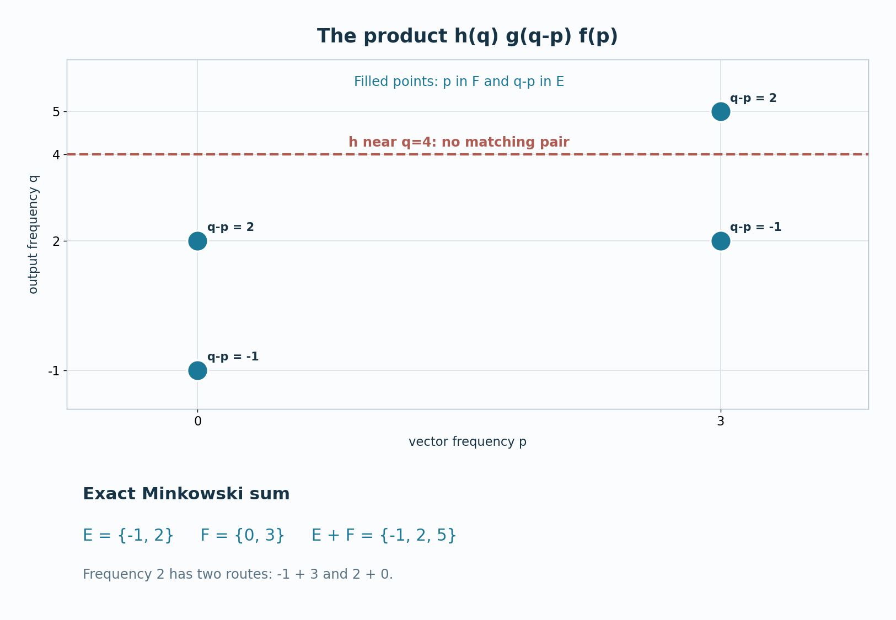

# Spectral transfer on ordinary Banach spaces

For two uniformly bounded actions, an operator can move a vector's frequencies by the frequencies it carries itself. We prove this for bounded maps between arbitrary complex Banach spaces. The vector limits are in norm; the operator limits are pointwise in norm, with explicit uniform bounds. No predual or reflexivity assumption is used.

*Original expression: CC0-1.0 to the extent of rights held.*

## Vector filters and the Fourier convention

Let \(G\) be a locally compact Hausdorff abelian group, write \(H=\widehat G\), and use additive notation. Fix the positive transform
\[
 f(p)=\mathcal Fa(p)=\int_G a(t)(t,p)\,dt,\qquad
 A(H)=\mathcal F(L^1(G)),\qquad \|f\|_A=\|a\|_1.
 \tag{NB1}
\]
Fourier injectivity and the Banach-algebra identification are proved in [LF0](OA-FLOW-LF.md#lf-0). That lesson and [BS](OA-FLOW-BS.md#bs-1) use the negative transform \(\widehat a(p)=\mathcal Fa(-p)\). The reflection \(Rf(p)=f(-p)\) is an isometric algebra isomorphism, and \(\widehat a=R(\mathcal Fa)\). Applying their statements through \(R\) reflects every spectral set and preserves all inclusions and sums below.

Let \(X\) be a complex Banach space with a representation \(\alpha\) satisfying
\[
 \alpha_0=1,\quad \alpha_{s+t}=\alpha_s\alpha_t,\quad
 C_\alpha=\sup_t\|\alpha_t\|<\infty,\quad
 \|\alpha_t x-x\|\longrightarrow0\quad(t\to0).
 \tag{NB2}
\]
For \(f=\mathcal Fa\), put
\[
 \alpha_f x=\int_G a(t)\alpha_t x\,dt.
 \tag{NB3}
\]
This is a Bochner integral on the entire \(L^1\) domain, as proved in [BS1](OA-FLOW-BS.md#bs-1). More explicitly, [L24](OA-FLOW-L24.md#oa-flow.grp.haarconventions) gives a Borel representative of \(a\) with sigma compact carrier. On each compact piece the continuous orbit has compact, hence separable, image. Its product with \(a\) is strongly measurable and has integrable norm bound \(C_\alpha|a(t)|\|x\|\). [L24's vector integral](OA-FLOW-L24.md#oa-flow.grp.vectorintegration) supplies the integral and its norm bound:
\[
 \|\alpha_f\|\leq C_\alpha\|f\|_A,\qquad
 \alpha_f\alpha_g=\alpha_{fg}.
 \tag{NB4}
\]
The product identity follows by vector Fubini, using
\(\alpha_s\alpha_t=\alpha_{s+t}\) and the absolute norm bound
\(C_\alpha|a(s)b(t)|\|x\|\). All products use [HR5's qualified Radon integration](OA-FLOW-HR.md#hr-05).

For nonnegative mass-one \(a_V\in C_c(G)\) supported in a shrinking identity neighborhood \(V\),
\[
 \|\alpha_{\mathcal Fa_V}x-x\|
 \leq\sup_{t\in V}\|\alpha_t x-x\|\longrightarrow0.
 \tag{NB5}
\]
Define \(I_\alpha(x)=\{f:\alpha_fx=0\}\) and
\(\operatorname{Sp}_\alpha(x)=hI_\alpha(x)\). The ideal is closed by (NB4).
[LF6–7](OA-FLOW-LF.md#lf-6), together with (NB5), gives
\[
 \begin{split}
 X_\alpha(E)&=\{x:\operatorname{Sp}_\alpha(x)\subset E\}
   =\bigcap_{\substack{f\in A_c(H)\\
                       \operatorname{supp}f\cap E=\varnothing}}\ker\alpha_f,
       \quad E\text{ closed},\\
 \operatorname{Sp}_\alpha(x)=\varnothing&\ \Longleftrightarrow\ x=0,\\
 \operatorname{Sp}_\alpha(\alpha_fx)
       &\subset\operatorname{supp}f\cap\operatorname{Sp}_\alpha(x).
 \end{split}
 \tag{NB6}
\]
For the first equality, the closed-ideal sandwich puts every compactly supported function avoiding the hull into the ideal; conversely a compact cutoff at any point outside \(E\) excludes that point from the hull. An empty hull makes the ideal all of \(A(H)\), and (NB5) then gives \(x=0\). The filter inclusion follows from the ideal inclusion
\(I_\alpha(x)\subset I_\alpha(\alpha_fx)\) and a cutoff supported outside \(\operatorname{supp}f\). In particular \(X_\alpha(E)\) is norm closed.

For open \(U\subset H\), define
\[
 X_0^\alpha(U)=
 \overline{\operatorname{span}\{\alpha_fz:
        f\in A_c(H),\ \operatorname{supp}f\subset U,\ z\in X\}}^{\|\cdot\|}.
 \tag{NB7}
\]
For closed \(E\subset U\), [BS4](OA-FLOW-BS.md#bs-4), with the reflection above, proves
\[
 X_\alpha(E)\subset X_0^\alpha(U)\subset X_\alpha(\overline U).
 \tag{NB8}
\]
One can also see the first inclusion directly in the Banach quotient \(X/X_0^\alpha(U)\). The subspace is invariant, by covariance of the filters, so the quotient has a uniformly bounded strongly continuous induced action. The image of \(x\in X_\alpha(E)\) has spectrum inside \(E\). At each point of \(E\), a cutoff supported in \(U\) annihilates the quotient image and is nonzero at that point. Its spectrum is therefore empty, so (NB6) in the quotient makes its image zero. The second inclusion follows from (NB6) on the generators and norm closedness. Completeness and boundedness of the quotient action follow from the usual quotient norm and its Cauchy-series construction, proved in [CP5](OA-FLOW-CP.md#oa-flow.cp.5).

## Pointwise Bochner integration on the operator space

Let \(Y\) be another complex Banach space with a representation \(\beta\) satisfying (NB2), with bound \(C_\beta\). Set
\[
 \mathcal B=B(X,Y),\qquad
 \gamma_t(T)=\beta_tT\alpha_{-t},\qquad D=C_\alpha C_\beta.
 \tag{NB9}
\]
The space \(\mathcal B\) is Banach: a norm-Cauchy sequence of bounded operators has pointwise limits in \(Y\), and its uniform norm estimates pass to those limits and prove operator-norm convergence. The maps \(\gamma_t\) form a representation with \(\|\gamma_t\|\leq D\).

For fixed \(T,x\), the orbit \(t\mapsto\gamma_t(T)x\) is norm continuous. At zero, expand
\[
 \gamma_t(T)x-Tx
   =\beta_tT(\alpha_{-t}x-x)+(\beta_t-1)Tx.
 \tag{NB10}
\]
The first term tends to zero by its uniform bound and the second by strong continuity of \(\beta\). Translation of the parameter gives continuity everywhere.

For \(f=\mathcal Fa\), define an operator by its values
\[
 (\Gamma_fT)x=\int_G a(t)\beta_tT\alpha_{-t}x\,dt.
 \tag{NB11}
\]
The same measurable-carrier argument as for (NB3) applies to this \(Y\)-valued orbit. Linearity in \(x\) and the integral estimate give
\[
 \|\Gamma_fT\|\leq D\|f\|_A\|T\|,\qquad
 \Gamma_f\Gamma_gT=\Gamma_{fg}T,\qquad
 \gamma_s(\Gamma_{\mathcal Fa}T)=\Gamma_{\mathcal F(L_sa)}T,
 \quad L_sa(t)=a(t-s).
 \tag{NB12}
\]
For the product identity, apply both sides to \(x\). The iterated integrand collapses to
\(a(s)b(t)\beta_{s+t}T\alpha_{-(s+t)}x\), whose norm is at most
\(D|a(s)b(t)|\|T\|\|x\|\). Vector Fubini gives convolution of the kernels. Translation of the integration variable proves the last formula.

Although the original orbit need not be norm continuous, every filtered operator has a norm-continuous orbit:
\[
 \|\gamma_s(\Gamma_{\mathcal Fa}T)-\Gamma_{\mathcal Fa}T\|
       \leq D\|T\|\|L_sa-a\|_1\longrightarrow0.
 \tag{NB13}
\]
Here \(L^1\)-translation continuity is [L24](OA-FLOW-L24.md#oa-flow.grp.translations). The operators with norm-continuous orbits form a norm-closed invariant subspace \(Z\subset\mathcal B\). Closedness follows from
\[
 \|\gamma_tT-T\|
 \leq D\|T-S\|+\|\gamma_tS-S\|+\|S-T\|
\]
with \(S\in Z\) near \(T\); invariance follows from the group law and boundedness of each \(\gamma_s\). Thus the restriction to \(Z\) is an ordinary strongly continuous Banach action.

The mass-one kernels in (NB5) give
\[
 \Gamma_{\mathcal Fa_V}T\longrightarrow T
 \quad\text{pointwise in norm},\qquad
 \|\Gamma_{\mathcal Fa_V}T\|\leq D\|T\|.
 \tag{NB14}
\]
Indeed evaluate at \(x\) and bound the difference by the supremum of (NB10) over \(V\). In particular, if all filters annihilate \(T\), then \(T=0\).

## Which operator limits the filters preserve

The strong operator topology on \(B(X,Y)\) uses the seminorms
\(T\mapsto\|Tx\|\), \(x\in X\). Its continuous linear functionals are precisely
\[
 T\longmapsto\sum_{j=1}^n y_j^*(Tx_j),
 \qquad x_j\in X,\quad y_j^*\in Y^*.
 \tag{NB15}
\]
The displayed functionals are continuous. Conversely, continuity and rescaling bound a linear functional \(\ell\) by
\(C\max_j\|Tx_j\|\) for finitely many \(x_j\). It vanishes on the kernel of
\(T\mapsto(Tx_1,\ldots,Tx_n)\), so it factors as a bounded functional on that map's range in \(Y^n\). Hahn–Banach, as proved in [CF1](OA-FLOW-CF.md#oa-flow.cf.1), extends it to \(Y^n\). Evaluating the extension on each coordinate gives (NB15).

The weak topology generated by these scalar functionals is the weak operator topology. It can be strictly weaker than the strong operator topology. For example, take \(X=\mathbb C\), \(Y=\ell^2\), and \(T_nz=ze_n\). Every scalar test tends to zero because the coordinates of an \(\ell^2\) vector tend to zero, whereas \(\|T_n1\|=1\).

For the filters we need the following exact continuity statement:
\[
 \begin{gathered}
 T_i x\longrightarrow Tx\text{ in norm for every }x,\qquad
 \sup_i\|T_i\|<\infty\\
 \Longrightarrow\quad
 (\Gamma_fT_i)x\longrightarrow(\Gamma_fT)x
       \text{ in norm for every }f,x.
 \end{gathered}
 \tag{NB16}
\]
Put \(L=\sup_i\|T_i-T\|<\infty\). Strong convergence is uniform on a compact subset \(C\subset X\): choose a finite \(\epsilon\)-net in \(C\), use convergence at its finitely many points, and bound the errors to those points by \(L\epsilon\). If \(f=\mathcal Fa\), choose a compact \(K\subset G\) with small \(\int_{G\setminus K}|a|\); such compact \(L^1\)-approximation follows from L24 and HR3. The set
\(\{\alpha_{-t}x:t\in K\}\) is compact. Hence
\[
 \begin{split}
 \|(\Gamma_fT_i-\Gamma_fT)x\|
 &\leq C_\beta\int_K|a(t)|
             \|(T_i-T)\alpha_{-t}x\|\,dt\\
 &\quad+D L\|x\|\int_{G\setminus K}|a(t)|\,dt
 \end{split}
 \tag{NB17}
\]
tends to zero by first choosing the tail and then the finite-net convergence. This proof applies to nets; it does not use a dominated-convergence theorem for arbitrary nets.

The uniform bound in (NB16) is a real hypothesis. On an infinite-dimensional Hilbert space, direct pairs \((F,n)\), with \(F\) a finite-dimensional subspace and \(n\geq1\), by inclusion of \(F\) and increase of \(n\). Choose a unit vector \(v_F\in F^\perp\) and fix a unit vector \(e\). The operators
\[
 T_{F,n}x=n\langle x,v_F\rangle e
 \tag{NB18}
\]
converge strongly to zero: eventually \(F\) contains any fixed \(x\). But \(\|T_{F,n}\|=n\), unbounded on every tail. Existence of the orthogonal complements and vectors follows from [CF8](OA-FLOW-CF.md#oa-flow.cf.8). Thus pointwise convergence of a net alone does not supply the common bound used in (NB17).

## Bounded operator localization

Define
\[
 I_\gamma(T)=\{f:\Gamma_fT=0\},\qquad
 \operatorname{Sp}_\gamma(T)=hI_\gamma(T),\qquad
 B_\gamma(E)=\{T:\operatorname{Sp}_\gamma(T)\subset E\}.
 \tag{NB19}
\]
The norm bound and product law in (NB12) make \(I_\gamma(T)\) a closed ideal of \(A(H)\). The same scalar ideal proof as in (NB6), using (NB14) for essentiality, gives
\[
 \begin{split}
 B_\gamma(E)
   &=\bigcap_{\substack{f\in A_c(H)\\
                       \operatorname{supp}f\cap E=\varnothing}}\ker\Gamma_f,
                   \quad E\text{ closed},\\
 \operatorname{Sp}_\gamma(T)=\varnothing
   &\ \Longleftrightarrow\ T=0,\\
 \operatorname{Sp}_\gamma(\Gamma_fT)
   &\subset\operatorname{supp}f\cap\operatorname{Sp}_\gamma(T).
 \end{split}
 \tag{NB20}
\]
We will also use the plateau identity
\[
 f=1\text{ near }\operatorname{Sp}_\gamma(T)
        \quad\Longrightarrow\quad\Gamma_fT=T.
 \tag{NB21}
\]
For every \(g\in A(H)\), the function \(g-gf\) vanishes near that spectrum. [LF6](OA-FLOW-LF.md#lf-6) puts it in \(I_\gamma(T)\); hence
\(\Gamma_g(T-\Gamma_fT)=0\) for every \(g\), and (NB14) proves (NB21).
By (NB16), \(B_\gamma(E)\) is closed under uniformly bounded strongly convergent nets.

For open \(U\subset H\), let \(B_0^\gamma(U)\) consist of all strong limits of uniformly norm-bounded nets in
\[
 \operatorname{span}\{\Gamma_fS:
       f\in A_c(H),\ \operatorname{supp}f\subset U,\ S\in B(X,Y)\}.
 \tag{NB22}
\]
The zero operator is included. Sums and scalar multiples stay in this space by taking product directed sets and adding their uniform bounds. We prove
\[
 B_\gamma(E)\subset B_0^\gamma(U)\subset B_\gamma(\overline U),
       \qquad E\subset U,\quad E\text{ closed}.
 \tag{NB23}
\]

The first inclusion has a bounded approximation with no increase beyond \(D\|T\|\). Use the particular kernels \(k_i=k_{V,\epsilon}\) constructed in [LF5](OA-FLOW-LF.md#lf-5):
\[
 k_i\geq0,\quad \|k_i\|_1=\int k_i=1,\quad
 \|k_{V,\epsilon}-a_V\|_1<2\epsilon,\quad
 K_i=\operatorname{supp}\mathcal Fk_i\text{ compact}.
 \tag{NB24}
\]
The reflection in (NB1) preserves compactness of their frequency supports. Set \(T_i=\Gamma_{\mathcal Fk_i}T\). Equations (NB12) and (NB14) give
\[
 T_i\longrightarrow T\text{ strongly},\qquad
 \|T_i\|\leq D\|T\|,\qquad
 \operatorname{Sp}_\gamma(T_i)\subset E\cap K_i.
 \tag{NB25}
\]
For example,
\(\|(T_i-\Gamma_{\mathcal Fa_V}T)x\|\leq2D\epsilon\|T\|\|x\|\), which proves the first convergence.

The compact set \(E\cap K_i\) lies in \(U\). By [LF4](OA-FLOW-LF.md#lf-4), choose \(q_i\in A_c(H)\), supported in \(U\), equal to one on a neighborhood of \(E\cap K_i\). Then (NB21) says \(T_i=\Gamma_{q_i}T_i\). If that compact set is empty, (NB20) gives \(T_i=0\). Thus the actual \(T_i\) lie in the generating ranges of (NB22), with the common bound in (NB25), proving the first inclusion in (NB23). Each \(T_i\) also lies in the norm-continuous subspace \(Z\), by (NB13).

For the second inclusion, every generator has spectrum in \(\overline U\) by (NB20). Their finite sums are annihilated by every compactly supported filter avoiding \(\overline U\). Equation (NB16) preserves those annihilations along the defining bounded strong net. The kernel criterion in (NB20) proves the inclusion.

## A Bochner three-kernel identity

Let \(g=\mathcal Fa\), \(f=\mathcal Fb\), \(h=\mathcal Fc\), with all three kernels in \(L^1(G)\). For \(T\in B(X,Y)\) and \(x\in X\), substituting (NB3) and (NB11) gives
\[
 \beta_h\bigl((\Gamma_gT)(\alpha_fx)\bigr)
  =\int_{G^3}c(t)a(r)b(s)\,
           \beta_{t+r}T\alpha_{s-r}x\,dt\,dr\,ds.
 \tag{NB26}
\]
This is a \(Y\)-valued Bochner identity. The norm integrand is bounded by
\(D|c(t)a(r)b(s)|\|T\|\|x\|\). Its orbit factor is jointly norm continuous, by strong continuity of \(\alpha,\beta\), their uniform bounds, and boundedness of \(T\). On compact carriers its image is separable. Thus vector Fubini from L24 applies, first to compactly supported continuous kernels and then, by their \(L^1\) approximation and the bound, to the stated full domain.

Set \(u=t+r\), \(v=s-r\), and
\[
 k(u,v)=\int_G a(r)b(v+r)c(u-r)\,dr.
 \tag{NB27}
\]
The scalar lemma proved in [L80, the three-kernel identity](OA-FLOW-L80.md#sum-kernel) gives
\[
 \|k\|_{L^1(G^2)}\leq\|a\|_1\|b\|_1\|c\|_1,\qquad
 \widehat k(q,p)=h(q)g(q-p)f(p).
 \tag{NB28}
\]
Only its scalar kernel assertion is used here. Its proof substitutes the above variables in the Radon Haar integral on \(G^3\); the character product is
\((t+r,q)(s-r,p)=(t,q)(r,q-p)(s,p)\). All kernels and shear images have sigma compact carriers, and [H1](OA-FLOW-HARMONIC.md#l138-h1) gives Fourier injectivity on the product LCA group.

Equation (NB26) is therefore also
\[
 \int_{G^2}k(u,v)\beta_uT\alpha_vx\,du\,dv.
 \tag{NB29}
\]
The same norm bound justifies this vector integral and the substitutions. If
\[
 \operatorname{supp}h\ \cap\
       (\operatorname{supp}g+\operatorname{supp}f)=\varnothing,
 \tag{NB30}
\]
the transform in (NB28) is zero everywhere. Fourier injectivity makes \(k=0\) almost everywhere, so
\[
 \beta_h\bigl((\Gamma_gT)(\alpha_fx)\bigr)=0.
 \tag{NB31}
\]
No normality of \(T\) or identification of either Banach space as a dual is needed.

## The full closed-set transfer theorem

For arbitrary closed sets \(E,F\subset H\), we have
\[
 \boxed{\quad
 T\in B_\gamma(E),\quad x\in X_\alpha(F)
 \quad\Longrightarrow\quad
 Tx\in Y_\beta(\overline{E+F}).
 \quad}
 \tag{NB32}
\]
The zero-space and empty-spectrum cases follow from (NB6) and (NB20). Otherwise put \(C=\overline{E+F}\), and take \(h\in A_c(H)\) whose compact support \(K\) misses \(C\).

There is a symmetric identity neighborhood \(W\subset H\) such that
\[
 K\cap(C+W+W)=\varnothing.
 \tag{NB33}
\]
To see this, continuity of subtraction and a finite cover of the compact \(K\) give an identity neighborhood \(V\) with \((K+V)\cap C=\varnothing\). Shrink to a symmetric \(W\) with \(W+W\subset V\). An intersection in (NB33) would put a point of \(C\) in \(K-W-W\subset K+V\), a contradiction. Thus the open sets \(U_E=E+W\) and \(U_F=F+W\) satisfy
\(K\cap(U_E+U_F)=\varnothing\).

By (NB8), \(x\) is a norm limit of finite sums of vectors \(\alpha_fz\) with \(f\in A_c(H)\) supported in \(U_F\). By (NB23), \(T\) is a strong limit of a uniformly bounded net of finite sums of \(\Gamma_gS\) with \(g\in A_c(H)\) supported in \(U_E\). Every pair of generators satisfies (NB30), so (NB31) annihilates it.

Fix one filtered operator \(B=\Gamma_gS\). The bounded map \(z\mapsto\beta_h(Bz)\) preserves the first, norm limit; hence \(\beta_h(Bx)=0\). This remains true for finite sums of these operators. Now hold \(x\) fixed and take the second, strong operator limit. Since \(B_ix\to Tx\) in norm and \(\beta_h\) is bounded, \(\beta_h(Tx)=0\). These are successive limits; no joint continuity of evaluation in a weaker topology is being assumed.

Every compactly supported test avoiding \(C\) has therefore annihilated \(Tx\). The closed-space criterion (NB6) for \(\beta\) proves (NB32).

## Frequencies, and the difference between the two operator topologies

The figure marks the four possible pairs with \(p\in\{0,3\}\) and
\(q-p\in\{-1,2\}\). Their output frequencies lie in \(\{-1,2,5\}\). For the filter proof, replace these finite sets by sufficiently small neighborhoods and take the test \(h\) near \(q=4\), away from their sum. The horizontal line indicates that test's center; a nonzero continuous filter on \(\mathbb R\) cannot be supported at that point alone. Formula (NB28) is then zero.

An actual finite-dimensional model also shows why the theorem gives containment. Take \(G=\mathbb R\), \(X=Y=\mathbb C^2\),
\[
 \alpha_t=\operatorname{diag}(1,e^{3it}),\qquad
 \beta_t=\operatorname{diag}(e^{-it},e^{2it}),\qquad
 T=\begin{pmatrix}1&1\\1&1\end{pmatrix},\quad x=e_2.
 \tag{NB34}
\]
In the matrix unit at position \((i,j)\), \(\gamma_t\) has frequency \(b_i-a_j\), where \(a=(0,3)\) and \(b=(-1,2)\). Integration in (NB11) multiplies that entry by \(f(b_i-a_j)\). Compact cutoffs separate the finitely many frequencies, so
\[
 \operatorname{Sp}_\gamma(T)=\{-4,-1,2\},\quad
 \operatorname{Sp}_\alpha(x)=\{3\},\quad
 \operatorname{Sp}_\beta(Tx)=\{-1,2\}.
 \tag{NB35}
\]
The possible sum also contains \(5\), but the entry of \(T\) at frequency \(2\) lies in its first column and does not act on \(e_2\). Thus equality in (NB32) is not forced.

For failure of operator-norm continuity, take \(X=Y=L^2(\mathbb R)\), let
\(\alpha_t=1\), let \((\beta_t\xi)(r)=\xi(r-t)\), and put \(T=1\). Then \(\gamma_t(T)=\beta_t\) is strongly continuous by L24, but
\[
 \|\beta_t-1\|=2\qquad(t\ne0).
 \tag{NB36}
\]
The upper bound follows from unitarity. The unitary negative Fourier transform proved in [FF3](OA-FLOW-FF.md#oa-flow.ff.3) conjugates the difference to multiplication by \(e^{-itp}-1\). For any \(\epsilon>0\), an interval about \(p=\pi/t\) has
\(|e^{-itp}-1|>2-\epsilon\). A normalized indicator of a finite such interval has \(L^2\) norm one and is moved by at least \(2-\epsilon\). Fourier unitarity transports it back to the original space. Letting \(\epsilon\downarrow0\) proves (NB36). The smoothing in (NB13), rather than norm continuity of every operator orbit, supplies the norm-continuous operators used above.

## Adjoint filters and source conventions

Suppose \(X\) is also a Banach star algebra with continuous conjugate-linear involution, and that every \(\alpha_t\) preserves adjoints. For \(f=\mathcal Fa\), put
\[
 f^\dagger(p)=\overline{f(-p)}
              =\mathcal F(\overline a)(p).
 \tag{NB37}
\]
The equality follows by conjugating the character integral. A continuous conjugate-linear map passes through Bochner integrals by conjugating scalar coefficients: this holds for simple functions and extends by the defining integral-norm approximation. Consequently
\[
 (\alpha_f x)^*
    =\int_G\overline{a(t)}\,\alpha_t(x^*)\,dt
    =\alpha_{f^\dagger}(x^*).
 \tag{NB38}
\]
For a normal action on a von Neumann algebra, [AT5](OA-FLOW-AT.md#oa-flow.at.5) supplies the weakly integrated filter. For \(\omega\in M_*\), put \(\omega^\sharp(z)=\overline{\omega(z^*)}\). The vector-series description in [CP4–6](OA-FLOW-CP.md#oa-flow.cp.4) shows that \(\omega^\sharp\) is normal. Then
\[
 \omega((\alpha_fx)^*)
 =\overline{\omega^\sharp(\alpha_fx)}
 =\int_G\overline{a(t)}\,\omega(\alpha_t(x^*))\,dt
 =\omega(\alpha_{f^\dagger}(x^*)).
\]
Normal functionals separate \(M\), so (NB38) holds in this setting as well.

The mathematical source is Takesaki, *Theory of Operator Algebras II*, Definition XI.1.1 and the nondual extension on p. 312, the operator/vector sum theorem in Corollary XI.1.7 on p. 319 with the preceding argument on pp. 317–318, and the adjoint-filter identity in equation (9) on p. 320. The source uses the negative Fourier transform and integrates its inverse kernel at \(-t\). If \(f=\mathcal F_+a\) as in (NB1), its inverse under \(\mathcal F_-\) is \(a(-t)\); evaluating that inverse at \(-t\) recovers \(a(t)\). Its filters and spectral labels therefore agree with (NB3) and (NB11). This differs from BS's convention, which pairs its negative transform directly with the unreflected kernel; the reflection from BS to this lesson is the one stated after (NB1).

