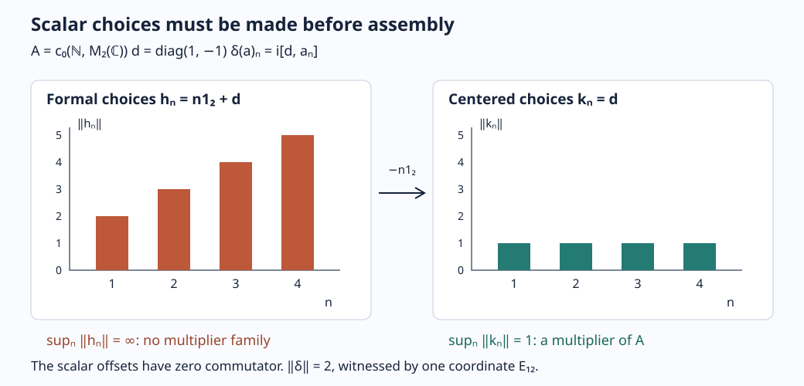
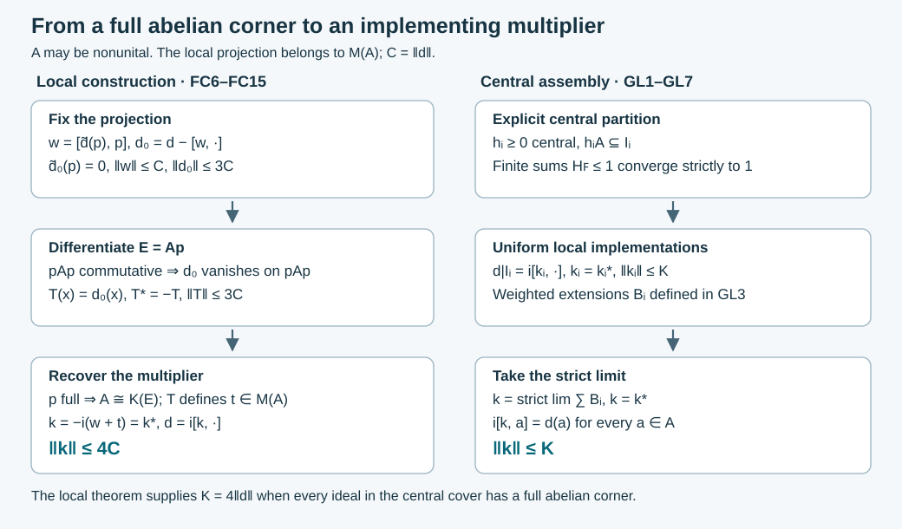
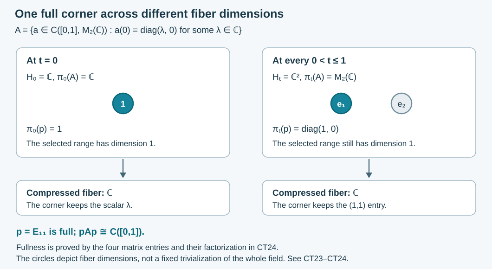
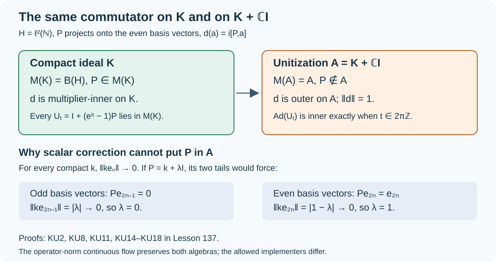
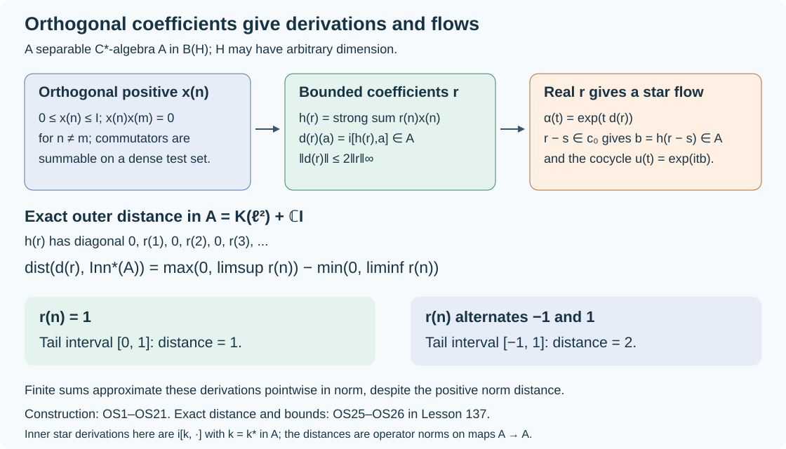

# Multiplier innerness, von Neumann uniformity, analytic measures, and positive energy

Four results close the boundary of Takesaki II, Chapter XI, Section 3. They live in different categories and require different proof routes. A derivation of a simple nonunital C*-algebra is implemented in its multiplier algebra, not necessarily in the algebra itself. Point-norm continuity of a flow upgrades to operator-norm continuity only because the algebra is a von Neumann algebra. The F. and M. Riesz theorem turns a one-sided Fourier condition on a measure into absolute continuity. Finally, a positive external implementation of a von Neumann flow can be replaced by a positive implementation affiliated with the algebra.

For the first, we prove the primitive-extension theorem using the programme’s written bidual and representation foundations and the von Neumann innerness theorem proved here. For the second, we prove the full von Neumann automorphism convergence theorem from orthogonal projections, the programme’s written Phillips lemma and projection theory, and the small-automorphism theorem already proved here. The third is proved from the Poisson kernel and an elementary radial estimate. The fourth is derived from the positive-tail criterion already proved in this course.

*New expression is dedicated under CC0 to the extent of rights held; inherited component terms remain in force.*

## Four targets and their category boundaries

Throughout, a C*-algebra may be nonunital. For such an algebra \(A\), \(M(A)\) denotes its multiplier algebra, realized as the algebra of bounded double centralizers. Every automorphism of a von Neumann algebra preserves the order in both directions, so it preserves each bounded increasing supremum: the image of a least upper bound is again a least upper bound. It is therefore normal by [NF6](OA-FLOW-NF.md#oa-flow.nf.6). For a von Neumann algebra \(M\), a homomorphism

$$\alpha:\mathbb R\longrightarrow\operatorname{Aut}(M) \tag{1}$$

is called point-norm continuous when

$$\|\alpha_t(x)-x\|\longrightarrow0
\qquad(t\longrightarrow0) \tag{2}$$

for each fixed \(x\in M\). Operator-norm continuity means

$$\|\alpha_t-\operatorname{id}_M\|\longrightarrow0. \tag{3}$$

The distinction between (2) and (3) is essential on general C*-algebras: the compact-operator counterexample in lesson 34 satisfies (2) and fails (3).

For the circle \(\mathbb T\), let \(m\) be normalized Haar measure and fix

$$\widehat\mu(n)=\int_{\mathbb T}\zeta^{-n}\,d\mu(\zeta)
\qquad(n\in\mathbb Z). \tag{4}$$

For the positive-energy result, \(M\subset B(K)\) is a faithful normal concrete realization and \(U_t=e^{itH}\) is a strongly continuous unitary group on \(K\).

## Sakai's exact primitive-extension theorem

**Theorem.** If $A\ne0$ is a simple C*-algebra, there is a unital primitive C*-algebra $D$ containing $A$ as an essential two-sided ideal. Every complex derivation of $A$ is implemented by an element of $D$, uniquely modulo scalar multiples of $1_D$. Every derivation of $D$ is inner, and $D$ is unique up to an isomorphism fixing $A$.

In particular,

$$\delta(a)=da-ad\qquad(a\in A),\quad d\in D. \tag{5}$$

This is S. Sakai's [Derivations of simple C*-algebras II](https://www.numdam.org/articles/10.24033/bsmf.1719/), *Bull. Soc. Math. France* 99 (1971), Theorem on printed page 260. The proof uses a maximal quotient, an extreme annihilator and a scalar spectral-evaluation contradiction. Its bounded-derivation input is the von Neumann innerness theorem in [lesson 35](OA-FLOW-L35.md#oa-flow.gi.innerness).

The other operator-algebra prerequisites are actual programme lessons. [Every bounded functional becomes normal in one representation](../../OA-MOD/OA-MOD-UB.html#transfer-of-the-algebra-structure-to-the-banach-bidual), sections 2–8, constructs the C*-bidual, its product and normal extensions. [Functionals as vector coefficients](../../foundations-of-von-neumann-algebras/the-universal-enveloping-von-neumann-algebra-of-a-c-star-algebra-and-w-star-algebras.html#oa-fnd-wa-01), Proposition 1.1(1), gives the norm-additive positive decomposition of a hermitian functional; [Representations, normal extensions and central corners](../../foundations-of-von-neumann-algebras/the-universal-enveloping-von-neumann-algebra-of-a-c-star-algebra-and-w-star-algebras.html#oa-fnd-wa-02), Lemma 2.1, gives the corresponding representation statement. [Pure states and irreducible representations](../../foundations-of-von-neumann-algebras/representations-and-positive-functionals-the-gns-construction-and-the-gelfand-naimark.html), Lemma 8.1 and Theorems 8.3–8.5, gives the commutant Radon–Nikodym lemma and enough irreducible representations. Continuous and spectral functional calculus and approximate-identity nets retain their full nonseparable scopes. The bidual and arbitrary-representation derivation arguments are also written in [GI11–GI12](OA-FLOW-L35.md#oa-flow.gi.bidual). The maximality and norm separation used below are [CF1](OA-FLOW-CF.md#oa-flow.cf.1); the compactness of arbitrary products of discs is proved in [CF4](OA-FLOW-CF.md#oa-flow.cf.4).

### Derivations extend to the bidual and become spatial

Let $\Delta$ preserve star. It is bounded by [lesson 34](OA-FLOW-L34.md#oa-flow.dfd.algebra). Its second adjoint is a normal star derivation of $A^{**}$. To verify the product rule, first hold $a\in A$ fixed and approximate $Y\in A^{**}$ ultraweakly by elements of $A$. Separate ultraweak continuity of multiplication and of $\Delta^{**}$ gives

$$\Delta^{**}(aY)=\Delta(a)Y+a\Delta^{**}(Y).$$

Then hold $Y$ fixed and approximate $X\in A^{**}$ in the same way. This gives the product rule for $XY$. The star identity follows by the same density argument.

Lesson 35 therefore gives a selfadjoint $h\in A^{**}$ with $\Delta^{**}=i[h,\mathord\cdot]$. We now construct the map that carries this implementer into a representation.

Let $\pi:A\to B(K)$ be nondegenerate and put $N=\pi(A)''$. The concrete predual construction in [CP6](../../OA-MOD/OA-MOD-CP.html#the-concrete-predual-and-its-intrinsic-norm) identifies $N$ isometrically with $(N_*)^*$. Composition defines a contraction

$$S_\pi:N_*\longrightarrow A^*,\qquad S_\pi(\rho)=\rho\circ\pi,$$

since $|\rho(\pi(a))|\le\|\rho\|\|a\|$. Its Banach adjoint is thus a contraction

$$\bar\pi=S_\pi^*:A^{**}\longrightarrow N,\qquad
\rho(\bar\pi(X))=X(\rho\circ\pi).$$

This pairing proves ultraweak continuity and gives $\bar\pi(a)=\pi(a)$ for every $a\in A$.

Here is the multiplicativity check. For fixed $a\in A$ and $Y\in A^{**}$, choose a bounded net $b_i\in A$ converging to $Y$ in $\sigma(A^{**},A^*)$, using the bidual density theorem in [GI11](OA-FLOW-L35.md#oa-flow.gi.bidual). The pairing above gives $\pi(b_i)\to\bar\pi(Y)$ ultraweakly. Separate ultraweak continuity of multiplication in the two von Neumann algebras then gives

$$\bar\pi(aY)=\lim_i\pi(ab_i)
             =\pi(a)\bar\pi(Y).$$

Now approximate $X\in A^{**}$ by a bounded net $a_j\in A$ and keep $Y$ fixed. The same argument yields

$$\bar\pi(XY)=\lim_j\bar\pi(a_jY)
             =\bar\pi(X)\bar\pi(Y).$$

All limits here are ultraweak; the order of the two limiting arguments is part of the proof. The involution is ultraweakly continuous, so density also gives $\bar\pi(X^*)=\bar\pi(X)^*$. Moreover $\bar\pi(1)\pi(a)=\pi(a)$ for all $a$. Nondegeneracy makes the span of $\pi(A)K$ dense, hence $\bar\pi(1)=1_K$. Finally, ultraweak density of $A$ proves uniqueness of this normal extension.

In particular $\bar\pi(h)$ is selfadjoint. Applying the product identity to $ha$ and $ah$ gives

$$\pi(\Delta(a))=i[\bar\pi(h),\pi(a)]. \tag{SP.1}$$

There is no assumption that the original derivation is normal in a chosen representation; (SP.1) follows from the bidual first. For a simple nonzero $A$, take a nonzero irreducible representation, which is faithful because its kernel is an ideal. Identify $A$ with this concrete copy. Adding a scalar to the spatial selfadjoint implementer gives $r_0\ge1$ without changing $\Delta=i[r_0,\mathord\cdot]$.

### A maximal quotient with no ideal disjoint from the simple algebra

Put $C_0=C^*(A,r_0)$. This algebra contains the Hilbert-space identity: a continuous function equal to one on the positive spectrum of $r_0$ and zero at zero supplies it in the nonunital functional calculus.

Choose a maximal closed two-sided ideal $J_0$ of $C_0$ with $J_0\cap A=0$. Such an ideal exists by Zorn's lemma. Indeed, each quotient by an ideal disjoint from $A$ is isometric on $A$. If the closure of an increasing chain of these ideals contained an $a\in A$ of norm one, some member would contain a $b$ with $\|a-b\|<1/2$. Its quotient would give $1=\|a+J\|\le\|a-b\|<1/2$, a contradiction.

In $C=C_0/J_0$, the copy of $A$ remains faithful and $r=r_0+J_0\ge1$. Moreover,

$$K\text{ a closed ideal of }C,\quad K\cap A=0
\quad\Longrightarrow\quad K=0. \tag{SP.2}$$

Otherwise the inverse image of $K$ would contradict maximality. At this point $A$ is only a subalgebra of $C$; we have not yet proved it is an ideal. Put $B=A+\mathbb C1_C$, a closed C*-subalgebra, and let $I$ be the closed ideal of $C$ generated by $A$.

Suppose $I\ne A$. Then there is a selfadjoint $s\in I\setminus B$. To see this, if $I\subset B$, the quotient $B/A$ has dimension at most one. Strict containment $A\subsetneq I$ would force $I=B$. Then $1_C\in I$ gives $I=C=B$, in which $A$ is already an ideal, so the ideal it generates is $A$ after all. If $I\not\subset B$, one of the real or imaginary selfadjoint parts of an element outside $B$ is outside $B$.

The hermitian annihilator ball

$$\mathcal S=\{g\in C^*:g=g^*,\ \|g\|\le1,\ g|_B=0\} \tag{SP.3}$$

has an extreme point $g$ with $g(s)>0$. Here are the compactness and extremality details. Hahn–Banach separates $s$ from $B_{\rm sa}$ and gives an element of $\mathcal S$ positive on $s$. The dual unit ball is compact in the pointwise topology: embed it in the product of the discs $\{|z|\le\|x\|\}$, $x\in C$, and note that linearity and the norm inequalities define a closed subset. The hermitian and annihilator constraints are closed as well. Maximizing evaluation at $s$ therefore gives a nonempty compact face with positive maximum. A descending chain of its nonempty closed faces has a nonempty face as its intersection, by compactness. Zorn gives a minimal such face. If it had two distinct functionals, an evaluation on a selfadjoint element would separate them; its maximizing subface would be proper. Thus the minimal face is a point, extreme also in $\mathcal S$. Since $g\ne0$ is extreme in this ball, $\|g\|=1$: otherwise the distinct small radial perturbations $(1\pm\varepsilon)g$ would express it as a midpoint.

### An extreme annihilator forces the coefficient algebra to be a factor

Write $g=g_+-g_-$, where $g_\pm$ are positive and $\|g_+\|+\|g_-\|=1$, and put $\lambda=g_++g_-$. Let $(\pi,H,\xi)$ be the GNS triple of the state $\lambda$. The commutant Radon–Nikodym lemma gives positive contractions $T_\pm\in\pi(C)'$ representing $g_\pm$, with $T_++T_-=1$. Consequently $T=T_+-T_-$ is a selfadjoint contraction and

$$g(x)=\langle\pi(x)T\xi,\xi\rangle,
\qquad \|\xi\|=1. \tag{SP.4}$$

This vector formula gives a normal functional $f$ on $R=\pi(C)''$. Since $g$ vanishes on $B$, $f$ vanishes on $N=\pi(B)''$.

The commutator with the selfadjoint $\pi(r)$ maps $\pi(B)$ into itself. It is ultraweakly continuous, so it maps $N$ into $N$. Apply lesson 35 to the bounded star derivation $i[\pi(r),\mathord\cdot]$ on $N$. There is a selfadjoint $p\in N$ such that

$$q=\pi(r)-p\in N'. \tag{SP.5}$$

Every central projection $e$ of $N$ commutes with $p$, with $q$ and hence with $\pi(r)$. As $C$ is generated by $B$ and $r$, it follows that $e\in Z(R)$.

If $0<e<1$, cyclicity of $\xi$ for $\pi(C)$ gives $0<t=\langle e\xi,\xi\rangle<1$: a central projection killing $\xi$ kills the whole dense cyclic subspace. Define

$$g_e(x)=\langle\pi(x)T e\xi,e\xi\rangle,
\qquad g_{1-e}(x)=\langle\pi(x)T(1-e)\xi,(1-e)\xi\rangle.$$

They are hermitian, their sum is $g$, and their norms are at most $t$ and $1-t$. Because $e$ is central in $N$ and $f|_N=0$, both vanish on $B$. The equality $\|g\|=1$ and the triangle inequality force $\|g_e\|=t$ and $\|g_{1-e}\|=1-t$. Thus

$$g=t\,(g_e/t)+(1-t)\,(g_{1-e}/(1-t))$$

is a convex decomposition in $\mathcal S$. Extremality implies $g_e=tg$. Extend this equality normally to $R$. The functional on its left vanishes on $(1-e)R$, whereas the restriction of $f$ to $(1-e)R$ has norm $1-t>0$, by the preceding vector formula and equality. This contradicts $t>0$. Hence $N$ has no nontrivial central projections. Spectral approximation of central selfadjoint elements now gives

$$N\text{ is a factor}. \tag{SP.6}$$

### Spectral evaluation gives the scalar-shift contradiction

Suppose $\pi(A)\ne0$. Because $A$ is an ideal of $B$, its ultraweak closure is a nonzero ultraweakly closed ideal of the factor $N$, and therefore equals $N$. In particular $\pi|_A$ is a nonzero, hence faithful, representation of the simple algebra.

The selfadjoint $q$ in (SP.5) cannot be scalar. If it were, $\pi(r)\in N$ would imply $R=N$; then $f|_N=0$ would imply $g=0$. Write $X=\sigma(q)$, a compact subset of $\mathbb R$ with at least two points.

We justify evaluation at every $t\in X$ on $C^*(N,q)$. For a finite sum $F(t)=\sum_j a_j u_j(t)$, $a_j\in N$, $u_j\in C(X)$, define $F(q)=\sum_j a_j u_j(q)$. Then

$$\|F(q)\|=\sup_{t\in X}\|F(t)\|. \tag{SP.7}$$

For the upper bound, approximate the finitely many $u_j$ uniformly by step functions on a common finite spectral partition of $q$. The resulting operator is block diagonal, and the norm of a block is at most the norm of its coefficient in $N$. The approximation error is bounded by the sum of the coefficient norms times the scalar errors; letting these errors decrease gives the upper bound.

For the lower bound, fix $t\in X$. A sufficiently small spectral neighborhood $U$ of $t$ has a nonzero spectral projection $e_U$ of $q$. The representation $a\mapsto a|_{e_UH}$ of $N$ is normal because $e_U\in N'$. Its kernel is an ultraweakly closed ideal of the factor $N$; since $e_U\ne0$, the representation is faithful and isometric. Uniform continuity gives

$$\|(F(q)-F(t))e_U\|
\le\sum_j\|a_j\|\sup_{u\in U\cap X}|u_j(u)-u_j(t)|.$$

This can be made arbitrarily small, whereas $\|F(t)e_U\|=\|F(t)\|$. This proves (SP.7). Finite sums of this form are uniformly dense in $C(X,N)$, by uniform continuity and a finite scalar partition of unity on $X$. The map $F\mapsto F(q)$ is therefore an isometric star isomorphism onto $C^*(N,q)$. Evaluation at $t$ is a unital star homomorphism onto $N$.

Since $\pi(B)\subset N$ and $\pi(r)=p+q$, evaluation restricts to a star homomorphism

$$\theta_t:C\longrightarrow N,\qquad
\theta_t(a)=\pi(a)\ (a\in A),\qquad
\theta_t(r)=p+t1. \tag{SP.8}$$

It is faithful on $A$, so its kernel is disjoint from $A$. Property (SP.2) makes $\theta_t$ faithful on all of $C$. Since $r\ge1$, we have $p+t1\ge1$ and

$$\|r\|=\|p+t1\|=\max\sigma(p)+t
\qquad(t\in X). \tag{SP.9}$$

Two different points of $X$ contradict this equality. Thus $\pi(A)=0$.

But then $\pi(I)=0$, since $I$ is the ideal generated by $A$. Formula (SP.4) gives $g(s)=0$, contrary to its choice. The supposition $I\ne A$ was false. We have proved that $A$ is an ideal of $C$, and (SP.2) now makes it an essential ideal. For every star derivation $\Delta$ we have obtained such a unital algebra $C_\Delta$ and a selfadjoint $r_\Delta\ge1$ with $\Delta=i[r_\Delta,\mathord\cdot]$.

### Assemble all implementers in one primitive algebra

Fix one faithful irreducible representation $\rho$ of $A$ on $K$. A nondegenerate representation of an ideal extends to its ambient algebra. For completeness, if $A$ is an ideal of $E$ and $(e_j)$ is a contractive approximate-identity net of $A$, the uniformly bounded operators $\rho(c e_j)$, $c\in E$, converge strongly: on the dense subspace spanned by $\rho(a)\eta$ they converge to $\rho(ca)\eta$. Their strong limit $\widetilde\rho(c)$ satisfies

$$\widetilde\rho(c)\rho(a)\eta=\rho(ca)\eta. \tag{SP.10}$$

This identity proves multiplication. Testing the inner product on two vectors from the dense subspace proves the adjoint identity, and $1_E$ acts as $1_K$. The extension is unique. If $\rho$ is faithful and $A$ is essential in $E$, its kernel is zero, since an element of the kernel annihilates $A$.

Apply this to each $C_\Delta$ and write $R_\Delta=\widetilde\rho(r_\Delta)$. Each $R_\Delta$ multiplies $\rho(A)$ into itself on both sides. Hence

$$D=C^*(\rho(A),1_K,\{R_\Delta:\Delta\text{ a star derivation of }A\}) \tag{SP.11}$$

contains $\rho(A)$ as an ideal: products and sums of generators preserve that property, as do norm limits. It is primitive because it contains the irreducibly acting $\rho(A)$. That ideal is essential, since an operator annihilating $\rho(A)$ annihilates its dense nondegenerate range.

Every complex derivation is a complex linear combination of two star derivations. Explicitly, for $\delta^\sharp(a)=\delta(a^*)^*$, the maps $(\delta+\delta^\sharp)/2$ and $(\delta-\delta^\sharp)/(2i)$ preserve star. Thus the corresponding linear combination of $iR_\Delta$ implements $\delta$ in $D$. Two implementers differ by an operator commuting with the irreducible algebra $\rho(A)$. Each selfadjoint part of such an operator has spectral projections commuting with $\rho(A)$; irreducibility makes their ranges zero or the whole space. Spectral approximation makes each selfadjoint part scalar, and hence their complex combination is scalar.

Let $\varepsilon$ be a derivation of $D$. It preserves $A$: for $a\in A_+$,

$$\varepsilon(a)=\varepsilon(a^{1/2})a^{1/2}
+a^{1/2}\varepsilon(a^{1/2})\in A,$$

and positive elements span $A$. Its restriction therefore has an implementer $d\in D$. The derivation $\eta=\varepsilon-[d,\mathord\cdot]$ vanishes on $A$. For $x\in D$ and $a\in A$,

$$\eta(x)a=\eta(xa)-x\eta(a)=0.$$

Nondegeneracy of $A$ forces $\eta(x)=0$. Hence every derivation of $D$ is inner.

### Uniqueness of the derived algebra

If $D'$ is another unital primitive algebra satisfying the theorem's implementer clauses, $A$ is essential in $D'$. Indeed, in a faithful irreducible representation of $D'$, the nonzero subspace generated by $A$ is the whole space. An ideal disjoint from $A$ annihilates that subspace and is zero. Formula (SP.10) therefore extends the fixed $\rho$ faithfully to $D'$.

For $c\in D'$, its commutator on $A$ has an implementer $d\in D$, so $\widetilde\rho(c)-d$ commutes with $\rho(A)$ and is scalar. Thus $\widetilde\rho(D')\subset D$. Conversely, each star derivation $\Delta$ has an implementer in $D'$; its image differs from $iR_\Delta$ by a scalar. Together with $A$ and the unit, these elements generate $D$, so $D\subset\widetilde\rho(D')$. This proves the required isomorphism fixing $A$. It is unique: two extensions of the identity on $A$ agree after multiplication by every $a\in A$, and essentiality removes their difference. The theorem is proved without a separability or countable-approximate-identity assumption.

## An essential ideal embeds its ambient algebra in the multiplier algebra

Let \(A\) be a closed two-sided essential ideal of a C*-algebra \(D\). For \(d\in D\), define

$$L_d(a)=da,\qquad R_d(a)=ad\qquad(a\in A). \tag{6}$$

These maps are bounded and satisfy the double-centralizer identities

$$L_d(ab)=L_d(a)b,\qquad
R_d(ab)=aR_d(b),\qquad
aL_d(b)=R_d(a)b. \tag{7}$$

Thus

$$\iota:D\longrightarrow M(A),\qquad
\iota(d)=(L_d,R_d), \tag{8}$$

is a star homomorphism, unital when \(D\) is unital. It extends the canonical copy of \(A\): if \(d=a\in A\), then \(\iota(a)\) is left and right multiplication by \(a\).

It remains to check injectivity. If \(\iota(d)=0\), then \(dA=Ad=0\). The closed ideal generated by \(d^*d\) is orthogonal to \(A\). Essentiality forces that ideal to be zero, so \(d^*d=0\) and \(d=0\). Hence

$$D\hookrightarrow M(A) \quad\text{faithfully}. \tag{9}$$

This argument is valid without a countable approximate identity, separability, or unitality of \(A\).

We also need the faithful represented meaning of a general multiplier. Fix a faithful nondegenerate representation \(\rho:A\to B(K)\), and a contractive approximate-identity net \((e_j)\). If \((L,R)\) is a bounded double centralizer, the operators \(\rho(L(e_j))\) have norm at most \(\|L\|\). On the dense vectors \(\rho(a)\xi\), the identity \(L(e_j)a=L(e_ja)\) shows that they converge to \(\rho(L(a))\xi\). Their common bound extends the limit to every vector. Denote the resulting bounded operator by \(T\). Then
\[
 T\rho(a)=\rho(L(a)),\qquad
 \rho(a)T=\rho(R(a)).
 \tag{MP1}
\]
The second identity follows from \(aL(e_j)=R(a)e_j\). These identities make the map multiplicative and unique. For the adjoint, compatibility gives \(b^*L(a)=R(b^*)a\); testing scalar inner products on \(\rho(A)K\) yields
\[
 T^*\rho(b)=\rho(R(b^*)^*).
 \tag{MP2}
\]
This is precisely the double-centralizer adjoint. If \(T=0\), faithfulness of \(\rho\) gives \(L=R=0\); the representation is therefore faithful. Its norm equals \(\|L\|\): the construction gives \(\|T\|\le\|L\|\), while (MP1) and isometry of \(\rho\) give the reverse inequality. The usual unit multiplier acts as \(1_K\).

For \(A=K(K)\) in its defining representation, every bounded \(T\) preserves the compact operators on both sides. This follows first for finite-rank operators and then for their norm closure. Hence every \(T\in B(K)\) gives a double centralizer, and (MP1) proves
\[
 M(K(K))=B(K)
 \tag{MP3}
\]
with no dimension restriction. An operator commuting with all rank-one operators is scalar: it leaves each one-dimensional range invariant, and comparison on \(v,w,v+w\), for independent vectors \(v,w\), makes their eigenvalues equal. For a general irreducible representation, the scalar-commutant assertion follows separately from spectral projections. If a selfadjoint operator commutes with the represented algebra, each of its spectral projections does too. Its range and orthogonal complement are invariant, so irreducibility makes each such projection zero or one. Spectral approximation makes the selfadjoint operator scalar. Applying this to the real and imaginary parts proves that every commuting operator is scalar; no rank-one operator is assumed to belong to the represented algebra.

If \(A\) itself is unital, its unit is the ambient unit in every essential unital extension: their difference annihilates \(A\), so essentiality makes it zero. Since \(A\) is an ideal, this forces \(D=A=M(A)\). Thus the theorem includes the statement that all derivations of a unital simple algebra are inner in the algebra itself.

## Simple C*-algebra derivations are multiplier-inner

Let \(A\ne0\) be simple and let \(\delta:A\to A\) be any complex derivation. Apply Sakai's theorem to obtain \(D\) and \(d\in D\) satisfying (5). The preceding irreducible-representation argument makes \(A\) essential in \(D\), so (8)–(9) send \(d\) to a multiplier \(h=\iota(d)\). Because \(\iota\) is the identity on \(A\),

$$\boxed{\delta(a)=ha-ah\qquad(a\in A),\quad h\in M(A).} \tag{10}$$

If \(\delta\) preserves star, the usual adjoint calculation shows that \(h+h^*\) commutes with \(A\). A faithful irreducible representation of the simple algebra extends to \(M(A)\), so a multiplier commuting with \(A\) is scalar. Subtracting half that scalar makes the implementer skew adjoint; equivalently,

$$\delta(a)=i[k,a]\qquad(k=k^*\in M(A)). \tag{11}$$

The location \(M(A)\) is sharp. For \(A=K(\mathcal H)\) with \(\mathcal H\) infinite dimensional, \(M(A)=B(\mathcal H)\). Choose a bounded selfadjoint
\(k\notin K(\mathcal H)+\mathbb C1\), for example a projection of infinite rank and infinite corank. The projection cannot differ from a scalar by a compact operator: choose orthonormal sequences in its range and kernel. A compact operator sends either sequence to zero in norm, because a finite-rank approximation does so and its norm error is uniform. The two sequences would respectively force the scalar to be \(1\) and \(0\). Then \(i[k,\mathord\cdot]\) is a derivation of \(K(\mathcal H)\). If a compact operator implemented the same derivation, its difference from \(ik\) would commute with every compact operator and hence would be scalar, contradicting the choice of \(k\). Thus this derivation has no implementer in \(K(\mathcal H)\).

## Uniform continuity of von Neumann actions

We prove the sequential automorphism theorem needed for the flow, at arbitrary von Neumann algebra scope:

$$
\forall x\in M,\quad \|\beta_n(x)-x\|\longrightarrow0
\quad\Longrightarrow\quad
\|\beta_n-\operatorname{id}_M\|\longrightarrow0,
\qquad \beta_n\in\operatorname{Aut}(M).
\tag{UW.1}
$$

The argument uses three already written programme results. [Phillips's lemma and Schur's theorem](../../foundations-of-von-neumann-algebras/polar-decomposition-of-functionals-and-weak-compactness-in-preduals.html#oa-fnd-pd-12), Lemma 7.1, applies to a bounded sequence of functionals on $\ell^\infty(\Gamma)$ which tends to zero on every indicator function; it concludes that the sum of the absolute values on the individual coordinates tends to zero. [Homogeneous algebras and the structure of type I algebras](../../foundations-of-von-neumann-algebras/projections-and-types-of-von-neumann-algebras.html#oa-fnd-ty-14), Theorem 10.3, supplies the central homogeneous matrix decomposition. [Orthogonal families of equivalent projections, and halving](../../foundations-of-von-neumann-algebras/projections-and-types-of-von-neumann-algebras.html#oa-fnd-ty-17), Propositions 13.3–13.4 and Corollary 13.5, supplies equal halves outside type I and countably many copies of a properly infinite unit. These are exact existing prerequisite lessons, with their stated arbitrary-cardinality hypotheses. We derive all the convergence and finite-cover estimates used here.

### Orthogonal projections cannot carry persistent errors

Write $T_n=\beta_n-\operatorname{id}_M$. Then $\|T_n\|\le2$. Suppose $(f_j)$ is an orthogonal sequence of projections and $n_j$ increases to infinity. We claim

$$\|T_{n_j}(f_j)\|\longrightarrow0. \tag{UW.2}$$

Otherwise pass to a subsequence for which these norms exceed some $\varepsilon>0$. Choose functionals $\omega_j\in M^*$ with $\|\omega_j\|\le1$ and

$$|\omega_j(T_{n_j}(f_j))|>\varepsilon/2.$$

For a bounded scalar sequence $a$, the strong sum $\rho(a)=\sum_j a_jf_j$ exists and defines a contractive star homomorphism $\ell^\infty(\mathbb N)\to M$. To see existence, the orthogonal subspaces $f_jK$ give a bounded diagonal operator of norm at most $\sup_j|a_j|$ on their sum, extended by zero on its orthogonal complement; finite partial sums converge strongly to this operator, so it belongs to $M$. Define

$$\mu_j(a)=\omega_j(T_{n_j}(\rho(a))).$$

These functionals have norm at most two. For every subset $E\subseteq\mathbb N$, $\rho(1_E)$ is one fixed projection in $M$, and point-norm convergence gives $\mu_j(1_E)\to0$. Phillips's lemma therefore gives $\sum_i|\mu_j(1_{\{i\}})|\to0$. Its $i=j$ term is greater than $\varepsilon/2$, a contradiction. This proves (UW.2). The functionals need not be normal: no interchange of a functional with an infinite projection sum was used.

There is also a uniform consequence for orthogonal *corners*. If $(p_k)$ is an orthogonal sequence, put

$$d_k=\limsup_{n\to\infty}\|T_n|_{p_kMp_k}\|. \tag{UW.3}$$

Then $d_k\to0$. Indeed a bounded linear map $T$ on a von Neumann corner satisfies

$$\|T\|\le4\sup\{\|T(e)\|:e\text{ is a projection in the corner}\}. \tag{UW.4}$$

For a positive contraction $x$, its spectral step approximants are positive combinations of spectral projections with coefficient sum at most one: for example $m^{-1}\sum_{j=1}^{m}1_{[j/m,1]}(x)$ differs from $x$ by at most $1/m$. Thus the projection supremum bounds $\|T(x)\|$. Split a selfadjoint contraction into its positive and negative parts, and then split an arbitrary contraction into its real and imaginary parts, to obtain the factor four. If $d_k\not\to0$, choose distinct increasing $k_j$ with $d_{k_j}\ge\varepsilon$, increasing $n_j$, and projections $f_j\le p_{k_j}$ with $\|T_{n_j}(f_j)\|>\varepsilon/8$, using (UW.4). These $f_j$ are orthogonal, contradicting (UW.2).

### The action on the centre eventually becomes the identity

First consider an abelian von Neumann algebra $B$ and point-norm convergent automorphisms $\gamma_n\to\operatorname{id}_B$. For each projection $r$, $\gamma_n(r)=r$ eventually: distinct commuting projections have distance one. We show that $\gamma_n$ is the identity on all of $B$ eventually.

Suppose it is not. Starting with $r_0=1$, maintain a projection $r_j$ on whose corner infinitely many $\gamma_n$ act nontrivially. Choose $n_j$ greater than the preceding indices, with $\gamma_{n_j}(r_{j-1})=r_{j-1}$ and nontrivial action on $r_{j-1}B$. Since spectral step functions span that corner densely, choose $e\le r_{j-1}$ with $\gamma_{n_j}(e)\ne e$. The complementary projection $r_{j-1}-e$ is also changed by $\gamma_{n_j}$.

For sufficiently large $n$, both $e$ and $r_{j-1}-e$ are fixed. At least one of their corners still has nontrivial action for infinitely many $n$; otherwise the action on $r_{j-1}B$, the direct sum of these two corners, would eventually be the identity. Retain such a corner as $r_j$ and denote the discarded projection by $f_j$. Then $(f_j)$ is orthogonal and $\|\gamma_{n_j}(f_j)-f_j\|=1$. Applying (UW.2), whose proof only required point-norm convergence and boundedness, gives a contradiction.

Apply this result to $B=Z(M)$ and $\gamma_n=\beta_n|_{Z(M)}$. After discarding finitely many indices we may therefore assume

$$\beta_n(z)=z\qquad(z\in Z(M),\ n\ge1). \tag{UW.5}$$

In particular all the central summands used next are invariant. No faithful normal state or countability condition on the centre is required.

### Small corner errors give a cover-independent bound

Let $p\le q$ be projections, with $q$ central, and suppose that $q$ is a finite sum of orthogonal projections $q_i=v_iv_i^*$, where

$$v_i^*v_i=a_i\le p. \tag{UW.6}$$

The number of $v_i$ is fixed in this paragraph. Assume (UW.5) and put $d=\limsup_n\|T_n|_{pMp}\|$. We prove

$$d<\tfrac14\quad\Longrightarrow\quad
\limsup_n\|T_n|_{qMq}\|\le4d. \tag{UW.7}$$

The constant does not depend on the number of covering projections. This independence is needed when the matrix sizes are unbounded.

If $p=0$, (UW.6) forces $q=0$ and the assertion is immediate. Assume $p\ne0$ in the construction that follows.

Because $\beta_n(p)\to p$ in norm, put

$$b_n=\beta_n(p)p+(q-\beta_n(p))(q-p)\in qMq.$$

It satisfies $\|b_n-q\|=\|\beta_n(p)-p\|\to0$ and $b_np=\beta_n(p)b_n$. For large $n$, $b_n$ is invertible in $qMq$. Its polar unitary $s_n=b_n(b_n^*b_n)^{-1/2}$ tends to $q$ in norm, by continuous functional calculus. Moreover $b_n^*b_n$ commutes with $p$, so $s_nps_n^*=\beta_n(p)$. Extend $s_n$ by $1-q$ and set

$$\eta_n=\operatorname{Ad}(s_n^*+1-q)\circ\beta_n.$$

Then $\eta_n(p)=p$, $\eta_n(q)=q$, and $\|\eta_n-\beta_n\|\to0$. The restriction $\eta_n|_{pMp}$ is an automorphism and has norm distance $c_n$ from the identity with $\limsup_n c_n=d$.

For large $n$, $c_n<1/2$. [Principal logarithms and small automorphisms](OA-FLOW-L135.md) proves that its principal logarithm is a bounded star derivation. The norm-convergent series for the logarithm gives

$$
\|\operatorname{Log}(\eta_n|_{pMp})\|
\le\sum_{j\ge1}\frac{c_n^j}{j}
=-\log(1-c_n)\le2c_n.
\tag{UW.8}
$$

[General innerness](OA-FLOW-L35.md#oa-flow.gi.innerness), including its normalized implementer bound, supplies $h_n=h_n^*\in pMp$ of norm at most $2c_n$ with this derivation equal to $i[h_n,\cdot]$. Hence $w_n=e^{ih_n}$ implements $\eta_n$ on $pMp$ and $\|w_n-p\|\le2c_n$. The exponential is taken in the corner with unit $p$.

Define

$$u_n=\sum_i\eta_n(v_i)w_nv_i^*\in qMq. \tag{UW.9}$$

The final projections $\eta_n(q_i)$ are orthogonal, as are the $q_i$. Since $\eta_n(a_i)=w_na_iw_n^*$, multiplication gives

$$u_n^*u_n=\sum_i v_iw_n^*\eta_n(a_i)w_nv_i^*=q,
\qquad
u_nu_n^*=\sum_i\eta_n(q_i)=q.$$

For $x\in qMq$, expand $x=\sum_{i,j}v_i(v_i^*xv_j)v_j^*$. The middle entries lie in $a_iMa_j\subset pMp$. Applying $\operatorname{Ad}u_n$ to this expansion shows that it equals $\eta_n(x)$, because $w_n$ implements $\eta_n$ on every middle entry. Thus $u_n$ implements $\eta_n$ throughout $qMq$.

Finally,

$$u_n-q
=\sum_i(\eta_n(v_i)-v_i)w_nv_i^*
+\sum_i v_i(w_n-p)v_i^*. \tag{UW.10}$$

The first sum tends to zero in norm: it is finite, the $v_i$ are fixed, and $\eta_n(v_i)\to v_i$. The second sum is block diagonal on the mutually orthogonal $q_i$, and every block has norm at most $\|w_n-p\|$. Its norm is therefore at most $2c_n$, with no factor equal to the number of blocks. The elementary bound $\|\operatorname{Ad}u_n-\operatorname{id}\|\le2\|u_n-q\|$, followed by $\|\eta_n-\beta_n\|\to0$, proves (UW.7).

The small-automorphism and bounded-derivation theorems used here do not assume the point-norm upgrade being proved: the former starts from an operator-norm inequality, and the latter starts from an already bounded derivation and its norm-continuous exponential. Thus the argument is not circular.

### Orthogonal corners covering the large matrix summands

Use the existing projection and type results to write $M$ as the central sum of its part $M_c$ with no type I summand, its properly infinite type I part $M_\infty$, and its finite homogeneous parts

$$M_m\cong M_m(Z_m),\qquad m=1,2,\ldots, \tag{UW.11}$$

where $Z_m$ is abelian and zero summands are allowed. Write their central units as $z_c,z_\infty,z_m$.

In $M_c$, repeatedly halve the unused projection. This gives orthogonal $p_k^c$, $k\ge1$, such that $z_c$ is the sum of $2^k$ projections equivalent to $p_k^c$: after the $k$th halving, its two equal halves can be transported into each of the $2^{k-1}$ equal pieces obtained at the preceding stage. In $M_\infty$, division of the properly infinite unit by $\aleph_0$ gives orthogonal $p_k^\infty\sim z_\infty$.

In $M_m(Z_m)$ choose fixed standard matrix units. For $k\ge1$ set $N_k=2^{k+1}$ and let $p_k^{(m)}$ be a diagonal projection of rank

$$r_k(m)=\lfloor m/N_k\rfloor.$$

Choose its diagonal slots just after all the slots used at earlier stages. This is possible because $\sum_{k\ge1}r_k(m)\le m/2$. These projections are orthogonal as $k$ varies. If $m\ge N_k$, then $r_k(m)\ge m/(2N_k)$, so the $m$ diagonal slots can be partitioned into at most $2N_k$ groups of size at most $r_k(m)$. Each group's projection is equivalent, by a fixed matrix partial isometry, to a subprojection of $p_k^{(m)}$.

Now form the strong central sums

$$
p_k=p_k^c+p_k^\infty+\sum_{m\ge N_k}p_k^{(m)},
\qquad
q_k=z_c+z_\infty+\sum_{m\ge N_k}z_m.
\tag{UW.12}
$$

The $p_k$ are orthogonal. For each fixed $k$, $q_k$ is a sum of at most $2N_k$ orthogonal projections equivalent to subprojections of $p_k$. To assemble the partial isometries, pad the finite lists on each central summand by zeros and take their strong sums across the orthogonal central units. These sums are bounded by one, their initial and final projections are the corresponding strong sums, and they belong to $M$. Thus (UW.6) holds exactly, even with arbitrary multiplicities and a non-countably decomposable $M$.

### Completing the sequential theorem and the flow implication

Let $d_k$ be (UW.3) for these $p_k$. We proved $d_k\to0$. For every sufficiently large $k$, (UW.7) gives

$$\limsup_n\|T_n|_{q_kMq_k}\|\le4d_k. \tag{UW.13}$$

The complementary algebra has only finitely many finite homogeneous sizes $m<N_k$. On each of them, (UW.5) makes $\beta_n$ linear over $Z_m$. Writing $x=\sum_{i,j}a_{ij}E_{ij}$ with $a_{ij}\in Z_m$ and $\|a_{ij}\|\le\|x\|$ gives

$$\|T_n|_{M_m(Z_m)}\|
\le m^2\max_{i,j}\|\beta_n(E_{ij})-E_{ij}\|
\longrightarrow0. \tag{UW.14}$$

There are finitely many such summands, so $\|T_n|_{(1-q_k)M}\|\to0$. Since $q_k$ is central and fixed, $T_n$ preserves the two central blocks and its norm is the maximum of the two restricted norms. Consequently $\limsup_n\|T_n\|\le4d_k$ for every sufficiently large $k$. Letting $k\to\infty$ proves (UW.1). If $M$ has only bounded finite homogeneous sizes, the same conclusion follows directly from (UW.14); zero $p_k$ and $q_k$ present no exception.

For the real flow, failure of (3) would give $\varepsilon>0$ and a sequence $t_n\to0$ with $\|\alpha_{t_n}-\operatorname{id}_M\|\ge\varepsilon$. Condition (2) says that the automorphisms $\beta_n=\alpha_{t_n}$ converge pointwise in norm. Applying (UW.1) is a contradiction. We have therefore proved

$$
\bigl[\ \forall x\in M,\ \|\alpha_t(x)-x\|\to0\ \bigr]
\quad\Longrightarrow\quad
\|\alpha_t-\operatorname{id}_M\|\to0. \tag{12}
$$

This is a sequential argument for the first-countable real parameter. It introduces no factor, separability, sigma-finiteness or faithful-state hypothesis. The uniform boundedness principle alone would only bound the already isometric $\alpha_t$; the orthogonal-projection and cover-independent estimates supply the decay.

Kallman's 1969 and 1970 work gives the historical flow result, as credited in Takesaki's notes. Elliott's [On the convergence of a sequence of completely positive maps to the identity](https://doi.org/10.1017/S1446788700001439), Theorem 1, printed page 341, proves a stronger statement for completely positive maps on AW* algebras and their quotients. That stronger theorem is research context here; the proof above supplies the full von Neumann automorphism statement actually used in (12), through the programme's written prerequisites. It does not claim a proof for general completely positive maps, AW* algebras or their quotients.

### A matrix-product example shows why the von Neumann hypothesis matters

Let $M=\prod_{m\ge2}M_m(\mathbb C)$, the algebra of bounded matrix families. Define $\theta_n$ to act only on the $n$th factor, $n\ge2$, by conjugation with $\operatorname{diag}(-1,1,\ldots,1)$. Its norm distance from the identity is two: the matrix unit $E_{12}$ in that factor is sent to $-E_{12}$, and two is the general upper bound for the difference of isometries. The bounded family $x=(E_{12}^{(m)})_{m\ge2}$ lies in $M$ and satisfies $\|\theta_n(x)-x\|=2$ for every $n$. Thus this sequence cannot satisfy the point-norm hypothesis of (UW.1).

On the C*-algebra $A=\bigoplus_{m\ge2}^{c_0}M_m(\mathbb C)$, the same automorphisms do converge pointwise in norm: $\|\theta_n(a)-a\|\le2\|a_n\|\to0$ for each $a\in A$. They still have norm distance two from the identity. The test family $x$ belongs to the von Neumann product and is excluded from the $c_0$ sum; it detects precisely the error that point-norm convergence on the smaller algebra misses. This gives a finite-matrix counterpart of the compact-operator example from lesson 34.

## Uniform continuity gives a bounded internal generator

Regard \(\alpha_t\) as a group of isometries of the Banach space \(M\). By (12) it is operator-norm continuous. The [uniform-flow theorem in lesson 34](OA-FLOW-L34.md#oa-flow.dfd.implementation) therefore gives a bounded star derivation

$$d(x)=\lim_{t\to0}\frac{\alpha_t(x)-x}{t},
\qquad
\alpha_t=e^{td}. \tag{13}$$

The [general von Neumann innerness theorem in lesson 35](OA-FLOW-L35.md#oa-flow.gi.innerness) supplies a bounded selfadjoint \(h\in M\) such that

$$d(x)=i[h,x]. \tag{14}$$

The commuting left-right exponential calculation then yields

$$e^{td}(x)=e^{ith}xe^{-ith}. \tag{15}$$

Consequently

$$\boxed{\alpha_t=\operatorname{Ad}(e^{ith}),\qquad h=h^*\in M,} \tag{16}$$

and

$$\|\alpha_t-\operatorname{id}_M\|
\le e^{|t|\|d\|}-1\longrightarrow0. \tag{17}$$

Thus the conclusion includes both assertions in Exercise XI.3.6. It does not say that a merely point-ultraweakly continuous flow has a bounded generator; modular automorphism groups provide the central reason to keep that distinction.

## The analytic ingredients for the radial estimate

We use “analytic” to mean locally represented by a convergent complex power series. Such series have continuous derivatives, by uniform convergence of the differentiated series on smaller discs. Here are the disc facts needed below, with their proofs.

**Taylor expansion throughout a disc.** If \(f\) is analytic on \(|z|<R_0\), fix \(R<R_0\). For \(|w|<R\), the function
\[
 h(z)=\frac{f(z)-f(w)}{z-w}
\]
extends analytically at \(w\), by its local series. The circle-mean calculation in [CF2](OA-FLOW-CF.md#oa-flow.cf.2), applied to \(zh(z)\), gives \(\int_{|z|=R}h(z)\,dz=0\). The geometric expansion of \(1/(z-w)\) on that circle has integral \(2\pi i\). Consequently
\[
 f(w)=\frac{1}{2\pi i}\int_{|z|=R}\frac{f(z)}{z-w}\,dz
      =\sum_{n\ge0}c_nw^n,\qquad
 c_n=\frac{1}{2\pi i}\int_{|z|=R}\frac{f(z)}{z^{n+1}}\,dz.
 \tag{AN1}
\]
The geometric series is uniformly convergent for \(|w|\le r<R\), which licenses its integration. If \(M_R=\max_{|z|=R}|f(z)|\), then \(|c_n|\le M_RR^{-n}\). Thus the resulting Taylor series and its differentiated series converge uniformly on each smaller closed disc. Local uniqueness of coefficients identifies the expansions for different \(R\).

**Zeros and analytic square roots.** The first nonzero coefficient of a local Taylor series factors a zero as \((z-a)^m\) times a nonvanishing analytic function. If zeros accumulate at an interior point, all its coefficients vanish, and the function vanishes in a neighborhood. The set where it vanishes in a neighborhood is both open and closed in the disc: at a limit point, either that point already belongs to the set or accumulating zeros force the same local conclusion. The disc is connected by line segments. Hence a nonzero analytic function has isolated zeros and only finitely many zeros in a compact subdisc.

If \(F\) is zero-free on a disc, \(F'/F\) is analytic there: the reciprocal is locally given by a geometric series. Expand \(F'/F\) at zero by (AN1), integrate its coefficients, and call the primitive \(H\), normalized by \(H(0)=0\). Termwise differentiation gives \(H'=F'/F\), so \((Fe^{-H})'=0\). Restricting to line segments and using the real fundamental theorem from [CF1](OA-FLOW-CF.md#oa-flow.cf.1) gives \(Fe^{-H}=F(0)\). Choose a scalar \(c\) with \(c^2=F(0)\). Then
\[
 c\,e^{H/2}
 \tag{AN2}
\]
is an analytic square root of \(F\) throughout the disc.

**A finite product removes exactly the interior zeros.** For \(0<\rho<1\) and a zero \(a\) with \(|a|<\rho\), put
\[
 B_a(z)=\frac{\rho(z-a)}{\rho^2-\overline a z}.
 \tag{AN3}
\]
Its denominator has no zero on the closed \(\rho\)-disc, and
\[
 |\rho^2-\overline a z|^2-\rho^2|z-a|^2
    =(\rho^2-|a|^2)(\rho^2-|z|^2).
 \tag{AN4}
\]
Thus \(|B_a|\le1\) there and equals \(1\) on the boundary. If \(f\) has no zero on that boundary, multiply one factor for each interior zero, with its multiplicity; there are finitely many. The quotient \(F=f/B\) has removable singularities at precisely those zeros and no remaining zero on the closed disc. Compactness and continuity give a slightly larger disc on which the quotient is analytic and zero-free. Formula (AN2) applies on that disc. The empty product is \(1\).

Finally, normalized arc measure satisfies
\(\int_{\mathbb T}\zeta^n\overline{\zeta^m}\,dm=\delta_{nm}\), by integrating \(e^{i(n-m)t}\) on \([0,2\pi]\). Applying this to finite partial sums, then using uniform convergence from (AN1), proves the power-series \(L^2\) identities used next. All radii in the next proof lie strictly inside the analyticity disc.

## An elementary radial estimate for analytic functions

For an analytic function \(f\) on the unit disc write

$$f_r(\zeta)=f(r\zeta),\qquad
N(r)=\|f_r\|_{L^1(\mathbb T,m)}. \tag{18}$$

We prove the estimate

$$\boxed{
\|f_\rho-f_r\|_1
\le2\sqrt{N(\rho)^2-N(r)^2}
\qquad(0\le r\le\rho<1).
} \tag{19}$$

If \(\rho=0\), then \(r=0\) and both sides of (19) vanish. The zero function also gives the inequality immediately. Assume henceforth that \(f\ne0\) and \(\rho>0\). First suppose that \(f\) has no zero on \(|z|=\rho\). Take the finite Blaschke product \(B\) constructed in (AN3)–(AN4) for the zeros of \(f\) in the disc of radius \(\rho\), normalized so that

$$|B(z)|=1\quad(|z|=\rho),\qquad
|B(z)|\le1\quad(|z|\le\rho). \tag{20}$$

Then \(F=f/B\) is analytic and zero-free on a neighborhood of the closed \(\rho\)-disc. It has an analytic square root there. Put

$$g=B F^{1/2},\qquad h=F^{1/2},\qquad f=gh. \tag{21}$$

On the outer circle,

$$\|g_\rho\|_2^2=\|h_\rho\|_2^2=N(\rho). \tag{22}$$

Write \(a=\|g_r\|_2\), \(b=\|h_r\|_2\), and \(c=N(\rho)^{1/2}\). The power-series orthogonality identity gives

$$\|g_\rho-g_r\|_2^2
\le c^2-a^2,\qquad
\|h_\rho-h_r\|_2^2
\le c^2-b^2. \tag{23}$$

Indeed, term by term,

$$(\rho^n-r^n)^2\le\rho^{2n}-r^{2n}. \tag{24}$$

The factorization and Cauchy–Schwarz now give

$$
\begin{aligned}
\|f_\rho-f_r\|_1
&\le\|(g_\rho-g_r)h_\rho\|_1
  +\|g_r(h_\rho-h_r)\|_1\\
&\le c\sqrt{c^2-a^2}+a\sqrt{c^2-b^2}. 
\end{aligned} \tag{25}
$$

Moreover \(N(r)\le ab\), while \(a,b\le c\). Each summand in (25) is at most

$$\sqrt{c^4-a^2b^2}
\le\sqrt{N(\rho)^2-N(r)^2}. \tag{26}$$

This proves (19), and also proves \(N(r)\le N(\rho)\). If \(f\) has a zero on the circle of radius \(\rho\), approximate \(\rho\) by radii avoiding the discrete zero set and pass to the limit by continuity. The case \(f=0\) is immediate.

The finite-Blaschke proof of (19) is included so that no Fatou boundary theorem or inner-outer factorization theorem is hidden in the next argument.

## The F. and M. Riesz theorem

Let \(\mu\) be a finite complex Borel measure on \(\mathbb T\) satisfying

$$\widehat\mu(n)=0\qquad(n<0). \tag{27}$$

The Poisson kernel is

$$P_r(\zeta)=\sum_{n\in\mathbb Z}r^{|n|}\zeta^n
=\frac{1-r^2}{|1-r\zeta|^2}. \tag{28}$$

Define

$$f_r(\zeta)
=\int_{\mathbb T}P_r(\zeta\overline\eta)\,d\mu(\eta). \tag{29}$$

Condition (27) removes every negative Fourier term, so these are the radial values of the analytic function

$$f(z)=\sum_{n=0}^\infty\widehat\mu(n)z^n. \tag{30}$$

Positivity and unit mass of \(P_r\), followed by Fubini, give

$$\|f_r\|_1\le\|\mu\|_{\mathrm{TV}}. \tag{31}$$

The increasing function \(N(r)=\|f_r\|_1\) therefore has a finite limit as \(r\uparrow1\). Estimate (19) shows that \((f_r)\) is Cauchy in \(L^1(\mathbb T)\): if \(r,\rho\) are close to one, the difference \(N(\rho)^2-N(r)^2\) is small. Let

$$f_r\longrightarrow f^*\quad\text{in }L^1(\mathbb T). \tag{32}$$

The approximate-identity assertion also follows directly from (28). The geometric series proves that formula and its uniform absolute convergence for \(r<1\). Its constant Fourier coefficient is \(1\), so its integral is \(1\), and the displayed quotient makes it nonnegative. Fix \(\delta>0\). When \(|1-\zeta|\ge\delta\) and \(1-r<\delta/2\),
\[
 |1-r\zeta|\ge\delta/2,\qquad
 0\le P_r(\zeta)\le4(1-r^2)/\delta^2.
 \tag{AN5}
\]
For continuous \(\varphi\), split its convolution difference into \(|1-\zeta|<\delta\) and the complement. Unit mass bounds the first part by the uniform modulus of continuity of \(\varphi\); (AN5) bounds the second by \(8\|\varphi\|_\infty(1-r^2)/\delta^2\). Choosing \(\delta\) first and then \(r\uparrow1\) proves uniform convergence to \(\varphi\). The kernel is invariant under \(\zeta\mapsto\overline\zeta\), so the convolution orientation in the following identity is the same as in (29). For every \(\varphi\in C(\mathbb T)\), Fubini gives

$$
\int_{\mathbb T}\varphi(\zeta)f_r(\zeta)\,dm(\zeta)
=\int_{\mathbb T}(P_r*\varphi)(\eta)\,d\mu(\eta)
\longrightarrow\int_{\mathbb T}\varphi\,d\mu. \tag{33}
$$

The \(L^1\)-limit in (32) makes the left side converge to

$$\int_{\mathbb T}\varphi f^*\,dm. \tag{34}$$

Uniqueness in the [Riesz representation theorem HR2](OA-FLOW-HR.md#hr-02) therefore gives

$$\boxed{d\mu=f^*\,dm.} \tag{35}$$

Thus every finite analytic measure on the circle is absolutely continuous. The argument preserves the convention (4); reversing the Fourier convention reverses which half of the coefficients must vanish.

## A positive external group forces vanishing intrinsic tails

Let \(U_t=e^{itH}\) be a strongly continuous unitary group on \(K\), assume \(H\ge0\), and suppose

$$U_tMU_t^*=M\qquad(t\in\mathbb R). \tag{36}$$

Then

$$\alpha_t(x)=U_txU_t^*\qquad(x\in M) \tag{37}$$

is a point-ultraweakly continuous automorphism group. Let \(P\) be the spectral measure of \(H\), so \(P([0,\infty))=1\).

For the intrinsic Arveson spectral subspace \(M_\alpha([s,\infty))\), let \(Q_s\) be the join in \(M\) of its left supports, with the positive Fourier convention and left-support notation of [L86](OA-FLOW-L86.md#positiveflow.setting). The [operator-to-vector spectral transfer theorem](OA-FLOW-L80.md#sum-claim), with its Hilbert and normal-inclusion hypotheses verified in [L86](OA-FLOW-L86.md#positiveflow.models), gives

$$xP([r,\infty))K
\subset P([r+s,\infty))K
\quad
\bigl(x\in M_\alpha([s,\infty))\bigr). \tag{38}$$

Put \(r=0\). Since \(P([0,\infty))=1\),

$$xK\subset P([s,\infty))K. \tag{39}$$

Taking left supports and then their join yields

$$Q_s\le P([s,\infty)). \tag{40}$$

Spectral tails of a selfadjoint operator decrease strongly to zero, hence

$$\bigwedge_{s\in\mathbb R}Q_s
\le\bigwedge_{s\in\mathbb R}P([s,\infty))=0. \tag{41}$$

The external group is used only to prove the intrinsic condition (41). Its unitaries need not belong to \(M\).

## The positive tail criterion constructs the internal group

[L86's positive-tail criterion](OA-FLOW-L86.md#positiveflow.recovery) proves the converse direction at exactly these hypotheses. From (41), regularize the tails by

$$E_s=\bigwedge_{r<s}Q_r. \tag{42}$$

The projections \(E_s\) lie in \(Z(M^\alpha)\), form the closed tails of a projection-valued measure \(E\) supported in \([0,\infty)\), and define

$$V_t=\int_{[0,\infty)}e^{it\lambda}\,dE(\lambda)\in M. \tag{43}$$

The [shifted-tail transfer](OA-FLOW-L86.md#positiveflow.shift) and [compact spectral recovery](OA-FLOW-L86.md#positiveflow.recovery) prove

$$\alpha_t=\operatorname{Ad}V_t. \tag{44}$$

The [full-domain spectral construction](OA-FLOW-L86.md#positiveflow.measure) gives

$$V_t=e^{itL},\qquad
L=\int_{[0,\infty)}\lambda\,dE(\lambda)\ge0. \tag{45}$$

Every spectral projection of \(L\) lies in \(M\), so \(L\) is affiliated with \(M\). It may be unbounded, which is why (45) is a strong-operator spectral integral rather than an element of \(M\).

## Positive external implementation becomes positive internal implementation

Combining (36)–(45) proves the Borchers–Arveson conclusion:

$$
\boxed{
U_t=e^{itH},\ H\ge0,\ U_tMU_t^*=M
\ \Longrightarrow\
\exists\,L\ge0\text{ affiliated with }M:
\alpha_t=\operatorname{Ad}(e^{itL}).
} \tag{46}
$$

No factor, separability, sigma-finiteness, cyclic-vector, separating-vector, or invariant-state hypothesis was introduced. The proof does not claim that the external generator \(H\) belongs to \(M\), nor that the internal generator \(L\) is bounded. It identifies the exact mechanism: external positivity forces the intrinsic high-frequency tail to vanish, and the canonical tail measure supplies a positive internal implementation.

**Source locators.** Multiplier innerness is Takesaki II, Exercise XI.3.1, printed page 358, using Sakai's Theorem on page 260 and the local essentiality and multiplier-embedding proofs above. The point-norm upgrade is Exercise XI.3.6, printed page 361; it follows here from the proved von Neumann automorphism sequence theorem (UW.1), by the explicit sequential contradiction, followed by the bounded-generator arguments in lessons 34–35. The broader completely-positive-map theorem is credited as research context and is not used as a proof substitute. The analytic-measure and positive-implementation statements occur in the Notes on Chapter XI on the same printed page. The F. and M. Riesz proof above is complete under the stated measure and complex-analysis foundations; the radial estimate follows the finite-Blaschke method of O. F. Brevig, [Two footnotes to the F. & M. Riesz theorem, version 2](https://arxiv.org/abs/2407.06843v2), Lemma 2 on page 2 and its proof in Section 2 on page 4. The positive implementation proof uses the full intrinsic criterion in L86, including its spectral-measure construction and exact representation transport.

## Uniform implementers for simple algebras

The multiplier-innerness theorem also gives a uniform norm estimate. This estimate is needed when many simple algebras are assembled: unrelated scalar choices in their implementers can otherwise destroy boundedness.

**Proposition.** Let \(A\ne0\) be a simple C*-algebra. For every star derivation \(d:A\to A\) there is \(k=k^*\in M(A)\) such that
\[
d(a)=i[k,a],\qquad \|k\|=\frac12\|d\|.
\tag{DS1}
\]
For every complex derivation \(\delta:A\to A\) there is \(b\in M(A)\) such that
\[
\delta(a)=[b,a],\qquad \|b\|\le\|\delta\|.
\tag{DS2}
\]
No separability or countable approximate identity is required.

**Proof.** Derivations are bounded by [lesson 34](OA-FLOW-L34.md#oa-flow.dfd.algebra). We keep the norm estimates through the construction in [the primitive-extension proof](OA-FLOW-L137.md#boundaries.primitive), rather than choosing an arbitrary scalar representative after that construction.

First \(\|d^{**}\|=\|d\|\). The upper bound follows twice from the dual norm inequality; the reverse bound follows by restricting \(d^{**}\) to the canonical isometric copy of \(A\). The isometry of that copy follows from [CF1's norm separation](OA-FLOW-CF.md#oa-flow.cf.1). The bidual derivation is a star derivation of \(A^{**}\), as proved in [GI11](OA-FLOW-L35.md#oa-flow.gi.bidual). The positive normalization in [GI7](OA-FLOW-L35.md#oa-flow.gi.innerness) therefore gives
\[
d^{**}=i[h,\mathord\cdot],\qquad
0\le h\le C1,\qquad C=\|d\|.
\tag{DS3}
\]
Choose a faithful irreducible representation \(\pi\) of \(A\) and its unital normal extension \(\bar\pi\). Its spatial implementer \(h_0=\bar\pi(h)\) satisfies \(0\le h_0\le C1\). In the primitive-extension construction take exactly
\[
r_0=h_0+1,\qquad C_0=C^*(\pi(A),r_0).
\]
Thus \(1\le r_0\le(C+1)1\). The construction quotients \(C_0\) by a maximal ideal disjoint from \(\pi(A)\), and proves that the resulting copy of \(A\) is an essential ideal. Let \(q:C_0\to C_0/J_0\) be that quotient. Its inequalities are preserved:
\[
0\le q(r_0)-1\le C1.
\tag{DS4}
\]
The essential-ideal embedding into \(M(A)\), proved [above](OA-FLOW-L137.md#boundaries.embedding), is a unital star homomorphism. It sends \(q(r_0)-1\) to a positive multiplier \(s\) with \(0\le s\le C1\) and \(d=i[s,\mathord\cdot]\). Consequently
\[
k=s-\frac C2\,1
\]
is selfadjoint, implements \(d\), and has norm at most \(C/2\). Conversely \(\|[k,a]\|\le2\|k\|\|a\|\) gives \(C\le2\|k\|\), proving equality. This also covers \(C=0\), when \(k=0\).

For a complex derivation put
\[
\delta^\sharp(a)=\delta(a^*)^*,\qquad
d_1=\frac{\delta+\delta^\sharp}{2},\qquad
d_2=\frac{\delta-\delta^\sharp}{2i}.
\tag{DS5}
\]
Both \(d_j\) are star derivations, \(\delta=d_1+id_2\), and \(\|d_j\|\le\|\delta\|\), since the involution is isometric. Apply (DS1) to obtain \(d_j=i[k_j,\mathord\cdot]\). Then \(b=ik_1-k_2\) implements \(\delta\), with
\[
\|b\|\le\frac{\|d_1\|+\|d_2\|}{2}\le\|\delta\|.
\]
This proves (DS2). \(\square\)

## Derivations of arbitrary direct sums of simple algebras

Let \((A_i)_{i\in I}\) be a family of nonzero C*-algebras and set
\[
A=\bigoplus_{i\in I}^{c_0}A_i
=\left\{(a_i):\sup_i\|a_i\|<\infty,\
       \{i:\|a_i\|\ge\varepsilon\}\text{ is finite for every }\varepsilon>0\right\}.
\tag{DS6}
\]
Operations are coordinatewise and the norm is \(\sup_i\|a_i\|\). Finite-support families are norm dense: keep the finitely many coordinates above a prescribed error. The coordinate operations obey the C*-identity. Completeness follows by taking the coordinate limits of a uniformly Cauchy sequence; a uniformly close finite-support approximation to one term also approximates the limit. These facts make (DS6) a C*-algebra, for arbitrary \(I\).

**Multiplier product.** There is an isometric star isomorphism
\[
M(A)=\prod_{i\in I}^{\ell^\infty}M(A_i).
\tag{DS7}
\]
Here the right side means bounded families of multipliers, not all formal families.

To prove this, first let \((L,R)\) be a bounded double centralizer of \(A\), with the identities (7). Regard \(A_i\) as its coordinate ideal. If \(a\in A_i\), \(j\ne i\), and \(b\in A_j\), then
\[
L(a)b=L(ab)=0,\qquad bR(a)=R(ba)=0.
\]
A contractive approximate identity of \(A_j\) shows that the \(j\)-coordinates of \(L(a)\) and \(R(a)\) vanish. Thus both maps preserve \(A_i\) and restrict to a multiplier \(m_i\in M(A_i)\). The represented norm equality in (MP1) gives \(\|m_i\|=\|L|_{A_i}\|\le\|L\|\).

Conversely a family \((m_i)\) with \(C=\sup_i\|m_i\|<\infty\) gives
\[
L(a)=(m_i a_i)_i,\qquad R(a)=(a_i m_i)_i.
\]
Both families belong to (DS6), because their coordinate norms are at most \(C\|a_i\|\). These bounded maps satisfy all double-centralizer identities coordinatewise. Restriction and this construction are inverse: they agree on finite-support elements and hence everywhere by continuity. Multiplication and adjoints also agree coordinatewise. Finally the two norm inequalities
\[
\|L\|\le\sup_i\|m_i\|,\qquad
\|L\|\ge\sup_i\|L|_{A_i}\|
\]
prove the isometry in (DS7).

**Coordinate derivations.** Every derivation \(\delta:A\to A\) preserves each coordinate ideal. Indeed, for \(a\in(A_i)_+\), the square root also lies in \(A_i\), and
\[
\delta(a)=\delta(a^{1/2})a^{1/2}
          +a^{1/2}\delta(a^{1/2})\in A_i.
\tag{DS8}
\]
Positive elements span \(A_i\), proving the claim. Write \(\delta_i=\delta|_{A_i}\). Boundedness and finite-support density give
\[
\delta((a_i)_i)=(\delta_i(a_i))_i,\qquad
\|\delta\|=\sup_i\|\delta_i\|.
\tag{DS9}
\]
The lower norm inequality is restriction. For the upper one take the supremum of \(\|\delta_i(a_i)\|\le(\sup_j\|\delta_j\|)\|a_i\|\). Conversely every uniformly bounded family of coordinate derivations defines a bounded derivation by (DS9): its image is in the \(c_0\)-sum by the same estimate, and its product rule holds in each coordinate.

**Theorem.** Suppose now that every \(A_i\) is simple. Every complex derivation of \(A\) is implemented by a multiplier \(b\) with \(\|b\|\le\|\delta\|\). If \(\delta\) preserves star, one can choose \(k=k^*\in M(A)\) with
\[
\delta=i[k,\mathord\cdot],\qquad
\|k\|=\frac12\|\delta\|.
\tag{DS10}
\]
Two multiplier implementers differ precisely by a bounded scalar family.

**Proof.** For a star derivation apply (DS1) to every \(\delta_i\), obtaining \(k_i=k_i^*\) with \(\|k_i\|=\|\delta_i\|/2\). Equations (DS7) and (DS9) show that \(k=(k_i)\) is a multiplier of norm \(\|\delta\|/2\). Its coordinate commutators equal \(\delta\), giving (DS10). For a complex derivation use (DS2) coordinatewise to obtain \((b_i)\) bounded by \(\|\delta\|\), and apply (DS7) again. The choices require no enumeration of \(I\).

If two implementers \(b,c\) give the same derivation, each \(b_i-c_i\) commutes with \(A_i\). The faithful irreducible multiplier representation and scalar-commutant argument in (MP1)–(MP3) give \(b_i-c_i=\lambda_i1\). The family \((\lambda_i)\) is bounded because \(b-c\) is a multiplier. Conversely every bounded scalar family lies in (DS7) and has zero commutator. This also identifies the center of \(M(A)\) as \(\ell^\infty(I)\). If \(I\) is empty, \(A=M(A)=0\), and all assertions have their zero interpretation. \(\square\)

**A scalar-choice diagnostic.** Take \(A=\bigoplus_{n\ge1}^{c_0}M_2(\mathbb C)\) and \(d=\operatorname{diag}(1,-1)\). The formal coordinate implementers
\[
h_n=n1_2+d
\]
have norms \(n+1\), so \((h_n)\) is not an element of \(M(A)\). Nevertheless their coordinate commutators define the bounded derivation
\[
\delta((a_n))=(i[d,a_n])_n.
\]
The centered family \((d)_n\) is a multiplier of norm \(1\). The estimate \(\|\delta\|\le2\) is sharp: an element supported in one coordinate with value \(E_{12}\) has norm \(1\) and image \(2iE_{12}\). Thus \(\|\delta\|=2\). The drawing shows the exact norms at the first four coordinates; the formula, rather than those four samples, proves the unboundedness of the uncentered family.

The local simple-algebra implementation used here is proved above from Sakai's freely readable primary paper. The direct-sum argument keeps the uniform estimate through the quotient and multiplier constructions, then assembles the actual bounded family.

## Extending derivations and fixing central multipliers

We first make two tools available for nonsimple algebras. Let \(A\ne0\) be a C*-algebra and let \(d:A\to A\) be a bounded derivation. The multiplier construction (MP1) and the [universal-bidual construction in GI11](OA-FLOW-L35.md#oa-flow.gi.bidual) identify
\[
M(A)=\{m\in A^{**}:mA\subseteq A,\ Am\subseteq A\}.
\tag{FC1}
\]
Here is the identification in both directions. In the universal nondegenerate representation, a double centralizer is represented by the strong limit of \(L(e_j)\), as in (MP1). These elements belong to \(A\), so their limit belongs to the strongly closed algebra \(A^{**}\). Conversely an element of the displayed idealizer gives the double centralizer \(L(a)=ma,\ R(a)=am\). Its represented operator is the original element, since the two agree on the dense set \(A H\). The correspondence is isometric and preserves products and adjoints by (MP1)–(MP2).

The normal bidual extension therefore restricts to a derivation
\[
\widetilde d:M(A)\longrightarrow M(A),\qquad
\|\widetilde d\|=\|d\|.
\tag{FC2}
\]
Indeed, for \(m\in M(A)\) and \(a\in A\), the bidual product rule gives
\[
d^{**}(m)a=d(ma)-m d(a)\in A,\qquad
a d^{**}(m)=d(am)-d(a)m\in A.
\tag{FC3}
\]
Equation (FC1) proves preservation of \(M(A)\). The bound follows from \(\|d^{**}\|=\|d\|\), and restriction to \(A\) gives the reverse inequality. Star preservation also passes to this restriction when \(d\) is a star derivation.

**Commutative vanishing.** Every bounded derivation \(D:B\to B\) on a commutative C*-algebra is zero, including when \(B\) is nonunital. Work in the unitization proved in [CF9](OA-FLOW-CF.md#oa-flow.cf.9), extending \(D\) algebraically by \(D(1)=0\). For \(h=h^*\in B\), the product rule and commutativity give \(D(h^n)=n h^{n-1}D(h)\). Norm convergence of the exponential series, justified in [CF1](OA-FLOW-CF.md#oa-flow.cf.1), now gives
\[
D(e^{ith})=it e^{ith}D(h).
\tag{FC4}
\]
For this calculation boundedness is needed only on \(B\): the nonconstant part of the exponential series lies there. Since \(e^{ith}\) is unitary and \(e^{ith}-1\in B\),
\[
|t|\,\|D(h)\|=\|D(e^{ith}-1)\|
       \le 2\|D\|.
\]
Letting \(|t|\to\infty\) gives \(D(h)=0\). Every element is a complex linear combination of two selfadjoint elements, so \(D=0\).

It follows in particular that
\[
\widetilde d(z)=0\qquad(z\in Z(M(A))).
\tag{FC5}
\]
To see that the preceding lemma applies, differentiate \(zm-mz=0\) for arbitrary \(m\in M(A)\). Since \(z\) is central, the result is \([\widetilde d(z),m]=0\); thus \(\widetilde d\) preserves the commutative C*-algebra \(Z(M(A))\). Its restriction is a bounded derivation, hence zero. Consequently \(d(za)=z d(a)\) for every such \(z\) and \(a\in A\). These statements also hold for \(A=0\), with all maps zero.

## A full abelian corner produces an implementing multiplier

A projection \(p\in M(A)\) is **full** when the closed linear span of \(ApA\) is \(A\). The corner \(pAp\) is a C*-algebra: it is the closed range of the bounded idempotent map \(a\mapsto pap\), and it is closed under multiplication and star. The projection \(p\) need not belong to \(A\), so \(pAp\) need not be unital.

**Theorem.** Suppose \(p\in M(A)\) is full and \(pAp\) is commutative. Every everywhere-defined star derivation \(d:A\to A\) has a selfadjoint multiplier \(k\) with
\[
d(a)=i[k,a],\qquad \|k\|\le4\|d\|.
\tag{FC6}
\]
Every everywhere-defined complex derivation \(\delta:A\to A\) has a multiplier \(b\) with \(\delta=[b,\mathord\cdot]\) and \(\|b\|\le8\|\delta\|\). No separability or countability hypothesis is used.

**Step 1: fix the projection.** The zero algebra is immediate. Otherwise automatic boundedness is [L34.4](OA-FLOW-L34.md#oa-flow.dfd.algebra). Set \(C=\|d\|\), use (FC2), and write
\[
q=\widetilde d(p),\qquad w=[q,p].
\]
The product rule for \(p^2=p\) gives \(q=pq+qp\) and \(pqp=0\). Since \(d\) preserves star, \(q=q^*\), and hence
\[
w^*=-w,\qquad
w=q(2p-1),\qquad
[w,p]=q,\qquad
\|w\|=\|q\|\le C.
\tag{FC7}
\]
For the norm equality use that \(2p-1\) is unitary. Define \(d_0=d-[w,\mathord\cdot]\) on \(A\) and use the same formula on \(M(A)\). Then
\[
\widetilde d_0(p)=0,\qquad
\|d_0\|\le3C,\qquad
d_0(pap)=p d_0(a)p.
\tag{FC8}
\]
Thus \(d_0\) preserves the commutative corner \(B=pAp\). By (FC4), its restriction to \(B\) is zero.

**Step 2: realize the algebra on \(Ap\).** Put \(E=Ap\), a closed subspace of \(A\), since right multiplication by \(p\) is a bounded idempotent. It is a complete right \(B\)-module with \(B\)-valued inner product
\[
\langle x,y\rangle_B=x^*y,\qquad
\|\langle x,x\rangle_B\|^{1/2}=\|x\|.
\tag{FC9}
\]
This module inner product is linear in its second variable. Positivity, definiteness, conjugate symmetry and the module identity follow directly from the corresponding operations in \(A\). In particular \(\|x^*y\|\le\|x\|\|y\|\).

We give the operator-algebra details of this realization. Write \(\mathcal L(E)\) for the bounded right \(B\)-linear maps \(S:E\to E\) having an adjoint \(S^*\), defined by
\[
(Sx)^*y=x^*(S^*y)\qquad(x,y\in E).
\tag{FC10}
\]
The adjoint is unique: if \(x^*z=0\) for all \(x\), taking \(x=z\) gives \(z=0\). For \(z\in E\),
\[
\|z\|=\sup_{\|y\|\le1}\|y^*z\|.
\]
The upper estimate is the product norm inequality; equality follows from \(y=z/\|z\|\) when \(z\ne0\). Applying this identity to (FC10) gives \(\|S\|\le\|S^*\|\); applying it to the adjoint gives equality. Moreover
\[
\|Sx\|^2=\|x^*S^*Sx\|
   \le\|S^*S\|\|x\|^2,
\]
so \(\|S\|^2=\|S^*S\|\). Sums, products and adjoints preserve (FC10); a norm-Cauchy sequence of such maps and its adjoints have bounded-operator limits satisfying the same identity. Thus \(\mathcal L(E)\) is a unital C*-algebra.

Left multiplication defines a contractive star homomorphism
\[
\lambda:A\longrightarrow\mathcal L(E),\qquad
\lambda(a)x=ax.
\]
It is faithful: if \(aE=0\), then \(a\) annihilates every product \(x y^*\) with \(x,y\in E\); their span is \(ApA\), which is dense in \(A\). Thus \(aA=0\), and an approximate identity gives \(a=0\). It is also isometric. To verify the last assertion from the [continuous calculus in CF6](OA-FLOW-CF.md#oa-flow.cf.6), if \(\|\lambda(a)\|<\|a\|\), choose a continuous function \(f\) on \([0,\|a\|^2]\) which vanishes on \([0,\|\lambda(a)\|^2]\) and is nonzero at \(\|a\|^2\). It has \(f(0)=0\), so \(f(a^*a)\in A\) and is nonzero, whereas
\(\lambda(f(a^*a))=f(\lambda(a)^*\lambda(a))=0\), contradicting faithfulness.

Define
\[
\theta_{x,y}(z)=x(y^*z),\qquad x,y,z\in E.
\]
These maps have adjoints \(\theta_{y,x}\) and satisfy
\(\theta_{x,y}\theta_{u,v}=\theta_{x(y^*u),v}\). Their norm-closed linear span \(\mathcal K(E)\) is therefore a C*-algebra. Since \(\theta_{x,y}=\lambda(xy^*)\), fullness and isometry give
\[
\lambda(A)=\mathcal K(E).
\tag{FC11}
\]
This proves the identification here without assuming a general Hilbert-module representation theorem.

**Step 3: differentiate \(Ap\).** Define \(T:E\to E\) by \(Tx=d_0(x)\). Equation (FC8) shows that \(Tx=d_0(x)p\), so the image is in \(E\). Since \(d_0\) vanishes on \(B\), this map is right \(B\)-linear. Differentiating \(x^*y\in B\) gives
\[
(Tx)^*y+x^*(Ty)=0.
\]
Consequently
\[
T\in\mathcal L(E),\qquad T^*=-T,\qquad \|T\|\le3C.
\tag{FC12}
\]
For each rank-one map there are exact identities
\[
T\theta_{x,y}=\theta_{Tx,y},\qquad
\theta_{x,y}T=\theta_{x,T^*y}.
\tag{FC13}
\]
Norm closure shows that \(T\) multiplies \(\mathcal K(E)\) into itself on both sides. Using (FC11), define
\[
L_t(a)=\lambda^{-1}(T\lambda(a)),\qquad
R_t(a)=\lambda^{-1}(\lambda(a)T).
\tag{FC14}
\]
These bounded maps satisfy the three double-centralizer identities (7), by associativity in \(\mathcal L(E)\). They define \(t\in M(A)\), with \(\|t\|=\|L_t\|\le\|T\|\). The adjoint formulas and \(T^*=-T\) give \(t^*=-t\).

For \(a\in A\) and \(x\in E\), the product rule gives
\[
(T\lambda(a)-\lambda(a)T)x=d_0(a)x.
\]
By faithfulness of \(\lambda\), (FC14) implies \([t,a]=d_0(a)\). Thus
\[
d=[w+t,\mathord\cdot],\qquad
k=-i(w+t)=k^*,\qquad
\|k\|\le C+3C=4C.
\tag{FC15}
\]
This proves the star case, including \(C=0\).

For a complex derivation use the star parts \(d_1,d_2\) in (DS5), with \(\delta=d_1+id_2\) and \(\|d_j\|\le\|\delta\|\). Apply the star case to obtain \(d_j=i[k_j,\mathord\cdot]\), \(\|k_j\|\le4\|d_j\|\). Then \(b=ik_1-k_2\) implements \(\delta\), and \(\|b\|\le8\|\delta\|\). \(\square\)

The diagram records the actual maps in (FC7)–(FC15). Fullness is used exactly in (FC11); commutativity is used exactly to make \(d_0|_B=0\). Neither condition is replaced by a representation of one fiber.

## Assembling local implementers with a central partition

We now prove an assembly statement with its hypotheses explicit. Let \((I_i)_{i\in J}\) be closed two-sided ideals of a nonzero C*-algebra \(A\). Suppose there are positive central multipliers \(h_i\in Z(M(A))\) such that
\[
h_i A\subseteq I_i,\qquad
H_F=\sum_{i\in F}h_i\le1
\quad(F\subseteq J\text{ finite}),\qquad
H_F\longrightarrow1\text{ strictly}.
\tag{GL1}
\]
Strict convergence here means \(\|(1-H_F)a\|+\|a(1-H_F)\|\to0\) for every \(a\in A\), with finite sets ordered by inclusion. Neither countability nor disjointness is assumed.

**Theorem.** Let \(d:A\to A\) be a bounded star derivation. Suppose for each \(i\) its restriction to \(I_i\) has a selfadjoint implementer \(k_i\in M(I_i)\),
\[
d(x)=i[k_i,x]\quad(x\in I_i),\qquad
\|k_i\|\le K
\tag{GL2}
\]
for one finite constant \(K\). Then \(d=i[k,\mathord\cdot]\) for some \(k=k^*\in M(A)\) with \(\|k\|\le K\).

**Proof.** Fix a faithful nondegenerate representation \(\rho:A\to B(H)\). For an ideal \(I_i\), put \(H_i=\overline{\rho(I_i)H}\). This subspace reduces \(\rho(A)\): both \(aI_i\) and \(a^*I_i\) lie in \(I_i\). A positive contractive approximate identity of \(I_i\) converges strongly to the projection \(z_i\) onto \(H_i\). Indeed it converges to the identity on the dense vectors \(\rho(x)\xi\), \(x\in I_i\), and vanishes on \(H_i^\perp\). Thus \(z_i\in\rho(A)''\cap\rho(A)'\).

The restriction of \(\rho\) to \(I_i\) on \(H_i\) is faithful and nondegenerate. Represent \(k_i\) there by (MP1) and extend that operator by zero on \(H_i^\perp\); call the resulting selfadjoint operator \(K_i\). It has norm at most \(K\) and belongs to \(\rho(A)''\), since it is the strong limit of \(\rho(k_i e_j)\), with \(k_i e_j\in I_i\). For \(I_i=0\) take \(H_i=0\) and \(K_i=0\).

Represent multipliers of \(A\) by (MP1), and write \(\rho(h_i)\) for the represented multiplier. A central multiplier commutes with \(\rho(A)\) and hence with its strong closure \(\rho(A)''\). Moreover \(h_i A\subseteq I_i\) and density of \(\rho(A)H\) give \(\rho(h_i)H\subseteq H_i\). Thus \(\rho(h_i)=z_i\rho(h_i)\). The operator
\[
B_i=\rho(h_i)K_i=K_i\rho(h_i)
\tag{GL3}
\]
is selfadjoint and satisfies
\[
-K\rho(h_i)\le B_i\le K\rho(h_i).
\tag{GL4}
\]
This follows by multiplying the positive inequalities \(Kz_i\pm K_i\ge0\) on both sides by \(\rho(h_i)^{1/2}\).

Each \(B_i\) represents a multiplier of \(A\). Indeed, for \(a\in A\),
\[
B_i\rho(a)=K_i\rho(h_i a)=\rho(k_i(h_i a)),\qquad
\rho(a)B_i=\rho((a h_i)k_i).
\tag{GL5}
\]
Both elements on the right belong to \(\rho(I_i)\subseteq\rho(A)\). Therefore left and right multiplication by \(B_i\) define a double centralizer of \(A\), and (MP1) identifies its represented operator with \(B_i\).

For a finite set \(S\subseteq J\), let \(B_S=\sum_{i\in S}B_i\). Summing (GL4) gives \(-K\rho(H_S)\le B_S\le K\rho(H_S)\). Centrality of \(H_S\) implies that it commutes with \(B_S\); hence multiplication of the two commuting positive operators gives
\[
B_S^2\le K^2\rho(H_S)^2,\qquad
\|B_S\rho(a)\|\le K\|H_S a\|.
\tag{GL6}
\]
The same bound holds for \(\|\rho(a)B_S\|\), by taking adjoints. In particular \(\|B_S\|\le K\), since \(H_S\le1\). These order and square-root facts are the [positivity calculus proved in CF7](OA-FLOW-CF.md#oa-flow.cf.7).

If \(S\) is disjoint from a fixed finite \(F\), then \(0\le H_S\le1-H_F\). The two central positive multipliers commute, so the same square inequality gives
\(\|H_S a\|\le\|(1-H_F)a\|\).
For any two finite supersets \(G_1,G_2\) of \(F\), write their difference as the two disjoint tails \(G_1\setminus G_2\) and \(G_2\setminus G_1\). Equation (GL6) bounds the corresponding difference on \(a\) by \(2K\|(1-H_F)a\|\), on either side. By (GL1), the finite sums \(B_F\) are therefore Cauchy in the strict sense.

Their left and right products with \(\rho(a)\) have norm limits in the closed algebra \(\rho(A)\). Pulling those limits back to \(A\) gives bounded maps \(L,R\) with norms at most \(K\); the double-centralizer identities pass to the limits. They define \(k\in M(A)\) with \(\|k\|\le K\). Since every \(B_F\) is selfadjoint, the identities \(L(a)^*=R(a^*)\) pass to the limits, and \(k=k^*\).

Finally (FC5) and (GL2) give
\[
i[B_i,\rho(a)]
 =\rho(d(h_i a))
 =\rho(h_i d(a)).
\tag{GL7}
\]
Summing and taking norm limits, the left side converges to \(\rho(i[k,a])\), while the right side converges to \(\rho(d(a))\) by (GL1). Faithfulness gives the required implementation. \(\square\)

**Full-corner corollary.** In (GL1), suppose every nonzero ideal \(I_i\) has a full projection \(p_i\in M(I_i)\) with commutative \(p_i I_i p_i\). Then every everywhere-defined star derivation of \(A\) has a selfadjoint multiplier implementer of norm at most \(4\|d\|\); every complex derivation has a multiplier implementer of norm at most \(8\|\delta\|\).

To check restriction to the ideals, if \(x\in(I_i)_+\), then
\[
d(x)=d(x^{1/2})x^{1/2}+x^{1/2}d(x^{1/2})\in I_i.
\tag{GL8}
\]
Positive elements span a C*-algebra by CF7, so every derivation preserves \(I_i\). Automatic boundedness gives \(\|d|_{I_i}\|\le\|d\|\). The full-corner theorem supplies (GL2) with \(K=4\|d\|\), uniformly in \(i\); the assembly theorem proves the star assertion. The complex assertion again follows by taking the two star parts. This corollary includes the zero algebra with zero implementer.

The hypotheses (GL1) are part of the theorem, not consequences of merely naming a class of algebras. An application to a continuous-trace algebra requires a proof of its appropriate local full abelian corners and central partition. The argument above supplies the multiplier construction and assembly once those geometric data have been established.

## Compactly supported partitions on a second-countable spectrum

We need a partition theorem for locally compact Hausdorff spaces, not a manifold theorem. The construction also supplies the compact-support functions used in identifying local spectra.

**Cutoff lemma.** If \(X\) is locally compact Hausdorff, \(K\subseteq X\) is compact, and \(O\) is open with \(K\subseteq O\), there is \(g\in C_c(X)\) with
\[
0\le g\le1,\qquad g|_K=1,\qquad \operatorname{supp}g\subseteq O.
\tag{CT1}
\]
Here \(C_c(X)\) means continuous complex-valued functions with compact support.

We give the topological details. A compact Hausdorff space is normal. For a point \(x\) outside a compact set \(F\), choose disjoint neighborhoods of \(x\) and each point of \(F\), and retain finitely many of the latter. Intersecting the corresponding neighborhoods of \(x\) gives an open neighborhood whose closure misses \(F\). For two disjoint closed sets, cover the first by finitely many such neighborhoods and take their union; its closure misses the second. In particular, if a closed set \(E\) is contained in an open set \(V\), there is an open \(W\) with \(E\subset W\subset\overline W\subset V\).

In a normal space, disjoint closed sets \(E,F\) can be separated by a continuous function with values zero and one. To prove this, recursively choose open sets \(G_r\), indexed by dyadic rationals \(0\le r\le1\), with
\[
E\subset G_0,\quad G_1=X\setminus F,\quad
\overline{G_r}\subset G_s\quad(r<s).
\]
The preceding shrinking property inserts each new intermediate set. Set
\(u(x)=\inf\{r:x\in G_r\}\), with infimum \(1\) for the empty set. Then \(u=0\) on \(E\), \(u=1\) on \(F\), and
\[
\{u<t\}=\bigcup_{r<t}G_r,\qquad
\{u>t\}=\bigcup_{r>t}(X\setminus\overline{G_r})
\quad(0<t<1).
\]
Both are open, proving continuity, including at the endpoints by these level sets.

Local compactness and the preceding compact-space shrinking show that every point \(x\in O\) has an open neighborhood \(V\) with compact closure contained in \(O\). Indeed take a compact neighborhood \(L\) of \(x\) and shrink inside \(O\cap\operatorname{int}L\), using normality of \(L\). A finite union of such neighborhoods gives \(K\subset V\subset\overline V\subset O\), with \(\overline V\) compact. If \(X\) is noncompact, its one-point compactification \(X^+\) is compact Hausdorff: neighborhoods of the added point have compact complement, which proves compactness by reducing a cover to that complement; a relatively compact neighborhood separates an ordinary point from the added point. If \(X\) is compact use \(X\) itself. Apply the just-proved separation construction to \(K\) and \(X^+\setminus V\), reversing zero and one. The resulting function restricts to (CT1), with support inside \(\overline V\).

**Partition theorem.** Every open cover of a second-countable locally compact Hausdorff space has a countable locally finite subordinate partition \((h_j)\) with \(h_j\in C_c(X)\), \(h_j\ge0\), and
\[
\sum_j h_j(x)=1\quad(x\in X).
\tag{CT2}
\]
Subordinate means that each support is contained in one specified member of the cover.

For a complete construction, take a countable cover by relatively compact open sets. It exists by retaining the relatively compact members of a countable base: the shrinking argument ensures that they still cover \(X\). Successively enlarge their finite unions to obtain compact sets \(K_n\) with
\[
K_n\subset\operatorname{int}K_{n+1},\qquad
X=\bigcup_{n\ge1}\operatorname{int}K_n.
\]
At each step cover the preceding compact set and the closure of the next basic open set by finitely many relatively compact open neighborhoods, and take the union of their closures. Put \(K_0=K_{-1}=\varnothing\).

The set \(S_n=K_n\setminus\operatorname{int}K_{n-1}\) is compact. For each of its points, choose an open neighborhood with compact closure inside a member of the prescribed cover and inside
\(\operatorname{int}K_{n+1}\setminus K_{n-2}\).
Such a neighborhood exists because \(K_{n-2}\subset\operatorname{int}K_{n-1}\). Choose a smaller neighborhood and a cutoff equal to one on its closure by (CT1). Finitely many smaller neighborhoods cover \(S_n\); retain their finitely many cutoffs \(g_{n,r}\). The whole family is locally finite: a neighborhood inside \(\operatorname{int}K_N\) misses the supports with \(n\ge N+2\), and only finitely many cutoffs have smaller \(n\). It is positive somewhere at every point, because the \(S_n\) cover \(X\). Thus
\[
G=\sum_{n,r}g_{n,r}>0,\qquad h_{n,r}=g_{n,r}/G
\]
are continuous and have the required supports and sum.

For finite sets \(F\) of indices write \(H_F=\sum_{j\in F}h_j\). Then \(0\le H_F\le1\), and \(H_F=1\) on any fixed compact set once \(F\) contains the finitely many supports meeting it. Consequently
\[
\|(1-H_F)f\|_\infty\longrightarrow0\qquad(f\in C_0(X)).
\tag{CT3}
\]
To check this, outside the compact set \(\{|f|\ge\varepsilon\}\) the product has absolute value at most \(\varepsilon\), while on that set it is eventually zero. This also proves that \(C_c(X)\) is dense in \(C_0(X)\), by multiplying \(f\) by a cutoff on that compact set. For \(X=\varnothing\), use the empty partition.

## Local rank-one elements give full abelian corners

We use the Hausdorff-spectrum and local-rank-one definition of continuous trace. The spectrum \(X=\widehat A\) consists of unitary-equivalence classes of nonzero irreducible representations, with the hull-kernel topology. The defining conditions are that \(X\) is Hausdorff and, for each \(x\in X\), there are an open neighborhood \(U\) and \(b\in A_+\) such that
\[
\pi_y(b)\text{ is a rank-one projection for every }y\in U.
\tag{CT4}
\]
This is the Fell formulation used, for example, in Jonathan Rosenberg's freely available [Oberwolfach lectures, Section II.1, printed page 16](https://math.umd.edu/~jmr/OberwolfachS05.pdf#page=17). Positivity adds no restriction if the local element is initially arbitrary: replace it by \(b^*b\). We will derive the central action and local compactness; they are not extra assumptions. No fixed fiber dimension or globally trivial bundle is required.

**Ideals and their open spectra.** We use the earlier [representation theorem, Theorem 8.5](../../foundations-of-von-neumann-algebras/representations-and-positive-functionals-the-gns-construction-and-the-gelfand-naimark.html#enough-irreducible-representations): irreducible representations of every C*-algebra separate its elements and detect its norm. Applied also to quotients, it gives
\[
\|a\|=\sup_{\pi\in\widehat A}\|\pi(a)\|,\qquad
J=\bigcap_{\pi(J)=0}\ker\pi
\quad(J\text{ a closed two-sided ideal}).
\tag{CT5}
\]
The second equality follows because a nonzero coset in \(A/J\) survives an irreducible representation of that quotient. Empty intersections mean \(A\).

The positive contractive approximate identities used below are supplied by the earlier [approximate-identity theorem, Theorem 11.4](../../foundations-of-von-neumann-algebras/c-star-algebras-continuous-functional-calculus-automatic-continuity-positive-cones.html#oa-fnd-cf-19), for every C*-algebra and every closed ideal.

For clarity, the ideal facts needed below are proved here. An irreducible representation of \(A\) restricts to either zero or an irreducible nondegenerate representation of an ideal \(I\). If its restriction is nonzero, the closure of \(\pi(I)H\) is a nonzero invariant subspace for \(\pi(A)\), hence all of \(H\). If a closed subspace \(V\) reduces \(\pi(I)\), then \(V=\overline{\pi(I)V}\), by an approximate identity of \(I\). This makes \(V\) invariant under \(\pi(A)\), since \(aI\subset I\); irreducibility gives \(V=0\) or \(H\).

Conversely a nondegenerate representation \(\sigma\) of \(I\) extends uniquely to \(A\). For \(a\in A\), define its extension on the dense vectors \(\sigma(x)\xi\) by
\(\widetilde\sigma(a)\sigma(x)\xi=\sigma(ax)\xi\).
It is bounded and well-defined by the strong-limit construction (MP1), applied to the double centralizer of \(I\) given by \(a\): the operators \(\sigma(ae_\lambda)\) are bounded by \(\|a\|\) and converge on those dense vectors. That construction does not need faithfulness for existence. Products and adjoints follow on the same dense set. Uniqueness follows there too. If \(\sigma\) is irreducible, so is its extension.

These observations identify \(\widehat I\) with
\[
U_I=\{\pi\in\widehat A:\pi(I)\ne0\}.
\tag{CT6}
\]
This is a homeomorphism. A closed ideal of \(I\) is an ideal of \(A\): for \(x\) in that ideal, \(ax=\lim(ae_\lambda)x\) lies in it, and similarly on the right. Open sets from such ideals therefore remain open in \(U_I\). Conversely, for ideals \(I,J\) of \(A\), a representation nonzero on both is nonzero on \(I\cap J\): its restrictions are nondegenerate, and the products of their approximate identities converge strongly to \(1\). Those products belong to \(I\cap J\). Thus \(U_I\cap U_J=U_{I\cap J}\), proving the inverse continuity. This identity also verifies the finite-intersection axiom for the open sets \(U_I\); arbitrary unions correspond to the closed ideal generated by the union of the ideals.

By definition of the hull-kernel topology and (CT5), every open set \(U\subseteq X\) is \(U_I\) for the unique ideal
\[
I_U=\bigcap_{x\notin U}\ker\pi_x.
\tag{CT7}
\]
In a Hausdorff spectrum two distinct classes cannot have the same kernel, because the sets \(U_I\) could not distinguish them. Thus this notation is unambiguous.

Apply (CT7) to a neighborhood in (CT4). Left and right multiplication by \(b\) define a multiplier \(p\) of \(I_U\). Every irreducible representation of \(I_U\) extends to a point of \(U\), where its multiplier extension sends \(p\) to the rank-one projection \(\pi_y(b)\). Consequently \((p^2-p)x=0\) and \(x(p^2-p)=0\) for all \(x\in I_U\), by (CT5); also \(p=p^*\). Thus \(p\) is a projection in \(M(I_U)\).

This projection is full. Otherwise \(J=\overline{\operatorname{span}}\,I_U p I_U\) would be a proper ideal of \(I_U\), and a nonzero irreducible representation of \(I_U/J\) would give an irreducible \(\sigma\) of \(I_U\) with
\(\sigma(x)\widetilde\sigma(p)\sigma(y)=0\) for all \(x,y\). Approximate identities and nondegeneracy would force \(\widetilde\sigma(p)=0\), contrary to its rank being one. Finally \(pI_Up\) is commutative: in each such representation its image acts on a one-dimensional range, so every commutator has zero image. Equation (CT5) makes each commutator zero.

**The corner has exactly the neighborhood as spectrum.** Write \(I=I_U\), \(B=pIp\), and \(E=Ip\). The construction (FC9)–(FC11) gives \(I=\mathcal K(E)\), faithfully and isometrically. Let \(Y\) be the character space of the commutative algebra \(B\).

We will use \(B=C_0(Y)\), including in the nonunital case. This follows from [CF6](OA-FLOW-CF.md#oa-flow.cf.6) and [CF9](OA-FLOW-CF.md#oa-flow.cf.9): for nonunital \(B\), its unitization has compact character space \(Y^+\) and Gelfand algebra \(C(Y^+)\). The augmentation character is one point \(\infty\), and \(B\) is exactly its kernel, the continuous functions vanishing at \(\infty\). Restriction identifies these with \(C_0(Y^+\setminus\{\infty\})\), because extension by zero at \(\infty\) is continuous precisely when the level sets above each positive threshold are compact. The nonzero characters of \(B\) are exactly the restrictions of the other unitization characters: extend a character by \(\chi(b+\lambda1)=\chi(b)+\lambda\). Hence \(Y=Y^+\setminus\{\infty\}\) is locally compact Hausdorff. For unital \(B\), use its compact character space directly.

For \(\chi\in Y\), give \(E\) the positive semidefinite scalar inner product
\[
(x,y)_\chi=\chi(x^*y).
\]
Quotient by its null space and complete as in [CF10](OA-FLOW-CF.md#oa-flow.cf.10), obtaining \(H_\chi\). This is nonzero, since \(B\subseteq E\) and \(\chi\ne0\). For \(c\in B\) one has \([xc]=[x]\chi(c)\), by expanding the squared seminorm of the difference. Left multiplication defines a bounded representation \(\sigma_\chi\) of \(I\): the inequality
\(x^*a^*ax\le\|a\|^2x^*x\)
proves its bound and preservation of the null space. On the dense vectors \([z]\),
\[
\sigma_\chi(xy^*)[z]=[x]\,([y],[z])_\chi.
\tag{CT8}
\]
Thus \(\sigma_\chi(I)=K(H_\chi)\). Indeed these operators span a dense set of finite-rank operators, \(I\) is the norm closure of the span of \(xy^*\), and a C*-representation has closed image, by the [closed-ideal quotient theorem](../../foundations-of-von-neumann-algebras/c-star-algebras-continuous-functional-calculus-automatic-continuity-positive-cones.html#oa-fnd-cf-25) and the faithful isometry argument of (FC11). It is nondegenerate and irreducible: an invariant subspace containing a nonzero vector contains every vector by rank-one operators. The multiplier \(p\) acts by \([x]\mapsto[px]\), whose range is the one-dimensional nonzero space generated by the classes of \(B\).

In fact fullness and commutativity alone force \(\widetilde\sigma(p)\) to have rank one in every irreducible representation \(\sigma\) of \(I\). Fullness makes its range \(H_p\) nonzero. If \(V\subseteq H_p\) is a nonzero closed subspace invariant under \(\sigma(B)\), irreducibility gives \(\overline{\sigma(I)V}=H\). Apply \(\widetilde\sigma(p)\) and use \(V\subseteq H_p\): the images belong to \(\sigma(pIp)V\subseteq V\), so \(H_p\subseteq V\). Thus the commutative algebra \(B\) acts irreducibly on \(H_p\), forcing \(\dim H_p=1\) by the scalar-commutant argument (MP3). This also shows that the following spectrum identification holds for any full abelian multiplier corner, independently of how the projection was obtained.

Conversely let \(\sigma\) be an irreducible representation of \(I\). Choose a unit vector \(\xi\) in the one-dimensional range of \(\widetilde\sigma(p)\). The action of \(B\) on that range gives a character \(\chi_\sigma\), and
\[
[x]\longmapsto \sigma(x)\xi
\tag{CT9}
\]
is isometric from \(H_{\chi_\sigma}\) into the representation space. Its range is dense because \(\xi\) is cyclic for the irreducible representation; \(x=ap\) has the same value on \(\xi\) as \(a\). Thus (CT9) is a unitary intertwiner. It follows that \(\chi\mapsto[\sigma_\chi]\) is a bijection \(Y\to\widehat I\).

For an ideal \(J\subseteq I\),
\[
\sigma_\chi(J)\ne0
\quad\Longleftrightarrow\quad
\chi(pJp)\ne0.
\tag{CT10}
\]
For the nontrivial direction, if \(\sigma_\chi(J)\ne0\), choose \(j\in J\) and \(a,c\in I\) such that the matrix coefficient of \(\sigma_\chi(ajc)\) on a unit vector in the \(p\)-range is nonzero; these vectors span the representation space by cyclicity. Then \(pajcp\in pJp\) has nonzero character value. The reverse implication is immediate. This proves continuity of the bijection. It is open as well: cozero sets \(\{\chi:\chi(b)\ne0\}\), \(b\in B=C_0(Y)\), form a base by (CT1), and their images are \(\{\sigma:\sigma(b)\ne0\}\), the open sets of the ideal generated by \(b\). Therefore
\[
Y\ \cong\ \widehat I\ \cong\ U.
\tag{CT11}
\]
In particular each point of \(X\) has a locally compact neighborhood. Since \(X\) is Hausdorff, it is locally compact.

**Separability gives a countable base.** Let \((a_n)\) be norm dense in \(A\), and \(r>0\) rational. The sets
\[
V_{n,r}=\{x:\|\pi_x(a_n)\|>r\}
\tag{CT12}
\]
are open: they are the sets on which \(\pi_x((a_n^*a_n-r^2)_+)\ne0\). For \(x\in U_I\), choose \(a\in I\) with \(\|\pi_x(a)\|>0\), then \(a_n\) close enough to \(a\) and a rational \(r\) with
\[
\|a_n-a\|<r<\|\pi_x(a)\|-\|a_n-a\|.
\]
This puts \(x\in V_{n,r}\subset U_I\), because every representation vanishing on \(I\) has \(\|\pi(a_n)\|\le\|a_n-a\|<r\). Thus (CT12) is a countable base.

## Construct the central function action from the corners

The central action on a continuous-trace algebra can now be constructed, rather than postulated. For the local corner \(B=pIp=C_0(U)\) and module \(E=Ip\), a function \(f\in C_b(U)\) acts on the right of \(E\).

Here is the bounded extension in detail. For a positive contractive approximate identity \((e_\lambda)\) of \(B\),
\[
\|x-xe_\lambda\|^2
=\|(1-e_\lambda)x^*x(1-e_\lambda)\|\longrightarrow0.
\]
For \(f\in C_b(U)\), the products \(f e_\lambda\) belong to \(B\). Commutativity and the pointwise Gelfand norm give
\[
\|x f(e_\lambda-e_\mu)\|
 \le\|f\|_\infty\,\|x(e_\lambda-e_\mu)\|.
\]
Thus \(x(fe_\lambda)\) converges in \(E\); define its limit to be \(T_f x\). It is independent of the approximate identity, since on the dense subspace \(EB\) it is the right multiplication rule \(x b\mapsto x(bf)\). Also
\[
\|T_f\|\le\|f\|_\infty,\qquad
T_f^*=T_{\overline f},\qquad T_fT_g=T_{fg}.
\tag{CT13}
\]
The adjoint identity follows from \(x^*y\in B\), and the product identity can be checked on \(EB\). This operator commutes with left multiplication by \(I\). Equations (FC13)–(FC14), valid for every adjointable map, therefore give a central multiplier \(z_f\in Z(M(I))\). In each representation \(\sigma_\chi\) its action is multiplication by \(f(\chi)\), because \(T_f[x]=f(\chi)[x]\) on the dense quotient vectors.

Let \((U_\alpha)\) be the neighborhoods from (CT4), with their ideals \(I_\alpha\). These ideals generate \(A\): otherwise a nonzero irreducible representation of their quotient would vanish on every \(I_\alpha\), although the \(U_\alpha\) cover the spectrum. Their algebraic sum is therefore dense.

For \(f\in C_b(X)\), define on this algebraic sum
\[
L_f\Bigl(\sum_{\alpha\in F}a_\alpha\Bigr)
   =\sum_{\alpha\in F} z_{f|_{U_\alpha}}a_\alpha,
\qquad a_\alpha\in I_\alpha,\quad F\text{ finite}.
\tag{CT14}
\]
If \(x\notin U_\alpha\), the representation \(\pi_x\) kills both \(a_\alpha\) and its image, since both lie in \(I_\alpha\). If \(x\in U_\alpha\), (CT9) and (CT13) give the scalar action. Consequently
\[
\pi_x\Bigl(\sum_{\alpha\in F}z_{f|_{U_\alpha}}a_\alpha\Bigr)
 =f(x)\pi_x\Bigl(\sum_{\alpha\in F}a_\alpha\Bigr).
\]
By the norm equality (CT5), (CT14) is independent of the chosen decomposition, with norm at most \(\|f\|_\infty\). It extends to all of \(A\).

Testing in the separating irreducible representations gives, for all \(a,b\in A\),
\[
L_f(ab)=L_f(a)b=aL_f(b),\quad
L_fL_g=L_{fg},\quad
L_f(a)^*=L_{\overline f}(a^*).
\tag{CT15}
\]
Thus \((L_f,L_f)\) is a central double centralizer. We have constructed a unital star homomorphism
\[
\Theta:C_b(X)\longrightarrow Z(M(A)),\qquad
\widetilde\pi_x(\Theta(f))=f(x)1.
\tag{CT16}
\]
The last identity follows first after multiplying by \(\pi_x(a)\), then on the dense set \(\pi_x(A)H_x\). This makes the homomorphism injective, since each representation is nonzero. It is therefore isometric by the faithful-homomorphism argument in (FC11). It is also uniquely determined by (CT16), because (CT5) separates the left and right products with \(A\).

The action of \(C_0(X)\) is nondegenerate:
\[
\overline{\operatorname{span}}\ \Theta(C_0(X))A=A.
\tag{CT17}
\]
To prove this first in a local ideal \(I_\alpha=\mathcal K(E_\alpha)\), take \(x,y\in E_\alpha\). Since \(x^*x\in C_0(U_\alpha)\), choose \(g\in C_c(U_\alpha)\), \(0\le g\le1\), equal to one on a large norm-level set of \(x^*x\). Then
\(\|x-T_gx\|^2=\|(1-g)^2x^*x\|\)
is arbitrarily small. Extend \(g\) by zero to \(X\); compact support inside \(U_\alpha\) makes the extension continuous. The element \(\Theta(g)xy^*\) corresponds to \(\theta_{T_gx,y}\), and hence approximates \(xy^*\) in norm. The span of these rank-one elements is dense in \(I_\alpha\), and the sum of the ideals is dense in \(A\). This proves (CT17).

For later use, if \(f\in C_b(X)\) vanishes outside an open \(U\), then
\[
\Theta(f)A\subseteq I_U.
\tag{CT18}
\]
Indeed every irreducible representation outside \(U\) kills the product, and (CT7) identifies their common kernel. No extension of a local operator by a pointwise formula has been assumed: (CT13)–(CT16) constructed the actual multiplier.

## Every derivation of a separable continuous-trace algebra is multiplier-inner

**Theorem.** Let \(A\) be a separable continuous-trace C*-algebra, with continuous trace understood by (CT4) and the Hausdorff-spectrum condition. Every everywhere-defined star derivation \(d:A\to A\) has \(k=k^*\in M(A)\) with
\[
d=i[k,\mathord\cdot],\qquad \|k\|\le4\|d\|.
\tag{CT19}
\]
Every everywhere-defined complex derivation \(\delta\) has an implementer \(b\in M(A)\) with
\[
\delta=[b,\mathord\cdot],\qquad \|b\|\le8\|\delta\|.
\tag{CT20}
\]

**Proof.** If \(A=0\), take the zero implementer. Otherwise (CT4)–(CT12) provide an open cover \((U_\alpha)\) of a second-countable locally compact Hausdorff space \(X\), and a full projection \(p_\alpha\in M(I_{U_\alpha})\) with commutative corner. Apply (CT2) to this cover. For each member \(h_j\) of its countable locally finite partition choose \(U_{\alpha(j)}\) containing its support, and put
\[
z_j=\Theta(h_j)\in Z(M(A))_+.
\]
Equation (CT18) gives \(z_jA\subseteq I_{U_{\alpha(j)}}\), and positivity and unitality of \(\Theta\) give \(0\le\sum_{j\in F}z_j\le1\) for finite \(F\).

These partial sums converge strictly to \(1\). On an element \(\Theta(f)a\), with \(f\in C_0(X)\), (CT3) gives
\[
\Bigl\|\Bigl(1-\sum_{j\in F}z_j\Bigr)\Theta(f)a\Bigr\|
 \le \|(1-H_F)f\|_\infty\,\|a\|\longrightarrow0.
\tag{CT21}
\]
Finite sums of such elements are dense by (CT17); the uniform bound one for the multiplying factor extends convergence to all of \(A\). The right-hand convergence is identical by centrality. Thus all the hypotheses (GL1) are proved for these particular ideals and weights.

Automatic boundedness and (GL8) let us restrict \(d\) to each ideal with norm at most \(\|d\|\). The full-corner theorem (FC6) supplies selfadjoint local implementers bounded uniformly by \(4\|d\|\). The central assembly theorem (GL2)–(GL7) gives (CT19). Apply the same argument to the two star parts of a complex derivation, as in (DS5), to obtain (CT20). \(\square\)

Together with the simple-direct-sum theorem, this proves multiplier-innerness for every algebra
\[
A=B\oplus\Bigl(\bigoplus_{i\in J}^{c_0} A_i\Bigr)
\tag{CT22}
\]
where \(B\) is separable continuous trace and every \(A_i\) is simple. The multiplier-product proof (DS7) applies also to the two outer summands; (DS8)–(DS9) restrict the derivation and bound both parts. The bounds (CT19)–(CT20) therefore work for (CT22) as well. This is a sufficient structural condition. Its necessity is a distinct assertion and is not implied by the constructions above.

**An example with changing fiber dimension.** Consider
\[
A=\{a\in C([0,1],M_2(\mathbb C)):
       a(0)=\operatorname{diag}(\lambda,0)
       \text{ for some }\lambda\in\mathbb C\}.
\tag{CT23}
\]
This is a closed star subalgebra in the supremum norm and hence a C*-algebra; separability follows by approximating its four entries by piecewise-linear functions with rational breakpoints and complex rational values, keeping the required zero values at \(0\).

The constant projection \(p=E_{11}\) belongs to \(A\), and \(pAp=C([0,1])p\). It is full. Write an element of \(A\) as
\[
fE_{11}+gE_{12}+hE_{21}+kE_{22},
\qquad g(0)=h(0)=k(0)=0.
\]
The first three terms lie in \(ApA\) by multiplication with \(p\). For the fourth, put \(u=\sqrt{|k|}\), and \(v=k/\sqrt{|k|}\) where \(k\ne0\), with \(v=0\) at its zeros. Both \(u,v\) are continuous and vanish at \(0\), since \(|v|=\sqrt{|k|}\). Then
\[
kE_{22}=(uE_{21})p(vE_{12})\in ApA.
\tag{CT24}
\]
The full-corner spectrum identification (CT11) therefore identifies \(\widehat A\) with \([0,1]\). The representations are the entry evaluation into \(\mathbb C\) at \(0\) and matrix evaluation into \(M_2(\mathbb C)\) at \(t>0\). They are surjective, hence irreducible in their defining spaces: at \(t>0\), functions vanishing at \(0\) can take arbitrary prescribed values at \(t\); the corner characters distinguish the points and (CT9) exhausts all irreducible representations. The projection \(p\) has rank one in every fiber. Thus \(A\) satisfies (CT4), while its representation dimension is one at \(0\) and two elsewhere.

The figure shows the example (CT23)–(CT24). The common corner is scalar, while the ambient matrix dimension changes. The multiplier implementation theorem applies to this algebra without replacing it by a fixed-dimension bundle.

## Rank-one operators determine every derivation of the compact unitization

The distinction between an implementer in \(A\), in \(M(A)\), and in a larger represented algebra is already visible in a separable example. Throughout this section let
\[
H=\ell^2(\mathbb N),\qquad K=\mathcal K(H),\qquad A=K+\mathbb C I\subset B(H).
\tag{KU1}
\]
Here \(K\) means the operator-norm closure of the finite-rank operators. Inner products are linear in the first variable, and
\[
\theta_{\eta,\xi}\zeta=\langle\zeta,\xi\rangle\eta.
\]
Cauchy–Schwarz gives \(\|\theta_{\eta,\xi}\|\le\|\eta\|\|\xi\|\), with equality by testing \(\xi/\|\xi\|\) when \(\xi\ne0\); the zero case is immediate. The Hilbert-space and operator-norm facts used below are proved in [CF8](OA-FLOW-CF.md#oa-flow.cf.8) and [CF10](OA-FLOW-CF.md#oa-flow.cf.10). Automatic boundedness of an everywhere-defined derivation is [L34.4](OA-FLOW-L34.md#oa-flow.l34.4).

**The concrete algebra.** Products of a bounded operator with a finite-rank operator are finite rank, on either side. Taking norm limits proves that \(K\) is a closed two-sided star ideal of \(B(H)\). If \((e_n)\) is the standard orthonormal basis, then
\[
\|k e_n\|\longrightarrow0\quad(k\in K).
\tag{KU2}
\]
For a rank-one operator this follows from \(\langle e_n,\xi\rangle\to0\): orthogonality gives \(\sum_{n=1}^N|\langle\xi,e_n\rangle|^2=\|\xi\|^2-\|\xi-\sum_{n=1}^N\langle\xi,e_n\rangle e_n\|^2\le\|\xi\|^2\), so the individual coefficients tend to zero. Every finite-rank operator is a finite sum of rank-one operators: expand its output in an orthonormal basis of its finite-dimensional range and use CF8's representation of each bounded coordinate functional. Equation (KU2) therefore follows for finite rank and then for the norm closure. Consequently
\[
|\lambda|=\lim_n\|(k+\lambda I)e_n\|\le\|k+\lambda I\|.
\tag{KU3}
\]
In particular \(I\notin K\), and the expression in (KU1) is unique. If \(k_j+\lambda_jI\) is norm Cauchy, (KU3) makes \((\lambda_j)\) Cauchy, and subtraction makes \((k_j)\) Cauchy in \(K\). Thus \(A\) is closed; its displayed product and involution make it a unital C*-algebra. It is separable: finite matrices with rational real and imaginary entries form a countable dense set in \(K\). Indeed finite sums of rank-one operators are dense, and each vector in such a sum can be approximated by a finitely supported vector. Adjoining rational scalar multiples of \(I\) gives a countable dense set in \(A\).

We shall also need the scalar commutant calculation. If \(S\in B(H)\) commutes with every rank-one operator, fix a unit vector \(\xi\). Commutation with \(\theta_{\xi,\xi}\) gives \(S\xi=c\xi\), and commutation with \(\theta_{\eta,\xi}\), applied to \(\xi\), gives \(S\eta=c\eta\) for every \(\eta\). Hence
\[
K'=\mathbb C I.
\tag{KU4}
\]

**Spatial implementation from one column.** More generally, let \(D\subset B(H)\) be a C*-algebra containing \(K\), and let \(\delta:D\to D\) be an everywhere-defined complex-linear derivation. It is bounded by L34.4. Fix a unit vector \(\xi\), and define a bounded linear operator on \(H\) by
\[
T\eta=\delta(\theta_{\eta,\xi})\xi,\qquad \|T\|\le\|\delta\|.
\tag{KU5}
\]
For \(a\in D\), the identity \(a\theta_{\eta,\xi}=\theta_{a\eta,\xi}\) and the product rule give
\[
T(a\eta)=\delta(a)\eta+aT\eta.
\]
Thus
\[
\delta(a)=[T,a]\quad(a\in D).
\tag{KU6}
\]
This proves implementation directly; it does not require a decomposition of \(D\) or a prior assertion about its primitive spectrum. Two such operators differ by a scalar by (KU4).

If \(\delta\) is a star derivation, then
\[
[T,a^*]=\delta(a^*)=\delta(a)^*=[-T^*,a^*].
\]
Consequently \(T+T^*\) is scalar. The selfadjoint operator
\[
h=\frac{T-T^*}{2i},\qquad \|h\|\le\|\delta\|,
\tag{KU7}
\]
therefore satisfies \(\delta=i[h,\mathord\cdot]\). Selfadjoint implementers differ by real scalar multiples of \(I\).

**Complete classification for \(A\).** Every \(T\in B(H)\) gives a bounded derivation \(a\mapsto[T,a]\) of \(A\), since \([T,k+\lambda I]=Tk-kT\in K\). Equations (KU5)–(KU6) prove that these are all its complex derivations. Moreover
\[
[T,\mathord\cdot]\text{ is inner in }A
\quad\Longleftrightarrow\quad T\in K+\mathbb C I.
\tag{KU8}
\]
Indeed, if it equals \([b,\mathord\cdot]\) for \(b\in A\), then \(T-b\) commutes with \(K\) and is scalar; the converse is immediate. In particular the induced map gives a complex vector-space isomorphism
\[
B(H)/(K+\mathbb C I)\ \longrightarrow\
\operatorname{Der}(A)/\operatorname{Inn}(A),\qquad
[T]\longmapsto[\,[T,\mathord\cdot]\,].
\tag{KU9}
\]
Here the quotients are algebraic vector-space quotients; no assertion about a quotient topology is needed.

For star derivations the corresponding real vector-space quotient is
\[
B(H)_{\mathrm{sa}}/(K_{\mathrm{sa}}+\mathbb R I).
\tag{KU10}
\]
To check the denominator even when innerness was initially expressed using a nonselfadjoint \(b\), use (KU8): a selfadjoint \(h\in A\) has a decomposition \(h=k+\lambda I\). Uniqueness of the decomposition, compared with its adjoint, forces \(k=k^*\) and \(\lambda\in\mathbb R\).

There is no larger multiplier algebra available for this unital \(A\): \(M(A)=A\). In the double-centralizer description, the two actions of a multiplier are multiplication by its value at \(I\), since \(L(a)=L(I)a\), \(R(a)=aR(I)\), and the compatibility identity at \(I,I\) gives \(L(I)=R(I)\). Thus (KU8) is also the exact criterion for multiplier-innerness on \(A\).

For comparison, \(M(K)=B(H)\). The inclusion sends \(T\) to left and right multiplication on \(K\). For a multiplier \(m\) in the other direction, fix a unit \(\xi\) and set \(T\eta=(m\theta_{\eta,\xi})\xi\); this is bounded. The left multiplier identity, applied first to products \(a\theta_{\eta,\xi}\), gives \((ma)\eta=T(a\eta)\), hence \(ma=Ta\). The compatibility identity then gives \(am=aT\), because the difference annihilates every rank-one operator. This proves surjectivity. Finally \(\|T\theta_{\eta,\xi}\|=\|T\eta\|\) for unit \(\eta,\xi\) proves the equality of multiplier and operator norms. Thus the restriction to \(K\) of every derivation in (KU6) is multiplier-inner, whether or not its extension to \(A\) is inner.

## The exact norm of a selfadjoint commutator

Let \(h=h^*\in B(H)\), and define its lower and upper numerical bounds by
\[
m=\inf_{\|\xi\|=1}\langle h\xi,\xi\rangle,\qquad
M=\sup_{\|\xi\|=1}\langle h\xi,\xi\rangle.
\]
Then, both on \(K\) and on its unitization \(A\),
\[
\|i[h,\mathord\cdot]\|=M-m
 =2\min_{c\in\mathbb R}\|h-cI\|.
\tag{KU11}
\]

**Proof.** The quadratic-form definition of order gives \(mI\le h\le MI\). The positive calculus and norm-order facts of [CF7](OA-FLOW-CF.md#oa-flow.cf.7) imply
\[
\left\|h-\frac{M+m}{2}I\right\|\le\frac{M-m}{2}.
\]
For completeness, if \(-rI\le x=x^*\le rI\), the commuting positive factors \(rI-x,rI+x\) have positive product, so \(x^2\le r^2I\), and the C* identity gives \(\|x\|\le r\). This is the norm-order implication being used. Since subtracting a scalar does not change a commutator, the upper bound in (KU11) follows from \(\|xa-ax\|\le2\|x\|\|a\|\).

For any unit \(u,v\), the norm-one rank-one operator \(\theta_{u,v}\) satisfies
\[
\langle[h,\theta_{u,v}]v,u\rangle
 =\langle hu,u\rangle-\langle hv,v\rangle.
\tag{KU12}
\]
Choose \(u\) with the first quadratic value within \(\varepsilon\) of \(M\) and \(v\) with the second within \(\varepsilon\) of \(m\). This proves the lower bound \(M-m-2\varepsilon\) already on \(K\). Letting \(\varepsilon\downarrow0\) proves the norm equality for both domains. Finally \(\|h-cI\|\ge\max\{|M-c|,|m-c|\}\ge(M-m)/2\); the midpoint attains this value. The case \(M=m\) is included. \(\square\)

In particular the implementing \(h\) of a star derivation in (KU7) can always be centered so that
\[
\left\|h-\frac{M+m}{2}I\right\|=\frac12\|\delta\|.
\tag{KU13}
\]
This norm control concerns an operator in \(B(H)\). It does not imply that the centered operator belongs to \(A\).

## A bounded outer generator and a uniformly continuous outer flow

Let \(P\) be the projection onto the closed span of the even basis vectors:
\[
Pe_{2n}=e_{2n},\qquad Pe_{2n-1}=0,\qquad
d(a)=i[P,a]\quad(a\in A).
\tag{KU14}
\]
The ideal calculation in (KU6) proves that \(d\) maps \(A\) to \(K\subset A\) and obeys both the product and star rules. Its norm is exactly one by (KU11), since \(m=0\) and \(M=1\). One can also see the lower bound without the norm theorem:
\[
d(\theta_{e_2,e_1})=i\theta_{e_2,e_1}.
\]

This derivation is outer in \(A\). Otherwise (KU8) would give \(P=k+\lambda I\). Equation (KU2), applied to the odd and even basis vectors, would force respectively \(\lambda=0\) and \(\lambda=1\). This contradiction proves outerness; in particular no choice of a scalar correction to \(P\) supplies an implementer in \(M(A)=A\).

The same generator gives an explicit automorphism group
\[
U_t=e^{itP}=I+(e^{it}-1)P,\qquad
\alpha_t(a)=U_taU_t^*,\qquad t\in\mathbb R.
\tag{KU15}
\]
The displayed formula shows directly that \(U_t\) is unitary and \(U_{s+t}=U_sU_t\). Conjugation preserves the finite-rank operators and hence \(K\) and \(A\); its inverse is conjugation by \(U_t^*\). Thus each \(\alpha_t\) is a star automorphism of \(A\). Moreover
\[
\|\alpha_t-\alpha_s\|_{B(A)}
 \le2\|U_t-U_s\|
 =2|e^{it}-e^{is}|,
\tag{KU16}
\]
where \(\|\cdot\|_{B(A)}\) is the norm on bounded linear maps \(A\to A\). The group is therefore uniformly continuous in this operator-norm sense, which is stronger than pointwise norm continuity.

Differentiating the scalar formula for \(U_t\), or its absolutely norm-convergent exponential series as in [CF1](OA-FLOW-CF.md#oa-flow.cf.1), gives
\[
\lim_{t\to0}\left\|\frac{\alpha_t-\operatorname{id}_A}{t}-d\right\|_{B(A)}=0.
\tag{KU17}
\]
Indeed \(U_t=I+itP+O(t^2)\) and \(U_t^*=I-itP+O(t^2)\) in operator norm; multiplication leaves a remainder bounded by a constant times \(t^2\|a\|\), uniformly over \(\|a\|\le1\). This also proves directly that the generator is defined on all of \(A\).

The individual automorphism has the exact innerness criterion
\[
\alpha_t\text{ is inner in }A
\quad\Longleftrightarrow\quad t\in2\pi\mathbb Z,
\tag{KU18}
\]
and at those times it is the identity. If a unitary \(v\in A\) implemented \(\alpha_t\), then \(v^*U_t\) would commute with \(K\), so (KU4) would make it a scalar unitary. Consequently \(U_t\in A\). Its diagonal values alternate between \(1\) and \(e^{it}\); (KU2) then forces \(e^{it}=1\). Conversely this equality gives \(U_t=I\). On the ideal \(K\), all of these automorphisms are implemented by the unitaries \(U_t\in M(K)\).

The figure records (KU14)–(KU18): the operator \(P\) supplies a multiplier implementer on \(K\), but it belongs neither to \(A\) nor to \(M(A)\). The flow on \(A\) is outer at every time outside \(2\pi\mathbb Z\), despite its bounded generator and operator-norm continuity.

**Exercise: all diagonal examples.** For a bounded real sequence \(r=(r_n)\), put \(h_re_n=r_ne_n\). Classify innerness of \(d_r=i[h_r,\mathord\cdot]\) on \(A\), compute its norm, and determine exactly when \(d_r-d_s\) is inner for another bounded real sequence \(s\).

**Solution.** A diagonal operator \(\operatorname{diag}(z_n)\) is compact if and only if \(z_n\to0\). Necessity is (KU2); sufficiency follows by truncation, since the operator norm of the tail is \(\sup_{n>N}|z_n|\), tending to zero. Thus \(h_r\in K+\mathbb C I\) exactly when \(r_n\) converges. By (KU8), this is exactly when \(d_r\) is inner, and then the diagonal compact operator \(h_r-(\lim r_n)I\) implements it.

The quadratic value of \(h_r\) on a unit vector is \(\sum_n r_n|\xi_n|^2\), between \(\inf_n r_n\) and \(\sup_n r_n\); basis vectors approach both extrema. Equation (KU11) therefore gives
\[
\|d_r\|=\sup_n r_n-\inf_n r_n,\qquad
d_r-d_s\text{ inner }\Longleftrightarrow (r_n-s_n)\text{ converges}.
\tag{KU19}
\]
In particular the diagonal construction induces an injective real-linear map
\[
\ell^\infty(\mathbb N,\mathbb R)/
 \bigl(c_0(\mathbb N,\mathbb R)+\mathbb R\mathbf1\bigr)
 \ \longrightarrow\
 \operatorname{Der}_*(A)/\operatorname{Inn}_*(A).
\tag{KU20}
\]
The preceding equivalence proves both well-definedness and injectivity. This gives an explicit family of outer classes, rather than merely an existence statement. \(\square\)

## Bounded operator sums on orthogonal supports

Let \(A\subset B(H)\) be a faithfully and nondegenerately represented separable C*-algebra. The Hilbert space need not be separable. Suppose
\[
x_n\in A,\qquad 0\le x_n\le I,\qquad x_nx_m=0\quad(n\ne m).
\tag{OS1}
\]
Orthogonal constructions of derivations also occur in Martino Lupini's freely accessible [Derivation length and automorphism length of unital C*-algebras](https://arxiv.org/pdf/2508.21726v5), Section 8.3. We prove the operator estimates and the resulting flows here, including bounded signed coefficients.

Write \(E_n\) for the orthogonal projection onto \(\overline{x_nH}\), using the projection construction in [CF8](OA-FLOW-CF.md#oa-flow.cf.8). These ranges are orthogonal: \(\langle x_n\xi,x_m\eta\rangle=\langle\xi,x_nx_m\eta\rangle=0\). Since \(x_n=x_n^*\), its kernel is the orthogonal complement of its closed range, and
\[
x_n=E_nx_n=x_nE_n,\qquad E_nE_m=0\ (n\ne m).
\tag{OS2}
\]
No assertion that \(E_n\in A\) is needed.

**Orthogonal-sum lemma.** For every bounded complex sequence \(r=(r_n)\), the finite partial sums have a strong operator limit
\[
h_r=\operatorname*{s-lim}_{N\to\infty}\sum_{n=1}^N r_nx_n\in B(H),\qquad
\|h_r\|=\sup_n |r_n|\|x_n\|.
\tag{OS3}
\]
The map \(r\mapsto h_r\) is complex-linear, respects adjoints, and has norm at most one from \(\ell^\infty\) into \(B(H)\). For real \(r\), \(h_r\) is selfadjoint. For nonnegative \(r\), it is positive. The sum converges in operator norm exactly when
\[
|r_n|\|x_n\|\longrightarrow0.
\tag{OS4}
\]

**Proof.** For any finite set \(F\), orthogonality gives
\[
\left\|\sum_{n\in F}r_nx_n\xi\right\|^2
 =\sum_{n\in F}|r_n|^2\|x_n\xi\|^2
 \le\left(\sup_{n\in F}|r_n|\|x_n\|\right)^2
       \sum_{n\in F}\|E_n\xi\|^2.
\tag{OS5}
\]
The sum of squared projection norms is at most \(\|\xi\|^2\): subtract the finite orthogonal projection from \(\xi\) and expand its squared norm. Consequently its tails tend to zero. Equation (OS5) proves that the partial sums are strongly Cauchy, with operator norm bounded by the right side of (OS3). Completeness of \(H\) constructs their bounded linear limit on each vector. On \(E_nH\), that limit is \(r_nx_n\); because \(x_n=x_nE_n\), its restriction has norm \(|r_n|\|x_n\|\). Taking the supremum proves the reverse norm inequality.

Linearity follows by taking vector limits. To check adjoints without assuming their strong continuity, pair with two vectors:
\[
\langle h_r\xi,\eta\rangle
 =\lim_N\left\langle\xi,\sum_{n=1}^N\overline{r_n}x_n\eta\right\rangle
 =\langle\xi,h_{\bar r}\eta\rangle.
\]
Thus \(h_r^*=h_{\bar r}\). For \(r_n\ge0\), the quadratic values of every partial sum are nonnegative, so those of the limit are nonnegative; CF8's concrete positive-operator criterion gives positivity. For a tail the norm formula is
\[
\left\|h_r-\sum_{n=1}^N r_nx_n\right\|
 =\sup_{n>N}|r_n|\|x_n\|,
\tag{OS6}
\]
which proves (OS4). \(\square\)

In particular \(r\in c_0\) gives \(h_r\in A\), by norm closedness. Equation (OS4) characterizes norm convergence of these partial sums; it is not an equivalence between \(h_r\in A\) and \(r\in c_0\).

All of these operators commute with one another. Indeed \(h_rx_n=r_nx_n^2=x_nh_r\), first by finite sums and then by strong limits on vectors. Commuting with the finite partial sums for \(h_s\) and taking their vector limits gives \(h_rh_s=h_sh_r\). Unless the \(x_n\) are projections, this assertion does not identify \(h_rh_s\) with \(h_{rs}\).

## A dense summability test produces derivations on the entire algebra

Fix a norm-dense sequence \((a_j)\) in \(A\). In addition to (OS1), assume
\[
\sum_{n=1}^{\infty}\|[x_n,a_j]\|<\infty
\quad\text{for every }j.
\tag{OS7}
\]
For every bounded complex sequence \(r\), the formula
\[
d_r(a)=i[h_r,a],\qquad a\in A,
\tag{OS8}
\]
then defines a bounded complex derivation \(A\to A\), with
\[
\|d_r\|\le2\|r\|_\infty.
\tag{OS9}
\]
For real \(r\) it is a star derivation. It is the pointwise norm limit of the inner derivations
\[
d_{r,N}(a)=i\left[\sum_{n=1}^N r_nx_n,a\right].
\tag{OS10}
\]

**Proof.** At a test element \(a_j\), the series \(i\sum_n r_n[x_n,a_j]\) converges absolutely in \(A\), by (OS7) and completeness. All the finite-sum derivations have norm at most \(2\|r\|_\infty\), by (OS3). For arbitrary \(a\in A\),
\[
\|d_{r,N}(a)-d_{r,M}(a)\|
 \le4\|r\|_\infty\|a-a_j\|
       +\|d_{r,N}(a_j)-d_{r,M}(a_j)\|.
\tag{OS11}
\]
Choose \(a_j\) close to \(a\), then \(N,M\) large. This proves norm convergence in \(A\) at every \(a\), including when the series of individual commutator norms is not summable there. The strong limit of the same sequence is \(i[h_r,a]\): multiplication on either side by a fixed bounded operator preserves strong convergence of this bounded sequence. Uniqueness of vector limits identifies the norm limit with (OS8).

The estimate (OS9) passes to the limit, as do complex linearity and the product identity
\[
d_r(ab)=d_r(a)b+ad_r(b).
\]
For real \(r\), the selfadjointness from (OS3) gives \(d_r(a^*)=d_r(a)^*\), with the sign of \(i\) included. All terms in (OS10) and their norm limits are intrinsic elements of \(A\). Thus \(d_r\) is independent of which faithful nondegenerate representation was used to construct \(h_r\). \(\square\)

If \(r-s\in c_0\), then
\[
b=h_{r-s}\in A,\qquad d_r-d_s=i[b,\mathord\cdot].
\tag{OS12}
\]
For real coefficients \(b=b^*\). The resulting map
\[
\ell^\infty(\mathbb N,\mathbb R)/c_0(\mathbb N,\mathbb R)
 \longrightarrow \operatorname{Der}_*(A)/\operatorname{Inn}_*(A)
\tag{OS13}
\]
is well defined and real-linear. Here \(\operatorname{Inn}_*(A)\) consists of the derivations \(i[b,\mathord\cdot]\) with \(b\in A_{\mathrm{sa}}\). It need not be injective: if every \(x_n\) is central in \(A\), every finite commutator and hence every \(d_r\) is zero. The hypotheses alone therefore give a construction, without asserting existence of an outer class.

## Choosing a summable subsequence and controlling the parameters

A sequence \((x_n)\) in \(A\) is central if \(\|[x_n,a]\|\to0\) for every \(a\in A\). Suppose it is central and also satisfies (OS1). Then it has a subsequence satisfying (OS7).

**Proof.** Choose indices \(n_1<n_2<\cdots\) recursively. Once \(n_{k-1}\) is chosen, convergence of the finitely many commutators with \(a_1,\ldots,a_k\) permits a larger \(n_k\) with
\[
\|[x_{n_k},a_j]\|\le2^{-k}\qquad(1\le j\le k).
\tag{OS14}
\]
For fixed \(j\), the terms with \(k<j\) form a finite sum and the remaining norms have sum at most \(\sum_{k\ge j}2^{-k}\). The subsequence retains positivity, contractivity and orthogonality. This proves the claim. It does not construct orthogonality from an arbitrary central sequence. \(\square\)

There is also precise continuity in the coefficient parameter. Suppose \((r^\lambda)\) is a net in \(\ell^\infty(\mathbb N,\mathbb C)\) with
\[
\sup_\lambda\|r^\lambda\|_\infty\le R,\qquad
r^\lambda_n\longrightarrow r_n\quad\text{for every }n.
\]
Then \(\|r\|_\infty\le R\), and
\[
\|d_{r^\lambda}(a)-d_r(a)\|\longrightarrow0
\quad(a\in A).
\tag{OS15}
\]

**Proof.** For a fixed \(a_j\), split the absolutely convergent series after \(N\). The first \(N\) terms tend to zero, and the remaining terms have norm sum at most
\[
2R\sum_{n>N}\|[x_n,a_j]\|.
\tag{OS16}
\]
Choose \(N\) so that this bound is small, then use coordinate convergence on the finite part. On arbitrary \(a\), approximation by \(a_j\) leaves an additional bound \(4R\|a-a_j\|\), by (OS9). This proves (OS15); when \(R=0\), all derivations vanish. \(\square\)

For example, truncating any bounded \(r\) gives the inner derivations (OS10), converging pointwise in norm. This topology differs from the operator norm on derivations. The exact norm obstruction below exhibits the difference.

## Integrating the derivations and comparing their flows by explicit cocycles

For real bounded \(r\), set
\[
\alpha^r_t(a)=e^{it h_r}a e^{-it h_r}\quad(t\in\mathbb R,\ a\in A).
\tag{OS17}
\]
Although \(h_r\) need not lie in \(M(A)\), this formula preserves \(A\) and defines an operator-norm continuous one-parameter group of star automorphisms, with generator \(d_r\) on all of \(A\).

**Proof.** On \(B(H)\), left and right multiplication by \(h_r\) are commuting bounded linear operators. The binomial formula gives the powers of their difference. Multiplying the absolutely norm-convergent exponential series, justified by [CF1](OA-FLOW-CF.md#oa-flow.cf.1), therefore gives
\[
e^{it h_r}a e^{-it h_r}
 =\sum_{m=0}^{\infty}\frac{t^m}{m!}\,d_r^{\,m}(a).
\tag{OS18}
\]
More explicitly, the product series has terms
\((it)^p(-it)^q h_r^p a h_r^q/(p!q!)\); their norm sum is bounded by
\(e^{2|t|\|h_r\|}\|a\|\). Grouping them by \(p+q=m\) is legitimate, and the binomial expansion is exactly the \(m\)-th term of (OS18). Every term on the right belongs to \(A\) by (OS8); norm closedness puts its sum in \(A\).

The bounded selfadjoint exponential is unitary: its adjoint is the exponential with opposite sign, and their product is \(I\) by the same power-series multiplication. The formula at \(-t\) is the inverse and proves surjectivity on \(A\). Conjugation proves the star, multiplication and group identities. Finally
\[
\|\alpha^r_t-\operatorname{id}_A\|
 \le e^{|t|\|d_r\|}-1,\qquad
\lim_{t\to0}\left\|\frac{\alpha^r_t-\operatorname{id}_A}{t}-d_r\right\|=0,
\tag{OS19}
\]
because the series tail starting with \(m=2\), after division by \(|t|\), tends to zero. The group law and isometry extend the continuity estimate to any pair of times. \(\square\)

For a bounded net of real coefficients converging coordinatewise as in (OS15), one has, for every \(0\le T<\infty\) and \(a\in A\),
\[
\sup_{|t|\le T}\|\alpha^{r^\lambda}_t(a)-\alpha^r_t(a)\|
 \longrightarrow0.
\tag{OS20}
\]
To prove this without exchanging unbounded limits, put \(D_\lambda=d_{r^\lambda}\), \(D=d_r\). Their norms are bounded by \(L=2R\). The identity
\[
D_\lambda^m-D^m
 =\sum_{j=0}^{m-1}D_\lambda^{m-1-j}(D_\lambda-D)D^j
\]
and (OS15) give pointwise norm convergence of every fixed power. The first finitely many terms in (OS18) therefore converge uniformly for \(|t|\le T\); the remaining difference is bounded by \(2\|a\|\sum_{m>N}(TL)^m/m!\), tending to zero. In particular these flows are pointwise norm limits, uniformly on compact time intervals, of the flows with finite-sum generators in \(A\).

If real \(r-s\in c_0\), write \(b=h_{r-s}\in A_{\mathrm{sa}}\) and put
\[
u_t=e^{itb}\in\mathcal U(M(A)).
\]
Indeed \(u_t-I\in A\), by its norm-convergent series; the identity plus \(A\) acts by multipliers, and \(u_{-t}\) is the inverse. The commutation following (OS6) gives \(h_r=h_s+b\) with \([h_s,b]=0\). Hence
\[
\alpha^r_t=\operatorname{Ad}(u_t)\circ\alpha^s_t,\qquad
\alpha^s_t(b)=b,\qquad
u_{t+v}=u_t\,\alpha^s_t(u_v).
\tag{OS21}
\]
In the last identity, \(\alpha^s_t\) acts on \(I+A\) by fixing \(I\); it fixes \(u_v\) because it fixes every power of \(b\). Thus \(u\) is a norm-continuous unitary cocycle, and (OS21) is the precise exterior equivalence between these flows. A signed difference \(r-s\) gives a selfadjoint \(b\); it is not assumed positive.

## A quantitative outer family on the compact unitization

Take \(A=\mathcal K(\ell^2(\mathbb N))+\mathbb C I\) from (KU1), and let
\[
x_n=p_{2n}=\theta_{e_{2n},e_{2n}}.
\tag{OS22}
\]
These are orthogonal projections. They form a central sequence: for compact \(k\),
\[
\|p_{2n}k\|=\|k^*e_{2n}\|\longrightarrow0,\qquad
\|kp_{2n}\|=\|ke_{2n}\|\longrightarrow0
\]
by (KU2), and they commute with scalars. A countable dense set consisting of rational finite matrices plus rational scalars has \([p_{2n},a_j]=0\) for all sufficiently large \(n\), for each fixed \(j\). Thus (OS7) holds without taking a subsequence.

For bounded real \(r\), the resulting implementer and derivation are
\[
h_re_{2n}=r_ne_{2n},\qquad h_re_{2n-1}=0,\qquad d_r=i[h_r,\mathord\cdot].
\tag{OS23}
\]
The complete compact-unitization classification (KU8)–(KU10) now yields
\[
d_r-d_s\text{ is inner}\quad\Longleftrightarrow\quad r-s\in c_0.
\tag{OS24}
\]
Indeed \(h_{r-s}=k+\lambda I\) would force \(\lambda=0\) along the odd basis vectors by (KU2), then \(r_n-s_n\to0\) along the even ones. Conversely that convergence makes the diagonal operator compact by the truncation proof in (KU19). Hence (OS13) is injective for this particular family.

There is an exact distance estimate, in the norm on bounded maps \(A\to A\):
\[
\begin{split}
\operatorname{dist}(d_r,\operatorname{Inn}_*(A))
 &=\max\{0,\limsup_n r_n\}-\min\{0,\liminf_n r_n\}\\
 &=:\Delta_\infty(r).
\end{split}
\tag{OS25}
\]
Here \(\operatorname{Inn}_*(A)=\{i[k,\mathord\cdot]:k\in A_{\mathrm{sa}}\}\).

**Proof.** A selfadjoint element of \(A\) is a selfadjoint compact operator plus a real scalar, by (KU10); the scalar has no effect on its derivation. For any \(k=k^*\in\mathcal K(H)\), the diagonal quadratic values of \(h_r-k\) along odd vectors tend to zero, while along even vectors they equal \(r_n-\langle ke_{2n},e_{2n}\rangle\). Their upper limit is \(\limsup r_n\) and their lower limit is \(\liminf r_n\), since the compact term tends to zero. The supremum over all unit-vector quadratic values is therefore at least \(\max\{0,\limsup r_n\}\), and the infimum is at most \(\min\{0,\liminf r_n\}\). The exact norm theorem (KU11) gives the lower bound in (OS25), for every possible \(k\).

For the upper bound use the selfadjoint finite-rank operator \(k_N=\sum_{n=1}^N r_np_{2n}\). The diagonal entries of \(h_r-k_N\) are zero and the tail values \(r_n\), \(n>N\). As in (KU19), its numerical extrema are their infimum and supremum. Thus
\[
\|d_r-i[k_N,\mathord\cdot]\|
 =\max\{0,\sup_{n>N}r_n\}-\min\{0,\inf_{n>N}r_n\}.
\]
Let \(N\to\infty\). The two monotone tail extrema converge to the limsup and liminf, proving the upper bound and hence equality. \(\square\)

The quotient norm of \(r+c_0\) in \(\ell^\infty/c_0\) is
\[
\rho(r)=\limsup_n|r_n|.
\]
Finite truncation proves the upper bound for this quotient norm. For any \(s\in c_0\), the inequality \(|r_n|\le|r_n-s_n|+|s_n|\) gives \(\rho(r)\le\|r-s\|_\infty\), proving the reverse. With \(L=\liminf r_n\le U=\limsup r_n\), one has \(\rho(r)=\max\{|L|,|U|\}\); this follows by applying \(|r_n|=\max\{r_n,-r_n\}\) to tail suprema. Therefore
\[
\rho(r)\le\Delta_\infty(r)\le2\rho(r).
\tag{OS26}
\]
These inequalities show quantitatively that nonzero coefficient classes stay a positive norm distance from all inner star derivations. For \(r_n=1\) that distance is one; for \(r_n=(-1)^n\) it is two. Nevertheless (OS10) approximates each of them pointwise in norm by inner derivations.

The exact inner times of the integrated flow also have a direct test:
\[
\alpha^r_t\text{ is inner in }A
\quad\Longleftrightarrow\quad e^{it r_n}\longrightarrow1.
\tag{OS27}
\]
The diagonal unitary \(e^{ith_r}\) has odd entries one and even entries \(e^{itr_n}\). If another unitary in \(A\) implemented the same automorphism, the scalar-commutant argument (KU4) would put \(e^{ith_r}\) in \(A\). Its scalar part must be one, by the odd entries, and the diagonal compactness criterion makes (OS27) necessary. Conversely that convergence gives \(e^{ith_r}=I+k\in A\), an actual implementing unitary, proving sufficiency.

The diagram summarizes the construction (OS1)–(OS21) and the norm calculation (OS25)–(OS26) for the even-coordinate family. Its two distances concern operator norm on derivations; pointwise norm approximation by finite sums holds in both examples.

**Exercise: summability on the test set.** For (OS22), find \(a\in A\) such that \(\sum_n\|[p_{2n},a]\|=\infty\), while the commutator series in (OS8) still converges in norm for every bounded \(r\).

**Solution.** Let \(v=\sum_{n\ge1}n^{-1}e_{2n}\) and \(a=\theta_{v,e_1}\). This vector belongs to \(\ell^2\): grouping \(2^j\le n<2^{j+1}\) bounds the corresponding square sum by \(2^{-j}\). Since \(p_{2n}e_1=0\),
\[
[p_{2n},a]=\frac1n\theta_{e_{2n},e_1},
\qquad \|[p_{2n},a]\|=\frac1n.
\]
The norm sum diverges, because each dyadic block of the harmonic sum contributes at least \(1/2\). But for any bounded complex \(r\), the partial commutator sums are the rank-one operators with first vector \(\sum_{n\le N}r_n n^{-1}e_{2n}\). Their tail norm is
\[
\left(\sum_{n>N}\frac{|r_n|^2}{n^2}\right)^{1/2}\longrightarrow0.
\tag{OS28}
\]
This proves norm convergence directly and explains why the dense summability hypothesis in (OS7) suffices for the whole algebra. \(\square\)
