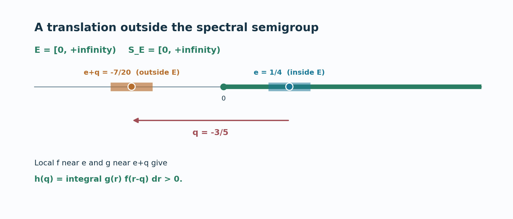

# A spectral filtration determines operator frequencies

An operator may preserve every translate of a spectral region even though it does not intertwine the two actions. The frequencies of that operator are precisely constrained by the translations that keep the region inside itself. The forward implication follows from the spectral-sum theorem of lesson 80. For the converse, translated input and output filters produce a scalar convolution kernel whose Fourier transform vanishes for every translation. A pointwise value of that kernel then supplies an annihilating filter for the conjugation action. This lesson proves Takesaki II, Theorem XI.1.5 under its regular-closed hypothesis.

*Newly written original expression in this lesson and its figure is dedicated under CC0.*

## Translation semigroup and theorem

Keep the full arbitrary LCA and specified dual-Banach setting of [MX0–4](OA-FLOW-MX.md#mx-0) and the [spectral-sum theorem](OA-FLOW-L80.md#sum-claim). Thus \(\alpha,\beta\) are uniformly bounded normal actions on \(X=X_*^*\) and \(Y=Y_*^*\), with norm-continuous predual orbits; \(\gamma_t(A)=\beta_tA\alpha_{-t}\) acts on \(\mathcal L_w(X,Y)\). The vector filter laws (S4), (S14), (S16) below are the full weak-star integral, closed-space annihilator test and support inclusion proved in BS1/BS3 and reflected to (MX1). Let \(E\subset H=\widehat G\) be closed, contain \(0\), and satisfy

$$E=\overline{\operatorname{int}E}. \tag{R1}$$

Define its translation semigroup

$$S_E=\{q\in H:q+E\subset E\}
=\bigcap_{p\in E}(E-p). \tag{R2}$$

It is closed, contains \(0\), and is closed under addition. Because \(0\in E\), it is a subset of \(E\). A closed set such as \(E=[-1,1]\subset\mathbb R\) has \(S_E=\{0\}\), whereas \(E=[0,\infty)\) has \(S_E=[0,\infty)\). The regular-closed condition (R1) will be used in only one direction of the proof.

**Spectral-filtration theorem.** For \(A\in\mathcal L_w(X,Y)\), the following are equivalent:

$$\begin{aligned}
\text{(i)}\quad&\operatorname{Sp}_\gamma(A)\subset S_E;\\
\text{(ii)}\quad&A X_\alpha(E+p)\subset Y_\beta(E+p)
\quad\text{for every }p\in H.
\end{aligned}\tag{R3}$$

Neither action is assumed isometric, and \(G\) need not be second countable or sigma compact. The operator \(A\) may be zero. The same proof therefore covers empty operator spectrum without adding a spurious nonzero assumption.

## Frequencies in the semigroup preserve every translate

Assume (i), fix \(p\in H\) and \(x\in X_\alpha(E+p)\). The spectral-sum theorem (T1) gives

$$Ax\in Y_\beta\bigl(\overline{S_E+E+p}\bigr). \tag{R4}$$

The defining property of \(S_E\) gives \(S_E+E\subset E\). Since \(E+p\) is closed, \(\overline{S_E+E+p}\subset E+p\); hence \(Ax\in Y_\beta(E+p)\). This proves (ii). Notice that regular-closedness was not used here.

## Translating input and output filters

Assume (ii). Fix \(f,g\in A_c(H)\) with

$$\operatorname{supp}(f)\subset\operatorname{int}E,
\qquad \operatorname{supp}(g)\cap E=\varnothing. \tag{R5}$$

For \(p\in H\), put \(f_p(r)=f(r-p)\) and \(g_p(r)=g(r-p)\). The support of \(f_p\) lies inside \(E+p\), so (S16) makes \(\alpha_{f_p}x\in X_\alpha(E+p)\) for every \(x\). The support of \(g_p\) misses \(E+p\), so (S14) makes \(\beta_{g_p}\) annihilate \(Y_\beta(E+p)\). Hypothesis (ii) therefore implies the operator identity

$$\beta_{g_p}A\alpha_{f_p}=0\quad(p\in H). \tag{R6}$$

Let \(f=\mathcal Fa\) and \(g=\mathcal Fb\). Their defining kernels lie in \(L^1(G)\). [MX4](OA-FLOW-MX.md#mx-4) proves that their compact continuous Fourier transforms put these very \(L^1\) classes in \(L^2(G)\), with the same transform under the unitary extension. Thus \(a,b\in L^1\cap L^2\); this is an actual domain identification, not a converse silently inferred from the definition of Plancherel. Use the paired dual Haar measure of H2–4. Translation in frequency gives

$$f_p=\mathcal F\bigl((\,\cdot,-p)a\bigr),\qquad
g_p=\mathcal F\bigl((\,\cdot,-p)b\bigr). \tag{R7}$$

For fixed \(x\in X\) and \(\psi\in Y_*\), expand (R6) with the weak-star integral formula (S4), using normality of \(A\) and the filtered maps. This gives a scalar Fourier transform in the translation parameter:

$$0=\int_{G^2}b(t)a(s)(t+s,-p)
\langle\beta_tA\alpha_sx,\psi\rangle\,dt\,ds
\quad(p\in H). \tag{R8}$$

The absolute bound is \(C_\alpha C_\beta\|A\|\|x\|\|\psi\|\|a\|_1\|b\|_1\). Compact-support approximants justify Fubini and then the \(L^1\) estimate passes to (R8), without a global sigma-finite Haar assumption.

Set \(u=t+s\) and define the scalar kernel

$$k(u)=\int_G b(t)a(u-t)
\langle\beta_tA\alpha_{u-t}x,\psi\rangle\,dt. \tag{R9}$$

The same absolute estimate makes \(k\in L^1(G)\). Equation (R8) says \(\widehat k(-p)=0\) for all \(p\in H\), so Fourier injectivity gives \(k=0\) almost everywhere. We need its value at \(0\), not just its equivalence class. Put
\[
 \Phi(t,u)=\langle\beta_tA\alpha_{u-t}x,\psi\rangle,\qquad
 M=C_\alpha C_\beta\|A\|\|x\|\|\psi\|.
\]
This function is jointly continuous and bounded by \(M\): write the pairing as \(\langle\alpha_{u-t}x,A_*\beta_{t,*}\psi\rangle\), split the difference, and use a norm-continuous predual vector and a bounded weak-star-continuous vector. Cauchy–Schwarz shows the integral (R9) exists at every \(u\), bounded by \(M\|a\|_2\|b\|_2\), and null changes to the kernels do not change any one of these integrals. For a fixed \(u_0\), split the difference by first changing \(a(u-t)\), then \(\Phi(t,u)\). If \(K\subset G\) is compact, the resulting bounds are

\[
 \begin{aligned}
 |k(u)-k(u_0)|\le{}&
 M\|b\|_2\|a(u-\cdot)-a(u_0-\cdot)\|_2\\
 &+\|a\|_2\|b\|_2\sup_{t\in K}|\Phi(t,u)-\Phi(t,u_0)|\\
 &+2M\|a\|_2\|1_{G\setminus K}b\|_2 .
 \end{aligned}\tag{R9a}
\]
L24's \(L^2\) translation continuity makes the first term tend to zero. Joint continuity and a finite cover of \(K\) make the second tend to zero. The third is arbitrarily small for a suitably chosen compact \(K\), by HR3 finite-exponent compact approximation. These estimates prove continuity for arbitrary nets \(u\to u_0\), without a net version of dominated convergence. This continuous representative agrees almost everywhere with the \(L^1\) kernel already used in (R8), by HR5. A continuous function zero almost everywhere is identically zero, because every nonempty open set has positive Haar measure. Evaluating at \(u=0\),

$$0=k(0)=\int_G b(t)a(-t)
\langle\gamma_t(A)x,\psi\rangle\,dt. \tag{R10}$$

This step is the reason for the \(L^2\) observation. An arbitrary convolution of two \(L^1\) kernels only defines an \(L^1\) function almost everywhere, so setting \(u=0\) without more regularity would be unjustified.

## Annihilators outside the translation semigroup

Define \(c(t)=b(t)a(-t)\). By Cauchy–Schwarz, \(c\in L^1(G)\); let \(h_{f,g}=\mathcal Fc\in A(H)\). Since (R10) holds for every \(x,\psi\), the operator filter of MX2 satisfies

$$\Gamma_{h_{f,g}}(A)=0. \tag{R11}$$

Fourier inversion and Plancherel give a second, frequency-side description:

$$h_{f,g}(q)=\int_H g(r)f(r-q)\,dr. \tag{R12}$$

All functions in (R12) are compactly supported and continuous, so the integral is ordinary Haar integration. The equality is [MX4](OA-FLOW-MX.md#mx-4), equation (MX9), which binds the complete \(L^2\) product theorem in LF0, the reflection of \(a\), and the actual \(L^1\) Fourier transform of \(c\). It holds at every \(q\). In particular, \(h_{f,g}\) is an annihilator of \(A\) for every pair satisfying (R5).

Now take \(q\notin S_E\). Some \(e\in E\) has \(e+q\notin E\). Since \(E=\overline{\operatorname{int}E}\) and \(H\setminus E\) is open, \(e\) can be chosen in \(\operatorname{int}E\) while retaining \(e+q\notin E\). Choose small open neighborhoods \(U\ni e\) and \(V\ni e+q\) with compact closures, \(\overline U\subset\operatorname{int}E\), \(\overline V\subset H\setminus E\), and \(U+q\subset V\). [LF1/LF4](OA-FLOW-LF.md#lf-1) give local Fourier cutoffs \(c_U,c_V\in A_c(H)\) supported in \(U,V\) and equal to \(1\) near their center points. Set \(f=|c_U|^2\), \(g=|c_V|^2\), which are nonnegative members of \(A_c(H)\) satisfying (R5). On an open neighborhood of \(r=e+q\), both \(g(r)\) and \(f(r-q)\) are positive. Haar measure of that neighborhood is positive, so (R12) yields

$$h_{f,g}(q)>0,\qquad h_{f,g}\in I_\gamma(A). \tag{R13}$$

Thus \(q\) is not in the hull \(\operatorname{Sp}_\gamma(A)\). Every point outside \(S_E\) is excluded this way, proving (i) and the theorem. \(\square\)

[View the figure for spectral transfer on a half-line at full size](../assets/spectral-transfer/81-transfer-semigroup-witness.png).

*Figure 81.1.* The example uses \(E=[0,\infty)\subset\mathbb R\), so \(S_E=[0,\infty)\). The negative candidate frequency is \(q=-3/5\). An interior point \(e=1/4\) moves to \(e+q=-7/20\notin E\). Local nonnegative Fourier cutoffs \(f\) near \(e\) and \(g\) near \(e+q\) make the convolution value \(h_{f,g}(q)\) in (R12) positive. The figure shows exact coordinates and the direction of the translation. The shaded support intervals are schematic neighborhoods, not a claim about the shape of the Fourier cutoffs.

**Problem.** For \(E=[-1,1]\subset\mathbb R\), compute \(S_E\) and interpret (R3) when \(\alpha=\beta\) and \(A\) is the identity operator.

**Solution.** A translation \(q\) satisfies \(q+[-1,1]\subset[-1,1]\) only when \(q=0\), so \(S_E=\{0\}\). The identity maps each \(X_\alpha(E+p)\) to itself, satisfying (ii). Its conjugation orbit is constant, so its \(\gamma\)-spectrum is contained in \(\{0\}\), satisfying (i). If \(X=\{0\}\), the identity is the zero map and its spectrum is empty; the containment remains true. \(\square\)

## Support-preserving Fourier approximation

The source proof also uses a Tauberian approximation that preserves a filter's support restriction. Let \(e_V=\mathcal Fa_V\), where \(a_V\ge0\), \(\int a_V=1\), and \(\operatorname{supp}(a_V)\) shrinks to the identity as in [L24](OA-FLOW-L24.md#oa-flow.grp.algebra). Translation continuity in \(L^1(G)\) gives \(e_Vf\to f\) in \(A\)-norm for every \(f\in A(H)\), because Fourier multiplication corresponds to convolution. Choose \(d_{V,n}\in A_c(H)\) with \(\|d_{V,n}-e_V\|_A<1/n\), possible by [LF5](OA-FLOW-LF.md#lf-5), and direct the pairs \((V,n)\) by shrinking \(V\) and increasing \(n\). Then

$$\|d_{V,n}f-f\|_A
\le\frac{\|f\|_A}{n}+\|e_Vf-f\|_A\longrightarrow0. \tag{R14}$$

Each \(d_{V,n}f\) belongs to \(A_c(H)\subset A(H)\cap L^1(H)\), and

$$\operatorname{supp}(d_{V,n}f)
\subset\operatorname{supp}(f). \tag{R15}$$

Also \(A(H)\cap L^1(H)\) is an ideal of \(A(H)\): multiplying an integrable Fourier function by a bounded Fourier function remains integrable. Thus the ideal is dense and approximation can respect a prescribed closed support set. The converse proof above starts with compactly supported filters, so its Fourier-uniqueness step does not discard any support condition through approximation.

The source is [Takesaki, Theory of Operator Algebras II](https://doi.org/10.1007/978-3-662-10451-4), Theorem XI.1.5. The preserved programme argument uses the translated-filter mechanism, with an explicit scalar kernel and a local positive annihilator. MX4 and (R9a) supply full inverse-domain and pointwise-continuity details. The earlier inputs are MX0–4, the spectral-sum theorem, BS1/BS3, LF0/LF1/LF4/LF5, L24/HR3/HR5 and H1–4 at their exact declared hypotheses. No one-sided action-recovery theorem is substituted for (R3), and neither an arbitrary closed-set synthesis assertion nor a full-dual identification of the normal-operator space is used.

## Ordinary Banach spaces: operator topology and integration

Let \(X,Y\) be arbitrary complex Banach spaces. Let \(\alpha\) on \(X\)
and \(\beta\) on \(Y\) be strongly continuous representations of the
arbitrary LCA group \(G\), with
\[
 C_\alpha=\sup_t\|\alpha_t\|<\infty,\qquad
 C_\beta=\sup_t\|\beta_t\|<\infty,\qquad D=C_\alpha C_\beta .
 \tag{NB1}
\]
Here strongly continuous means norm continuity of every vector orbit.
Use the positive Fourier convention (MX1):
\(f=\mathcal Fa\), \(\mathcal Fa(p)=\int_G a(t)(t,p)\,dt\), and
\(\alpha_f x=\int_G a(t)\alpha_t x\,dt\). These vector integrals and their
norm spectral calculus are the Banach case of
[BS1–5](OA-FLOW-BS.md#bs-1), with frequency reflected from (BS1).
No predual of \(X\) or \(Y\) is specified or required.

On \(\mathcal L=\mathcal B(X,Y)\) put the locally convex topology
\(\tau_c\) defined by
\[
 p_K(A)=\sup_{x\in K}\|Ax\|,
 \qquad K\subset X\ \hbox{norm compact}.
 \tag{NB2}
\]
Singletons show that it is Hausdorff and stronger than pointwise norm
convergence. On every operator-norm bounded subset the two topologies
agree. Indeed, if \(\|A_i\|,\|A\|\le M\), and
\(x_1,\ldots,x_m\) is a \(\delta\)-net in \(K\), then
\[
 p_K(A_i-A)\le \max_j\|(A_i-A)x_j\|+2M\delta .
 \tag{NB3}
\]
Choose \(\delta\) first and then use the finitely many convergences.
This proof applies to arbitrary nets on that bounded subset.

Define
\[
 \gamma_t(A)=\beta_tA\alpha_{-t},\qquad
 (\Gamma_f A)x=\int_G a(t)\beta_tA\alpha_{-t}x\,dt
 \quad(f=\mathcal Fa).
 \tag{NB4}
\]
For fixed \(A,x\) the integrand's vector orbit is norm continuous:
split a difference using the strong continuity of \(\alpha,\beta\)
and their uniform bounds. The full Bochner construction in
[L24](OA-FLOW-L24.md#oa-flow.grp.vectorintegration) therefore applies.
Its sigma-compact carrier argument concerns the integrable kernel;
it does not assume that \(G\) itself is sigma compact. Thus (NB4)
defines a bounded linear operator and
\[
 \|\Gamma_f A\|\le D\|f\|_A\|A\|.
 \tag{NB5}
\]
Fubini on the same integrable carriers gives
\(\Gamma_f\Gamma_g=\Gamma_{fg}\).
For example the two group variables in the vector integrand combine
to \(\beta_{t+s}A\alpha_{-t-s}x\); its norm is bounded by
\(D\|A\|\|x\|\), times the product of the two absolute kernels.
This also proves the covariance identities for translations of a
kernel.

Every \(\gamma_t\) is \(\tau_c\)-continuous, because
\(p_K(\gamma_t A)\le C_\beta p_{\alpha_{-t}K}(A)\).
For fixed \(A\) its orbit is \(\tau_c\)-continuous. Pointwise norm
continuity and the common bound \(D\|A\|\), followed by (NB3), prove this.

The continuity of \(\Gamma_f\) for arbitrary \(\tau_c\)-convergent nets
requires a further estimate. Fix \(a\in L^1(G)\) and compact \(K\subset X\).
By [HR3](OA-FLOW-HR.md#hr-03), choose increasing compact sets \(L_n\subset G\)
such that
\[
 \int_{G\setminus L_n}|a(t)|\,dt\le 2^{-3n}.
\]
Put \(L_0=\varnothing\), \(D_n=L_n\setminus L_{n-1}\), and
\[
 Q_K=\{0\}\ \cup\
       \bigcup_{n\ge1}2^{-n}\{\alpha_{-t}x:t\in L_n,\ x\in K\},
 \qquad B_a=\sum_{n\ge1}2^n\int_{D_n}|a(t)|\,dt .
 \tag{NB6}
\]
The action map is jointly norm continuous by BS0. Each displayed
scaled image is compact. Their norms tend uniformly to zero because
\(\sup_{x\in K}\|x\|<\infty\) and \(\|\alpha_t\|\le C_\alpha\).
An open set containing zero therefore covers all sufficiently late
images, and finitely many earlier compact images have a finite
subcover. This proves that \(Q_K\) is compact. Moreover
\[
 B_a\le 2\|a\|_1+\sum_{n\ge2}2^n2^{-3(n-1)}<\infty .
\]
The complement of \(\bigcup_nL_n\) has zero \(|a|\,dt\)-measure.
On \(D_n\), \(\|A\alpha_{-t}x\|\le 2^np_{Q_K}(A)\). Consequently
\[
 p_K(\Gamma_f A)\le C_\beta B_a\,p_{Q_K}(A).
 \tag{NB7}
\]
This is continuity in the stated locally convex topology, without
an operator-norm bound on the convergent net.

For the mass-one kernels \(a_V\) supported in shrinking identity
neighbourhoods, orbit continuity on \(K\) gives
\[
 p_K(\Gamma_{\mathcal Fa_V}A-A)
 \le \sup_{t\in V,\ x\in K}\|(\gamma_t A-A)x\|\longrightarrow0.
 \tag{NB8}
\]
The particular kernels \(k_{V,\epsilon}\) in BS2 have compact Fourier
support, mass and \(L^1\)-norm one, and
\(\|k_{V,\epsilon}-a_V\|_1<2\epsilon\).
Combining (NB5) with (NB8) shows
\(\Gamma_{\mathcal Fk_{V,\epsilon}}A\to A\) in \(\tau_c\), with operator
norm bounded by \(D\|A\|\). This supplies compact-frequency
approximants in the operator space itself.

## Operator hulls and localization in the compact-set topology

For \(A\in\mathcal L\), define the closed ideal
\[
 I_\gamma(A)=\{f\in A(H):\Gamma_f A=0\},\qquad
 \operatorname{Sp}_\gamma(A)=\operatorname{hull}I_\gamma(A).
 \tag{NB9}
\]
The ideal and norm-closedness assertions follow from (NB5) and the
product identity. Let
\[
 \mathcal L^\gamma(E)=\{A:\operatorname{Sp}_\gamma(A)\subset E\},\qquad
 \mathcal L^\gamma_0(U)=
 \overline{\operatorname{span}
 \{\Gamma_f B:f\in A_c(H),\ \operatorname{supp}f\subset U\}}^{\,\tau_c},
 \tag{NB10}
\]
where \(E\) is any subset and \(U\) is open.
The following arguments also explain each use of closure.

If the spectrum of \(A\) is empty, [LF6](OA-FLOW-LF.md#lf-6) gives
\(I_\gamma(A)=A(H)\). Equation (NB8) then gives \(A=0\).
For every filter \(f\),
\[
 \operatorname{Sp}_\gamma(\Gamma_f A)
 \subset \operatorname{supp}f\cap\operatorname{Sp}_\gamma(A).
 \tag{NB11}
\]
An annihilator of \(A\) also annihilates \(\Gamma_f A\).
At a point outside \(\operatorname{supp}f\), a compact local cutoff
nonzero at that point has product zero with \(f\), and is another
annihilator. These two observations prove (NB11).

For a closed \(E\), LF6 and the local cutoffs give the exact test
\[
 \mathcal L^\gamma(E)=
 \bigcap_{\substack{f\in A_c(H)\\\operatorname{supp}f\cap E=\varnothing}}
       \ker\Gamma_f .
 \tag{NB12}
\]
In one direction every displayed \(f\) vanishes on a neighbourhood of
the hull and thus belongs to \(I_\gamma(A)\).
In the other direction a compact cutoff supported in \(H\setminus E\)
and nonzero at a prescribed point outside \(E\) excludes that point
from the hull. By (NB7), (NB12) is \(\tau_c\)-closed.

If \(\operatorname{Sp}_\gamma(A)\) is compact and \(f=1\) on a
neighbourhood of it, then \(\Gamma_f A=A\). Indeed for every \(h\in A(H)\)
the function \(h-fh\) vanishes on that neighbourhood and belongs to
\(I_\gamma(A)\) by LF6. Hence
\(\Gamma_h A=\Gamma_h\Gamma_f A\); use the mass-one kernels in (NB8)
on both sides.

For closed \(E\subset U\), the compact-frequency approximants to
\(A\in\mathcal L^\gamma(E)\) supplied after (NB8) have spectra contained
in compact subsets \(K_i\cap E\).
[LF1/LF4](OA-FLOW-LF.md#lf-1) supply \(f_i\in A_c(H)\), supported in \(U\)
and equal to one near \(K_i\cap E\).
The preceding cutoff identity puts each approximant in the range of
\(\Gamma_{f_i}\); if \(K_i\cap E=\varnothing\), it is zero.
Thus
\[
 \mathcal L^\gamma(E)\subset\mathcal L^\gamma_0(U)
       \subset\mathcal L^\gamma(\overline U),\qquad
 \mathcal L^\gamma(E)
       =\bigcap_{\substack{U\supset E\\U\ {\rm open}}}
                         \mathcal L^\gamma_0(U).
 \tag{NB13}
\]
The second containment follows from (NB11) and closedness (NB12).
The equality follows by intersecting the containments and separating
each point outside \(E\) by an open neighbourhood of \(E\) whose closure
misses that point, using [H0](OA-FLOW-TOPOLOGY.md#l138-h0).
Arbitrary intersections of spectral sets commute with
\(\mathcal L^\gamma(\,\cdot\,)\) by its definition.
Every \(\gamma_t\) preserves the hull because it commutes with all
filters and has inverse \(\gamma_{-t}\).

Finally,
\[
 \operatorname{Sp}_\gamma(A)\subset\{p\}
 \quad\Longleftrightarrow\quad
 \gamma_t(A)=(t,p)A\quad(t\in G).
 \tag{NB14}
\]
For nonzero \(A\), [SS1–2](OA-FLOW-SS.md#ss-1), reflected to the positive
Fourier convention, say that a closed ideal with hull \(\{p\}\) is
precisely \(\{f:f(p)=0\}\).
Choose a compact cutoff \(f\) equal to one near \(p\).
Then \(\Gamma_f A=A\), while translation covariance and the ideal
identity give
\(\gamma_t\Gamma_f A=(t,p)\Gamma_f A\).
Conversely an eigenoperator has \(\Gamma_f A=f(p)A\), whose annihilator
has hull \(\{p\}\). The zero operator satisfies both assertions.
No norm continuity of the orbit in \(\mathcal B(X,Y)\) is used.

## Compact families and their probability averages

Every nonempty \(\tau_c\)-compact set \(\mathcal K\subset\mathcal L\)
has a compact closed convex hull in \(\tau_c\).
For each Radon probability \(\mu\) on \(\mathcal K\), its barycentre
belongs to that hull and satisfies
\[
 T_\mu x=\int_{\mathcal K}Tx\,d\mu(T),\qquad
 \|T_\mu\|\le\sup_{T\in\mathcal K}\|T\|.
 \tag{NB15}
\]
The integral is a norm integral in \(Y\).
The barycentre map is affine and continuous for convergence against
\(C(\mathcal K)\) on probabilities and for \(\tau_c\) on operators.

Here is a direct proof. For every \(x\), the image
\(\mathcal Kx\) is norm compact, hence bounded.
[Uniform boundedness](../../foundations-of-von-neumann-algebras/hahn-banach-baire-and-the-basic-theorems-on-banach-spaces.html#oa-fnd-hb-04)
gives \(M=\sup_{T\in\mathcal K}\|T\|<\infty\).
In a Banach space the norm-closed convex hull of a norm-compact set
is norm compact: take a finite \(\epsilon\)-net of the original set.
Every convex combination is within \(\epsilon\) of the convex hull
of that finite net. The latter is a continuous image of a finite
simplex, hence compact, and has a finite \(\epsilon\)-net.
The closed hull is therefore totally bounded and complete.
To recall why these imply compactness, an ultrafilter contains a
member of each finite \(2^{-n}\)-ball cover. Centers of such chosen
balls are Cauchy, since two chosen members intersect; completeness
gives a limit and the ultrafilter converges to it.
The ultrafilter compactness criterion is proved in
[CF4](OA-FLOW-CF.md#oa-flow.cf.4).

Let \(H_x=\overline{\operatorname{co}(\mathcal Kx)}^{\|\cdot\|}\).
The product \(\prod_{x\in X}H_x\) is compact by the product proof in CF4.
Take in it the coordinatewise norm closure of \(\operatorname{co}\mathcal K\).
Coordinate limits satisfy all linearity equations and
\(\|Ax\|\le M\|x\|\), so they define bounded operators \(A:X\to Y\).
On this \(M\)-bounded set, (NB3) identifies coordinatewise norm
convergence with \(\tau_c\)-convergence. The resulting compact set is
therefore exactly
\(C=\overline{\operatorname{co}\mathcal K}^{\,\tau_c}\).

For each \(x\), \(T\mapsto Tx\) is norm continuous with compact image.
Finite Borel partitions whose images have diameter less than
\(\epsilon\) give finite-valued approximations uniformly within
\(\epsilon\). Their integrals are Cauchy in \(Y\), defining (NB15);
this also proves its linearity in \(x\) and its bound.
For finitely many \(x_1,\ldots,x_m\), take one partition controlling
all these images and choose \(T_j\) in each nonempty piece \(B_j\).
Then \(\sum_j\mu(B_j)T_j\) approximates \(T_\mu x_k\) simultaneously
within \(\epsilon\). These convex combinations and \(T_\mu\) have
norm at most \(M\); (NB3) shows \(T_\mu\in C\).
Scalar testing proves uniqueness and affinity.

If \(\mu_i\to\mu\) against \(C(\mathcal K)\), then
\(\psi(T_{\mu_i}x)\to\psi(T_\mu x)\) for every \(x\in X,\psi\in Y^*\).
All operators lie in compact \(C\). A subnet staying outside a
neighbourhood of \(T_\mu\) would have a cluster subnet in \(C\);
its limit would agree with \(T_\mu\) on all these scalar tests.
Hahn–Banach separation forces equality, a contradiction.
Thus \(T_{\mu_i}\to T_\mu\) in \(\tau_c\), for arbitrary nets.
The empty family is contained in compact convex \(\{0\}\) and has
no probability measure. This proves all assertions.

## Spectral sums, filtrations and recovery of a Banach action

For closed \(E,F\subset H\), the ordinary Banach-space sum theorem is
\[
 A\in\mathcal L^\gamma(E),\quad x\in X^\alpha(F)
 \quad\Longrightarrow\quad
 Ax\in Y^\beta(\overline{E+F}).
 \tag{NB16}
\]
Here the vector spectral spaces use norm closure as in BS3–4.
To prove it, put \(C=\overline{E+F}\) and take \(h\in A_c(H)\)
with support disjoint from \(C\). The compact separation argument
(T7) gives a symmetric neighbourhood \(W\) such that
\(\operatorname{supp}h\cap(E+W+F+W)=\varnothing\).
By (NB13), approximate \(A\) in \(\tau_c\) by linear combinations of
\(\Gamma_gB\) with \(\operatorname{supp}g\subset E+W\).
By BS4 approximate \(x\) in norm by linear combinations of
\(\alpha_fy\) with \(\operatorname{supp}f\subset F+W\).

For each pair of such generators, write \(g=\mathcal Fa\),
\(f=\mathcal Fb\), \(h=\mathcal Fc\).
The three-kernel computation (T2)–(T4) now takes place directly in
norm-integrable \(Y\)-valued functions:
\[
 \begin{aligned}
 \beta_h((\Gamma_gB)(\alpha_fy))
   &=\int_{G^2}k(u,v)\beta_uB\alpha_vy\,du\,dv,\\
 k(u,v)&=\int_G a(r)b(v+r)c(u-r)\,dr,\\
 \mathcal F_{G^2}k(q,p)&=h(q)g(q-p)f(p).
 \end{aligned}\tag{NB17}
\]
The vector coefficient is jointly norm continuous and bounded by
\(D\|B\|\|y\|\).
The scalar kernel has \(L^1\)-norm at most
\(\|a\|_1\|b\|_1\|c\|_1\).
Thus the qualified Radon Fubini argument in
[the full kernel proof](OA-FLOW-L80.md#sum-kernel) applies on the same
sigma-compact carriers, with Bochner integrals instead of predual
pairings. The support choices make the transform zero everywhere.
Fourier injectivity on \(G^2\) gives \(k=0\), so the first line is zero.

Fix the filtered operator first and pass through the norm limit of
the vectors. Next keep \(x\) fixed and pass through the
\(\tau_c\)-limit of the operators; evaluation at \(x\) is norm
continuous by (NB2). Boundedness of \(\beta_h\) gives
\(\beta_h(Ax)=0\). The vector annihilator test BS3 for all such \(h\)
proves (NB16). These two separate limits require no joint
continuity of operator evaluation.

For a closed regular-closed \(E\) containing zero, the filtration theorem is
\[
 \operatorname{Sp}_\gamma(A)\subset S_E
 \quad\Longleftrightarrow\quad
 A X^\alpha(E+p)\subset Y^\beta(E+p)\quad(p\in H).
 \tag{NB18}
\]
The forward direction follows from (NB16) and \(S_E+E\subset E\).
For the converse choose \(f,g\in A_c(H)\) as in (R5), put
\(f_p(r)=f(r-p)\), \(g_p(r)=g(r-p)\), and use the vector
annihilator test to get \(\beta_{g_p}A\alpha_{f_p}=0\).
With \(f=\mathcal Fa,g=\mathcal Fb\), [MX4](OA-FLOW-MX.md#mx-4)
puts these same kernels in \(L^1\cap L^2\).
For \(x\in X,\psi\in Y^*\), Fubini gives
\[
 \begin{aligned}
 0&=\int_G(u,-p)\,k_{x,\psi}(u)\,du \quad(p\in H),\\
 k_{x,\psi}(u)
   &=\int_G b(t)a(u-t)\,
       \psi(\beta_tA\alpha_{u-t}x)\,dt .
 \end{aligned}\tag{NB19}
\]
The kernel is \(L^1\), with bound
\(D\|A\|\|x\|\|\psi\|\|a\|_1\|b\|_1\).
It is also continuous everywhere: apply (R9a) with the bounded
jointly continuous coefficient
\(\Phi(t,u)=\psi(\beta_tA\alpha_{u-t}x)\).
Its joint continuity follows here from the two strong actions.
The three terms in (R9a) tend to zero by \(L^2\) translation continuity,
uniform continuity on a compact \(t\)-set and the \(L^2\) tail of \(b\).
This proves continuity for nets; it does not use dominated convergence
for nets. Fourier uniqueness therefore gives \(k_{x,\psi}(0)=0\).

It follows that \(\Gamma_hA=0\) for
\[
 h=\mathcal F[b(t)a(-t)],\qquad
 h(q)=\int_H g(r)f(r-q)\,dr .
 \tag{NB20}
\]
The first conclusion holds because every \(\psi\in Y^*\) annihilates
\((\Gamma_h A)x\), and these functionals separate \(Y\).
The pointwise Fourier identity is (MX9).
For any \(q\notin S_E\), regular-closedness supplies
\(e\in\operatorname{int}E\) with \(e+q\notin E\).
Choose nonnegative compact Fourier cutoffs \(f,g\) around
\(e,e+q\), supported respectively inside \(E\) and outside \(E\),
and positive near these two points, as in (R13).
Then (NB20) is positive at \(q\). It excludes \(q\) from the hull
of \(I_\gamma(A)\), proving the reverse direction of (NB18).

The action-recovery theorem follows as well. Suppose \(\alpha,\beta\)
act on the same Banach space and
\(X^\alpha(K)\subset X^\beta(K)\) for every compact \(K\).
In each identity neighbourhood of \(H\), local compactness and
regularity give an open \(V\) with compact closure contained there.
Set \(E=\overline V\). Since \(V\subset\operatorname{int}\overline V\),
\(E=\overline{\operatorname{int}E}\); it contains zero after choosing
\(V\) to be an identity neighbourhood. These compact regular-closed
neighbourhoods form a neighbourhood net with intersection \(\{0\}\).
Apply (NB18) to \(A=I_X\), using the assumed inclusion for every
compact translate \(E+p\). It yields
\(\operatorname{Sp}_\gamma(I_X)\subset S_E\subset E\) for all such \(E\).
Thus (NB14) gives
\(\beta_t\alpha_{-t}=I_X\), hence \(\alpha_t=\beta_t\).
The converse is immediate. The zero space satisfies the same conclusion.

## Why pointwise operator convergence does not suffice

The topology in (NB2) has a concrete purpose. Let \(G=\mathbb Z\),
\(X=Y=\ell^2(\mathbb Z)\), let \(e_j\) be its coordinate unit vectors,
and let \(S e_j=e_{j+1}\). Put \(\alpha_n=\beta_n=S^n\) and
\[
 a(n)=\frac{2^{-|n|}}3,\qquad \sum_{n\in\mathbb Z}a(n)=1 .
 \tag{NB21}
\]
Both actions are isometric and strongly continuous on the discrete group.
For completeness, a norm-Cauchy sequence in \(\ell^2\) has coordinate
limits. Bounds for each finite sum of squared absolute values pass
to those limits and prove square summability; the same argument on
Cauchy differences proves norm convergence. Finite truncations
converge in norm, so the coordinate span is dense. The shift preserves
the square norm and has the inverse backward shift.
For a bounded linear functional \(\varphi\ne0\), define
\(B_\varphi x=\varphi(x)e_0\). Direct substitution into (NB4) gives
\[
 \Gamma_{\mathcal Fa}(B_\varphi)e_0
       =\sum_{n\in\mathbb Z}a(n)\varphi(e_{-n})e_n\ne0 .
 \tag{NB22}
\]
The series is absolutely norm convergent.
It is nonzero because a functional vanishing on every coordinate
vector vanishes on their dense finite span, and hence on the Hilbert space.

Direct the finite subsets \(F\subset\ell^2(\mathbb Z)\) by inclusion.
Their spans are finite dimensional and closed.
Indeed the norm of a linear combination of a fixed finite independent
family has a positive minimum on the Euclidean coefficient unit
sphere, by compactness. Thus a Cauchy sequence in that span has Cauchy
coefficients and converges in the span.
Hahn–Banach gives a nonzero bounded functional \(\varphi_F\)
annihilating that span: choose a vector outside it, define a functional
on its span together with that vector, and extend it.
Scale \(B_{\varphi_F}\) to an operator \(A_F\) such that
\[
 A_F|_F=0,\qquad
 \|\Gamma_{\mathcal Fa}(A_F)e_0\|=1 .
 \tag{NB23}
\]
For each fixed \(x\), \(A_Fx=0\) whenever \(F\supset\{x\}\).
Thus \(A_F\to0\) pointwise in norm, but its averaged operators do not.
In particular \(\Gamma_{\mathcal Fa}\) is not continuous for the
unrestricted strong operator topology.

There is no conflict with (NB7). The norm-compact set
\[
 Q=\{0\}\cup\{2^{-|n|/2}e_{-n}:n\in\mathbb Z\}
\]
has only zero as a possible accumulation point outside its finite subsets.
For every \(A\),
\[
 \|\Gamma_{\mathcal Fa}(A)e_0\|
 \le \frac{3+2\sqrt2}{3}\,p_Q(A).
 \tag{NB24}
\]
Indeed sum \(a(n)\|Ae_{-n}\|\le a(n)2^{|n|/2}p_Q(A)\);
the resulting geometric series is
\(\frac13(1+2\sum_{n\ge1}2^{-n/2})=(3+2\sqrt2)/3\).
Equation (NB23) therefore prevents \(A_F\to0\) in \(\tau_c\).
This example concerns arbitrary operator nets, not a failure of the
bounded-set equivalence (NB3).

The nondual extension is proposed in Takesaki,
*Theory of Operator Algebras II*, XI §1, printed p.312.
The results treated here are the operator compactness and integration
lemma, the filtration theorem, action recovery and the spectral-sum
corollary on printed pp.315–319.
The proof uses compact sets in the input Banach space to control
integrable orbit tails, then norm localization and scalar Fourier
kernels. The subsequent von Neumann algebra applications retain
their own algebra and normality hypotheses.

## Recovering an element's frequencies from multiplication

Let \(M\) be any von Neumann algebra with its specified predual \(M_*\),
and let \(G\) be an arbitrary locally compact Hausdorff abelian group.
Suppose \(\alpha:G\to\operatorname{Aut}(M)\) is point-ultraweakly continuous.
The concrete predual is constructed in
[CP6](OA-FLOW-CP.md#oa-flow.cp.6).
[AT3](OA-FLOW-AT.md#oa-flow.at.3) proves norm continuity of its predual
orbits, and [GL0](OA-FLOW-GL.md#gl-0) proves the isometric and
multiplication-continuity facts. Thus the specified-dual hypotheses
of [MX0–3](OA-FLOW-MX.md#mx-0) hold with \(X=Y=M\).
Write
\[
 V=\mathcal L_w(M,M),\qquad Q=M\widehat\otimes_\pi M_*,
 \qquad \sigma_0=\sigma(Q^*,Q)|_V,\qquad
 \gamma_t(T)=\alpha_tT\alpha_{-t}.
\]
Use the positive Fourier convention of this lesson. All assertions below
include the zero algebra; the norm calculation may therefore be checked
first when \(M\ne0\).

The value of a left multiplication map at the identity recovers its
multiplier. Define
\[
 J(x)(y)=xy,\qquad \epsilon(T)=T(1),\qquad P=J\epsilon .
 \tag{LM1}
\]
Fixed multiplication is normal by GL0, so \(J(x)\in V\).
The algebra norm inequality and evaluation at \(1\) give
\[
 \|J(x)\|=\|x\|,\qquad \|\epsilon(T)\|\leq\|T\|,
 \qquad \epsilon J=I_M,\qquad P^2=P,\quad \|P\|\leq1.
 \tag{LM2}
\]
Here \(\|1\|=1\) in a nonzero von Neumann algebra. Thus \(P\) is a
contractive projection onto the space of left multiplication maps.

Both maps in this retraction have their full weak topologies, without
a boundedness restriction on convergent nets.
The inverse map \(\epsilon\) is continuous from \(\sigma_0\) to the
ultraweak topology, since
\(\varphi(\epsilon(T))=\langle T,1\otimes\varphi\rangle_Q\).
For the other direction define, on elementary tensors,
\[
 b(y\otimes\varphi)(x)=\varphi(xy).
 \tag{LM3}
\]
GL0's normality of right multiplication puts this functional in \(M_*\);
its norm is at most \(\|y\|\|\varphi\|\). Bilinearity and the definition
of the projective norm give a linear contraction on the algebraic
tensor product. Completeness of \(M_*\), proved in CP6, extends it to
a contraction \(b:Q\to M_*\). On elementary tensors, and hence on all
of \(Q\) by norm density,
\[
 \langle J(x),q\rangle_Q=b(q)(x).
 \tag{LM4}
\]
Consequently \(J\) is ultraweak-to-\(\sigma_0\) continuous.
Together with \(\epsilon J=I_M\), this proves that \(J\) identifies
\(M\), with its actual ultraweak topology, homeomorphically with
\(J(M)\). The projection \(P\) is \(\sigma_0\)-continuous. Its range
is relatively \(\sigma_0\)-closed in \(V\), being the kernel of \(I-P\);
the topology is Hausdorff because elementary tensor tests separate
operators. No closedness assertion about all normal operators in
the ambient space \(Q^*\) is needed.

The retraction respects the action. For every \(y\in M\),
\[
 \begin{aligned}
 \gamma_t(J(x))(y)
   &=\alpha_t\!\left(x\alpha_{-t}(y)\right)
     =\alpha_t(x)y,\\
 \epsilon(\gamma_t(T))&=\alpha_t(T(1)).
 \end{aligned}
 \tag{LM5}
\]
In the second line \(\alpha_{-t}(1)=1\). Hence
\(\gamma_tJ=J\alpha_t\), \(\epsilon\gamma_t=\alpha_t\epsilon\), and
\(P\gamma_t=\gamma_tP\).

These identities also hold for every Fourier filter in its full domain.
For \(a\in L^1(G)\), put \(f(p)=\int_Ga(t)(t,p)\,dt\).
MX2 constructs the normal operator \(\Gamma_f(T)\), while
[AT5](OA-FLOW-AT.md#oa-flow.at.5) constructs \(\alpha_f(x)\).
For \(y\in M,\varphi\in M_*\), their defining scalar integrals give
\[
 \begin{aligned}
 \varphi\!\left(\Gamma_f(J(x))(y)\right)
 &=\int_G a(t)\varphi(\alpha_t(x)y)\,dt
   =\varphi(\alpha_f(x)y),\\
 \varphi\!\left(\epsilon(\Gamma_f(T))\right)
 &=\int_G a(t)\varphi(\alpha_t(T(1)))\,dt
   =\varphi(\alpha_f(\epsilon(T))).
 \end{aligned}
 \tag{LM6}
\]
The first integral is bounded in absolute value by
\(\|a\|_1\|\varphi\|\|x\|\|y\|\), and the second by
\(\|a\|_1\|\varphi\|\|T\|\).
The functional \(z\mapsto\varphi(zy)\) belongs to \(M_*\) by (LM3),
so the first equality uses the actual normal integral.
These are full \(L^1\) identities, not limits requiring a compactly
supported symbol or a norm-continuous orbit of \(x\). Separation by
\(M_*\) proves
\[
 \Gamma_fJ=J\alpha_f,\qquad
 \epsilon\Gamma_f=\alpha_f\epsilon,\qquad
 P\Gamma_f=\Gamma_fP.
 \tag{LM7}
\]

Let \(I_\alpha(x)=\{f:\alpha_f(x)=0\}\) and
\(I_\gamma(T)=\{f:\Gamma_f(T)=0\}\).
Since \(J\) is injective, (LM7) gives the exact ideal identity
\[
 I_\gamma(J(x))=I_\alpha(x),\qquad
 \operatorname{Sp}_\gamma(J(x))=\operatorname{Sp}_\alpha(x).
 \tag{LM8}
\]
Thus no frequency of an element is lost when it becomes a normal
left multiplication map. For a general \(T\),
\(I_\gamma(T)\subset I_\alpha(\epsilon(T))\);
taking hulls reverses this inclusion, giving
\[
 \operatorname{Sp}_\alpha(T(1))\subset\operatorname{Sp}_\gamma(T).
 \tag{LM9}
\]
For every subset \(E\subset\widehat G\), with spectral spaces defined
by containment of their hulls, (LM8) is equivalently
\[
 J(M_\alpha(E))=J(M)\cap V_\gamma(E).
 \tag{LM10}
\]
This set identity does not assume that \(E\) is closed.

The earlier [spectral-sum theorem](OA-FLOW-L80.md#sum-claim)
now applies to the normal operator \(J(x)\) and vector \(y\).
Their actual spectra are closed, so (LM8) yields
\[
 \operatorname{Sp}_\alpha(xy)\subset
 \overline{\operatorname{Sp}_\alpha(x)+
                 \operatorname{Sp}_\alpha(y)} .
 \tag{LM11}
\]
For arbitrary subsets \(E,F\), therefore,
\(M_\alpha(E)M_\alpha(F)\subset M_\alpha(\overline{E+F})\).
If a factor is zero the same statement holds because its spectrum
and the spectrum of the product are empty. The operator theorem
already proved both required weak limits separately.

For comparison with [GL](OA-FLOW-GL.md#gl-0), its negative-transform
label is the negative of the label used here. Reflection sends
\(E+F\) to \((-E)+(-F)\) and commutes with closure, so (LM11) is
exactly its product assertion with the same action.
The alternative convention
\(\mathcal F_-c(p)=\int_G\overline{(t,p)}c(t)\,dt\) with filter kernel
\(c(-t)\) also gives the present formulas: set \(a(t)=c(-t)\);
Haar inversion yields \(\mathcal F_+a=\mathcal F_-c\).
Thus a reflected physical kernel compensates for the reversed
Fourier sign without changing the symbol or its spectral label.

The left-multiplication spectral identity is discussed in Takesaki,
*Theory of Operator Algebras II*, XI.1.8, printed pp.319–320.
Here evaluation at the identity supplies a continuous retraction,
and equality of the full annihilator ideals proves the identification.
