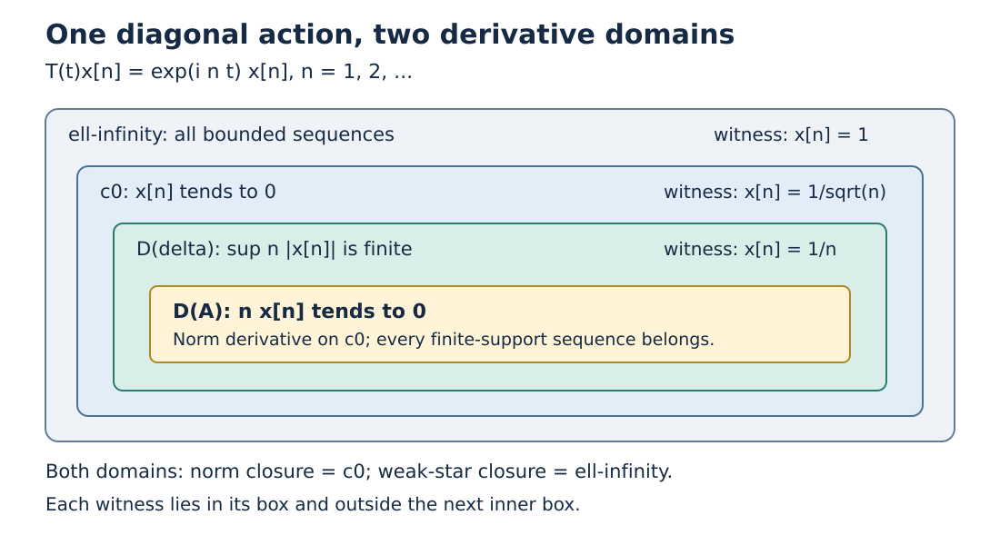

# Generators and their norm and weak-star domains

A scalar derivative can define an unbounded generator even when the orbit is not differentiable in norm. We first establish the uniform bounds and smoothing estimates that control this domain. The generator then appears as the adjoint of the predual generator, giving its full weak-star closed graph and a weak-star dense invariant domain.

*New expression is dedicated under CC0 to the extent of rights held.*

Let \(X=X_*^*\) be a complex dual Banach space with specified predual, and let \(\alpha:\mathbb R\to\operatorname{GL}(X)\) be a uniformly bounded group of weak-star continuous operators with norm-continuous predual orbits, with the specified-dual conventions of [BS0–1](OA-FLOW-BS.md#bs-0). Write \(C_\alpha=\sup_t\|\alpha_t\|\). Put \(\beta_t\phi=\phi\circ\alpha_t\); the specified predual hypothesis makes this a strongly continuous group on \(X_*\).

The exact earlier proofs used here are [CF1](OA-FLOW-CF.md#oa-flow.cf.1) for scalar and Banach-valued fundamental calculus, [L24 Proposition4.1](OA-FLOW-L24.md#oa-flow.grp.vectorintegration) for Banach-valued integration, [L34 Lemma3.2](OA-FLOW-L34.md#oa-flow.l34.3) for the complete-metric Baire argument, [RF1](OA-FLOW-RF.md#oa-flow.rf.1) for smooth compact kernels, and [BS0–1](OA-FLOW-BS.md#bs-0) for the dual action and its full integrated maps. The uniform-boundedness argument is included immediately below.

## Uniform bounds from pointwise bounds

**Uniform-boundedness lemma.** Let $X$ be a Banach space, $Y$ a normed space, and $(T_i)$ any family of bounded linear maps $X\to Y$. If $\sup_i\|T_i x\|<\infty$ for every $x\in X$, then $\sup_i\|T_i\|<\infty$.

**Proof.** The closed sets

$$F_n=\{x:\sup_i\|T_i x\|\leq n\},\qquad n\geq1,$$

cover $X$. By the complete-metric Baire proof in [L34 Lemma3.2](OA-FLOW-L34.md#oa-flow.l34.3), some $F_n$ contains an open ball about a point $x_0$ of radius $r>0$. For $\|x\|\leq1$, both $x_0$ and $x_0+(r/2)x$ are in that ball. Hence

$$\frac r2\|T_i x\|\leq\|T_i(x_0+(r/2)x)\|+\|T_i x_0\|\leq2n.$$

Taking the supremum over $i$ and the unit ball gives $\sup_i\|T_i\|\leq4n/r$. $\square$

## Smoothing and interval averages

Let \(f\) belong to \(C_c^1(\mathbb R)\), put \(L_t f(u)=f(u-t)\), and take nonzero real \(t\). The scalar fundamental theorem gives, for each \(u\),

\[
 \frac{L_t f(u)-f(u)}t+f'(u)
 =-\int_0^1\bigl(f'(u-\theta t)-f'(u)\bigr)\,d\theta.
 \tag{LR1}
\]

Choose \(R\) with the support of \(f\) and \(f'\) inside \([-R,R]\). For \(|t|\le1\), the integrand vanishes outside \([-R-1,R+1]\). [CF1's compact uniform-continuity proof](OA-FLOW-CF.md#oa-flow.cf.1) applied to \(f'\) gives a modulus \(\omega_{f\prime}(\varepsilon)\) tending to zero. Taking absolute values and integrating on this fixed interval gives

\[
 \left\|\frac{L_t f-f}t+f'\right\|_1
 \le (2R+2)\,\omega_{f'}(|t|)\longrightarrow0.
 \tag{LR2}
\]

Thus no interchange theorem for arbitrary nets or unbounded domains is needed. The same proof works for both signs of \(t\). [BS1's norm bound](OA-FLOW-BS.md#bs-1) transfers (LR2) to integrated vectors, with the minus sign used in (G4) below.

For density, [RF1](OA-FLOW-RF.md#oa-flow.rf.1) supplies \(b\ge0\), smooth, supported in \([-1,1]\), positive inside. Its integral \(c\) is finite and positive. The kernels \(f_\varepsilon(u)=b(u/\varepsilon)/(c\varepsilon)\) have integral one, nonnegative values and support in \([-\varepsilon,\varepsilon]\), by [SC8's scalar substitution theorem](OA-FLOW-SC.md#sc-08), with [SC2's normalization and affine scaling](OA-FLOW-SC.md#sc-02). For any strongly continuous predual orbit,

\[
 \left\|\int f_\epsilon(u)\beta_u\phi\,du-\phi\right\|
 \le\sup_{|u|\le\epsilon}\|\beta_u\phi-\phi\|\longrightarrow0.
 \tag{LR3}
\]

The analogous scalar estimate for a fixed predual functional gives weak-star density on \(X\). These are the required smoothing estimates; no predual separability is used.

For the strongly continuous predual group \(\beta\), the group law and bounded-map compatibility yield the interval-average identity

\[
 \frac{\beta_h\psi_t-\psi_t}{h}
 =\frac1h\int_t^{t+h}\beta_u\phi\,du
  -\frac1h\int_0^h\beta_u\phi\,du
 \longrightarrow\beta_t\phi-\phi
 \quad(h\to0),
 \qquad \psi_t=\int_0^t\beta_u\phi\,du.
 \tag{LR4}
\]

Oriented intervals and continuity justify both signs of \(h\) and \(t\). This will identify the full adjoint-generator domain below.

## Scalar derivatives define the domain

Define \(D(\delta)\) to contain exactly those \(x\in X\) for which every scalar function \(t\mapsto\langle\alpha_t x,\phi\rangle\), \(\phi\in X_*\), has a derivative at zero and

$$\phi\longmapsto
\left.\frac{d}{dt}\langle\alpha_t x,\phi\rangle\right|_{t=0}
\quad\text{is bounded on }X_*.\tag{G1}$$

For such \(x\), duality gives a unique \(\delta x\in X\) representing this functional:

$$\langle\delta x,\phi\rangle
=\lim_{t\to0}\left\langle\frac{\alpha_t x-x}{t},\phi\right\rangle
\qquad(\phi\in X_*).\tag{G2}$$

Thus (G1)–(G2) say exactly that the difference quotient converges weak-star to \(\delta x\). Under the stated hypothesis that scalar derivatives exist against **every** \(\phi\in X_*\), the boundedness in (G1) is automatic. To prove this, put \(Q_t=(\alpha_t x-x)/t\) for \(0<|t|\le1\). For each fixed \(\phi\), the numbers \(\langle Q_t,\phi\rangle\) are bounded near zero because they converge. Away from zero, the uniform action bound gives \(|\langle Q_t,\phi\rangle|\le(C_\alpha+1)\|x\|\|\phi\|/|t|\), so they are bounded on the entire indicated time interval. Uniform boundedness, applied to these functionals on the Banach space \(X_*\), gives

$$\sup_{0<|t|\le1}\|Q_t\|=:C_x<\infty,
\qquad |\ell(\phi)|\le C_x\|\phi\|,
\quad \ell(\phi):=\lim_{t\to0}\langle Q_t,\phi\rangle. \tag{G2a}$$

The limit \(\ell\) is linear and bounded, hence an element of \(X_*^*=X\); it is the required \(\delta x\). Thus the boundedness clause may be retained to match the source definition, but it adds no domain restriction when all predual scalar derivatives exist. The argument uses all functionals in \(X_*\), rather than only a dense testing subset. Linearity of the domain and generator follows from this scalar characterization.

## Smoothing gives weak-star density

For \(f\in C_c^1(\mathbb R)\) and \(x\in X\), define the weak-star integral \(x_f=\int_{\mathbb R}f(u)\alpha_u x\,du\). It exists through the predual, and \(\|x_f\|\le C_\alpha\|f\|_1\|x\|\). The group law and a change of variable give

$$\alpha_t x_f=\int_{\mathbb R}f(u-t)\alpha_u x\,du.\tag{G3}$$

The explicit estimate (LR2) makes the difference quotient in (G3) converge even in the norm of the resulting integrated vector. In particular

$$x_f\in D(\delta),\qquad
\delta x_f=-\int_{\mathbb R}f'(u)\alpha_u x\,du.\tag{G4}$$

Choose a nonnegative smooth unit-mass approximate identity \(f_V\) supported in shrinking neighborhoods of zero. For every \(\phi\in X_*\), weak-star orbit continuity gives \(\langle x_{f_V},\phi\rangle\to\langle x,\phi\rangle\). Hence \(x_{f_V}\to x\) weak-star, proving

$$\overline{D(\delta)}^{\,\sigma(X,X_*)}=X.\tag{G5}$$

No norm density of \(D(\delta)\) is inferred for an arbitrary dual-space action.

## The predual generator makes the graph closed

Let \(\beta_t\phi=\phi\circ\alpha_t\) on \(X_*\). It is a strongly continuous, uniformly bounded group. Denote its norm generator by \(L\), with domain \(D(L)\). Smooth convolution of predual vectors, by the same calculation as (G3)–(G4), shows \(D(L)\) is norm dense in \(X_*\). Define the Banach adjoint \(L^*\) by

$$x\in D(L^*)\quad\Longleftrightarrow\quad
\phi\mapsto\langle x,L\phi\rangle
\text{ is bounded on }D(L)\text{ in the }X_*\text{ norm},\tag{G6}$$

and represent that bounded functional by \(L^*x\in X\). We claim \(\delta=L^*\). If \(x\in D(\delta)\) and \(\phi\in D(L)\), differentiating \(\langle x,\beta_t\phi\rangle\) at zero in the two allowed ways gives \(\langle\delta x,\phi\rangle=\langle x,L\phi\rangle\), so \(x\in D(L^*)\) and \(L^*x=\delta x\).

Conversely, for \(x\in D(L^*)\) and arbitrary \(\phi\in X_*\), set \(\psi_t=\int_0^t\beta_u\phi\,du\), with the oriented integral for negative \(t\). The both-sign interval identity (LR4) shows \(\psi_t\in D(L)\) and \(L\psi_t=\beta_t\phi-\phi\). Therefore

$$\langle\alpha_t x-x,\phi\rangle
=\langle x,L\psi_t\rangle
=\int_0^t\langle\alpha_u L^*x,\phi\rangle\,du.\tag{G7}$$

Dividing by \(t\) and using weak-star continuity of the orbit of \(L^*x\) gives the scalar derivative \(\langle L^*x,\phi\rangle\) at zero. It is bounded in \(\phi\), so \(x\in D(\delta)\) and \(\delta x=L^*x\). The graph therefore has the description

$$\operatorname{Graph}(\delta)
=\bigcap_{\phi\in D(L)}
\{(x,y)\in X\times X:\langle y,\phi\rangle=\langle x,L\phi\rangle\}.\tag{G8}$$

Each set in the intersection is closed for the product weak-star topology. Thus \(\delta\) is weak-star closed. This argument does not exchange a weak-star convergent net with an integral without a uniform bound; closedness follows from fixed predual test equations.

## The domain is invariant under the action

For \(x\in D(\delta)\) and \(s\in\mathbb R\), commutativity of the group and normality of \(\alpha_s\) give, for every \(\phi\in X_*\),

$$\left.\frac{d}{dt}\langle\alpha_t\alpha_s x,\phi\rangle\right|_{t=0}
=\langle\alpha_s\delta x,\phi\rangle.\tag{G9}$$

The right side is a bounded predual functional. Hence \(\alpha_sD(\delta)=D(\delta)\) (apply the same inclusion to \(-s\)) and

$$\delta\alpha_sx=\alpha_s\delta x\qquad(x\in D(\delta)).\tag{G10}$$

**Problem.** If \(\alpha_t=\operatorname{diag}(e^{it\lambda_1},\ldots,e^{it\lambda_n})\) on \(\mathbb C^n\), identify \(D(\delta)\) and \(\delta\).

**Solution.** Every coordinate orbit is differentiable, so \(D(\delta)=\mathbb C^n\) and \(\delta=\operatorname{diag}(i\lambda_1,\ldots,i\lambda_n)\). Both (G5) and (G8) are immediate in finite dimension, while the general proof is needed when domain and weak-star topology matter. \(\square\)

The mathematical source is M. Takesaki, *Theory of Operator Algebras II*, Definition XI.1.18 and the preceding domain assertions, printed page325 ([edition record](https://doi.org/10.1007/978-3-662-10451-4)). The proof above supplies the uniform-boundedness argument, smoothing estimates and complete adjoint-domain calculation. All mathematical inputs have the written local or earlier proof locators stated above.

## Norm generators on an ordinary Banach space

Let \(E\) be a complex Banach space and let \(T:\mathbb R\to\mathcal B(E)\) be a group with \(T_0=I\), norm-continuous vector orbits, and \(C=\sup_t\|T_t\|<\infty\). No predual is assumed. Define
\[
 D(A)=\left\{x\in E:\lim_{h\to0}\frac{T_hx-x}{h}\text{ exists in }E\text{ norm}\right\},
 \qquad Ax=\lim_{h\to0}\frac{T_hx-x}{h}.
 \tag{NG1}
\]
This is a linear operator. The complete vector integral in [L24](OA-FLOW-L24.md#oa-flow.grp.vectorintegration) and the scalar translation estimate (LR2) apply in \(E\). Thus for \(f\in C_c^1(\mathbb R)\),
\[
 x_f=\int_{\mathbb R}f(t)T_tx\,dt\in D(A),\qquad
 Ax_f=-\int_{\mathbb R}f'(t)T_tx\,dt .
 \tag{NG2}
\]
Indeed the difference between the difference quotient of \(x_f\) and the right-hand side is at most \(C\|x\|\|(L_hf-f)/h+f'\|_1\), which tends to zero. For the nonnegative mass-one kernels in (LR3),
\(\|x_{f_\varepsilon}-x\|\leq\sup_{|t|\leq\varepsilon}\|T_tx-x\|\to0\).
Consequently \(D(A)\) is norm dense in \(E\).

For \(x\in D(A)\), boundedness of \(T_t\) permits passage through the norm difference quotient. The group law gives
\[
 T_tD(A)=D(A),\qquad AT_tx=T_tAx,\qquad
 T_tx-x=\int_0^tT_uAx\,du .
 \tag{NG3}
\]
The last equality follows from [Banach-valued fundamental calculus](OA-FLOW-CF.md#oa-flow.cf.1): the orbit derivative is \(T_uAx\), continuous in norm, and the integral is oriented for negative \(t\).

These identities prove that \(A\) has a norm-closed graph. Suppose \(x_j\to x\) and \(Ax_j\to y\) in norm. Passing to the limit in (NG3) is justified by
\(\|\int_0^tT_u(Ax_j-y)\,du\|\leq C|t|\|Ax_j-y\|\).
It yields \(T_tx-x=\int_0^tT_uy\,du\). For nonzero \(t\),
\[
 \left\|\frac{T_tx-x}{t}-y\right\|
 \leq \sup_{|u|\leq |t|}\|T_uy-y\|\longrightarrow0 .
 \tag{NG4}
\]
Hence \(x\in D(A)\) and \(Ax=y\). Since the product norm topology is metrizable, this sequential argument proves closedness.

There is also an exact link to the dual construction. Equip \(E^*\) with its specified predual \(E\), and let \(\alpha_t=T_t^*\). Its weak-star generator is the Banach adjoint \(A^*\), including equality of domains. Here \(z\in D(A^*)\) means that \(x\mapsto z(Ax)\), initially on \(D(A)\), is bounded in the \(E\)-norm. Density makes its extension unique. If \(z\) has a weak-star orbit derivative \(w\), testing on \(x\in D(A)\) gives \(w(x)=z(Ax)\). Conversely, for \(z\in D(A^*)\) and arbitrary \(x\in E\), the norm integral
\[
 v_t=\int_0^tT_ux\,du
 \quad\text{satisfies}\quad v_t\in D(A),\qquad Av_t=T_tx-x .
 \tag{NG5}
\]
To check this, the difference quotient of \(T_hv_t\) is
\(h^{-1}\int_t^{t+h}T_ux\,du-h^{-1}\int_0^hT_ux\,du\), which tends in norm to \(T_tx-x\), for either time sign. Therefore
\[
 (\alpha_tz-z)(x)=z(Av_t)=\int_0^t(A^*z)(T_ux)\,du .
 \tag{NG6}
\]
Division by \(t\) gives the weak-star derivative \(A^*z\). This proves the full adjoint-domain assertion without identifying \(E\) itself as a dual space.

## One action, different derivative domains

The distinction between a norm derivative and a weak-star derivative is visible on sequence spaces. Let
\[
 (T_tx)_n=e^{int}x_n,\qquad n=1,2,\ldots .
 \tag{NG7}
\]
First take \(E=c_0(\mathbb N)\) with the supremum norm. Here is the needed completeness argument. If \(x^{(j)}\) is Cauchy in \(\ell^\infty\), every coordinate has a limit \(x_n\). For \(j,k\geq J\), a uniform bound \(\|x^{(j)}-x^{(k)}\|_\infty\leq\varepsilon\) passes to the limit in each coordinate as \(k\to\infty\). Hence \(\sup_n|x^{(j)}_n-x_n|\leq\varepsilon\). Comparing with one bounded \(x^{(J)}\) shows that \(x\) is bounded and that convergence is in supremum norm. Thus \(\ell^\infty\) is complete. If all \(x^{(j)}\) vanish at infinity, choosing \(j\) with \(\|x-x^{(j)}\|_\infty<\varepsilon\) and then a tail on which \(|x^{(j)}_n|<\varepsilon\) gives \(|x_n|<2\varepsilon\) there. Therefore \(c_0\) is closed and complete. Finite truncations converge in norm for every \(x\in c_0\), so finite-support sequences are norm dense. The operators in (NG7) are surjective isometries; continuity on finite-support sequences and the bound \(\|T_t\|=1\) give norm continuity of every orbit. Its norm generator is
\[
 D(A)=\{x\in c_0:(n x_n)_n\in c_0\},\qquad
 (Ax)_n=in x_n .
 \tag{NG8}
\]
Coordinate differentiation proves necessity, because a norm derivative must belong to \(c_0\). For sufficiency, use
\(|(e^{inh}-1)/h|\leq n\), obtained by integrating the scalar derivative. The error in the \(n\)-th derivative coordinate is at most \(2n|x_n|\). Its tail is uniformly small by the condition in (NG8), and the finite initial coordinates converge. This proves convergence in the supremum norm.

Now put the same formula on \(X=\ell^\infty=(\ell^1)^*\) with the bilinear pairing \(\langle x,a\rangle=\sum_nx_na_n\). The completeness of \(\ell^1\) follows from [SC-07](OA-FLOW-SC.md#sc-07), applied to counting measure; finite truncations converge since the absolute-series tail tends to zero. To prove the duality, let \(\ell\) be a bounded linear functional on \(\ell^1\) and set \(x_n=\ell(e_n)\), where \(e_n\) is the \(n\)-th unit vector. Then \(|x_n|\leq\|\ell\|\), and continuity on finite truncations gives \(\ell(a)=\sum_n x_na_n\). Conversely, each bounded \(x\) defines such a functional with norm at most \(\|x\|_\infty\), and the tests \(e_n\) give the reverse norm inequality. This proves the asserted isometric dual identification. The predual action \(a_n\mapsto e^{int}a_n\) is norm continuous: on a fixed finite head each term is continuous, while its difference from \(a\) on the remaining tail has \(\ell^1\)-norm at most \(2\sum_{n>N}|a_n|\). Its adjoint is exactly (NG7). The weak-star generator has the different domain
\[
 D(\delta)=\{x\in\ell^\infty:\sup_n n|x_n|<\infty\},\qquad
 (\delta x)_n=in x_n .
 \tag{NG9}
\]
Necessity follows by testing individual coordinates and requiring \(\delta x\in\ell^\infty\). Conversely, if the displayed supremum is \(M<\infty\), both the difference quotients and their proposed limit have norm at most \(M\). For a fixed \(a\in\ell^1\), the tail of the paired difference is at most \(2M\sum_{n>N}|a_n|\); the finite head tends to zero. Thus the difference quotient converges weak-star to the stated bounded sequence.

These are strict inclusions:
\[
 D(A)\ \subsetneq\ D(\delta)\ \subsetneq\ c_0\ \subsetneq\ \ell^\infty .
 \tag{NG10}
\]
A sequence in \(D(\delta)\) tends to zero since \(|x_n|\leq M/n\). The witnesses for the three strict inclusions are, respectively, \((1/n)_n\), \((1/\sqrt n)_n\), and \((1)_n\). Both domains contain the finite-support sequences, so both have norm closure \(c_0\). Both are weak-star dense in \(\ell^\infty\): finite truncations of any bounded sequence converge against every \(\ell^1\) test by the tail estimate.

In fact the norm-continuous vectors of (NG7) on \(\ell^\infty\) are exactly \(c_0\). The forward inclusion from \(c_0\) was proved above. If \(x\notin c_0\), choose \(n_j\to\infty\) with \(|x_{n_j}|\geq\varepsilon>0\), and put \(t_j=\pi/n_j\). Then \(t_j\to0\), but
\(\|T_{t_j}x-x\|_\infty\geq2\varepsilon\). Thus weak-star continuity does not supply norm continuity on all of \(X\).

The inclusions and witnesses in the diagram are exactly (NG8)–(NG10); the boxes represent sets, not lengths or quantitative distances. The weak-star derivative of \(x_n=1/n\) is the constant sequence \(i\), which is in \(\ell^\infty\) but not \(c_0\). This explains its membership in the middle domain and its exclusion from the norm-generator domain. The [editable SVG](../assets/generator-domains/generator-domains.svg) is the illustration source. Original diagram and caption: CC0-1.0 to the extent of rights held.

The ordinary Banach-space setting is part of the scope of Takesaki, *Theory of Operator Algebras II*, XI.1, p.312; the generator discussion is on p.325. The norm-domain proof and the sequence-space calculation above give this case directly.
