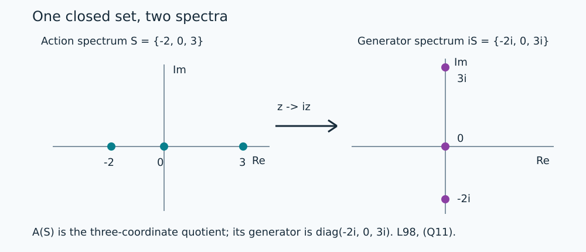

# Closed-set Fourier quotients and their full generators

A closed subset of the real line can be realized as the action spectrum of a modulation group. Its generator has exactly the rotated spectrum \(iS\). The quotient also has an explicit full generator domain, and every vector in that domain has a representative in the full Fourier generator domain.

*Original expression: CC0-1.0 to the extent of rights held.*

## The quotient and its two frequency descriptions

For a closed \(S\subset\mathbb R\), put
\[
 I(S)=\{f\in A(\mathbb R):f|_S=0\},\qquad A(S)=A(\mathbb R)/I(S),
 \qquad \pi_S f=[f].
 \tag{Q1}
\]
The ideal is closed by \(\|f\|_\infty\leq\|f\|_A\), and is a multiplication ideal. The quotient is complete: from a Cauchy sequence choose a subsequence with successive quotient differences below \(2^{-j-1}\), lift these differences with \(A\)-norm below \(2^{-j}\), and sum the absolutely convergent series in \(A(\mathbb R)\). Its quotient is the subsequence limit; the Cauchy property gives convergence of the whole sequence. Thus \(A(S)\) is a Banach algebra with the quotient norm.

Each class is identified with its restriction to \(S\). This is injective by the definition of \(I(S)\), and each evaluation has norm at most one, since \(|f(q)|\leq\|f+h\|_A\) for all \(h\in I(S)\), \(q\in S\). The modulation group from [L97](OA-FLOW-L97.md#oa-flow.recip.modulation) preserves \(I(S)\) and induces
\[
 (\rho_t^S a)(q)=e^{itq}a(q).
 \tag{Q2}
\]
It is contractive in the quotient norm. Its inverse is contractive too, so it is isometric. The inequality
\(\|\rho_t^S[f]-[f]\|\leq\|\rho_t f-f\|_A\) proves strong continuity.

[AF2](OA-FLOW-AF.md#af-2) classifies the nonzero continuous characters of \(A(\mathbb R)\) as evaluations. Composition with the onto map \(\pi_S\) therefore identifies every character of \(A(S)\) with evaluation at a point annihilating \(I(S)\). Those points are exactly \(S\): for a point outside this closed set, RF1 gives a smooth bump equal to one at that point and supported off \(S\). Evaluations at points of \(S\) are nonzero, again by a bump. The identification is a homeomorphism for the character topology. Continuity follows because every \(f\in A(\mathbb R)\) is continuous; inverse continuity follows from a bump supported in any chosen neighborhood and nonzero at its center.

For a Fourier filter \(h=\widehat k\), [L24's bounded-map integral rule](OA-FLOW-L24.md#oa-flow.grp.vectorintegration) and evaluation give
\[
 (\rho^S)_h[f]=\int k(t)\rho_t^S[f]\,dt=[hf].
 \tag{Q3}
\]
Hence the action-annihilator ideal is exactly \(I(S)\). Indeed \(h|_S=0\) annihilates every product; conversely, if all these products vanish, evaluate at each \(q\in S\) using a bump \(f\) with \(f(q)=1\). The hull of \(I(S)\) is \(S\), by the same cutoff separation. Consequently
\[
 \operatorname{Sp}(A(S))\cong S,\qquad \operatorname{Sp}(\rho^S)=S.
 \tag{Q4}
\]
For \(S=\varnothing\), the quotient is zero and both sets are empty.

## The full domain, including lifting to the Fourier algebra

Let \(D_S\) be the norm generator of \(\rho^S\). Then
\[
 D(D_S)=\{a\in A(S):q\mapsto iqa(q)\text{ is the restriction of an element of }A(\mathbb R)\},
 \qquad (D_Sa)(q)=iqa(q).
 \tag{Q5}
\]
For the forward inclusion, evaluate the norm difference quotient at each \(q\in S\). Conversely, suppose \(b\in A(S)\) satisfies \(b(q)=iqa(q)\). Evaluation of the norm integral gives
\[
 \rho_t^S a-a=\int_0^t\rho_u^S b\,du
 \tag{Q6}
\]
because the evaluations separate quotient classes. Dividing by \(t\) gives the norm derivative \(b\), with precisely the estimate (R10). This proves the entire domain statement without an assertion about a selected representative.

In fact a domain representative can always be chosen:
\[
 \pi_S(D(D_\rho))=D(D_S).
 \tag{Q7}
\]
The inclusion from left to right follows by applying the bounded quotient map to difference quotients. For the reverse inclusion take \(a\in D(D_S)\) and lift \((I-D_S)a\) to \(f\in A(\mathbb R)\). The full norm Laplace theorem [L95](OA-FLOW-L95.md#oa-flow.res.norm) gives \(g=(I-D_\rho)^{-1}f\in D(D_\rho)\). Since the quotient intertwines the two groups, passing it through the norm Laplace integral gives
\[
 \pi_Sg=(I-D_S)^{-1}\pi_Sf=a.
\]
Both inverse identities apply on their full domains, so no lifting assumption is hidden.

For each \(q\in S\), evaluation annihilates \((D_S-iq)D(D_S)\) but is a nonzero functional on \(A(S)\). This map is not onto. Thus \(iS\subset\sigma(D_S)\). L95 also supplies every off-axis resolvent.

## Reciprocal multipliers and exact spectrum

Let \(p\notin S\). Choose a smooth compact \(\theta\), equal to one near \(p\), supported in an interval disjoint from \(S\), and put \(b_p=(1-\theta)/(i(\,\cdot-p))\). By [L97](OA-FLOW-L97.md#oa-flow.recip.tail), \(b_p\in A(\mathbb R)\). Multiplication defines a bounded map
\[
 B_p[f]=[b_pf],\qquad \|B_p\|\leq\|b_p\|_A.
 \tag{Q8}
\]
It is well defined since \(I(S)\) is an ideal. Formula (R11) puts \(b_pf\) in \(D(D_\rho)\), so \(B_pA(S)\subset D(D_S)\). Since \(\theta|_S=0\),
\[
 (D_S-ip)B_p[f]=[(1-\theta)f]=[f].
 \tag{Q9}
\]
The multiplier commutes with every \(\rho_t^S\). Applying it to the norm difference quotient proves that it preserves \(D(D_S)\) and commutes with \(D_S\) there. Therefore
\[
 B_p(D_S-ip)a=(D_S-ip)B_pa=a\quad(a\in D(D_S)).
 \tag{Q10}
\]
This proves both inverse identities and the full range assertion. Combining them with (Q5) and the off-axis Laplace resolvents yields
\[
 \boxed{\sigma(D_S)=iS.}
 \tag{Q11}
\]
On the zero space the unique operator is invertible as a map of the zero space, so this spectrum is empty as required.

**Example.** For \(S=\{0\}\), evaluation identifies \(A(S)\) with \(\mathbb C\), the group is the identity, and \(D_S=0\). For \(S=\{-2,0,3\}\), disjoint smooth bumps give every function on these three points. In that coordinate basis \(D_S=\operatorname{diag}(-2i,0,3i)\). More generally every closed, possibly unbounded, \(S\) occurs by the same quotient theorem.

The plotted coordinates are exactly the three-point example of (Q11), with the same scale on both axes. Multiplication by \(i\) rotates the points by a right angle; the diagram makes no claim that the quotient norm is a Euclidean norm. [Editable diagram](../assets/generator-domains/quotient-spectrum.svg), original CC0-1.0 expression.

The mathematical source is Takesaki, *Theory of Operator Algebras II*, Corollary XI.1.22, printed pp.327–328 ([edition](https://doi.org/10.1007/978-3-662-10451-4)). The norm generator and Laplace proofs used here are the earlier L94–L95 results.
