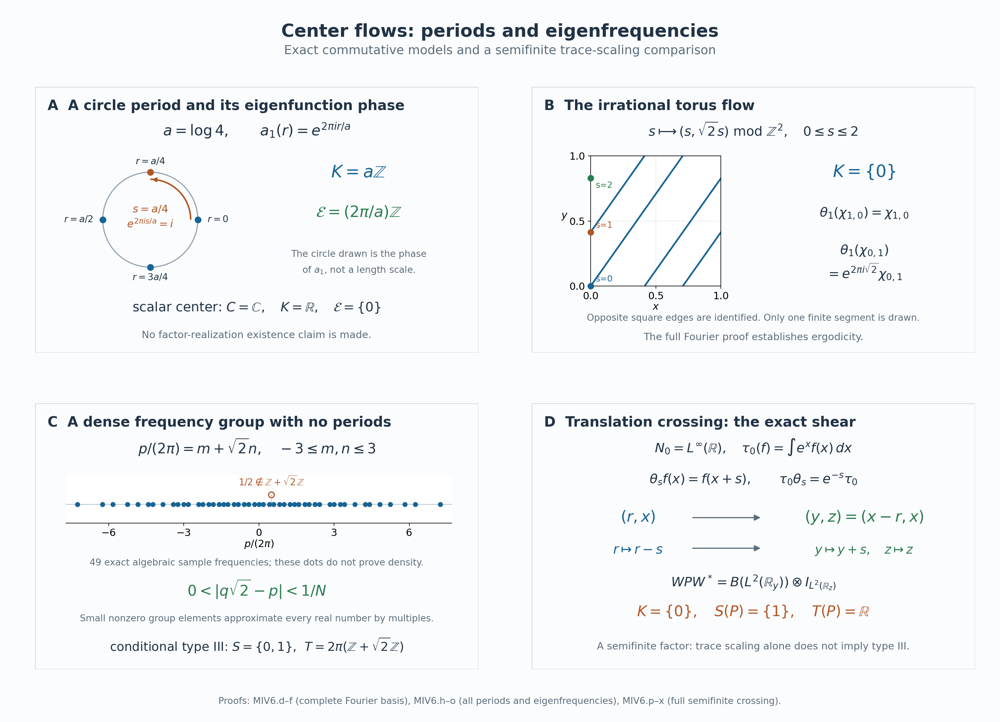
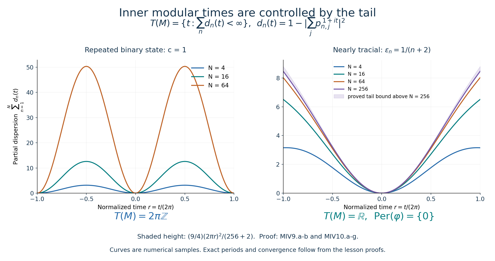
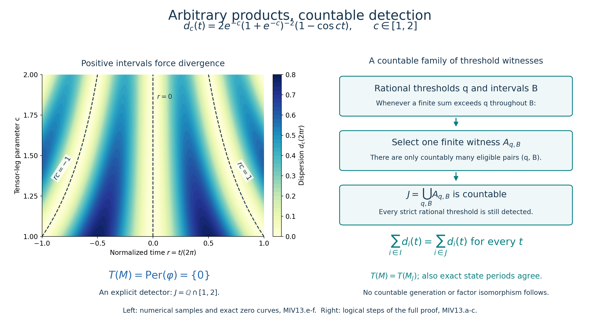
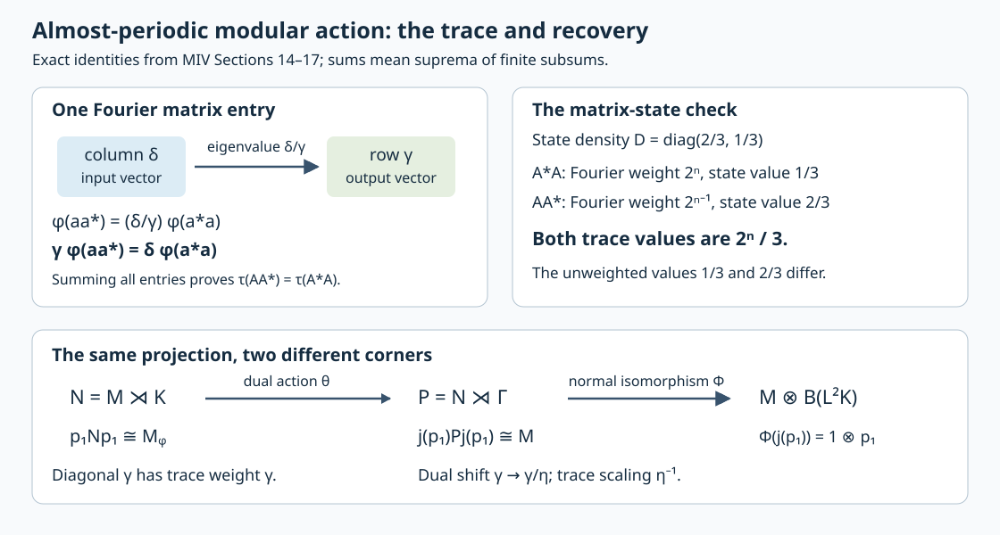
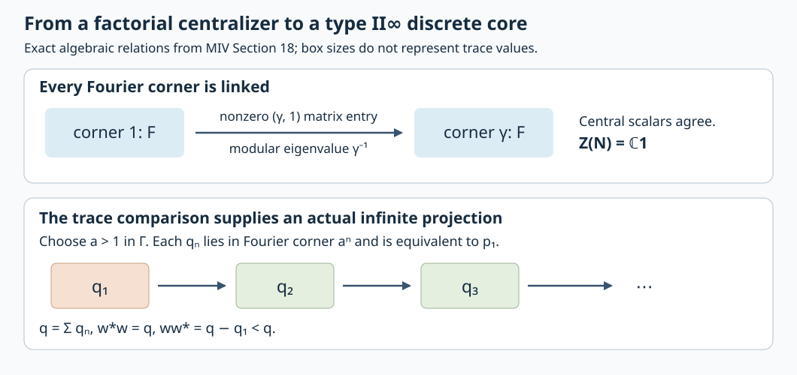
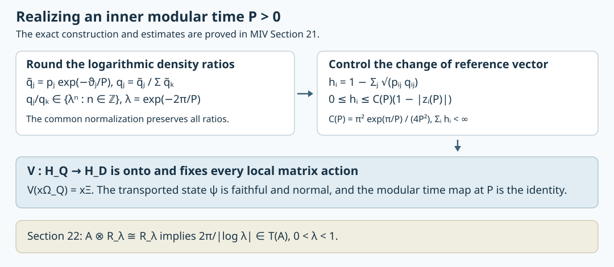
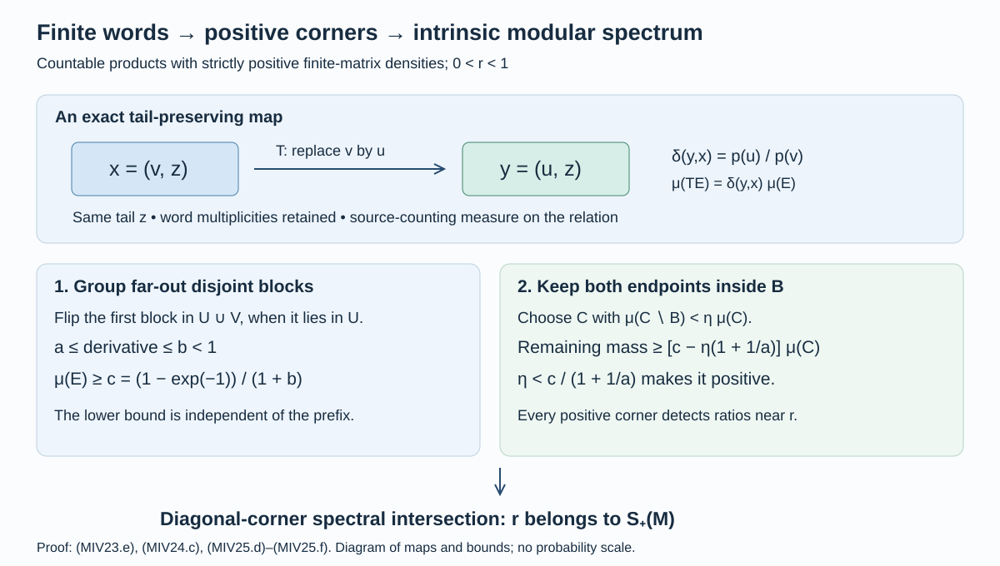
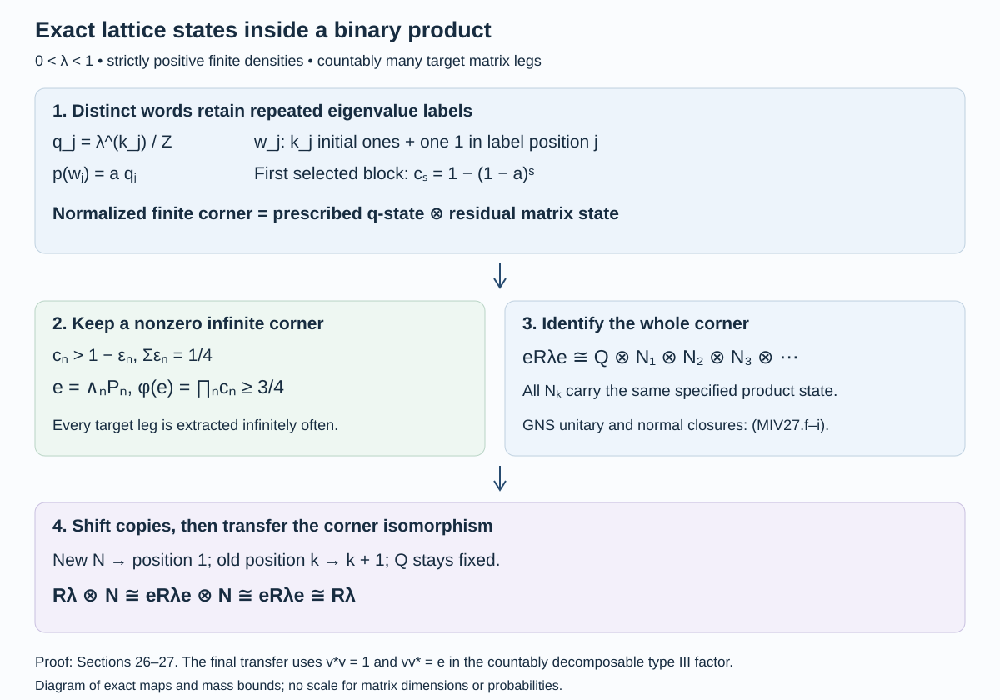
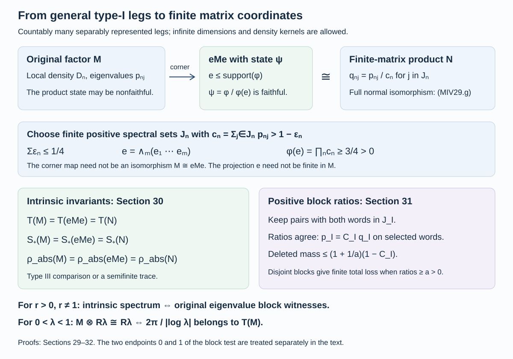
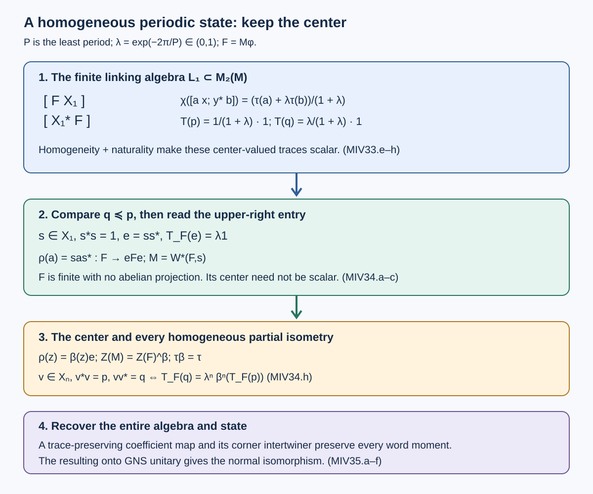

# Modular spectra, periods and almost-periodic states

*Original exposition and illustration sources: CC0-1.0; earlier and font components retain their recorded terms.*

Two different subsets of the real line occur in the modular theory of a factor. One consists of times that fix its whole center flow. The other consists of frequencies carried by central eigenunitaries. The first determines the spectrum shared by all modular operators; the second determines when a modular automorphism is inner. We prove both identifications, keeping all faithful normal semifinite weights and arbitrary predual size.

## A trace-scaling presentation of the factor

Let \(N\ne0\) be a von Neumann algebra, let \(\theta:\mathbb R\to\operatorname{Aut}(N)\) be point-ultraweakly continuous, and let \(\tau\) be a faithful normal semifinite trace satisfying
\[
 \tau\circ\theta_s=e^{-s}\tau.
\tag{MIV0.a}
\]
Assume that the crossed product
\[
 P=N\rtimes_\theta\mathbb R
\tag{MIV0.b}
\]
is a type III factor. Here type III means that it has no nonzero finite projection. Every type III factor admits such a presentation at arbitrary predual size by [Continuous decompositions](OA-FLOW-CDEC.md#cdec-3). We identify \(N\) with its faithful normal coefficient copy in \(P\), and write \(u(s)\) for the crossed-product unitaries. Thus
\[
 u(s)xu(s)^*=\theta_s(x)\qquad(x\in N).
\tag{MIV0.c}
\]
The original group parameter is \(s\). We label dual characters by \(\chi_t(s)=e^{its}\); the dual action uses the multiplier \(\overline{\chi_t(s)}=e^{-its}\).

Let \(\Phi\) be the full dual weight of \(\tau\). The [modular and fixed-algebra calculation](OA-FLOW-L18.md#l18-1) proves, on the entire algebras,
\[
 \begin{aligned}
 \sigma_t^\Phi(x)&=x &&(x\in N),&
 \sigma_t^\Phi(u(s))&=e^{-its}u(s),\\
 P_\Phi&=N,&Z(P)&=Z(N)^\theta.
 \end{aligned}
\tag{MIV0.d}
\]
In particular \(\Phi\) is faithful normal semifinite and, on putting \(C=Z(N)\), we have \(C^\theta=\mathbb C1\). This is ergodicity of the center flow. The coefficient algebra \(N\) need not be a factor.

Our two modular invariants are
\[
 \begin{aligned}
 S(P)&=\bigcap_{\psi\ {\rm faithful\ normal\ semifinite}}
                  \operatorname{Sp}(\Delta_\psi),\\
 T(P)&=\{p\in\mathbb R:\sigma_p^\psi
                         \text{ is inner}\}.
 \end{aligned}
\tag{MIV0.e}
\]
The intersection in the first line includes every such weight, without requiring finite total mass. The second line is independent of the weight; Section 5 proves this explicitly. The modular operators and their spectra are those of the complete GNS constructions, including their unbounded domains.

There is no separability or sigma-finiteness assumption on either algebra or on its represented Hilbert space. The countable Fourier expansions in particular examples do not change these hypotheses. Some examples below are comparisons of commutative flows; assertions about a factor with such an associated flow are stated conditionally. The semifinite comparison is explicitly separated from the type III hypothesis in (MIV0.b).

## 1. The center kernel through the full second crossing

Denote the coefficient inclusion by \(i:N\to P\), and put
\[
 K=\{s\in\mathbb R:\theta_s(z)=z\text{ for every }z\in C\}.
\]

Put \(\alpha=\sigma^\Phi=\widehat\theta\), with the equality supplied by [L18's dual-weight calculation](OA-FLOW-L18.md#l18-1), and write
\[
 D=P\rtimes_\alpha\mathbb R.
\]
Let \(j:P\to D\) be the coefficient map and \(v(t)\) its implementing unitary group. With the original Haar measure \(ds\) and its dual \(dt/(2\pi)\), the remaining dual action is
\[
 \delta_s(j(y))=j(y),\qquad
 \delta_s(v(t))=e^{-ist}v(t)
 \quad(y\in P).
 \tag{MIV1.a}
\]
The character used to label \(s\) on the second group is \(t\mapsto e^{ist}\); the dual action uses its conjugate. Haar rescaling gives the same normally represented crossed product: multiplication of \(L^2\) functions by the square root of the constant measure ratio is an onto unitary intertwining coefficient fields and translations. Thus choosing this dual Haar measure imposes no additional hypothesis on the modular action.

The full [normal double-duality construction](OA-FLOW-ND.md#nd-construction), applied to the original action \(\theta\), gives a normal isomorphism with normal inverse
\[
 \Xi:D\longrightarrow
       N\,\overline\otimes\,B(L^2(\mathbb R,dr)).
 \tag{MIV1.b}
\]
In an arbitrary faithful normal representation \(N\subseteq B(H)\), its exact values are
\[
 \begin{aligned}
 \bigl[\Xi(j(i(x)))\xi\bigr](r)&=\theta_{-r}(x)\xi(r),\\
 \Xi(j(u(s)))&=1\otimes L_s,
       & [L_s\xi](r)&=\xi(r-s),\\
 \Xi(v(t))&=1\otimes Q_t,
       & [Q_t\xi](r)&=e^{-itr}\xi(r).
 \end{aligned}
 \tag{MIV1.c}
\]
These formulas describe the full map. For its existence and onto image, ND first uses the partial Fourier unitary on the second real variable, then the shear \((q,r)\mapsto(q+r,r)\), and finally tensor regrouping. If \(\mathscr W\) is their composite and
\[
 [\rho(x)\eta](q)=\theta_{-q}(x)\eta(q),
\]
then its [whole-domain inverse formulas](OA-FLOW-ND.md#nd-inverse) are
\[
 \begin{aligned}
 \Xi(Y)&=(\rho^{-1}\bar\otimes\mathrm{id})
                 (\mathscr W Y\mathscr W^*),\\
 \Xi^{-1}(Z)&=\mathscr W^*
                 (\rho\bar\otimes\mathrm{id})(Z)\mathscr W .
 \end{aligned}
 \tag{MIV1.d}
\]
Here \(\rho\) is faithful and normal onto its von Neumann image. The [finite-matrix tensor proof](OA-FLOW-ND.md#nd-tensor) constructs both tensor maps normally on the entire tensor algebras. The [orbit-field and Weyl-pair proof](OA-FLOW-ND.md#nd-orbits) identifies the image after the Fourier transform and shear with that whole tensor algebra. Consequently (MIV1.d) proves normality and surjectivity of (MIV1.b), including its inverse; covariance on generators alone is not being used to obtain normal extension.

Let \(R_s\xi(r)=\xi(r+s)\). The surviving action is
\[
 \Xi\delta_s\Xi^{-1}
       =\theta_s\bar\otimes\operatorname{Ad}R_s .
 \tag{MIV1.e}
\]
One can check its sign on each family in (MIV1.c). On the coefficient field, the right translation first changes \(\theta_{-r}(x)\) to \(\theta_{-(r+s)}(x)\), and \(\theta_s\) restores it. Left and right translations commute. Finally
\[
 R_sQ_tR_s^*=e^{-ist}Q_t,
\]
which is exactly (MIV1.a). Both actions are normal and the three families generate the algebra, so these checks prove (MIV1.e) everywhere.

We need the entire center of the tensor algebra in (MIV1.b). Put \(K_0=L^2(\mathbb R,dr)\), choose an orthonormal basis \((e_k)\), and use its matrix units \(E_{kl}\). An operator \(Z\in N\bar\otimes B(K_0)\) has entries \(Z_{kl}\in N\), by the finite-compression proof in ND. If \(Z\) is central, commutation with \(1\otimes E_{kk}\) makes its off-diagonal entries zero; commutation with \(1\otimes E_{kl}\) makes all diagonal entries the same \(z\in N\). Equality of the operators follows on the dense finite-coordinate vectors, so \(Z=z\otimes1\). Commutation with every \(x\otimes1\) now says \(z\in Z(N)\). Conversely such a \(z\otimes1\) commutes with the algebraic tensor generators, and separate ultraweak continuity of multiplication extends this to their von Neumann closure. Hence
\[
 Z(N\bar\otimes B(K_0))=Z(N)\otimes1 .
 \tag{MIV1.f}
\]
The map \(z\mapsto z\otimes1\) is normal: for each positive bounded increasing net, its supremum is detected on elementary vectors, hence on all vectors by density and boundedness. Its inverse on this range is compression by the isometry \(\eta\mapsto\eta\otimes e_{k_0}\), and is normal as well. Thus (MIV1.f) is a normal identification in both directions, not just an algebraic center equality. No countable basis of \(H\), or of a representation of \(N\), has been assumed.

It follows that
\[
 \kappa_C:C=Z(N)\longrightarrow Z(D),\qquad
 \kappa_C(z)=\Xi^{-1}(z\otimes1)
\]
is an onto normal isomorphism with normal inverse. Equations (MIV1.e)–(MIV1.f) give
\[
 \delta_s\kappa_C(z)=\kappa_C(\theta_s(z)),\qquad
 \ker(\delta|_{Z(D)})=\ker(\theta|_C)=K .
 \tag{MIV1.g}
\]
This is the center map used here. The original coefficient \(j(i(z))\) has image \(r\mapsto\theta_{-r}(z)\), which need not be constant or central in the full tensor algebra.

For each \(z\in C\), the set \(\{s:\theta_s(z)=z\}\) is closed, since every normal functional evaluated on \(\theta_s(z)-z\) is continuous and the predual separates points. Their intersection \(K\) is therefore closed. The action law gives \(0\in K\), closure under addition, and closure under inverses. Thus \(K\) is a closed additive subgroup of \(\mathbb R\).

Finally apply the [dual-center kernel theorem, L115 equation K43](OA-FLOW-L115.md#oa-flow.connes.centerkernel), to \(\alpha=\sigma^\Phi\) on \(P\). Its hypotheses are a point-ultraweakly continuous action on an arbitrary von Neumann algebra and a locally compact Hausdorff abelian group. They all hold here. Its crossed product is \(D\), and its negative-character dual action is precisely \(\delta\). Therefore (MIV1.g) proves
\[
 \boxed{\ \Gamma(\sigma^\Phi)=K.\ }
 \tag{MIV1.h}
\]
L115's [Fourier conventions](OA-FLOW-L115.md#oa-flow.l115.conventions) identify the positive and negative conventions for whole action spectra: adjoint reflection makes those spectra symmetric. No reflection of an individual spectral vector is presumed. In particular the real subgroup in (MIV1.h) is expressed in the original parameter \(s\), with no extra \(2\pi\) factor. The proof of this section works for every specified trace-scaling system; factoriality and type III will enter the all-weight and zero-spectrum steps.

## 2. Intersect over all faithful semifinite weights

Let \(\mathcal W_0(P)\) be the set of all faithful normal semifinite weights on \(P\). It is nonempty because \(\Phi\) belongs to it. For \(\psi\in\mathcal W_0(P)\), let \(\Delta_\psi\) be its complete modular operator on its GNS Hilbert space. Put
\[
 S_+(P)=
 \left(\bigcap_{\psi\in\mathcal W_0(P)}
                \operatorname{Sp}(\Delta_\psi)\right)
                 \cap(0,\infty).
 \tag{MIV2.a}
\]
The separate GNS Hilbert spaces present no difficulty: each spectrum is a subset of the same scalar half-line. All weights in this intersection may have infinite value at the identity.

We first recall the exact analytic link between a modular action and its operator. With the positive Fourier convention
\(\widehat f(r)=\int_{\mathbb R}f(t)e^{itr}\,dt\), put
\[
 T_f^\psi(x)=\int_{\mathbb R} f(t)\sigma_t^\psi(x)\,dt
 \quad(f\in L^1(\mathbb R)).
\]
The integral is normal and weak-star. The full GNS filter theorem [MG0](OA-FLOW-MG.md#oa-flow.mg.0) proves, on every element of the finite left ideal,
\[
 \begin{gathered}
 T_f^\psi(\mathfrak n_\psi)\subseteq\mathfrak n_\psi,\\
 \Lambda_\psi(T_f^\psi x)
    =\widehat f(\log\Delta_\psi)\Lambda_\psi(x),
       \qquad x\in\mathfrak n_\psi .
 \end{gathered}
 \tag{MIV2.b}
\]
That theorem obtains the domain inclusion from simultaneous bounded operator sums and convergent Hilbert-vector sums, followed by the closed GNS graph. Thus (MIV2.b) holds even though the GNS map need not be bounded on operator balls.

Here is how it gives the entire action spectrum. If \(T_f^\psi=0\), the multiplier on the right of (MIV2.b) vanishes on the dense range of \(\Lambda_\psi\), hence is zero. Conversely a zero multiplier makes \(\Lambda_\psi(T_f^\psi x)=0\) for every \(x\in\mathfrak n_\psi\). Faithfulness gives \(T_f^\psi x=0\). The finite left ideal is ultraweakly dense and \(T_f^\psi\) is normal, so it vanishes everywhere. The full spectral-support argument in [MG1](OA-FLOW-MG.md#oa-flow.mg.1) identifies the resulting filter annihilator:
\[
 \begin{aligned}
 \operatorname{Sp}(\sigma^\psi)
       &=\operatorname{Sp}(\log\Delta_\psi),\\
 \exp\operatorname{Sp}(\sigma^\psi)
       &=\operatorname{Sp}(\Delta_\psi)\cap(0,\infty).
 \end{aligned}
 \tag{MIV2.c}
\]
Indeed a neighborhood of a positive number \(\lambda\) has nonzero \(\Delta_\psi\)-spectral projection exactly when its logarithmic image has nonzero \(\log\Delta_\psi\)-spectral projection. MG1 proves the support criterion from the full resolvents and squared spectral-domain integrals. The statement at \(\lambda>0\) makes no assertion about zero.

Fix \(\alpha=\sigma^\Phi\), and let \(Z^1_\alpha(\mathbb R,P)\) denote the strongly continuous unitary cocycles:
\[
 w_{t+r}=w_t\alpha_t(w_r).
\]
Such a path is also strongly* continuous. For example,
\(\|(w_t^*-w_{t_0}^*)\xi\|
 =\|(w_{t_0}-w_t)w_{t_0}^*\xi\|\).
The [balanced-cocycle theorem BC4](OA-FLOW-BC.md#oa-flow.bc.4) assigns to every \(\psi\in\mathcal W_0(P)\) a cocycle
\[
 w_t^\psi=(D\psi:D\Phi)_t,\qquad
 \sigma_t^\psi=\operatorname{Ad}(w_t^\psi)\alpha_t .
 \tag{MIV2.d}
\]
Conversely, the complete [unitary-cocycle reconstruction UR0–5](OA-FLOW-UR.md#oa-flow.ur.0) assigns to every \(w\in Z^1_\alpha(\mathbb R,P)\) a unique faithful normal semifinite weight \(\psi_w\) on \(P\), with
\[
 (D\psi_w:D\Phi)_t=w_t,\qquad
 \sigma_t^{\psi_w}=\operatorname{Ad}(w_t)\alpha_t .
 \tag{MIV2.e}
\]
Its hypotheses are exactly a faithful n.s.f. reference and a strongly* continuous unitary cocycle. UR1 constructs the dense mixed analytic space with its GNS curve; UR2 closes its full involution; UR3 recovers a weight on the entire positive cone. UR4 aligns the natural cones, and [UR5's complete relative graph](OA-FLOW-UR.md#oa-flow.ur.5) gives the normalized derivative in (MIV2.e), including its scalar normalization. Thus every cocycle in the intersection below is realized on this same algebra. Neither a finite reference weight nor a countability assumption is required.

Since \(P\) is a factor, \(Z(P)^\alpha=\mathbb C1\). The full [cocycle spectral-intersection theorem L120](OA-FLOW-L120.md#ci-intersection), equation C29, therefore applies:
\[
 \Gamma(\alpha)
   =\bigcap_{w\in Z^1_\alpha(\mathbb R,P)}
         \operatorname{Sp}(\operatorname{Ad}(w)\alpha).
 \tag{MIV2.f}
\]
The [actual setting of L120](OA-FLOW-L120.md#ci-setting) allows arbitrary Hilbert dimension and arbitrary algebra cardinality. Its central-ergodicity assumption, just verified, is the only additional action hypothesis needed here. Its proof compares the reduced spectra of every nonzero fixed corner. The [matrix transport](OA-FLOW-L120.md#ci-transport) preserves the entire action spectrum under amplification by any nonzero Hilbert space; the first-corner construction fixes the prescribed corner exactly before lifting to a cocycle. The resulting containment for each fixed projection is what yields C29. Full central support alone is not substituted for an isomorphism \(ePe\cong P\).

We prove both inclusions in the weight intersection. If \(r\in\Gamma(\alpha)\), (MIV2.f) puts \(r\) in the spectrum of the perturbation associated with every \(\psi\) in (MIV2.d). Equation (MIV2.c) then puts \(e^r\) in every \(\operatorname{Sp}(\Delta_\psi)\), so \(e^r\in S_+(P)\).

Conversely let \(\lambda\in S_+(P)\) and set \(r=\log\lambda\). For any cocycle \(w\), use the weight \(\psi_w\) from (MIV2.e). Since \(\lambda\) belongs to that weight's complete modular spectrum, (MIV2.c) puts \(r\) in
\(\operatorname{Sp}(\operatorname{Ad}(w)\alpha)\).
This holds for every \(w\); (MIV2.f) therefore gives \(r\in\Gamma(\alpha)\). We have proved
\[
 \boxed{\quad S_+(P)=\exp\Gamma(\sigma^\Phi)=\exp K.\quad}
 \tag{MIV2.g}
\]
The logarithm and exponential in this proof are inverse bijections at positive scalar values. No closure operation at zero has been moved through an intersection.

Only factoriality was used in the comparison leading to the first equality in (MIV2.g). Thus the same argument proves, for every nonzero factor \(A\) and every faithful n.s.f. reference weight \(\omega\),
\[
 \left(\bigcap_{\psi\in\mathcal W_0(A)}
                \operatorname{Sp}(\Delta_\psi)\right)
       \cap(0,\infty)
       =\exp\Gamma(\sigma^\omega).
 \tag{MIV2.h}
\]
Such a reference always exists by [FR1](OA-FLOW-FR.md#oa-flow.fr.1), whose proof uses an arbitrary orthogonal family of normal-state supports. Formula (MIV2.h) is independent of the reference because its left side is. The proof used the unrestricted cocycle reconstruction and cocycle intersection; it did not use the separable-predual corner-isomorphism conclusion in MG4.

## 3. Zero belongs to each complete modular spectrum

We retain the type III hypothesis on \(P\). In fact the argument in this section applies to any nonzero type III algebra equipped with a faithful normal semifinite weight. Fix such a weight \(\psi\). Its complete modular data satisfy the closed-operator identity
\[
 J_\psi\Delta_\psi J_\psi=\Delta_\psi^{-1}.
 \tag{MIV3.a}
\]
This includes equality of domains; \(\Delta_\psi\) is injective, even when zero belongs to its spectrum.

Suppose, for a contradiction, that \(0\notin\operatorname{Sp}(\Delta_\psi)\). The exact [reciprocal-domain argument in MT1](OA-FLOW-MT.md#oa-flow.mt.1) then gives a number \(0<c<1\) such that
\[
 cI\le\Delta_\psi\le c^{-1}I,\qquad
 L=\log\Delta_\psi=L^*\in B(H_\psi).
 \tag{MIV3.b}
\]
To recall the domain mechanism, the spectral gap at zero makes the reciprocal spectral function bounded, so \(\Delta_\psi^{-1}\) has domain all of \(H_\psi\). Conjugating (MIV3.a) then makes \(\Delta_\psi\) bounded on all of \(H_\psi\) as well. The same full spectral calculus makes the logarithm bounded, with \(\|L\|\le|\log c|\).

Identify \(P\) with its faithful normal GNS image. Modular implementation gives
\(\sigma_t^\psi(x)=e^{itL}xe^{-itL}\).
The norm-convergent exponential series yields the operator-norm limit
\[
 d(x)=\lim_{t\to0}\frac{\sigma_t^\psi(x)-x}{t}
       =i[L,x]\in P,\qquad
 \|d\|\le2\|L\|.
 \tag{MIV3.c}
\]
Membership in \(P\) follows because every difference quotient lies in its norm-closed image. The commutator identities show that \(d\) is a bounded star derivation. The [already-bounded implementer construction used in MT2](OA-FLOW-MT.md#oa-flow.mt.2) supplies \(b=b^*\in P\) with \(d(x)=i[b,x]\). The two norm-continuous groups with this bounded generator agree: differentiating \(e^{-td}\sigma_t^\psi\) gives zero derivative and value the identity at zero, and the same calculation applies to \(\operatorname{Ad}(e^{itb})\). Hence
\[
 \sigma_t^\psi=\operatorname{Ad}(e^{itb}),\qquad
 b\in P_\psi .
 \tag{MIV3.d}
\]
The last assertion follows by applying the first to \(b\). This argument invokes the proved bounded-derivation result inside MT2; it requires no automatic boundedness assertion about arbitrary derivations.

Put \(h=e^{-b}\). It is bounded, positive, invertible, and belongs to the centralizer. The [whole-positive-cone construction in MT3](OA-FLOW-MT.md#oa-flow.mt.3), using the bounded centralizer-density theorem, defines
\[
 \eta(a)=\psi(h^{1/2}ah^{1/2})
 \quad(a\in P_+)
\]
and proves
\[
 e^{-\|b\|}\psi\le\eta\le e^{\|b\|}\psi,\qquad
 \sigma_t^\eta(x)
   =h^{it}\sigma_t^\psi(x)h^{-it}=x .
 \tag{MIV3.e}
\]
These weight inequalities hold on the entire positive cone, including infinite values. They make \(\eta\) faithful and give exactly the same finite left ideal as \(\psi\), so semifiniteness is preserved. Normality follows from normal compression and normality of \(\psi\). The full trace criterion in MT3 now gives
\[
 \eta(x^*x)=\eta(xx^*)\quad(x\in P),
 \tag{MIV3.f}
\]
also when the values are infinite. Thus \(\eta\) is a faithful normal semifinite trace.

For completeness, here is the projection contradiction from [MT4](OA-FLOW-MT.md#oa-flow.mt.4). Semifiniteness on the nonzero algebra gives \(0\ne x\in\mathfrak n_\eta\). Then \(a=x^*x\ne0\) has \(0<\eta(a)<\infty\). Some spectral projection
\[
 q=1_{[\varepsilon,\infty)}(a),\qquad \varepsilon>0,
\]
is nonzero, since these projections increase to the support of \(a\) as \(\varepsilon\downarrow0\). Spectral order and faithfulness give
\[
 0<\eta(q)\le\varepsilon^{-1}\eta(a)<\infty.
 \tag{MIV3.g}
\]
If \(q'\le q\) is equivalent to \(q\), choose \(w\in P\) with \(w^*w=q\), \(ww^*=q'\). Equation (MIV3.f) gives \(\eta(q)=\eta(q')\). Additivity at \(q=q'+(q-q')\), and the finite value already proved in (MIV3.g), imply \(\eta(q-q')=0\). Faithfulness gives \(q'=q\). Therefore \(q\) is finite, contradicting the definition of type III.

The contradiction proves, for every weight in the full defining intersection,
\[
 0\in\operatorname{Sp}(\Delta_\psi)
 \quad(\psi\in\mathcal W_0(P)).
 \tag{MIV3.h}
\]
The spectrum of each positive self-adjoint modular operator is contained in \([0,\infty)\). Combining (MIV3.h) with (MIV2.g) therefore gives the complete invariant
\[
 \boxed{\quad
 S(P)=\bigcap_{\psi\in\mathcal W_0(P)}
                    \operatorname{Sp}(\Delta_\psi)
       =\{0\}\cup\exp K .
 \quad}
 \tag{MIV3.i}
\]
No weight in the intersection has been replaced by a state or by a restriction to a countably decomposable corner. The zero term was proved separately for each full modular operator. It is compatible with injectivity: \(E_{\Delta_\psi}(\{0\})=0\) excludes a zero eigenvector, whereas (MIV3.h) says there is no bounded everywhere-defined inverse.

## 4. Three closed kernels and three modular spectra

The preceding sections have identified
\[
 K=\{s\in\mathbb R:\theta_s|_C=\operatorname{id}\},
 \qquad S(P)=\{0\}\cup\exp K.
\tag{MIV4.a}
\]
Here \(K\) is a closed additive subgroup, and \(\exp K=\{e^s:s\in K\}\). We now classify these subsets directly.

If \(K\) has no positive element, symmetry under negation gives \(K=\{0\}\). Otherwise let
\[
 a=\inf\bigl(K\cap(0,\infty)\bigr).
\tag{MIV4.b}
\]
Suppose first that \(a=0\). Choose \(k_n\in K\) with \(0<k_n<1/n\). For any \(r\in\mathbb R\), put \(m_n=\lfloor r/k_n\rfloor\). Then
\[
 0\le r-m_nk_n<k_n,\qquad m_nk_n\in K.
\tag{MIV4.c}
\]
Thus \(r\) is a limit of points of \(K\), so closedness gives \(r\in K\). Consequently \(K=\mathbb R\).

If \(a>0\), the definition of the infimum supplies \(k_n\in K\cap(0,\infty)\) tending to \(a\). Closedness puts \(a\) in \(K\). Given \(r\in K\), divide by \(a\): for \(m=\lfloor r/a\rfloor\),
\(r-ma\in K\cap[0,a)\). A positive remainder would contradict the definition of \(a\). Hence \(r=ma\), and conversely every integer multiple of \(a\) is in \(K\). We have proved the complete list
\[
 K=\{0\},\qquad K=a\mathbb Z\ (a>0),\qquad K=\mathbb R.
\tag{MIV4.d}
\]
This proof includes negative \(r\) and uses neither a measurable model of the center nor a countability assumption on its algebra.

Ergodicity identifies the last case precisely. If \(K=\mathbb R\), every element of \(C\) is fixed, so \(C=C^\theta=\mathbb C1\). If \(C=\mathbb C1\), every automorphism fixes it, so \(K=\mathbb R\). Therefore
\[
 K=\mathbb R\quad\Longleftrightarrow\quad C=\mathbb C1.
\tag{MIV4.e}
\]
In the case \(K=a\mathbb Z\), \(a\) is exactly the least positive period of the center flow. Put \(\lambda=e^{-a}\), so \(0<\lambda<1\). Negating the integer index gives
\(\exp(a\mathbb Z)=\lambda^{\mathbb Z}\). In the case \(K=\{0\}\), the center flow is faithful as an action of \(\mathbb R\), and its center cannot be scalar by (MIV4.e). Combining with (MIV4.a) gives:

| Center-flow condition | Modular spectrum \(S(P)\) | Type |
| --- | --- | --- |
| Kernel \(a\mathbb Z\), with least positive period \(a>0\) | \(\{0\}\cup\{\lambda^n:n\in\mathbb Z\}\), \(\lambda=e^{-a}\) | \({\rm III}_\lambda\) |
| Kernel \(\{0\}\) | \(\{0,1\}\) | \({\rm III}_0\) |
| Scalar center, equivalently kernel \(\mathbb R\) | \([0,\infty)\) | \({\rm III}_1\) |

These are equivalent spectral and center-flow descriptions of the subtypes of a given type III factor. The implications go in both directions: the positive part of \(S(P)\) recovers \(K\) by the logarithm, and (MIV4.d)–(MIV4.e) recover the corresponding center-flow condition. This is not an isomorphism classification within a subtype or an existence proof for a factor realizing a prescribed flow.

A trivial flow has every real time in its kernel. A faithful aperiodic flow has only zero in its kernel. The distinction between these statements, rather than the phrase “no least positive period,” separates the last two rows.

## 5. Inner modular times are central eigenfrequencies

We first verify that the definition of \(T(P)\) is independent of \(\psi\). If \(\psi,\eta\) are faithful normal semifinite weights, the [balanced cocycle covariance theorem](OA-FLOW-BC.md#oa-flow.bc.4) gives unitary elements
\[
 v_t=[D\eta:D\psi]_t,\qquad
 \sigma_t^\eta=\operatorname{Ad}(v_t)\circ\sigma_t^\psi.
\tag{MIV5.a}
\]
For each fixed \(p\), the right side differs from \(\sigma_p^\psi\) by an inner automorphism. A composition of two inner automorphisms is inner, and the inverse of an inner automorphism is inner. It follows that \(\sigma_p^\eta\) is inner exactly when \(\sigma_p^\psi\) is inner. The modular group law also shows that \(T(P)\) is an additive subgroup: inner times are closed under addition and negation and contain zero. No closedness of this subgroup is asserted.

Define the central eigenfrequency group by
\[
 E_\theta(C)=
 \{p\in\mathbb R:\text{there is }a\in\mathcal U(C)
                 \text{ with }\theta_s(a)=e^{isp}a
                 \text{ for every }s\in\mathbb R\}.
\tag{MIV5.b}
\]
Then
\[
 \boxed{\quad T(P)=E_\theta(C).\quad}
\tag{MIV5.c}
\]
The units in (MIV5.b) are bounded elements of the whole center, and the equations are operator equalities for every \(s\).

To prove the forward implication, use weight independence to choose \(\Phi\). Let \(p\in T(P)\), and choose a unitary \(a\in P\) with
\(\sigma_p^\Phi=\operatorname{Ad}(a)\).
The whole-positive modular invariance gives
\[
 \Phi\circ\operatorname{Ad}(a)=\Phi.
\tag{MIV5.d}
\]
The [weight-preserving-unitary criterion](OA-FLOW-CZ.md#cz-0) now puts \(a\) in \(P_\Phi=N\). Its proof works on the full finite ideal of an arbitrary semifinite weight: preservation gives right stability and the finite cyclic identity, and the modular strip test then proves that the unitary is in the centralizer. In particular this step is valid when \(\Phi(1)=\infty\). It is also the precise mechanism in [PW1](OA-FLOW-PW.md#pw-1).

By (MIV0.d), \(\sigma_p^\Phi\) fixes \(N\) pointwise. Therefore \(a\), already known to belong to \(N\), commutes with every element of \(N\). Thus \(a\in C\). Apply its adjoint action to \(u(s)\). Covariance and (MIV0.d) give
\[
 a\theta_s(a^*)u(s)=a u(s)a^*
                 =e^{-ips}u(s).
\tag{MIV5.e}
\]
Cancel the unitary \(u(s)\), multiply by \(a^*\), and take adjoints. The result is
\[
 \theta_s(a)=e^{isp}a\qquad(s\in\mathbb R).
\tag{MIV5.f}
\]
This is (MIV5.b), with its positive eigenfrequency sign.

Conversely let \(a\in\mathcal U(C)\) satisfy (MIV5.f). Its adjoint action fixes \(N\). The same covariance calculation yields
\[
 a u(s)a^*=a\theta_s(a^*)u(s)=e^{-ips}u(s).
\tag{MIV5.g}
\]
Hence \(\operatorname{Ad}(a)\) and \(\sigma_p^\Phi\) agree on \(N\) and on every \(u(s)\). They are normal automorphisms, so agreement on the unital star algebra generated by these operators extends by ultraweak density to all of \(P\). Thus \(\sigma_p^\Phi\) is inner, proving (MIV5.c). The proof did not require a computation of \(N'\cap P\).

The eigenspaces have an additional rigidity. Suppose \(0\ne b\in C\) satisfies
\(\theta_s(b)=e^{isp}b\). Then \(b^*b\in C^\theta=\mathbb C1\), so \(b^*b=c1\) for a positive scalar \(c\). Since \(C\) is abelian, also \(bb^*=c1\). Thus \(c^{-1/2}b\) is an eigenunitary. If \(a_1,a_2\) are two eigenunitaries of frequency \(p\), their product \(a_1a_2^*\) is fixed and central, hence is a scalar of modulus one. We obtain
\[
 \{b\in C:\theta_s(b)=e^{isp}b\ \forall s\}
   =\mathbb C a
 \quad\text{whenever this space is nonzero.}
\tag{MIV5.h}
\]
Products and adjoints give eigenunitaries at frequencies \(p+q\) and \(-p\), respectively. Thus the right side of (MIV5.c) is an additive group directly as well.

The closed period kernel \(K\) and the possibly nonclosed group \(T(P)\) encode different properties. Any \(s\in K\) and \(p\in T(P)\) satisfy
\[
 e^{isp}=1,
\tag{MIV5.i}
\]
because \(\theta_s\) fixes the eigenunitary. This necessary relation does not say that every character trivial on \(K\) occurs as an eigenfrequency. The irrational-flow example below will show why it is essential to distinguish the kernel from the complete eigenfrequency group.

## 6. Periods, eigenfrequencies and a semifinite comparison

For a commutative flow \((C,\theta)\), distinguish its period group from its unitary eigenfrequency group:
\[
 \begin{aligned}
 K(C,\theta)&=\{s\in\mathbb R:\theta_s=\mathrm{id}_C\},\\
 \mathcal E(C,\theta)
 &=\{p\in\mathbb R:\text{some }a\in\mathcal U(C)
                    \text{ satisfies }\theta_s(a)=e^{isp}a
                    \text{ for every }s\}.
 \end{aligned}
 \tag{MIV6.a}
\]
The first records times; the second records frequencies, with the positive phase fixed in [Section 5](#miv-5). We calculate three complete commutative flows. Whenever such a flow is the center flow of a trace-scaling system whose crossing is a type III factor as in the setting, [Sections 3–5](#miv-3) give
\[
 S(P)=\{0\}\cup\exp K(C,\theta),\qquad
 T(P)=\mathcal E(C,\theta).
 \tag{MIV6.b}
\]
The commutative calculations alone do not construct any such factor or assert a factor-realization theorem. Their use of finite-dimensional tori is a property of these examples, not a restriction on the earlier arbitrary-predual theorem.

**The complete Fourier basis needed below.** Put \(\mathbb T=\mathbb R/\mathbb Z\), with normalized Lebesgue measure, and let \(d=1\) or \(2\). The functions
\[
 \chi_k(x)=e^{2\pi i k\cdot x},\qquad k\in\mathbb Z^d,
 \tag{MIV6.c}
\]
are orthonormal: integration of \(e^{2\pi i nt}\) over \([0,1]\) is \(0\) for a nonzero integer \(n\) and \(1\) for \(n=0\), and product integration handles \(d=2\). Here is a proof that their span is dense.

Translations are strongly continuous on \(L^2(\mathbb T)\) by [LFT7's arc-indicator argument](OA-FLOW-LFT.md#lft-7), which proves density of the interval step functions as well. Finite sums of products of such functions are dense in \(L^2(\mathbb T^2)\): this is the onto scalar-product identification in [L24, Proposition 4.2](OA-FLOW-L24.md#oa-flow.grp.vectorintegration), or directly its proof by finite simple functions and scalar Fubini. Translations of each product are norm continuous, by the triangle inequality and invariance of the two \(L^2\) norms. Uniform norm one then extends continuity to every vector in \(L^2(\mathbb T^2)\).

For \(N\ge1\) define the one-variable Fejér kernel
\[
 \begin{aligned}
 F_N(t)
 &=\frac1N\left|\sum_{j=0}^{N-1}e^{2\pi ijt}\right|^2\\
 &=\sum_{|k|<N}\left(1-\frac{|k|}{N}\right)e^{2\pi ikt},
 \qquad F_N\ge0,\qquad \int_{\mathbb T}F_N=1.
 \end{aligned}
 \tag{MIV6.d}
\]
The expansion counts pairs of indices with difference \(k\), proving all these assertions by finite sums and the preceding scalar integral. If the distance of \(t\) to \(\mathbb Z\) is at least \(\delta\), where \(0<\delta<1/2\), the geometric-sum formula gives
\[
 F_N(t)\le\frac1{N\sin^2(\pi\delta)}.
 \tag{MIV6.e}
\]
For \(d=2\) use \(K_N(t_1,t_2)=F_N(t_1)F_N(t_2)\), and for \(d=1\) put \(K_N=F_N\). The integral over the set where at least one coordinate has distance at least \(\delta\) from \(\mathbb Z\) is at most \(d/(N\sin^2(\pi\delta))\), by the union bound and the integral-one identities.

For \(f\in L^2(\mathbb T^d)\), its continuous translation orbit is Bochner integrable against \(K_N\); the elementary Hilbert integral estimate, also proved in [L24, Section 4](OA-FLOW-L24.md#oa-flow.grp.vectorintegration), gives
\[
 \|K_N*f-f\|_2
 \le\int_{\mathbb T^d}K_N(t)\|f(\,\cdot-t)-f\|_2\,dt
 \longrightarrow0.
 \tag{MIV6.f}
\]
Indeed first make the norm difference uniformly small near \(0\), and then use the displayed tail bound and the global bound \(2\|f\|_2\). Since \(L^2\subset L^1\) on this probability space, finite expansion of \(K_N\) and scalar integration show that \(K_N*f\) is a finite linear combination of the \(\chi_k\), with coefficient
\(\prod_{j=1}^d(1-|k_j|/N)\widehat f(k)\) when all \(|k_j|<N\), and zero otherwise. This proves completeness. In particular a nonzero \(L^2\) function has a nonzero Fourier coefficient, and two functions with the same coefficients agree in \(L^2\).

These arguments also verify continuity of the flows used below. Translations of multipliers are implemented on \(L^2(\mathbb T^d)\) by the strongly continuous translation unitaries, so their conjugations are pointwise ultraweakly continuous. The multiplication algebra, its inherited normal topology and its \(L^1\) predual are the full construction in [ND's multiplication lemma](OA-FLOW-ND.md#nd-multiplication).

**The circle of circumference \(a\).** Let \(a>0\), let
\(C_a=L^\infty(\mathbb R/a\mathbb Z,dr/a)\), and put
\[
 (\theta_s f)(r)=f(r+s),\qquad
 e_n(r)=e^{2\pi inr/a}.
 \tag{MIV6.g}
\]
Rescaling \(r=ax\) identifies the preceding orthonormal basis with \((e_n)_{n\in\mathbb Z}\), and
\[
 \theta_s(e_n)=e^{2\pi ins/a}e_n,\qquad
 K(C_a,\theta)=a\mathbb Z,\qquad
 \mathcal E(C_a,\theta)=\frac{2\pi}{a}\mathbb Z.
 \tag{MIV6.h}
\]
For the period assertion, \(s\in a\mathbb Z\) acts trivially; conversely triviality on \(e_1\) forces \(e^{2\pi is/a}=1\), hence \(s\in a\mathbb Z\). To prove the entire eigenfrequency assertion, suppose \(0\ne f\in C_a\) satisfies \(\theta_s(f)=e^{isp}f\) for all \(s\). If its coefficient at \(e_n\) is nonzero, comparison of that coefficient for all real \(s\) gives \(p=2\pi n/a\). Completeness ensures such a coefficient exists. Distinct integers have distinct frequencies, so all other coefficients vanish and \(f\) is a scalar multiple of \(e_n\). For a unitary \(f\), that scalar has modulus one. In particular the fixed functions are precisely the constants; this flow is ergodic.

Conditionally on the type III setting, (MIV6.b) therefore reads
\[
 \begin{aligned}
 S(P)&=\{0\}\cup\{e^{an}:n\in\mathbb Z\}\\
     &=\{0\}\cup\{\lambda^n:n\in\mathbb Z\},\qquad\lambda=e^{-a},\\
 T(P)&=\frac{2\pi}{a}\mathbb Z.
 \end{aligned}
 \tag{MIV6.i}
\]
The last equality of the two multiplicative groups uses \(n\mapsto-n\); it introduces no sign change in the eigenunitary equation.

**The scalar flow.** On \(C=\mathbb C1\) every complex-linear unital automorphism is the identity. Every nonzero scalar is fixed, so its eigenfrequency must be zero. Thus
\[
 C^\theta=\mathbb C1,\qquad K(C,\theta)=\mathbb R,\qquad
 \mathcal E(C,\theta)=\{0\}.
 \tag{MIV6.j}
\]
In the type III setting this gives \(S(P)=[0,\infty)\) and \(T(P)=\{0\}\). Here “scalar flow” means the action on a scalar center; it is different from the translation action on an algebra of scalar-valued functions considered below.

**An irrational Kronecker flow.** On \(C=L^\infty(\mathbb T^2)\), let
\[
 (\theta_s f)(x,y)=f(x+s,y+\sqrt2\,s),\qquad
 \chi_{m,n}(x,y)=e^{2\pi i(mx+ny)}.
 \tag{MIV6.k}
\]
Coordinates are taken modulo \(1\). Direct substitution gives
\[
 \theta_s(\chi_{m,n})
   =e^{\,2\pi i(m+\sqrt2\,n)s}\chi_{m,n}.
 \tag{MIV6.l}
\]
If \(m+\sqrt2\,n=0\) with integers \(m,n\), then \(m=n=0\), because \(\sqrt2\) is irrational. Its irrationality follows from the parity proof in [LFT7](OA-FLOW-LFT.md#lft-7). More generally these frequencies are distinct for distinct pairs.

For an invariant \(f\in C\), each nonconstant Fourier coefficient is zero: its coefficient must equal that coefficient times the nontrivial phase in (MIV6.l) for every \(s\). Completeness proves \(f\) constant, hence ergodicity. For any nonzero bounded eigenfunction with frequency \(p\), one nonzero Fourier coefficient gives \(p=2\pi(m+\sqrt2\,n)\). Distinctness and completeness show that this eigenfunction is a scalar multiple of the corresponding character. Consequently
\[
 K(C,\theta)=\{0\},\qquad
 \mathcal E(C,\theta)=2\pi(\mathbb Z+\sqrt2\,\mathbb Z).
 \tag{MIV6.m}
\]
To check the period group independently, triviality on \(\chi_{1,0}\) and \(\chi_{0,1}\) requires \(s\in\mathbb Z\) and \(\sqrt2\,s\in\mathbb Z\). Irrationality forces \(s=0\).

The eigenfrequency group is dense in \(\mathbb R\), despite being countable. Here is the full approximation argument. Pigeonholing the \(N+1\) fractional parts of \(0,\sqrt2,\ldots,N\sqrt2\) into \(N\) equal intervals produces integers \(q\ne0,p\) with
\[
 0<|q\sqrt2-p|<1/N.
 \tag{MIV6.n}
\]
Write \(\beta=|q\sqrt2-p|\), which belongs to \(\mathbb Z+\sqrt2\mathbb Z\). For any \(u\in\mathbb R\), choose an integer \(k\) nearest to \(u/\beta\). Then \(|u-k\beta|\le\beta/2<1/(2N)\). Letting \(N\) increase proves density, and multiplication by \(2\pi\) preserves it. The group is proper: \(1/2\notin\mathbb Z+\sqrt2\mathbb Z\), since a nonzero coefficient of \(\sqrt2\) would make it rational and a zero coefficient would make \(1/2\) an integer.

Thus, conditionally on the type III setting,
\[
 S(P)=\{0,1\},\qquad
 T(P)=2\pi(\mathbb Z+\sqrt2\,\mathbb Z),
 \tag{MIV6.o}
\]
and \(T(P)\) is a proper dense subgroup of \(\mathbb R\). A nonzero period of the center action and a nonzero eigenfrequency are different assertions.

**A trace-scaling translation whose crossing is semifinite.** This comparison deliberately drops the type III hypothesis. Let
\[
 N_0=L^\infty(\mathbb R,dx),\qquad
 \tau_0(f)=\int_{\mathbb R}e^x f(x)\,dx\quad(f\ge0),\qquad
 (\theta_s f)(x)=f(x+s).
 \tag{MIV6.p}
\]
The multiplier representation on \(L^2(\mathbb R,dx)\) is faithful and normal by ND's multiplication lemma. The weight is faithful since \(e^x>0\). It is normal: each integral restricted to \([-n,n]\) is a positive normal vector functional, represented by \(e^{x/2}1_{[-n,n]}\); their increasing supremum is the displayed weight and preserves bounded increasing positive suprema. It is a trace because the algebra is commutative. For \(f\in(N_0)_+\), the elements \(f1_{[-n,n]}\) increase to \(f\), and
\(\tau_0(f1_{[-n,n]})\le\|f\|(e^n-e^{-n})<\infty\). This proves semifiniteness on the whole positive cone. Substitution \(u=x+s\) gives
\[
 \tau_0(\theta_s f)=e^{-s}\tau_0(f).
 \tag{MIV6.q}
\]
The translation unitaries on \(L^2(\mathbb R)\) are strongly continuous: verify this first on compactly supported continuous functions by uniform continuity and a common compact bound, then use their scalar \(L^2\) density from [FF2](OA-FLOW-FF.md#oa-flow.ff.2). They implement \(\theta\), proving pointwise ultraweak continuity.

The center is all of \(N_0\). Its fixed functions are constants by [ND's convolution proof of translation invariance](OA-FLOW-ND.md#nd-weyl-proof), which applies to \(L^\infty(\mathbb R)\) without a finite measure assumption. Its periods and eigenfrequencies are
\[
 \begin{aligned}
 K(N_0,\theta)&=\{0\},\qquad
 \mathcal E(N_0,\theta)=\mathbb R,\\
 a_p(x)&=e^{ipx},\qquad\theta_s(a_p)=e^{isp}a_p.
 \end{aligned}
 \tag{MIV6.r}
\]
Every real number occurs in the eigenfrequency group. If \(\theta_s=\mathrm{id}\), the equality \(e^{ips}=1\) for every \(p\in\mathbb R\) forces \(s=0\).

We identify the entire crossing, including its representation multiplicity. Its regular representation on \(L^2(\mathbb R_r\times\mathbb R_x,dr\,dx)\) is
\[
 \begin{aligned}
 (\pi(f)\xi)(r,x)&=f(x-r)\xi(r,x),\\
 (u(s)\xi)(r,x)&=\xi(r-s,x).
 \end{aligned}
 \tag{MIV6.s}
\]
Set \(y=x-r,\ z=x\), and define
\[
 (W\xi)(y,z)=\xi(z-y,z),\qquad
 (W^*\eta)(r,x)=\eta(x-r,x).
 \tag{MIV6.t}
\]
The linear change of variables has absolute determinant \(1\). Scalar change of variables proves equality of norms; the displayed inverse proves onto unitarity. On all vectors the generators become
\[
 \begin{aligned}
 W\pi(f)W^*&=M_f\otimes I,\\
 Wu(s)W^*&=R_s\otimes I,\qquad (R_sg)(y)=g(y+s).
 \end{aligned}
 \tag{MIV6.u}
\]
In particular the sign of the translation is positive in \(y\), since replacing \(r\) by \(r-s\) replaces \(x-r\) by \(y+s\).

All first-factor multipliers occur, and they include \(e^{ipy}\). [ND's proved concrete Weyl lemma](OA-FLOW-ND.md#nd-weyl-proof) therefore gives
\[
 \begin{aligned}
 W(N_0\rtimes_\theta\mathbb R)W^*
   &=B(L^2(\mathbb R_y))\otimes I_{L^2(\mathbb R_z)},\\
 N_0\rtimes_\theta\mathbb R&\cong B(L^2(\mathbb R)).
 \end{aligned}
 \tag{MIV6.v}
\]
This is equality of the full generated von Neumann algebras. The map \(A\mapsto A\otimes I\) is normal by expanding vector coefficients in an orthonormal basis of the second factor and taking their absolutely summable series. Its inverse is normal as well: for any unit vector \(v\) in that factor, each coefficient \(\langle A\xi,\eta\rangle\) is the ambient coefficient at \(\xi\otimes v,\eta\otimes v\). Summable vector series give all normal functionals, as in ND's multiplication and tensor proofs. Thus (MIV6.v) is a normal isomorphism, with no missing multiplicity or proper-subalgebra assertion.

For completeness, the canonical trace on \(B(H)\), here \(H=L^2(\mathbb R)\), is
\[
 \operatorname{Tr}(A)=\sum_j\langle Ae_j,e_j\rangle
 \quad(A\ge0)
 \tag{MIV6.w}
\]
for an orthonormal basis. Nonnegative sums mean suprema of finite subsums. Faithfulness follows because all \(A^{1/2}e_j\) vanish if this sum is zero. Normality follows by interchanging two increasing suprema. The matrix-entry identity
\(\sum_j\|Ae_j\|^2=\sum_{i,j}|\langle Ae_j,e_i\rangle|^2
=\sum_i\|A^*e_i\|^2\)
proves the trace identity, including infinity. If \(q_F\) is the projection onto a finite set of basis vectors, then \(A^{1/2}q_FA^{1/2}\uparrow A\); its trace is at most \(|F|\|A\|\). This proves semifiniteness. The trace identity also gives invariance under unitary changes of basis, so the trace is independent of the chosen basis. The algebra is a factor since an operator commuting with every rank-one matrix unit is scalar. Rank-one projections are nonzero finite projections, so this factor is not type III.

By [TD1's full trace GNS proof](OA-FLOW-TD.md#oa-flow.td.1), its modular operator for \(\operatorname{Tr}\) is \(I\), so \(S(B(H))\subseteq\{1\}\). Conversely \(1\) belongs to the modular spectrum of every faithful normal semifinite weight \(\psi\): every modular action fixes the identity, so an integrable filter annihilating the action on all of \(B(H)\) has \(\int f(t)\,dt=0\). Thus \(0\) belongs to its action spectrum, and [MG1's arbitrary-weight full GNS spectral identity](OA-FLOW-MG.md#oa-flow.mg.1) gives \(1\in\operatorname{Sp}\Delta_\psi\). Finally [BC4's entire cocycle conjugacy formula](OA-FLOW-BC.md#bc-4), with the trace as reference, makes every \(\sigma_t^\psi\) inner. We have proved
\[
 \begin{aligned}
 S(N_0\rtimes_\theta\mathbb R)&=\{1\},\\
 T(N_0\rtimes_\theta\mathbb R)&=\mathbb R.
 \end{aligned}
 \tag{MIV6.x}
\]
The zero term in (MIV6.b) is therefore a substantive type III conclusion. Trace scaling, an ergodic center action and \(K=\{0\}\) by themselves do not supply it.

The circle panel uses circumference \(a=\log4\), and labels a time \(s=a/4\) and its eigenfunction phase \(e^{2\pi is/a}=i\). The torus panel displays a finite segment of the exact curve \(s\mapsto(s,\sqrt2 s)\bmod\mathbb Z^2\); the drawn segment does not prove ergodicity or the Fourier-basis assertion. The frequency panel shows only the specified finite lattice sample \(2\pi(m+\sqrt2 n)\); density is proved by (MIV6.n), not inferred from the dots. The translation panel retains the coordinate \(z\) as a representation multiplicity and displays the entire crossing (MIV6.v). Conditional type III consequences require the setting of this lesson; no factor existence is inferred from these diagrams. For human-source context see [Further reading](#miv-reading). Original diagram, exact data and renderer: CC0-1.0 to the extent of rights held, with separate font terms. [Editable SVG](../assets/modular-invariants/modular-invariants.svg), [data](../assets/modular-invariants/data.json), [renderer](../assets/modular-invariants/render.py), and font terms are retained.

## 7. Five solved diagnostics

**Diagnostic A: the period \(\log4\).** Suppose the center flow of a system satisfying the type III setting is the circle translation flow of circumference \(a=\log4\). Compute \(K,S(P),T(P)\), the parameter \(\lambda\), and a central eigenunitary for the smallest positive element of \(T(P)\).

**Solution.** Equations (MIV6.h)–(MIV6.i) give
\[
 \begin{aligned}
 K&=(\log4)\mathbb Z,&
 \lambda&=e^{-\log4}=\frac14,\\
 S(P)&=\{0\}\cup\{4^n:n\in\mathbb Z\},&
 T(P)&=\frac{2\pi}{\log4}\mathbb Z.
 \end{aligned}
 \tag{MIV7.a}
\]
The eigenunitary is \(a_1(r)=e^{2\pi ir/\log4}\), since
\(\theta_s(a_1)=e^{is(2\pi/\log4)}a_1\).
At \(s=(\log4)/4\) this multiplier is \(i\), and at \(s=\log4\) it is \(1\). The period \(a\) and the smallest positive frequency \(2\pi/a\) have different roles.

**Diagnostic B: a dense \(T\)-group with only two \(S\)-values.** Suppose instead that the center flow in the type III setting is the irrational torus flow (MIV6.k). Determine whether \(2\pi\sqrt2,\pi,2\pi(1-\sqrt2)\) belong to \(T(P)\). Does density of \(T(P)\) force \(T(P)=\mathbb R\) or force \(S(P)=[0,\infty)\)?

**Solution.** The characters \(e^{2\pi iy}\) and \(e^{2\pi i(x-y)}\) have frequencies \(2\pi\sqrt2\) and \(2\pi(1-\sqrt2)\), respectively. Both belong to \(T(P)\). If \(\pi\in T(P)\), then \(m+\sqrt2 n=1/2\) for integers \(m,n\), which is impossible by the argument after (MIV6.n). Thus
\[
 T(P)=2\pi(\mathbb Z+\sqrt2\mathbb Z)\ne\mathbb R,
 \qquad \overline{T(P)}=\mathbb R,\qquad S(P)=\{0,1\}.
 \tag{MIV7.b}
\]
The group is dense by the complete pigeonhole argument, while \(S(P)\) follows from the period group \(K=\{0\}\). Replacing \(T(P)\) by its closure would erase information.

**Diagnostic C: one sampled translation does not test flow ergodicity.** The torus flow satisfies \(\theta_1(e^{2\pi ix})=e^{2\pi ix}\). Does this contradict the ergodicity proved in Section 6? Is \(s=1\) a period of the flow?

**Solution.** Ergodicity concerns invariance for every real \(s\). Here
\[
 \theta_s(e^{2\pi ix})=e^{2\pi is}e^{2\pi ix},
 \qquad
 \theta_1(e^{2\pi iy})=e^{2\pi i\sqrt2}e^{2\pi iy}.
 \tag{MIV7.c}
\]
The first function is fixed at integer times but not, for example, at \(s=1/2\). The second is not fixed at \(s=1\), because \(\sqrt2\notin\mathbb Z\). Hence the time-one automorphism has nonconstant fixed functions and is not the identity, while the full real flow has only constant fixed functions and \(1\notin K\). Neither a finite trajectory plot nor the fixed algebra of a single sampled time replaces the full Fourier argument.

**Diagnostic D: test the sign of the implementing eigenunitary.** In the setting of this lesson, suppose \(a\in\mathcal U(Z(N))\) obeys \(\theta_s(a)=e^{isp}a\). Show directly on the coefficient and group generators that \(\operatorname{Ad}i(a)\) has the modular sign \(\sigma_p^\Phi(u(s))=e^{-ips}u(s)\). What changes if \(a\) is replaced by \(a^*\)?

**Solution.** The covariance relation is \(u(s)i(b)u(s)^*=i(\theta_s(b))\). Centrality of \(a\) makes conjugation by \(i(a)\) fix every \(i(x)\). On the group generator,
\[
 \begin{aligned}
 i(a)u(s)i(a)^*
 &=i\bigl(a\,\theta_s(a^*)\bigr)u(s)\\
 &=e^{-isp}u(s).
 \end{aligned}
 \tag{MIV7.d}
\]
These are exactly the two values of \(\sigma_p^\Phi\). Both automorphisms are normal, so equality on the generating families gives equality on the entire crossing. The adjoint \(a^*\) has eigenfrequency \(-p\) and implements \(\sigma_{-p}^\Phi\). Thus the positive phase in the center-flow eigenunitary equation and the negative modular phase on \(u(s)\) agree.

**Diagnostic E: the scalar-valued translation trap.** Take \(N_0,\tau_0,\theta\) from (MIV6.p). Since the center action is ergodic and has \(K=\{0\}\), may one conclude that its crossing is type \(\mathrm{III}_0\)? Compute the trace-scaling test at \(f=1_{[0,1]}\) and \(s=\log2\), and identify a nonzero finite projection in the crossing.

**Solution.** The full normal coordinate calculation (MIV6.s)–(MIV6.v) gives \(B(L^2(\mathbb R))\), so the proposed conclusion is false. Explicitly,
\[
 \begin{aligned}
 \tau_0(1_{[0,1]})&=e-1,\\
 \theta_{\log2}(1_{[0,1]})
   &=1_{[-\log2,\,1-\log2]},\\
 \tau_0\!\left(\theta_{\log2}(1_{[0,1]})\right)
   &=\frac{e-1}{2}.
 \end{aligned}
 \tag{MIV7.e}
\]
This verifies trace scaling without implying type III. For the unit vector \(g=1_{[0,1]}\in L^2(\mathbb R_y)\), let \(q=|g\rangle\langle g|\). The projection
\[
 W^*(q\otimes I_{L^2(\mathbb R_z)})W
 \tag{MIV7.f}
\]
belongs to the crossing by the proved onto algebra equality. It is finite as an algebra projection: its corresponding corner \(qB(L^2(\mathbb R_y))q\) is one-dimensional, and no proper nonzero subprojection can be equivalent to \(q\). Its canonical factor trace is \(1\), even though \(q\otimes I\) has an infinite-dimensional range in the regular representation. Thus representation multiplicity does not alter finiteness inside the algebra. The complete invariants here are \(S=\{1\}\), \(T=\mathbb R\), from (MIV6.x). The type III hypothesis is the missing premise; the phrase “scalar-valued functions” does not mean the scalar algebra \(\mathbb C\).

## 8. Inner modular times for products of matrix states

We now change the setting: this section concerns a countable product of finite matrix factors, with no type assumption. For each \(n\ge1\), choose \(d_n\ge1\) and numbers
\[
 p_{n,j}>0,\qquad \sum_{j=1}^{d_n}p_{n,j}=1,\qquad
 D_n=\operatorname{diag}(p_{n,1},\ldots,p_{n,d_n}).
 \tag{MIV8.a}
\]
Put \(\varphi_n(x)=\operatorname{Tr}(D_nx)\) on \(M_{d_n}(\mathbb C)\). The trace here is the usual, unnormalized matrix trace. Represent this matrix algebra by left multiplication on its Hilbert–Schmidt space, pointed by \(D_n^{1/2}\), and form the pointed Hilbert tensor product. Let \(M\) be the von Neumann algebra generated by the finite tensor legs, and let \(\Omega=\bigotimes_nD_n^{1/2}\) and \(\varphi(x)=\langle x\Omega,\Omega\rangle\).

The earlier programme lesson [Infinite tensor products, Theorems 4.1 and 5.1 and Proposition 5.2](../../OA-APPROX/infinite-tensor-products.html#theorem-4-1) proves the needed construction: \(M\) is a factor, \(\varphi\) is faithful and normal, and the product-state expectations \(E_m\) onto the first \(m\) legs converge strongly* to the identity on each element of \(M\). That lesson also proves that the relative commutant of these first legs is precisely the remaining tensor product. These conclusions use the finite factors and their faithful states, not an assertion about the type of \(M\).

On one Hilbert–Schmidt leg, the Tomita operator and its polar factors are
\[
 S_n(xD_n^{1/2})=x^*D_n^{1/2},\qquad
 J_nX=X^*,\qquad
 \Delta_n^{1/2}X=D_n^{1/2}XD_n^{-1/2}.
\]
Indeed \(J_n\Delta_n^{1/2}(xD_n^{1/2})=x^*D_n^{1/2}\), and the displayed positive operator is diagonal on the matrix units. The full product modular theorem, [Theorem 6.1 of that earlier lesson](../../OA-APPROX/infinite-tensor-products.html#theorem-6-1), includes the Tomita graph closure and therefore gives
\[
 \sigma_t^\varphi(x)=D_n^{it}xD_n^{-it}
       \quad(x\text{ in leg }n).
 \tag{MIV8.b}
\]
Here is a coordinate proof of the closed-domain assertion for these matrix legs. In the Hilbert–Schmidt space of leg \(n\), choose an orthonormal basis of the real diagonal matrices whose first vector is \(b_{n,0}=D_n^{1/2}\), and adjoin the off-diagonal matrix units. Its complex span is the whole Hilbert–Schmidt space. Give a diagonal basis vector the number \(r_{n,k}=1\), and give \(b_{n,k}=E_{ij}\), \(i\ne j\), the number \(r_{n,k}=p_{n,i}/p_{n,j}\). Adjoint fixes each chosen diagonal vector and exchanges \(E_{ij}\) with \(E_{ji}\).

Let \(\mathcal I\) be the set of sequences \(\alpha=(\alpha_n)\) with finite support in these basis labels, where label \(0\) means the reference vector. Then
\[
 e_\alpha=\bigotimes_n b_{n,\alpha_n},\qquad
 q_\alpha=\prod_n r_{n,\alpha_n}>0
 \tag{MIV8.b1}
\]
give an orthonormal basis of the pointed product and a positive number for each basis vector. Only finitely many factors in each displayed product differ from \(1\). Define
\[
 \begin{aligned}
 Q\Bigl(\sum_\alpha c_\alpha e_\alpha\Bigr)
   &=\sum_\alpha q_\alpha c_\alpha e_\alpha,\\
 D(Q)&=\Bigl\{\sum_\alpha c_\alpha e_\alpha:
                    \sum_\alpha q_\alpha^2|c_\alpha|^2<\infty\Bigr\}.
 \end{aligned}
 \tag{MIV8.b2}
\]
Testing an adjoint against each \(e_\alpha\) forces exactly the same coefficients and square-summability condition, so \(Q\) is positive selfadjoint. It is injective, since every \(q_\alpha\) is positive; this does not exclude \(0\) from its spectrum. The same coordinate test gives its positive square root, with coefficients \(q_\alpha^{1/2}\) and domain
\[
 D(Q^{1/2})=
   \Bigl\{\sum_\alpha c_\alpha e_\alpha:
                 \sum_\alpha q_\alpha|c_\alpha|^2<\infty\Bigr\}.
 \tag{MIV8.b3}
\]
Finite sums of basis vectors are a graph core for this square root: truncate the two convergent sums \(\sum_\alpha|c_\alpha|^2\) and \(\sum_\alpha q_\alpha|c_\alpha|^2\) together.

Coordinatewise adjoint defines an antiunitary \(K\) on the pointed product, because it fixes every reference vector and permutes the chosen basis, conjugating coefficients. Put \(\mathcal C=\bigcup_m M_{\{1,\ldots,m\}}\Omega\). Invertibility of each \(D_n^{1/2}\) makes \(M_{\{1,\ldots,m\}}\Omega\) the entire finite-leg Hilbert space. Hence \(\mathcal C\) is precisely the span of the \(e_\alpha\). The one-leg computation above gives
\[
 KQ^{1/2}(x\Omega)=x^*\Omega
       \qquad(x\text{ supported on finitely many legs}).
 \tag{MIV8.b4}
\]
It remains to compare this core with the initial Tomita operator on the whole algebra. For \(x\in M\), the product-state expectations used above satisfy
\[
 E_m(x)\Omega\longrightarrow x\Omega,\qquad
 E_m(x)^*\Omega=E_m(x^*)\Omega\longrightarrow x^*\Omega.
 \tag{MIV8.b5}
\]
Thus restriction to \(\mathcal C\) has the same graph closure as the initial involution \(x\Omega\mapsto x^*\Omega\) on \(M\Omega\). On the other hand, the weighted-square-sum argument makes \(\mathcal C\) a graph core for the closed antilinear operator \(KQ^{1/2}\). Equation (MIV8.b4) therefore identifies the full Tomita operator with \(KQ^{1/2}\). Uniqueness of polar decomposition gives \(J=K\) and \(\Delta=Q\). On every finite leg, \(Q^{it}\) acts by \(X\mapsto D_n^{it}XD_n^{-it}\); conjugating left multiplication by this operator yields (MIV8.b). This proves the claimed modular action together with its full closed domain.

The product modular operator is not being defined merely on a formal algebraic tensor product.

Set
\[
 z_n(t)=\sum_jp_{n,j}e^{it\log p_{n,j}},\qquad
 a_n(t)=|z_n(t)|.
 \tag{MIV8.c}
\]
The triangle inequality gives \(0\le a_n(t)\le1\). Then the exact answer is
\[
 \boxed{\quad T(M)=
   \left\{t\in\mathbb R:\sum_{n=1}^{\infty}(1-a_n(t))<\infty\right\}.\quad}
 \tag{MIV8.d}
\]
Here \(T(M)\) means inner modular times, as in Section 5. Its independence of the faithful normal state follows from the cocycle argument at the start of that section, which does not require the trace-scaling presentation or the type III assumption.

We prove (MIV8.d) and a useful estimate. Fix \(t\), suppress it in the notation, and multiply each \(D_n^{it}\) by a scalar of modulus one to obtain \(v_n\) with
\(\varphi_n(v_n)=a_n\ge0\). If \(z_n=0\), any phase works. Write \(V_m=v_1\cdots v_m\), with each factor embedded in its own tensor leg.

Suppose first that \(\sum_n(1-a_n)<\infty\). For \(x\) supported on the first \(m\) legs and \(\ell>m\), tensor factorization and unitarity give
\[
 \begin{aligned}
 \|(V_\ell-V_m)x\Omega\|^2
 &=2\|x\Omega\|^2
       \left(1-\prod_{m<n\le\ell}a_n\right)\\
 &\le2\|x\Omega\|^2\sum_{m<n\le\ell}(1-a_n).
 \end{aligned}
 \tag{MIV8.e}
\]
The last inequality follows inductively from
\(1-ab=(1-a)+a(1-b)\le(1-a)+(1-b)\) for \(a,b\in[0,1]\).
The same calculation holds for \(V_\ell^*-V_m^*\): the tail state values remain \(a_n\). Vectors \(x\Omega\) with finite support are dense. Since the partial products and their adjoints have norm one, these estimates give strong limits \(V\) and \(W\) of \(V_m\) and \(V_m^*\). Taking inner products identifies \(W=V^*\); taking strong limits of the bounded products \(V_m^*V_m\) and \(V_mV_m^*\) gives \(V^*V=VV^*=1\). Strong closedness puts \(V\) in \(M\). On every finite set of legs, \(\operatorname{Ad}V_m\) eventually equals (MIV8.b), so normality and generation give \(\operatorname{Ad}V=\sigma_t^\varphi\) on all of \(M\). Moreover,
\[
 \|(V-V_m)x\Omega\|
 \le \left(2\sum_{n>m}(1-a_n(t))\right)^{1/2}\|x\Omega\|
 \quad(x\text{ supported in the first }m\text{ legs}).
 \tag{MIV8.f}
\]

Conversely, suppose a unitary \(u\in M\) implements \(\sigma_t^\varphi\). On the first \(m\) legs it implements the same automorphism as \(V_m\); consequently \(V_m^*u\) belongs to their relative commutant. Applying the product-state expectation therefore gives
\[
 E_m(u)=c_mV_m,\qquad |c_m|\le1.
\]
Strong convergence \(E_m(u)\Omega\to u\Omega\) gives \(|c_m|\to1\). The expectation tower and product states imply, for \(\ell>m\),
\[
 c_m=c_\ell\prod_{m<n\le\ell}a_n.
 \tag{MIV8.g}
\]
Choose \(m\) with \(|c_m|>0\). Every tail factor \(a_n\), \(n>m\), is then nonzero, and every finite tail product is at least \(|c_m|\). Since \(1-a\le-\log a\) for \(0<a\le1\) (integrate \(1/s\ge1\) from \(a\) to \(1\)), we obtain
\[
 \sum_{m<n\le\ell}(1-a_n)
 \le-\log\prod_{m<n\le\ell}a_n
 \le-\log|c_m|.
\]
The nonnegative partial sums are bounded. The finite initial part adds a finite amount, proving necessity. This is the product-innerness argument of the earlier [Theorem 7.2](../../OA-APPROX/infinite-tensor-products.html#theorem-7-2), specialized here with its coefficients and estimates explicit.

In particular, finitely many zero values of \(z_n(t)\) cause no obstruction. Nor does changing, deleting or inserting finitely many faithful matrix states change \(T(M)\). The criterion involves the tail sum, not positivity of the product beginning at \(n=1\). The phase choices above concern one fixed \(t\); no continuity of the chosen implementing unitary as a function of \(t\) has been asserted.

## 9. Phase dispersion and the exact state-period group

The criterion has a real, nonnegative form that makes both estimates and examples transparent. Define
\[
 \begin{aligned}
 d_n(t)&=1-|z_n(t)|^2\\
 &=\sum_{j,k}p_{n,j}p_{n,k}
       \left(1-\cos\left(t\log\frac{p_{n,j}}{p_{n,k}}\right)\right)\\
 &=\frac12\sum_{j,k}p_{n,j}p_{n,k}
       \left|e^{it\log(p_{n,j}/p_{n,k})}-1\right|^2.
 \end{aligned}
 \tag{MIV9.a}
\]
To verify this, expand \(z_n\overline{z_n}\). The imaginary terms cancel in pairs \(j,k\) and \(k,j\), while \(\sum_{j,k}p_{n,j}p_{n,k}=1\). The last equality is \(|e^{ir}-1|^2=2(1-\cos r)\). Since
\[
 1-a_n\le d_n=(1-a_n)(1+a_n)\le2(1-a_n),
\]
(MIV8.d) becomes
\[
 T(M)=\left\{t:\sum_nd_n(t)<\infty\right\}.
 \tag{MIV9.b}
\]
All pair weights are strictly positive. Thus \(d_n(t)=0\) holds exactly when every phase ratio in (MIV9.a) is one.

This description also gives the group and descriptive-topology properties without closing the group artificially. We have \(d_n(0)=0\), \(d_n(-t)=d_n(t)\), and
\[
 d_n(s+t)\le2d_n(s)+2d_n(t).
 \tag{MIV9.c}
\]
For the last inequality, apply
\[
 |e^{i(s+t)r}-1|
 \le |e^{isr}-1|+|e^{itr}-1|
\]
and \((A+B)^2\le2A^2+2B^2\) to every summand of (MIV9.a). Summing proves that the set in (MIV9.b) is a subgroup. Each finite partial sum is continuous. Consequently
\[
 T(M)=\bigcup_{K=1}^{\infty}
       \bigcap_{N=1}^{\infty}
       \left\{t:\sum_{n=1}^{N}d_n(t)\le K\right\}.
 \tag{MIV9.d}
\]
The inner intersections are closed, so this is an \(F_\sigma\) subgroup of \(\mathbb R\). Intersecting each of them with \([-m,m]\), \(m\ge1\), expresses the same group as a countable union of closed bounded, hence compact, subsets of \(\mathbb R\). Thus \(T(M)\) is sigma-compact in this countable matrix-product setting. This argument does not say it is closed.

A different group records when the chosen state's modular automorphism is actually the identity:
\[
 \begin{aligned}
 \operatorname{Per}(\varphi)
 &:=\{t:\sigma_t^\varphi=\operatorname{id}_M\}\\
 &=\left\{t:
 t\log(p_{n,j}/p_{n,k})\in2\pi\mathbb Z
 \text{ for every }n,j,k\right\}\\
 &=\{t:d_n(t)=0\text{ for every }n\}.
 \end{aligned}
 \tag{MIV9.e}
\]
Indeed (MIV8.b) multiplies a matrix unit \(e_{jk}\) in leg \(n\) by \(e^{it\log(p_{n,j}/p_{n,k})}\). Identity on \(M\) forces all these multipliers to be one; conversely that condition fixes the generating finite-leg algebras, hence all of \(M\). We therefore have \(\operatorname{Per}(\varphi)\subset T(M)\). This is the period group of the particular modular action, not the period group of the center flow in Sections 1–7. A finite change of the matrix states can change \(\operatorname{Per}(\varphi)\) even though it leaves \(T(M)\) unchanged.

## 10. Three explicit products and an implementer bound

**A repeated two-level state.** Fix \(c>0\), and at every leg take
\[
 D_n=\frac{\operatorname{diag}(1,e^{-c})}{1+e^{-c}},
 \qquad p=\frac1{1+e^{-c}},\quad q=\frac{e^{-c}}{1+e^{-c}}.
\]
There are two off-diagonal pairs in (MIV9.a), so
\[
 d_n(t)=2pq(1-\cos(ct)).
 \tag{MIV10.a}
\]
This nonnegative constant sequence has a finite sum precisely when it is zero. Equations (MIV9.b) and (MIV9.e) give
\[
 T(M)=\operatorname{Per}(\varphi)=\frac{2\pi}{c}\mathbb Z.
 \tag{MIV10.b}
\]
If instead \(c=0\), each density is scalar, and both groups are \(\mathbb R\).

**One exceptional first leg.** Take \(c=\sqrt2\) in the first leg and \(c=1\) in every later leg. Removing the first summand leaves the repeated-state criterion, so
\[
 T(M)=2\pi\mathbb Z.
\]
An exact period must satisfy \(t=2\pi k\) and \(\sqrt2\,t=2\pi l\) for integers \(k,l\). If \(k\ne0\), this says \(\sqrt2=l/k\), contradicting the irrationality proved in Section 6; hence
\[
 \operatorname{Per}(\varphi)=\{0\}.
 \tag{MIV10.c}
\]
At \(t=2\pi\) there is an especially simple implementer:
\[
 u=D_1^{i2\pi}\otimes1_{\mathrm{tail}}.
 \tag{MIV10.d}
\]
Every tail modular action is the identity. The first leg has eigenvalue ratio \(e^{i2\pi\sqrt2}\ne1\), so \(u\) is nonscalar and its conjugation is not the identity. This directly exhibits a nonzero inner modular time that is not an exact period of the chosen state.

**A summably small departure from the trace.** For \(n\ge1\), set
\[
 \varepsilon_n=\frac1{n+2},\qquad
 p_n=\frac{1+\varepsilon_n}{2},\qquad
 q_n=\frac{1-\varepsilon_n}{2},\qquad
 D_n=\operatorname{diag}(p_n,q_n).
 \tag{MIV10.e}
\]
Every state is faithful. Put
\(\ell_n=\log(p_n/q_n)=\log((1+\varepsilon_n)/(1-\varepsilon_n))\).
Since \(0<\varepsilon_n\le1/3\),
\[
 0<\ell_n
   =\int_{-\varepsilon_n}^{\varepsilon_n}\frac{ds}{1+s}
   \le\frac{2\varepsilon_n}{1-\varepsilon_n}
   \le3\varepsilon_n.
\]
The elementary bound \(1-\cos r=2\sin^2(r/2)\le r^2/2\) follows from \(|\sin v|\le|v|\), obtained by integrating \(\cos v\). Together with \(p_nq_n\le1/4\), it gives
\[
 d_n(t)=2p_nq_n(1-\cos(t\ell_n))
       \le\frac94\,t^2\varepsilon_n^2.
 \tag{MIV10.f}
\]
For \(m\ge0\), telescoping yields
\[
 \sum_{n>m}\varepsilon_n^2
 =\sum_{k=m+3}^{\infty}\frac1{k^2}
 \le\sum_{k=m+3}^{\infty}
       \left(\frac1{k-1}-\frac1k\right)
 =\frac1{m+2}.
 \tag{MIV10.g}
\]
Thus the dispersion series converges for every real \(t\), and \(T(M)=\mathbb R\). More quantitatively, the phase-adjusted products of Section 8 have a unitary limit \(V(t)\), and for \(m\ge1\),
\[
 \|(V(t)-V_m(t))x\Omega\|
 \le \frac{3|t|}{\sqrt{2(m+2)}}\,\|x\Omega\|
 \quad(x\text{ supported on the first }m\text{ legs}).
 \tag{MIV10.h}
\]
This is (MIV8.f) using \(1-a_n\le d_n\) and (MIV10.f)–(MIV10.g). It bounds convergence on each local vector, not the operator norm.

Nevertheless \(\operatorname{Per}(\varphi)=\{0\}\). The first two eigenvalue ratios are \(2\) and \(5/3\). A nonzero exact period would give
\(t\log2=2\pi k\) and \(t\log(5/3)=2\pi l\) with nonzero integers \(k,l\) of the same sign. Eliminating \(t\) and exponentiating gives
\[
 2^{|l|}3^{|k|}=5^{|k|},
\]
an even integer equal to an odd integer. This is impossible. Here every modular time is inner, but no nonzero time fixes the entire algebra pointwise.

*Figure 2.* The horizontal coordinate is \(r=t/(2\pi)\). On the left, the repeated state with \(c=1\) has partial sum \(N\,2pq(1-\cos(2\pi r))\); its zeros at integer \(r\) persist for every \(N\), while the sum diverges at every other fixed \(r\). On the right, the nearly tracial states (MIV10.e) have bounded partial sums. The shaded strip above the \(N=256\) curve has height \((9/4)(2\pi r)^2/(256+2)\), the proved bound for the omitted tail from (MIV10.f)–(MIV10.g). Curves are numerical samples of the displayed formulas; the convergence and exact group statements are established by the proofs. [Vector figure](../assets/product-modular-times/product-modular-times.svg), [reproducible renderer](../assets/product-modular-times/render.py), [sample values and formulas](../assets/product-modular-times/data.json).

These computations determine \(T(M)\) and \(\operatorname{Per}(\varphi)\) for the stated products. They do not by themselves compute \(S(M)\), an asymptotic ratio set, or the factor's type. The finite-prefix example explains why exact state periods cannot replace inner modular times in those further questions.

## 11. Countable support inside an arbitrary tensor product

The finite-leg construction is available for an arbitrary index set \(I\), including an uncountable one. At index \(i\), take a finite matrix factor and a faithful state as in (MIV8.a), with density \(D_i\). Use the pointed product representation and denote its product state by \(\varphi\). For \(J\subset I\), write \(M_J\) for the von Neumann subalgebra generated by the legs in \(J\), represented with the identity on the complementary tensor factor. The earlier programme [product construction and grouping theorem](../../OA-APPROX/infinite-tensor-products.html#theorem-5-1) prove
\[
 M=M_J\ \overline\otimes\ M_{I\setminus J};
\]
both factors and the product state are faithful in the indicated representations. For \(I=\varnothing\), the convention is \(M=\mathbb C\).

Here is a distinction that will be useful: **each individual operator of \(M\) belongs to some \(M_J\) with \(J\) countable.** The set \(J\) may depend on the operator. There need not be one countable \(J\) that contains the entire algebra.

We prove the assertion without choosing a sequence cofinal among all finite subsets of \(I\). For a fixed \(x\in M\), the [finite-part expectations](../../OA-APPROX/infinite-tensor-products.html#theorem-4-1) satisfy
\[
 E_F(x)\Omega\longrightarrow x\Omega,\qquad
 E_F(x)^*\Omega\longrightarrow x^*\Omega
 \quad(F\subset I\text{ finite},\ F\uparrow I).
 \tag{MIV11.a}
\]
Choose nested finite sets \(F_1\subset F_2\subset\cdots\) so that both errors in (MIV11.a) are less than \(2^{-n}\) at \(F_n\). This is possible by the definition of convergence of the two nets: after finding their finite thresholds, enlarge their union to contain \(F_{n-1}\). Put \(J=\bigcup_nF_n\) and \(x_n=E_{F_n}(x)\in M_J\). The sequence is uniformly bounded by \(\|x\|\).

The product vector is cyclic for \(M'\), by the faithful-state proof in [Proposition 5.2](../../OA-APPROX/infinite-tensor-products.html#proposition-5-2). For \(y'\in M'\), commutation gives
\[
 \|(x_n-x)y'\Omega\|
 =\|y'(x_n-x)\Omega\|
 \le\|y'\|\,2^{-n}.
\]
For an arbitrary \(\xi\in H\), approximation by \(y'\Omega\) gives
\[
 \|(x_n-x)\xi\|
 \le2\|x\|\,\|\xi-y'\Omega\|+\|y'\|\,2^{-n}.
 \tag{MIV11.b}
\]
First make the approximation term small, then let \(n\) tend to infinity. The same argument applies to the adjoints. Thus \(x_n\to x\) strongly*, and the strong closedness of \(M_J\) puts \(x\) in \(M_J\). This proves countable support. For any countable family \(x_1,x_2,\ldots\), the union of their countable supports is countable, so the entire von Neumann algebra they generate lies in one such \(M_J\).

The approximation in (MIV11.b) concerns a fixed operator and the dense commutant orbit. It does not assert that the full Hilbert space is separable, that \(I\) is countable, or that one sequence of finite-part expectations works simultaneously for all operators.

## 12. The modular-time criterion without an index restriction

Define \(z_i(t),a_i(t),d_i(t)\) by the same finite matrix formulas as in (MIV8.c) and (MIV9.a). For nonnegative numbers \((b_i)_{i\in I}\), the meaning of their sum is
\[
 \sum_{i\in I}b_i
 :=\sup_{F\subset I\ {\rm finite}}\sum_{i\in F}b_i
 \quad\text{in }[0,\infty].
 \tag{MIV12.a}
\]
If this number is finite, only countably many \(b_i\) are nonzero. To see this, each set \(\{i:b_i\ge1/k\}\) is finite: otherwise finite subsets of arbitrarily large cardinality would make the sums unbounded. Their countable union contains every index with \(b_i>0\).

For the full arbitrary product, the exact formula is
\[
 \boxed{\quad
 T(M)=
 \left\{t:\sum_{i\in I}(1-a_i(t))<\infty\right\}
 =
 \left\{t:\sum_{i\in I}d_i(t)<\infty\right\}.
 \quad}
 \tag{MIV12.b}
\]
The single-leg modular formula remains (MIV8.b): the earlier [full product modular theorem](../../OA-APPROX/infinite-tensor-products.html#theorem-6-1) was proved for arbitrary \(I\), using finite-subset nets and full graph cores. The second equality in (MIV12.b) follows from
\(1-a_i\le d_i\le2(1-a_i)\) by taking finite sums and suprema.

For necessity, suppose \(\sigma_t^\varphi=\operatorname{Ad}u\) with a unitary \(u\in M\). Section 11 places \(u\) in \(M_J\) for some countable \(J\). On every leg outside \(J\), conjugation by \(u\) is the identity. Hence the modular action on that leg is the identity. The matrix-unit calculation of Section 9 says that all eigenvalue phases of \(D_i^{it}\) agree, so \(a_i(t)=1\) and \(d_i(t)=0\) there. On \(M_J\), the product modular action is implemented by the same \(u\). If \(J\) is countably infinite, Section 8 proves summability over \(J\). If \(J\) is finite, the sum is finite directly. Thus the unrestricted sum in (MIV12.b) is finite.

For sufficiency, let that sum be finite and put
\[
 A_t=\{i\in I:1-a_i(t)>0\}.
 \tag{MIV12.c}
\]
This set is countable by the argument after (MIV12.a). Outside \(A_t\), the positive pair weights in (MIV9.a) force every phase ratio to be one, so the modular action is the identity. On \(M_{A_t}\), Section 8 supplies an implementing unitary. In the finite or empty case the finite product, or the scalar unit, does so. Embed this unitary in \(M\). Its conjugation is the required modular action on \(M_{A_t}\) and the identity on the complementary factor; these two algebras generate \(M\). This proves sufficiency on the whole algebra.

The implementer can also be recovered as a net over finite subsets, with an explicit error bound. Fix \(t\in T(M)\), and choose \(v_i=\zeta_iD_i^{it}\) so that \(\varphi_i(v_i)=a_i(t)\ge0\). For \(i\notin A_t\), this choice gives \(v_i=1\). Indeed
\(\varphi_i((v_i-1)^*(v_i-1))=2-2\operatorname{Re}\varphi_i(v_i)=0\), and faithfulness gives the assertion. For finite \(F\subset I\), put \(V_F=\prod_{i\in F}v_i\). If \(E\supset F\) and \(x\in M_F\), product factorization gives
\[
 \|(V_E-V_F)x\Omega\|^2
 =2\|x\Omega\|^2\left(1-\prod_{i\in E\setminus F}a_i(t)\right).
 \tag{MIV12.d}
\]
Enumerate the countable set \(A_t\) and use its unitary limit from Section 8. For fixed \(F\), apply (MIV12.d) to the finite unions of \(F\) with the initial segments of that enumeration. Passing to the limit yields
\[
 \|(V-V_F)x\Omega\|
 \le\left(2\sum_{i\notin F}(1-a_i(t))\right)^{1/2}\|x\Omega\|.
 \tag{MIV12.e}
\]
The omitted sum tends to zero along the finite-subset net. Indeed, if the total sum is \(L<\infty\), choose a finite \(F_0\) whose sum exceeds \(L-\varepsilon\). For any finite \(E\subset I\setminus F_0\), its sum is at most \(L-\sum_{F_0}(1-a_i)<\varepsilon\); taking a supremum gives the same tail bound. This remains true for \(F\supset F_0\).

For each fixed local vector, eventually \(F\) also contains its support. Equation (MIV12.e), and the corresponding adjoint estimate, then prove \(V_F\to V\) strongly*. The unitary obtained is independent of the enumeration of \(A_t\), because every enumeration has the same finite-net limit. No enumeration of the uncountable set \(I\) has been used.

The state-period criterion likewise becomes
\[
 \operatorname{Per}(\varphi)
 =\{t:d_i(t)=0\text{ for all }i\in I\}\subset T(M).
 \tag{MIV12.f}
\]
As before, it follows by testing matrix units in every leg and then using normality on the generated algebra.

## 13. One countable subproduct detects all modular times

The countable support of a particular implementer depends on its time parameter. A separate argument gives a single countable set of legs that detects the invariant for every time simultaneously.

We first prove a scalar lemma. Let \((f_i)_{i\in I}\) be any family of nonnegative continuous functions on \(\mathbb R\), and define
\[
 F(t)=\sup_{A\subset I\ {\rm finite}}\sum_{i\in A}f_i(t).
\]
There is a countable \(J\subset I\) such that
\[
 F(t)=\sum_{i\in J}f_i(t)\qquad(t\in\mathbb R),
 \tag{MIV13.a}
\]
including at points where either side is infinite.

For the proof, fix a nonnegative rational \(q\). The set
\[
 U_q=\{t:F(t)>q\}
 =\bigcup_{A\subset I\ {\rm finite}}
      \left\{t:\sum_{i\in A}f_i(t)>q\right\}
 \tag{MIV13.b}
\]
is open. Consider all open intervals with rational endpoints. For each such interval \(B\) that is contained in
\(\{\sum_{i\in A}f_i>q\}\) for at least one finite \(A\), select one such finite set \(A_{q,B}\). There are only countably many pairs \((q,B)\); the union \(J\) of their selected finite sets is therefore countable.

If \(t\in U_q\), some finite sum exceeds \(q\) at \(t\). Its continuity supplies an open neighborhood on which the inequality persists. Density of the rationals gives a rational-endpoint interval \(B\) containing \(t\) inside that neighborhood. The selected set \(A_{q,B}\), whether or not it is the original witness, still has sum greater than \(q\) at \(t\). Since \(A_{q,B}\subset J\), the sum over \(J\) exceeds \(q\). Conversely, a sum over \(J\) cannot exceed \(F\). Thus the two nonnegative extended-real quantities have exactly the same strict rational lower bounds at every \(t\). If they differed, a rational between them would separate those bounds, also when the larger value is infinite. This proves (MIV13.a).

Apply the lemma to \(f_i=d_i\), which is continuous and nonnegative by its finite phase formula. For the resulting countable \(J\), (MIV12.b) and (MIV12.f) give
\[
 \boxed{\quad
 T(M)=T(M_J),\qquad
 \operatorname{Per}(\varphi)
   =\operatorname{Per}(\varphi|_{M_J}).
 \quad}
 \tag{MIV13.c}
\]
The same \(J\) works at all times, and it preserves the entire dispersion function, not just its finiteness set. The restricted product state is faithful, and its modular action is the restriction on these tensor legs. If \(J\) is finite, its \(T\)-group is all of \(\mathbb R\), as (MIV12.b) also shows.

There is also a common location for the implementers. If \(t\in T(M)\), the sum over \(J\) in (MIV13.a) is finite. For \(i\notin J\), adjoining \(i\) to finite subsets of \(J\) gives
\(\sum_{k\in I}d_k(t)\ge\sum_{k\in J}d_k(t)+d_i(t)\); equality in (MIV13.a) therefore forces \(d_i(t)=0\). Thus the modular action is the identity outside \(J\) at every inner time, and Section 8 supplies an implementing unitary inside this same \(M_J\) for each such time. This is a choice of location, not a claim that the implementing unitaries can be chosen continuously in time.

The argument of Section 9 now applies to the countable subproduct. Hence \(T(M)\) is an \(F_\sigma\), sigma-compact subgroup even for the arbitrary product. One can also see closedness of the level sets directly:
\[
 \left\{t:\sum_{i\in I}d_i(t)\le K\right\}
 =\bigcap_{A\subset I\ {\rm finite}}
     \left\{t:\sum_{i\in A}d_i(t)\le K\right\}.
\]
An arbitrary intersection of closed sets is closed. The countable union over integer \(K\), followed by intersection with bounded closed intervals, gives the same conclusion. Neither proof asserts closedness of \(T(M)\) itself.

**A large algebra can have a very small detector.** Let \(I\) be uncountable and take \(D_i=\tfrac12 1_2\) at every leg. All \(d_i\) vanish; the empty subproduct detects both groups, which are \(\mathbb R\). Nevertheless the full algebra has nonseparable predual. To prove this directly, let \(z_i=\operatorname{diag}(1,-1)\) in leg \(i\) and put \(\eta_i(x)=\varphi(z_i x)\). These are normal functionals of norm one: bounded multiplication preserves normality, \(|\eta_i(x)|\le\|x\|\), and \(\eta_i(z_i)=1\). Product independence gives
\[
 \eta_j(z_i)=0\quad(i\ne j),\qquad
 \|\eta_i-\eta_j\|\ge1.
 \tag{MIV13.d}
\]
If the predual had a countable dense subset, choose a member within distance \(1/3\) of each \(\eta_i\). One member cannot serve two different indices, by the triangle inequality. This would inject the uncountable set \(I\) into a countable set, a contradiction. Also, no countable coordinate subproduct is all of \(M\): for \(i\notin J\), every element of \(M_J\) commutes with the matrix unit \(e_{12}\) in leg \(i\), whereas \([z_i,e_{12}]=2e_{12}\ne0\). Thus countable detection in (MIV13.c) is an equality of invariants, not a countable generation or an isomorphism assertion.

**Continuously many two-level states.** At each \(c\in[1,2]\), take
\[
 D_c=\frac{\operatorname{diag}(1,e^{-c})}{1+e^{-c}},\qquad
 d_c(t)=2\,\frac{e^{-c}}{(1+e^{-c})^2}\,(1-\cos(ct)).
 \tag{MIV13.e}
\]
For fixed \(t\ne0\), only finitely many \(c\in[1,2]\) satisfy \(ct\in2\pi\mathbb Z\): the integer multiples involved lie in a bounded interval. Choose an interior \(c_0\) outside that finite set. By continuity in \(c\), there are an open interval \(B\subset[1,2]\) and \(\delta>0\) with \(d_c(t)>\delta\) for all \(c\in B\). Selecting arbitrarily many distinct indices in \(B\) makes the finite sums arbitrarily large. At \(t=0\), every summand is zero. Therefore
\[
 T(M)=\operatorname{Per}(\varphi)=\{0\}.
 \tag{MIV13.f}
\]
In this example one explicit detector is \(J=\mathbb Q\cap[1,2]\). Every nonempty open interval contains arbitrarily many distinct rationals: recursively choose one in each of finitely many disjoint subintervals. The same lower bound on \(B\) therefore proves divergence already over \(J\) at every nonzero \(t\). This detector has the full dispersion sum \(0\) at zero and \(+\infty\) elsewhere. No factor-type conclusion is being drawn from (MIV13.f).

*Figure 3.* Left: numerical samples of the continuous scalar function in (MIV13.e), with \(r=t/(2\pi)\) and \(1\le c\le2\). The marked zero curves satisfy \(rc\in\mathbb Z\). At each nonzero fixed \(r\), a whole interval of \(c\)-values has a positive lower bound, which forces the unrestricted sum to be infinite; rational indices already suffice. Right: the exact quantifier structure of the rational-interval selection in (MIV13.b). It selects countably many finite sets of indices, whose union preserves all rational threshold tests and therefore the entire extended dispersion function. The diagram records logical steps and assigns no geometry or cardinality scale to the tensor-index set. Proofs and limitations are in Sections 11–13. [Vector figure](../assets/uncountable-product-times/uncountable-product-times.svg), [renderer](../assets/uncountable-product-times/render.py), [formulas and sample data](../assets/uncountable-product-times/data.json).

## 14. From an almost-periodic state to a compact modular action

Here \(M\) may be any von Neumann algebra carrying a faithful normal **state** \(\varphi\). No factoriality or separability assumption is made in Sections 14–16. In its faithful normal GNS representation write \(\Omega=\Lambda_\varphi(1)\), \(S=J\Delta^{1/2}\), and \(\sigma_t^\varphi(x)=\Delta^{it}x\Delta^{-it}\). We call the state *almost periodic* when
\[
 H_\varphi=\bigoplus_{\lambda\in E}H_\lambda,\qquad
 H_\lambda=\ker(\Delta-\lambda),\qquad
 E=\{\lambda>0:H_\lambda\ne0\}.
 \tag{MIV14.a}
\]
Thus the eigenspaces span the whole Hilbert space; discreteness of the set of eigenvalues is not assumed. The zero spectral subspace is absent because the state is faithful. Put
\[
 \Gamma=\langle E\rangle\subset\mathbb R_{>0},
 \qquad K=\widehat{\Gamma_{\mathrm d}},
 \qquad \iota(t)(\gamma)=\gamma^{it}.
 \tag{MIV14.b}
\]
The subscript gives \(\Gamma\) the discrete topology, even if it is dense as a subgroup of the positive reals.

The earlier inputs are the [faithful normal GNS and closed involution](OA-FLOW-WR.md#wr-3), [modular implementation](OA-FLOW-MW.md#mw-4), [compact product theorem](OA-FLOW-CF.md#oa-flow.cf.4), [uniform character approximation](OA-FLOW-CF.md#oa-flow.cf.5), [H3's Pontryagin duality](OA-FLOW-HARMONIC-LATE.md#l138-h3), and [Haar and vector integration](OA-FLOW-L24.md#oa-flow.grp.haarconventions). We give the extension and the Fourier argument explicitly.

The group \(K\) is the closed subgroup of \(\mathbb T^\Gamma\) specified by \(k(1)=1\) and \(k(\gamma\delta)=k(\gamma)k(\delta)\), hence compact Hausdorff. Its continuous characters are \(k\mapsto k(\gamma)\), by H3. The image of \(\iota\) is dense. Indeed, if its closed subgroup \(L\) were proper, a nontrivial character of the compact quotient \(K/L\) would separate a nonidentity coset from the identity, by H3 applied to that quotient. Pulling this character back would give some \(\gamma\ne1\) with \(\gamma^{it}=1\) for every \(t\). Choosing \(t=\pi/\log\gamma\) contradicts this.

Define a unitary on the entire Hilbert sum by
\[
 U_k\big|_{H_\lambda}=k(\lambda)1_{H_\lambda}.
 \tag{MIV14.c}
\]
This representation is strongly continuous. For a fixed vector first discard a tail of arbitrarily small squared norm outside finitely many eigenspaces. On the finite sum, continuity follows from finitely many coordinates \(k(\lambda)\); the discarded tail changes by at most twice its norm. The same argument applies to \(U_k^*\). Moreover \(U_{\iota(t)}=\Delta^{it}\).

Given \(k\in K\), choose a net \(\iota(t_i)\to k\). For every \(x\in M\), the bounded operators \(\Delta^{it_i}x\Delta^{-it_i}\) converge strongly-star to \(U_kxU_k^*\), so that limit is in the strongly closed algebra \(M\). Applying the same argument to \(k^{-1}\) proves equality of the conjugated algebra with \(M\). Consequently
\[
 \alpha_k(x)=U_kxU_k^*,\qquad
 \alpha_{\iota(t)}=\sigma_t^\varphi
 \tag{MIV14.d}
\]
defines a point ultraweakly continuous action by normal automorphisms. Here bounded strong-star convergence implies ultraweak convergence by the [concrete predual estimate](OA-FLOW-CP.md#oa-flow.cp.4). Since \(\Omega\in H_1\), \(U_k\Omega=\Omega\), and \(\varphi\alpha_k=\varphi\). The action is faithful: if \(\alpha_k=\mathrm{id}\), then \(U_kx\Omega=x\Omega\) for all \(x\), hence \(U_k=1\); it follows that \(k=1\) on the generating set \(E\) and therefore on \(\Gamma\).

Normalize Haar measure on \(K\) to mass one and write \(e_\gamma(k)=k(\gamma)\). Distinct such characters are orthogonal: translating their Haar integral by an element where their quotient is not one forces that integral to vanish. They span a uniformly dense subalgebra of \(C(K)\), since they contain constants, are closed under conjugation, and separate points. CF5 and the Radon density statement in L24 therefore give the complete Fourier unitary
\[
 L^2(K,H_\varphi)=\bigoplus_{\gamma\in\Gamma}e_\gamma H_\varphi.
 \tag{MIV14.e}
\]
This assertion uses Hilbert sums and finite subsets, not a presumed enumeration of \(\Gamma\).

For \(\eta\in\Gamma\), let
\[
 M_\eta=\{a\in M:\alpha_k(a)=k(\eta)a\text{ for every }k\in K\}.
\]
An element \(a\in M_\eta\) satisfies \(\Delta^{it}a\Omega=\eta^{it}a\Omega\). For every rational \(t\), the spectral measure of \(a\Omega\) is supported where \(\lambda^{it}=\eta^{it}\); the intersection of these countably many sets is \(\{\eta\}\). Indeed, for \(\log\lambda-\log\eta\ne0\), a sufficiently small nonzero rational \(t\) makes its product with \(t\) lie strictly between \(-2\pi\) and \(2\pi\) and differ from zero. The spectral theorem therefore gives \(\Delta^{1/2}a\Omega=\eta^{1/2}a\Omega\). Since the state is finite, both \(a\Omega\) and \(a^*\Omega\) belong to the original Tomita domain, and \(Sa\Omega=a^*\Omega\). Taking norms in \(S=J\Delta^{1/2}\) yields the key identity
\[
 \varphi(aa^*)=\eta\,\varphi(a^*a)
 \qquad(a\in M_\eta).
 \tag{MIV14.f}
\]
No trace or crossed-product assertion has been used to obtain this identity.

## 15. A semifinite trace from weighted Fourier diagonals

Form the actual regular crossed product \(N=M\rtimes_\alpha K\) on \(L^2(K,H_\varphi)\):
\[
 [\pi(x)\xi](k)=\alpha_{k^{-1}}(x)\xi(k),\qquad
 [\lambda_h\xi](k)=\xi(h^{-1}k).
 \tag{MIV15.a}
\]
The faithful normal coefficient representation and regular-algebra construction are the [normal regular representation theorem](OA-FLOW-NR.md#oa-flow.nr.3). For \(\gamma\in\Gamma\), Haar integration gives
\[
 p_\gamma=\int_K k(\gamma)\lambda_k\,dk
          =|e_\gamma\rangle\langle e_\gamma|\otimes1\in N.
 \tag{MIV15.b}
\]
The equality follows by applying the integral to each Fourier summand and using character orthogonality. In particular the \(p_\gamma\) are orthogonal and their finite sums increase strongly to one.

For \(A\in N\), denote by \(A_{\gamma\delta}\in B(H_\varphi)\) its matrix entry between \(e_\delta H_\varphi\) and \(e_\gamma H_\varphi\). In fact
\[
 A_{\gamma\delta}\in M_{\delta/\gamma}.
 \tag{MIV15.c}
\]
To check this on generators, define the ultraweak integral
\[
 E_\eta(x)=\int_K\overline{k(\eta)}\,\alpha_k(x)\,dk.
\]
A Haar substitution shows \(\alpha_h(E_\eta(x))=h(\eta)E_\eta(x)\), and direct Fourier integration gives
\[
 [\pi(x)\lambda_h]_{\gamma\delta}
   =\overline{h(\delta)}\,E_{\delta/\gamma}(x).
\]
Finite linear combinations of \(\pi(x)\lambda_h\) form a unital star algebra, by covariance, and are ultraweakly dense in \(N\), by the [bicommutant density theorem](OA-FLOW-BD.md#oa-flow.bd.1). Matrix-entry maps are normal and \(M_{\delta/\gamma}\) is ultraweakly closed. This proves (MIV15.c) for all \(A\).

For \(X\in N_+\), define
\[
 \tau(X)=\sum_{\gamma\in\Gamma}
                \gamma\,\varphi(X_{\gamma\gamma}),
 \qquad
 \sum_{\gamma\in\Gamma}b_\gamma
   :=\sup_{F\subset\Gamma\ {\rm finite}}\sum_{\gamma\in F}b_\gamma
 \quad(b_\gamma\ge0).
 \tag{MIV15.d}
\]
Each summand is a positive normal functional, so this formula is an additive homogeneous normal weight, with infinite values permitted. Normality follows directly by interchanging the two suprema, over finite \(F\) and an increasing bounded net of positive operators. It is faithful: if \(\tau(X)=0\), faithfulness of \(\varphi\) makes every \(X_{\gamma\gamma}=0\). Then \(X^{1/2}(e_\gamma\otimes\xi)=0\) for every \(\gamma,\xi\); their dense span forces \(X=0\).

The weight is a trace on the **whole** positive cone. For any bounded \(A\in N\), positivity and strong convergence of the finite Fourier projections give
\[
 \begin{aligned}
 \tau(A^*A)
   &=\sum_{\delta,\gamma}\delta\,
                    \varphi(A_{\gamma\delta}^*A_{\gamma\delta})\\
   &=\sum_{\gamma,\delta}\gamma\,
                    \varphi(A_{\gamma\delta}A_{\gamma\delta}^*)
     =\tau(AA^*).
 \end{aligned}
 \tag{MIV15.e}
\]
The middle equality is (MIV14.f) with \(\eta=\delta/\gamma\). Interchanging the sums is legitimate even for an uncountable index set and infinite values: both iterated sums are the supremum over all finite subsets of \(\Gamma\times\Gamma\). The outside equalities use normality of \(\varphi\) on the increasing finite sums of positive matrix products. Thus this is not a calculation restricted to finite matrices. In particular, applying (MIV15.e) to \(A=uX^{1/2}\) proves \(\tau(uXu^*)=\tau(X)\) for every unitary \(u\in N\).

For finite \(F\), let \(p_F=\sum_{\gamma\in F}p_\gamma\). Then
\[
 \tau(p_F)=\sum_{\gamma\in F}\gamma<\infty.
 \tag{MIV15.f}
\]
For any \(X\in N_+\), the positive elements \(X^{1/2}p_FX^{1/2}\) increase to \(X\), and (MIV15.e) gives
\[
 \tau(X^{1/2}p_FX^{1/2})
 =\tau(p_FXp_F)\le\|X\|\tau(p_F)<\infty.
\]
This proves semifiniteness directly from positive approximants dominated by \(X\). Thus \(N\) is semifinite, with the specified faithful normal semifinite trace \(\tau\).

There is also a concrete finite corner. By (MIV15.c), \(A_{11}\in M_1=M_\varphi\), where equality with the centralizer follows from the density of \(\iota(\mathbb R)\). Conversely, for \(x\in M_\varphi\), \(\pi(x)\) is constant in \(k\), and its \(11\)-entry is \(x\). Matrix entries and constant inclusion are inverse normal maps, so
\[
 p_1Np_1\cong M_\varphi,\qquad
 \tau\big|_{p_1Np_1}=\varphi\big|_{M_\varphi}.
 \tag{MIV15.g}
\]
This corner need not be a factor or have full central support in \(N\).

## 16. Exact dual scaling and recovery of the original algebra

Use the negative dual-action convention of [normal biduality](OA-FLOW-ND.md#nd-construction):
\[
 \theta_\eta(\pi(x))=\pi(x),\qquad
 \theta_\eta(\lambda_k)=\overline{k(\eta)}\lambda_k
 \quad(\eta\in\Gamma).
 \tag{MIV16.a}
\]
It is implemented on the regular Hilbert space by multiplication by \(\overline{k(\eta)}\). Denote that unitary by \(V_\eta\). It sends \(e_\gamma\xi\) to \(e_{\gamma/\eta}\xi\), hence
\[
 \theta_\eta(p_\gamma)=p_{\gamma/\eta},\qquad
 (\theta_\eta(X))_{\gamma\gamma}=X_{\gamma\eta,\gamma\eta}.
\]
Reindexing the nonnegative sum in (MIV15.d), with no finiteness hypothesis on \(X\), gives
\[
 \tau\theta_\eta(X)
 =\sum_{\gamma}\gamma\,\varphi(X_{\gamma\eta,\gamma\eta})
 =\eta^{-1}\tau(X),\qquad X\in N_+.
 \tag{MIV16.b}
\]
Thus the scaling is the inverse of the positive eigenvalue label for this negative dual convention.

Let \(j:N\to P=N\rtimes_\theta\Gamma\) be the regular coefficient inclusion, and let \(\ell_\eta\) be the second implementing unitaries. All hypotheses of the earlier [full normal biduality theorem](OA-FLOW-ND.md#nd-construction) now hold: \(K\) is locally compact abelian, \(\alpha\) is point ultraweakly continuous, and its dual is exactly \(\Gamma_{\mathrm d}\). That theorem, including its [normal inverse](OA-FLOW-ND.md#nd-inverse), gives
\[
 \Phi:P\xrightarrow{\ \cong\ }M\bar\otimes B(L^2K)
 \tag{MIV16.c}
\]
with
\[
 \begin{aligned}
 [\Phi(j(\pi(x)))\xi](k)&=\alpha_{k^{-1}}(x)\xi(k),\\
 \Phi(j(\lambda_h))&=1\otimes L_h,\\
 \Phi(\ell_\eta)&=1\otimes M_{\overline{e_\eta}}.
 \end{aligned}
 \tag{MIV16.d}
\]
The theorem proves onto normality and injectivity by Fourier transform, shear, and the two full multiplier commutants; covariance alone is not the justification for (MIV16.c).

The original algebra is recovered without a countability assumption. Since \(p_1=\int_K\lambda_k\,dk\), normality and (MIV16.d) give
\[
 \Phi(j(p_1))=1\otimes|e_1\rangle\langle e_1|,
 \qquad j(p_1)Pj(p_1)\cong M.
 \tag{MIV16.e}
\]
The normal map from \(M\) onto this corner is explicitly
\(x\mapsto\Phi^{-1}(x\otimes|e_1\rangle\langle e_1|)\);
its inverse is compression of \(\Phi\) to the constant Fourier vector. Notice the distinction between \(p_1Np_1=M_\varphi\) in the first crossing and \(j(p_1)Pj(p_1)=M\) after the second.

If \(M\) has separable predual, its state GNS space is separable. To see this, choose a norm-dense sequence in the predual unit ball. Its evaluations metrize the ultraweak topology of the unit ball of \(M\): finite coordinate approximation and the uniform operator bound control every other predual functional. That ball is compact by the [dual-ball compactness proof](OA-FLOW-ST12.md#oa-flow.st.1), hence has a countable dense set \(\{x_n\}\), obtained by finite \(1/m\)-nets. If a vector is orthogonal to every \(x_n\Omega\), the normal vector functional \(x\mapsto\langle x\Omega,\xi\rangle\) vanishes on the entire unit ball and then on \(M\). Cyclicity forces \(\xi=0\). Thus the closed span of the \(x_n\Omega\) is all of \(H_\varphi\).

Consequently \(E\), and then \(\Gamma\), are countable: distinct nonzero eigenspaces supply orthogonal unit vectors, and disjoint balls of radius \(1/3\) around such vectors must meet distinct elements of a fixed countable dense set. If in addition \(M\) is type III, [proper infiniteness and the countable amplification isomorphism](OA-FLOW-CDEC.md#cdec-2) turn (MIV16.c) into \(P\cong M\). Neither countability nor this last absorption is needed for the exact corner recovery (MIV16.e). No uniqueness of the pair \((N,\theta)\) under changing the almost-periodic state is asserted.

## 17. Examples and solved checks for the compact construction

**A tracial state.** If \(\varphi\) is tracial, \(\Delta=1\), so \(E=\Gamma=\{1\}\), \(K\) is trivial, \(N=M\), and (MIV15.d) gives \(\tau=\varphi\). Both crossings and the recovery map are the identity.

**A matrix factor with a nonfactor coefficient algebra.** Take
\[
 M=M_2(\mathbb C),\qquad
 \varphi(x)=\operatorname{Tr}(Dx),\qquad
 D=\operatorname{diag}(2/3,1/3).
\]
Here \(\Delta\) has eigenvalues \(1,2,1/2\), \(\Gamma=2^{\mathbb Z}\), and \(K=\mathbb T\). If \(z=k(2)\), the compact action is
\(\alpha_z=\operatorname{Ad}\operatorname{diag}(z,1)\).
Index the Fourier coordinates by \(e_{2^n}\), \(n\in\mathbb Z\). The operator \(\pi(E_{12})\) sends coordinate \((n,2)\) to \((n-1,1)\). Therefore the two-dimensional spaces
\[
 Q_j=\operatorname{span}\{e_{2^j}\otimes\varepsilon_1,\,
                           e_{2^{j+1}}\otimes\varepsilon_2\},
 \qquad j\in\mathbb Z,
 \tag{MIV17.a}
\]
are reducing and mutually orthogonal in the faithful defining matrix representation. We use that representation here through the [normal representation-independence isomorphism](OA-FLOW-NR.md#oa-flow.nr.4); the Fourier-entry formulas and the state values are unchanged. They exhaust that regular space. Their projections belong to \(N\), as sums of \(p_{2^j}\pi(E_{11})\) and \(p_{2^{j+1}}\pi(E_{22})\); the two compressed diagonals and \(\pi(E_{12})\) give all matrix units in each block. Bounded strong sums of these blocks consequently identify
\[
 N\cong\prod_{j\in\mathbb Z}M_2(\mathbb C),\qquad
 \tau((X_j)_j)=\sum_{j\in\mathbb Z}
                       \frac{2^{j+1}}3\operatorname{Tr}_2(X_j).
 \tag{MIV17.b}
\]
Here \(\operatorname{Tr}_2\) is the unnormalized matrix trace. Indeed the two minimal projections of block \(j\) have values
\(2^j(2/3)\) and \(2^{j+1}(1/3)\), which agree. The action \(\theta_2\) moves block \(j\) to block \(j-1\), so it divides this trace by two. This proves explicitly that \(M\) being a factor does not make \(N\) a factor. Also \(p_1Np_1\cong\mathbb C^2\), while \(j(p_1)Pj(p_1)\cong M_2(\mathbb C)\).

**Why the diagonal weights cannot be omitted.** In the same example choose
\(A=\pi(E_{12})p_{2^n}\). Then \(A^*A=p_{2^n}\pi(E_{22})\) and
\(AA^*=p_{2^{n-1}}\pi(E_{11})\). The unweighted sum
\(\sum_\gamma\varphi(X_{\gamma\gamma})\) takes values \(1/3\) and \(2/3\) on these two projections, so is not tracial. The weight in (MIV15.d) gives \(2^n/3\) to both.

**The earlier product states are almost periodic.** For any product of faithful finite matrix states considered in Sections 8–13, the finite-tensor matrix vectors diagonalize each finite tensor modular operator. Their eigenvalues are finite products of the density ratios. The remaining tensor factors carry their state vectors, whose modular eigenvalue is one. These finite excitations span the product GNS space densely, including for an unrestricted index set. The modular implementation proved in the product construction therefore yields (MIV14.a), and Sections 14–16 apply to those products. In particular the example (MIV13.f) has an almost-periodic state with exact period group \(\{0\}\). Almost periodicity is not the existence of a nonzero common period: finite combinations of eigenvectors approximate each GNS vector, although the eigenvalues can have incompatible logarithms.

*Figure 4.* The upper left is the single-entry identity (MIV14.f) used in the full trace proof (MIV15.e); the upper right checks it on the matrix state of Section 17. The lower row distinguishes the first corner (MIV15.g) from the second corner (MIV16.e). The arrow labelled \(\Phi\) is the whole normal isomorphism (MIV16.c). The trace scaling uses the negative dual convention (MIV16.a). [Editable vector source](../assets/almost-periodic-core/weighted-diagonals.svg) and [component terms](../assets/almost-periodic-core/TERMS.md).

## 18. Factorial centralizers give factorial discrete cores

Retain the specified faithful normal almost-periodic state of Sections 14–16 and suppose now that
\[
 F=M_\varphi
\]
is a factor. We call this an *extremal almost-periodic state*. This also makes \(M\) a factor. Indeed, for \(z\in Z(M)\), one has \(\varphi(zx)=\varphi(xz)\) for all \(x\in M\). The finite ideals of a state are all of \(M\), so the [centralizer test CZ0](OA-FLOW-CZ.md#oa-flow.cz.0) gives \(z\in F\). Thus \(Z(M)\subseteq Z(F)=\mathbb C1\).

We prove that its discrete core \(N=M\rtimes_\alpha K\) is a semifinite factor and that, when \(M\) is type III, \(N\) is type II\(_\infty\). We impose no countability condition. The projection facts used below are the full [central-support and comparison proof PC2](OA-FLOW-PC.md#oa-flow.pc.2), [centers of corners PC4](OA-FLOW-PC.md#oa-flow.pc.4), and [orthogonal sums PC1](OA-FLOW-PC.md#oa-flow.pc.1).

First the actual modular eigenvalues already form a group:
\[
 E=\{\eta\in\Gamma:M_\eta\ne0\}=\Gamma.
 \tag{MIV18.a}
\]
For the first equality, the Fourier projection \(E_\eta\) from Section 15 satisfies
\[
 E_\eta(x)\Omega
   =\int_K\overline{k(\eta)}\,U_kx\Omega\,dk
   =P_{H_\eta}x\Omega.
 \tag{MIV18.b}
\]
Character orthogonality proves the last equality on each eigenspace, then on the whole Hilbert space by boundedness. If \(H_\eta\ne0\), cyclicity supplies \(x\) for which this projection is nonzero. Conversely a nonzero \(a\in M_\eta\) has \(a\Omega\ne0\) by faithfulness and is an \(\eta\)-eigenvector, as in (MIV14.f). For parameters outside \(E\), the right side of (MIV18.b) is zero; thus there are no additional nonzero algebraic eigenspaces.

We use the following consequence of factoriality:
\[
 e,f\in F\text{ nonzero projections},\quad M_\eta\ne0
 \quad\Longrightarrow\quad fM_\eta e\ne0.
 \tag{MIV18.c}
\]
If \(fM_\eta e=0\), the right \(F\)-module property says \(fa\) annihilates \(FeH_\varphi\) for every \(a\in M_\eta\). That space has dense linear span because the central support of \(e\) in \(F\) is one, by PC2. Hence \(fa=0\). Replacing \(a\) by \(xa\), \(x\in F\), shows \(fxa=0\) for every \(x\). For any vector \(\xi\), the vector \(a\xi\) is consequently orthogonal to the dense span \(FfH_\varphi\), so \(a=0\). This contradicts \(M_\eta\ne0\).

To prove closure under multiplication, choose nonzero \(a\in M_\eta\) and \(b\in M_\zeta\). The range support
\[
 q=s(bb^*)
\]
is nonzero and in \(F\), since \(\alpha\) fixes \(bb^*\) and preserves its spectral projections. There is \(c\in F\) with \(acb\ne0\). Otherwise \(ac\) would annihilate the closure of \(bH_\varphi=qH_\varphi\) for every \(c\), hence \(a\) would vanish on the dense span \(FqH_\varphi\). This would force \(a=0\). Now \(acb\in M_{\eta\zeta}\). Taking adjoints gives closure under inversion, and \(1\in M_1\). Thus \(E\) is a subgroup; its generated group \(\Gamma\) is \(E\) itself. This proves (MIV18.a).

Every Fourier corner has the normal identification
\[
 p_\gamma Np_\gamma\cong F,\qquad
 \tau(p_\gamma)=\gamma.
 \tag{MIV18.d}
\]
Indeed its only matrix entry belongs to \(M_1=F\), and every element of \(F\) is supplied by the constant coefficient \(\pi(x)\). This is the proof of (MIV15.g) at coordinate \(\gamma\).

Let \(z\in Z(N)\). By (MIV18.d), there are scalars \(c_\gamma\) with
\(zp_\gamma=c_\gamma p_\gamma\). For each \(\gamma\), (MIV18.a) supplies a nonzero
\(a\in M_{\gamma^{-1}}\). The operator
\[
 b=p_\gamma\pi(a)p_1
\]
has its \((\gamma,1)\)-entry equal to \(a\), hence is nonzero. Commutation with \(z\) gives
\(c_\gamma b=zb=bz=c_1b\), so \(c_\gamma=c_1\). The Fourier projections sum strongly to one; consequently \(z=c_1 1\). Thus \(N\) is a factor. In particular \(p_1\ne0\) has full central support. Semifiniteness and the exact trace are already proved in Section 15.

Suppose in addition that \(M\) is type III. Then \(\Gamma\ne\{1\}\). For otherwise (MIV14.a) gives \(\Delta=1\), and (MIV14.f) for every \(a\in M\) would make the faithful state \(\varphi\) tracial. A faithful finite trace makes every projection finite: for \(v^*v=e\), \(vv^*\le e\), equality of the finite traces of the two supports gives \(\varphi(e-vv^*)=0\), hence \(vv^*=e\). This contradicts the type III hypothesis.

The factor \(N\) has no minimal projection. If \(q\ne0\) were minimal, semifiniteness would supply a nonzero finite-trace positive element below \(q\). Such an element is a positive scalar multiple of \(q\), so
\[
 0<\tau(q)<\infty.
\]
All minimal projections in a factor are equivalent: their central supports are one, and a nonzero bridge between their corners, supplied by PC2, has a polar partial isometry whose initial and final supports must be those whole minimal projections. For every \(\eta\in\Gamma\), \(\theta_\eta(q)\) is minimal and therefore equivalent to \(q\). Traciality and (MIV16.b) would imply
\[
 \tau(q)=\tau(\theta_\eta(q))=\eta^{-1}\tau(q).
\]
Thus every \(\eta\) would be one, contrary to the preceding paragraph. There is no nonzero abelian projection either: PC4 makes each nonzero corner of this factor a factor, so an abelian corner would be the scalars and its unit would be minimal.

Finally the unit of \(N\) is infinite. Choose \(a>1\) in the nontrivial subgroup \(\Gamma\). For \(n\ge1\), comparison of \(p_1\) and \(p_{a^n}\) in the factor \(N\) gives
\[
 p_1\precsim p_{a^n}.
 \tag{MIV18.e}
\]
The other comparison \(p_{a^n}\precsim p_1\) is impossible because their finite traces are \(a^n>1\) and \(1\). Choose partial isometries \(v_n\) with
\[
 v_n^*v_n=p_1,\qquad q_n=v_nv_n^*\le p_{a^n}.
\]
The \(q_n\) are orthogonal. PC1's strong-star sum construction gives
\[
 q=\sum_{n\ge1}q_n,\qquad
 w=\sum_{n\ge1}v_{n+1}v_n^*,\qquad
 w^*w=q,\quad ww^*=q-q_1<q.
 \tag{MIV18.f}
\]
Thus \(q\) is infinite. The operator \(w+(1-q)\) witnesses infiniteness of the unit. We have exhibited a semifinite factor with infinite unit and no nonzero abelian projection, which is precisely a type II\(_\infty\) factor. Its trace still satisfies \(\tau\theta_\eta=\eta^{-1}\tau\) on every positive element.

## 19. The modular type and the periodic integer decomposition

Under the hypotheses of Section 18, every nonzero fixed corner contains every modular eigenvalue. More precisely, for \(0\ne e\in F\), (MIV18.c) gives a nonzero element of \(eM_\eta e\) for each \(\eta\in\Gamma\). It is an eigenoperator of the reduced modular action, with frequency \(\log\eta\).

We spell out the spectral conclusion. The complete pure-point decomposition of \(\log\Delta\) implies
\[
 \operatorname{Sp}(\log\Delta)=\overline{\log\Gamma}.
 \tag{MIV19.a}
\]
A real point outside that closure has a positive distance from all its eigenvalues, so the diagonal reciprocal of \(\log\Delta-r\) is bounded and has range in its full domain. Conversely every neighborhood of a point in the closure contains an eigenvalue and hence a nonzero spectral projection; the spectral support criterion in [MG1](OA-FLOW-MG.md#oa-flow.mg.1) puts that point in the spectrum. Thus the statement concerns the entire operator, including accumulation points.

The action-spectrum identity (MIV2.c) identifies the full action spectrum with (MIV19.a). A reduced action has spectrum contained in the full action spectrum: every integrable filter annihilating the whole algebra also annihilates its invariant corner, so its annihilator ideal is larger and its hull smaller. On the other hand, a nonzero eigenoperator of frequency \(\log\eta\) forces every annihilating filter to have Fourier transform zero there. The reduced spectrum is closed and contains every \(\log\eta\). Hence
\[
 \operatorname{Sp}\bigl((\sigma^\varphi)^e\bigr)
       =\overline{\log\Gamma}\quad(0\ne e\in F),
 \qquad
 \Gamma_{\!C}(\sigma^\varphi)=\overline{\log\Gamma}.
 \tag{MIV19.b}
\]
Here \(\Gamma_{\!C}\) denotes the Connes spectrum, the intersection over these fixed corners; it is distinguished from the multiplicative eigenvalue group \(\Gamma\).

The arbitrary-factor, all-weight identity (MIV2.h), proved in Section 2, now gives
\[
 S(M)\cap(0,\infty)=\exp\bigl(\overline{\log\Gamma}\bigr).
 \tag{MIV19.c}
\]
If \(M\) is type III, Section 3 puts zero in every modular spectrum. Section 18 excludes \(\Gamma=\{1\}\). The elementary classification of closed subgroups of the line used in Section 4 leaves exactly two possibilities:
\[
 \begin{array}{c|c|c}
 \overline{\log\Gamma}&S(M)&\text{type of }M\\ \hline
 a\mathbb Z,\ a>0&\{0\}\cup e^{a\mathbb Z}
     &\mathrm{III}_{e^{-a}}\\
 \mathbb R&[0,\infty)&\mathrm{III}_1.
 \end{array}
 \tag{MIV19.d}
\]
For completeness, a nonzero closed subgroup of \(\mathbb R\) either has arbitrarily small positive elements, whose integer multiples approximate every real number, or its positive elements have a strictly positive infimum \(a\). Closedness then puts \(a\) in the subgroup, and division with remainder shows it is \(a\mathbb Z\). This proves the dichotomy without a countability assumption. In particular, an extremal almost-periodic state cannot occur on a type III\(_0\) factor.

In the first case \(\log\Gamma=a\mathbb Z\), not just a dense proper subset of that discrete group: each point of \(a\mathbb Z\) is isolated and belongs to the closure of \(\log\Gamma\), hence belongs to \(\log\Gamma\) itself. Set
\[
 \lambda=e^{-a},\qquad P=2\pi/a,\qquad \beta=\theta_{\lambda^{-1}}.
 \tag{MIV19.e}
\]
Faithfulness of the compact action in Section 14 shows that \(\sigma_t^\varphi=\mathrm{id}\) exactly when \(\gamma^{it}=1\) for every \(\gamma\in\Gamma\). Thus \(P\) is its least positive period. The coefficient algebra is the type II\(_\infty\) factor of Section 18 and
\[
 \tau\beta=\lambda\tau.
 \tag{MIV19.f}
\]
The inverse eigenvalue label in the definition of \(\beta\) fixes this contraction sign.

The group isomorphism \(\mathbb Z\to\Gamma\), \(n\mapsto\lambda^{-n}\), identifies the regular action \(\theta\) with the powers of \(\beta\). Relabeling the orthonormal counting basis by this bijection is an onto unitary; it identifies both regular coefficient fields and left translations. Therefore
\[
 N\rtimes_\beta\mathbb Z
   \cong N\rtimes_\theta\Gamma
   \cong M\bar\otimes B(\ell^2\Gamma)
   \cong M.
 \tag{MIV19.g}
\]
The middle isomorphism is (MIV16.c). The final one uses the countable infinite group \(\Gamma\), the proper infiniteness of the type III algebra \(M\), and the full normal amplification maps of [CDEC1–2](OA-FLOW-CDEC.md#cdec-1). Separability of \(M_*\) is not required: only this scalar Fourier coordinate is countable. The coefficient action and its trace were constructed directly from the specified state.

**The finite centralizer and a generating isometry.** The same periodic state also gives a presentation before passing to the semifinite core. There is an isometry \(s\in M_\lambda\) such that, with \(e=ss^*\),
\[
 s^*s=1,\qquad \varphi(e)=\lambda,\qquad
 sFs^*=eFe,\qquad
 M=W^*(F,s).
 \tag{MIV19.h}
\]
To construct \(s\), choose a maximal family of nonzero partial isometries in \(M_\lambda\) with mutually orthogonal initial supports and mutually orthogonal final supports. The existence argument is the chain-union maximality principle [PC0](OA-FLOW-PC.md#oa-flow.pc.0). Polar parts remain in \(M_\lambda\): uniqueness of polar decomposition under \(\sigma_t^\varphi\) sends the polar part of \(x\) to \(\lambda^{it}\) times itself, while both support projections are fixed. Thus (MIV18.c) supplies a polar part between any two nonzero projections of \(F\).

The chosen family is countable, because its nonzero initial projections have strictly positive values under the finite faithful state. Its strong-star sum \(s\) is a partial isometry in \(M_\lambda\), by PC1 and normality of the compact action. Write \(p=s^*s\), \(q=ss^*\). The identity (MIV14.f) gives
\(\varphi(q)=\lambda\varphi(p)\le\lambda<1\), so \(q\ne1\). If \(p\ne1\), the nonzero space \((1-q)M_\lambda(1-p)\) would supply a further polar partial isometry, contradicting maximality. Hence \(p=1\), \(q=e\), and \(\varphi(e)=\lambda\).

The map
\[
 \rho:F\longrightarrow eFe,\qquad \rho(x)=sxs^*
 \tag{MIV19.i}
\]
has normal inverse \(y\mapsto s^*ys\): the character factors cancel to make both images fixed, and \(s^*s=1\), \(ss^*=e\) give both inverse identities. Applied to \(sx^{1/2}\), (MIV14.f) also gives
\[
 \varphi(\rho(x))=\lambda\varphi(x)\qquad(x\in F_+).
 \tag{MIV19.j}
\]
All values here are finite because \(\varphi\) is a state.

For \(n\ge0\) and \(x\in M_{\lambda^n}\), one has \(xs^{*n}\in F\) and
\(x=(xs^{*n})s^n\). Taking adjoints gives the corresponding formula for negative \(n\). Therefore every spectral subspace lies in \(W^*(F,s)\). These subspaces span \(M\) ultraweakly. Indeed, if a normal functional \(\omega\) annihilates their span, all Fourier coefficients of the continuous function \(k\mapsto\omega(\alpha_k(x))\) vanish for every \(x\). Approximate its complex conjugate uniformly by character polynomials, using Section 14. Its squared Haar integral is then zero. Continuity and positivity of Haar measure on nonempty open sets force the function to be identically zero, in particular \(\omega(x)=0\). Separation by the predual proves the asserted ultraweak density, and hence the last equality of (MIV19.h).

**Three checks on the conclusion.** The matrix-state example of Section 17 has \(M=M_2\) and \(F=\mathbb C^2\); its nonfactor discrete core does not satisfy the factorial-centralizer hypothesis. A tracial state on a II\(_1\) factor does have factorial centralizer, but has \(\Gamma=\{1\}\) and \(N=M\); the type III assumption is what excluded this finite case. Finally, replacing \(\beta\) in (MIV19.e) by \(\theta_\lambda\) expands the trace by \(\lambda^{-1}\). It reverses the chosen integer generator and does not give the contraction formula (MIV19.f).

*Figure 5.* In the upper row, a nonzero element of \(M_{\gamma^{-1}}\) supplies the \((\gamma,1)\)-entry used after (MIV18.d); it forces the scalars of a central operator on those two corners to agree. The lower row is the exact shift (MIV18.f), with \(q_n\le p_{a^n}\); the orange projection is omitted by the range of \(w\). All boxes are schematic. [Editable vector source](../assets/almost-periodic-core/factor-corners.svg) and [component terms](../assets/almost-periodic-core/TERMS.md).

## 20. Inner modular times under a finite tensor product

Let \(A,B\) be nonzero factors, without a separability or sigma-finiteness assumption. Their inner-time groups satisfy
\[
 T(A\bar\otimes B)=T(A)\cap T(B).
 \tag{MIV20.a}
\]
Here the reference weights may take the value infinity at the identity. Such faithful normal semifinite weights \(\phi,\psi\) exist by [FR1](OA-FLOW-FR.md#oa-flow.fr.1). The complete [tensor-weight construction TG4](../../OA-MOD/OA-MOD-TG.html#oa-mod-tg-04), equations (TG.18)–(TG.21), supplies a faithful normal semifinite weight \(\phi\otimes\psi\), its full tensor Tomita graph, and
\[
 \sigma_t^{\phi\otimes\psi}
       =\sigma_t^\phi\bar\otimes\sigma_t^\psi.
 \tag{MIV20.b}
\]
In particular this identity is on the whole spatial algebra, not just on elementary tensors.

We use the earlier programme's [finite-factor slice lemma](../../OA-APPROX/infinite-tensor-products.html#lemma-7-1): if \(\alpha\bar\otimes\beta\) is inner on a tensor product of factors, each component automorphism is inner. Its proof does not impose countability. A nonzero vector slice \(a\) of an implementing unitary lies in the first factor and satisfies \(ax=\alpha(x)a\). Both \(a^*a\) and \(aa^*\) are central, and their common norm is \(\|a\|^2>0\); thus \(a/\|a\|\) is an implementing unitary. Applying the lemma after the Hilbert-space flip gives the assertion on the second factor.

If \(t\in T(A\bar\otimes B)\), apply that lemma to (MIV20.b) to obtain \(t\in T(A)\cap T(B)\). Conversely, if \(u\in A\) and \(v\in B\) implement the two time maps, then \(u\otimes v\) implements their tensor product, proving the reverse inclusion. The weight independence established at (MIV5.a) makes this calculation intrinsic.

We also record explicitly its invariance under a normal isomorphism \(\Theta:A\to B\). Transport a weight by \(\widetilde\phi=\phi\Theta^{-1}\). The map
\[
 \Lambda_\phi(x)\longmapsto\Lambda_{\widetilde\phi}(\Theta(x))
 \tag{MIV20.c}
\]
preserves the GNS inner products, has dense range by surjectivity, and carries the entire finite-star involution to the corresponding one. Its unitary extension therefore intertwines their closures and polar data. Hence
\(\sigma_t^{\widetilde\phi}=\Theta\sigma_t^\phi\Theta^{-1}\).
An inner implementer transports by \(\Theta\), and the inverse isomorphism gives the converse. Thus \(T(A)=T(B)\).

## 21. Realizing an inner time by a periodic product state

Return to the product of faithful finite matrix states in Sections 11–12. The index set \(I\) is arbitrary. Fix \(P>0\) and set
\[
 \lambda=\exp(-2\pi/P)\in(0,1).
 \tag{MIV21.a}
\]
The following three conditions are equivalent:

1. \(P\in T(M)\).
2. There is a faithful normal state \(\psi\) on this same algebra with \(\sigma_P^\psi=\mathrm{id}\).
3. There are strictly positive probability lists \(q_{i,j}\), diagonal in the original matrix coordinates, with
\[
 \frac{q_{i,j}}{q_{i,k}}\in\lambda^{\mathbb Z},\qquad
 \sum_{i\in I}\left(1-\sum_j\sqrt{p_{i,j}q_{i,j}}\right)<\infty.
 \tag{MIV21.b}
\]
The product of these new matrix states is represented normally and faithfully on \(M\), and it may be chosen as \(\psi\) in condition 2.

We prove all the assertions, including the normal equivalence implicit in the last sentence. This is a change of reference state with the same local matrix algebras. It does not say that the original state \(\varphi\) has period \(P\), or that \(P\) is the least positive period of \(\psi\).

**Rounding the logarithmic eigenvalues.** Suppose condition 1. For each \(i\), write
\[
 z_i=\sum_jp_{i,j}^{\,1+iP},\qquad
 \zeta_i=
 \begin{cases}z_i/|z_i|,&z_i\ne0,\\1,&z_i=0,\end{cases}
 \qquad
 \vartheta_{i,j}=\operatorname{Arg}
       \bigl(\overline{\zeta_i}\,e^{iP\log p_{i,j}}\bigr)\in[-\pi,\pi).
 \tag{MIV21.c}
\]
At the negative real axis use the endpoint \(-\pi\). No continuity of this choice in \(P\) is needed. Define
\[
 \widetilde q_{i,j}=p_{i,j}e^{-\vartheta_{i,j}/P},
 \qquad Z_i=\sum_j\widetilde q_{i,j},\qquad
 q_{i,j}=\widetilde q_{i,j}/Z_i.
 \tag{MIV21.d}
\]
All entries are strictly positive. Multiplying the logarithmic ratio of two entries by \(P\) gives an integer multiple of \(2\pi\), because the phase \(\zeta_i\) cancels. Normalization does not change ratios. Thus the lattice condition in (MIV21.b) holds.

Here is the summable estimate that prevents the state change from leaving the representation. Put
\[
 h_i=1-\sum_j\sqrt{p_{i,j}q_{i,j}},
 \qquad
 C_P=\frac{\pi^2e^{\pi/P}}{4P^2}.
\]
Then
\[
 0\le h_i\le C_P(1-|z_i|),\qquad
 e^{-2\pi/P}\le\frac{q_{i,j}}{p_{i,j}}\le e^{2\pi/P}.
 \tag{MIV21.e}
\]
The second assertion follows from \(e^{-\pi/P}\le Z_i\le e^{\pi/P}\) and the same bounds on \(\widetilde q_{i,j}/p_{i,j}\).

For the first, suppress \(i\), and regard \(a=(\sqrt{p_j})_j\) and \(b=(\sqrt{\widetilde q_j})_j\) as Euclidean vectors. For \(|\vartheta|\le\pi\),
\[
 |\vartheta|\le\frac{\pi}{2}|e^{i\vartheta}-1|,
 \qquad
 |e^{-\vartheta/(2P)}-1|
        \le\frac{e^{\pi/(2P)}}{2P}|\vartheta|.
 \tag{MIV21.f}
\]
The first inequality follows from concavity of sine on \([0,\pi/2]\); the second is the integral estimate for the real exponential. The choice of \(\zeta\) gives, including when \(z=0\),
\[
 \sum_jp_j|e^{i\vartheta_j}-1|^2
       =2-2\operatorname{Re}(\overline\zeta z)=2(1-|z|).
\]
Consequently
\[
 \|a-b\|^2
 \le\frac{\pi^2e^{\pi/P}}{8P^2}(1-|z|).
\]
Since \(\|a\|=1\), the reverse triangle inequality yields
\[
 \left\|a-\frac b{\|b\|}\right\|
 \le\|a-b\|+|\,\|b\|-1\,|\le2\|a-b\|.
\]
The normalized vector \(b/\|b\|\) is \((\sqrt{q_j})_j\). Its squared distance from \(a\) is \(2h_i\), proving (MIV21.e). Nonnegativity of \(h_i\) follows from Cauchy–Schwarz. Formula (MIV12.b) now proves the summability in (MIV21.b).

If \(|z_i|=1\), the displayed sum of nonnegative phase defects is zero. Every \(p_{i,j}\) is positive, so all \(\vartheta_{i,j}=0\) and \(q_{i,j}=p_{i,j}\). Thus this construction changes only countably many legs: Section 12 shows that the summable family \(1-|z_i|\) has countable support. The proof and its finite-subset estimates do not require an enumeration of \(I\).

**The full unitary change of product representation.** Now suppose any lists satisfy (MIV21.b), and put
\[
 Q_i=\operatorname{diag}(q_{i,1},\ldots,q_{i,d_i}),\qquad
 c_i=\operatorname{Tr}(D_i^{1/2}Q_i^{1/2})=1-h_i\in(0,1].
\]
For a finite \(F\subset I\), the vector in the original pointed Hilbert product
\[
 \Xi_F=\bigotimes_{i\in F}Q_i^{1/2}
           \ \otimes\!\bigotimes_{i\notin F}D_i^{1/2}
\]
has norm one. For \(F\subset E\), direct inner products give
\[
 \|\Xi_E-\Xi_F\|^2
       =2\left(1-\prod_{i\in E\setminus F}c_i\right)
       \le2\sum_{i\notin F}h_i.
 \tag{MIV21.g}
\]
The last tail tends to zero by the finite-subset argument of Section 12. Two arbitrary large finite sets can be compared through their union, so this is a Cauchy net. Let its norm-one limit be \(\Xi\). For every \(x\) in a finite local algebra, its vector functional at \(\Xi_F\), once \(F\) contains that algebra's indices, is the product of the \(Q_i\)-states. Passing to the limit gives the same identity at \(\Xi\).

Let \(H_Q,\Omega_Q\) be the pointed Hilbert product constructed from \(Q_i^{1/2}\). On the dense local cyclic span define
\[
 V(x\Omega_Q)=x\Xi.
 \tag{MIV21.h}
\]
The just-proved product-state identity, applied to \(y^*x\), preserves every inner product. Thus (MIV21.h) is well-defined and extends to an isometry. It intertwines each local matrix action.

This isometry is onto. For finite \(F\), the bounded local matrix
\[
 b_F=\bigotimes_{i\in F}D_i^{1/2}Q_i^{-1/2}
\]
is defined because all entries are positive. For fixed \(F\), apply \(b_F\) to the net \(\Xi_E\) with \(E\supset F\). The resulting vectors have the original reference vectors on \(F\), the new ones on \(E\setminus F\), and the original ones elsewhere. They have norm one. Taking limits shows
\[
 \|b_F\Xi\|=1,\qquad
 \langle b_F\Xi,\Omega\rangle
       =\lim_{E\supset F}\prod_{i\in E\setminus F}c_i,\qquad
 \|b_F\Xi-\Omega\|^2\le2\sum_{i\notin F}h_i.
 \tag{MIV21.i}
\]
Thus \(\Omega\) is in the closed range of \(V\). That range is invariant under each local matrix and its adjoint, by the intertwining relation. The original local orbit of \(\Omega\) is dense, so the range is the whole Hilbert space.

It follows that \(V\) conjugates the generated product algebra for \(Q_i\) onto \(M\), fixing every local matrix operator. The [faithful product-state theorem](../../OA-APPROX/infinite-tensor-products.html#proposition-5-2) makes the vector state at \(\Omega_Q\) faithful. Its transport to \(\Xi\) is therefore a faithful normal state \(\psi\) on \(M\). In particular, a norm limit of vectors has not been used by itself to assert faithfulness.

By the [complete product modular theorem](../../OA-APPROX/infinite-tensor-products.html#theorem-6-1), the new modular action on leg \(i\) is
\[
 \sigma_t^\psi(x)=Q_i^{it}xQ_i^{-it}.
\]
The lattice condition makes \(Q_i^{iP}\) scalar, because \(P\log\lambda=-2\pi\). Thus \(\sigma_P^\psi\) fixes every local matrix and hence the whole algebra by normality. This proves condition 2 from condition 3. Finally condition 2 implies condition 1 by the weight-independence argument (MIV5.a), since the identity automorphism is inner. All three conditions and the claimed representation have now been proved.

## 22. Tensor absorption gives a precise modular-time obstruction

For \(0<\lambda<1\), let \(R_\lambda\) denote the countable identical two-level product with density
\[
 D_\lambda=\frac1{1+\lambda}
       \begin{pmatrix}1&0\\0&\lambda\end{pmatrix}.
 \tag{MIV22.a}
\]
The product construction makes it a nonzero factor with a faithful normal product state. Put
\[
 P_\lambda=\frac{2\pi}{|\log\lambda|}.
\]
For one leg, the squared modulus in (MIV8.c) satisfies
\[
 1-|z(t)|^2
     =\frac{2\lambda}{(1+\lambda)^2}
                       \bigl(1-\cos(t\log\lambda)\bigr).
 \tag{MIV22.b}
\]
This follows by expanding the squared modulus of the sum of its two eigenvalue phases. Its identical defect repeats in every leg. Therefore (MIV8.d) gives
\[
 T(R_\lambda)=P_\lambda\mathbb Z.
 \tag{MIV22.c}
\]
No isomorphism classification of these factors is an input to this calculation.

For an arbitrary nonzero factor \(A\), define the positive-parameter absorption set
\[
 \rho_{\rm abs}(A)=
 \{\lambda\in(0,1):A\bar\otimes R_\lambda
                              \cong R_\lambda\}.
 \tag{MIV22.d}
\]
The symbol \(\cong\) here means a normal von Neumann algebra isomorphism. This is the tensor-absorption definition on the open parameter interval used in the historical \(\rho\) invariant. It is distinct from the corner endomorphism \(\rho\) in (MIV19.i).

Sections 20 and (MIV22.c) prove the full necessary condition
\[
 \boxed{\quad
 \lambda\in\rho_{\rm abs}(A)
       \ \Longrightarrow\
       P_\lambda\in T(A).
 \quad}
 \tag{MIV22.e}
\]
Indeed an isomorphism in (MIV22.d) gives
\[
 T(A)\cap P_\lambda\mathbb Z=P_\lambda\mathbb Z,
\]
and in particular contains \(P_\lambda\). Conversely, this last equality of groups follows from \(P_\lambda\in T(A)\), since \(T(A)\) is a subgroup. Equality of these groups alone does not construct the algebra isomorphism in (MIV22.d).

For the matrix products of Section 21, membership \(P_\lambda\in T(M)\) has the additional, proved meaning that \(M\) has a normally equivalent product presentation whose density ratios all lie in \(\lambda^{\mathbb Z}\). Thus the explicit state change supplies the periodic presentation in this comparison. The absorption set itself remains defined by the actual isomorphism, not by that presentation or by a modular period of one originally chosen state. Endpoints \(0\) and \(1\) are outside (MIV22.d), so no reciprocal-log formula at those endpoints is intended.

**Solved check 1: tensoring two identical-state products.** Let \(0<\lambda,\eta<1\). Equation (MIV20.a) gives
\[
 T(R_\lambda\bar\otimes R_\eta)
       =P_\lambda\mathbb Z\cap P_\eta\mathbb Z.
 \tag{MIV22.f}
\]
If \(P_\lambda/P_\eta\) is irrational, a nonzero common element would make this ratio a quotient of integers, so the intersection is \(\{0\}\). If \(P_\lambda/P_\eta=a/b\) in lowest positive integer terms, then \(bP_\lambda=aP_\eta\) and the intersection is
\((bP_\lambda)\mathbb Z\): the equation \(mP_\lambda=nP_\eta\) forces \(m=bk,n=ak\). This computes the inner-time group, without asserting an isomorphism classification from it.

**Solved check 2: the period of the old state can disappear.** Use the product in Section 10 with one two-level density ratio \(\eta\), followed by infinitely many density ratios \(\lambda\), where \(\log\eta/\log\lambda\) is irrational. Its original state has no nonzero exact period, because a nonzero common period would make that logarithmic ratio rational. Its inner-time group is nevertheless \(P_\lambda\mathbb Z\), since the first leg contributes only one finite summand. For \(P=P_\lambda\), the rounding construction in Section 21 leaves every tail leg unchanged and changes only the first probability list. The resulting faithful normal state on the same factor has exact period \(P_\lambda\); the unchanged tail makes this its least positive period.

**Solved check 3: absorption cannot turn a missing time into an inner one.** If \(T(A)=\{0\}\), (MIV22.e) gives \(\rho_{\rm abs}(A)=\varnothing\), because every \(P_\lambda\) is positive. More generally, if \(T(A)=P\mathbb Z\) for \(P>0\), the only possible parameters in (MIV22.d) are
\[
 \lambda=\exp\!\left(-\frac{2\pi}{nP}\right),
 \qquad n=1,2,\ldots.
 \tag{MIV22.g}
\]
This list follows by solving \(P_\lambda=nP\). It is a necessary list; it does not promote every listed parameter to an absorption isomorphism.

*Figure 6.* Equations (MIV21.c)–(MIV21.f) control the single-leg change. The finite-subset limits (MIV21.g)–(MIV21.i) produce the onto unitary \(V\), which fixes all local matrix algebras. The lower line records only the implication proved in (MIV22.e). The boxes display formulas and logical steps, with no geometric or cardinality scale. [Editable vector source](../assets/almost-periodic-core/periodic-state.svg) and [component terms](../assets/almost-periodic-core/TERMS.md).

## 23. A probability-space model of the complete product representation

Return to the countable faithful finite-matrix product of Section 8. Write \(A_n=\{1,\ldots,d_n\}\) and \(X=\prod_{n\ge1}A_n\). For a finite set \(I\) of coordinates and a word \(u\in A_I=\prod_{n\in I}A_n\), put
\[
 p_I(u)=\prod_{n\in I}p_{n,u_n}.
 \tag{MIV23.a}
\]
Words label eigenvalue occurrences: two different words remain different even when their probabilities coincide. Let \(\mu\) be the probability measure whose cylinder masses are \(p_I(u)\).

Here is a construction of the measure and the approximation facts we will use. Give \(X\) the metric \(\sum_n2^{-n}1_{\{x_n\ne y_n\}}\). It is compact. Indeed, if an open cover had no finite subcover, one could successively choose a nested cylinder of each length still having no finite subcover; their unique common point belongs to a member of the cover, which contains one of those cylinders, a contradiction. A continuous function is uniformly approximated by functions constant on sufficiently long cylinders: use a finite cover by cylinders on which its oscillation is small, and refine to a common length. The finite sums
\(\sum_{u\in A_{[1,m]}}p_{[1,m]}(u)f(u)\) therefore define a bounded positive functional, of norm one, on this dense cylinder algebra and hence on \(C(X)\). [HR-02](OA-FLOW-HR.md#hr-02) gives its unique Radon probability measure. The same construction on any complementary set of coordinates, followed by uniqueness on the cylinder algebra, proves the finite-head/tail product formula and independence of disjoint finite coordinate sets.

By [HR-03](OA-FLOW-HR.md#hr-03), cylinder functions are dense in \(L^q(\mu)\) for \(1\le q<\infty\). In particular, measurable sets can be approximated in symmetric-difference measure by finite unions of cylinders: first approximate their indicators in \(L^1\) by cylinder functions, truncate to \([0,1]\), and threshold at \(1/2\). The symmetric difference is bounded by twice the \(L^1\) error. We work with Borel representatives; completion changes none of the assertions below.

Define the tail relation and its source-counting measure by
\[
 \begin{split}
 \mathcal R&=\{(y,x)\in X^2:y_n=x_n\text{ for all sufficiently large }n\},\\
 \nu(E)&=\int_X\#\{y:(y,x)\in E\}\,d\mu(x).
 \end{split}
 \tag{MIV23.b}
\]
The subsets \(\mathcal R_m=\{(y,x):y_n=x_n\ (n>m)\}\) increase to \(\mathcal R\) and have finite measure \(\prod_{n\le m}d_n\). More explicitly, each is a finite disjoint union of graphs
\[
 G_{u,v}=\{(u z,v z):z\in X_{>m}\},\qquad
 \nu|_{G_{u,v}}=p_{[1,m]}(v)\,\mu_{>m}.
 \tag{MIV23.c}
\]
These formulas construct \(\nu\) consistently, show countable additivity, and make it sigma-finite. On this relation set
\[
 \delta(y,x)=\prod_{n:y_n\ne x_n}\frac{p_{n,y_n}}{p_{n,x_n}}.
 \tag{MIV23.d}
\]
The product is finite. The prefix replacement \(T(vz)=uz\) satisfies
\[
 \mu(T E)=\frac{p_{[1,m]}(u)}{p_{[1,m]}(v)}\,\mu(E)
 \quad(E\subseteq[v]\text{ measurable}).
 \tag{MIV23.e}
\]
This follows first on cylinders and then on all Borel sets from the product formula just constructed. It also holds after completion. Thus a null set in either coordinate has zero \(\nu\)-measure: use the countably many graphs \(G_{u,v}\). This fact makes all the following multipliers independent of the chosen representatives.

For a matrix \(a\) in the first \(m\) legs, define a kernel
\[
 F_a(y,x)=
 \begin{cases}
 a_{u,v},&y=uz,\ x=vz,\\
 0,&(y,x)\notin\mathcal R_m.
 \end{cases}
 \tag{MIV23.f}
\]
Its squared norm is
\[
 \|F_a\|_{L^2(\nu)}^2
 =\sum_{u,v}p_{[1,m]}(v)|a_{u,v}|^2
 =\varphi(a^*a)=\|a\Omega\|^2.
 \tag{MIV23.g}
\]
Replacing \(a\) by \(a\otimes1\) leaves its kernel unchanged. Polarization therefore makes \(a\Omega\mapsto F_a\) an isometry on the union of all local matrix GNS spaces.

It is onto after completion. On each graph in (MIV23.c), cylinder functions of \(z\) are dense in its \(L^2\) space. A kernel equal to such a function on that graph and zero elsewhere is the kernel of a matrix on a longer head: use the matrix unit \(e_{u,v}\) and a diagonal matrix on the extra coordinates. Finite graph sums are dense on \(\mathcal R_m\); truncation to the increasing sets \(\mathcal R_m\) is dense on \(\mathcal R\). Thus
\[
 H_\varphi=L^2(\mathcal R,\nu),\qquad
 \Omega=1_{\{y=x\}}
 \tag{MIV23.h}
\]
under this unitary identification. The left action of a local matrix changes the first coordinate:
\[
 (a\xi)(y,x)=
   \sum_{w\in A_{[1,m]}}a_{y_{[1,m]},w}
                  \xi(wy_{>m},x).
 \tag{MIV23.i}
\]
On each source fiber this is an orthogonal sum of copies of the matrix action, so its norm is at most \(\|a\|\). The formula agrees with multiplication of local kernels and therefore represents precisely the original product algebra \(M\).

The complete product modular theorem used in Section 8 now has a particularly concrete form:
\[
 (\Delta_\varphi^{it}\xi)(y,x)=\delta(y,x)^{it}\xi(y,x),
 \qquad
 \log\Delta_\varphi=\text{multiplication by }\log\delta .
 \tag{MIV23.j}
\]
Indeed, the first equality holds on every \(F_a\), by the local matrix formula (MIV8.b), and both sides are unitaries. Density gives it on the whole Hilbert space for every \(t\). Uniqueness in the full spectral calculus gives the generator, with domain
\(\{\xi:\int|\log\delta|^2|\xi|^2\,d\nu<\infty\}\).
Thus this model identifies the complete operator, including its domain.

Let \(D\) be the von Neumann algebra generated by the local diagonal matrices. In this representation
\[
 D=\{\,\xi(y,x)\mapsto f(y)\xi(y,x):f\in L^\infty(X,\mu)\,\}.
 \tag{MIV23.k}
\]
To see the closure assertion, approximate a bounded \(f\) in \(L^2(\mu)\) by uniformly bounded cylinder functions, using truncation, and choose a subsequence whose squared errors are summable. Chebyshev's inequality and the estimate of the measure of a union of error sets show convergence almost everywhere: each fixed error threshold fails only finitely often outside a null set. Nonsingularity on the countable graph cover then gives convergence \(\nu\)-almost everywhere in the first coordinate. Dominated convergence against \(|\xi|^2\) proves strong convergence of the multipliers. The representation of \(L^\infty(X,\mu)\) is faithful, since the diagonal \(\{y=x\}\) has measure \(\mu\), and normal by monotone convergence. Its range is strongly closed, which proves (MIV23.k).

Finally \(D\) is maximal abelian in \(M\). If \(a\in M\) commutes with \(D\), the product-state expectation \(E_m(a)\) commutes with every diagonal matrix in the first \(m\) legs, by its bimodule property. A finite matrix commuting with those diagonal projections is diagonal. Hence \(E_m(a)\in D\). Section 8's strong* convergence \(E_m(a)\to a\) gives \(a\in D\). Formula (MIV23.j), or the local action and normality, also shows
\[
 D\subseteq M_\varphi,\qquad Z(M_\varphi)\subseteq D.
 \tag{MIV23.l}
\]
For the second inclusion an element central in \(M_\varphi\) commutes with \(D\) and belongs to \(M\), so maximal abelianness applies.

## 24. Ratios that survive every positive corner

For measurable \(B\subseteq X\) with \(\mu(B)>0\), let
\[
 \mathcal R_B=\mathcal R\cap(B\times B),\qquad e_B=1_B\in D.
\]
The GNS Hilbert space of \(\varphi|_{e_BMe_B}\) identifies with
\(L^2(\mathcal R_B,\nu)\). To verify this exactly, multiplication by \(1_B(x)\) commutes with every local left matrix action in (MIV23.i), and it takes \(\Omega\) to \(e_B\Omega\). Consequently
\[
 e_Bae_B\Omega\longleftrightarrow
       1_B(y)1_B(x)F_a(y,x).
 \tag{MIV24.a}
\]
The right side, as \(a\) runs through local matrices, is dense in \(L^2(\mathcal R_B,\nu)\), because it is the orthogonal projection of a dense family onto that subspace. This is precisely the corner GNS norm, without a normalization factor. Normalizing the corner state instead divides every GNS vector by \(\sqrt{\mu(B)}\) and leaves its modular group unchanged.

Since \(e_B\in M_\varphi\), [MG-2](OA-FLOW-MG.md#oa-flow.mg.2) identifies the corner modular group with the restriction of \(\sigma^\varphi\). The unitary multiplication by \(\delta^{it}\) preserves \(\mathcal R_B\), fixes its diagonal cyclic vector and implements that restriction on the dense family (MIV24.a). It is therefore the corner modular unitary group. [MG-1](OA-FLOW-MG.md#oa-flow.mg.1) gives
\[
 \operatorname{Sp}(\sigma^\varphi|_{e_BMe_B})
   =\operatorname{essran}_{\mathcal R_B,\nu}(\log\delta).
 \tag{MIV24.b}
\]
Here essential range means the set of real \(s\) for which every open interval about \(s\) has inverse image of positive measure. For multiplication by a real function this is its full operator spectrum: the spectral projections are multiplication by the corresponding indicator functions, and MG-1's spectral-support criterion applies.

We can now identify the intrinsic positive modular spectrum:
\[
 \boxed{\quad
 S_+(M)=
 \left\{r>0:
  \nu\{(y,x)\in\mathcal R_B:|\delta(y,x)-r|<\epsilon\}>0
  \text{ for every }\mu(B)>0,\ \epsilon>0
 \right\}.
 \quad}
 \tag{MIV24.c}
\]
For completeness, the intersection over diagonal corners really suffices. Put \(F=M_\varphi\). The [central fixed-corner theorem](OA-FLOW-GCC.md#gcc-intersection) states that
\(\Gamma(\sigma^\varphi)\) is the intersection of the action spectra over nonzero projections of \(Z(F)\); its definition uses all nonzero projections of \(F\). By (MIV23.l),
\[
 \bigcap_{0\ne e\in\operatorname{Proj}(F)}
       \operatorname{Sp}(\sigma^e)
 \ \subseteq\
 \bigcap_{\mu(B)>0}\operatorname{Sp}(\sigma^{e_B})
 \ \subseteq\
 \bigcap_{0\ne z\in\operatorname{Proj}(Z(F))}
       \operatorname{Sp}(\sigma^z).
 \tag{MIV24.d}
\]
The outer intersections are equal, so all three agree. GCC uses the negative Fourier convention; replacing its real frequency label by its negative gives the same intersection identities in the positive convention used here. Combining (MIV24.b), (MIV24.d), and the arbitrary-factor identity (MIV2.h) proves (MIV24.c). Exponential is a bijection from the real line onto the positive half-line, so it commutes with these intersections; neighborhoods correspond under logarithm. The product is a factor by Section 8.

There is a useful equivalent formulation. For every such \(B\) and every open neighborhood \(V\) of \(r\), there is a prefix replacement \(T(vz)=uz\) restricted to a measurable domain \(E\subseteq B\) of positive measure, with \(T(E)\subseteq B\), and
\[
 \frac{\mu(T E')}{\mu(E')}=
 \frac{p_{[1,m]}(u)}{p_{[1,m]}(v)}\in V
 \quad\text{whenever }E'\subseteq E,\ \mu(E')>0.
 \tag{MIV24.e}
\]
Indeed, \(\mathcal R\) has a countable graph cover. A set of positive \(\nu\)-measure in (MIV24.c) has positive measure on one graph. Its source set supplies \(E\), and the derivative on that graph is constant by (MIV23.e). Conversely the graph of such a restriction has positive \(\nu\)-measure. This proves the formulation without a measurable-selection theorem.

The criterion also holds after deleting any finite prefix. Fix a prefix word \(w\) of length \(k\), of strictly positive probability, and apply (MIV24.c) to \(B=[w]\times B_{\rm tail}\). Both coordinates of every arrow in this corner have the same first \(k\) entries. Its derivative is exactly the tail derivative, and the source measure is \(p_{[1,k]}(w)\) times the tail source measure. Hence every positive tail set has the same corner-ratio property whenever \(r\in S_+(M)\).

## 25. Disjoint finite blocks detect every nonunit positive modular value

For \(0<r<1\), consider the following finite-block condition. There are pairwise disjoint finite sets \(I_j\subseteq\mathbb N\), disjoint subsets \(U_j,V_j\subseteq A_{I_j}\), and bijections \(\tau_j:U_j\to V_j\), such that
\[
 \sum_{j=1}^\infty p_{I_j}(U_j)=\infty,\qquad
 \max_{u\in U_j}
       \left|\frac{p_{I_j}(\tau_j u)}{p_{I_j}(u)}-r\right|
       \longrightarrow0.
 \tag{MIV25.a}
\]
Empty pairs can be omitted. Here \(p_I(U)=\sum_{u\in U}p_I(u)\), with word multiplicities retained as in (MIV23.a). This is the finite-matrix form of the asymptotic ratio condition. Its nonunit positive part is exactly
\[
 \boxed{\qquad
       r\in S_+(M)\quad\Longleftrightarrow\quad
       \text{condition (MIV25.a)},\qquad 0<r<1.
       \qquad}
 \tag{MIV25.b}
\]

**From blocks to corners.** Fix a neighborhood of \(r\) and choose
\(0<a<r<b<1\) inside it. Discard finitely many pairs so that every derivative lies in \([a,b]\). Write \(d_j=p_{I_j}(U_j)\), \(e_j=p_{I_j}(V_j)\). Then
\[
 a d_j\le e_j\le b d_j,\qquad d_j+e_j\le1.
 \tag{MIV25.c}
\]
Given any finite prefix, only finitely many of the pairwise disjoint nonempty \(I_j\) meet it. Remove those too; the remaining sum of \(d_j\)'s still diverges.

Choose a finite ordered collection of the remaining blocks with \(\sum_jd_j\ge1\). On their union define a partial bijection \(T\) as follows. Find the first block whose word lies in \(U_j\cup V_j\). The domain consists of points for which this first word lies in \(U_j\); replace it by \(\tau_j u\) and leave all other coordinates fixed. The image has its first active word in \(V_j\). These cases are disjoint, and reversing that replacement gives the inverse. The derivative on each case lies in \([a,b]\). By independence the domain \(E\) has measure
\[
 \begin{split}
 \mu(E)
 &=\sum_jd_j\prod_{i<j}(1-d_i-e_i)\\
 &\ge\frac{1}{1+b}
       \left(1-\prod_j(1-d_j-e_j)\right)
 \ge \frac{1-e^{-1}}{1+b}=:c>0.
 \end{split}
 \tag{MIV25.d}
\]
The middle inequality uses \(d_j+e_j\le(1+b)d_j\) and the finite telescoping product identity. The last uses \(1-s\le e^{-s}\) for \(0\le s\le1\) and \(\sum_j(d_j+e_j)\ge1\); if one factor is zero the same bound is immediate. Thus the grouped domain has a fixed positive mass, however far out the blocks are chosen.

Let \(B\) have positive measure. For any \(\eta>0\) there is a prefix cylinder \(C\) with
\[
 \mu(C\setminus B)<\eta\mu(C).
 \tag{MIV25.e}
\]
To prove this, approximate \(B\) by a nonempty finite union \(H\) of equal-length cylinders with \(\mu(H\setminus B)<\eta\mu(H)\), using Section 23's set approximation and choosing its error small compared with \(\mu(B)\). If every constituent cylinder had complement fraction at least \(\eta\), summing would contradict this inequality. One constituent is the required \(C\).

Choose the preceding grouped map beyond the length of \(C\). It preserves \(C\), and \(\mu(C\cap E)=\mu(C)\mu(E)\ge c\mu(C)\). Restrict its domain further to points in \(B\) whose images are also in \(B\). The first exclusion costs at most \(\eta\mu(C)\). For the second, (MIV23.e) on the finitely many disjoint graph pieces gives
\[
 \mu\{x\in C\cap E:T x\notin B\}
       \le a^{-1}\mu(C\setminus B)
       <a^{-1}\eta\mu(C).
 \tag{MIV25.f}
\]
Take \(\eta<c/(1+a^{-1})\). A positive-measure domain remains inside \(B\), with its image inside \(B\) and derivative in \([a,b]\). Its graph proves (MIV24.c). Since the initial neighborhood was arbitrary, \(r\in S_+(M)\).

**From corners to blocks.** Suppose \(r\in S_+(M)\). Fix a starting coordinate \(k\) and an interval \([a,b]\) with \(0<a<r<b<1\). We construct matchings on successive finite tails \((k,m]\). A matching consists of disjoint word sets and pairs \(u\mapsto v\) with
\[
 a\le p_{(k,m]}(v)/p_{(k,m]}(u)\le b.
 \tag{MIV25.g}
\]
At each stage extend all previous pairs to the next coordinate by pairing \(u j\) with \(v j\) for every new letter \(j\). Their probability ratios are unchanged. Among the remaining words add admissible pairs greedily until no pair can be added. This terminates because there are finitely many words; both words of each added pair are removed from the remainder.

Let \(B_m\) be the tail cylinder set of unmatched words. The construction gives \(B_{m+1}\subseteq B_m\). If \(B_\infty=\bigcap_mB_m\) had positive measure, the last paragraph of Section 24 would supply \(x,y\in B_\infty\), agreeing after some finite coordinate \(m\), with derivative in \((a,b)\). Take \(m>k\) large enough to contain every coordinate where they differ. Their \((k,m]\)-words are both unmatched at that stage. They are distinct because their probability ratio is below one. Thus they form an admissible pair that the maximal matching left unused, a contradiction.

Consequently \(\mu(B_m)\downarrow0\). At some finite stage the total matched mass exceeds \(1/2\). If \(U\) is its domain word set and \(V\) its image, then
\[
 p_{(k,m]}(U)+p_{(k,m]}(V)>\tfrac12,\qquad
 p_{(k,m]}(V)\le b\,p_{(k,m]}(U),
\]
so
\[
 p_{(k,m]}(U)>\frac{1}{2(1+b)}>\frac14.
 \tag{MIV25.h}
\]
Now take intervals \([a_j,b_j]\subset(0,1)\) containing \(r\) in their interiors and shrinking to \(r\). Start at \(k=0\), obtain one finite block as above, then start beyond its last coordinate and repeat with the next interval. This produces successive disjoint blocks, every domain of probability greater than \(1/4\), and uniformly convergent ratios. Both requirements in (MIV25.a) follow. This completes the proof of (MIV25.b).

**Inversion and the endpoints.** The equivalence extends to \(r>1\) by inversion. Reversing a block bijection replaces each ratio by its reciprocal. When the original ratios converge to a positive finite \(r\), its image mass is bounded below by a fixed positive multiple of its domain mass, so divergence is preserved. On relation graphs, (MIV23.e) shows that reversing an arrow takes a positive-measure subset to a positive-measure subset, and reciprocal neighborhoods correspond. Formula (MIV24.c) therefore has the same inversion property.

The values \(0\) and \(1\) have different roles. Every positive corner contains its diagonal, of measure \(\mu(B)>0\), with derivative one. Hence (MIV24.c) always contains \(1\). A disjoint-word matching cannot use the identity pair, and a finite matrix algebra need have no sequence of disjoint nontrivial coordinate blocks at all. For example, take \(d_1=2\) and \(d_n=1\) for \(n>1\). Then \(M=M_2(\mathbb C)\), \(S_+(M)=\{1\}\), but the divergent block condition at \(r=1\) is impossible: at most one nonempty paired block can contain the only nontrivial coordinate. Zero has no logarithm, and the lower derivative bound \(a>0\) is essential in (MIV25.f). Thus (MIV25.b) states its exact nonunit positive scope. For a type III factor the separate zero conclusion follows from Section 3, which concerns the full modular spectra of every faithful n.s.f. weight.

**A constant two-level product.** Let every density be \(\operatorname{diag}(1,\lambda)/(1+\lambda)\), where \(0<\lambda<1\). For each integer \(h\ge1\), divide the coordinates into successive blocks of length \(h\). Pair the all-first-letter word with the all-second-letter word. The derivative is exactly \(\lambda^h\), and each domain has the same positive probability \((1+\lambda)^{-h}\), so the block condition gives \(\lambda^h\in S_+(M)\). Inversion gives every negative power, and \(1\) was just proved. Conversely every relation derivative belongs to \(\lambda^{\mathbb Z}\). Its logarithmic values form the closed discrete set \((\log\lambda)\mathbb Z\), so (MIV24.c), already with \(B=X\), excludes every other positive value. We have proved
\[
 S_+(M)=\lambda^{\mathbb Z}.
 \tag{MIV25.i}
\]
This computes the intrinsic intersection, rather than just the spectrum of the specified product state.

*Figure 7.* The upper row is the exact prefix replacement in (MIV23.e), with the tail unchanged. The lower row records the two estimates (MIV25.d) and (MIV25.f) that leave a positive domain inside any corner \(B\). It is a diagram of maps and bounds, without a geometric probability scale. [Editable vector source](../assets/almost-periodic-core/block-ratios.svg) and [component terms](../assets/almost-periodic-core/TERMS.md).

## 26. Extracting an exact lattice state from a large binary block

Fix \(0<\lambda<1\). Let \(R_\lambda\) carry the binary product state \(\varphi_\lambda\) of Section 22: a zero has probability \((1+\lambda)^{-1}\), and a one has probability \(\lambda(1+\lambda)^{-1}\). A binary word \(w\) of length \(L\) consequently has probability
\[
 p_L(w)=\frac{\lambda^{|w|}}{(1+\lambda)^L},
 \tag{MIV26.a}
\]
where \(|w|\) is its number of ones.

Let \(q=(q_1,\ldots,q_d)\) be any strictly positive probability vector whose ratios belong to \(\lambda^{\mathbb Z}\). Choosing a largest entry as reference gives nonnegative integers \(k_j\), with at least one zero, such that
\[
 q_j=\frac{\lambda^{k_j}}{Z},\qquad
 Z=\sum_{i=1}^d\lambda^{k_i}.
 \tag{MIV26.b}
\]
The labels \(j\) retain their multiplicities when entries coincide. Set \(K=\max_j k_j\) and \(L=K+d\). Form \(d\) distinct words \(w_j\) as follows: their first \(K\) bits are \(k_j\) ones followed by zeros, and their last \(d\) bits have a single one in position \(j\). The last part distinguishes all the labels. With \(W=\{w_1,\ldots,w_d\}\),
\[
 p_L(w_j)=a q_j,\qquad
 a=p_L(W)=\frac{\lambda Z}{(1+\lambda)^L}\in(0,1).
 \tag{MIV26.c}
\]
The strict upper bound holds because the all-zero word is outside \(W\) and has positive probability. The formula also covers \(d=1\).

Take \(s\) consecutive blocks of length \(L\). Select all words for which at least one block belongs to \(W\). Group the selected words into \(d\)-tuples by the first such block: keep its position, all preceding blocks and all following blocks fixed, and vary that first selected block through \(w_1,\ldots,w_d\). The preceding blocks are outside \(W\); the following blocks are arbitrary. These descriptors, denoted \(z\), partition the selected words into disjoint tuples. In each tuple the probabilities have the exact form
\[
 p(j,z)=q_j b_z,\qquad
 b_z=a\prod_{\ell\ne t(z)}p_L(v_\ell)>0.
 \tag{MIV26.d}
\]
Here \(t(z)\) is the position of the first selected block, and \(v_\ell\) are the other blocks in the descriptor. There are finitely many descriptors, say \(h\), and independence gives
\[
 \sum_z b_z=c_s=1-(1-a)^s.
 \tag{MIV26.e}
\]

Let \(P_s\) be the diagonal projection onto these selected words in the matrix algebra \(M_{2^{Ls}}(\mathbb C)\). Mapping its basis vector labelled \((j,z)\) to \(e_j\otimes f_z\) is a unitary
\[
 P_s\mathbb C^{2^{Ls}}\longrightarrow\mathbb C^d\otimes\mathbb C^h.
\]
Conjugating every matrix unit by this unitary identifies the entire matrix corner, not just its diagonal. Equation (MIV26.d) identifies its normalized density as well:
\[
 \boxed{\quad
 \left(P_sM_{2^{Ls}}P_s,\,
        \frac{\varphi_\lambda|_{P_sM_{2^{Ls}}P_s}}{c_s}\right)
 \cong
 \left(M_d,\operatorname{Tr}(\operatorname{diag}(q)\,\cdot)\right)
 \bar\otimes
 \left(M_h,\operatorname{Tr}(\operatorname{diag}(b_z/c_s)\,\cdot)\right).
 \quad}
 \tag{MIV26.f}
\]
Both states on the right are faithful. The corner has mass \(c_s\), which tends to one, and the desired \(q\)-state is exact for every \(s\).

For a vector estimate, write \(D\) for the density of this full binary block and \(\Omega=D^{1/2}\) for its Hilbert–Schmidt unit vector. Since \(P_s\) commutes with \(D\), its normalized corner vector is \(\Omega_s=P_s\Omega/\sqrt{c_s}\). Hence
\[
 \|\Omega-\Omega_s\|^2
   =2(1-\sqrt{c_s})
   \le2(1-c_s)=2(1-a)^s.
 \tag{MIV26.g}
\]
In particular, for every \(\epsilon>0\) a finite binary block contains the exact prescribed state as a tensor coordinate in a corner of mass greater than \(1-\epsilon\). No approximation of the entries of \(q\) has occurred.

**A three-dimensional example.** Take \(\lambda=1/2\) and \(q=(1,\lambda,\lambda^3)/(1+\lambda+\lambda^3)\). The construction uses
\[
 (k_1,k_2,k_3)=(0,1,3),\quad L=6,\quad
 (w_1,w_2,w_3)=(000100,\ 100010,\ 111001).
 \tag{MIV26.h}
\]
Their probabilities have ratio \(1:\lambda:\lambda^3\), and \(a=52/729\). Choosing \(s=128\) gives
\[
 1-c_s=(677/729)^{128}<2^{-12},\qquad
 \|\Omega-\Omega_s\|^2<2^{-11}.
 \tag{MIV26.i}
\]
For the strict rational bound, retain just the constant, linear and quadratic terms in the tenfold product:
\[
 (729/677)^{10}=(1+52/677)^{10}
 >1+\frac{520}{677}+45\left(\frac{52}{677}\right)^2
 =\frac{932049}{458329}>2.
\]
Thus \((677/729)^{120}<2^{-12}\), and multiplying by eight more factors less than one proves (MIV26.i). The selected matrix corner has rank divisible by three, even though the full binary matrix size is a power of two.

## 27. A corner carrying infinitely many copies of a prescribed product

Let
\[
 (N,\omega)=\overline{\bigotimes_{a\ge1}}
       \left(M_{d_a}(\mathbb C),\omega_a\right),\qquad
 \omega_a=\operatorname{Tr}(\operatorname{diag}(q^{(a)})\,\cdot),
 \tag{MIV27.a}
\]
where every entry is positive and every ratio in each \(q^{(a)}\) lies in \(\lambda^{\mathbb Z}\). The bar denotes the faithful pointed product representation of Section 8. A finite product is included by appending scalar legs. We will construct a normal isomorphism
\[
 R_\lambda\bar\otimes N\cong R_\lambda.
 \tag{MIV27.b}
\]

First, the required corner equivalence in \(R_\lambda\) follows from earlier proved facts. Equation (MIV25.i) gives \(S_+(R_\lambda)=\lambda^{\mathbb Z}\), so it contains \(\lambda\ne1\). If this factor had a nonzero finite projection, the [full-corner trace construction L18.6](OA-FLOW-L18.md#l18-6) would supply a faithful normal semifinite trace on \(R_\lambda\). [MG-5](OA-FLOW-MG.md#oa-flow.mg.5) would then give \(S_+=\{1\}\), a contradiction. Thus \(R_\lambda\) has no nonzero finite projections: it is type III. Also \(\lambda^n\to0\), and each complete modular spectrum is closed. Therefore the full intersection is \(\{0\}\cup\lambda^{\mathbb Z}\), so its modular subtype is \(\mathrm{III}_\lambda\).

Its faithful normal product state makes the identity countably decomposable by [PC-7](OA-FLOW-PC.md#oa-flow.pc.7). The [type III projection comparison PC-8](OA-FLOW-PC.md#oa-flow.pc.8) consequently gives
\[
 0\ne e\in\operatorname{Proj}(R_\lambda)
 \quad\Longrightarrow\quad
 \text{there is }v\in R_\lambda\text{ with }v^*v=1,\ vv^*=e.
 \tag{MIV27.c}
\]
In particular \(x\mapsto vxv^*\) is a normal isomorphism onto \(eR_\lambda e\), with inverse \(y\mapsto v^*yv\). This uses projection comparison in this countably decomposable factor.

Enumerate the pairs \((a,k)\in\mathbb N^2\) by \(n=1,2,\ldots\), for example by increasing \(a+k\) and then increasing \(a\). The second index will label copies of \(N\). Choose \(\epsilon_n=2^{-n-2}\), so \(\sum_n\epsilon_n=1/4\). Apply Section 26 to \(q^{(a)}\), with this error, in a finite block \(I_n\) of fresh consecutive binary coordinates. Make the blocks successive, starting at the first coordinate. Each has positive finite length; they partition \(\mathbb N\).

Write \(B_n\) for the full matrix algebra on \(I_n\), \(\varphi_n\) for its binary product state, \(P_n\) for its selected projection, and \(c_n=\varphi_n(P_n)>1-\epsilon_n\). Formula (MIV26.f) gives an exact finite-dimensional state-preserving isomorphism
\[
 \left(P_nB_nP_n,\frac{\varphi_n}{c_n}\right)
    \cong (M_{d_a},\omega_a)\bar\otimes(C_n,\eta_n),
 \tag{MIV27.d}
\]
where \(C_n\) is a finite full matrix algebra and \(\eta_n\) is faithful. Each \(P_n\) is diagonal. The projections commute across blocks and with the product modular action. Their decreasing product therefore has a strong limit in the centralizer:
\[
 e=\bigwedge_{m\ge1}\prod_{n\le m}P_n,\qquad
 \varphi_\lambda(e)=\prod_{n\ge1}c_n
       \ge1-\sum_{n\ge1}(1-c_n)\ge\tfrac34>0.
 \tag{MIV27.e}
\]
The finite inequality \(\prod_{n\le m}(1-t_n)\ge1-\sum_{n\le m}t_n\) follows by induction for \(0\le t_n\le1\). Normality of \(\varphi_\lambda\) passes it to the decreasing projection limit. Thus \(e\ne0\).

We next identify the whole corner with the product of the finite corners, including its state. Let
\(\psi(x)=\varphi_\lambda(x)/\varphi_\lambda(e)\) on \(eR_\lambda e\).
For finitely many \(b_n\in P_nB_nP_n\), the map
\[
 \bigotimes_{n\in F}b_n\longmapsto e\prod_{n\in F}b_n
 \tag{MIV27.f}
\]
is a unital star homomorphism into the corner; its unit goes to \(e\). Taking the normal limit of finite products of the \(P_n\)'s and cancelling the positive product \(\prod_n c_n\) proves
\[
 \psi\!\left(e\prod_{n\in F}b_n\right)
       =\prod_{n\in F}\frac{\varphi_n(b_n)}{c_n}.
 \tag{MIV27.g}
\]
Thus it preserves the product state and all its GNS inner products.

Its range is strongly dense in the corner. Indeed, the product-state expectations \(E_m\) onto the first \(m\) whole blocks converge strongly* to the identity by Section 8. For \(x\in R_\lambda\),
\[
 eE_m(x)e=e\left(P_{\le m}E_m(x)P_{\le m}\right),
 \qquad P_{\le m}=\prod_{n\le m}P_n.
 \tag{MIV27.h}
\]
The factor in parentheses is in the tensor product of the first \(m\) finite corners. The left side converges strongly* to \(exe\), with bounded norm. Hence the product GNS isometry from (MIV27.g) has dense, and therefore full, range in the corner GNS space. It intertwines the local bounded operators, so unitary conjugation identifies their full von Neumann closures. Both GNS representations are faithful and normal. This proves a normal state-preserving isomorphism of the entire corner, not just of its algebraic finite tensors.

Combine it with (MIV27.d), and let
\((Q,\eta)=\overline{\bigotimes_n}(C_n,\eta_n)\).
Regrouping the product by the indices \((a,k)\) gives
\[
 (eR_\lambda e,\psi)
 \cong (Q,\eta)\bar\otimes
           \overline{\bigotimes_{k\ge1}}(N,\omega).
 \tag{MIV27.i}
\]
Here regrouping is implemented by a Hilbert unitary: on finite tensor excitations it preserves the product of the scalar inner products and sends the reference vector to the reference vector. Finite excitations span both Hilbert spaces densely, so the isometry is onto. It carries all local matrix algebras to the corresponding ones; conjugation therefore carries their full normal closures onto each other. This proves the grouping assertion even though each \(N\)-coordinate is itself an infinite product.

Adjoining one more copy \((N,\omega)\) does not change the last product: send that copy to position \(1\) and every old position \(k\) to \(k+1\), leaving \(Q\) fixed. The same finite-excitation argument gives a normal isomorphism
\[
 \Theta:(eR_\lambda e)\bar\otimes N\longrightarrow eR_\lambda e.
 \tag{MIV27.j}
\]
Choose \(v\) as in (MIV27.c). The map
\[
 X\longmapsto
 v^*\,\Theta\!\left((\operatorname{Ad}v\bar\otimes
                  \operatorname{id}_N)(X)\right)v
 \tag{MIV27.k}
\]
is the promised normal isomorphism from \(R_\lambda\bar\otimes N\) onto \(R_\lambda\). Every constituent map has an explicitly proved inverse. The intermediate product and shift maps preserve their specified states; no assertion is made that the final corner-transfer map preserves \(\varphi_\lambda\).

## 28. The absorption set of a countable finite-matrix product

Let \(M\) be a countable product of faithful finite matrix states, as in Section 8. Recall that
\[
 \rho_{\rm abs}(M)=
 \{\lambda\in(0,1):M\bar\otimes R_\lambda\cong R_\lambda\},
 \qquad P_\lambda=\frac{2\pi}{|\log\lambda|}.
\]
Then
\[
 \boxed{\qquad
 \rho_{\rm abs}(M)=
       \left\{\lambda\in(0,1):P_\lambda\in T(M)\right\}.
 \qquad}
 \tag{MIV28.a}
\]

The forward implication is (MIV22.e). Conversely, suppose \(P_\lambda\in T(M)\). Section 21 constructs a normally equivalent faithful product presentation
\[
 (N,\omega)=\overline{\bigotimes_a}(M_{d_a},\omega_a)
\]
on the same countable index set, whose density ratios all lie in
\(\exp(-2\pi/P_\lambda)^{\mathbb Z}=\lambda^{\mathbb Z}\).
It proves the equivalence by an onto GNS unitary, so this is an isomorphism of the full factors. Section 27 gives \(R_\lambda\bar\otimes N\cong R_\lambda\). Transporting by \(M\cong N\) and the normal tensor flip gives \(M\bar\otimes R_\lambda\cong R_\lambda\), as required.

The construction specifies the role of the chosen state. An inner time first supplies a periodic product presentation by Section 21. The exact finite-word corners in Section 26 and their infinite assembly in Section 27 then supply the absorption isomorphism. The original product state need not itself have period \(P_\lambda\).

**Solved parameter checks.** If \(T(M)=P\mathbb Z\) with \(P>0\), the necessary list in Section 22 becomes the exact answer
\[
 \rho_{\rm abs}(M)=
       \left\{\exp\!\left(-\frac{2\pi}{nP}\right):n=1,2,\ldots\right\}.
 \tag{MIV28.b}
\]
Indeed \(P_\lambda>0\), so its membership in \(P\mathbb Z\) is precisely \(P_\lambda=nP\) for an integer \(n\ge1\). In particular, for \(0<\mu<1\),
\[
 \rho_{\rm abs}(R_\mu)=\{\mu^{1/n}:n=1,2,\ldots\},
 \tag{MIV28.c}
\]
using \(T(R_\mu)=P_\mu\mathbb Z\) from Section 22. If \(T(M)=\mathbb R\), every \(0<\lambda<1\) occurs. If \(T(M)=\{0\}\), none occurs. All of these assertions retain the countable finite-matrix-product hypothesis of (MIV28.a).

**Why the countability hypothesis cannot be dropped.** Let \(I\) be uncountable and take the faithful tracial product
\[
 A=\overline{\bigotimes_{i\in I}}(M_2,\operatorname{tr}_2),
 \qquad \tau=\bigotimes_{i\in I}\operatorname{tr}_2.
 \tag{MIV28.d}
\]
The arbitrary-index product construction used in Section 11 makes this a factor with faithful normal state; its full modular group is the identity. In particular \(\tau\) is a trace, and \(T(A)=\mathbb R\). Traciality can also be checked directly: it holds on local matrices, and normality first extends one variable and then the other to the bounded strong closures.

For each \(i\), let \(u_i=\operatorname{diag}(1,-1)\) in that leg and define
\[
 \omega_i(x)=\tau((1+u_i)x).
\]
These are normal states. Positivity follows from the trace identity
\(\tau((1+u_i)x)=\tau((1+u_i)^{1/2}x(1+u_i)^{1/2})\)
for \(x\ge0\); their value at one is one. Independence and the zero trace of \(u_i\) give
\[
 \omega_i(u_i)=1,\qquad
 \omega_j(u_i)=0\quad(j\ne i).
 \tag{MIV28.e}
\]
Hence \(\|\omega_i-\omega_j\|\ge1\). The predual is not separable: balls of radius \(1/3\) around this uncountable family are disjoint, whereas every such ball in a separable metric space would contain a distinct point of a fixed countable dense set. The normal states \(\varphi_\lambda\bar\otimes\omega_i\) give the same separation in the predual of \(R_\lambda\bar\otimes A\), tested on \(1\otimes u_i\).

By contrast \(R_\lambda\) has separable predual. Its countable product GNS space is separable, because finite matrix excitations on successive finite heads have a countable dense family of vectors. For clarity, [CP-4–6](OA-FLOW-CP.md#oa-flow.cp.4) expresses every normal functional as a norm-convergent sum of vector functionals. On a separable Hilbert space, approximate the vectors by a fixed countable dense set and their coefficients by rational complex numbers, and truncate the sums. The estimate
\[
 \|\omega_{\xi,\zeta}-\omega_{\xi',\zeta'}\|
 \le\|\xi-\xi'\|\,\|\zeta\|
       +\|\xi'\|\,\|\zeta-\zeta'\|
 \tag{MIV28.f}
\]
proves that these countably many finite sums are dense in the predual. A normal isomorphism with normal inverse induces an isometric isomorphism of preduals. Therefore
\[
 R_\lambda\bar\otimes A\not\cong R_\lambda
       \quad(0<\lambda<1),\qquad
 \rho_{\rm abs}(A)=\varnothing,\qquad T(A)=\mathbb R.
 \tag{MIV28.g}
\]
This proves that the countable converse is strictly more specific than the arbitrary-factor obstruction of Section 22 or the arbitrary-index periodic-state construction of Section 21.

*Figure 8.* The first row implements (MIV26.f). Summable discarded mass gives the nonzero corner (MIV27.e); the infinite product and copy shift are (MIV27.i)–(MIV27.j). Projection comparison supplies the final transfer (MIV27.k). The diagram records exact maps and probability bounds, without a scale for the matrix dimensions. [Editable vector source](../assets/almost-periodic-core/lattice-absorption.svg) and [component terms](../assets/almost-periodic-core/TERMS.md).

## 29. Finite matrix coordinates inside a general type-I product

We now allow both infinite-dimensional type-I factors and nonfaithful local states. For each \(n\ge1\), let
\[
 H_n=K_n\otimes L_n,\qquad
 A_n=B(K_n)\otimes1_{L_n},\qquad
 \xi_n\in H_n,\quad\|\xi_n\|=1,
 \tag{MIV29.a}
\]
where the Hilbert spaces are nonzero and separable. Form the pointed tensor product \(H=\bigotimes_n^{\xi_n}H_n\), put \(\Omega=\bigotimes_n\xi_n\), and let \(M\) be the von Neumann algebra generated by the local \(A_n\)'s. This is the countable represented type-I product setting. The factor \(B(K_n)\) may be a finite matrix algebra or \(B(\ell^2(\mathbb N))\); no cyclicity or separating property is assumed for \(\xi_n\).

The [general product expectations and factor theorem, ITP 4.1 and 5.1](../../OA-APPROX/infinite-tensor-products.html#theorem-4-1) apply to these actual represented algebras and vectors. In particular \(M\) is a factor. If \(E_m\) is the expectation onto the first \(m\) legs, then
\[
 \|E_m(x)\|\le\|x\|,\qquad E_m(x)\longrightarrow x
       \quad\text{strongly* for every }x\in M.
 \tag{MIV29.b}
\]
The expectations preserve the product vector state \(\varphi\), and are bimodular over their head algebras. Their ranges need not be finite-dimensional. These assertions hold before imposing faithfulness on \(\varphi\).

Write the state of the \(n\)-th type-I coordinate as
\[
 \varphi_n(x)=\operatorname{Tr}(D_nx),\qquad
 D_n\ge0,\quad\operatorname{Tr}(D_n)=1.
 \tag{MIV29.c}
\]
Here \(D_n\) is allowed to have a kernel. We recall why an eigenvalue list with total sum one is available. On \(B(K_n)\), the canonical trace is the sum of diagonal quadratic values in an orthonormal basis. Positivity and normality follow from nonnegative summation, and faithfulness from the basis spanning \(K_n\). For a bounded positive \(x\), let \(P_F\) increase through the finite basis projections. Then \(x^{1/2}P_Fx^{1/2}\uparrow x\); these positive operators have finite rank and finite trace, proving semifiniteness. Its identity
\(\operatorname{Tr}(x^*x)=\operatorname{Tr}(xx^*)\)
is the equality of the two orders in \(\sum_{i,j}|x_{ij}|^2\), including infinite values. [TD-4](OA-FLOW-TD.md#oa-flow.td.4) therefore supplies the positive density for every normal state.

That density is bounded. Its bounded spectral cutoffs have trace at most one; their quadratic value at any unit vector is at most their trace, by applying the trace identity to its rank-one compression. Thus every cutoff is at most the identity, and so \(0\le D_n\le1\). The spectral projection \(1_{[1/m,\infty)}(D_n)\) has trace at most \(m\), hence finite rank: otherwise arbitrarily many orthogonal unit vectors in its range would give finite-rank subprojections of arbitrarily large trace. These increasing finite-rank spectral subspaces fill the support of \(D_n\). Diagonalize on their mutually orthogonal successive differences, each of which reduces \(D_n\), and add a basis of the kernel. This constructs a finite or countable eigenbasis. Denote its labels by \(\mathcal A_n\) and its eigenvalues by \(p_{n,j}\ge0\). Normality of the trace gives
\(\sum_{j\in\mathcal A_n}p_{n,j}=1\).
Distinct eigenvectors retain separate labels even when their eigenvalues coincide.

Choose numbers \(\epsilon_n>0\) with \(\sum_n\epsilon_n\le1/4\), and choose a finite set \(J_n\) of positive-eigenvalue labels with
\[
 c_n=\sum_{j\in J_n}p_{n,j}>1-\epsilon_n.
\]
Let \(e_n\in A_n\) be the corresponding finite-rank projection in the \(B(K_n)\) coordinate, amplified by \(1_{L_n}\). The local corner \(e_nA_ne_n\) is a finite full matrix algebra. Define
\[
 e=\bigwedge_{m\ge1}\prod_{n\le m}e_n,\qquad
 c=\varphi(e)=\prod_{n\ge1}c_n\ge\tfrac34>0.
 \tag{MIV29.d}
\]
The commuting products decrease strongly, and normality gives the displayed state value; the product bound is the finite inequality used in (MIV27.e), passed to the limit. In particular \(e\ne0\). This projection is not asserted to be finite in \(M\).

There is a necessary support check. Put \(s_n=s_{A_n}(\varphi_n)\). The complete product-support theorem STP17 proves
\[
 s_M(\varphi)=\bigwedge_m\prod_{n\le m}s_n .
 \tag{MIV29.e}
\]
Since \(e_n\le s_n\) and \(e\le e_n\) for every \(n\), we have \(e\le s_M(\varphi)\). Therefore the normalized restriction
\[
 \psi=\frac{\varphi|_{eMe}}{c}
 \tag{MIV29.f}
\]
is a faithful normal state on \(eMe\). Explicitly, the support is the projection onto \(\overline{M'\Omega}\). If a positive element of that support corner has zero vector-state value, its square root kills \(\Omega\), hence the entire commutant orbit and its closure. It is zero. The same argument applies to the smaller corner \(e\).

Normalize each selected list:
\[
 q_{n,j}=p_{n,j}/c_n\quad(j\in J_n).
\]
These are strictly positive finite probability vectors. There is a normal state-preserving isomorphism
\[
 \boxed{\quad
 (eMe,\psi)\cong
 \overline{\bigotimes_{n\ge1}}
       \left(M_{|J_n|},\operatorname{Tr}
                     (\operatorname{diag}(q_n)\,\cdot)\right).
 \quad}
 \tag{MIV29.g}
\]
Here are the full range and normality checks. A finite tensor of \(b_n\in e_nA_ne_n\) maps to \(e\prod b_n\). This is compatible with adjoining the corner identities \(e_n\), and the state of its image is
\[
 \psi\!\left(e\prod_{n\in F}b_n\right)
       =\prod_{n\in F}\frac{\varphi_n(b_n)}{c_n},
 \tag{MIV29.h}
\]
by normal limits of finite products and cancellation of \(c>0\). It preserves all GNS inner products. If \(e_{\le m}=\prod_{n\le m}e_n\), then
\[
 eE_m(x)e=e\bigl(e_{\le m}E_m(x)e_{\le m}\bigr)
       \longrightarrow exe\quad\text{strongly*}.
 \tag{MIV29.i}
\]
The parenthesized element belongs to the finite tensor of the selected matrix corners, even when the uncompressed head algebra is infinite-dimensional. Thus the GNS isometry has full range. The argument of (MIV27.f)–(MIV27.i) now gives an onto Hilbert unitary intertwining the full normal closures. Both states are faithful, so the isomorphism and its inverse are normal on the stated whole algebras.

Finally \(M\) is countably decomposable. Indeed \(H\) is separable: choose a countable dense family in each \(H_n\); finite tensor excitations and rational complex linear combinations give a countable total family in the pointed completion. Choose a dense sequence of unit vectors \(\eta_\ell\) in \(H\). The functional
\[
 \omega_0(x)=\sum_{\ell\ge1}2^{-\ell}
                       \langle x\eta_\ell,\eta_\ell\rangle
 \tag{MIV29.j}
\]
is normal by [CP-4–6](OA-FLOW-CP.md#oa-flow.cp.4), and faithful because zero on a positive \(x\) forces \(x^{1/2}\) to vanish on a dense set. It is a state. [PC-7](OA-FLOW-PC.md#oa-flow.pc.7) proves countable decomposability. This state need not be the original, possibly nonfaithful, product state \(\varphi\).

## 30. Which invariants pass between a factor and a nonzero corner

Let \(A\ne0\) be a countably decomposable factor, and let \(0\ne f\in\operatorname{Proj}(A)\). Then
\[
 \boxed{\quad
 T(fAf)=T(A),\qquad
 S_+(fAf)=S_+(A),\qquad
 \rho_{\rm abs}(fAf)=\rho_{\rm abs}(A).
 \quad}
 \tag{MIV30.a}
\]
These equalities do not assert \(fAf\cong A\) for every such factor. The corner is a factor: a nontrivial central projection \(z\) of \(fAf\) would give \(zA(f-z)=z(fAf)(f-z)=0\), contradicting [PC-2](OA-FLOW-PC.md#oa-flow.pc.2), since both nonzero projections have central support one in \(A\). A nonscalar central self-adjoint element would have such a spectral projection, so the center is scalar.

First recall normal-isomorphism invariance. A normal isomorphism transports the entire set of faithful n.s.f. weights in both directions. For a transported weight the map on GNS vectors given by the isomorphism preserves inner products, has full range, and intertwines the initial involutions, hence their closed Tomita operators and complete modular operators. It also conjugates the modular automorphism groups. Thus the modular spectral intersections and the inner modular times agree. This is the weight-transport argument of Section 20, and applies even when a weight is infinite at the identity.

If \(A\) is type III, [PC-8](OA-FLOW-PC.md#oa-flow.pc.8) gives a partial isometry \(v\) with \(v^*v=1\), \(vv^*=f\). Conjugation by \(v\) is a normal isomorphism \(A\cong fAf\), with normal inverse conjugation by \(v^*\). It proves the first two equalities in this case.

Otherwise \(A\) has a nonzero finite projection. [L18.6](OA-FLOW-L18.md#l18-6) constructs a faithful n.s.f. trace \(\tau\) on this factor. Its restriction to \(fAf\) is again faithful n.s.f.: the trace modular group is the identity, so the fixed-corner restriction theorem [MG-2](OA-FLOW-MG.md#oa-flow.mg.2) applies to every \(f\), even when \(\tau(f)=\infty\). Both traces have trivial modular group. Weight independence of \(T\), proved in Section 5, and [MG-5](OA-FLOW-MG.md#oa-flow.mg.5) therefore give
\[
 T(A)=T(fAf)=\mathbb R,\qquad
 S_+(A)=S_+(fAf)=\{1\}.
 \tag{MIV30.b}
\]
This exhausts the cases: type III means precisely the absence of a nonzero finite projection.

For the absorption equality, fix \(0<\lambda<1\), set
\[
 B=R_\lambda\bar\otimes A,\qquad F=1\otimes f .
\]
The tensor factor calculation in [ITP 5.1](../../OA-APPROX/infinite-tensor-products.html#theorem-5-1) shows that \(B\) is a factor. It is countably decomposable. By PC-7, \(A\) has a faithful normal state, and its tensor product with \(\varphi_\lambda\) is faithful and normal. To check faithfulness, if \(x\ge0\) has product-state value zero, the positive slice by the second state is zero by faithfulness of the first. Slicing then by each positive normal functional in the first leg and using faithfulness in the second shows that all these slices of \(x\) vanish. Normal vector slices separate operators, so \(x=0\). PC-7 applies once more.

The corner identity is exact:
\[
 FBF=R_\lambda\bar\otimes fAf.
 \tag{MIV30.c}
\]
One proves the full range by compressing finite tensor sums and taking their bounded strong limits, or by the normal spatial slices. Suppose first that \(B\cong R_\lambda\). It is then a countably decomposable type III factor, by Section 27. Its nonzero corner \(FBF\) is normally isomorphic to \(B\) by PC-8. Hence \(FBF\cong R_\lambda\).

Conversely suppose \(FBF\cong R_\lambda\). A factor with a nonzero type III corner is itself type III. Here is the projection argument. If \(B\) had a nonzero finite projection \(q\), [PC-2](OA-FLOW-PC.md#oa-flow.pc.2) would give a nonzero element of \(qBF\), because both projections have central support one. Its polar partial isometry \(w\) has
\[
 0\ne w^*w\le F,\qquad ww^*\le q .
\]
The latter projection is finite, and equivalence preserves finiteness. Thus \(w^*w\) is a nonzero finite projection in the corner \(FBF\), a contradiction. Consequently \(B\) is type III. Its countable decomposability and PC-8 now give \(B\cong FBF\cong R_\lambda\). The normal tensor flip converts the two tensor orders to the convention in \(\rho_{\rm abs}\). This proves the third equality in (MIV30.a).

## 31. The nonunit positive block-ratio theorem for general type-I legs

Keep the setting and eigenvalue labels of Section 29. For a finite set \(I\subseteq\mathbb N\), words belong to the finite or countable set
\(\mathcal A_I=\prod_{n\in I}\mathcal A_n\), and
\(p_I(u)=\prod_{n\in I}p_{n,u_n}\).
Nonnegative summation gives total mass one. Zero-eigenvalue labels are retained, although they have probability zero.

For \(r>0\), say that the original lists have the block-ratio property at \(r\) if there are pairwise disjoint nonempty finite coordinate sets \(I_k\), disjoint word sets \(U_k,V_k\subseteq\mathcal A_{I_k}\), and bijections \(\tau_k:U_k\to V_k\), such that
\[
 \begin{gathered}
 p_{I_k}(u)>0\quad(u\in U_k),\qquad
 \sum_k p_{I_k}(U_k)=\infty,\\
 \sup_{u\in U_k}
   \left|\frac{p_{I_k}(\tau_k u)}{p_{I_k}(u)}-r\right|
       \longrightarrow0 .
 \end{gathered}
 \tag{MIV31.a}
\]
The word sets may initially be countable. We will also prove that finite word sets suffice. Empty pairs may be omitted.

For the finite selections \(J_n\) and normalized lists \(q_n\) of Section 29, put
\[
 J_I=\prod_{n\in I}J_n,\qquad C_I=\prod_{n\in I}c_n.
\]
On selected words,
\[
 p_I(u)=C_Iq_I(u),\qquad
 c\le C_I\le1,\qquad
 1-C_I\le\sum_{n\in I}(1-c_n),
 \tag{MIV31.b}
\]
where \(c=\prod_n c_n\ge3/4\). The common factor \(C_I\) cancels from every ratio.

If the finite \(q\)-lists have a witness for (MIV31.a), use those same selected words in the original lists. Their ratios are unchanged and their domain masses are multiplied by \(C_{I_k}\ge c>0\). Thus the original domain-mass sum still diverges.

For the reverse direction, discard finitely many pairs so that the original ratios are all at least a fixed \(a>0\); this is possible because \(r>0\). Keep only pairs for which both words belong to \(J_{I_k}\):
\[
 U'_k=\{u\in U_k:u\in J_{I_k},\ \tau_k u\in J_{I_k}\},
 \qquad V'_k=\tau_k(U'_k).
\]
The deleted domain mass obeys
\[
 0\le p_{I_k}(U_k)-p_{I_k}(U'_k)
       \le (1+a^{-1})(1-C_{I_k}).
 \tag{MIV31.c}
\]
Indeed domains outside \(J_{I_k}\) cost at most \(1-C_{I_k}\). For the other deletion, \(p_{I_k}(u)\le a^{-1}p_{I_k}(\tau_k u)\), and injectivity of \(\tau_k\) bounds the sum of the latter probabilities by the total mass outside \(J_{I_k}\). These are nonnegative sums, so the argument also applies to countable sets of pairs.

Disjointness of the coordinate blocks now gives
\[
 \sum_k\bigl[p_{I_k}(U_k)-p_{I_k}(U'_k)\bigr]
 \le(1+a^{-1})\sum_n(1-c_n)<\infty.
 \tag{MIV31.d}
\]
Only a finite total mass has been removed from a divergent sum. Hence
\(\sum_kp_{I_k}(U'_k)=\infty\).
The selected sets are finite, their ratios are unchanged, and
\(q_{I_k}(U'_k)=p_{I_k}(U'_k)/C_{I_k}\ge p_{I_k}(U'_k)\).
They give a finite-word witness for the \(q\)-lists.

We have proved that the original and selected block-ratio properties agree for every \(r>0\). For \(r\ne1\), Sections 25, 29 and 30 identify this property with the intrinsic spectrum:
\[
 \boxed{\qquad
 r\in S_+(M)
 \quad\Longleftrightarrow\quad
 \text{(MIV31.a) holds},
 \qquad r\in(0,\infty)\setminus\{1\}.
 \qquad}
 \tag{MIV31.e}
\]
The argument is: use (MIV30.a) to pass from \(M\) to \(eMe\), use the normal isomorphism (MIV29.g) to the faithful finite-matrix product, and apply the already proved finite-block theorem (MIV25.b) and its inversion statement. The mass argument then returns to the original eigenvalue lists.

This includes infinite-dimensional legs, repeated eigenvalues and kernels of the local densities. It also proves that allowing countable word sets adds no witnesses at positive parameters. The cut comparison itself includes \(r=1\); the modular-spectrum equivalence does not, because the diagonal identity already forces \(1\in S_+(M)\) without supplying a disjoint-word witness. The proof uses a positive lower ratio \(a\), so it makes no assertion about a block condition at zero. These are the same endpoint distinctions established in Section 25.

## 32. Absorption and periodic states in the complete countable type-I setting

For the general represented type-I product \(M\) of Section 29 and \(0<\lambda<1\), the following conditions are equivalent:
\[
 \begin{split}
 &M\bar\otimes R_\lambda\cong R_\lambda;\\
 &P_\lambda=2\pi/|\log\lambda|\ \text{belongs to }T(M);\\
 &\text{there is a faithful normal state }\omega
           \text{ on }M\text{ with }\sigma_{P_\lambda}^{\omega}
           =\operatorname{id}.
 \end{split}
 \tag{MIV32.a}
\]
In particular,
\[
 \boxed{\qquad
 \rho_{\rm abs}(M)=
 \{\lambda\in(0,1):2\pi/|\log\lambda|\in T(M)\}.
 \qquad}
 \tag{MIV32.b}
\]

To prove the absorption equivalence, choose the nonzero corner \(e\) of Section 29 and write \(N\) for its faithful finite-matrix product model. Section 30 and normal-isomorphism invariance give
\[
 \rho_{\rm abs}(M)=\rho_{\rm abs}(eMe)=\rho_{\rm abs}(N),
 \qquad
 T(M)=T(eMe)=T(N).
 \tag{MIV32.c}
\]
The finite-matrix equivalence (MIV28.a) for \(N\) now proves (MIV32.b). This argument includes the actual normal absorption maps: Section 27 constructs them for the periodic finite-matrix presentation, and Section 30 transfers the result between the whole factor and the nonzero tensor corner. No finite-rank cutoff is silently identified with the whole original factor.

The last two conditions in (MIV32.a) have a more general relation. For every nonzero countably decomposable factor \(A\),
\[
 \boxed{\quad
 T(A)\cap(0,\infty)=
 \{P>0:\text{some faithful normal state on }A
                         \text{ has modular period }P\}.
 \quad}
 \tag{MIV32.d}
\]
Choose a faithful normal state \(\omega_0\) using PC-7. If \(P\in T(A)\), the reference-independent definition of \(T\) supplies a unitary \(b\) with
\(\sigma_P^{\omega_0}=\operatorname{Ad}b\).
The complete phase-correction theorem [PW-1–3](OA-FLOW-PW.md#oa-flow.pw.1) constructs a bounded invertible density \(k\) in the old centralizer with
\[
 e^{-2\pi/P}1\le k\le1,\qquad k^{iP}=b^*,
 \qquad
 \omega_k(x)=\omega_0(k^{1/2}xk^{1/2}).
 \tag{MIV32.e}
\]
It proves normality, faithfulness and the full modular identity
\[
 \sigma_t^{\omega_k}
     =\operatorname{Ad}(k^{it})\sigma_t^{\omega_0},
 \qquad e^{-2\pi/P}\omega_0\le\omega_k\le\omega_0.
\]
Thus \(\sigma_P^{\omega_k}=\operatorname{id}\) and
\(0<\omega_k(1)<\infty\). PW-3 also proves that scalar normalization
\(\omega=\omega_k/\omega_k(1)\) leaves the modular group unchanged. This is the required faithful normal state. Conversely, the identity at time \(P\) is inner; weight independence then puts \(P\) in \(T(A)\).

Equation (MIV32.d) concerns an actual period, not necessarily the least positive period or the period of the originally given product state. Its proof does not require \(A\) to be a type-I product. The absorption equivalence in (MIV32.b) retains that product hypothesis; the uncountable product counterexample in Section 28 remains valid.

**An infinite-dimensional single leg.** Take \(M=B(\ell^2(\mathbb N_0))\) and a faithful reference density with probabilities
\(p_j=(1-\theta)\theta^j\), \(0<\theta<1\).
Its canonical trace gives
\[
 T(M)=\mathbb R,\qquad S_+(M)=\{1\},\qquad
 \rho_{\rm abs}(M)=(0,1).
 \tag{MIV32.f}
\]
The first two conclusions are (MIV30.b), and the last follows from (MIV32.b), regarding this as one nontrivial leg followed by scalar legs. There is no divergent disjoint-block witness at a positive nonunit value: at most one block can contain the sole nontrivial coordinate; all other blocks have only one positive-probability word and admit no disjoint positive pair. This is also a direct check of (MIV31.e). Finite spectral selections give matrix corners, but the entire original algebra remains infinite-dimensional.

**A product of pure states.** Take \(H_n=\mathbb C^2\), \(A_n=M_2\), and \(\xi_n=(1,0)\) for every \(n\). The local densities are \(\operatorname{diag}(1,0)\). Selecting the sole positive eigenvalue at every coordinate gives \(c_n=1\), and (MIV29.g) gives \(eMe=\mathbb Ce\). Nevertheless \(M\) is not scalar. The finite bit excitations form a countably infinite orthonormal basis of \(H\). Each local commutant is scalar, so the full commutant formula in ITP 5.1 gives \(M'=\mathbb C1\); the bicommutant theorem then gives \(M=B(H)\cong B(\ell^2(\mathbb N))\). The projection \(e\) is the rank-one projection onto \(\Omega\), also the support of the product state by (MIV29.e). The equalities of \(T\), \(S_+\) and \(\rho_{\rm abs}\) between this algebra and its scalar corner are exactly (MIV30.a). They do not assert that their algebras or state supports are equal.

*Figure 9.* The top arrow takes a corner and is not an algebra isomorphism in general. The normal isomorphism on the right is (MIV29.g). Equations (MIV30.a) and (MIV31.c)–(MIV31.d) are the two separate reasons the intrinsic invariants and the original block condition transfer. [Editable vector source](../assets/almost-periodic-core/typei-corners.svg) and [component terms](../assets/almost-periodic-core/TERMS.md).

## 33. Homogeneity and a finite linking algebra for each frequency

Let \(\varphi\) be a normal state of a von Neumann algebra \(M\). Write
\[
 G_\varphi=\{g\in\operatorname{Aut}(M):\varphi g=\varphi\}.
\]
The state is **homogeneous** if \(M^{G_\varphi}=\mathbb C1\). This condition concerns all state-preserving automorphisms. It does not say that the centralizer is a factor. Homogeneity makes the state faithful: its support is preserved by every element of \(G_\varphi\), so it is a nonzero scalar projection and hence is \(1\).

Assume that the modular group is nontrivial and has least positive period \(P\), and put
\[
 \lambda=e^{-2\pi/P},\qquad
 F=M_\varphi,\qquad \tau=\varphi|_F,\qquad
 X_n=\{x\in M:\sigma_t^\varphi(x)=\lambda^{int}x\}.
 \tag{MIV33.a}
\]
No factor or separable-predual hypothesis is imposed. The faithful normal state itself gives countable decomposability when that property is needed. The restriction \(\tau\) is a faithful normal tracial state by [CZ0](OA-FLOW-CZ.md#oa-flow.cz.0). Thus \(F\) is finite.

We first identify every frequency that occurs. The normal Fourier maps are
\[
 E_n(x)=\frac1P\int_0^P\lambda^{-int}\sigma_t^\varphi(x)\,dt .
 \tag{MIV33.b}
\]
The integral is ultraweak: pairing with a normal functional defines it, and its norm is at most \(\|x\|\). Translation of the integration variable proves that its range is \(X_n\). The Fejér sums
\[
 \sum_{|n|<N}(1-|n|/N)E_n(x)
       \longrightarrow x
       \quad\hbox{ultraweakly}
 \tag{MIV33.c}
\]
follow by integrating the scalar continuous periodic functions
\(t\mapsto\omega(\sigma_t^\varphi(x))\) against the nonnegative Fejér kernels of integral one. The concentration of those kernels at zero proves the limit for every \(\omega\in M_*\); their positivity also bounds the sums by \(\|x\|\). This is the same full Fourier convergence used in Section 14.

The same Fourier decomposition converges in the state Hilbert norm without Fejér weights. On the GNS Hilbert space let
\[
 Q_n=\frac1P\int_0^P\lambda^{-int}\Delta^{it}\,dt .
\]
Character orthogonality makes the \(Q_n\)'s mutually orthogonal projections, and \(Q_n(x\Omega)=E_n(x)\Omega\). The operator \(\Delta^{iP}\) fixes every \(x\Omega\), so it is the identity. Strong continuity of \(\Delta^{it}\) gives strong Fejér convergence to the identity, by the same nonnegative-kernel estimate applied to each vector. Therefore the orthogonal ranges of all \(Q_n\) span the Hilbert space. Pythagoras now gives the unweighted symmetric partial-sum limit
\[
 \left\|x\Omega-\sum_{|n|\le N}E_n(x)\Omega\right\|\longrightarrow0,
 \qquad
 \|x\Omega\|^2=\sum_{n\in\mathbb Z}\|E_n(x)\Omega\|^2 .
 \tag{MIV33.c'}
\]
This is the full state-Hilbert-space expansion, as well as the bounded ultraweak approximation (MIV33.c).

Every \(g\in G_\varphi\) commutes with \(\sigma^\varphi\). Indeed its GNS unitary \(U_g(x\Omega)=g(x)\Omega\) is onto and intertwines the Tomita operator on its core \(M\Omega\), and hence its closure, its adjoint and \(\Delta\). It follows that \(g(F)=F\) and \(g(X_n)=X_n\).

If \(X_n\ne0\), the ultraweakly closed linear spans of \(X_n^*X_n\) and \(X_nX_n^*\) are nonzero two-sided ideals of \(F\). To check the ideal assertion, multiply a product on either side by an element of \(F\), using \(FX_nF=X_n\); products of two such products remain in their span. Their units are central projections of \(F\). Both units are \(G_\varphi\)-invariant, so homogeneity makes them \(1\). In particular both spans are all of \(F\).

Consequently, if \(X_n\ne0\) and \(X_m\ne0\), their product cannot be zero. Otherwise \(X_n^*X_nX_m=0\), and ultraweak density of the first product span would give \(X_m=0\). Also \(X_n^*=X_{-n}\). Thus
\(\{n:X_n\ne0\}\) is a subgroup of \(\mathbb Z\). It is not \(\{0\}\), by (MIV33.c) and nontriviality of the modular action. If it were \(d\mathbb Z\), \(d>1\), the same Fourier convergence would make \(\sigma^\varphi_{P/d}\) the identity, contradicting leastness of \(P\). We have proved
\[
                         X_n\ne0\quad(n\in\mathbb Z).
 \tag{MIV33.d}
\]

The construction of an isometry will use a finite algebra rather than a factor comparison. For \(n>0\), form the concrete von Neumann algebra
\[
 \mathcal L_n=
 \left\{\begin{pmatrix}a&x\\y^*&b\end{pmatrix}:
                  a,b\in F,\ x,y\in X_n\right\}
       \subset M_2(M),
 \qquad p=e_{11},\quad q=e_{22}.
 \tag{MIV33.e}
\]
The spectral multiplication rules make this a unital star algebra, and its four corners are ultraweakly closed. Define
\[
 \chi_n\!\begin{pmatrix}a&x\\y^*&b\end{pmatrix}
       =\frac{\tau(a)+\lambda^n\tau(b)}{1+\lambda^n}.
 \tag{MIV33.f}
\]
This is a faithful normal state. For a positive matrix, zero on both faithful diagonal functionals forces both diagonal entries to vanish and then the whole matrix to vanish.

It is a trace on \(\mathcal L_n\). For \(x\in X_n\), the state Tomita identity gives
\(\varphi(xx^*)=\lambda^n\varphi(x^*x)\): apply
\(S=J\Delta^{1/2}\) to \(x\Omega\), whose modular eigenvalue is \(\lambda^n\), as in (MIV14.f). Polarization yields
\[
             \varphi(xy^*)=\lambda^n\varphi(y^*x)
                         \quad(x,y\in X_n).
 \tag{MIV33.g}
\]
For two matrices in (MIV33.e), this identity exchanges the two off-diagonal contributions to the trace of their product. The diagonal contributions commute under the trace \(\tau\). Thus \(\chi_n(AB)=\chi_n(BA)\). In particular \(\mathcal L_n\) is finite.

We use the normalized center-valued trace \(T_{\mathcal L_n}\) constructed in [FCT3–8](OA-FLOW-FCT.md#fct-3). Here is the scalar-trace consequence needed for its normalization. On any finite algebra \(A\), every finite normal scalar trace \(\chi\) satisfies \(\chi T_A=\chi\). For a central tile \(r\), consisting of one of \(k\) equivalent projections filling a central unit \(z\), both sides have value \(\chi(z)/k\). FCT3 decomposes every projection into orthogonal such tiles. Normality gives equality on projections, and bounded spectral step approximation gives it on all of \(A\).

The diagonal action of \(G_\varphi\) preserves \(\mathcal L_n\), \(p\) and \(q\). Its fixed part in \(Z(\mathcal L_n)\) is scalar. In fact a central element commutes with \(p\), so is diagonal; invariance makes its two diagonal entries scalar by homogeneity. Commutation with a nonzero \(x\in X_n\) makes the two scalars equal. Naturality of the center-valued trace, [FCT8](OA-FLOW-FCT.md#fct-8), therefore makes \(T_{\mathcal L_n}(p)\) and \(T_{\mathcal L_n}(q)\) scalar. Applying \(\chi_n\) determines them:
\[
 T_{\mathcal L_n}(p)=\frac1{1+\lambda^n}1,\qquad
 T_{\mathcal L_n}(q)=\frac{\lambda^n}{1+\lambda^n}1.
 \tag{MIV33.h}
\]
Because \(0<\lambda^n<1\), the full finite-algebra comparison theorem [FCT7](OA-FLOW-FCT.md#fct-7) gives \(q\precsim p\). Its implementing partial isometry belongs to
\(p\mathcal L_nq=X_ne_{12}\). Thus there is \(s_n\in X_n\) with \(s_n^*s_n=1\). Taking \(n=1\), we obtain
\[
 s^*s=1,\qquad s\in X_1,\qquad e=ss^*\in F,\qquad \tau(e)=\lambda .
 \tag{MIV33.i}
\]
This comparison retained the entire center of \(\mathcal L_n\); no step assumed that \(F\) or \(M\) was a factor.

## 34. The finite centralizer, its center action and all homogeneous corners

Keep the hypotheses of Section 33. The generating isometry gives a normal corner isomorphism
\[
 \rho:F\longrightarrow eFe,\qquad
 \rho(a)=sas^*,\qquad \rho^{-1}(b)=s^*bs,\qquad
 \tau\rho=\lambda\tau .
 \tag{MIV34.a}
\]
The character factors show that both maps take values in \(F\); their inverse identities follow from \(s^*s=1\) and \(ss^*=e\). The trace identity follows by applying (MIV33.g) to \(sa^{1/2}\) for \(a\ge0\), then extending linearly.

For \(n\ge0\), multiplication by \(s^{*n}\) gives
\[
 X_n=Fs^n,\qquad X_{-n}=s^{*n}F,\qquad M=W^*(F,s).
 \tag{MIV34.b}
\]
Indeed \(xs^{*n}\in F\) and \(x=(xs^{*n})s^n\) for \(x\in X_n\). The converse inclusion and the negative formula are immediate. The last assertion follows from (MIV33.c).

Write \(T_F:F\to Z(F)\) for the normalized center-valued trace. Each
\(e_n=s^ns^{*n}\) has
\[
                         T_F(e_n)=\lambda^n1.
 \tag{MIV34.c}
\]
For \(g\in G_\varphi\), the element \(w=g(s^n)s^{*n}\in F\) is a partial isometry from \(e_n\) to \(g(e_n)\). Thus \(T_F(g(e_n))=T_F(e_n)\). Naturality makes \(T_F(e_n)\) invariant under \(G_\varphi\), hence scalar. Applying \(\tau T_F=\tau\) and the state Tomita identity determines that scalar as \(\lambda^n\). In particular each \(e_n\) has full central support, by the support identity in FCT7.

The finite algebra \(F\) has no nonzero abelian projection. Suppose \(a\) were such a projection. Faithfulness of \(T_F\) gives a nonzero central projection \(z\le c(a)\) and a number \(\delta>0\) with \(zT_F(a)\ge\delta z\). Choose \(n\) with \(\lambda^n<\delta\). Comparison gives a projection \(b\le za\) equivalent to \(ze_n\). Since \(za\) is abelian, [PC4's corner-center identity](OA-FLOW-PC.md#oa-flow.projection.pc4) writes \(b=ya\) for a central projection \(y\le z\). But \(c(b)=c(ze_n)=z\), so \(y=z\) and \(b=za\). Its center-valued trace is then both \(\lambda^n z\) and at least \(\delta z\), a contradiction. Thus \(F\) is type \(\mathrm{II}_1\), with its possibly nontrivial center retained.

Since \(e\) is full in \(F\), PC4 identifies \(Z(eFe)=Z(F)e\). The isomorphism \(\rho\) therefore induces a normal automorphism \(\beta\) of \(Z(F)\), characterized by
\[
 \rho(z)=\beta(z)e,\qquad
 \beta^{-1}(z)=s^*zs,\qquad z\in Z(F).
 \tag{MIV34.d}
\]
The formula for the inverse follows by multiplying the first identity by \(s^*\) and \(s\). If \(t\) is another isometry in \(X_1\), then \(w=ts^*\in F\) carries \(e\) onto \(tt^*\) and
\(\operatorname{Ad}t=\operatorname{Ad}w\circ\rho\).
Since \(w\) commutes with the central coefficients, the induced automorphism on \(Z(F)\) is still \(\beta\). Full central support of \(tt^*\) makes this equality hold on the entire center.

The exact center-valued scaling formula is
\[
 T_F(\rho(a))=\lambda\beta(T_F(a)),\qquad
                         \tau\beta(z)=\tau(z)\quad(z\in Z(F)).
 \tag{MIV34.e}
\]
For the first formula, the map
\(\lambda^{-1}\beta^{-1}T_F\rho:F\to Z(F)\)
is normal, positive, tracial and a center-module map. It is normalized by (MIV34.c). Uniqueness in FCT7 makes it \(T_F\). For the second, use
\(\tau(\beta(z)e)=\tau(\beta(z)T_F(e))=\lambda\tau(\beta(z))\);
the left side is \(\tau(\rho(z))=\lambda\tau(z)\).
The same calculation applies first to positive elements and then linearly.

The relative commutant and the center of \(M\) are
\[
       F'\cap M=Z(F),\qquad Z(M)=Z(F)^\beta .
 \tag{MIV34.f}
\]
To prove the first, let \(x\) commute with \(F\). Each Fourier coefficient \(x_n\) also commutes with \(F\). The polar part \(v\) of a nonzero \(x_n\) belongs to \(X_n\), and its supports \(p=v^*v,q=vv^*\) lie in \(F\). Both \(v\) and its supports commute with \(F\). In particular commutation with \(p\) gives \(q\le p\), and commutation with \(q\) gives \(p\le q\). Thus \(p=q\ne0\). The trace identity
\(\tau(q)=\lambda^n\tau(p)\) forces \(n=0\).
Fejér convergence leaves only \(x_0\in Z(F)\). The reverse inclusion is immediate. An element of \(Z(M)\) lies in this relative commutant. By (MIV34.b), a \(z\in Z(F)\) is central in \(M\) exactly when it commutes with \(s\) and \(s^*\). Using \(sz=\beta(z)s\), this is equivalent to \(\beta(z)=z\): the implication from commutation uses full central support of \(e\). This proves the second formula. In particular
\[
                     M\text{ is a factor}
              \quad\Longleftrightarrow\quad Z(F)^\beta=\mathbb C1 .
 \tag{MIV34.g}
\]
Factoriality of \(F\) is sufficient, but is not part of the decomposition hypotheses.

There is also an exact criterion for every homogeneous partial isometry. For projections \(p,q\in F\) and any \(n\in\mathbb Z\),
\[
 \begin{split}
 &\text{there is }v\in X_n\text{ with }v^*v=p,\ vv^*=q\\
 &\hspace{22mm}\Longleftrightarrow\
                 T_F(q)=\lambda^n\beta^n(T_F(p)).
 \end{split}
 \tag{MIV34.h}
\]
For \(n\ge0\), if such a \(v\) exists, then \(w=vs^{*n}\in F\) has
\(w^*w=\rho^n(p)\) and \(ww^*=q\). Iteration of (MIV34.e) proves necessity. Conversely, equality of the displayed center-valued traces gives such a \(w\) by FCT7. Then \(v=ws^n\) has exactly the required supports and degree. For \(n<0\), interchange \(p,q\), replace \(n\) by \(-n\), apply the proved case and take the adjoint. Applying \(\beta^{-n}\) verifies the stated sign. If one projection is zero, faithfulness of \(T_F\) makes both zero, and \(v=0\) applies. Thus the criterion includes zero supports and both directions of the grading.

A useful diagnostic separates homogeneity from factoriality of the centralizer. Suppose \((M_0,\varphi_0)\) is a periodic-state example with factorial centralizer \(F_0\) and \(F_0'\cap M_0=\mathbb C1\). On \(M_0\oplus M_0\), give the two states equal weight. The state-preserving group contains independent conjugations by unitaries of the two copies of \(F_0\), and the interchange of the summands. The first operations leave only scalar pairs fixed, and the interchange leaves only equal pairs. Hence the direct-sum state is homogeneous, while its centralizer \(F_0\oplus F_0\) is not a factor. The preceding theorem keeps precisely this distinction.

## 35. Recovering the state from its finite corner presentation

Consider two homogeneous states as in Section 33, indexed by \(i=1,2\), with centralizers \(F_i\), traces \(\tau_i\), generating isometries \(s_i\), range projections \(e_i\), and corner isomorphisms
\(\rho_i(a)=s_i a s_i^*\).
A normal isomorphism \(\Phi:M_1\to M_2\) with
\(\varphi_2\Phi=\varphi_1\) exists if and only if the least modular periods agree and there are a normal isomorphism \(J:F_1\to F_2\) and a partial isometry \(w\in F_2\) such that
\[
 \begin{gathered}
  \tau_2J=\tau_1,\qquad
  w^*w=e_2,\qquad ww^*=J(e_1),\\
  J(\rho_1(a))=w\rho_2(J(a))w^*
                         \quad(a\in F_1).
 \end{gathered}
 \tag{MIV35.a}
\]
All maps in this statement have normal inverses. The intertwiner \(w\) is a partial isometry between the stated finite corners; it need not be a unitary of \(F_2\).

For necessity, a state-preserving isomorphism transports the modular groups. Their least periods therefore agree, and \(J=\Phi|_{F_1}\) is a trace-preserving normal isomorphism onto \(F_2\). The isometry \(t=\Phi(s_1)\) has degree one for the second state. Set \(w=ts_2^*\). It belongs to \(F_2\), and direct multiplication gives
\[
 w^*w=e_2,\qquad ww^*=\Phi(e_1),\qquad ws_2=t .
\]
Conjugating \(J(a)\) by \(t\) gives the last equality in (MIV35.a).

For sufficiency, put \(v=ws_2\). The support identities imply
\[
 v^*v=1,\qquad vv^*=J(e_1),\qquad
 vJ(a)v^*=J(\rho_1(a)),\qquad s_2=w^*v .
 \tag{MIV35.b}
\]
Thus \(v\) is a degree-one isometry, and \(W^*(F_2,v)=M_2\).
We construct the whole normal isomorphism by state moments, rather than just specifying its values on generators.

In either presentation, the relations
\[
 sa=\rho(a)s,\qquad
 as^*=s^*\rho(a),\qquad
 s^*as=\rho^{-1}(eae),\qquad ss^*=e
 \tag{MIV35.c}
\]
reduce every finite word in \(F,s,s^*\) to a sum of terms \(as^n\), \(s^{*n}a\) and \(a\), with \(a\in F\) and \(n>0\).
For clarity, move a coefficient past a neighboring \(s\) to the left or past a neighboring \(s^*\) to the right using the first two rules. An adjacent \(s^*as\) or \(ss^*\) removes two occurrences of \(s,s^*\). Iterating leaves only one sign of the exponent. This induction also shows that every degree-zero word reduces to its coefficient in \(F\). The same reductions hold with \(J(a),v\), because (MIV35.b) intertwines the corner maps and their inverses.

A nonzero-degree word has zero state value: modular invariance multiplies its state value by the nontrivial character \(\lambda^{int}\). A degree-zero word has the value of its reduced coefficient under \(\tau\). Since \(\tau_2J=\tau_1\), the generator substitution
\[
                 a\longmapsto J(a),\qquad s_1\longmapsto v
 \tag{MIV35.d}
\]
preserves the state value of every finite word, and therefore of every finite star polynomial and every product \(Q^*P\) of such polynomials.

Let \((H_i,\Omega_i)\) be the faithful state GNS representations. On polynomial vectors define
\[
 U\bigl(P(F_1,s_1)\Omega_1\bigr)
                    =P(J(F_1),v)\Omega_2 .
 \tag{MIV35.e}
\]
The equality of the \(P^*P\) moments proves well-definedness even if there are extra relations among the concrete generators, and the equality of the \(Q^*P\) moments proves isometry. These polynomial vectors are dense: their closures are reducing for the generating star algebras and contain the cyclic vectors, so they are reducing for their double commutants \(M_i\), and hence fill \(H_i\). Equation (MIV35.b) gives this density on the second side as well. Therefore \(U\) extends to an onto unitary with \(U\Omega_1=\Omega_2\).

Left multiplication on the dense polynomial vectors gives
\[
 U a U^*=J(a)\quad(a\in F_1),\qquad
 U s_1 U^*=v .
 \tag{MIV35.f}
\]
Since these elements generate, conjugation by \(U\) maps the full \(M_1\) onto \(M_2\), with conjugation by \(U^*\) as its normal inverse. The vector identity gives \(\varphi_2\Phi=\varphi_1\). This proves the claimed criterion on the entire algebras.

The criterion fixes the state as part of the object. It gives a unique extension once \(J\) and the target image \(v=ws_2\) are fixed, because \(F_1,s_1\) generate \(M_1\). It does not assert a unique \(J,w\), nor does it identify arbitrary almost-periodic states on an algebra. The latter existence construction remains the specified-state construction of Sections 14–16.

*Figure 10.* Formula (MIV33.h) gives the exact comparison \(q\precsim p\), and its upper-right entry is the isometry \(s\). The corner projection has \(T_F(ss^*)=\lambda1\); the induced center action and all homogeneous support comparisons are (MIV34.d)–(MIV34.h). The last box records the full state-preserving reconstruction (MIV35.e)–(MIV35.f). [Editable vector source](../assets/almost-periodic-core/homogeneous-linking.svg) and [component terms](../assets/almost-periodic-core/TERMS.md).

## Further reading

M. Takesaki, *Theory of Operator Algebras II*, Chapter XII, §1, Definition 1.5 and Theorem 1.6, printed pp. 368–370, introduce the modular spectrum and modular period group and connect them with the flow of weights. The all-weight argument here uses the complete arbitrary-cardinal corner amplification and unrestricted cocycle reconstruction proved earlier in the programme. It does not identify an arbitrary nonzero corner of a large factor with the whole factor.

The distinction between an individual modular spectrum and their intersection is developed in [The full weight spectral identity](OA-FLOW-MG.md#oa-flow.mg.1). The [arbitrary-cardinal cocycle intersection](OA-FLOW-L120.md#ci-intersection) is the step that makes the present all-weight theorem independent of a separable-predual restriction. [Zero in every modular spectrum](OA-FLOW-MT.md#mt-1) explains the type III zero term. The examples retain separate calculations of kernel, eigenfrequency group, and modular intersection so that these invariants are not conflated.

For the original infinite-product setting, see H. Araki and E. J. Woods, [A Classification of Factors](https://ems.press/journals/prims/articles/2441), available as a [free article PDF](https://ems.press/content/serial-article-files/41616?nt=1). Sections 8–10 use the complete product construction and innerness arguments already proved in the programme and give the summability and exact-period calculations explicitly.

An early discrete modular construction under isolated-spectrum and centralizer-center hypotheses is H. Araki, [Structure of Some von Neumann Algebras with Isolated Discrete Modular Spectrum](https://ems.press/journals/prims/articles/2630), with a [free article PDF](https://ems.press/content/serial-article-files/41734?nt=1). Sections 14–19 construct the compact modular extension and its weighted-diagonal trace for every specified faithful normal almost-periodic state. They prove dual reconstruction and its corner interpretation, then determine factoriality, modular type, and the periodic finite-centralizer presentation under the factorial-centralizer hypothesis.

A. Connes, [Une classification des facteurs de type III](https://www.numdam.org/item/ASENS_1973_4_6_2_133_0/), Theorems 1.3.4, 1.3.7 and 3.6.2, treats tensorial modular times, periodic product presentations and their relation to the absorption invariant. Sections 20–22 prove the tensor formula, give a quantitative state construction, and establish the absorption obstruction with the parameter \(P_\lambda=2\pi/|\log\lambda|\).

The finite-word condition in Section 25 is Definition 3.2 of Araki–Woods, printed pp. 61–62, with eigenvalue occurrences represented by words. The nonunit positive comparison is the block-ratio/modular-spectrum equivalence in Connes, Theorem 3.6.1, printed pp. 203–205. Sections 23–25 prove that comparison here through the full product GNS representation, diagonal corners and explicit finite matchings.

For tensor absorption, Araki–Woods, Lemmas 5.4 and 7.5, printed pp. 75–77 and 97, extract repeated product coordinates inside a corner. Sections 26–28 give the exact lattice-state construction needed for the countable faithful finite-matrix case of Connes, Theorem 3.6.2: finite binary words produce exact state coordinates, a positive infinite corner carries repeated copies, and an explicit shift gives the normal absorption isomorphism. The final example proves why this converse does not extend to arbitrary index sets.

The general homogeneous-periodic-state setting is treated in Masamichi Takesaki, [*The structure of a von Neumann algebra with a homogeneous periodic state*](https://archive.ymsc.tsinghua.edu.cn/pacm_download/117/6154-11511_2006_Article_BF02392037.pdf), Acta Mathematica 131 (1973), 79–121, Definition 1.1 and Theorems 1.27–1.28. Sections 33–35 give a finite linking-algebra proof of the generating-isometry theorem, the center-valued support criterion and state-preserving recognition, retaining nonfactor centralizers.
