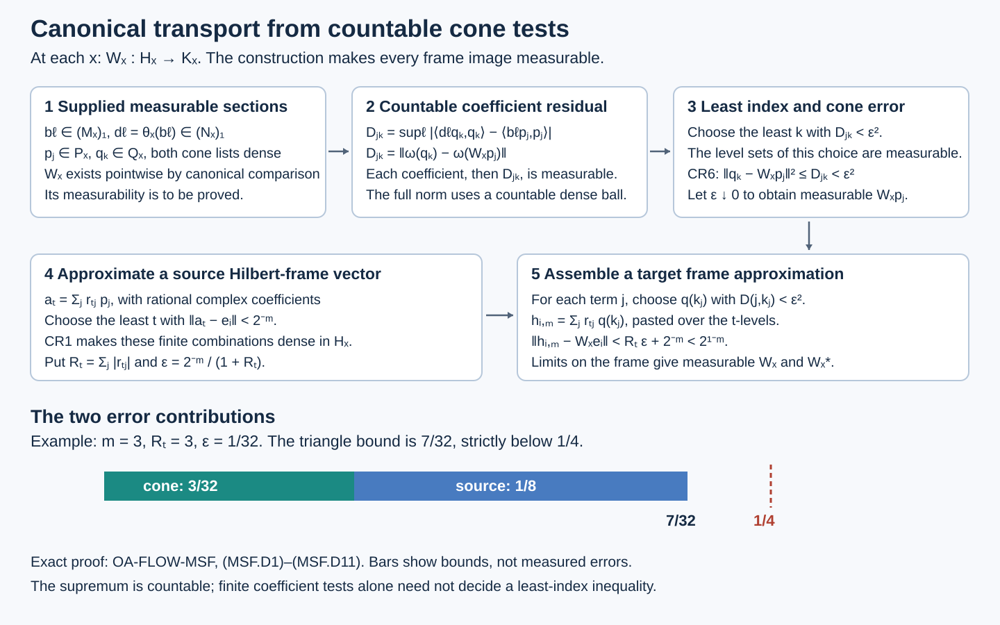

# Measurable standard forms and canonical transport between varying fibres

*Original exposition and arguments: CC0-1.0 to the extent of rights held; cited publications and existing programme components retain their own terms.*

A central decomposition produces varying Hilbert spaces, algebras and positive cones. We first identify their exact integral standard form, then prove that a measurable field of specified normal isomorphisms has Borel canonical unitaries. Countable operator and cone tests supply the bridge. The resulting reconstruction retains every bounded operator section, both inverse maps and the square-root density needed when the base measure changes.

## 1. Earlier proofs

The central-field construction is proved in [L41 setup](OA-FLOW-L41.md#oa-flow.cstd.setup), [L41 static](OA-FLOW-L41.md#oa-flow.cstd.static) and [L41 cone](OA-FLOW-L41.md#oa-flow.cstd.cone). It uses [DC7](../../OA-MOD/OA-MOD-DC.html#existence-over-any-specified-central-abelian-subalgebra) for the whole algebra, [MW7](../../OA-MOD/OA-MOD-MW.html#central-disintegration-of-a-separable-weighted-algebra) for compatible GNS and modular fields, [MW4–5](../../OA-MOD/OA-MOD-MW.html#constructing-the-integral-weight-and-its-full-operators) for every positive weight value and full operator domain, and [GFR7](../../OA-MOD/OA-MOD-GFR.html#a-common-countable-strong-dense-contraction-family)–[GFR8](../../OA-MOD/OA-MOD-GFR.html#forward-and-inverse-transport-by-least-indices) for dense measurable contractions and both operator transports. The factor criterion is [DC8](../../OA-MOD/OA-MOD-DC.html#centers-and-the-factor-decomposition).

The field arguments below use [DF2](../../OA-MOD/OA-MOD-DF.html#compact-orthonormal-frames-and-measurable-dimension) and [DF4](../../OA-MOD/OA-MOD-DF.html#subfields-projections-conjugates-and-direct-sums)–[DF7](../../OA-MOD/OA-MOD-DF.html#integrating-operator-fields-norm-domains-and-adjoints); [DC4](../../OA-MOD/OA-MOD-DC.html#the-integral-algebra-and-its-exact-commutant) identifies the entire integral commutant. [MC1](OA-FLOW-MC.md#oa-flow.mc.1) proves the unique canonical unitary for any normal isomorphism of standard forms. The cone representatives, their norm bound and spanning property are [CR1](OA-FLOW-CR.md#oa-flow.cr.1), [CR4](OA-FLOW-CR.md#oa-flow.cr.4), [CR6](OA-FLOW-CR.md#oa-flow.cr.6) and [CR8](OA-FLOW-CR.md#oa-flow.cr.8). [NC3–5](OA-FLOW-NC.md#oa-flow.nc.3) supplies the natural-cone axioms. [SE10–11](../../OA-MOD/OA-MOD-SE.html#patching-the-unique-comparisons) is another complete proof of arbitrary canonical comparison, and [CL-u](../../OA-MOD/OA-MOD-CL.html#the-precise-topology-of-a-standard-implementation) gives its predual norm topology.

[PB4.3](../../foundations-of-von-neumann-algebras/polish-spaces-and-standard-borel-spaces.html#oa-fnd-pb-06) proves the Borel inverse assertion used for a singleton graph; [SCF5](../../OA-MOD/OA-MOD-SCF.html#choose-a-witness-after-completing-the-measure) proves selection after measure completion and a Borel version off a null set. These have different strengths. For reconstruction over different bases we use [DC10](../../OA-MOD/OA-MOD-DC.html#uniqueness-over-the-same-diagonal-structure)–[DC11](../../OA-MOD/OA-MOD-DC.html#change-of-base-and-the-square-root-density-in-general-uniqueness) and [DF8](../../OA-MOD/OA-MOD-DF.html#the-diagonal-commutant-is-exactly-the-decomposable-algebra). The nonmeasurable set used in the final counterexample is available from [SCF9](../../OA-MOD/OA-MOD-SCF.html#test-the-hypothesis-with-constant-graph-data).

Only the static construction is imported from the moving-base lesson. Its later strict-cocycle repair is not an input here. The isomorphism-field argument below proves its coordinate Borel facts directly, before applying the Borel inverse theorem.

## 2. The static interface is already proved

**Proposition 2.1.** Let \(M\ne0\) have separable predual. Fix any standard form \((M,H,J,P)\) and a unital von Neumann subalgebra \(D\subseteq Z(M)\). There is a standard probability space and a measurable field of nonzero separable standard forms \((M_x,H_x,J_x,P_x)\) with compatible identifications
\[
 D=L^\infty(X,\mu),\quad H=\int_X^\oplus H_x\,d\mu,
 \quad M=\int_X^\oplus M_x\,d\mu,
 \quad J=\int_X^\oplus J_x\,d\mu,
 \quad P=\{\xi\in H:\xi_x\in P_x\text{ a.e.}\}.
 \tag{MSF1}
\]
The algebra equality contains every essentially bounded measurable section in the fibre algebras. There are countable measurable contraction sections strong-star dense in \((M_x)_1\), and countable measurable vector sections norm-dense in \(P_x\), or in its unit part. If \(D=Z(M)\), the fibres are factors almost everywhere. The probability may be replaced by any equivalent sigma-finite measure, with the corresponding unitary change of Hilbert coordinates.

**Proof by exact existing-provider specialization.** Apply L41's construction with the one-element locally compact group and its trivial action. Its continuity, separability and invariance hypotheses then hold for every specified \(D\). The necessary separability of the chosen standard Hilbert space and existence of a faithful normal state are proved at L41 lines 89–102, using CR's cone-vector norm estimate and spanning theorem. Thus no separably acting representation or cyclic separating vector is assumed without proof.

The complete algebra disintegration is [DC7](../../OA-MOD/OA-MOD-DC.html#existence-over-any-specified-central-abelian-subalgebra), applied explicitly at L41 lines 164–166. [MW7](../../OA-MOD/OA-MOD-MW.html#central-disintegration-of-a-separable-weighted-algebra) gives the compatible field of actual GNS spaces and full left/right involution graphs; this is stronger than decomposition of selected algebra generators. L41 lines 168–187 normalize the fibre weights by
\[
 r(x)=\widetilde\varphi_x(1),\qquad
 d\mu=r\,d\widetilde\mu,
 \qquad \varphi_x=r^{-1}\widetilde\varphi_x.
 \tag{MSF2}
\]
The all-positive MW formula at \(1\) proves \(0<r<\infty\) almost everywhere and \(\int r\,d\widetilde\mu=1\). Its compatible GNS transport has fibre norm factor \(r^{-1/2}\), compensated by the change of measure. It is a unitary of integrals; the coordinate maps are not incorrectly treated as fibre unitaries. The base identification at L41 lines 189–210 is a proved Borel isomorphism on conull sets. L41 (A16), lines 211–224, proves the Hilbert, whole-algebra, GNS and modular identities, including all closed-operator domains.

The cone identity is proved in [L41's cone construction](OA-FLOW-L41.md#oa-flow.cstd.cone), lines 233–287. There the [GFR7](../../OA-MOD/OA-MOD-GFR.html#a-common-countable-strong-dense-contraction-family) contractions \(q_i(x)\) give positive sections \(a_j=kq_i^*q_i\), and
\[
 v_j(x)=\Delta_x^{1/4}a_j(x)\Omega_x,
 \qquad \Omega_x=\Lambda_{\varphi_x}(1).
 \tag{MSF3}
\]
The proof explicitly verifies that \(a_j\Omega_x\) lies in the half-power domain and bounds the quarter power by both vector and adjoint-vector norms. Bounded spectral truncations prove measurability. This is not an assumption that unbounded modular powers act on arbitrary measurable sections. The \(v_j(x)\) are norm-dense in \(P_x\). Finite measurable pastes of their positive preimages approximate any square-integrable cone section, with squared error less than \(2n^{-2}\); this proves exactly the last equality in (MSF1). Radial truncation supplies dense cone-unit-ball sections. Consequently all clauses of the proposition except factoriality and the optional measure change are literal conclusions of the cited completed proof.

For \(D=Z(M)\), apply [DC8](../../OA-MOD/OA-MOD-DC.html#centers-and-the-factor-decomposition), lines 231–253, to that same full algebra field. Its centre formula and countable non-scalar-centre tests prove that nonfactor fibres form a null set. Remove this and the construction's other Borel null exceptions. L41's defaults on its discarded set may be nonfactors when \(M\) is not a factor; they are not used to claim factoriality everywhere. The restricted conull static model has nonzero factor fibres at every retained point.

For \(d\nu=s\,d\mu\), with \(0<s<\infty\) almost everywhere, the map
\[
 H_\mu\longrightarrow H_\nu,\qquad
 \xi(x)\longmapsto s(x)^{-1/2}\xi(x)
 \tag{MSF4}
\]
is onto isometric by integration; its inverse uses \(s^{1/2}\). Positive scalar multiplication preserves each cone, and commutes with its antiunitary conjugation because the scalar is real. Algebra sections are unchanged. Equivalent sigma-finite measures have such a positive finite Radon–Nikodym density. This proves the optional change and preserves every clause. \(\square\)

The construction therefore provides the specified compatible algebra and standard-form fields without an additional central-reduction assumption.

## 3. Assembly also works for given measurable standard-form fields

The following compatibility fact makes the converse use of VFF precise, even when the fields are supplied independently of a weight construction.

**Proposition 3.1.** On a standard sigma-finite measured base, suppose \(H_x\) is a measurable field of separable Hilbert spaces. Suppose each \((M_x,H_x,J_x,P_x)\) is a standard form, \(M_x\) has countable measurable strong-star dense contraction sections, \(J_x\) is measurable as a map from the conjugate Hilbert field, and \(P_x\) has countable measurable norm-dense sections. Then the whole integral algebra, integrated conjugation and square-integrable cone sections form a standard form. Factoriality is not needed. Zero fibres, if allowed in the supplied field, contribute the zero standard form and can be removed from the effective base.

**Proof.** Put \(\mathcal M=\int^\oplus M_x\), \(\mathcal J\xi=(J_x\xi_x)_x\), and \(\mathcal P=\{\xi\in H:\xi_x\in P_x\text{ a.e.}\}\). DF's conjugate-field and bounded-action results make \(\mathcal J\) a well-defined antiunitary involution on all \(H\). [DC4](../../OA-MOD/OA-MOD-DC.html#the-integral-algebra-and-its-exact-commutant) makes \(\mathcal M\) a von Neumann algebra and identifies its entire commutant fibrewise. Convexity of \(\mathcal P\) is pointwise; closedness follows from the [DF6](../../OA-MOD/OA-MOD-DF.html#the-hilbert-direct-integral-localization-and-subsequences) almost-everywhere convergent subsequence of any \(L^2\)-convergent sequence.

Selfduality uses the actual complex cone convention
\[
 C^\vee=\{\eta:\langle\xi,\eta\rangle\text{ is real and nonnegative for every }\xi\in C\}.
 \tag{MSF5}
\]
This is not a condition only on the real part. If \(\eta\in\mathcal P\), fibre selfduality and scalar Cauchy–Schwarz show \(\eta\in\mathcal P^\vee\). Conversely, let \(\eta\in\mathcal P^\vee\). Let \(p_j(x)\) be the dense cone sections, and set \(t_j=p_j/\max(1,\|p_j\|)\). For every finite-measure exhaustion set \(F_k\) and measurable \(A\subseteq F_k\), the section \(1_A t_j\) belongs to \(\mathcal P\). Thus
\[
 \int_A\langle t_j(x),\eta_x\rangle\,d\mu(x)\in[0,\infty).
 \tag{MSF6}
\]
The integrand is absolutely integrable on \(F_k\). Testing its imaginary positive and negative sets, then its real negative set, proves that it is real and nonnegative almost everywhere. Take the countable common null union in \(j,k\), undo the positive radial factor and use density and continuity. Each retained \(\eta_x\) belongs to \(P_x^\vee=P_x\). Hence \(\mathcal P=\mathcal P^\vee\).

Fibre standard-form identities and [DC4](../../OA-MOD/OA-MOD-DC.html#the-integral-algebra-and-its-exact-commutant) give \(\mathcal J\mathcal M\mathcal J=\int^\oplus M_x'=\mathcal M'\). Also \(\mathcal J\) fixes \(\mathcal P\) pointwise. For any \(a\in\mathcal M\), its bounded fibre field gives \(a_xJ_xa_xJ_xP_x\subseteq P_x\), and the uniform bound \(\|a\|^2\) makes \(a\mathcal Ja\mathcal J\) preserve square-integrability. Finally [DC8](../../OA-MOD/OA-MOD-DC.html#centers-and-the-factor-decomposition)'s whole centre formula says that \(z\in Z(\mathcal M)\) has \(z_x\in Z(M_x)\) almost everywhere. Therefore \(\mathcal Jz\mathcal J=z^*\). These are all standard-form axioms on their full bounded-operator domains. \(\square\)

## 4. Precisely what a measurable fibre-isomorphism field means

Let \(X\) be a standard Borel space. Let \((M_x,H_x,J_x,P_x)\) and \((N_x,K_x,L_x,Q_x)\) be Borel fields of nonzero separable standard forms. The field structures include countable Borel strong-star dense contraction sections \(b_j(x)\in(M_x)_1\) and \(c_j(x)\in(N_x)_1\), Borel conjugations, and countable Borel norm-dense cone sections \(p_j(x)\in P_x\), \(q_j(x)\in Q_x\). Fundamental Hilbert sections or their [DF2](../../OA-MOD/OA-MOD-DF.html#compact-orthonormal-frames-and-measurable-dimension) orthonormal frames specify the Hilbert-field Borel structures. A target field over a different base is first pulled back through its given Borel base map; this does not make its fibre algebra constant.

Suppose for each \(x\) we are given a unital normal star isomorphism
\[
 \theta_x:M_x\longrightarrow N_x.
 \tag{MSF7}
\]
The **operator-section convention** is that \(\theta_x(b_j(x))\) is a Borel operator field for every \(j\). Equivalently, \(\theta\) sends every Borel contraction section to a Borel operator section. The stronger-looking two-sided convention additionally asks this for all inverse sections; Theorem 5.1 will prove it automatically. Borelness of operator sections means Borel matrix coefficients in the compact frames, equivalently Borel maps into the strong-star contraction balls on dimension strata. Pointwise bounded fields with nonuniform norm are treated by measurable scalar normalization.

The **canonical-unitary convention** is that the unique [MC1](OA-FLOW-MC.md#oa-flow.mc.1) unitary
\[
 W_x:H_x\longrightarrow K_x,
 \quad W_xaW_x^*=\theta_x(a),\quad W_xP_x=Q_x,
 \quad W_xJ_x=L_xW_x
 \tag{MSF8}
\]
is a Borel unitary field. This is an intrinsic assertion between the indicated Hilbert fields; equivalently its matrices are Borel after [DF2](../../OA-MOD/OA-MOD-DF.html#compact-orthonormal-frames-and-measurable-dimension) coordinates on the dimension strata. [MC1](OA-FLOW-MC.md#oa-flow.mc.1) proves pointwise existence and uniqueness before any assertion of Borelness. Neither convention assumes that the varying factors are mutually isomorphic.

## 5. A singleton relation proves the equivalence

**Theorem 5.1.** In Section 4, the operator-section and canonical-unitary conventions are equivalent. Either implies that \(\theta\) and \(\theta^{-1}\) send every Borel pointwise bounded algebra section to a Borel section. The theorem holds on an arbitrary standard Borel parameter space, without a measure, and does not require factor fibres. With completed-measurable data on a standard sigma-finite measured base, the same equivalence holds modulo one null set and the canonical unitary field has a Borel representative on a conull Borel subset. The null-set statement makes no assertion of a valid canonical map at exceptional points where no isomorphism was supplied.

**Proof.** [MC1](OA-FLOW-MC.md#oa-flow.mc.1) gives \(W_x\) individually, so \(\dim H_x=\dim K_x\) at every point satisfying (MSF7). [DF2](../../OA-MOD/OA-MOD-DF.html#compact-orthonormal-frames-and-measurable-dimension) makes dimension measurable and supplies Borel orthonormal coordinates. Partition \(X\) into the countably many common dimension strata \(d\in\{1,2,\ldots,\infty\}\). On one stratum identify the two Hilbert fields with \(E_d=\mathbb C^d\) or \(\ell^2\). Only the Hilbert spaces have been trivialized; \(M_x,N_x,P_x,Q_x\) still vary with \(x\).

The group \(\mathcal U(E_d)\) is Polish in the strong topology. A compatible complete metric tests both \(u\) and \(u^*\) on a countable orthonormal basis, with summable bounded weights. A Cauchy sequence has strong limits for both components; their products give two inverse isometries, hence a unitary and its adjoint. This topology is the usual strong unitary topology because strong convergence of unitaries to a unitary implies strong convergence of their adjoints. Separability follows from its embedding into the countable product of vector-coordinate spaces. The same facts cover finite dimension. The corresponding operator-and-adjoint metric on the contraction ball is complete: a Cauchy sequence has strong limits \(a,b\), its vector coefficients give \(b=a^*\), and both norms remain at most one. Finite matrix compressions with rational approximations give separability. Matrix coefficients determine Borel maps into this ball: norms of the basis-vector differences are countable sums of squared coefficients, so preimages of its metric balls are Borel. Conversely evaluation and its coefficients are continuous. These are direct coordinate arguments and require no SVFF result.

Assume the operator-section convention and write \(d_j(x)=\theta_x(b_j(x))\). These are Borel contractions. In the fixed Hilbert coordinates define \(\mathscr R_d\subseteq X_d\times\mathcal U(E_d)\) by the following countably many tests:
\[
 \begin{aligned}
 &u b_j(x)u^*=d_j(x) &&(j\geq1),\\
 &\inf_k\|u p_j(x)-q_k(x)\|=0 &&(j\geq1),\\
 &\inf_j\|u^*q_k(x)-p_j(x)\|=0 &&(k\geq1).
 \end{aligned}
 \tag{MSF9}
\]
The first equality is tested on the countable orthonormal basis. The other two say \(uP_x\subseteq Q_x\) and \(u^*Q_x\subseteq P_x\), by density and closure. No generic selection of algebra isomorphisms occurs here; the specified images \(d_j\) are part of the input.

This relation is Borel. The action of a unitary on a varying Borel vector is jointly Borel, indeed continuous in its unitary/vector variables. Products of uniformly bounded strongly convergent operators are strongly continuous; applying this to operators and adjoints gives jointly continuous conjugation on the strong-star contraction ball. Thus each matrix equality and each norm in (MSF9) is Borel, and a countable infimum is Borel. The fibre relations are also closed in \(u\), although that extra fact is unnecessary for the following argument. Cone codes can equivalently be recognized through their dense sections, without describing the subset of the coding space consisting of all valid standard forms.

At every \(x\), the pointwise canonical unitary supplied by [MC1](OA-FLOW-MC.md#oa-flow.mc.1) belongs to \(\mathscr R_d\), so the fibre is nonempty. Conversely suppose \(u\) passes (MSF9). For \(a\in(M_x)_1\), choose a sequence from \(b_j(x)\) tending strong-star to \(a\). The pointwise canonical unitary \(W_x\), whose measurability has not yet been used, shows that \(\theta_x\) is strong-star continuous on this bounded ball: it is conjugation by \(W_x\). Passing to the limit in the first tests therefore gives \(uau^*=\theta_x(a)\). Scaling gives this on every \(a\in M_x\). The two cone tests give \(uP_x=Q_x\). [MC1](OA-FLOW-MC.md#oa-flow.mc.1) uniqueness now forces \(u=W_x\), and also forces the conjugation identity in (MSF8). Hence \(\mathscr R_d\) has exactly one point over each \(x\).

The projection \(\mathscr R_d\to X_d\) is a Borel bijection between standard Borel spaces: \(\mathscr R_d\) is a Borel subset of the product of a standard Borel space and a Polish space. [PB Theorem 4.3(5)](../../foundations-of-von-neumann-algebras/polish-spaces-and-standard-borel-spaces.html#oa-fnd-pb-06) makes its inverse Borel. Composing with the second projection proves that \(x\mapsto W_x\) is Borel. The countable union over dimensions proves the intrinsic assertion on the original two Hilbert fields. This is the point where uniqueness yields everywhere Borelness, stronger than a general selection theorem.

Conversely, if \(W_x\) is Borel, [DF5](../../OA-MOD/OA-MOD-DF.html#pointwise-bounded-operator-fields-adjoints-and-exact-norm-tests) makes \(W_x\), \(W_x^*\), and their products with any Borel operator section measurable; their coordinate expansions make them Borel in these coordinates. Consequently \(a_x\mapsto W_xa_xW_x^*\) and \(c_x\mapsto W_x^*c_xW_x\) send all Borel sections to Borel sections. This proves the operator-section convention and the two-sided assertion, including pointwise bounded sections with nonuniform norm. Their algebra norms are preserved exactly, so essentially bounded sections are preserved with the same essential bound.

For completeness the countable operator tests alone also extend to every Borel contraction section without using the just-proved Borelness of \(W\). Let \(\delta_x\) be the strong-star metric supplied by the Borel frame. For a Borel contraction \(a_x\), let \(j_n(x)\) be the least index satisfying \(\delta_x(b_{j_n(x)}(x),a_x)<1/n\). Its level sets are Borel, so \(d_{j_n(x)}(x)\) is a Borel pasted contraction field. Pointwise bounded strong-star continuity of \(\theta_x\), already justified by the individually existing [MC1](OA-FLOW-MC.md#oa-flow.mc.1) unitary, shows that it tends to \(\theta_x(a_x)\). Countable coordinate limits prove Borelness. Divide any nonuniform pointwise bounded \(a_x\) by \(1+\|a_x\|\), a Borel scalar by [DF5](../../OA-MOD/OA-MOD-DF.html#pointwise-bounded-operator-fields-adjoints-and-exact-norm-tests), and multiply back after applying the contraction conclusion. Thus the section convention is independent of the chosen dense family.

For the completed-measurable version, choose Borel versions of the countably many Hilbert frames, operator tests, conjugations and cone sections, and remove a common Borel null set containing their exceptions and any exceptions to the supplied isomorphism hypothesis. Polish-valued Borel versions exist by [SCF5](../../OA-MOD/OA-MOD-SCF.html#choose-a-witness-after-completing-the-measure)'s last step, or by the scalar coordinate version proof; countability is essential. On this conull Borel subset the Borel argument applies verbatim. Alternatively apply [SCF5](../../OA-MOD/OA-MOD-SCF.html#choose-a-witness-after-completing-the-measure) directly to the already coded (MSF9): it selects its unique canonical value in the completed measure, then gives a Borel representative almost everywhere. This alternative proves the measured assertion, not an everywhere Borel selector for arbitrary nonunique relations. The arbitrary standard Borel parameter theorem above cannot be strengthened by intersecting uncountably many parameter-dependent conull sets. \(\square\)

### A direct construction from functional distances

The same measurable unitary can be constructed from the countable data without the singleton-relation theorem. This gives explicit vector error bounds and works over any measurable parameter space carrying the indicated measurable fields. On a standard Borel base with Borel data, every section constructed below is Borel.

Keep \(b_\ell(x)\), \(d_\ell(x)=\theta_x(b_\ell(x))\), and the norm-dense cone sections \(p_j(x)\in P_x\), \(q_k(x)\in Q_x\). Pointwise existence of the canonical unitary \(W_x\) is already [MC1](OA-FLOW-MC.md#oa-flow.mc.1); none of the following steps presupposes its measurability. For fixed \(j,k\), form the scalar function
\[
 D_{jk}(x)=\sup_{\ell\geq1}
 \left|
 \langle d_\ell(x)q_k(x),q_k(x)\rangle
 -
 \langle b_\ell(x)p_j(x),p_j(x)\rangle
 \right|.
 \tag{MSF.D1}
\]
Every term is measurable by the operator-section hypothesis and the measurable-field scalar-product rules. The countable supremum is measurable and finite: it is bounded by \(\|q_k(x)\|^2+\|p_j(x)\|^2\).

For a fixed \(x\), put
\[
 f_{j,x}(c)=\langle\theta_x^{-1}(c)p_j(x),p_j(x)\rangle
          =\langle cW_xp_j(x),W_xp_j(x)\rangle
 \quad(c\in N_x).
 \tag{MSF.D2}
\]
Conjugation by the individually existing \(W_x\) makes \(d_\ell(x)\) strong-star dense in \((N_x)_1\). The difference between the two vector functionals in (MSF.D2) and (MSF.D1) is continuous on this bounded ball: strong convergence of \(c_n\) implies convergence of each coefficient \(\langle c_n v,v\rangle\) for its fixed vector \(v\). A continuous scalar function has the same supremum on a dense subset. Consequently
\[
 D_{jk}(x)=\|\omega_{q_k(x)}-f_{j,x}\|
          =\|\omega_{q_k(x)}-\omega_{W_xp_j(x)}\|.
 \tag{MSF.D3}
\]
Thus (MSF.D1) computes the full functional norm from the supplied countable coefficients. No measurable inverse-isomorphism field was used.

For any two vectors \(u,v\), expansion of their coefficient difference and Cauchy–Schwarz give
\[
 \|\omega_u-\omega_v\|
 \leq \|u-v\|(\|u\|+\|v\|).
 \tag{MSF.D4}
\]
Since \(W_xp_j(x)\in Q_x\) and \(q_k(x)\) is norm-dense in \(Q_x\), for every \(n\geq1\) there is a \(k\) with \(D_{jk}(x)<2^{-2n}\). Choose the least such index:
\[
 k(j,n,x)=\min\{k:D_{jk}(x)<2^{-2n}\},\qquad
 z_{j,n}(x)=q_{k(j,n,x)}(x).
 \tag{MSF.D5}
\]
For a fixed \(k\), its level set is the intersection of the measurable event \(D_{jk}<2^{-2n}\) with the finitely many events \(D_{jr}\geq2^{-2n}\), \(r<k\). Thus \(k(j,n,\cdot)\) is measurable and \(z_{j,n}\) is a countable measurable paste. The [cone square-root estimate CR6](OA-FLOW-CR.md#oa-flow.cr.6) now gives the uniform absolute error
\[
 \|z_{j,n}(x)-W_xp_j(x)\|^2\leq D_{j,k(j,n,x)}(x)<2^{-2n}.
 \tag{MSF.D6}
\]
Its pointwise limit \(\zeta_j(x)=W_xp_j(x)\) is therefore a measurable vector section. The argument includes zero and nonfaithful cone functionals; no lower bound on their supports is required.

Enumerate all finite rational-complex linear combinations of the \(p_j(x)\) as
\[
 a_t(x)=\sum_{j\in I_t}r_{tj}p_j(x),\qquad
 a'_t(x)=\sum_{j\in I_t}r_{tj}\zeta_j(x).
 \tag{MSF.D7}
\]
Here \(I_t\) is finite, the coefficients are fixed elements of \(\mathbb Q(i)\), and the list includes the zero combination. By [CR1](OA-FLOW-CR.md#oa-flow.cr.1), the complex span of \(P_x\) is \(H_x\). Density of the \(p_j(x)\), followed by rational approximation of the finitely many coefficients, makes the values \(a_t(x)\) dense in \(H_x\).

For a measurable Hilbert-frame vector \(e_i(x)\), choose the least \(t=t(i,m,x)\) with \(\|a_t(x)-e_i(x)\|<2^{-m}\). These indices are measurable by the same level-set argument. Because \(a'_t(x)=W_xa_t(x)\) pointwise and \(W_x\) is isometric,
\[
 \|a'_{t(i,m,x)}(x)-W_xe_i(x)\|<2^{-m}.
 \tag{MSF.D8}
\]
The left approximants are measurable pastes. Hence every \(W_xe_i(x)\) is measurable. The [DF5 operator-field and adjoint criterion](../../OA-MOD/OA-MOD-DF.html#pointwise-bounded-operator-fields-adjoints-and-exact-norm-tests) proves measurability of \(W\) and \(W^*\). Products with measurable operator sections prove both isomorphism-field conventions and all the two-sided conclusions of Theorem 5.1.

One can also approximate a frame image directly by finitely many of the original \(q_k\), without first taking the limits \(\zeta_j\). After choosing \(t=t(i,m,x)\), put
\[
 R_t=\sum_{j\in I_t}|r_{tj}|,\qquad
 \epsilon_{t,m}=\frac{2^{-m}}{1+R_t}.
 \tag{MSF.D9}
\]
For each \(j\in I_t\), take the least \(k_j\) with \(D_{jk_j}(x)<\epsilon_{t,m}^2\), and set
\[
 h_{i,m}(x)=\sum_{j\in I_t}r_{tj}q_{k_j}(x).
 \tag{MSF.D10}
\]
On every measurable level set of \(t\), this is a finite sum of measurable pastes; the countable union of those level sets makes it a measurable section. The empty combination gives zero. Equations (MSF.D3), (MSF.D6) and the triangle inequality yield
\[
 \begin{split}
 \|h_{i,m}(x)-W_xe_i(x)\|
 &\leq R_t\epsilon_{t,m}+\|a_t(x)-e_i(x)\|\\
 &<2^{-m}\frac{R_t}{1+R_t}+2^{-m}
 <2^{1-m}.
 \end{split}
 \tag{MSF.D11}
\]
All bounds are pointwise on the supplied field; no measure or countable union of almost-everywhere exceptions is needed for Borel data given everywhere. With completed-measurable data the construction gives completed-measurable fields on their supplied conull domain. Choosing Borel versions on a standard measured base remains the separate version statement proved above.

The construction uses an exact countable supremum in (MSF.D1). Its error bounds do not assert that finitely many coefficient tests can decide the least-index inequalities. The earlier singleton-graph proof and this norm construction establish the same canonical field through different explicitly proved mechanisms. \(\square\)

The diagram records (MSF.D1)–(MSF.D11). Its two error contributions are the cone-image approximation and the source-frame approximation, both in the indicated fibre Hilbert norms. [Editable construction data](../assets/canonical-field/countable-cone-transport.json) give the same formulas and proof locators.

**Corollary 5.2.** Borel isomorphism fields compose and invert in the same convention; their canonical fields compose and invert. For example \(W_{\eta_x\circ\theta_x}=W_{\eta_x}W_{\theta_x}\). The product is Borel between the correctly pulled-back fields, implements the composite and maps its cones onto each other; [MC1](OA-FLOW-MC.md#oa-flow.mc.1) uniqueness proves the displayed identity. No common factor algebra is needed. If all data, including the specified isomorphism images, are jointly Borel in a standard Borel parameter, Theorem 5.1 applies on that entire parameter space. It does not turn separate almost-everywhere measurability in each parameter into a joint strict version.

**Corollary 5.3 (the predual convention).** For a field as in Section 4, a pointwise positive normal functional \(f_x\) has a Borel cone representative if and only if all the scalar functions \(f_x(b_j(x))\) are Borel. Indeed any two positive normal functionals are represented pointwise by cone vectors, and their difference is strong-star continuous on the contraction ball. Density gives
\[
 \|f_x-\omega_{p_k(x)}\|
 =\sup_j|f_x(b_j(x))-\langle b_j(x)p_k(x),p_k(x)\rangle|.
 \tag{MSF14}
\]
This is Borel under the scalar hypothesis. The \(\omega_{p_k(x)}\) are norm-dense in the positive predual, by [CR8](OA-FLOW-CR.md#oa-flow.cr.8) and the elementary vector-functional norm bound. Choose the least \(k_n(x)\) for which (MSF14) is less than \(2^{-2n}\). This is a Borel countable choice. [CR6](OA-FLOW-CR.md#oa-flow.cr.6) gives \(\|p_{k_n(x)}(x)-\xi_{f_x}\|<2^{-n}\), so the unique representative is Borel as a pointwise vector limit. The reverse implication follows from Borel vector coefficients. No measurability of a predual field is assumed to establish this equivalence.

For a specified isomorphism field, it suffices instead to assume that the pullbacks of the dense target positive functionals \(\omega_{q_k(x)}\) have Borel evaluations on all \(b_j(x)\). The preceding argument makes their cone vectors Borel. Pointwise canonical comparison identifies those vectors as \(W_x^*q_k(x)\). Enumerate rational complex combinations of the \(q_k(x)\); their values are dense in \(K_x\), by [CR1](OA-FLOW-CR.md#oa-flow.cr.1). Approximating each target Hilbert-frame vector by least indices from this list makes its \(W_x^*\)-image a Borel limit, because \(W_x^*\) is individually isometric. [DF5](../../OA-MOD/OA-MOD-DF.html#pointwise-bounded-operator-fields-adjoints-and-exact-norm-tests) now proves Borelness of \(W^*\) and \(W\), hence Theorem 5.1's full conclusion. Conversely a Borel canonical field gives exactly those Borel pullback evaluations. Thus the result also covers the usual predual evaluation formulation, with a countable norm-dense positive test family.

On a fixed algebra the predual norm topology is the usual u-topology, rather than merely point-ultraweak continuity. The actual complete proof in [CL-u](../../OA-MOD/OA-MOD-CL.html#the-precise-topology-of-a-standard-implementation) identifies it with strong convergence of the canonical unitaries: [CR6](OA-FLOW-CR.md#oa-flow.cr.6) controls convergence on cone representatives in one direction; convergence of both unitaries and adjoints controls vector-functional norms in the other. This fixed-algebra topology comparison is an earlier result, not a reduction of the varying-fibre theorem to a constant algebra.

## 6. Reconstruction over different bases

Let \((X,\mu)\), \((Y,\nu)\) be standard sigma-finite bases, with the fields of Proposition 3.1 and nonzero factor fibres, so their whole centres are their scalar diagonals by [DC8](../../OA-MOD/OA-MOD-DC.html#centers-and-the-factor-decomposition). Let \(F:X_0\to Y_0\) be a measure-class Borel isomorphism of conull Borel subsets. Put
\[
 \rho=\frac{dF_*\mu}{d\nu},\qquad 0<\rho<\infty\quad\text{a.e.}
 \tag{MSF10}
\]
Given normal fibre isomorphisms \(\theta_x:M_x\to N_{F(x)}\) in either equivalent measurable convention, Theorem 5.1 gives a measurable canonical field \(W_x:H_x\to K_{F(x)}\). Its integral, followed by the base change, is the unitary
\[
 (U\xi)(y)=\rho(y)^{1/2}W_{F^{-1}y}\xi(F^{-1}y).
 \tag{MSF11}
\]
Indeed the pushforward identity gives its exact squared norm, and its inverse sends \(\eta\) to \(x\mapsto\rho(Fx)^{-1/2}W_x^*\eta(Fx)\). These assertions require no boundedness of the density. Positivity of the scalar and anti-linearity of the conjugations give \(UJ=LU\), and Proposition 3.1's cone identity gives \(UP=Q\). Conjugation by \(U\) maps the entire bounded measurable algebra field by
\[
 (UaU^*)_y=\theta_{F^{-1}y}(a_{F^{-1}y}).
 \tag{MSF12}
\]
Theorem 5.1 gives measurability in both directions and preservation of essential bounds, hence this is an onto normal star isomorphism of the whole integral algebras. Normality follows also immediately from unitary conjugation. The scalar density cancels in (MSF12), while remaining indispensable in (MSF11).

### From a global isomorphism to its base map

Conversely, let \(\alpha:\mathcal M\longrightarrow\mathcal N\) be a normal star isomorphism of the two whole integral algebras. Proposition 3.1 makes their given Hilbert-space representations standard forms. [MC1](OA-FLOW-MC.md#oa-flow.mc.1) therefore supplies the unique global canonical unitary \(U:H_\mu\longrightarrow K_\nu\), with
\[
 U aU^*=\alpha(a),\qquad UP=Q,\qquad UJ=LU.
 \tag{MSF15}
\]
The whole-centre formula [DC8](../../OA-MOD/OA-MOD-DC.html#centers-and-the-factor-decomposition) identifies the two centres with their scalar diagonals. Thus \(U\) takes one diagonal onto the other. The construction in [DC11](../../OA-MOD/OA-MOD-DC.html#change-of-base-and-the-square-root-density-in-general-uniqueness) gives a measure-class Borel isomorphism \(F:X_0\longrightarrow Y_0\) of conull Borel sets such that
\[
 U M_f U^*=M_{f\circ F^{-1}}
 \qquad(f\in L^\infty(X,\mu)).
 \tag{MSF16}
\]
DC11 proves the required real-coordinate realization for arbitrary standard Borel bases by least-index Cauchy codes, including the Borel image and inverse. Its subsequent reconstruction of the diagonal isomorphism therefore applies to the present bases directly. Remove the null complements and use \(X,Y\) for the retained bases.

### Removing the change of measure before disintegrating

Set \(\rho=dF_*\mu/d\nu\), as in (MSF10), and pull the target field back to \(X\). Write
\[
 \widetilde K_x=K_{Fx},\quad
 \widetilde N_x=N_{Fx},\quad
 \widetilde L_x=L_{Fx},\quad
 \widetilde Q_x=Q_{Fx}.
 \tag{MSF17}
\]
Composing the target fundamental sections with \(F\) gives the measurable structure on this field. Define
\[
 \begin{split}
 C:K_\nu&\longrightarrow
          \int_X^\oplus\widetilde K_x\,d\mu(x),\\
 (C\eta)(x)&=\rho(Fx)^{-1/2}\eta(Fx).
 \end{split}
 \tag{MSF18}
\]
This map is defined on every vector of \(K_\nu\), even when the displayed scalar is unbounded. Its exact domain calculation is
\[
 \int_X\|\rho(Fx)^{-1/2}\eta(Fx)\|^2\,d\mu(x)
 =\int_Y\rho(y)^{-1}\|\eta(y)\|^2\,d(F_*\mu)(y)
 =\|\eta\|_{K_\nu}^2.
 \tag{MSF19}
\]
The inverse sends \(\zeta\) to \(y\mapsto\rho(y)^{1/2}\zeta(F^{-1}y)\), and the same integral identity proves that it is defined on the entire pulled-back direct integral. Thus \(C\) is onto unitary. It sends the target integral cone onto the pulled-back integral cone and intertwines the conjugations, since its scalar factor is positive and real. It also conjugates every bounded target algebra section \(c_y\) to the section \(c_{Fx}\); the two scalar factors cancel.

Put \(V=CU\). Equation (MSF16) implies \(VM_f=M_fV\), now between fields over the same base and the same measure. The two-field proof of [DC10](../../OA-MOD/OA-MOD-DC.html#uniqueness-over-the-same-diagonal-structure), using [DF8](../../OA-MOD/OA-MOD-DF.html#the-diagonal-commutant-is-exactly-the-decomposable-algebra), gives
\[
 V=\int_X^\oplus W_x\,d\mu(x),\qquad
 W_x:H_x\longrightarrow K_{Fx}\text{ unitary a.e.}
 \tag{MSF20}
\]
Here both \(V^*V=1\) and \(VV^*=1\) are localized on countable Hilbert frames; the field consists of onto unitaries, not merely isometries. Solving \(U=C^{-1}V\) recovers exactly (MSF11), with \(\rho^{1/2}\) in the forward direction.

### Recovering the entire fibre algebra

Let \(b_j(x)\) and \(c_k(y)\) be the countable strong-star dense contraction sections in the two given algebra fields. Each \(B_j=\int^\oplus b_j\,d\mu\) belongs to \(\mathcal M\). Write \(\alpha(B_j)=\int^\oplus d_j(y)\,d\nu(y)\), with \(d_j(y)\in N_y\), using the definition of the whole target integral algebra. Conjugating by \(C\) and using (MSF20) yields equality of two bounded decomposable operators. [DF8](../../OA-MOD/OA-MOD-DF.html#the-diagonal-commutant-is-exactly-the-decomposable-algebra)'s uniqueness proof gives
\[
 W_xb_j(x)W_x^*=d_j(Fx)
 \quad\text{for almost every }x.
 \tag{MSF21}
\]
Apply the same argument to \(\alpha^{-1}(\int^\oplus c_k\,d\nu)\). Remove the countable union of these exceptional sets, together with the null sets needed for (MSF20). For every retained \(x\), conjugation by \(W_x\) takes all \(b_j(x)\) into \(N_{Fx}\), and conjugation by \(W_x^*\) takes all \(c_k(Fx)\) into \(M_x\). Unitary conjugation is strong-star continuous. Density on each contraction ball and strong closure of the two von Neumann algebras now prove both inclusions:
\[
 W_xM_xW_x^*=N_{Fx}.
 \tag{MSF22}
\]
This equality is valid on one conull set for the entire fibre algebras. It is not obtained by taking an uncountable union of exceptional sets for their individual elements. Define \(\theta_x=\operatorname{Ad}W_x\) on these fibres. It is a normal star isomorphism, and the measurable operator-field product and adjoint rules make \(\theta\) and its inverse measurable in Section 4's convention.

### Recovering the cones on the same conull set

Let \(p_j(x)\) be norm-dense cone sections in \(P_x\), and choose a countable finite-measure exhaustion \(E_n\uparrow X\). Put \(t_j(x)=p_j(x)/(1+\|p_j(x)\|)\). Then \(1_{E_n}t_j\) is a square-integrable cone section. Since \(V=CU\) takes the source integral cone onto the pulled-back target integral cone, (MSF20) gives
\[
 W_xt_j(x)\in Q_{Fx}
 \quad\text{for almost every }x\in E_n.
 \tag{MSF23}
\]
The countable union in \(j,n\) removes all these exceptions at once. Multiplying back by the positive scalar \(1+\|p_j(x)\|\), then using density and closure, proves \(W_xP_x\subseteq Q_{Fx}\). Apply the same argument to \(V^*\) and the bounded radial truncations of the dense sections \(q_k(Fx)\). This proves \(W_x^*Q_{Fx}\subseteq P_x\), hence
\[
 W_xP_x=Q_{Fx}.
 \tag{MSF24}
\]
Together with (MSF22), [MC1](OA-FLOW-MC.md#oa-flow.mc.1) identifies \(W_x\) as the canonical unitary of \(\theta_x\), and gives \(W_xJ_x=L_{Fx}W_x\). The countable null sets from the algebra and cone tests can be removed together. Theorem 5.1 consequently gives both usual measurability conventions for these specified fibre isomorphisms.

For an arbitrary subsequently chosen bounded algebra section \(a_x\), integration of \(W_xa_xW_x^*\), followed by \(C^{-1}\), gives (MSF12) and therefore the original \(\alpha(a)\). The representative of that particular section may have its own null exception; this does not alter the already established whole-algebra identity (MSF22). [The variable-field reconstruction theorem](../../OA-ERGODIC/reader/variable-factor-fields-and-measurable-conjugacy.html#1-reconstructing-an-isomorphism-of-variable-fields) uses precisely this reconstruction. \(\square\)

### A nonlinear base map with an unbounded density

Take \(X=Y=(0,1)\), with Lebesgue probability on both sides, and \(F(x)=x^2\). On each fibre use the standard form of \(M_2(\mathbb C)\) on its Hilbert–Schmidt space: left multiplication, conjugation \(a\mapsto a^*\), and the cone of positive matrices. A substitution \(y=x^2\) gives
\[
 \rho(y)=\frac1{2\sqrt y},\qquad
 \int_0^1 h(x^2)\,dx
   =\int_0^1 h(y)\frac{dy}{2\sqrt y}
 \tag{MSF25}
\]
for nonnegative measurable \(h\), first by the scalar change of variables for intervals and then by simple approximation and monotone convergence. In particular \(\rho\) is unbounded near zero, positive everywhere and integrable with integral one.

Let
\[
 v_x=\begin{pmatrix}e^{2\pi ix}&0\\0&1\end{pmatrix},
 \qquad \theta_x(a)=v_xav_x^*,\qquad W_x(a)=v_xav_x^*.
 \tag{MSF26}
\]
The last formula denotes a unitary on the Hilbert–Schmidt space. Direct multiplication shows that it implements the left-algebra automorphism, commutes with adjoint conjugation and maps the positive-matrix cone onto itself. Thus it is the canonical unitary. Its coefficients are continuous in \(x\). Formula (MSF11) and its inverse become
\[
 \begin{split}
 (U\xi)(y)&=\frac{v_{\sqrt y}\xi(\sqrt y)v_{\sqrt y}^*}
                         {\sqrt2\,y^{1/4}},\\
 (U^{-1}\eta)(x)&=\sqrt{2x}\,v_x^*\eta(x^2)v_x.
 \end{split}
 \tag{MSF27}
\]
Substitution in (MSF25) proves that both maps have their full \(L^2\) domains and preserve the norm. The algebra map has no density multiplier:
\[
 (UaU^*)_y=v_{\sqrt y}a_{\sqrt y}v_{\sqrt y}^*.
 \tag{MSF28}
\]
For instance the constant algebra section \(E_{12}\) becomes \(e^{2\pi i\sqrt y}E_{12}\).

For a test of the density factor, choose \(0<\varepsilon<1\) and the Hilbert–Schmidt vector section \(\xi(x)=1_{(0,\varepsilon)}(x)E_{11}\). Its squared norm is \(\varepsilon\). The correct image satisfies
\[
 \|U\xi\|^2
   =\int_0^{\varepsilon^2}\frac{dy}{2\sqrt y}
   =\varepsilon.
 \tag{MSF29}
\]
Omitting the scalar factor in (MSF27) would give squared norm \(\varepsilon^2\). The error occurs even though every \(W_x\) is a fibre unitary and every \(\theta_x\) is a normal algebra isomorphism. The density compensates for the change of base measure; it is independent of the fibre isomorphism.

## 7. Resolved scope and genuine limits

Proposition 2.1 gives central standard forms, dense measurable cone and contraction sections, and the actual integrated \(J\) and cone. Its fibres are factors when `D=Z(M)`. Proposition 3.1 verifies the same assembly interface for supplied fields on arbitrary sigma-finite bases. Theorem 5.1 supplies the equivalence of the two varying-fibre measurability conventions, and Section 6 checks the precise measure-density conventions and whole-section domains of their reconstruction. These conclusions hold at the stated hypotheses and earlier proofs.

The measurable structures and specified normal isomorphisms are genuine hypotheses. Pointwise existence of some isomorphism between unlabelled fibre algebras does not supply the Borel operator-image data in Section 4, and no Borel selection of arbitrary isomorphisms is proved here. An abstract Hilbert or Hilbert-algebra field with an unverified concrete frame does not provide the compatible concrete operator transports: the [frame counterexample](../../OA-MOD/OA-MOD-MC.html#a-full-finite-dimensional-field-with-a-nonmeasurable-concrete-frame) demonstrates this separate compatibility issue.

There is also a direct elementary counterexample to dropping the operator-section hypothesis. Let \(A\subset[0,1]\) be nonmeasurable in the completed Lebesgue measure. Use the constant standard form of \(M_2(\mathbb C)\) on its Hilbert–Schmidt space, with conjugation \(J(a)=a^*\) and positive-matrix cone. Let \(s=\begin{pmatrix}0&1\\1&0\end{pmatrix}\), set \(s_x=s\) on \(A\) and \(s_x=1\) elsewhere, and set \(\theta_x=\operatorname{Ad}s_x\). Each point has a normal automorphism; its canonical unitary is \(W_x(a)=s_xas_x^*\), since that map is Hilbert–Schmidt unitary and preserves the entire cone and conjugation. But
\[
 \theta_x(E_{11})=(1-\mathbf1_A(x))E_{11}+\mathbf1_A(x)E_{22},
 \qquad
 \langle W_x(E_{11}),E_{11}\rangle=1-\mathbf1_A(x).
 \tag{MSF13}
\]
Neither field is measurable, even after a conull modification: equality to a completed-measurable function off a measurable null set would make \(A\) completed-measurable. This is a counterexample to an omitted hypothesis, and agrees with the equivalence proved above. It is not a counterexample to Theorem 5.1.

Neither a classification of factors nor a D-family theorem is used. Static almost-everywhere fields and Borel canonical implementers do not by themselves prove a simultaneous strict cocycle law for an uncountable group. The existing strict-repair lessons retain that separate work. PB and SCF are used at their different exact strengths; no arbitrary Borel relation is declared to have an everywhere Borel selector. No separability, bounded modular operator, analytic-vector assumption, invariant state, cyclic faithful vector, or fixed-factor hypothesis is silently added to the preceding theorems.
