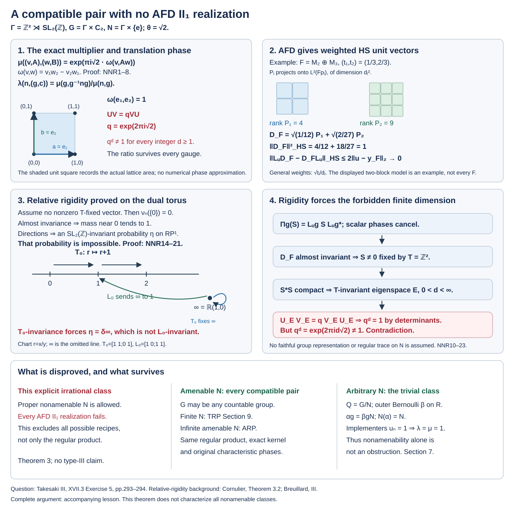

# An irrational characteristic class with no AFD realization

*Original exposition, arguments and reproducible illustration: CC0-1.0 to the extent of rights held. Cited publications and existing components retain their own terms.*

There is a countable group \(G\), a proper infinite nonamenable normal subgroup \(N\), and a normalized compatible pair in the convention of [compatible lifts](OA-FLOW-CPP.md#cp-compatible) for which no action on any AFD factor of type \(\mathrm{II}_1\) has the prescribed characteristic class. The obstruction excludes every AFD realization of this pair. It does not merely invalidate one crossed-product recipe.

The motivating realization question is Masamichi Takesaki, *Theory of Operator Algebras III*, XVII.3 Exercise 5, printed pp.293–294. It separately specifies a countable discrete group, a normal subgroup and a compatible pair, without an amenability hypothesis. The preceding Proposition 3.22 has its own abelian-group hypothesis; that hypothesis does not carry into the exercise. The conclusion below concerns the intended realization assertion in the coherent characteristic convention derived from the defining implementer identity. One printed action identity needs correction, as we explain first. The amenable-subgroup theorem of [ARP](OA-FLOW-ARP.md) and the trivial-class construction for arbitrary normal subgroups remain valid. No type-III replacement is asserted.

## The convention and the printed action identity

For a section \(s\) of a central extension of \(N\), the conjugation convention is
\[
 \beta_g\bigl(s(g^{-1}ng)\bigr)=\lambda(n,g)s(n).
 \tag{NNRC1}
\]
An action satisfies \(\beta_g\beta_h=\beta_{gh}\). Apply the two maps successively to \(s(h^{-1}g^{-1}ngh)\): first \(\beta_h\) gives \(\lambda(g^{-1}ng,h)s(g^{-1}ng)\), and then \(\beta_g\) gives \(\lambda(g^{-1}ng,h)\lambda(n,g)s(n)\). Comparing with \(\beta_{gh}\) forces
\[
 \lambda(n,gh)=\lambda(n,g)\lambda(g^{-1}ng,h).
 \tag{NNRC2}
\]
This is [CPP (CP1)](OA-FLOW-CPP.md#cp-compatible). In XVII.3 Exercise 1(b), printed p.292, the defining identity uses inverse conjugation as in (NNRC1), but Exercise 1(c) writes forward conjugation in the action line. Those two printed formulas are inconsistent. The printed list also omits the inner-action identity, which CPP derives and includes for actual inner implementers. The inverse-conjugation identity (NNRC2), the multiplication identity, compatibility, normalization and inner action are the convention used throughout this lesson. The pair below satisfies all five coherent CPP identities, so retaining inner compatibility does not remove the counterexample. We do not assert that it satisfies every literal printed formula.

The inconsistency can be seen inside the example itself. Write \(e_2=(0,1)^t\), take
\[
 n=(e_2,I),\qquad
 g=\left(0,\begin{pmatrix}1&1\\0&1\end{pmatrix}\right),
 \qquad h=(e_2,I),\qquad q=e^{2\pi i\sqrt2}.
 \tag{NNRC3}
\]
For the pair constructed in Section 1, its restriction to a translation has the explicit formula
\[
 \lambda\bigl((v,I),(z,A)\bigr)
       =e^{2\pi i\sqrt2\,\omega(z,v)}.
 \tag{NNRC4}
\]
Indeed the two multiplier exponents in its defining ratio are \(\omega(z,v)\) and \(\omega(v,z)=-\omega(z,v)\). Here \(g^{-1}ng=((-1,1)^t,I)\), whereas \(gng^{-1}=((1,1)^t,I)\), and \(gh=((1,1)^t,A)\). Consequently
\[
 \lambda(n,gh)=q,\qquad
 \lambda(n,g)\lambda(g^{-1}ng,h)=1\cdot q=q,
 \qquad
 \lambda(n,g)\lambda(gng^{-1},h)=1\cdot q^{-1}=q^{-1}.
 \tag{NNRC5}
\]
Since \(q\) has infinite order, \(q\ne q^{-1}\). The theorem refutes the unrestricted realization assertion after this necessary convention correction.

## 1. The group and the admissible pair

Let \(T=\mathbb Z^2\), let \(K=\mathrm{SL}_2(\mathbb Z)\), and use column vectors. Set
\[
 \Gamma=T\rtimes K,\qquad
 (v,A)(w,B)=(v+Aw,AB),\qquad
 (v,A)^{-1}=(-A^{-1}v,A^{-1}).
 \tag{NNR1}
\]

Take the ambient group \(G=\Gamma\times C_2\) and its proper normal subgroup \(N=\Gamma\times\{e\}\), identified with \(\Gamma\). Both groups are countable discrete. The subgroup \(N\) is infinite and nonamenable, as proved in Section 7. The extra \(C_2\) ensures that the prescribed normal subgroup is proper.

Write \(\omega(v,w)=v_1w_2-v_2w_1\) and fix \(\theta=\sqrt2\). For \(n=(v,A)\), \(m=(w,B)\) in \(N\), define
\[
 \mu_\theta(n,m)
   =\exp\bigl(\pi i\theta\,\omega(v,Aw)\bigr).
 \tag{NNR2}
\]
For \(h=(g,c)\) in \(G\) and \(n\in N\), put
\[
 \lambda_\theta(n,h)
   =\frac{\mu_\theta(g,g^{-1}ng)}{\mu_\theta(n,g)}.
 \tag{NNR3}
\]
The \(C_2\) coordinate is absent because it centralizes \(N\).

**Proposition 1.** This is a normalized compatible pair in the full CPP convention, including the inner-action equation.

**Proof.** Every \(A\in\mathrm{SL}_2(\mathbb Z)\) preserves \(\omega\). For \(n=(v,A)\), \(m=(w,B)\), \(\ell=(z,C)\), the two exponents in the multiplier identity agree:
\[
 \begin{aligned}
 \omega(v,Aw)+\omega(v+Aw,ABz)
 &=\omega(v,Aw)+\omega(v,ABz)+\omega(w,Bz)\\
 &=\omega(v,A(w+Bz))+\omega(w,Bz).
 \end{aligned}
 \tag{NNR4}
\]
Thus \(\mu(n,m)\mu(nm,\ell)=\mu(n,m\ell)\mu(m,\ell)\), and an identity argument gives the value one. Form \(E=\mathbb T\times N\) with multiplication
\[
 (z,n)(w,m)=(zw\mu(n,m),nm),\qquad s(n)=(1,n).
\]
Associativity and inverses follow from the multiplier identity just verified. Its kernel \(\mathbb T\times\{e\}\) is central.

Define \(\beta_{(g,c)}=\operatorname{Ad}_E s(g)\). Since \(s(g)s(h)\) is a central multiple of \(s(gh)\), we have \(\beta_{(g,c)}\beta_{(h,d)}=\beta_{(gh,cd)}\). These maps fix the central circle and cover conjugation on \(N\). Comparing \(s(g)s(g^{-1}ng)\) and \(s(n)s(g)\) gives
\[
 \beta_{(g,c)}\bigl(s(g^{-1}ng)\bigr)
       =\lambda_\theta(n,(g,c))s(n).
 \tag{NNR5}
\]
Associating three section elements gives the multiplication equation. Composing the maps \(\beta\) gives the action equation, and applying \(\beta\) to a product gives compatibility. Taking the acting element to be \((m,e)\) gives the inner-action equation. Explicitly,
\[
 \begin{aligned}
 \lambda(n,hk)&=\lambda(n,h)\lambda(h^{-1}nh,k),\\
 \frac{\lambda(n,h)\lambda(m,h)}{\lambda(nm,h)}
   &=\frac{\mu(h^{-1}nh,h^{-1}mh)}{\mu(n,m)},\\
 \lambda(n,m)&=\frac{\mu(m,m^{-1}nm)}{\mu(n,m)}.
 \end{aligned}
 \tag{NNR6}
\]
All identity values are one. This is also the proved compatible-extension calculation [CPP (CP4)–(CP7)](OA-FLOW-CPP.md#cp-compatible): the extension and its action have been constructed here. Every function is Borel because its domain is countable discrete. \(\square\)

Let \(a=((1,0)^t,I)\), \(b=((0,1)^t,I)\). They commute in \(N\), and
\[
 \frac{\mu_\theta(a,b)}{\mu_\theta(b,a)}
       =q,\qquad q=\exp(2\pi i\sqrt2).
 \tag{NNR7}
\]
A gauge \(\mu^f(n,m)=\mu(n,m)f(n)f(m)/f(nm)\) leaves this ratio unchanged when \(n,m\) commute. Consequently every projective unitary lift with multiplier cohomologous to \(\mu_\theta\) satisfies
\[
 UV=qVU,\qquad U=u_a,\quad V=u_b.
 \tag{NNR8}
\]
For every integer \(d\ge1\), \(q^d\ne1\): otherwise \(d\sqrt2\) would be an integer. To recall the elementary irrationality proof, a reduced fraction \(p/r\) satisfying \(p^2=2r^2\) has even \(p\), and then even \(r\), a contradiction. In particular \([\mu_\theta]\) has infinite order. If \(\mu_\theta^d\) were a coboundary, its commuting-pair ratio would be one.

## 2. What AFD supplies to a projective representation

We work more generally with a finite von Neumann algebra \(M\) carrying a **supplied faithful normal tracial state** \(\tau\), with \(\tau(1)=1\). Assume \(M\) is AFD: an increasing directed family of finite-dimensional unital star algebras \(F\) has weakly dense union. If the definition permits nonunital finite algebras, adjoining \(1\) preserves finite dimension, the star-algebra property, directedness and density. A sequential exhaustion is enough, but is not assumed. Put \(H=L^2(M,\tau)\), with left multiplication \(L_x\). The normal faithful concrete trace representation is the argument of [TRP Section 1](OA-FLOW-TRP.md#trp-setting); its GNS proof uses the supplied trace and does not require the algebra to be a factor.

We construct the Hilbert–Schmidt space without a trace-class normality theorem. For a finite-rank operator \(S\) and an orthonormal basis \((h_k)\), put
\[
 \|S\|_{\mathrm{HS}}^2=\sum_k\|Sh_k\|^2.
\]
Parseval on its finite-dimensional range gives basis independence and the Hilbert inner product. Rank-one operators identify the completion with \(H\otimes\overline H\). The inequality \(\|S\|\le\|S\|_{\mathrm{HS}}\) extends this completion to bounded operators. This extension is faithful: pairing \(S\) with the rank-one operator \(R_{\eta,\xi}(\zeta)=\langle\zeta,\xi\rangle\eta\) gives \(\langle S\xi,\eta\rangle\). If the resulting bounded operator vanishes, all these pairings vanish, and density of rank-one tensors forces the completed vector to vanish. Finite-rank approximation makes every resulting operator compact. Conjugation by a Hilbert-space unitary sends the rank-one operator indexed by \((\xi,\eta)\) to the one indexed by \((u\xi,u\eta)\), and hence is unitary on this completion. All sums defining \(D_F\) below are finite. These arguments also cover a nonseparable \(H\).

The finite-dimensional block and matrix-unit proof is [TRP Section 10](OA-FLOW-TRP.md#trp-obstruction). For each \(F\),
\[
 F=\bigoplus_j M_{d_j},\qquad
 p_j=1_{M_{d_j}},\quad t_j=\tau(p_j)>0,\qquad
 \tau(e^j_{rs})=(t_j/d_j)\,\mathbf1_{r=s}.
 \tag{NNR9}
\]
Traciality makes the diagonal matrix units in a block have equal trace and makes every off-diagonal unit have trace zero. Summing the diagonal gives \(t_j/d_j\).

Let \(P_j\) be the orthogonal projection of \(H\) onto the \(d_j^2\)-dimensional subspace \(Fp_j\), represented as trace vectors. Define the finite-rank positive operator
\[
 D_F=\sum_j\frac{\sqrt{t_j}}{d_j}P_j
       \quad\text{on }H.
 \tag{NNR10}
\]
An orthonormal basis of \(Fp_j\) is \(f^j_{rs}=\sqrt{d_j/t_j}\,e^j_{rs}\). Matrix-unit summation gives
\[
 \begin{aligned}
 \|D_F\|_{\mathrm{HS}}^2
   &=\sum_j(t_j/d_j^2)d_j^2=\sum_jt_j=1,\\
 \|L_xD_F\|_{\mathrm{HS}}^2
   &=\sum_j(t_j/d_j^2)\sum_{r,s}
       \tau((f^j_{rs})^*x^*xf^j_{rs})\\
   &=\sum_j\tau(x^*xp_j)=\|x\|_2^2
       \qquad(x\in M).
 \end{aligned}
 \tag{NNR11}
\]
For the second identity use \(\sum_{r,s}f^j_{rs}(f^j_{rs})^*=(d_j^2/t_j)p_j\) and the trace. Taking adjoints also gives \(\|D_FL_x\|_{\mathrm{HS}}=\|x\|_2\), since \((D_FL_x)^*=L_{x^*}D_F\) and \(\|x^*\|_2=\|x\|_2\). The weights in (NNR10) are essential: an unweighted finite-rank projection generally gives the wrong block traces.

For \(y\in F\), both \(L_y\) and its adjoint preserve every \(Fp_j\). Thus \(L_y\) commutes with \(P_j\) and \(D_F\). For \(u\in\mathcal U(M)\) and any \(y\in F\), (NNR11) therefore gives
\[
 \|L_uD_F-D_FL_u\|_{\mathrm{HS}}
       \le2\|u-y\|_2.
 \tag{NNR12}
\]
No unitary approximation or rational block-trace assumption is used. The element \(y\) may be the ordinary Hilbert projection of \(u\) onto \(F\).

Those projections converge. TRP Section 1's bounded approximation argument transfers weak density to the normal trace representation using uniformly bounded approximants; it does not pass an unbounded weakly convergent net through that representation. The closure of \((\bigcup F)\widehat1\) reduces every algebra in the union. Its projection commutes with their generated algebra \(M\) in this representation. It fixes \(\widehat1\), so it fixes the dense space \(M\widehat1\). The closure is therefore all of \(H\). Orthogonal projections onto the increasing finite-dimensional spaces \(F\widehat1\) converge strongly to \(1\). The corresponding actual elements \(y_F\in F\) satisfy \(\|u-y_F\|_2\to0\). This is the same density mechanism proved in [TRP Section 10](OA-FLOW-TRP.md#trp-obstruction).

Suppose \(u:\Gamma\to\mathcal U(M)\) is a normalized projective representation, so \(u_gu_h=\nu(g,h)u_{gh}\) with scalar \(\nu\). On the Hilbert space \(\mathrm{HS}(H)\) set
\[
 \Pi_g(S)=L_{u_g}S L_{u_g}^*.
 \tag{NNR13}
\]
Conjugation preserves the Hilbert–Schmidt inner product. Scalar phases cancel, so \(\Pi\) is an ordinary unitary representation of \(\Gamma\). By (NNR11)–(NNR12), its unit vectors \(D_F\) satisfy \(\|\Pi_g(D_F)-D_F\|_{\mathrm{HS}}\to0\) for every \(g\). Enumerate \(\Gamma\). At step \(k\), choose a finite algebra sufficiently far along the directed family to make this error less than \(1/k\) for the first \(k\) elements. This gives a sequence of almost invariant unit vectors. Countability is used only for this choice; neither the factor's predual nor the AFD definition is narrowed.

## 3. Two elementary measure facts

The following arguments supply the measure tools needed for rigidity.

**Compact probability lemma.** Every sequence of Borel probability measures on a compact metric space \(X\) has a weakly convergent subsequence.

**Proof.** Construct nested finite Borel partitions \(\mathcal P_k\) whose nonempty cells have diameter at most \(2^{-k}\): take finite small-ball covers, disjointize them by successive differences and refine the preceding partition. Choose \(x_C\) in each nonempty cell. A diagonal subsequence makes the mass of every cell converge, say to \(p_C\). There are countably many cells. The limits are nonnegative, sum to one at each level and satisfy \(p_C=\sum_Dp_D\), where \(D\) ranges over the children of \(C\).

Partition \([0,1)\) into half-open intervals \(I_C\) of lengths \(p_C\), nested with the cell tree, subdividing each parent interval by its finitely many children. Discard zero-length intervals and the countable set of endpoints. Almost every \(r\) specifies an infinite branch of nonempty nested cells. Their closures are nested nonempty compact sets with diameters tending to zero, so they have a unique common point \(x(r)\). The level-\(k\) simple map \(r\mapsto x_{C_k(r)}\) converges uniformly to \(x(r)\) outside the discarded endpoints. Hence \(x\) is measurable, after assigning any point on that null set. Push Lebesgue probability forward by \(x\).

For continuous \(f\), the integral of the level-\(k\) simple map is \(\sum_Cp_Cf(x_C)\). Uniform continuity bounds its error from the pushforward integral by the oscillation of \(f\) over distances at most \(2^{-k}\). The integrals against the chosen original measures have the same error bound from their finite cell sums; those sums converge to the displayed sum for fixed \(k\). Let first the subsequence index and then \(k\) tend to infinity. This proves weak convergence using only elementary Lebesgue measure, finite partitions and continuity of integrals. \(\square\)

**Regular-test lemma.** If finite Borel measures \(\nu,\nu'\) on compact metric \(X\) satisfy
\[
 \left|\int f\,d(\nu-\nu')\right|\le c\|f\|_\infty
\]
for every continuous real \(f\), the same bound holds for every bounded real Borel \(f\).

**Proof.** We first prove regularity directly. An open set \(O\ne X\) is the increasing union of its compact subsets \(\{x:\operatorname{dist}(x,X\setminus O)\ge1/k\}\); the case \(O=X\) is immediate. Continuity from below gives inner regularity of open sets, and complementation gives outer regularity of closed sets. The family of sets approximable from inside by compact sets and from outside by open sets is closed under complementation. It is closed under countable unions: choose open supersets with summable errors, and use finite unions of compact approximants and finite-measure continuity to approximate from inside. It contains the open sets and therefore all Borel sets.

Apply this to \(\nu+\nu'\). For a bounded real Borel simple function, choose disjoint compact approximants inside its finitely many level sets. They have positive pairwise distances. Choose disjoint open neighborhoods with arbitrarily small extra measure; distance functions provide continuous cutoffs equal to one on the compact sets and zero outside their neighborhoods. The weighted sum of these cutoffs stays within the simple function's supremum norm and approximates it in \(L^1(\nu+\nu')\). The remaining outside region has arbitrarily small measure. Pass the inequality to this limit. Uniform simple approximation proves it for every bounded real Borel function. \(\square\)

## 4. The exact relative rigidity of \(\Gamma\) and \(T\)

**Lemma 2.** Every ordinary unitary representation \(\pi\) of \(\Gamma=\mathbb Z^2\rtimes\mathrm{SL}_2(\mathbb Z)\) with a sequence of almost invariant unit vectors has a nonzero \(T\)-invariant vector.

**Proof.** First construct coefficient probability measures from finite sums. For a unit vector \(\xi\) and \(t\in X=(\mathbb R/\mathbb Z)^2\), put
\[
 F_k^\xi(t)=\frac1{(k+1)^2}
  \left\|\sum_{r,s=0}^k
       e^{-2\pi i(rt_1+st_2)}\pi(r,s)\xi\right\|^2.
 \tag{NNR14}
\]
This function is nonnegative and has integral one by orthogonality of scalar characters. When \(|m|,|n|\le k\), its Fourier coefficient at \((m,n)\) is
\[
 \left(1-\frac{|m|}{k+1}\right)
 \left(1-\frac{|n|}{k+1}\right)
       \langle\pi(m,n)\xi,\xi\rangle.
\]
The compact probability lemma gives a subsequential weak limit \(\nu_\xi\) satisfying
\[
 \int_X e^{2\pi i a\cdot t}\,d\nu_\xi(t)
       =\langle\pi(a)\xi,\xi\rangle
       \qquad(a\in\mathbb Z^2).
 \tag{NNR15}
\]

These coefficients determine the measure. Indeed the scalar Fejér kernels
\[
 K_k(t)=\frac1{k+1}\left|\sum_{r=0}^k e^{2\pi i rt}\right|^2
\]
have integral one. Away from the integers by distance at least \(\delta>0\), they are bounded by \(1/((k+1)\sin^2(\pi\delta))\). Their product kernels on \(X\) concentrate at zero. Uniform continuity gives \(f*(K_k\otimes K_k)\to f\) uniformly for every continuous \(f\); these convolutions are trigonometric polynomials. Equal Fourier coefficients give equal continuous integrals and then equal measures by the regular-test approximation of Borel indicators. Thus uniqueness requires no joint spectral theorem.

For unit vectors \(\xi,\eta\), the vector sums in (NNR14), Cauchy–Schwarz for their torus integral and scalar orthogonality give
\[
 \int_X|F_k^\xi-F_k^\eta|\le2\|\xi-\eta\|.
 \tag{NNR16}
\]
In detail, the squared integral norms of the two sums, divided by \((k+1)^2\), are one, while that of their difference is \(\|\xi-\eta\|^2\). Use
\[
 \bigl|\|v\|^2-\|w\|^2\bigr|
       \le(\|v\|+\|w\|)\|v-w\|
\]
and Cauchy–Schwarz. Pass to the coefficient-measure limits, first for continuous tests and then by the regular-test lemma, to obtain
\[
 \left|\int_X f\,d(\nu_\xi-\nu_\eta)\right|
       \le2\|\xi-\eta\|\|f\|_\infty
       \quad(f\text{ bounded real Borel}).
 \tag{NNR17}
\]

Write \(M\in\mathrm{SL}_2(\mathbb Z)\) also for the group element \((0,M)\in\Gamma\). The group law and (NNR15) imply
\[
 \nu_{\pi(M)\xi}=(M^{-t})_*\nu_\xi.
 \tag{NNR18}
\]
Indeed \(\pi(M)^*\pi(a)\pi(M)=\pi(M^{-1}a)\), and the coefficient is the Fourier coefficient of the displayed pushforward. The uniqueness just proved gives equality.

We next identify the atom at zero. Put \(U_i=\pi(e_i)\), \(i=1,2\), and
\[
 C_k=\frac1{(k+1)^2}\sum_{r,s=0}^kU_1^rU_2^s.
\]
These contractions converge strongly to the orthogonal projection \(P_T\) onto the common fixed vectors. They act as the identity on that space, while \(\|C_k(I-U_i)\|\le2/(k+1)\). The orthogonal complement of the closed span of the ranges of \(I-U_i\) is the common fixed space, by taking adjoints and using unitarity. Thus convergence holds on a dense subspace and then everywhere. Expanding the finite polynomial in (NNR15) gives
\[
 \|C_k\xi\|^2=
 \int_X\prod_{j=1}^2
 \left|\frac1{k+1}\sum_{r=0}^k e^{2\pi i rt_j}\right|^2d\nu_\xi(t).
 \tag{NNR19}
\]
The integrand is bounded by one and converges pointwise to the indicator of \(\{0\}\). Dominated convergence proves \(\nu_\xi(\{0\})=\|P_T\xi\|^2\).

Assume that there is no nonzero \(T\)-fixed vector, and let \(\xi_l\) be almost invariant unit vectors. Put \(\nu_l=\nu_{\xi_l}\). They have no atom at zero. Moreover,
\[
 \int_X\sum_{j=1}^2|e^{2\pi i t_j}-1|^2d\nu_l(t)
       =\sum_{j=1}^2\|\pi(e_j)\xi_l-\xi_l\|^2
       \longrightarrow0.
 \tag{NNR20}
\]
The continuous integrand vanishes only at zero. Compactness gives a positive minimum on the complement of every neighborhood of zero, so the mass outside each such neighborhood tends to zero.

Choose the representatives \(\widetilde t\in[-1/2,1/2)^2\), and define the Borel direction map
\[
 d:X\setminus\{0\}\longrightarrow\mathbb{RP}^1,
 \qquad d(t)=\mathbb R\widetilde t.
\]
Put \(\eta_l=d_*\nu_l\). These are probabilities because the omitted atom is zero. For each fixed integral invertible matrix \(S\), sufficiently small \(\|\widetilde t\|_\infty\) prevents wraparound when multiplying by \(S\), and then \(d(St)=S\,d(t)\). By (NNR20), the mass where this equality may fail tends to zero. Equations (NNR17)–(NNR18) and almost invariance under the linear group imply
\[
 \int_{\mathbb{RP}^1}f(S\ell)\,d\eta_l(\ell)
       -\int_{\mathbb{RP}^1}f(\ell)\,d\eta_l(\ell)
       \longrightarrow0
       \qquad(f\in C(\mathbb{RP}^1),\ S\in\mathrm{SL}_2(\mathbb Z)).
 \tag{NNR21}
\]
For real \(f\), the wraparound error is at most \(2\|f\|_\infty\) times the mass outside one fixed small neighborhood, and the measure-change error is at most \(2\|f\|_\infty\|\pi(S^{-t})\xi_l-\xi_l\|\). Apply the argument to real and imaginary parts for complex \(f\). This fixes the inverse-transpose convention: the dual action of \(S\) is supplied by \(M=S^{-t}\) in the original linear group.

The space \(\mathbb{RP}^1\) is the unit circle modulo antipodal identification, with metric \(\min(\|v-w\|,\|v+w\|)\) on unit representatives; its continuous quotient map proves compactness. Take a weakly convergent subsequence of \(\eta_l\). Its limit \(\eta\) is a probability invariant under every \(S\): composition with \(S\) preserves continuity, and (NNR21) passes to the limit.

Such a probability cannot exist. For
\[
 T_0=\begin{pmatrix}1&1\\0&1\end{pmatrix},
\]
use the coordinate \(r=x/y\) on \(\mathbb{RP}^1\setminus\{\mathbb R(1,0)^t\}\). The map \(T_0\) sends \(r\) to \(r+1\). The disjoint intervals \([k,k+1)\), \(k\in\mathbb Z\), have equal \(\eta\)-mass; finiteness forces that mass to be zero. Their union is the whole finite coordinate line. Thus \(\eta\) is the point mass at \(\mathbb R(1,0)^t\). But
\[
 L_0=\begin{pmatrix}1&0\\1&1\end{pmatrix}
\]
sends this point to \(\mathbb R(1,1)^t\), a different point, contradicting \(L_0\)-invariance.

This proves the lemma. It is the relative-rigidity assertion for this specific pair, proved from finite coefficient sums and projective-line dynamics. No general property-(T) theorem, lattice theorem, Deligne extension, injective-factor classification or spectral disintegration is used. \(\square\)

## 5. A finite-dimensional subspace forced by AFD

Continue with a finite AFD von Neumann algebra \(M\) and the supplied faithful normal tracial state \(\tau\) of Section 2. Apply Lemma 2 to the ordinary representation \(\Pi\) in (NNR13). Its almost invariant vectors were constructed there. We obtain a nonzero Hilbert–Schmidt operator \(S\) such that
\[
 L_{u_a}S=SL_{u_a}\qquad(a\in T).
 \tag{NNR22}
\]
The positive operator \(C=S^*S\) is nonzero, compact and commutes with every \(L_{u_a}\), \(a\in T\). It has a positive eigenvalue with a nonzero finite-dimensional eigenspace \(E\).

Here is the full compact-operator argument. A nonzero compact positive operator has its positive norm as an eigenvalue. Choose unit vectors maximizing its quadratic form. In their separable closed span, choose a countable orthonormal basis and a diagonal subsequence of all coordinates. Finite Parseval bounds give a limit vector of norm at most one. Boundedness and finite-coordinate approximation give weak convergence to it; tests on the orthogonal complement vanish. Compactness, or finite-rank norm approximation, makes the images converge strongly. The limit attains the norm. Its norm is one because \(\|C\|>0\). Positivity of \(\|C\|I-C\) and its square root gives the eigenvector equation. An infinite-dimensional eigenspace for a positive eigenvalue would contain infinitely many orthonormal vectors whose images stay separated, contradicting compactness. Hence \(E\) has finite positive dimension \(d\).

Commutation makes \(E\) invariant under \(L_U,L_V\) and their adjoints. Their restrictions \(U_E,V_E\) are therefore unitaries and retain (NNR8). Ordinary finite-dimensional determinants give
\[
 \det(U_EV_E)=q^d\det(V_EU_E),\qquad q^d=1.
 \tag{NNR23}
\]
The determinants are nonzero, and their products commute. But \(q^d\ne1\) for every \(d\ge1\) by (NNR7), a contradiction.

We have proved the following exact statement: **there is no projective representation of \(\Gamma\), with multiplier cohomologous to \(\mu_\theta\), in the unitary group of a finite AFD von Neumann algebra carrying a supplied faithful normal tracial state.** This hypothesis is part of the broader finite-algebra assertion. A factor of type \(\mathrm{II}_1\) supplies such a state.

## 6. The intended unrestricted realization is impossible

**Theorem 3.** For \(G=\Gamma\times C_2\), \(N=\Gamma\times\{e\}\), \(\theta=\sqrt2\), and the normalized compatible pair \((\lambda_\theta,\mu_\theta)\) of (NNR2)–(NNR3) in the coherent CPP convention, there is no action \(\alpha\) of \(G\) on any AFD factor of type \(\mathrm{II}_1\) with inner kernel \(N\) and characteristic class \([\lambda_\theta,\mu_\theta]\).

**Proof.** A factor of type \(\mathrm{II}_1\) has a faithful normal normalized trace. If type is defined through finite projections, the earlier [FCT6–8 construction](OA-FLOW-FCT.md#oa-flow.fct.6) supplies that trace, including normality and faithfulness, without a separability assumption. Choose \(u_n\in\mathcal U(M)\) implementing \(\alpha_n\) for each \(n\in N\), with \(u_e=1\). Because \(\alpha\) is an action and \(M\) is a factor, \(u_nu_mu_{nm}^*\) is scalar. Thus \(u\) is a projective representation of \(N\).

The characteristic convention is [CPP (CP23)–(CP25)](OA-FLOW-CPP.md#cp-actions), with the defining inverse-conjugation identity. Equality of characteristic classes means that the multiplier differs from \(\mu_\theta\) by a normalized scalar coboundary, as in [CPP (CP8)](OA-FLOW-CPP.md#cp-gauge). The commuting translation implementers therefore satisfy (NNR8), regardless of their phases. Sections 2–5 give the contradiction. The action on \(G\setminus N\) cannot avoid it.

In fact, the argument excludes any action for which \(N\) merely acts innerly and the restricted multiplication class is \([\mu_\theta]\). Exactness of the outer quotient is not needed for the contradiction. The intended realization assertion imposes stronger requirements and is consequently excluded. \(\square\)

The recipe correction and this impossibility are distinct. [TRP](OA-FLOW-TRP.md) constructs a finite factor, its faithful trace, the full \(G\)-action, the exact inner kernel and the requested pair for arbitrary countable \(G,N\) and compatible twists. Its invariant-mean argument shows that the regular product is not AFD when \(N\) is nonamenable. [ARP](OA-FLOW-ARP.md) proves that the same regular product is AFD for infinite amenable \(N\), arbitrary countable \(G\) and every compatible twist. Finite \(N\) is covered by TRP Section 9. Theorem 3 proves the stronger impossibility only for the explicit pair here: every other AFD realization of that pair is impossible too.

## 7. Nonamenability and the precise surviving boundary

The matrices
\[
 A_0=\begin{pmatrix}1&2\\0&1\end{pmatrix},
 \qquad B_0=\begin{pmatrix}1&0\\2&1\end{pmatrix}
\]
generate a free group of rank two in \(\mathrm{SL}_2(\mathbb Z)\). In projective coordinate \(r=x/y\), let \(D_A=\{|r|>1\}\), including infinity, and \(D_B=\{|r|<1\}\). For every nonzero integer \(k\), \(A_0^k\) sends \(D_B\) into \(D_A\). Also \(B_0^k\) sends \(D_A\) into \(D_B\): its formula is \(r/(2kr+1)\), and \(|2kr+1|>|r|\) when \(|r|>1\); infinity goes to \(1/(2k)\).

For a reduced alternating word whose first and last powers have the same generator, applying the word to the other domain sends that domain into the first generator's domain. Hence the word is not the identity. If the first and last generators differ, conjugate by a suitable nonzero power of the first, avoiding cancellation of its initial exponent. The resulting reduced word starts and ends with that generator. A nonzero power of one generator is directly nonidentity from its matrix. Therefore every nonempty reduced word is nonidentity, proving freeness.

[TRP (TR32)](OA-FLOW-TRP.md#trp-obstruction) proves by the four first-letter sets that \(F_2\) has no invariant mean. To pass from \(N\) to this subgroup \(H\), choose one representative \(r\) of each left \(H\)-orbit \(Hr\) in \(N\). Extend \(f\in\ell^\infty(H)\) by \(\widetilde f(hr)=f(h)\). This map is unital, positive and intertwines left \(H\)-translations. Composing an invariant mean on \(N\) with this map would give one on \(H\), a contradiction. Thus \(N\) is nonamenable.

Nonamenability alone does not prohibit an inner kernel on an AFD factor of type \(\mathrm{II}_1\). For any countable \(G\) and normal \(N\), put \(Q=G/N\). [TRP Section 8](OA-FLOW-TRP.md#trp-bernoulli) constructs an AFD tensor factor \(P_Q\) of type \(\mathrm{II}_1\) over \(Q\times\mathbb N_{>0}\), with an action \(\beta\) of \(Q\) outer at every nonidentity coset, including finite and trivial \(Q\). Set \(\alpha_g=\beta_{gN}\). Its inner kernel is exactly \(N\). Choosing \(u_n=1\) makes both characteristic functions one. Thus the trivial class is realizable for arbitrary \(N\), including the subgroup in Theorem 3.

The obstruction requires inner implementers for the whole \(\Gamma\). The same irrational translation multiplier is realizable when the prescribed inner subgroup is only the amenable \(T=\mathbb Z^2\) inside the ambient \(\Gamma\). Restrict (NNR2) to translations:
\[
 \mu_T(v,w)=e^{\pi i\sqrt2\,\omega(v,w)},\qquad
 \lambda_T(v,(z,A))=e^{2\pi i\sqrt2\,\omega(z,v)}.
\]
These are the restriction of the compatible extension and action already constructed. Inverse conjugation sends \(v\) to \(A^{-1}v\), and the ratio (NNR3) gives the displayed \(\lambda_T\). They satisfy CPP, and ARP gives an AFD action of \(\Gamma\) on a factor of type \(\mathrm{II}_1\) with exact inner kernel \(T\). Its \(\mathrm{SL}_2(\mathbb Z)\) automorphisms need not be inner and therefore supply no projective lift of all \(\Gamma\) inside the factor. This identifies the hypothesis responsible for the contradiction.

The quantifiers and conclusions are:

- For arbitrary countable ambient \(G\), amenable \(N\), and every normalized compatible pair, the finite-subgroup or ARP regular construction gives an AFD realization of type \(\mathrm{II}_1\).
- For arbitrary \(N\) and the trivial class, the quotient Bernoulli construction gives an AFD realization of type \(\mathrm{II}_1\) with exact inner kernel.
- For the explicit nonamenable \(N\) and irrational pair of Theorem 3, no AFD realization of type \(\mathrm{II}_1\) exists.
- This proof does not characterize all realizable compatible classes for arbitrary nonamenable \(N\). CPP, TRP, NB and ARP do not provide that characterization either. The unrestricted positive assertion is refuted by the counterexample.

These quantifiers cannot be interchanged. A change of factor type, group labels, twist class or normal-subgroup scope would change the original realization question.

## 8. Foundations, a weighted finite example and sources

The actual proof inputs are [CPP Section 1](OA-FLOW-CPP.md#cp-compatible) and its gauge and action definitions; [FCT6–8](OA-FLOW-FCT.md#oa-flow.fct.6), with the preceding finite cancellation, central tiles, corner distortion and stability proofs FCT0–5; [TRP Section 1](OA-FLOW-TRP.md#trp-setting), for normal trace GNS; [TRP Section 10](OA-FLOW-TRP.md#trp-obstruction), for matrix units and \(L^2\)-density; and [TRP Section 8](OA-FLOW-TRP.md#trp-bernoulli), for the positive quotient Bernoulli example. The Hilbert projections, trace Cauchy–Schwarz, finite-dimensional matrix algebra and scalar determinant identities use the earlier bounded operator foundations named there. Sections 3–5 supply compact probability subsequences, regular testing, coefficient measures, the fixed-space average, relative rigidity for this specific pair and the compact-eigenspace argument locally. There is no premise asserting that a rigid group embeds into, or is excluded from, an AFD factor. The negative proof needs only CPP's algebraic calculations and countable implementer choices; the general Borel-section and Polish-factor theorem is not needed.

The retained measure foundations are Lebesgue probability on \([0,1]\), finite product integration, Borel pushforward, continuity from below, dominated convergence and finite sums and integrals. The compact probability and regular-test arguments are proved in Section 3. This negative proof does not require an amenable-to-hyperfinite theorem or its measured-relation machinery. Those enter only the separately proved positive amenable boundary through ARP.

**Weighted two-block example.** Inside \(M_{18}\), take
\[
 F=(M_2\otimes I_3)\oplus(M_3\otimes I_4),
 \qquad \tau=\tfrac1{18}\operatorname{Tr}.
\]
The block traces are \(t_1=6/18=1/3\), \(t_2=12/18=2/3\). The Hilbert space \(L^2(M_{18},\tau)\) has dimension \(324\), and \(F\) has dimension \(4+9=13\). With \(\operatorname{rank}P_1=4\) and \(\operatorname{rank}P_2=9\), formula (NNR10) becomes
\[
 D_F=\sqrt{\tfrac1{12}}P_1+\sqrt{\tfrac2{27}}P_2,
 \qquad \|D_F\|_{\mathrm{HS}}^2=\tfrac4{12}+\tfrac{18}{27}=1.
\]
The normalized unweighted projection \((P_1+P_2)/\sqrt{13}\) also has Hilbert–Schmidt norm one, but its test at the first block unit gives \(4/13\), whereas the required value is \(\tau(p_1)=1/3\). Thus normalization alone does not establish (NNR11). This is a concrete example of the weights, not a restriction on the approximating algebras.

The classical relative-rigidity background is Yves Cornulier, [*On Kazhdan's Property T*](https://www.normalesup.org/~cornulier/kaz.pdf), Theorem 3.2, printed p.22, and Emmanuel Breuillard, [*Exercises for the PCMI Summer School*](https://www.math.utah.edu/pcmi12/lecture_notes/breuillard-problems1.pdf), Section III, printed pp.3–4. Breuillard credits Burger's argument. These sources locate the human theorem and strategy. Here the finite Fejér densities, weighted block operator and every relative-rigidity deduction have been supplied in full.

A related nonrealization result is Sergio Girón Pacheco, [*Projective representations on operator algebras*](https://arxiv.org/html/2510.02924v1), Theorem 3.1, printed p.12. Its symplectic-lattice and Deligne argument is not a premise of this semidirect-product proof. No novelty priority is claimed. The motivating exercise is Takesaki's [*Theory of Operator Algebras III*](https://doi.org/10.1007/978-3-662-10453-8), XVII.3 Exercise 5, printed pp.293–294, interpreted with the correction of Exercise 1(c) on p.292 established above.

## The phase, weighted vectors and determinant obstruction

*Figure. Equations (NNR1)–(NNR23), with the positive boundaries of Section 7. The lattice is the \(e_1,e_2\) unit square, of oriented area one. The \(M_2\oplus M_3\) picture is the example above with trace weights \(1/3,2/3\), giving Hilbert–Schmidt squared masses \(1/3,2/3\); not every approximating algebra has those blocks. The projective chart is \(r=x/y\), with omitted line infinity. \(T_0\) fixes that line and \(L_0\) moves it to \(r=1\). The zero-atom argument is conditional on the absence of a nonzero \(T\)-fixed vector. The operator chain has domain \(\mathrm{HS}(L^2(M,\tau))\), a nonzero compact \(S^*S\), and a finite-dimensional invariant eigenspace. The constants \(q,\theta\) remain symbolic and exact. Compatibility means the coherent CPP convention; the statement is neither a type-III assignment nor a characterization of all nonamenable classes. [Reproduction source](../assets/nonamenable-normal-realization/render_nonamenable_normal_realization.py).*
