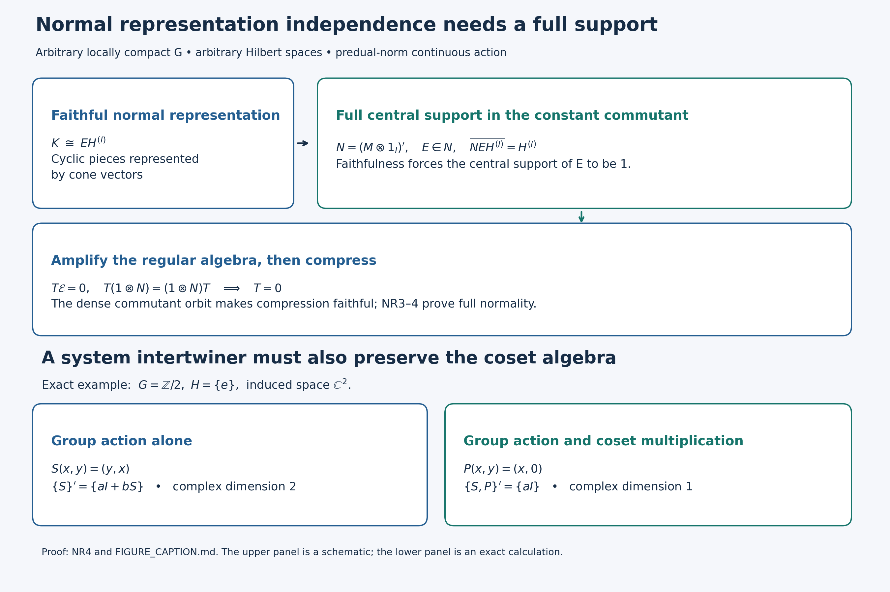
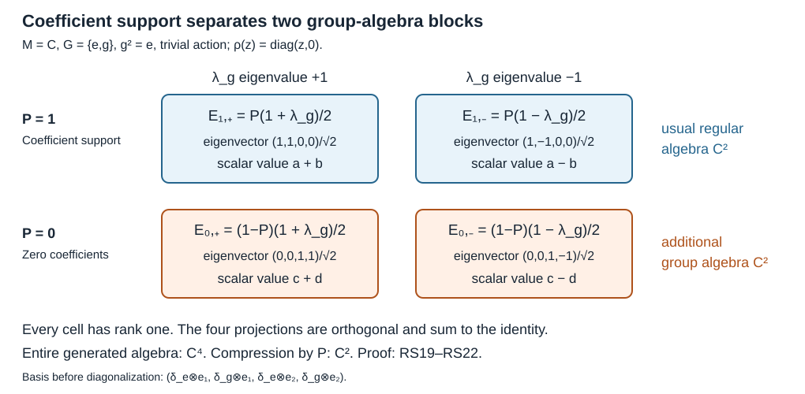

# A normal regular construction on arbitrary Hilbert spaces

*CC0-1.0 to the extent of rights held.*

This chapter proves the normal regular construction, its faithful-representation independence and cocycle transport for every locally compact Hausdorff group. It does not prove the crossed-product commutant theorem, closed-subgroup imprimitivity, disintegration, or the induced-system converse.

For \(M=\{0\}\), a unital representation has zero Hilbert space, since its identity is \(\rho(0)=0\). Thus \(L^2(G,H)=\{0\}\), the regular crossed product is \(\{0\}\), and each standard implementation, representation comparison and cocycle transport is the unique map on the zero space. Every asserted continuity and intertwining identity holds there. The remaining proof treats the nonzero case.

Let \(M\ne0\) be a von Neumann algebra and \(G\) a locally compact Hausdorff group. Assume that \(\alpha:G\to\operatorname{Aut}(M)\) is a homomorphism into normal star automorphisms and

\[
 s\longmapsto \omega\circ\alpha_s\quad\hbox{is norm continuous in }M_*
 \qquad(\omega\in M_*).                                      \tag{NR0}
\]
No separability, countability, sigma finiteness or unimodularity is assumed. The equivalence of (NR0) with merely point-ultraweak continuity for arbitrary \(G\) is proved in the earlier [AT1–3](OA-FLOW-AT.md#oa-flow.at.3). All integrals below use the exact locally determined Haar convention of L24 Section 2 and its finite-exponent identification with completed outer regular Radon classes. Inner products are linear in the first variable.

The earlier written inputs are [HR-03/05/08/09](OA-FLOW-HR.md#hr-03); L24 [Sections 2–5](OA-FLOW-L24.md#oa-flow.grp.haarconventions) and [7–9](OA-FLOW-L24.md#oa-flow.grp.integration) (vector integrals, tensor model, Haar transformations, approximate identities and integrated actions); L25 [integration](OA-FLOW-L25.md#oa-flow.ccov.integration), [coefficient recovery](OA-FLOW-L25.md#oa-flow.ccov.coefficientrecovery) and [group recovery](OA-FLOW-L25.md#oa-flow.ccov.grouprecovery); [CP-04–06](OA-FLOW-CP.md#oa-flow.cp.4) (concrete predual, Banach norm closure and vector series); [ST-1–2](OA-FLOW-ST12.md#oa-flow.st.1) (compact balls and faithful normal topology); [BD-1–5](OA-FLOW-BD.md#oa-flow.bd.1) (bicommutant and bounded density); [NC](OA-FLOW-NC.md#oa-flow.nc.1), [CR-1](OA-FLOW-CR.md#oa-flow.cr.1), [CR-6](OA-FLOW-CR.md#oa-flow.cr.6), [CR-8–9](OA-FLOW-CR.md#oa-flow.cr.8) and [MC-1](OA-FLOW-MC.md#oa-flow.mc.1) (arbitrary standard forms, cone vectors and their exact norm bound). [AT1–6](OA-FLOW-AT.md#oa-flow.at.1) proves the full action-topology and integrated-map input. Only these actual local arguments are imported. The matrix-entry facts needed below are proved again locally.

## NR-1. Canonical implementation is strongly continuous

Choose the standard form \((\sigma,H,J,P)\) provided by NC and CR-9, and identify \(M\) with its faithful normal image. MC-1 applied to each \(\alpha_s\) supplies a unique unitary \(U_s\) such that

\[
 U_s\sigma(x)U_s^*=\sigma(\alpha_s(x)),\qquad U_sP=P,\qquad U_sJ=JU_s.
                                                               \tag{NR1}
\]
Uniqueness gives \(U_sU_t=U_{st}\) and \(U_e=1\). For the unique cone vector \(\xi_f\) of \(f\in M_*^+\),

\[
 U_s\xi_f=\xi_{f\circ\alpha_{s^{-1}}},\qquad
 \|U_s\xi_f-\xi_f\|^2\leq\|f\circ\alpha_{s^{-1}}-f\|.           \tag{NR2}
\]
The first equality follows by evaluating its vector functional and cone membership; the second is CR-6/8. Hypothesis (NR0) proves continuity at \(e\) on every cone vector. CR-1 says the complex span of \(P\) is all \(H\), so linearity and the uniform unitary bound prove strong continuity on all vectors. The group law gives continuity everywhere. Thus no separable standard Hilbert space or faithful normal state is being tacitly chosen.

For later use, every normal representation \(\rho:M\to B(K)\) has point-strong-star continuous coefficient orbits. For \(y_s=\alpha_s(x)-x\), expansion of
\(\|\rho(y_s)\eta\|^2\) uses the four normal functionals evaluating \(\alpha_s(x^*x),\alpha_s(x)^*x,x^*\alpha_s(x),x^*x\). Point-ultraweak continuity, which follows from (NR0), makes their sum tend to zero. The same argument for \(x^*\), followed by translation of the parameter, proves the assertion.

## NR-2. The norm-continuous coefficient core

Define

\[
 A=\{x\in M:s\mapsto\alpha_s(x)\text{ is norm continuous}\}.
                                                               \tag{NR3}
\]
It is an invariant norm-closed unital C\* subalgebra: sums, adjoints and products preserve orbit continuity by the triangle inequality and isometry of the automorphisms; a uniform norm limit preserves it by a three-term estimate. Invariance uses continuity of conjugation \(s\mapsto t^{-1}st\).

For \(f\in L^1(G)\), define \(\alpha_f(x)\in M=(M_*)^*\) by

\[
 \omega(\alpha_f(x))=\int_G f(t)\omega(\alpha_t(x))\,dt.
                                                               \tag{NR4}
\]
This is a bounded functional of \(\omega\) of norm at most \(\|f\|_1\|x\|\), so CP-06 gives exactly one element of \(M\). The scalar integrand is measurable on the sigma compact carrier of \(f\), and is absolutely integrable. Left invariance, tested by every \(\omega\), gives

\[
 \alpha_s(\alpha_f(x))=\alpha_{L_sf}(x),\qquad
 \|\alpha_s(\alpha_f(x))-\alpha_f(x)\|
 \leq\|L_sf-f\|_1\|x\|.                                     \tag{NR5}
\]
Normality of \(\alpha_s\) justifies its passage through the weak-star integral by the predual test. L24 Section 3 proves the last \(L^1\) difference tends to zero. Therefore \(\alpha_f(x)\in A\).

For the nonnegative normalized bumps \(a_V\) of L24 Section 5,

\[
 \|\alpha_{a_V}(x)\|\leq\|x\|,\qquad
 \omega(\alpha_{a_V}(x)-x)\longrightarrow0.                    \tag{NR6}
\]
Indeed the absolute error is at most \(\|x\|\sup_{t\in V}\|\omega\circ\alpha_t-\omega\|\). Thus \(A\) is ultraweakly dense in \(M\), with bounded approximants. This supplies the precise bridge to L25; applying that point-norm theorem to all of \(M\) without passing to \(A\) would not be justified.

## NR-3. Faithful normality of the actual regular coefficient map

Let \(\rho:M\to B(K)\) be a faithful normal unital representation, with arbitrary \(K\ne0\). On the tensor/function model \(L^2(G)\otimes K=L^2(G,K)\), define

\[
 [\pi_\rho(x)\xi](t)=\rho(\alpha_{t^{-1}}(x))\xi(t),\qquad
 [\lambda_s\xi](t)=\xi(s^{-1}t).                              \tag{NR7}
\]
For a compact scalar tensor \(h\eta\), NR-1 gives a continuous vector field \(t\mapsto\rho(\alpha_{t^{-1}}(x))\eta\). Its image on a compact set is separable, by finite metric nets, and multiplication by \(h\) is strongly measurable and square integrable. Finite compact scalar tensors are dense by L24 Section 4. The bound \(\|\pi_\rho(x)\xi\|_2\leq\|x\|\|\xi\|_2\) therefore defines an operator on all \(L^2(G,K)\); approximation identifies it with the displayed field on any strongly measurable representative. No simultaneous exceptional-set union over all Hilbert vectors is used.

Pointwise products and adjoints, first tested on compact tensors, prove that \(\pi_\rho\) is a unital star homomorphism. L24 proves that \(\lambda\) is a strongly continuous unitary representation. Direct substitution gives

\[
 \lambda_s\pi_\rho(x)\lambda_s^*=\pi_\rho(\alpha_s(x)).        \tag{NR8}
\]
Faithfulness follows without a direct integral theorem. If \(\rho(x)\eta\ne0\), the norm of the continuous orbit vector in (NR7) is bounded below on an identity neighbourhood. A nonzero compact bump supported there has positive Haar integral, so \(\pi_\rho(x)\ne0\).

To prove full ultraweak continuity, not just sequential normality, first use compact tensors \(h\eta,k\zeta\). Their coefficient on \(M\) is the \(M_*\)-valued Bochner integral

\[
 \omega_{h\eta,k\zeta}\circ\pi_\rho
 =\int_G h(t)\overline{k(t)}
       (\omega_{\eta,\zeta}\circ\rho\circ\alpha_{t^{-1}})\,dt. \tag{NR9}
\]
The vector-valued integrand is norm continuous and compactly supported by (NR0), and is integrable by L24's arbitrary-Banach-space construction. Its integral lies in the Banach space \(M_*\). Equality holds by testing at each \(x\). Approximate general pairs of \(L^2\) vectors by these finite tensors. The estimate
\(\|\omega_{v,w}-\omega_{v',w'}\|\leq\|v-v'\|\|w\|+\|v'\|\|w-w'\|\)
and CP-06's norm closure put every vector coefficient pullback in \(M_*\). Finally every ultraweak functional on \(B(L^2(G,K))\) is a vector series. Its pulled-back series converges in \(M_*\), with the Cauchy–Schwarz tail bound from CP-04. This proves ultraweak continuity for the entire topology, including arbitrary nets.

Put \(R_\rho=\{\pi_\rho(M),\lambda(G)\}''\). The bounded approximants (NR6) and normality imply

\[
 R_\rho=\{\pi_\rho(A),\lambda(G)\}''.
                                                               \tag{NR10}
\]
The latter is the von Neumann algebra generated by the integrated L25 representation of \(L^1(G,A)\). Here is the recovery detail: the integrated elements for \(a_V(t)x\) tend strongly to \(\pi_\rho(x)\), for \(x\in A\), because \(\int a_V(t)\lambda_tdt\to1\). Taking \(x=1\) and translating the bump recovers every \(\lambda_s\). The integrated operators themselves belong to \(R_\rho\), since their scalar pairings are integrals of elements of its ultraweakly closed linear span (or separate a putative exterior operator by its preannihilator, CP-05). Thus the two generated algebras coincide.

## NR-4. Amplification and normal independence of the initial representation

We give the representation comparison, rather than infer a normal isomorphism merely from equality of C\* norms.

Fix the standard representation \(\sigma\) of NR-1. Decompose \(K\) into an orthogonal sum of cyclic reducing subspaces \(K_i=\overline{\rho(M)\eta_i}\), \(i\in I\). A maximal such family exists by the maximal principle; a nonzero orthogonal complement would contain a vector generating an additional reducing subspace. The index set may be arbitrary. For each \(i\), the functional \(f_i(x)=\langle\rho(x)\eta_i,\eta_i\rangle\) is normal positive. CR-8 provides its cone vector \(\zeta_i\in H\). The map

\[
 \rho(x)\eta_i\longmapsto\sigma(x)\zeta_i
                                                               \tag{NR11}
\]
preserves all inner products, hence extends to a unitary from \(K_i\) onto \(q_iH=\overline{\sigma(M)\zeta_i}\). This subspace is reducing, so \(q_i\in\sigma(M)'\). Taking the arbitrary orthogonal sum gives a unitary

\[
 W:K\longrightarrow EH^{(I)},\qquad
 E=\operatorname{diag}(q_i)\in N:=\{\sigma(M)\otimes1_I\}',
 \quad W\rho(x)W^*=(\sigma(x)\otimes1_I)|_{EH^{(I)}}.          \tag{NR12}
\]

For clarity, \(N=\sigma(M)'\,\bar\otimes B(\ell^2(I))\) follows directly from matrix entries: commutation with \(\sigma(M)\otimes1\) says every entry belongs to \(\sigma(M)'\); finite matrix compressions converge strongly to the operator and belong to the algebra generated by those matrix entries. This proves equality with the indicated generated von Neumann tensor product. Similarly \(N'=\sigma(M)\otimes1_I\), either by the bicommutant theorem or by commuting with all matrix units and then all constant commutant entries. In particular
\(Z(N)=Z(\sigma(M))\otimes1_I\).

Let \(Q\) project onto \(\overline{N E H^{(I)}}\). The subspace is invariant under \(N\) and its adjoints, hence \(Q\in N'\). It is invariant under \(N'\) and its adjoints, since \(E\in N\), hence \(Q\in N\) as well. It contains \(EH^{(I)}\), so \(QE=E\). Write \(Q=\sigma(z)\otimes1_I\) with a central projection \(z\in M\). Equation (NR12) then gives \(\rho(1-z)=0\). Faithfulness forces \(z=1\), and consequently

\[
 \overline{N E H^{(I)}}=H^{(I)}.                              \tag{NR13}
\]
This is the exact support argument needed for the next compression.

Tensor \(W\) with \(1_{L^2(G)}\). The arbitrary sum identification
\(L^2(G)\otimes H^{(I)}\cong(L^2(G)\otimes H)^{(I)}\)
is defined isometrically on finite simple tensors, whose spans are dense on both sides. It transports (NR7) to the compression by \(\mathcal E=1\otimes E\) of the amplification \(R_\sigma\otimes1_I\). The constant algebra \(1_{L^2(G)}\otimes N\) commutes with every amplified regular generator: its entries commute with all \(\sigma(\alpha_{t^{-1}}(M))=\sigma(M)\), and translations act only on the \(G\)-variable. Thus it commutes with the whole amplified algebra, and in particular \(\mathcal E\) does too.

Compression on \(\mathcal E\) is faithful on \(R_\sigma\otimes1_I\). Indeed, an operator \(T\) there whose compression is zero kills the range of \(\mathcal E\), since it commutes with that projection. Commutation with \(1\otimes N\) makes it kill the dense span \((1\otimes N)\mathcal E(L^2(G)\otimes H^{(I)})\), which is all the space by (NR13). Hence \(T=0\).

Amplification \(T\mapsto T\otimes1_I\) is ultraweakly continuous: its vector pairings are sums of component pairings, with uniform square-summable tails. Its range is ultraweakly closed, since matrix entries characterize it by zero off-diagonal entries and identical diagonal entries. Compression is also ultraweakly continuous by vector-series tests. ST-2 therefore proves that their faithful composite has a von Neumann image and a normal inverse. That image is exactly \(R_\rho\): it contains the regular generators, and the converse containment follows by applying bounded strong-star density (BD) to the algebra of amplified generators and compressing its bounded approximants. We obtain the unique normal star isomorphism

\[
 R_\sigma\longrightarrow R_\rho,\qquad
 \pi_\sigma(x)\mapsto\pi_\rho(x),\quad\lambda_s\mapsto\lambda_s.
                                                               \tag{NR14}
\]
Uniqueness follows from ultraweak generation. Comparing two faithful normal representations through \(\sigma\) proves full normal representation independence. This argument does not assert that arbitrary faithful normal representations themselves are unitarily equivalent; the intervening amplification and compression are indispensable.

## NR-5. Exact cocycle transport

Let \(u:G\to\mathcal U(M)\) be sigma-strong-star continuous and satisfy \(u_{st}=u_s\alpha_s(u_t)\). Put \(\beta_s=\operatorname{Ad}(u_s)\alpha_s\). This is an action. It satisfies (NR0): for a vector functional, its pullback under \(\operatorname{Ad}(u_s)\) is norm continuous by the vector-functional estimate; finite vector-series approximation gives this for every normal functional, and the original predual action gives continuity of the composite. The same argument works after any faithful normal realization using ST-2's bounded topology comparison.

The field

\[
 [V\xi](t)=\rho(u_{t^{-1}})\xi(t)                              \tag{NR15}
\]
defines a unitary on all \(L^2(G,K)\). On compact tensors its vector field is continuous and has separable compact image; approximate arbitrary \(L^2\) vectors. The adjoint is multiplication by \(\rho(u_{t^{-1}}^*)\). Direct evaluation gives

\[
 V\pi_\alpha(x)V^*=\pi_\beta(x),\qquad
 V\lambda_sV^*=\pi_\beta(u_s^*)\lambda_s.                     \tag{NR16}
\]
For the second formula use
\(u_{t^{-1}s}=u_{t^{-1}}\alpha_{t^{-1}}(u_s)\), so that
\(u_{t^{-1}}u_{t^{-1}s}^*=\beta_{t^{-1}}(u_s^*)\).
The displayed images generate the beta regular algebra, because \(\lambda_s=\pi_\beta(u_s)V\lambda_sV^*\). Consequently conjugation by \(V\) is an onto normal spatial isomorphism of the two actual crossed products. This establishes the adjoint and the noncommutative order explicitly.

## Scope and source development

The proof above was constructed from the current Haar, concrete-predual and natural-cone arguments. No historical induction or commutant lesson body was used as a template. Free primary context for the remaining induction problem is Rieffel, *Induced representations of C\*-algebras* (1974), especially Theorems 6.23, 6.29 and 7.18, [author-hosted complete edition](https://math.berkeley.edu/~rieffel/papers/rieffel-C-induced.pdf). Its theorem is not substituted for a local proof. Takesaki, [*Covariant representations of C\*-algebras and their locally compact automorphism groups*](https://projecteuclid.org/euclid.acta/1485889537), Acta Math. 119 (1967), Sections 3–4, supplies separable induction/disintegration context, not an arbitrary-Hilbert theorem.

For a nonfaithful normal representation, (NR7) is still a normal covariant construction, but the proof of (NR13) fails precisely on its central kernel. If the kernel is invariant, it can be treated after passing to the quotient supported algebra. No isomorphism with the original faithful crossed product is claimed in that case. General commutant identification, closed-subgroup quotient measures, imprimitivity and direct-integral reconstruction require further proofs.

## What the two operator pictures prove

The upper panel illustrates [NR4](OA-FLOW-NR.md#oa-flow.nr.4). It is a commuting-algebra schematic, not a finite-dimensional model or a dimension comparison. The Hilbert spaces and index set \(I\) can be arbitrary. The initial faithful normal representation on \(K\) is unitarily a reducing compression of the standard representation amplified on \(H^{(I)}\):
\[
 W:K\longrightarrow EH^{(I)},\qquad
 N=(M\otimes1_I)',\qquad E=\operatorname{diag}(q_i)\in N.
\]
The canonical cone vectors for the cyclic normal functionals construct \(W\), using current CR8 and MC1. The projection onto \(\overline{NEH^{(I)}}\) belongs to both \(N\) and \(N'\). It therefore equals \(z\otimes1_I\) for a central projection \(z\in M\). Since this projection contains \(E\), its complementary central projection is killed by the original faithful representation. Hence \(z=1\).

On \(L^2(G)\otimes H^{(I)}\), the constant algebra \(1\otimes N\) commutes with the regular coefficients and with translations. Thus an operator \(T\) in the amplified regular algebra which vanishes on \(\mathcal E=1\otimes E\) vanishes on the dense span \((1\otimes N)\mathcal E(L^2(G)\otimes H^{(I)})\). Therefore \(T=0\). This proves the faithfulness of compression. Full normality is proved separately in NR3–4 by vector-series tests and ST12; the image is the entire regular algebra by bounded density. The picture must not be read as asserting that two arbitrary faithful initial representations have a unitary between their original spaces.

The lower panel is an exact finite example explaining the qualification for systems of imprimitivity. Let \(G=\mathbb Z/2\), \(H=\{e\}\), and induce the one-dimensional representation of \(H\). On \(\mathbb C^2\) with the two cosets as the ordered basis, the nonidentity group element acts by
\[
 S=\begin{pmatrix}0&1\\1&0\end{pmatrix}.
\]
For a matrix \(T=\begin{pmatrix}a&b\\c&d\end{pmatrix}\), the equation \(TS=ST\) is exactly \(d=a,c=b\). Thus the group commutant is
\[
 \{S\}'=\{aI+bS:a,b\in\mathbb C\},
\]
of complex dimension two. The coset algebra acts by every diagonal matrix. In particular commutation with \(P=\operatorname{diag}(1,0)\) forces \(b=c=0\). Combining this with commutation with \(S\) leaves precisely \(T=aI\). The full system commutant is therefore one-dimensional, as is the intertwiner space of the original one-dimensional \(H\)-representation.

This calculation does not refute imprimitivity. It shows why its morphisms must preserve the coset multiplication action as well as the group action. Rieffel, [*Induced representations of C\*-algebras*](https://math.berkeley.edu/~rieffel/papers/rieffel-C-induced.pdf) (1974), Theorem 7.18, and Green, [*The local structure of twisted covariance algebras*](https://projecteuclid.org/euclid.acta/1485889984), Acta Math. 140 (1978), Theorem 6, provide context; the programme proves the [converse imprimitivity theorem in L45](OA-FLOW-L45.md) and identifies [every covariant-system intertwiner in L46](OA-FLOW-L46.md). Both arguments retain the coset multiplication action.

The diagram and this explanation are CC0-1.0 to the extent of rights held. Run render_c2_foundation.py with Python and matplotlib to reproduce the PNG, SVG and exact diagram data beside this caption.

## NR6. Successive perturbations give successive regular maps

Let \(G\) be a locally compact Hausdorff group, let \(M\ne0\) be a von Neumann algebra, and let \(\alpha\) be a point-ultraweak continuous action by normal automorphisms. Fix one faithful normal unital representation \(\rho:M\to B(K)\), with arbitrary \(K\). Use this same representation for all the regular algebras in this subsection. There is no separability, countability, sigma-finiteness or unimodularity assumption.

Suppose \(u:G\to\mathcal U(M)\) is an \(\alpha\)-cocycle and \(v:G\to\mathcal U(M)\) is a cocycle for \(\beta_s=\operatorname{Ad}(u_s)\alpha_s\). Both maps are continuous in the intrinsic \(\sigma\)-strong-star topology. By [UC2](OA-FLOW-UC.md#oa-flow.uc.2),
\[
 w_s=v_su_s,\qquad
 w_{st}=w_s\alpha_s(w_t),\qquad
 \gamma_s=\operatorname{Ad}(v_s)\beta_s
          =\operatorname{Ad}(w_s)\alpha_s.
 \tag{NR17}
\]
Indeed, in the indicated order,
\[
 v_{st}u_{st}
 =v_s\beta_s(v_t)u_s\alpha_s(u_t)
 =v_su_s\alpha_s(v_t)u_s^*u_s\alpha_s(u_t)
 =w_s\alpha_s(w_t).
\]
[UC0](OA-FLOW-UC.md#oa-flow.uc.0) proves continuity of the bounded products. The hypothesis on the action of the second cocycle is essential; two cocycles for \(\alpha\) need not have an \(\alpha\)-cocycle as their pointwise product.

Write \(R_\alpha\), \(R_\beta\) and \(R_\gamma\) for the regular crossed products on the same Hilbert space \(L^2(G,K)\). [NR5](#oa-flow.nr.5) constructs the full multiplication unitaries
\[
 [W_{u,\alpha}\xi](t)=\rho(u_{t^{-1}})\xi(t),\qquad
 [W_{v,\beta}\xi](t)=\rho(v_{t^{-1}})\xi(t).
 \tag{NR18}
\]
For clarity, their construction covers the whole Hilbert space. On a compact elementary section, continuity of each fixed-vector orbit gives a compact metric image and hence a separable range. The unitary norm bound extends multiplication by density; multiplication by the pointwise adjoint is its inverse. Thus it does not require a countable-dimensional coefficient space or a common exceptional set for all vectors.

Multiplication on compact elementary sections gives
\[
 W_{v,\beta}W_{u,\alpha}\xi(t)
 =\rho(v_{t^{-1}}u_{t^{-1}})\xi(t)
 =W_{w,\alpha}\xi(t).
 \tag{NR19}
\]
All three operators are bounded, so this equality holds on every vector in \(L^2(G,K)\). Their spatial normal isomorphisms therefore compose in the same order:
\[
 \operatorname{Ad}(W_{v,\beta})\circ
 \operatorname{Ad}(W_{u,\alpha})|_{R_\alpha}
 =\operatorname{Ad}(W_{w,\alpha})|_{R_\alpha}.
 \tag{NR20}
\]
The generator identities are those of NR5:
\[
 W_{u,\alpha}\pi_\alpha(a)W_{u,\alpha}^*=\pi_\beta(a),\qquad
 W_{u,\alpha}\lambda_sW_{u,\alpha}^*
       =\pi_\beta(u_s^*)\lambda_s.
 \tag{NR21}
\]
In particular, transporting \(\pi_\alpha(u_s)\lambda_s\) cancels the adjacent coefficient factors and gives \(\lambda_s\). These identities concern the whole normal crossed products and specify the adjoint without changing the order of the noncommuting cocycle factors.

## NR7. Central multipliers and inner automorphisms

Retain the arbitrary locally compact group and normal continuous action above. Let \(Z^1(G,\mathcal U(Z(M)))\) denote the continuous \(\alpha\)-cocycles whose values lie in the center. This is an abelian group under pointwise multiplication. To check the cocycle law for \(uv\), reorder only central factors in
\(u_s\alpha_s(u_t)v_s\alpha_s(v_t)\); the result is
\((u_sv_s)\alpha_s(u_tv_t)\). The identity cocycle is constant one, and pointwise adjoints give inverses. [UC0](OA-FLOW-UC.md#oa-flow.uc.0) supplies continuity of these operations.

For a central cocycle, \(\operatorname{Ad}(u_s)\alpha_s=\alpha_s\). Thus NR5 restricts conjugation by \(W_{u,\alpha}\) to a normal automorphism \(A_u\) of the same algebra \(R_\alpha\), with
\[
 A_u(\pi_\alpha(a))=\pi_\alpha(a),\qquad
 A_u(\lambda_s)=\pi_\alpha(u_s^*)\lambda_s.
 \tag{NR22}
\]
The image contains all coefficients and translations, so it is the entire algebra. Since central multiplication unitaries commute and satisfy
\(W_{u,\alpha}W_{v,\alpha}=W_{uv,\alpha}\),
\[
 A_uA_v=A_{uv}.
 \tag{NR23}
\]
This proves the homomorphism on the full crossed product, not only on its polynomial generators.

For \(z\in\mathcal U(Z(M))\), define
\[
 (\partial z)_s=z^*\alpha_s(z).
 \tag{NR24}
\]
Direct multiplication gives its cocycle law, and continuity follows from the action topology proved in [AT1–4](OA-FLOW-AT.md#oa-flow.at.1). The products of two such coboundaries are the coboundary of the product of the central unitaries; their adjoints are again coboundaries. Hence these form a subgroup of the central cocycle group.

Centrality is also what gives the correct implementer:
\[
 (\partial z)_s^*=z\alpha_s(z^*),\qquad
 \pi_\alpha((\partial z)_s^*)\lambda_s
 =\pi_\alpha(z)\lambda_s\pi_\alpha(z)^*.
 \tag{NR25}
\]
Both automorphisms fix coefficients and are normal. Equality on the generating coefficients and translations therefore gives
\(A_{\partial z}=\operatorname{Ad}\pi_\alpha(z)\) on all of \(R_\alpha\).

For the converse, assume exactly
\[
 \pi_\alpha(M)'\cap R_\alpha=\pi_\alpha(Z(M)).
 \tag{NR26}
\]
If \(A_u=\operatorname{Ad}(w)\) for a unitary \(w\in R_\alpha\), its fixation of the coefficients puts \(w\) in this relative commutant. Write \(w=\pi_\alpha(z)\), where faithfulness makes \(z\) a central unitary. Comparing the translation generators and cancelling \(\lambda_s\) yields
\[
 u_s^*=z\alpha_s(z^*),\qquad
 u_s=z^*\alpha_s(z).
 \tag{NR27}
\]
Thus precisely the central coboundaries give inner automorphisms under (NR26). The converse assumes the displayed relative-commutant equality; no factor condition, freeness theorem, countability assumption or commutativity of \(G\) is being substituted for it.

For comparison, [the central cocycles of a trace-scaling real action](OA-FLOW-RCC.md#rcc-6) use multiplication by \(c(-t)^*\) and the coboundary \(z\theta_s(z^*)\). Their generator coefficient is unstarred. Here multiplication by \(u_{t^{-1}}\) and the coboundary (NR24) give the starred coefficient in (NR22). These conventions describe the same inner-implementer mechanism with opposite adjoints; the specialized trace-scaling theorem is not a premise of the arbitrary-group statements above.

Classical context for these ordered multiplier and central-cocycle identities is Takesaki, [*Theory of Operator Algebras II*](https://doi.org/10.1007/978-3-662-10451-4), Chapter X.1, Exercises5–6.

## NR8. What a degenerate coefficient representation adds

Let \(\rho:M\to B(K)\) be a normal star representation, with neither faithfulness nor nondegeneracy assumed. Put \(p=\rho(1)\). Since
\(\rho(x)=p\rho(x)p\), the subspaces \(pK\) and \((1-p)K\) reduce every coefficient. Use the same regular formulas as in NR3, on all of \(L^2(G)\otimes K\):
\[
 [\pi_\rho(x)\xi](t)=\rho(\alpha_{t^{-1}}(x))\xi(t),\qquad
 [\lambda_s\xi](t)=\xi(s^{-1}t).
 \tag{RS1}
\]
The bounded-field construction and vector-series normality argument in NR3 apply to this \(\rho\) unchanged: their only bounds are contractivity and normality of \(\rho\). The faithfulness conclusion of NR3 is used only when \(\rho\) is faithful.

Define
\[
 R_\rho=\{\pi_\rho(M),\lambda(G)\}'',\qquad
 P=\pi_\rho(1)=1_{L^2(G)}\otimes p.
 \tag{RS2}
\]
Then \(P\) belongs to \(R_\rho\), commutes with every coefficient, and commutes with every translation because it is constant in the group variable. It is therefore a central projection of \(R_\rho\).

Write \(\rho_p(x)=\rho(x)|_{pK}\); this is a normal unital representation on its support space. The decomposition of the Hilbert space gives the exact algebra decomposition
\[
 R_\rho
 =R_{\rho_p}\ \oplus\
   \bigl(\operatorname{VN}(G)\otimes 1_{(1-p)K}\bigr),
 \qquad
 \operatorname{VN}(G)=\{L_s:s\in G\}''\subseteq B(L^2(G)).
 \tag{RS3}
\]
A zero support space contributes the zero algebra.

**Proof of the whole-algebra equality.** Both generators are block diagonal. Their restrictions to \(pK\) give precisely the regular generators for \(\rho_p\). On the complementary space, every coefficient vanishes and the group operators are \(L_s\otimes1\). Since the central projections \(P,1-P\) already lie in \(R_\rho\), each block can be selected independently inside this algebra. Each corner is weakly closed: after extension by zero it is the intersection of \(R_\rho\) with the weakly closed corner \(PB(L^2(G,K))P\), or its complement. By BD's bounded-density theorem, each element of a corner is the strong* limit of compressed bounded approximants from the algebra of the original generators. These compressions belong to the algebra of the restricted generators. Thus the weakly closed algebra generated by the restricted generators is precisely that corner. Conversely their two corners generate the block sum. This proves (RS3), including its normal coordinate projections and inclusions.

If \(\rho\) is faithful, then \(\rho_p\) is faithful: its vanishing on an element would make \(\rho\) vanish on that element. NR4 identifies the first summand normally with the faithful regular crossed product. The second summand is still present whenever \((1-p)K\ne0\). Thus the entire degenerate model is not automatically a model of the same algebra. A concrete failure is calculated in NR11.

If \(\rho\) is not faithful, no faithfulness is claimed for \(\rho_p\) or for its regular coefficient map. Its central support in the *representing Hilbert space*, namely \(P\), is what (RS3) separates. It must not be confused with a central projection of \(M\) describing the kernel of \(\rho\), whose behavior under \(\alpha\) is a different question.

## NR9. Scalar compressions recover actual coefficient averages

For \(h\in L^2(G)\), let
\[
 T_h:K\longrightarrow L^2(G,K),\qquad T_h\xi=h\otimes\xi.
 \tag{RS4}
\]
Then \(\|T_h\|=\|h\|_2\) when \(K\ne0\). For \(h,k\in L^2(G)\) and \(x\in M\), define \(B_{h,k}(x)\in M\) by its predual tests:
\[
 \omega(B_{h,k}(x))
 =\int_G\overline{h(t)}k(t)\,
          \omega(\alpha_{t^{-1}}(x))\,dt
 \qquad(\omega\in M_*).
 \tag{RS5}
\]
The scalar product \(\overline h k\) lies in \(L^1(G)\) by Cauchy–Schwarz. Its scalar integral is absolutely convergent and bounded by
\(\|h\|_2\|k\|_2\|\omega\|\|x\|\). The concrete duality \(M=(M_*)^*\) in CP6 therefore gives exactly one \(B_{h,k}(x)\), with
\[
 \|B_{h,k}(x)\|\leq\|h\|_2\|k\|_2\|x\|.
 \tag{RS6}
\]
These are elements of \(M\), not merely sesquilinear forms on one representation.

The map \(x\mapsto B_{h,k}(x)\) is normal. To see this for every normal functional, construct the predual integral
\[
 B_{h,k*}(\omega)
 =\int_G\overline{h(t)}k(t)\,
           (\omega\circ\alpha_{t^{-1}})\,dt\ \in M_*.
 \tag{RS7}
\]
For \(h,k\in C_c(G)\), the integrand is norm continuous on a compact support by (NR0), and L24's Banach-valued integration gives this vector. Compact images have finite metric nets and hence separable range, so no separability hypothesis on \(M_*\) is needed. For general \(h,k\), choose \(C_c\) approximants in \(L^2\), as proved in L24. The estimate
\[
 \|\overline h k-\overline {h'}k'\|_1
 \leq\|h-h'\|_2\|k\|_2+\|h'\|_2\|k-k'\|_2
 \tag{RS8}
\]
makes the integrals Cauchy in the Banach space \(M_*\); their limit satisfies (RS7) when tested at every \(x\). It is independent of the approximants and has norm at most \(\|h\|_2\|k\|_2\|\omega\|\). Thus \(B_{h,k}\) is the adjoint of this bounded predual map, proving full ultraweak continuity. In particular, no interchange of an arbitrary net and a scalar integral is used.

For every normal representation \(\rho\), including a degenerate one, the exact compression formula is
\[
 T_h^*\pi_\rho(x)T_k=\rho(B_{h,k}(x)).
 \tag{RS9}
\]
Indeed, pairing its left side against \(\xi,\eta\in K\), with the linear-first convention, gives
\[
 \langle\pi_\rho(x)(k\otimes\xi),h\otimes\eta\rangle
 =\int_G k(t)\overline{h(t)}
     \langle\rho(\alpha_{t^{-1}}(x))\xi,\eta\rangle\,dt.
\]
The functional \(a\mapsto\langle\rho(a)\xi,\eta\rangle\) is normal, so (RS5) is exactly the right-side pairing. Finite compact tensors prove the formula first, and (RS6), (RS8) and boundedness of the \(T_h\) extend it to all \(L^2\) scalar vectors.

When \(h=k\), the map \(B_{h,h}\) is positive and
\[
 B_{h,h}(1)=\|h\|_2^2\,1.
 \tag{RS10}
\]
For positivity, all its positive normal tests on a positive \(x\) are integrals of nonnegative functions. Positive vector tests in a faithful concrete representation detect positivity by CF7–8. The unit identity follows directly from (RS5).

These averages also commute with change of coefficients. Suppose
\(\vartheta:M\to N\) is a normal star isomorphism with normal inverse and
\(\beta_t\vartheta=\vartheta\alpha_t\). Construct \(B^\alpha\) and \(B^\beta\) from the two actions. Every \(\nu\in N_*\) gives
\[
 \begin{aligned}
 \nu(\vartheta(B^\alpha_{h,k}(x)))
 &=\int_G\overline h k\,(\nu\circ\vartheta)
                         (\alpha_{t^{-1}}(x))\,dt\\
 &=\nu(B^\beta_{h,k}(\vartheta(x))).
 \end{aligned}
\]
Separation by \(N_*\) proves
\[
 \vartheta B^\alpha_{h,k}=B^\beta_{h,k}\vartheta.
 \tag{RS11}
\]
This is a normal coefficient identity, independent of either representing Hilbert space.

Finally, the compact compressions retain the original coefficient. Let \(a_V\) be L24's nonnegative normalized compact bumps supported in shrinking identity neighborhoods, and put \(h_V=\sqrt{a_V}\in C_c(G)\). For every \(\omega\in M_*\),
\[
 \left|\omega(B_{h_V,h_V}(x)-x)\right|
 \leq \sup_{t\in V}
       |\omega(\alpha_{t^{-1}}(x)-x)|\longrightarrow0,
 \qquad \|B_{h_V,h_V}(x)\|\leq\|x\|.
 \tag{RS12}
\]
Inversion is continuous at the identity, so the displayed supremum tends to zero. Consequently, if \(\rho\) is faithful and all compact compressions \(T_h^*\pi_\rho(x)T_h\) vanish, (RS9), faithfulness and (RS12) give \(x=0\). This recovers the coefficient without measurable operator-field disintegration.

## NR10. Tensor location from arbitrary matrix entries

Let \(L,K\) be arbitrary Hilbert spaces and \(N\subseteq B(K)\) a unital von Neumann algebra. The spatial tensor algebra is the von Neumann algebra generated by the operators \(A\otimes x\), \(A\in B(L)\), \(x\in N\). We prove
\[
 (1_L\otimes N')'=B(L)\,\overline\otimes\,N.
 \tag{RS13}
\]
The inclusion from right to left is immediate on the generators and persists under weak limits.

For the reverse inclusion choose an orthonormal basis \((e_j)_{j\in J}\) of \(L\), with no countability assumption. The Hilbert-space projection theorem and maximal principle from CF give such a basis: a maximal orthonormal family's closed span has zero orthogonal complement. Let \(V_j\xi=e_j\otimes\xi\). If \(T\) commutes with \(1\otimes N'\), then
\[
 T_{ij}=V_i^*TV_j\in(N')'=N,
 \tag{RS14}
\]
because \(V_j b=(1\otimes b)V_j\) and \(bV_i^*=V_i^*(1\otimes b)\) for \(b\in N'\). The last equality is the earlier bicommutant theorem.

For each finite \(E\subset J\), let \(p_E\) project onto the span of its basis vectors and set \(P_E=p_E\otimes1\). Direct evaluation on elementary tensors gives
\[
 P_ETP_E=\sum_{i,j\in E}|e_i\rangle\langle e_j|\otimes T_{ij}
       \in B(L)\,\overline\otimes\,N.
 \tag{RS15}
\]
The finite-set net \(P_E\) tends strongly to \(1\). Indeed, finite linear combinations of basis vectors are dense in \(L\), elementary tensors are dense in \(L\otimes K\), and \(\|P_E\|\leq1\). For any \(\xi\),
\[
 \|(P_ETP_E-T)\xi\|
 \leq\|T\|\,\|(P_E-1)\xi\|+\|(P_E-1)T\xi\|
 \longrightarrow0.
 \tag{RS16}
\]
The same argument applies to \(T^*\). The spatial tensor algebra is strongly closed by the bicommutant theorem, so (RS15)–(RS16) place \(T\) in it. This proves (RS13) for arbitrary nets and arbitrary Hilbert dimensions.

Apply this to any normal unital representation \(\rho\), with \(N=\rho(M)''\). If \(\rho\) is faithful, ST2 gives \(N=\rho(M)\), identifying this factor with \(M\) itself. For \(b\in N'\), the regular coefficient field satisfies
\[
 (1\otimes b)\pi_\rho(x)=\pi_\rho(x)(1\otimes b).
 \tag{RS17}
\]
On compact elementary tensors this is pointwise commutation with every
\(\rho(\alpha_{t^{-1}}(x))\in N\). Boundedness extends it to all vectors. Hence
\[
 \pi_\rho(M)\subseteq B(L^2(G))\,\overline\otimes\,N,\qquad
 R_\rho\subseteq B(L^2(G))\,\overline\otimes\,N,
 \tag{RS18}
\]
because \(\lambda_s=L_s\otimes1\) belongs to the same algebra. On a degenerate faithful representation, first apply this argument on \(pK\) and then use the exact direct sum (RS3).

This proves the required tensor location without asserting a direct-integral decomposition of an arbitrary operator or identifying the full crossed-product commutant. Formula (RS13) concerns the constant coefficient commutant; the commutant of the full regular algebra has the additional translation constraints.

## NR11. A faithful degenerate model with four scalar summands

Take \(M=\mathbb C\), the trivial action, and \(G=\{e,g\}\) with \(g^2=e\) and counting Haar measure. The faithful unital representation on \(\mathbb C\) has regular algebra
\[
 \operatorname{VN}(G)=\{aI_2+bS:a,b\in\mathbb C\},\qquad
 S=\begin{pmatrix}0&1\\1&0\end{pmatrix}.
 \tag{RS19}
\]
The two unit vectors \(2^{-1/2}(1,1)\) and \(2^{-1/2}(1,-1)\) diagonalize \(S\), so the map \(aI_2+bS\mapsto(a+b,a-b)\) is an isomorphism onto \(\mathbb C^2\).

Now use the faithful degenerate representation
\(\rho(z)=\operatorname{diag}(z,0)\) on \(\mathbb C^2\). Order the regular basis as
\((\delta_e\otimes e_1,\delta_g\otimes e_1,\delta_e\otimes e_2,\delta_g\otimes e_2)\).
Then
\[
 \pi_\rho(z)=\begin{pmatrix}zI_2&0\\0&0\end{pmatrix},\qquad
 \lambda_g=\begin{pmatrix}S&0\\0&S\end{pmatrix},\qquad
 P=\begin{pmatrix}I_2&0\\0&0\end{pmatrix}.
 \tag{RS20}
\]
The four projections
\[
 E_{1,\pm}=\tfrac12P(1\pm\lambda_g),\qquad
 E_{0,\pm}=\tfrac12(1-P)(1\pm\lambda_g)
 \tag{RS21}
\]
are nonzero, rank one, pairwise orthogonal, and sum to the identity. These assertions follow by \(S^*=S\), \(S^2=1\), and the two eigenvectors above in each block. They belong to the generated algebra. Conversely every generator is a linear combination of them, so
\[
 R_\rho
 =\left\{\begin{pmatrix}aI_2+bS&0\\0&cI_2+dS\end{pmatrix}:a,b,c,d\in\mathbb C\right\}
 \cong\mathbb C^4,
 \tag{RS22}
\]
with coordinates \((a+b,a-b,c+d,c-d)\). A linear bijection between this four-dimensional algebra and the two-dimensional faithful unital model is impossible. Thus normality and faithfulness of the coefficient representation alone do not give whole-space model independence.

The diagram uses the ordered eigenbasis just calculated. Its two rows are the central support blocks \(P\) and \(1-P\); its columns are the eigenvalues \(+1,-1\) of \(\lambda_g\). Each cell is a one-dimensional minimal projection, not an extra assumption about multiplicity. Compressing to the upper row gives the usual two-summand crossed product; the lower row is the additional group algebra in (RS3).
