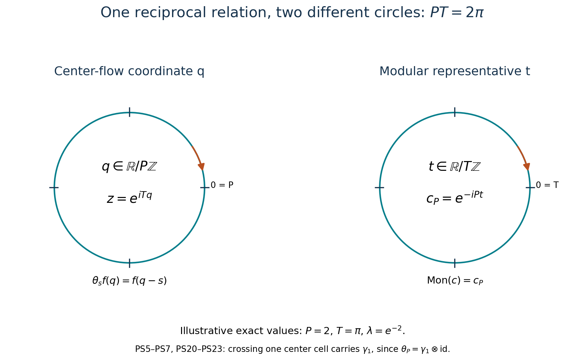
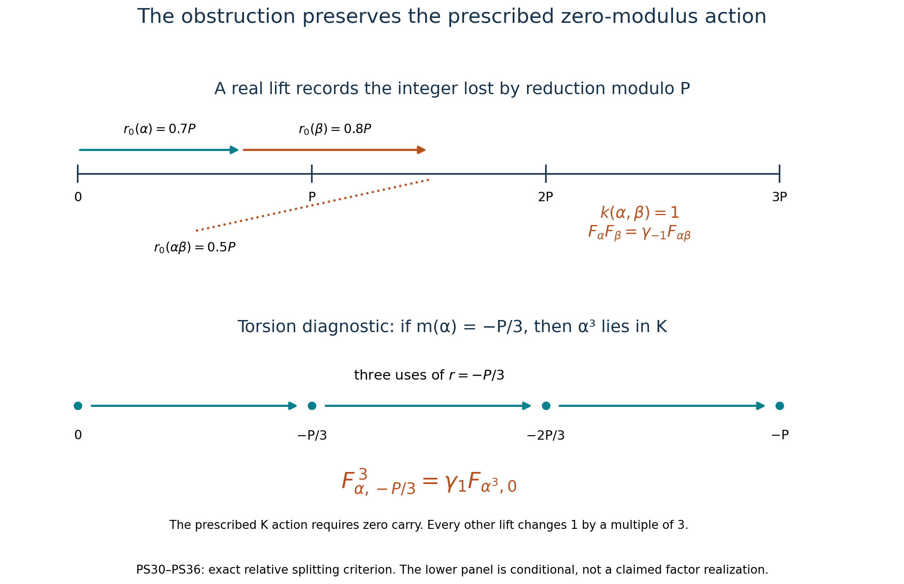

# Periodic cores and the lifting obstruction

The periodic flow has two different periods. One measures translation on the core center; the other measures modular time. Their product is \(2\pi\). Keeping both parameters visible makes the characteristic square concrete and exposes the obstruction to lifting all automorphisms to its compact version.

Throughout this lesson \(M\) is a nonzero factor with separable predual of type \(\mathrm{III}_\lambda\), \(0<\lambda<1\). Put
\[
 P=-\log\lambda,\qquad T=2\pi/P,\qquad PT=2\pi.
 \tag{PS1}
\]
Thus \(P\) is the period of the center flow and \(T\) the fundamental modular period. Neither endpoint \(\lambda=0,1\) is obtained by substitution.

*CC0-1.0 to the extent of rights held.*

## 1. The full center and an arbitrary specified periodic weight

The complete [discrete-decomposition theorem](OA-FLOW-DDP.md#dd-existence), including its given-weight and normal-inverse proofs, supplies an infinite faithful periodic weight \(\psi\) and
\[
 M=N\rtimes_\beta\mathbb Z,\quad
 N=M_\psi\text{ a }\mathrm{II}_\infty\text{ factor},\quad
 \tau_N\beta=\lambda\tau_N,\quad
 \psi=\tau_NE_N,\quad \sigma_t^\psi(U)=e^{-iPt}U .
 \tag{PS2}
\]
Here \(U\) implements \(\beta\), and \(E_N\) is the normalized circle average. Its actual full-center computation [DDP40–42](OA-FLOW-DDP.md#dd-center), also given with all chart choices in [PDM3](OA-FLOW-PDM.md#pdm-3), proves
\[
 Z(C(M))=W^*(\lambda_\psi(T))
       \cong L^\infty(\mathbb R/P\mathbb Z,dq),\qquad
 \theta_s f(q)=f(q-s).
 \tag{PS3}
\]
The central generator corresponds to \(e^{iTq}\). The proof excludes all nonzero Fourier coefficients by the outerness of \(\beta^n\), identifies the remaining periodic multipliers and proves their entire normal generation. Thus (PS3) is not a proper subalgebra of the center.

Let now \(\varphi\) be any specified faithful normal semifinite weight with
\(\sigma_T^\varphi=\mathrm{id}\). No infinite-mass assumption is imposed on \(\varphi\). Write \(d_t=[D\varphi:D\psi]_t\). Since both modular groups have period \(T\), the unitary \(d_T\) implements the identity automorphism of the factor; hence \(d_T=\zeta1\) for some \(\zeta\in\mathbb T\). The cocycle equation gives \(d_{t+T}=\zeta d_t\). In the common core,
\[
 \lambda_\varphi(T)=\zeta\lambda_\psi(T),
 \quad Z(C(M))=W^*(\lambda_\varphi(T)).
 \tag{PS4}
\]
Multiplication of the generating coordinate by a scalar changes neither the entire center nor its flow period. This handles finite periodic weights without replacing the specified weight in later formulas.

## 2. Every periodic cocycle and its topology

Let \(A=\mathcal U(L^\infty(\mathbb R/P\mathbb Z))\), with the action in (PS3). For a strongly continuous cocycle \(c\), commutativity of the two expressions for \(c_{s+P}\) gives
\[
 c_Pc_s=c_s\theta_s(c_P).
\]
Thus \(c_P\) is invariant under all translations and is a scalar \(\zeta\). Translation invariance implies constancy: convolve with continuous approximate identities on the circle; each convolution is a continuous invariant function, hence constant, and these converge in \(L^2\). Define its monodromy by
\[
 \operatorname{Mon}(c)=c_P\in\mathbb T.
 \tag{PS5}
\]

**Complete cocycle classification.** Every \(c\) has the form
\[
 c_s(q)=e^{-its}\,a(q)^*a(q-s)
 \quad(s\in\mathbb R),\qquad a\in A,\quad
 e^{-iPt}=\operatorname{Mon}(c).
 \tag{PS6}
\]
The real parameter \(t\) is unique modulo \(T\mathbb Z\).

*Proof.* Pull the periodic multiplier classes back to \(L^\infty(\mathbb R,dq)\). This is a normal injective homomorphism. Strong continuity is preserved: testing on a square-integrable vector reduces, by its periodized squared density, to normal-function testing on one period. The full line-translation transfer theorem [TCC3–5](OA-FLOW-TCC.md#tcc-3), reflected to negative translation and with its transfer replaced by its adjoint if necessary, gives
\[
 c_s(q)=b(q)^*b(q-s),\qquad b\in\mathcal U(L^\infty(\mathbb R)).
\]
This is an all-times equality of multiplier classes. That theorem constructs the necessary joint measurable representatives and a generic Fubini slice; no evaluation of an \(L^\infty\) class at \(q=0\) is involved.

At \(s=P\), the equality says \(b(q-P)=\zeta b(q)\) almost everywhere. Choose \(t\) with \(e^{-iPt}=\zeta\), and put \(a(q)=e^{-itq}b(q)\). Then \(a(q-P)=a(q)\) almost everywhere. Discarding the countable union of exceptional sets for integer translates gives a periodic representative obtained from its restriction to \([0,P)\). This defines \(a\in A\). Direct cancellation yields (PS6) at every time in the multiplier algebra. If two choices \(t,t'\) occur, equality of monodromy gives \(P(t-t')\in2\pi\mathbb Z\), equivalently \(t-t'\in T\mathbb Z\). ∎

Monodromy is a continuous surjective homomorphism from the compact-open strong cocycle group onto \(\mathbb T\). Continuity is evaluation at \(P\); on scalar unitaries strong convergence is their ordinary scalar convergence. Surjectivity follows from the scalar characters. Its kernel is precisely \(B^1_\theta(\mathbb R,A)\), by (PS6). The cocycle group is Polish by the path-space proof in [Characteristic, Section 4](OA-FLOW-NSQ.md#cs-topology). Polish open mapping therefore gives
\[
 H^1_\theta(\mathbb R,A)\ \cong\ \mathbb T
 \ \cong\ \mathbb R/T\mathbb Z,\qquad
 [c]\longmapsto e^{-iPt},\quad [t]\longmapsto e^{-iPt}.
 \tag{PS7}
\]
In particular the coboundaries are closed, and their quotient topology agrees with their subspace topology here. This last assertion follows also by open mapping from \(A/\mathbb T\) onto the closed kernel.

Write \(E\) for the normalizers in the continuous core and \(N_c=\operatorname{Cntr}(M)\). With the convention \(\delta(v)_s=v^*\theta_s(v)\), the full square is
\[
\begin{array}{ccccc}
 \mathbb T&\longrightarrow&A&\longrightarrow&B^1_\theta\\
 \downarrow&&\downarrow&&\downarrow\\
 \mathcal U(M)&\longrightarrow&E&\longrightarrow&Z^1_\theta\\
 \downarrow&&\downarrow&&\downarrow\\
 \operatorname{Int}(M)&\longrightarrow&N_c&\xrightarrow{\nu}&\mathbb R/T\mathbb Z .
\end{array}
\tag{PS8}
\]
Every row and column is exact with \(1\)'s at both ends, by the already proved general characteristic square and the actual identification (PS7). Explicitly, if \(v\in E\), factor its defect by (PS6):
\(\delta(v)=e^{-it\,\cdot}\delta(a)\).
Then \(v a^*\lambda_\varphi(t)^*\) is fixed by \(\theta\), hence belongs to \(\mathcal U(M)\). Therefore
\[
 N_c=\{\operatorname{Ad}(w)\sigma_t^\varphi:
               w\in\mathcal U(M),\ t\in\mathbb R\},\qquad
 \nu(\operatorname{Ad}(w)\sigma_t^\varphi)=[t].
 \tag{PS9}
\]
The kernel and independence of this formula follow from (PS7) and exactness, or from the actual inner-period theorem in DDP2. Thus the formula retains all extended inner automorphisms.

The \(\operatorname{Aut}(M)\times\mathbb R\) action of the general square is retained. On the center, every canonical lift commutes with translation. Such an automorphism is a rotation: the eigenspace for the character \(e^{-iTs}\) consists of scalar multiples of \(e^{iTq}\), since the ratio of two such eigenunitaries is invariant. It therefore sends the generating unitary to a scalar multiple and hence acts by a unique translation modulo \(P\). Scalar monodromy is unchanged. Thus both acting groups act trivially on the last entry of (PS8), although their actions on \(A,E\) and the automorphism groups need not be trivial.

## 3. The actual compact crossing

For the specified \(\varphi\), form the regular compact crossed product
\[
 C_{\varphi,0}=M\rtimes_{\sigma^\varphi}(\mathbb R/T\mathbb Z).
 \tag{PS10}
\]
Use Haar probability \(dr/T\) on the circle. Its translations are denoted \(\lambda_0(t)\), with \(\lambda_0(t+T)=\lambda_0(t)\); its dual action is
\[
 \gamma_n(x)=x\quad(x\in M),\qquad
 \gamma_n(\lambda_0(t))=e^{-inPt}\lambda_0(t)
 \quad(n\in\mathbb Z).
 \tag{PS11}
\]
The coefficient inclusion is faithful and normal, as in the regular representation. It is not a quotient of the continuous core obtained by point evaluation on its diffuse center.

We first identify the whole algebra for the reference \(\psi\) in (PS2). In Fourier coordinates on \(L^2(\mathbb R/T\mathbb Z,H)\), use the basis \(e^{ikPr}\). The coefficient \(n\in N\) acts constantly, \(U\) acts as \(U\otimes S\), and the compact translations act as
\[
 D_t e_k=e^{-ikPt}e_k,\qquad S e_k=e_{k+1}.
\]
Conjugate by the onto unitary \((W\xi)_k=U^{-k}\xi_k\). The exact images are
\[
 \pi(n)=\operatorname{diag}(\beta^{-k}(n)),\qquad
 \pi(U)=1\otimes S,\qquad \lambda_0(t)=1\otimes D_t.
 \tag{PS12}
\]
Every generator lies in \(N\bar\otimes B(\ell^2\mathbb Z)\). Conversely compact Fourier integration of \(D_t\) gives \(p_k=1\otimes e_{kk}\). The corners \(p_k\pi(N)p_k\) give \(N\otimes e_{kk}\), and \(S^i p_0S^{-j}=1\otimes e_{ij}\). Finite matrix compressions therefore recover the entire tensor algebra, not just its finite matrices. The original conjugation and its adjoint supply normal inverses:
\[
 C_{\psi,0}\cong N\bar\otimes B(\ell^2\mathbb Z),\qquad
 \gamma_n=\beta^n\bar\otimes\operatorname{Ad}S^{-n}.
 \tag{PS13}
\]
The trace \(\tau_N\otimes\operatorname{Tr}\) is semifinite and scales by \(\lambda^n\).

Here are two full-algebra consequences needed below. If \(X=[x_{ij}]\) commutes with \(\pi(N)\), then
\[
 x_{ij}\beta^{-j}(n)=\beta^{-i}(n)x_{ij}\quad(n\in N).
\]
For \(i\ne j\), applying \(\beta^i\) gives an intertwiner between the identity and \(\beta^{i-j}\). Such an intertwiner is zero: its two squared absolute values are scalars, and its polar part would implement an inner nonzero power of \(\beta\), contrary to trace scaling. For \(i=j\), \(x_{ii}\) is scalar. Commutation also with \(S\) makes those scalars equal. Hence
\[
 M'\cap C_{\psi,0}=\mathbb C1.
 \tag{PS14}
\]

Moreover \(C_{\psi,0}^\gamma=M\). To prove the nontrivial inclusion, take \(X\) fixed by \(\gamma\) and form its Fourier coefficients for the circle action \(\operatorname{Ad}D_t\). This action commutes with \(\gamma\). A single coefficient has one matrix diagonal and can be written \(\operatorname{diag}(a_k)S^m\). Fixedness under \(\beta\otimes\operatorname{Ad}S^{-1}\) says \(a_k=\beta(a_{k+1})\), so \(a_k=\beta^{-k}(a_0)\). This coefficient is \(\pi(a_0)S^m\in M\). Bounded strong-star Fejér sums converge to \(X\), hence \(X\in M\). The Fejér convergence follows by integrating the continuous operator orbit against the positive circle kernels: on each vector, split a small neighborhood of the identity, where the orbit difference is uniformly small, from its complement, where the kernel mass tends to zero. Apply the same argument to adjoints. Thus no matrix-coefficient equality is left unassembled.

For a general \(\varphi\), the cocycle \(d_t\) in Section 1 has \(d_T=\zeta\). Choose \(a\in\mathbb R\) with \(e^{iaT}\zeta=1\), and set \(b_t=e^{iat}d_t\). This is a \(T\)-periodic \(\sigma^\psi\)-cocycle. Multiplication by \(b_{-r}^*\) is an onto unitary on the entire regular circle Hilbert space. It sends the \(\varphi\)-coefficient field to the \(\psi\)-coefficient field and sends a translation to \(\pi_\psi(b_t)\lambda_{\psi,0}(t)\). The calculation is
\(b_{-r}^*b_{t-r}=\sigma^\psi_{-r}(b_t)\).
Consequently it implements a normal isomorphism
\[
 C_{\varphi,0}\longrightarrow C_{\psi,0},\qquad
 x\mapsto x,\quad \lambda_{\varphi,0}(t)\mapsto b_t\lambda_{\psi,0}(t).
 \tag{PS15}
\]
Its images generate the whole algebra and its unitary adjoint gives the inverse. It intertwines the dual \(\mathbb Z\)-actions. Changing \(a\) by \(kP\) changes this comparison by \(\gamma_{-k}\). In particular, (PS14) and the entire fixed-algebra conclusion hold for the specified \(C_{\varphi,0}\), whether \(\varphi(1)\) is finite or infinite.

## 4. The compact square, including its topology

Let
\[
 E_0=\{v\in\mathcal U(C_{\varphi,0}):vMv^*=M\},\qquad
 \delta_0(v)=v^*\gamma_1(v).
\]
The relative commutant argument used in the general square, now with (PS14), proves that \(\delta_0(v)\in\mathbb T\), that \(\delta_0\) is a continuous homomorphism and that its kernel is \(\mathcal U(M)\). By (PS11),
\[
 \delta_0(\lambda_0(t))=e^{-iPt}.
 \tag{PS16}
\]
This is onto the scalar circle. Every \(v\in E_0\) consequently has a unique expression
\[
 v=w\lambda_0(t),\qquad
 w\in\mathcal U(M),\quad [t]\in\mathbb R/T\mathbb Z .
 \tag{PS17}
\]
Indeed choose \([t]\) from \(\delta_0(v)\); the quotient \(v\lambda_0(t)^*\) is fixed by \(\gamma\), hence is in \(M\). Uniqueness follows from (PS16). The formula and its inverse are continuous, so this is the actual topological semidirect product
\(\mathcal U(M)\rtimes_{\sigma^\varphi}(\mathbb R/T\mathbb Z)\), whose multiplication is
\[
 (w,[t])(v,[s])=(w\sigma_t^\varphi(v),[t+s]).
 \tag{PS18}
\]

The compact characteristic square is
\[
\begin{array}{ccccc}
 \mathbb T&\xrightarrow{\mathrm{id}}&\mathbb T&\longrightarrow&1\\
 \downarrow&&\downarrow&&\downarrow\\
 \mathcal U(M)&\longrightarrow&E_0&\xrightarrow{\delta_0}&\mathbb T\\
 \downarrow\operatorname{Ad}&&\downarrow q_0&&
       \downarrow\,e^{-iPt}\mapsto[t]\\
 \operatorname{Int}(M)&\longrightarrow&N_c&\xrightarrow{\nu}&\mathbb R/T\mathbb Z .
\end{array}
\tag{PS19}
\]
Again every row and column has \(1\) at both ends. The top-left and middle-top circles are scalar unitaries; the right-middle circle is the group of scalar characters of \(\mathbb Z\), specified by its value at \(1\). The right-bottom group uses modular-time units. Thus its displayed right vertical arrow includes the exact factor \(P\) and the sign.

For proof of every remaining assertion, \(q_0(w\lambda_0(t))=\operatorname{Ad}(w)\sigma_t^\varphi\), so (PS9) makes it onto \(N_c\). Its kernel is the scalar circle by (PS14). The bottom exactness and the commutation with its right arrow follow from the explicit parameter \(t\). The first column is the defining inner-automorphism quotient; the right column is the displayed circle isomorphism. The top row and the middle row were proved above. This accounts for all six sequences.

There is also no hidden topology change in the middle-bottom group. Give \(N_c\) its earlier topology \(E/\mathcal U(Z(C))\). The map \(E_0\to N_c\) is continuous: locally in the parameter \([t]\), choose a real representative \(t\), and send \(w\lambda_0(t)\) to the class of \(w\lambda_\varphi(t)\) in \(E/A\). On overlapping representatives, \(t\) changes by an integer multiple of \(T\); the resulting \(\lambda_\varphi(T)\) is central by (PS4), so the classes agree. This is precisely \(q_0\). Both \(E_0\) and \(N_c\) are Polish. The former is a closed normalizer subgroup or, directly, the product space in (PS17); the latter was proved Polish in the general lesson. Open mapping now proves
\[
 E_0/\mathbb T\cong N_c
\]
as topological groups. All other quotient-topology assertions in (PS19) follow either from (PS17) or the same Polish open-mapping theorem.

## 5. A normal represented comparison with the continuous core

There is a full tensor description of the continuous core relative to this very compact crossing. It is useful precisely because evaluation at a point of its center is not a normal map. In the regular representation on \(L^2(\mathbb R,dr;H)\), first take vector fields supported in finitely many cells of length \(T\). Define
\[
 (\mathcal F\xi)(q,r)
   =\sqrt T\,e^{iqr}\sum_{k\in\mathbb Z}e^{ikTq}\xi(r+kT),
 \quad 0\le q<P,\quad0\le r<T.
 \tag{PS20}
\]
The target measure is \((dq/P)(dr/T)\). Parseval for the discrete Fourier series gives
\[
 \int_0^P\!\int_0^T\|(\mathcal F\xi)(q,r)\|^2
           \frac{dr}{T}\frac{dq}{P}
 =\int_0^T\sum_k\|\xi(r+kT)\|^2dr.
\]
The inverse takes the Fourier coefficients of
\(T^{-1/2}e^{-iqr}\eta(q,r)\) in the orthonormal basis \(e^{ikTq}\). Scalar Fourier unitarity, first on simple Hilbert tensors and then by density, proves that \(\mathcal F\) extends to an onto unitary. The sum in (PS20) is an \(L^2\) Fourier series after extension; no pointwise convergence of that series is assumed.

Before multiplication by \(e^{iqr}\), the field in (PS20) has quasiperiodicity \(F(q,r+T)=e^{-iTq}F(q,r)\). The multiplier makes it periodic in \(r\). Consequently the exact generator formulas are
\[
 \mathcal F\pi_\varphi(x)\mathcal F^*=\pi_0(x)\otimes1,
 \qquad
 \mathcal F\lambda_\varphi(t)\mathcal F^*
       =\lambda_0(t)\otimes e^{iqt}.
 \tag{PS21}
\]
The coefficient equality uses \(\sigma_{r+kT}^\varphi=\sigma_r^\varphi\). Translation by \(t\) gives the scalar \(e^{iqt}\), including when it crosses cell boundaries. In particular \(\lambda_\varphi(T)\) maps to \(1\otimes e^{iTq}\). The latter unitary generates all of \(L^\infty([0,P))\): its circle coordinate is a measure-class Borel bijection, and bounded Borel functional calculus gives every multiplier. Multiplying (PS21) by \(e^{-iqt}\) then recovers \(\lambda_0(t)\otimes1\). This proves both algebra inclusions and hence the entire normal isomorphism
\[
 C(M)\cong C_{\varphi,0}\bar\otimes L^\infty([0,P),dq/P).
 \tag{PS22}
\]
Its inverse is conjugation by \(\mathcal F^*\) on the full represented algebra. Thus no universal-property or fiber-evaluation gap remains.

For the flow formula let \(q_s=q-s+n_s(q)P\in[0,P)\), where the integer \(n_s(q)\) is unique except for immaterial endpoint representatives. In the tensor algebra, on bounded measurable fields,
\[
 (\theta_s X)(q)=\gamma_{n_s(q)}(X(q_s)).
 \tag{PS23}
\]
This defines a normal automorphism: partition the interval according to its finitely many possible integers \(n_s\), translate the pieces, and apply the specified normal \(\gamma_n\). The inverse uses \(-s\). It fixes the coefficient field and sends \(e^{iqt}\lambda_0(t)\) to \(e^{i(q-s)t}\lambda_0(t)\), so (PS21) identifies it with the dual action on the whole core. In particular
\(\theta_P=\gamma_1\otimes\mathrm{id}\).
The integer acquired at a cell boundary is exactly the dual automorphism that will occur in the lifting obstruction.

The figure uses the exact illustrative choice \(P=2\), \(T=\pi\), \(\lambda=e^{-2}\). Its two circles represent different parameter spaces. Equations (PS5)–(PS7) and (PS20)–(PS23), rather than the drawing, prove their relation.

## 6. The prescribed action of the zero-modulus subgroup

Let \(G=\operatorname{Aut}(M)\), with its u-topology, and identify its modulus with the rotation parameter
\[
 m:G\longrightarrow\mathbb R/P\mathbb Z,
 \qquad C(\alpha)(z)=e^{-iT m(\alpha)}z,
 \qquad z=\lambda_\varphi(T).
 \tag{PS24}
\]
This notation means that any real representative of \(m(\alpha)\) gives the displayed scalar. Section 2 proved that every center action is such a rotation. The exact core group law and its u-continuity show that \(m\) is a continuous homomorphism: continuity can also be tested on the one nonzero unitary \(z\). Set \(K=G_0=\ker m\).

Put
\[
 d_\alpha(t)=[D(\varphi\circ\alpha^{-1}):D\varphi]_t.
\]
The full normalized core formulas [CIM3 and CIM5](OA-FLOW-CIM.md#cim-3), or their coefficient calculation, give the exact identities
\[
 \begin{aligned}
 C(\alpha)(\lambda_\varphi(t))&=d_\alpha(t)\lambda_\varphi(t),\\
 d_{\alpha\beta}(t)&=\alpha(d_\beta(t))d_\alpha(t),\\
 d_\alpha(T)&=e^{-iT m(\alpha)}1.
 \end{aligned}
 \tag{PS25}
\]
The third is scalar because both relevant modular groups have period \(T\); its value follows by applying the first identity to \(z\). The cocycle law gives \(d_\alpha(t+T)=d_\alpha(T)d_\alpha(t)\). These are equalities of the normalized unitaries, not merely of their implemented automorphisms.

For \(\alpha\in K\), the cocycle is therefore \(T\)-periodic. Define
\[
 F_{\alpha,0}(x)=\alpha(x),\qquad
 F_{\alpha,0}(\lambda_0(t))=d_\alpha(t)\lambda_0(t).
 \tag{PS26}
\]
Here is its full normal realization. Let \(U(\alpha)\) be the canonical standard-form unitary, and on the regular circle Hilbert space put
\[
 (V_{\alpha,0}\xi)(r)=d_\alpha(-r)^*U(\alpha)\xi(r).
 \tag{PS27}
\]
Both fields are periodic where needed, and this is an onto unitary. The modular covariance
\(\alpha\sigma_t^\varphi\alpha^{-1}
=\operatorname{Ad}(d_\alpha(t))\sigma_t^\varphi\)
and the cocycle law show by multiplication that conjugation by (PS27) has exactly (PS26). The inverse coefficient and translation formulas follow either with \(\alpha^{-1}\) or from (PS25). Hence its image is the entire compact crossed product, and its inverse is normal.

Equation (PS25) proves \(F_{\alpha,0}F_{\beta,0}=F_{\alpha\beta,0}\). It commutes with every \(\gamma_n\), directly on both kinds of generator. This gives the requested action
\[
 (\alpha,n)\cdot v=F_{\alpha,0}(\gamma_n(v))
 \quad(\alpha\in K,n\in\mathbb Z,v\in E_0).
 \tag{PS28}
\]
On \(\mathcal U(M)\) its action is \(\alpha\); on both upper scalar circles and on the right-middle circle it is the identity; on the bottom automorphism groups it is conjugation by \(\alpha\); and on \(\mathbb R/T\mathbb Z\) it is the identity. The real modular parameter in the last group is unchanged because the extra factor \(d_\alpha(t)\) is inner. For every \(v\in E_0\),
\[
 \delta_0(F_{\alpha,0}(v))=\delta_0(v),\quad
 q_0(F_{\alpha,0}(v))=\alpha q_0(v)\alpha^{-1},\quad
 q_0(\gamma_n(v))=q_0(v).
 \tag{PS29}
\]
These identities and the evident inclusions check every arrow of (PS19), including its right-hand units.

The action is continuous. CIM5 proves compact-time strong-star convergence of \(d_\alpha(t)\) on each vector and strong continuity of \(U(\alpha)\) for arbitrary automorphism nets. On \([0,T]\) these estimates applied to finite simple vector fields prove strong-star continuity of (PS27); the common unitary bound extends it to all vectors. Conjugation then gives u-continuity by the vector-functional and summable-tail estimate of CIM5. Joint continuity on bounded operators follows from a two-term product estimate. It passes to \(E_0\) and to all quotient groups by their open quotient maps. The other acting factor \(\mathbb Z\) is discrete.

## 7. The full obstruction is a relative lifting class

All single automorphisms lift; choosing their lifts coherently is the issue. Form the pullback of the real covering of the center-rotation circle:
\[
 \widehat G=\{(\alpha,r)\in G\times\mathbb R:
                       r+P\mathbb Z=m(\alpha)\},
 \qquad
 0\longrightarrow\mathbb Z\longrightarrow\widehat G
       \longrightarrow G\longrightarrow1,
 \tag{PS30}
\]
where \(k\mapsto(\mathrm{id},kP)\) and multiplication is
\((\alpha,r)(\beta,s)=(\alpha\beta,r+s)\). The subgroup \(K\) has the prescribed splitting \(\alpha\mapsto(\alpha,0)\).

For \((\alpha,r)\in\widehat G\), the cocycle
\(b_{\alpha,r}(t)=e^{irt}d_\alpha(t)\) is periodic. The regular unitary of (PS27), with \(d\) replaced by \(b\), gives the entire normal automorphism
\[
 F_{\alpha,r}(x)=\alpha(x),\qquad
 F_{\alpha,r}(\lambda_0(t))
       =e^{irt}d_\alpha(t)\lambda_0(t).
 \tag{PS31}
\]
In particular
\[
 F_{\alpha,r}F_{\beta,s}=F_{\alpha\beta,r+s},\qquad
 F_{\alpha,r+kP}=\gamma_{-k}F_{\alpha,r}.
 \tag{PS32}
\]
The signs in the second formula are forced by (PS11). These automorphisms commute with \(\gamma\). They are continuous jointly in \((\alpha,r)\), by the same compact-time estimates as before, with the added scalar exponential.

There are no additional compatible lifts hidden outside (PS31). Suppose first that a normal automorphism of the compact core extends \(\alpha\) and commutes with \(\gamma\). Compare it with one \(F_{\alpha,r}\). Their quotient fixes \(M\) pointwise; its value on \(\lambda_0(t)\), divided by \(\lambda_0(t)\), lies in \(M'\cap C_{\varphi,0}=\mathbb C1\). The group law makes this scalar a continuous character of \(\mathbb R/T\mathbb Z\), hence \(e^{ikPt}\) for a unique integer \(k\). (Lift the argument near zero and use the period, as for real characters.) The quotient is \(\gamma_{-k}\), since the generators determine the whole normal map.

The same conclusion holds if a putative action is specified only as a continuous automorphism of the exact group square, with its prescribed actions on \(\mathcal U(M)\) and the bottom groups. The right vertical isomorphism in (PS19) forces it to fix \(\delta_0\). By (PS17) its value at \(\lambda_0(t)\) is \(v_t\lambda_0(t)\), \(v_t\in\mathcal U(M)\). Apply it to the conjugation relation with \(x\in\mathcal U(M)\). The resulting relation says that \(v_t\) and \(d_\alpha(t)\) implement the same automorphism of the factor; their ratio is scalar. The group law then gives \(v_t=e^{irt}d_\alpha(t)\) for a real \(r\), and periodicity forces \(r+P\mathbb Z=m(\alpha)\). Thus (PS31) exhausts continuous lifts of the whole square, too.

For completeness this parameter identification preserves topology, not just groups. Restriction from normal core automorphisms to \(M\) is u-continuous by extension of a normal functional to the ambient faithful representation. Locally choose continuous real representatives of \(m(\alpha)\). After removing the corresponding continuously varying \(F\), only powers \(\gamma_k\) remain. They form a discrete subgroup: the nonzero regular Fourier projection
\(p_0=T^{-1}\int_0^T\lambda_0(t)\,dt\)
is sent by \(\gamma_k\) to the mutually orthogonal projection \(p_{-k}\). If \(\gamma_{k_i}\to\mathrm{id}\) in the u-topology, testing a unit vector in \(p_0H\) forces \(k_i=0\) eventually. For the group-square topology, compact-open convergence on the compact path \(\lambda_0(\mathbb R/T\mathbb Z)\) gives the same result by integration. Hence continuous lift actions correspond exactly to continuous splittings of (PS30).

Here is the explicit integer obstruction. Choose the Borel representative
\(r_0(\alpha)\in[0,P)\) of \(m(\alpha)\); it is zero on \(K\). Set
\[
 k(\alpha,\beta)
 =\frac{r_0(\alpha)+r_0(\beta)-r_0(\alpha\beta)}P\in\mathbb Z.
 \tag{PS33}
\]
It is a normalized Borel two-cocycle, because both sides of
\[
 k(\alpha,\beta)+k(\alpha\beta,\eta)
   =k(\beta,\eta)+k(\alpha,\beta\eta)
 \tag{PS34}
\]
expand to the same four real lifts. It vanishes whenever either entry is in \(K\), and depends only on their modulus classes. The chosen lifts satisfy the actual defect equation
\[
 F_{\alpha,r_0(\alpha)}F_{\beta,r_0(\beta)}
   =\gamma_{-k(\alpha,\beta)}
      F_{\alpha\beta,r_0(\alpha\beta)}.
 \tag{PS35}
\]
Replacing \(r_0\) by \(r_0+Pj\), with integer-valued Borel \(j\) zero on \(K\), changes the defect to
\(k+j(\alpha)+j(\beta)-j(\alpha\beta)\).
This proves independence of the relative class under every change of allowed lifts; it also specifies exactly what “relative” means here.

**Extension criterion.** The given continuous \(K\times\mathbb Z\) action extends to a continuous \(G\times\mathbb Z\) action on the full square if and only if there is a continuous homomorphism
\[
 r:G\longrightarrow\mathbb R,\qquad
 r(\alpha)+P\mathbb Z=m(\alpha),\qquad r|_K=0.
 \tag{PS36}
\]
Equivalently, there is an integer-valued Borel \(j\), zero on \(K\), such that
\(k+\partial j=0\) and the real function \(r_0+Pj\) is continuous. Sufficiency is the action \((\alpha,n)\mapsto F_{\alpha,r(\alpha)}\gamma_n\), using (PS32). Necessity follows from exhaustion and the group law in (PS32); the preceding topology argument gives continuity of \(r\). Restriction to the prescribed action gives \(r|_K=0\), since the \(\gamma_k\)'s are distinct. For an abstract group action through normal compact-core automorphisms, omit continuity in the group parameter and the Borel requirement, while retaining normality of every individual automorphism and the same exact equations.

This is a usable criterion on the modulus alone. Give \(Q=G/K\) its quotient topology, identify it algebraically with the image of \(m\), and retain that quotient topology rather than silently substituting its circle subspace topology. Condition (PS36) says precisely that its injective homomorphism into \(\mathbb R/P\mathbb Z\) is the reduction of a continuous homomorphism \(Q\to\mathbb R\). In particular a nonzero torsion element in the modulus image prevents extension: if \(m(\alpha)\ne0\) has order \(n\), then \(\alpha^n\in K\), so (PS36) would give \(nr(\alpha)=r(\alpha^n)=0\), and therefore \(m(\alpha)=0\), a contradiction. If the modulus is trivial the criterion is satisfied by \(r=0\). If the image is infinite cyclic generated by \(q\), has discrete quotient topology, and \(a+P\mathbb Z=q\), the assignment \(nq\mapsto na\) satisfies the criterion. These are positive and negative tests of the exact criterion, not a claim that every factor has one of these modulus images.

An absolute splitting of (PS30) alone is insufficient: it could send \(\alpha\in K\) to \((\alpha,n(\alpha)P)\), changing the prescribed action by \(\gamma_{-n(\alpha)}\). The relative condition in (PS36) is indispensable to the question as posed.

The three-step panel is the conditional torsion test \(m(\alpha)=-P/3\): a lift \(r=-P/3\) accumulates \(-P\), so its third power differs from the prescribed lift of \(\alpha^3\in K\) by \(\gamma_1\). No particular factor with that modulus image is asserted by the illustration.

Finally, this obstruction is independent of the specified periodic weight. For another such weight \(\psi\), use the actual compact comparison (PS15), with \(b_t=e^{iat}[D\varphi:D\psi]_t\). Ordered weight-cocycle covariance gives
\[
 d_\alpha^\varphi(t)b_t
       =\alpha(b_t)d_\alpha^\psi(t).
 \tag{PS37}
\]
This is the exact normalized chain identity; the scalar \(e^{iat}\) occurs on both sides. Thus (PS15) intertwines \(F_{\alpha,r}^\varphi\) with \(F_{\alpha,r}^\psi\), with the same \(r\), and intertwines the dual actions. Changing the auxiliary \(a\) composes the comparison with a power of \(\gamma\), which commutes with every \(F\). The central generators differ only by the scalar in (PS4), so the modulus parameter (PS24), the pullback extension, its prescribed \(K\)-splitting and the class (PS33) are unchanged.

## Reading and scope

Masamichi Takesaki, *Theory of Operator Algebras II*, Exercise XII.6.1–2, printed pp.455–456, asks for the two arrays and the larger-action obstruction. The proofs here use the earlier programme's complete core, cocycle and discrete-decomposition theorems at the linked locators; the monodromy, compact representation, Floquet comparison and relative obstruction calculations are given in full above. They concern \(0<\lambda<1\) and the stated separable-predual topology. They do not assert a classification of factors, a normal evaluation map at a central point, or automatic vanishing of the lifting class. The diagrams have editable figure sources and exact model data.

