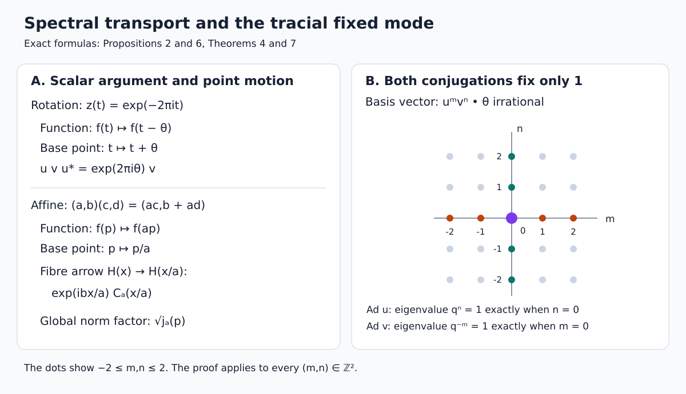

# Spectral normalizers and irrational rotation factors

A unitary that normalizes an abelian spectral algebra moves both a scalar coordinate and its multiplicity space. The scalar motion determines a measure class; the multiplicity map retains information about the representation. A finite trace imposes additional restrictions. We develop this distinction for irrational rotation relations, then construct the spectral fields of rational affine representations.

*Original exposition and diagram are CC0-1.0 to the extent of rights held. Earlier components retain their own terms.*

## Setting and earlier proofs

Hilbert spaces are complex, nonzero and separable unless a result explicitly says otherwise. Inner products are linear in the first variable. The circle is \(\mathbb T=\mathbb R/\mathbb Z\), with Haar probability \(m\), and
\[
 z(t)=e^{-2\pi i t},\qquad q=e^{2\pi i\theta},
 \qquad \theta\in\mathbb R\setminus\mathbb Q.
 \tag{SAR0}
\]
This choice of \(z\) makes conjugation by a rotation implementer act on functions by \(f(t)\mapsto f(t-\theta)\). A measure is quasi-invariant when the transformation and its inverse preserve its null sets.

The spectral inputs are the complete [cyclic multiplication construction and countable additivity](../../OA-MOD/OA-MOD-SK.html#a-continuous-cyclic-representation-becomes-multiplication), [bounded Borel calculus](../../OA-MOD/OA-MOD-SK.html#bounded-borel-functions-and-the-spectral-measure), and [unbounded measurable calculus](../../OA-MOD/OA-MOD-SK.html#unbounded-measurable-functions). We use [IS2's scalar Radon–Nikodym proof](OA-FLOW-IS.md#is-2), [ST2's faithful normal representation theorem](OA-FLOW-ST12.md#oa-flow.st.2), and [BD's bounded density theorem](OA-FLOW-BD.md#oa-flow.bd.4). [L24's vector integrals](OA-FLOW-L24.md#oa-flow.grp.vectorintegration) justify the norm integrals below.

For discrete crossed products, the actual regular representation, its faithful normal expectation and its square-sum identities are proved in [L128, RT0 and FC0–2](OA-FLOW-L128.md#regular-transport). The [finite-factor alternatives](OA-FLOW-L128.md#l128-tc3) distinguish type \(\mathrm{II}_1\) from finite matrix algebras. [CC0](OA-FLOW-CC.md#cc-0) proves scalar circle Fourier completeness. [SC2](OA-FLOW-SC.md#sc-02) constructs Lebesgue measure and its translation invariance, and [HR3](OA-FLOW-HR.md#hr-03) proves uniqueness of the finite Borel measure determined by continuous functions.

## 1. One measure records the entire spectral null ideal

Let \(E\) be the spectral measure of a normal operator on a compact metric space, or the spectral measure obtained from it by a one-to-one Borel change of variable onto a Borel subset of \(\mathbb R\) or \(\mathbb T\). Write \(X\) for this scalar space and \(A=\{E(B):B\text{ Borel}\}''\).

**Proposition 1.** There is a Borel probability \(\mu\) on \(X\), a measurable field of nonzero separable Hilbert spaces \(H_x\), and a unitary
\[
 J:H\longrightarrow\int_X^\oplus H_x\,d\mu(x)
 \quad\text{such that}\quad
 J E(B)J^*=M_{1_B},\qquad JAJ^*=L^\infty(X,\mu).
 \tag{SAR1}
\]
The last equality means the scalar diagonal algebra, including its full normal topology. In particular \(E(B)=0\) if and only if \(\mu(B)=0\).

**Proof.** The cyclic multiplication theorem in the setting decomposes \(H\) into orthogonal cyclic spectral spaces. Separability makes the nonzero family countable: orthogonal unit vectors have disjoint open balls of radius \(1/3\), each containing a different member of a countable dense set. Normalize each cyclic vector. Its spectral measure \(\mu_j\) is a probability, and its cyclic space is \(L^2(X,\mu_j)\), with the spectral algebra acting by multiplication. The compact spectral construction transports through the stated Borel change of variable, so the same description holds on \(X\).

Choose positive numbers \(c_j\) with \(\sum_jc_j=1\), and put \(\mu=\sum_jc_j\mu_j\). By IS2 let \(w_j=d\mu_j/d\mu\). Choose Borel representatives, changing a null set if necessary. Then
\[
 H_x=\{(a_j)\in\ell^2:a_j=0\text{ whenever }w_j(x)=0\},
 \qquad J(f_j)_j=(w_j^{1/2}f_j)_j.
 \tag{SAR2}
\]
The coordinate projections are measurable. Moreover \(\sum_jc_jw_j=1\) almost everywhere, so the field is nonzero there. The norm identity is
\[
 \int_X\sum_jw_j|f_j|^2\,d\mu
 =\sum_j\int_X|f_j|^2\,d\mu_j.
\]
It proves isometry. For a section \((a_j)\), set \(f_j=a_j/\sqrt{w_j}\) on \(\{w_j>0\}\) and zero elsewhere. The same identity proves that these functions lie in the Hilbert sum and map onto the given section. Thus \(J\) is onto and intertwines every bounded Borel multiplier.

The map \(L^\infty(\mu)\to B(\int H_x)\), \(f\mapsto M_f\), is faithful and isometric: its norm is the essential supremum, tested on coordinate sections supported where \(|f|\) is large. It is normal. Indeed every vector coefficient is integration against the \(L^1(\mu)\) function \(\sum_j a_j\overline{b_j}\); its absolute integral is bounded by \(\|a\|_2\|b\|_2\). The vector-series description of all normal functionals in [CP4–6](OA-FLOW-CP.md#oa-flow.cp.4) extends this to the full ultraweak topology. The faithful normal range theorem ST2 makes the range a von Neumann algebra. It contains every \(E(B)\), while every bounded measurable multiplier is a uniform limit of simple spectral multipliers. This proves the algebra equality. The equivalence of null ideals follows either from (SAR2) or directly from the strictly positive mixture defining \(\mu\). \(\square\)

**Spectral transport.** Suppose a unitary \(D\) satisfies
\[
 D f(E)D^*=(f\circ h)(E)
 \tag{SAR3}
\]
for a Borel bijection \(h:X\to X\), initially on a scalar generating family and hence on bounded Borel functions by uniqueness of the spectral calculus. Then \(T=h^{-1}\) is the base transformation. For Borel \(B\),
\[
 D E(B)D^*=E(h^{-1}B)=E(TB).
 \tag{SAR4}
\]
Unitary conjugacy and Proposition 1 show that \(\mu(B)=0\) exactly when \(\mu(TB)=0\). Thus \(\mu\) is quasi-invariant. Notice that the function argument \(h(x)\) and the movement \(T(x)\) of a point have opposite orientations.

## 2. The rotation relation determines a nonsingular scalar action

Let \(u,v\) be unitaries on \(H\) satisfying
\[
 uv=qvu,\qquad R=\{u,v\}'',\qquad A=\{v\}''.
 \tag{SAR5}
\]

**Proposition 2.** The space \(H\) is infinite dimensional. There is a Borel probability \(\mu\) on \(\mathbb T\) and a normal isomorphism \(A\cong L^\infty(\mathbb T,\mu)\) under which
\[
 v\longleftrightarrow z,\qquad
 u f(v)u^*\longleftrightarrow f(t-\theta).
 \tag{SAR6}
\]
The measure class of \(\mu\) is invariant under \(t\mapsto t+\theta\). A Haar measure class is not asserted here.

**Proof.** If \(1\le d=\dim H<\infty\), the vector space \(B(H)\) has dimension \(d^2\), by its matrix-unit basis. Its linear map \(\operatorname{Ad}u\) has the nonzero eigenvectors \(1,v,\ldots,v^{d^2}\) with distinct eigenvalues \(1,q,\ldots,q^{d^2}\). These vectors are linearly independent: in a proposed relation, apply \(\prod_{j\ne k}(\operatorname{Ad}u-q^jI)\) to isolate the coefficient of \(v^k\), with a nonzero scalar multiplier. Thus there would be \(d^2+1\) independent vectors in a \(d^2\)-dimensional space, a contradiction. This also explains the nonzero-Hilbert-space convention.

Apply Proposition 1 to the spectral measure of \(v\), using the Borel circle parametrization \(t\mapsto z(t)\). Since \(uvu^*=qv\) and \(z(t-\theta)=qz(t)\), uniqueness of the bounded Borel calculus gives (SAR6). More explicitly, conjugation carries the spectral projections to those of \(qv\); continuous functions agree first, and bounded Borel uniqueness extends the equality. Equations (SAR3)–(SAR4), with \(h(t)=t-\theta\), give quasi-invariance under \(T(t)=t+\theta\). \(\square\)

## 3. A trace fixes every scalar moment

Now assume that \(R\) has a faithful normal trace \(\tau\) with \(\tau(1)=1\).

**Proposition 3.** For integers \(m,n\),
\[
 \tau(u^m v^n)=
 \begin{cases}1,&(m,n)=(0,0),\\0,&(m,n)\ne(0,0).\end{cases}
 \tag{SAR7}
\]
The spectral measure on \(\mathbb T\) defined by \(\tau|_A\) is exactly Haar probability. In particular \(A\cong L^\infty(\mathbb T,m)\), with the same action (SAR6).

**Proof.** Conjugation by \(u\) multiplies \(u^m v^n\) by \(q^n\), and conjugation by \(v\) multiplies it by \(q^{-m}\). A trace is invariant under unitary conjugation:
\(\tau(wxw^*)=\tau(xw^*w)=\tau(x)\). If \(n\ne0\), irrationality gives \(q^n\ne1\), so the first conjugation makes the moment zero. If \(n=0\) and \(m\ne0\), use the second conjugation. The identity has trace one.

Let \(E_v\) denote the circle spectral measure and set \(\mu_\tau(B)=\tau(E_v(B))\). Normality proves countable additivity, and faithfulness gives precisely the same null ideal as \(E_v\). Thus Proposition 1 applies with this probability too. Equation (SAR7) gives
\(\int z^n\,d\mu_\tau=0\) for \(n\ne0\). The same identities hold for \(m\), by direct integration of the exponentials on \([0,1)\).

Trigonometric polynomials are uniformly dense in continuous circle functions, as proved in CC0. Hence both measures integrate every continuous function equally. HR3's finite-measure uniqueness gives \(\mu_\tau=m\). This identifies the actual measure, including its normalization, rather than only its null sets. \(\square\)

## 4. The normal crossed product is recovered on its whole Hilbert space

Let \(\alpha_n(f)(t)=f(t-n\theta)\) on \(A_0=L^\infty(\mathbb T,m)\), and let
\(N=A_0\rtimes_\alpha\mathbb Z\) be the regular von Neumann crossed product. Write \(\pi\) for its coefficient embedding and \(s\) for the unitary implementing \(1\in\mathbb Z\).

**Theorem 4.** Under the trace hypothesis of Proposition 3, there is a unique normal isomorphism
\[
 \Phi:N\longrightarrow R,\qquad
 \Phi(\pi(z))=v,\quad \Phi(s)=u.
 \tag{SAR8}
\]
It carries the faithful normalized trace \(m\circ E\) to \(\tau\), where \(E:N\to A_0\) is the regular expectation. The algebra \(R\) is a factor of type \(\mathrm{II}_1\).

**Proof of the isomorphism.** The expectation \(E\) is faithful and normal by L128 FC1. Thus \(\sigma=m\circ E\) is a faithful normal state. If \(a_k=E(xs^{-k})\), the two square sums in FC1 and invariance of \(m\) give
\[
 \sigma(x^*x)=\sum_k\int|a_k|^2\,dm=\sigma(xx^*).
 \tag{SAR9}
\]
Equality of these quadratic forms implies the trace identity by polarization. In detail, the Hermitian sesquilinear form
\(B(x,y)=\sigma(y^*x)-\sigma(xy^*)\) has zero diagonal; evaluating it at \(x+y\) and \(x+iy\) gives \(B(x,y)=0\). Replace \(y^*\) by an arbitrary element. So \(\sigma\) is a normalized trace on all of \(N\).

Both pairs \((s,\pi(z))\) and \((u,v)\) satisfy the relation in (SAR5). In the respective tracial Hilbert spaces, the families
\[
 \{\Lambda_\sigma(s^m\pi(z)^n):(m,n)\in\mathbb Z^2\},
 \qquad
 \{\Lambda_\tau(u^m v^n):(m,n)\in\mathbb Z^2\}
 \tag{SAR10}
\]
are orthonormal. For the second family, multiply two monomials using (SAR5) and apply (SAR7). For the first, expectation kills every nonzero \(s\)-degree and integration kills every nonzero \(z\)-degree. When the two indices agree, the product is the identity. The same multiplication and adjoint relations hold in both polynomial algebras.

Each family is total. In \(R\), the star algebra of the two generators has weak closure \(R\); BD's bounded density theorem and normality of \(\tau\) make its vectors dense in \(L^2(R,\tau)\). To spell out the last implication, bounded strong-star approximation \(x_i\to x\) gives
\(\tau((x_i-x)^*(x_i-x))\to0\), by the vector-series description of normal functionals. In \(N\), the normal coefficient map and \(W^*(z)=A_0\) show that \(\pi(z)\) and \(s\) generate \(N\), so the same argument applies.

Consequently the map carrying the first family in (SAR10) to the second extends to a unitary \(W:L^2(N,\sigma)\to L^2(R,\tau)\). Polynomial multiplication shows that \(W\) intertwines left multiplication by \(s,\pi(z)\) with left multiplication by \(u,v\), respectively.

For clarity, left multiplication of a finite von Neumann algebra \(M\) on \(L^2(M,\rho)\), with faithful normal trace \(\rho\), is a faithful normal representation. Boundedness follows from
\(\rho(a^*x^*xa)\le\|x\|^2\rho(a^*a)\), and faithfulness follows by applying an operator to \(\Lambda_\rho(1)\). Normality can be tested on increasing bounded positive nets: if \(0\le x_i\uparrow x\), then
\[
 \|(x-x_i)\Lambda_\rho(a)\|_2^2
 \le \|x\|\rho(a^*(x-x_i)a)\longrightarrow0.
 \tag{SAR11}
\]
Density and the common operator bound give strong convergence on every vector. The normality equivalence is proved in [NF6](OA-FLOW-NF.md#oa-flow.nf.6), and ST2 gives a normal inverse onto the represented algebra.

Apply this to both tracial representations. Their von Neumann ranges are generated by the indicated left multipliers, so conjugation by \(W\), followed by the two faithful normal identifications, gives (SAR8). It is onto and its inverse is normal. It preserves the traces because \(W\) also carries the identity vector to the identity vector. Normal maps agreeing on the generators agree on the weakly dense polynomial algebra and then everywhere; this proves uniqueness.

**Proof of the factor and type assertions.** On \(L^2(R,\tau)\), conjugation by \(u\) and by \(v\) are unitaries. On the basis (SAR10) their eigenvalues are \(q^n\) and \(q^{-m}\). If \(x\in Z(R)\), its vector is invariant under both. Orthogonality and irrationality force every coefficient except \((0,0)\) to vanish. Hence \(\Lambda_\tau(x)=c\Lambda_\tau(1)\); faithfulness gives \(x=c1\). Thus \(R\) is a factor.

The finite faithful trace excludes infinite projections: if a proper subprojection \(p'<p\) were equivalent to \(p\), traciality would give \(\tau(p-p')=0\), contradicting faithfulness. Finally \(A\cong L^\infty(\mathbb T,m)\) is infinite dimensional, since it contains arbitrarily large families of nonzero orthogonal interval projections. Thus \(R\) is an infinite-dimensional finite factor. L128 TC3 proves that a finite factor with a minimal projection is a finite matrix algebra. Therefore \(R\) has no minimal projections and is type \(\mathrm{II}_1\). \(\square\)

## 5. Recovering a real spectral coordinate from a continuous group

The affine application needs the spectral coordinate of a strongly continuous unitary group. We give its construction to keep the exact operator and scalar conventions explicit.

**Lemma 5.** If \(b\mapsto V_b\) is a strongly continuous unitary representation of \((\mathbb R,+)\) on a Hilbert space, there is a unique self-adjoint \(P\) such that \(V_b=e^{ibP}\). Moreover
\[
 \{V_b:b\in\mathbb R\}''=\{E_P(B):B\subseteq\mathbb R\text{ Borel}\}''.
 \tag{SAR12}
\]
This lemma does not require separability.

**Proof.** Define the bounded vector integral
\[
 C=\int_0^\infty e^{-t}V_t\,dt,\qquad \|C\|\le1.
 \tag{SAR13}
\]
The integral exists by L24's vector construction, using the integrable scalar bound. All \(V_t\) commute, so \(C\) is normal and commutes with every \(V_b\). Product Fubini is justified by \(e^{-s-t}\|\xi\|\), and the changes \(r=t-s\) in the regions \(t\ge s\) and \(s\ge t\) give
\[
 C^*C=\frac12\int_{\mathbb R}e^{-|r|}V_r\,dr
       =\frac12(C+C^*).
 \tag{SAR14}
\]
For \(h>0\), change variable in the vector integral:
\[
 V_hC=e^h\left(C-\int_0^h e^{-t}V_t\,dt\right).
 \tag{SAR15}
\]
If \(C\xi=0\), the last integral applied to \(\xi\) is zero for every \(h>0\). Dividing by \(h\) and using continuity at zero gives \(\xi=0\). Thus \(C\) is injective. Since it is normal, \(\ker C^*=\ker C=0\), so its range is dense.

Apply bounded spectral calculus to \(C\). Equation (SAR14) places its spectral measure on
\(\{z:\operatorname{Re}z=|z|^2\}\), and its projection at \(0\) is zero. On that set away from zero define the real function
\[
 p(z)=\frac{\operatorname{Im}z}{|z|^2},
 \qquad z=\frac1{1-ip(z)}.
 \tag{SAR16}
\]
Assign \(p(0)=0\). The unbounded measurable calculus constructs a self-adjoint \(P=p(C)\), and its actual domain is \(\operatorname{ran}C\). Indeed \(C=(1-iP)^{-1}\); multiplication by \((1-ip)^{-1}\) maps the whole Hilbert space onto the domain of \(p\), because both \(p/(1-ip)\) and \((1-ip)^{-1}\) are bounded and the inverse composition is the identity on that domain.

For \(\xi=C\eta\), (SAR15), and the corresponding left difference quotient, give
\[
 \frac{d}{db}V_b\xi=V_b(C-I)\eta=iP V_b\xi.
 \tag{SAR17}
\]
Here \(V_b\) commutes with the spectral projections of \(C\), by uniqueness of the bounded calculus; it therefore preserves \(D(P)\) and commutes with \(P\) there. The spectral norm identity and dominated convergence show, for every \(\xi\in D(P)\), that \(b\mapsto e^{ibP}\xi\) is differentiable with derivative \(iPe^{ibP}\xi\): the difference quotient is bounded in absolute value by \(|p|\).

The product rule now makes \(e^{-ibP}V_b\xi\) constant for \(\xi\in D(P)\). One can apply the rule in norm because (SAR17) is norm differentiable and the spectral derivative holds on the invariant domain; the latter orbit is continuous also in graph norm. Its value at zero is \(\xi\). Density of \(D(P)\) and the unitary bounds give \(V_b=e^{ibP}\) on all vectors.

If another self-adjoint \(Q\) gives the same group, integration of its scalar exponential gives \(C=(1-iQ)^{-1}\), including the domain and inverse identities. Equality of these bounded inverses gives equality of their ranges and of their inverse operators; hence \(P=Q\).

Finally, \(C\) belongs to \(\{V_b\}''\): every operator commuting with every \(V_b\) commutes with the vector integral and its adjoint. All bounded Borel functions of \(C\), including the spectral projections of \(P\), belong to this von Neumann algebra. The reverse inclusion follows from \(V_b=e^{ibP}\). This proves (SAR12). \(\square\)

## 6. Rational affine representations and their spectral action

Let
\[
 G=\{(a,b):a\in\mathbb Q^\times,\ b\in\mathbb R\},
 \qquad
 (a,b)(c,d)=(ac,b+ad),
 \tag{SAR18}
\]
with the discrete topology on \(\mathbb Q^\times\) and the usual topology on \(\mathbb R\). This is the group of matrices \(\left(\begin{smallmatrix}a&b\\0&1\end{smallmatrix}\right)\). It is locally compact and second countable: it is a countable disjoint union of real lines, with the displayed continuous group operations.

Let \(U\) be a strongly continuous unitary representation of \(G\) on nonzero separable \(H\), and set \(A=U(\{(1,b):b\in\mathbb R\})''\).

**Proposition 6.** There is a Borel probability \(\mu\) on \(\mathbb R\) identifying \(A\) normally with \(L^\infty(\mathbb R,\mu)\), such that
\[
 U(1,b)\longleftrightarrow e^{ibp},\qquad
 \operatorname{Ad}U(a,b)(f)(p)=f(ap).
 \tag{SAR19}
\]
The base action is \(T_{(a,b)}p=p/a\), and \(\mu\) is quasi-invariant under it.

**Proof.** Lemma 5 gives \(U(1,b)=e^{ibP}\). Apply Proposition 1 to the spectral measure of \(P\), realized through the bounded operator \(C\) in that lemma. Put \(D_a=U(a,0)\). The group law gives
\[
 D_a e^{itP}D_a^*=e^{iatP}.
 \tag{SAR20}
\]
Uniqueness in Lemma 5 gives \(D_aPD_a^*=aP\), with equality of domains. The spectral change-of-variable rule then gives \(D_af(P)D_a^*=f(aP)\). Since
\(U(a,b)=U(1,b)D_a=e^{ibP}D_a\) and the first factor commutes with \(A\), this proves normalization and (SAR19). Proposition 1 proves quasi-invariance for \(h(p)=ap\) and \(T=h^{-1}\). Neither a full-support measure nor equivalence to Lebesgue measure is needed. \(\square\)

## 7. The affine action on its actual multiplicity field

Use the same \(J,\mu,H_p\) as in Proposition 1, and write
\[
 j_a(p)=\frac{d(T_a)_*\mu}{d\mu}(p),\qquad T_a p=p/a.
 \tag{SAR21}
\]
Every \(j_a\) has a positive finite Borel version almost everywhere.

**Theorem 7.** On a \(\mathbb Q^\times\)-invariant conull Borel subset of \(\mathbb R\), there are measurable unitary maps
\[
 C_a(p):H_{ap}\longrightarrow H_p,\qquad
 C_{ac}(p)=C_a(p)C_c(ap),\quad C_1(p)=I,
 \tag{SAR22}
\]
and
\[
 [JU(a,b)J^*\xi](p)
   =e^{ibp}j_a(p)^{1/2}C_a(p)\xi(ap).
 \tag{SAR23}
\]
The formula recovers the given representation on its entire direct integral. The law (SAR22) and the corresponding group law in (SAR23) hold on this one base set for all group elements.

**Proof.** For each \(a\), the weighted pullback
\[
 [W_a\xi](p)=j_a(p)^{1/2}\xi(ap)
\]
is a unitary from \(\int H_p\,d\mu(p)\) onto \(\int H_{ap}\,d\mu(p)\). The norm identity is the pushforward formula
\(\int j_a(p)F(ap)\,d\mu(p)=\int F(x)\,d\mu(x)\).
Its inverse is obtained by substituting \(p=x/a\) and dividing by the positive square root. Thus it is onto, not merely isometric on a chosen dense family.

Both \(JD_aJ^*\) and \(W_a\) implement \(f(p)\mapsto f(ap)\) on the scalar diagonal. Their quotient \(JD_aJ^*W_a^{-1}\) intertwines the corresponding scalar multipliers at the same \(p\). The [two-space diagonal intertwiner theorem](../../OA-MOD/OA-MOD-DC.html#uniqueness-over-the-same-diagonal-structure), also applied explicitly in [L39's normalizer proof](OA-FLOW-L39.md#oa-flow.covrep.normalizer), gives a measurable unitary field \(C_a(p):H_{ap}\to H_p\). This proves the formula for \(D_a\), hence (SAR23).

The scalar change-of-variables identity gives
\[
 j_{ac}(p)=j_a(p)j_c(ap)
 \tag{SAR24}
\]
almost everywhere for each pair \(a,c\). Substituting the field formula in \(D_aD_c=D_{ac}\), cancelling these positive densities, and using uniqueness of the two-space decomposition gives (SAR22) almost everywhere for each pair. Impose also \(C_1=I\) and the inverse identities. There are countably many \(a,c\), so their exceptional sets have null union. Enlarge it by all rational nonzero dilations and their inverses. Quasi-invariance keeps the enlarged Borel set null; its complement is invariant and every displayed identity now holds there simultaneously.

Translations need no further exceptional sets: their field is the scalar \(e^{ibp}\), defined for every real \(b,p\). Direct multiplication yields
\[
 e^{ibp}C_a(p)e^{idap}C_c(ap)
   =e^{i(b+ad)p}C_{ac}(p).
 \tag{SAR25}
\]
Together with (SAR24), this proves the group law for every \((a,b),(c,d)\), including all real translations on the same set.

In source coordinates the arrow from \(H_x\) to \(H_{x/a}\) is
\[
 L((a,b),x)=e^{ibx/a}C_a(x/a).
 \tag{SAR26}
\]
Equation (SAR25) is equivalently
\(L(gh,x)=L(g,T_hx)L(h,x)\). Joint measurability follows from countability of \(a\), measurability of \(C_a\), and continuity of the scalar exponential in \((b,p)\). Strong continuity on each real component follows by dominated convergence; near any group point the rational coordinate is fixed. Thus the construction retains the original topology and the original representation, including its multiplicity spaces. \(\square\)

## 8. Models that separate the hypotheses

**An atomic rotation measure.** On \(\ell^2(\mathbb Z)\), define
\[
 u\delta_k=\delta_{k+1},\qquad v\delta_k=q^{-k}\delta_k.
 \tag{SAR27}
\]
Then \(uv=qvu\), by applying both sides to every basis vector. The spectral probability may be chosen as
\(\mu=\frac13\sum_{k\in\mathbb Z}2^{-|k|}\delta_{k\theta\bmod1}\).
Its total mass is one because \(\sum_k2^{-|k|}=3\). Irrationality makes these atoms distinct. Rotation permutes the atoms, so its measure class is invariant; it is singular to Haar measure.

The individual spectral projections of \(v\) are the rank-one coordinate projections. Any operator commuting with \(v\) is diagonal, and a diagonal operator commuting with \(u\) has all its diagonal entries equal. Hence \(\{u,v\}'=\mathbb C1\), and the bicommutant theorem gives \(R=B(\ell^2(\mathbb Z))\). It has no faithful normalized trace: all its coordinate projections are equivalent, so such a trace would assign them the same positive value; finite sums would exceed one. This proves why the trace hypothesis in Theorem 4 cannot be removed.

**A scalar affine field with a nontrivial density.** Let
\[
 d\mu(p)=w(p)\,dp,\qquad w(p)=\frac1{\pi(1+p^2)},\qquad H_p=\mathbb C.
\]
The density is strictly positive and has integral one. Its transformation under \(p\mapsto p/a\) gives
\[
 j_a(p)=\frac{|a|w(ap)}{w(p)}
       =\frac{|a|(1+p^2)}{1+a^2p^2}.
 \tag{SAR28}
\]
Set \(C_a(p)=1\). The formula
\[
 [U(a,b)f](p)=e^{ibp}
 \left(\frac{|a|(1+p^2)}{1+a^2p^2}\right)^{1/2}f(ap)
 \tag{SAR29}
\]
is unitary by change of variables. The scalar identity
\(j_a(p)j_c(ap)=j_{ac}(p)\) and (SAR25) prove its group law. Dominated convergence for the translation factor proves strong continuity. At \(a=2,p=1\), the density is \(4/5\); omitting it would fail the norm identity.

**Two checks.** In the rotation case, \(v\leftrightarrow e^{-2\pi it}\) forces the function argument \(t-\theta\) and the point action \(t+\theta\). Replacing just one sign violates \(uvu^*=qv\). In the affine case, the scalar argument is \(ap\), the point action is \(p/a\), and the translation phase in source coordinates is \(e^{ibx/a}\). Replacing it by \(e^{ibx}\) violates the multiplication law \(b+ad\).

The left panel records the exact maps in (SAR6), (SAR19) and (SAR26). The right panel is a finite window of the infinite basis (SAR10): conjugation by \(u\) tests \(q^n\), conjugation by \(v\) tests \(q^{-m}\), and irrationality leaves only \((0,0)\). The window is illustrative; the proof in Theorem 4 applies to all integer pairs.
