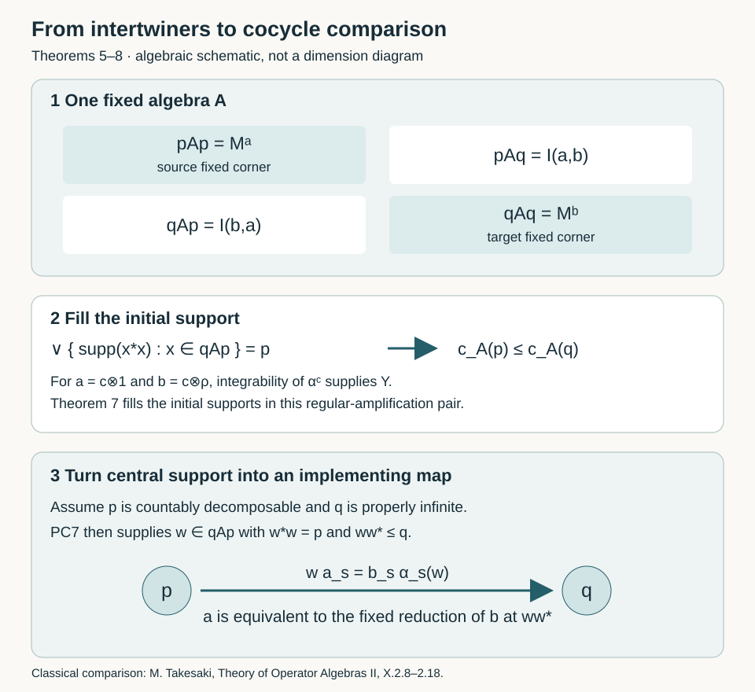

# Regular intertwiners and integrable cocycles

A cocycle changes an action by conjugating each of its automorphisms. Integrability of the changed action can be detected by an operator from a trivial scalar amplification into a regular amplification. We construct that operator, identify its initial support in a fixed matrix algebra, and then apply projection comparison. A second use of regular amplification characterizes dominant actions through unitary eigenvectors. The finite-group case retains an additional proper-infiniteness condition.

*Original exposition is CC0-1.0 to the extent of rights held. Earlier components retain their own terms.*

## Setting and earlier proofs

Let \(G\) be a locally compact Hausdorff group and \(M\subseteq B(H)\) a faithfully and normally represented von Neumann algebra. The representation space and algebra may have arbitrary cardinality. An action \(\alpha:G\to\operatorname{Aut}(M)\) is point-ultraweakly continuous and consists of normal unital star automorphisms. [AT1–3](OA-FLOW-AT.md#oa-flow.at.1) gives point-strong-star continuity and norm-continuous predual orbits. All scalar regular representations are strongly continuous.

Choose left Haar measure \(dl\), with modular convention \(dl(Et)=\Delta_G(t)dl(E)\), and let \(dr\) be its inversion image. Thus
\[
 \int_G h(t^{-1})\,dr(t)=\int_Gh(t)\,dl(t),
 \qquad K=L^2(G,dr),\qquad
 (\rho_s f)(t)=f(ts).
 \tag{TIC0}
\]
The Haar, modular, inversion and arbitrary-Hilbert integration proofs are [L24 Sections 2–4](OA-FLOW-L24.md#oa-flow.grp.haarconventions), with [HR's compact localization and qualified product integration](OA-FLOW-HR.md#hr-05). Hilbert-valued formulas on a general group are interpreted on compact carriers and then extended by completion; they do not assume a globally sigma-finite Haar space.

The earlier [general orbit-average theorem](OA-FLOW-L115.md#l115-general-average) constructs, on the whole positive cone,
\[
 T_\beta:N_+\longrightarrow\widehat{N^\beta}_+,
 \qquad
  \widehat{\omega|_{N^\beta}}(T_\beta(x))
   =\int_G\omega(\beta_s(x))\,dl(s).
 \tag{TIC1}
\]
The formula holds for every \(\omega\in N_*^+\). A positive normal functional on the fixed algebra has a positive normal extension to \(N\), and the value does not depend on that extension. Infinite values, finite and infinite spectral parts, and the full form domain are retained. The output is fixed; the input satisfies
\(T_\beta(\beta_s(x))=\Delta_G(s)^{-1}T_\beta(x)\).
Write
\[
 \mathcal F_\beta=\{x\in N_+:T_\beta(x)\text{ is bounded}\},\qquad
 \mathfrak n_\beta=\{x:x^*x\in\mathcal F_\beta\}.
 \tag{TIC2}
\]
The action is **integrable** when \(\mathfrak n_\beta\) is weak-operator dense. Equivalently, the span of \(\mathcal F_\beta\) is ultraweakly dense, or there is an increasing net of contractions in \(\mathcal F_\beta\) tending strongly to the identity. The [inheritance theorem](OA-FLOW-L115.md#l115-integrability-inheritance) proves invariant unital inclusion, tensor-product, fixed-corner and normal-conjugacy permanence, including the full finite domains and zero corners.

We also use [ND's full tensor commutant and normal extension](OA-FLOW-ND.md#nd-tensor), [CP's vector-series predual and duality](OA-FLOW-CP.md#oa-flow.cp.4), [ST2's normal inverse and bounded strong-star topology](OA-FLOW-ST12.md#oa-flow.st.2), and [PC0–7](OA-FLOW-PC.md#oa-flow.pc.0) for polar decomposition, central supports and projection comparison. Countability will be imposed only at the comparisons that need it. For eigenunitary selection we use [DS2](OA-FLOW-DS.md#ds-2), [the completed-measure section theorem](../../foundations-of-von-neumann-algebras/polish-spaces-and-standard-borel-spaces.html#oa-fnd-pb-11), [H1](OA-FLOW-HARMONIC.md#l138-h1), and [scalar Plancherel](OA-FLOW-PLANCHEREL.md#scalar-plancherel-p3).

### 1. The regular amplification has a dense bounded-average domain

**Theorem 1.** For every normal continuous action \(\alpha\), the action \(\alpha\overline\otimes\operatorname{Ad}\rho\) on \(M\overline\otimes B(K)\) is integrable. No separability, countable decomposability, commutativity or unimodularity is required.

**Proof.** Normality and continuity of the whole tensor action follow from the tensor construction in the earlier inheritance theorem. Multiplication by a bounded Borel scalar function on the right-Haar space is denoted \(M_h\). If \(h\ge0\) is compactly supported, right translation gives
\[
 \rho_sM_h\rho_s^*=M_{t\mapsto h(ts)}.
 \tag{TIC3}
\]
For a vector \(\xi\in K\), qualified nonnegative product integration gives
\[
 \int_G\langle\rho_sM_h\rho_s^*\xi,\xi\rangle\,dl(s)
 =\int_G\int_Gh(ts)|\xi(t)|^2\,dr(t)\,dl(s)
 =\left(\int_Gh\,dl\right)\|\xi\|^2.
 \tag{TIC4}
\]
For fixed \(t\), the change \(s\mapsto ts\) is a left translation; its measure is \(dl\). This is why the scalar on the right is the left-Haar integral even though the representation uses \(dr\). To justify the product formula on an arbitrary group, first take a compact carrier for \(h\) and a sigma-compact carrier for \(\xi\), as supplied by the earlier Haar \(L^2\) construction. The homeomorphism \((s,t)\mapsto(ts,t)\) places the nonzero integrand on a sigma-finite product carrier. The qualified Fubini theorem applies there. Approximation and monotone nonnegative tests give the stated formula without an unrestricted product assertion.

Thus \(T_{\operatorname{Ad}\rho}(M_h)=(\int h\,dl)1\), by all vector tests and the bounded-value test for the whole positive average. For compact \(C\subset G\), put \(q_C=M_{1_C}\). These projections increase strongly to 1. Indeed, compactly supported continuous functions are \(L^2\)-dense; once \(C\) contains such an approximant's support, the tail of any given vector is as small as the approximation error. Their averages are \(dl(C)1\). For every \(a\in B(K)_+\),
\[
 0\le q_Ca q_C\le\|a\|q_C,
 \qquad q_Ca q_C\longrightarrow a\quad\text{strongly}.
 \tag{TIC5}
\]
Heredity of the bounded-output cone therefore proves integrability of \(\operatorname{Ad}\rho\). Tensor-product inheritance gives the assertion for \(\alpha\). Equivalently, \(1\otimes q_C\) provides the same controlled positive approximants directly. If \(M=0\), the product and all its domains are zero, and the conclusion holds. \(\square\)

### 2. Fields give operators in the whole tensor algebra

**Lemma 2.** Let \(F:G\to M\) be bounded and strong-star continuous. Multiplication
\[
 (\mathcal M_F\xi)(t)=F(t)\xi(t)
 \tag{TIC6}
\]
defines an element of \(M\overline\otimes B(K)\), with adjoint \(\mathcal M_{F^*}\). A unitary field gives a unitary operator. If \(\gamma:M\to N\) is a normal isomorphism with normal inverse, its full normal tensor extension satisfies
\[
 (\gamma\overline\otimes\mathrm{id})(\mathcal M_F)
       =\mathcal M_{\gamma\circ F}.
 \tag{TIC7}
\]
The same conclusion holds on a sigma-finite measure space for a bounded strong-star measurable field with separable vector ranges, including completion-measurable unitary fields on a separable faithful normal model.

**Proof.** Begin with finite sums of compactly supported elementary vector fields \(f(t)\eta\), \(f\in C_c(G)\), \(\eta\in H\). On each compact carrier \(F(t)\eta\) has compact norm image, hence separable range, and is Bochner measurable. Its pointwise bound gives \(\|\mathcal M_F\xi\|\le\sup_t\|F(t)\|\,\|\xi\|\). Density extends the operator to the whole Hilbert tensor product. Apply the same construction to \(F^*\); integration of inner products proves the adjoint identity. If F is unitary, the two compositions are the identity first on compact fields and then everywhere. On a sigma-finite base the same proof uses simple-field approximation, with the same norm bound.

Every \(F(t)\) commutes with \(M'\), so \(\mathcal M_F\) commutes with \(M'\otimes1\). ND's identity \((M'\otimes1)'=M\overline\otimes B(K)\) proves membership. For any scalar orthonormal basis \((e_i)\), its matrix entry is the weak-star integral
\[
 x_{ij}=\int_GF(t)e_j(t)\overline{e_i(t)}\,dr(t)\in M.
 \tag{TIC8}
\]
For \(\omega\in M_*\), the scalar pairing is absolutely integrable and bounded by \(\|\omega\|\sup\|F\|\|e_j\|_2\|e_i\|_2\). CP duality produces \(x_{ij}\). Normality of \(\gamma\) moves it through this integral by replacing \(\omega\) with \(\omega\gamma\). ND's normal tensor extension and its normal inverse act on all these entries. Equality of entries proves (TIC7) on the entire algebra, not only an algebraic tensor product. Normal isomorphisms preserve bounded strong-star convergence by ST2, so the transported field has the required measurability. This also proves the assertion for measurable fields. \(\square\)

### 3. A unitary cocycle is absorbed by right translation

A **unitary \(\alpha\)-cocycle** is a strong-star continuous family \(u_s\in\mathcal U(M)\) with \(u_e=1\) and \(u_{st}=u_s\alpha_s(u_t)\). Its perturbed action is \(\alpha_s^u=\operatorname{Ad}(u_s)\alpha_s\). The cocycle law gives its composition and inverse; AT and bounded multiplication give continuity.

**Theorem 3.** In \(\overline M=M\overline\otimes B(K)\), with \(\overline\alpha=\alpha\overline\otimes\mathrm{id}\), there is a unitary V satisfying
\[
 u_s\otimes\rho_s
   =V(1\otimes\rho_s)\overline\alpha_s(V^*).
 \tag{TIC9}
\]
This holds for arbitrary \(G,M,H\).

**Proof.** Use Lemma 2 with \((V\xi)(t)=u_{t^{-1}}\xi(t)\). It gives full tensor membership, unitarity and normal transport. The product law, applied to \(s(ts)^{-1}=t^{-1}\), is
\[
 u_{t^{-1}}=u_s\alpha_s(u_{(ts)^{-1}}).
 \tag{TIC10}
\]
Thus the right side of (TIC9), evaluated at t, is
\(u_{t^{-1}}\alpha_s(u_{(ts)^{-1}}^*)\xi(ts)=u_s\xi(ts)\).
The equality holds first on compact fields and extends to every vector. Its adjoint and inverse use the same unitary V, so it is a whole operator identity. \(\square\)

For comparison with left translation, inversion gives the unitary
\[
 J:L^2(G,dr)\longrightarrow L^2(G,dl),\qquad
 (Jf)(t)=f(t^{-1}),\qquad J\rho_sJ^*=\lambda_s,
 \quad (\lambda_sf)(t)=f(s^{-1}t).
 \tag{TIC11}
\]
The norm identity is (TIC0), and substitution proves the translation identity. Domain and codomain measures are different. If right translation is represented on a single left-Haar space instead, L24's modular multiplier is required.

### 4. Supported actions and their implementers

A **partial \(\alpha\)-cocycle** is a strong-star continuous family \(a_s\in M\) such that
\[
 a_{st}=a_s\alpha_s(a_t),\qquad
 a_{s^{-1}}=\alpha_{s^{-1}}(a_s^*).
 \tag{TIC12}
\]
The second identity is part of the definition. Set \(e_a=a_e\). The zero family is allowed.

**Proposition 4.** The element \(e_a\) is a projection and
\[
 a_sa_s^*=e_a,\qquad a_s^*a_s=\alpha_s(e_a),\qquad
 \alpha_s^a(x)=a_s\alpha_s(x)a_s^*\quad(x\in e_aMe_a)
 \tag{TIC13}
\]
defines a normal continuous action on the actual support corner. Its fixed algebra is denoted \(M^a\). For a projection \(q\in M^a\), the family \(a_s^q=q a_s\) is a partial cocycle with support q.

**Proof.** At the identity (TIC12) gives \(e_a=e_a^*=e_a^2\). The product with \(s^{-1}\), and then the inverse identity, give \(a_sa_s^*=e_a\). Apply the same argument at \(s^{-1}\) and transport by \(\alpha_s\) to get \(a_s^*a_s=\alpha_s(e_a)\). Thus each \(a_s\) is a partial isometry from \(\alpha_s(e_a)H\) onto \(e_aH\). These supports prove multiplicativity, star preservation and preservation of the corner identity in (TIC13). The product law gives \(\alpha_s^a\alpha_t^a=\alpha_{st}^a\); the inverse parameter gives the whole inverse map. Normality follows from normality of \(\alpha\) and bounded multiplication. AT's bounded strong-star continuity and the assumed continuity of a prove continuity of this action, hence point-ultraweak continuity by its bounded vector-series test.

For fixed q, multiply \(q=a_s\alpha_s(q)a_s^*\) by \(a_s\) to obtain \(q a_s=a_s\alpha_s(q)\). It follows that \(q a_s\) has final projection q and initial projection \(\alpha_s(q)\). The same relation and the product law give its product identity, and at the inverse parameter give its adjoint identity. Its continuity is inherited by multiplication by q. If \(e_a=0\), all \(a_s\) are zero, the corner and fixed algebra are zero, and every assertion has precisely that interpretation. \(\square\)

For partial cocycles a,b, define
\[
 I(b,a)=\{x\in e_bMe_a:x a_s=b_s\alpha_s(x)\text{ for every }s\in G\}.
 \tag{TIC14}
\]
The first index is the target. They are **equivalent**, \(a\sim b\), if a partial isometry \(w\in I(b,a)\) satisfies \(w^*w=e_a\) and \(ww^*=e_b\). They satisfy \(a\precsim b\) if the same initial equality holds with \(ww^*\le e_b\). These definitions include zero.

The relation is the exact corner form of the two identities
\[
 a_s=w^*b_s\alpha_s(w),\qquad b_s=w a_s\alpha_s(w^*).
 \tag{TIC15}
\]
If an element c implements both identities before support compression, their identity-parameter equations are \(c^*e_bc=e_a\) and \(c e_ac^*=e_b\). Hence \(w=e_bc e_a\) has the indicated initial and final projections; compressing the parameter equations gives (TIC15). Conversely the two formulas follow from the intertwiner and support equations, so no choice outside the supports changes the definition. For subequivalence the final projection q is fixed and the second formula is for \(b^q\). The map \(x\mapsto wxw^*\), with inverse \(y\mapsto w^*yw\), is a whole normal equivariant isomorphism from the support action of a to the fixed reduction of the support action of b. The inherited whole positive averages and all bounded finite domains therefore transport through it.

### 5. A fixed matrix algebra records all comparisons

**Theorem 5.** Put \(E=\operatorname{diag}(e_a,e_b)\), \(c_s=\operatorname{diag}(a_s,b_s)\), and let A be the fixed algebra of
\[
 \gamma_s(X)=c_s(\alpha_s\otimes\mathrm{id}_{M_2})(X)c_s^*
 \quad\text{on }E M_2(M)E.
 \tag{TIC16}
\]
Let \(p=e_a\otimes e_{11}\) and \(q=e_b\otimes e_{22}\). Then
\[
 A=\begin{pmatrix}M^a&I(a,b)\\I(b,a)&M^b\end{pmatrix},\qquad
 a\sim b\iff p\sim_Aq,\qquad
 a\precsim b\iff p\precsim_Aq.
 \tag{TIC17}
\]
The intertwiner identities are
\[
 I(b,a)^*=I(a,b),\quad I(a,a)=M^a,\quad
 I(c,b)I(b,a)\subseteq I(c,a).
 \tag{TIC18}
\]
For \(x=w|x|\in I(b,a)\), its polar partial isometry w lies in \(I(b,a)\) and \(|x|\in M^a\).

**Proof.** Proposition 4 applies to the diagonal partial cocycle c, so \(\gamma\) is a normal continuous action on E's entire corner. For a lower-left x, its fixed equation is \(x=b_s\alpha_s(x)a_s^*\). Multiplication by \(a_s\) converts it to (TIC14), and the support equations convert (TIC14) back. Diagonal entries give the two fixed algebras. This proves the displayed matrix description.

A partial isometry in \(qAp\) is exactly a partial isometry w in \(I(b,a)\). Its initial and final projections are the corresponding diagonal entries of \(w^*w\) and \(ww^*\); this proves the two projection-comparison equivalences. If the latter is only a subprojection of q, it belongs to \(qAq=M^b\) and gives the required fixed reduction. Adjoints and matrix multiplication prove (TIC18). Finally polar decomposition inside the von Neumann algebra A fixes both the polar partial isometry and modulus in their specified corners, by uniqueness; equivalently they are obtained by spectral calculus and bounded strong limits of \(x(x^*x+\varepsilon)^{-1/2}\). These conclusions use no countability condition. \(\square\)

Write \(z_A(p)\) for the central support of p in A. Call a,b **disjoint** when \(z_A(p)z_A(q)=0\), and **quasi-equivalent** when \(z_A(p)=z_A(q)\). The first condition is equivalent to \(I(b,a)\)=0. Indeed, a zero \(qAp\) gives \(qvp=0\) for every unitary v in A. Therefore q annihilates the join of \(vpv^*\), which PC identifies as \(z_A(p)\); centrality then makes \(z_A(q)\) annihilate that same projection. The converse follows by inserting the two orthogonal central supports around \(qAp\).

<figure style="margin-left:0;margin-right:0">

<figcaption>The fixed algebra in Theorem 5 records the intertwiners as its lower-left corner. Theorem 7 fills their initial supports; Theorems 6 and 8 state the additional assumptions for an implementing partial isometry. The rectangles show algebraic corners, not their dimensions. <a href="../assets/integrable-cocycle-comparison/linking-corners.svg">Open the full diagram</a>.</figcaption>
</figure>

### 6. Where countability is needed

A nonzero partial cocycle has **infinite multiplicity** if its support fixed algebra is properly infinite, meaning that its identity contains two orthogonal projections equivalent to that identity.

**Theorem 6.** If a,b have infinite multiplicity and their two diagonal support projections in A are countably decomposable, then
\[
 a\sim b\quad\Longleftrightarrow\quad
 a,b\text{ are quasi-equivalent}.
 \tag{TIC19}
\]
More generally, \(z_A(p)\le z_A(q)\), proper infiniteness of q, and countable decomposability of p imply \(a\precsim b\).

**Proof.** The diagonal corner identities in Theorem 5 identify proper infiniteness with proper infiniteness of p and q as projections of A. [PC7](OA-FLOW-PC.md#oa-flow.projection.pc7) places countability on the **source** projection: if f is countably decomposable, e properly infinite and \(z_A(f)\le z_A(e)\), then \(f\precsim_A e\). Its proof fills f by a countable orthogonal family of subprojections comparable with e, places each under a different properly infinite copy of e, and sums the implementing partial isometries. Apply it in both directions for equal central supports; projection Cantor–Bernstein gives p equivalent q. Theorem 5 converts it to cocycle equivalence. Equivalence preserves central support in the reverse direction. The same one-way comparison proves the final assertion. \(\square\)

These conditions concern the actual source corners. A faithful normal state on any ambient algebra restricts faithfully and normally to its unital fixed subalgebra and normalizes on a nonzero corner; it therefore supplies the required countable decomposability. No corresponding equivalence is asserted for arbitrary-cardinality properly infinite projections merely because their central supports agree.

### 7. Integrability fills the initial intertwiner support

**Theorem 7.** Let \(b\) be a partial \(\alpha\)-cocycle whose support action \(\beta=\alpha^b\) on \(N=e_bMe_b\) is integrable. In the scalar tensor algebra, compare \(b\otimes1\) and \(b\otimes\rho\). The join of the initial supports of all operators in \(I(b\otimes\rho,b\otimes1)\) is \(e_b\otimes1\). This theorem holds for arbitrary \(G,M,H\).

**Proof.** If \(e_b=0\), the intertwiner space and asserted join are zero. Suppose otherwise. The initial fixed algebra is \(B_0=N^\beta\overline\otimes B(K)\): each fixed matrix entry belongs to \(N^\beta\), and normal finite-coordinate compression proves the converse inclusion for the whole algebra. Denote the initial-support join by \(z\). Right multiplication of an intertwiner by a unitary \(v\in B_0\) preserves its intertwining equation, and conjugates its initial support by \(v^*\). Thus \(z\) commutes with every such unitary and is central in \(B_0\). Commutation with scalar matrix units forces a central element of \(B_0\) to be of the form \(d\otimes1\); commutation with \(N^\beta\) then makes \(d\) central there. Consequently a nonzero missing complement would be \(d\otimes1\), with \(0\ne d\in Z(N^\beta)\).

Weak density of \(\mathfrak n_\beta\) gives \(x\) in that ideal with \(xd\ne0\); otherwise its weak closure would annihilate \(d\). Replace \(x\) by \(xd\). Fixed-algebra bimodularity gives \(T_\beta((xd)^*(xd))=dT_\beta(x^*x)d\), so this replacement keeps its average bounded. Take a nonzero \(f\in C_c(G)\). For \(\xi\in L^2(G,dr;e_bH)\), set
\[
 \eta=\int_G f(t)\xi(t)\,dr(t),\qquad
 (Y\xi)(r)=\beta_{r^{-1}}(x)\eta.
 \tag{TIC20}
\]
The scalar testing map is bounded by \(\|\eta\|\le\|f\|_2\|\xi\|_2\). Inversion and the bounded positive average give the exact estimate
\[
 \begin{aligned}
 \|Y\xi\|^2
 &=\int_G\|\beta_{r^{-1}}(x)\eta\|^2\,dr(r)\\
 &=\langle T_\beta(x^*x)\eta,\eta\rangle
 \le\|T_\beta(x^*x)\|\,\|f\|_2^2\,\|\xi\|_2^2.
 \end{aligned}
 \tag{TIC21}
\]
The output is rigorously a vector in the full Hilbert tensor product. On each compact carrier its field is continuous with separable norm image. Compact truncations have squared norms bounded by the finite integral in (TIC21); their tails tend to zero by compact localization of that finite positive integral. Completion defines the full vector even when G is not sigma compact.

Y commutes with \(N^\prime\otimes1\) because each \(\beta_{r^{-1}}(x)\) lies in N. ND places it in \(N\overline\otimes B(K)\), extended by zero to the support corner of \(M\overline\otimes B(K)\). We need its normal transport, not only this membership. For a scalar basis vector \(e_i\), the entry corresponding to its output is the weak-star integral of \(\overline{e_i(r)}\beta_{r^{-1}}(x)\), multiplied by the scalar \(\int f(t)e_j(t)\,dr(t)\). These integrals are defined by CP duality. For a positive normal functional \(\omega\) on N,
\[
 |\omega(\beta_{r^{-1}}(x))|^2
 \le\omega(e_b)\,\omega(\beta_{r^{-1}}(x^*x)),
 \tag{TIC22}
\]
The inequality is the [positive-functional Cauchy–Schwarz estimate](OA-FLOW-GNS.md#gns-lemma-2-1). Thus its coefficient is in scalar \(L^2\), and pairing against \(e_i\) is absolutely integrable. CP's square-summable vector series, polarized termwise, expresses a general normal functional as a linear combination of four positive normal vector-series functionals. The entries agree with those of the already bounded operator \(Y\), so their functional norm bound is its operator bound. Explicitly, for a positive normal functional \(\omega\), scalar Cauchy–Schwarz bounds the integral against \(e_i\) by \(\|e_i\|_2\,\omega(e_b)^{1/2}\omega(T_\beta(x^*x))^{1/2}\leq\|e_i\|_2\,\|T_\beta(x^*x)\|^{1/2}\|\omega\|\). The four positive terms in the polarized vector-series decomposition therefore define a bounded linear functional on the whole predual; CP duality identifies its value with that same matrix entry. Normality of \(\alpha_s\) passes through each entry by composing its predual functional. Hence \((\alpha_s\otimes\mathrm{id})(Y)\) is exactly the transported field operator, with unchanged scalar testing function.

For compact input fields, use \(\beta_s\beta_{(rs)^{-1}}=\beta_{r^{-1}}\) and \(b_s\alpha_s(y)=\beta_s(y)b_s\) for y in N. Evaluation gives
\[
 Y(b_s\otimes1)
   =(b_s\otimes\rho_s)(\alpha_s\otimes\mathrm{id})(Y).
 \tag{TIC23}
\]
The previously proved bounds extend this identity to all vectors. Since \(x=xd\) and \(d\) is \(\beta\)-fixed, \(Y=Y(d\otimes1)\). It is nonzero: choose \(\eta_0\) with \(x\eta_0\ne0\) and put \(\xi(t)=\overline{f(t)}\eta_0\). Then \(\eta=\|f\|_2^2\eta_0\), and continuity near the identity makes its output nonzero on an open set of positive Haar measure. Its nonzero initial support lies under the missing complement, contradicting the definition of \(z\). Thus \(z=e_b\otimes1\). \(\square\)

The testing norm in (TIC21) is \(L^2\). For \(G=\mathbb Z/2\) with counting Haar, \(N=\mathbb C\), \(\beta\) trivial, \(x=1\) and \(f=\xi=1\), the input norm squared is 2, the bounded orbit average is 2 and the output norm squared is 8. The right side of (TIC21) is 8. Replacing the \(L^2\) norm of f by its supremum would instead give 4, so such a replacement is invalid even for this finite group.

### 8. Comparison with the regular cocycle

**Theorem 8.** Suppose M is nonzero and admits a faithful normal state, and \(K=L^2(G,dr)\) is separable. Let b be a partial \(\alpha\)-cocycle and put z=\(z_M(e_b)\). Assume either \(b=0\) or \(M^b\) is properly infinite. Then z is \(\alpha\)-fixed and
\[
 \alpha^b\text{ is integrable}
 \quad\Longleftrightarrow\quad
 b\otimes1\precsim z\otimes\rho
 \quad\text{in }M\overline\otimes B(K).
 \tag{TIC24}
\]
In particular, for a unitary cocycle u with \(M^u\) properly infinite,
\[
 \alpha^u\text{ is integrable}
 \quad\Longleftrightarrow\quad
 u\otimes1\precsim1\otimes\rho.
 \tag{TIC25}
\]
The right regular representation may be replaced by the left regular representation through (TIC11). Second-countable G and separable-predual M are sufficient for the stated comparison hypotheses.

**Proof of the unitary assertion.** Theorem 7 and the matrix algebra of Theorem 5 show that the initial diagonal p for \(u\otimes1\) has central support at most that of the target diagonal q for \(u\otimes\rho\). Indeed, if a central piece of p were disjoint from q, all cross entries would have initial support zero on that piece, contrary to their full join. The target fixed corner is the fixed algebra of \(\alpha^u\overline\otimes\operatorname{Ad}\rho\); it contains \(M^u\otimes1\) unitally. Its identity q is therefore properly infinite.

The initial p is countably decomposable. To see this on the entire tensor algebra rather than infer it from an ambient Hilbert dimension, let \(\omega\) be a faithful normal state on M and choose a countable orthonormal basis \((e_n)\) of K. On positive bounded matrices define \(\Omega(X)=\sum_n c_n\omega(X_{nn})\), with positive summable \(c_n\) of sum 1. Normality is monotone convergence of this positive series. If its value is zero, each diagonal positive coefficient is zero by faithfulness; positivity then makes \(X^{1/2}\) vanish on all scalar coordinates, so \(X=0\). This gives a faithful normal state. A two-by-two version gives one on the linking algebra, whose restriction to its fixed subalgebra is faithful normal. PC7, with source p and properly infinite target q, gives p subequivalent q. Theorem 5 yields \(u\otimes1\precsim u\otimes\rho\). Theorem 3 absorbs the latter cocycle, proving the forward implication of (TIC25).

Conversely such a subequivalence identifies \(\alpha^u\overline\otimes\mathrm{id}\), by its actual partial-isometry corner isomorphism, with a fixed corner of \(\alpha\overline\otimes\operatorname{Ad}\rho\). Theorem 1 and whole-domain inheritance prove integrability of that corner. A scalar rank-one corner is fixed under \(\alpha^u\overline\otimes\mathrm{id}\), so fixed-corner inheritance proves integrability of \(\alpha^u\). This reverse implication requires no countability assumption.

**Reduction of the supported assertion.** The partial isometry \(b_s\) has initial \(\alpha_s(e_b)\) and final \(e_b\). Equivalent projections have equal central supports, and normal automorphisms transport central support; hence \(\alpha_s(z)=z\). If b is nonzero, proper infiniteness of \(M^b\) makes \(e_b\) properly infinite in M. The corner z is countably decomposable by the faithful normal state. PC7 gives \(z\precsim e_b\), while inclusion gives the reverse comparison. Cantor–Bernstein supplies v in M with \(v^*v=z\), \(vv^*=e_b\). On zM define
\[
 a_s=v^*b_s\alpha_s(v).
 \tag{TIC26}
\]
The support equations make \(a_s\) unitary in zM. Inserting \(vv^*=e_b\) and \(b_s\alpha_s(e_b)=b_s\) proves its product identity. Its inverse/adjoint law and continuity follow from the same identities. The isomorphism \(y\mapsto vyv^*\), with whole normal inverse \(x\mapsto v^*xv\), intertwines \(\alpha^a\) and \(\alpha^b\): substitution into (TIC26) gives this equality on every bounded element. Thus their full averages and bounded domains transport by inheritance, and their fixed algebras have the same proper-infiniteness property.

Apply the unitary assertion to zM. The family v implements a equivalence b, since \(v a_s=b_s\alpha_s(v)\). Tensoring its implementer and composing the subequivalences proves the forward implication of (TIC24). Conversely any subequivalence in (TIC24) identifies the support action \(\alpha^b\overline\otimes\mathrm{id}\) with a fixed corner of the integrable regular action on zM tensor B(K), and then the scalar rank-one corner proves integrability of \(\alpha^b\). If \(b=0\), then \(e_b=z=0\); its support action, average, ideals and every transporter are zero, so both sides hold directly. The zero algebra itself has this same unique zero interpretation. \(\square\)

### 9. Dominance forces infinite fixed multiplicity for an infinite group

For a nonzero M, the action \(\alpha\) is **dominant** when there is a unital normal isomorphism, with normal inverse,
\[
 \theta:(M,\alpha)\longrightarrow
 (M\overline\otimes B(K),\alpha\overline\otimes\operatorname{Ad}\rho)
 \tag{TIC27}
\]
intertwining every group parameter. This definition alone contains no proper-infiniteness clause.

**Theorem 9.** If G is infinite and \(\alpha\) is dominant, then \(M^\alpha\) is properly infinite. This assertion needs no separability hypothesis. If G is abelian, dominance also supplies a unitary eigenvector in M for every character of G, whether G is finite or infinite.

**Proof.** On \(K\otimes K\) define
\[
 (T\xi)(r,t)=\xi(r,tr),\qquad
 (T^{-1}\eta)(r,q)=\eta(r,qr^{-1}).
 \tag{TIC28}
\]
The changes of variables are inverse homeomorphisms. On compactly supported continuous fields, right invariance in the second variable and qualified product integration prove the norm identity. Their compact carriers permit the earlier product theorem, and density extends T and its inverse to all of \(K\otimes K\). Direct evaluation gives
\[
 T(\rho_s\otimes\rho_s)T^*=\rho_s\otimes1.
 \tag{TIC29}
\]
For example, both \(T(\rho_s\otimes\rho_s)\xi\) and \((\rho_s\otimes1)T\xi\), at (r,t), are \(\xi(rs,trs)\). Thus (TIC29) holds without commutativity.

ND extends \(\theta\) and its inverse normally after tensoring with the third scalar factor. Consequently
\[
 \Phi=(\theta^{-1}\overline\otimes\mathrm{id})
        (\mathrm{id}\overline\otimes\operatorname{Ad}T)
        (\theta\overline\otimes\mathrm{id})\theta
 \tag{TIC30}
\]
is a whole normal isomorphism from (M,\(\alpha\)) onto (\(M\overline\otimes B(K)\),\(\alpha\overline\otimes\mathrm{id}\)). Its whole inverse is the composition of the displayed inverses in reverse order. Formula (TIC29) checks its equivariance. Fixed matrix entries, with arbitrary-basis finite-coordinate compression, give
\[
 M^\alpha\cong M^\alpha\overline\otimes B(K).
 \tag{TIC31}
\]
If G is infinite, for every positive integer n choose n distinct points and disjoint relatively compact open neighborhoods. Each has positive finite right-Haar measure, so its normalized indicator gives one of n orthogonal vectors in K. Hence K has infinite dimension. An infinite-dimensional Hilbert space contains two orthogonal isometric copies of itself, by partitioning an orthonormal basis into two subsets of the same cardinality. Their isometries in B(K) make the right side of (TIC31) properly infinite; pull them back through Phi.

For abelian G and a character \(\chi\), multiplication by \(\chi\) is unitary on K and
\[
 \rho_sM_\chi\rho_s^*=\chi(s)M_\chi.
 \tag{TIC32}
\]
This is the identity \(\chi(ts)=\chi(t)\chi(s)\), with the right-translation sign already fixed. Pull back \(1\otimes M_\chi\) through \(\theta\) to obtain the claimed eigenunitary. \(\square\)

### 10. The measurable eigenunitary parameter space

For this section and Theorem 11 assume G second-countable LCH abelian, M nonzero with separable predual, and write \(\Gamma\)=\(\widehat G\). Equip \(\Gamma\) with the dual Haar measure normalized by the earlier Plancherel theorem.

**Lemma 10.** Both \(\Gamma\) and the strong-star unitary group \(\mathcal U(M)\) are Polish. The dual Haar measure is sigma finite, and K is separable.

**Proof.** DS2 proves the assertions for \(\mathcal U(M)\) and provides a faithful normal representation on a separable Hilbert space. Its hypotheses are exactly separable predual, with no factor assumption. In particular a positive sum of a countable norm-dense family of normal states is faithful, its normal GNS space is separable, and the simultaneous strong metric on operators and adjoints is complete on the unitary group. Normal automorphisms are continuous in that metric by ST2.

Here are the scalar parameter facts needed in addition. A countable relatively compact base of G makes G sigma compact. Finite unions of this base, with rational scalar coefficients, give a countable collection of Haar simple functions. It is dense in \(L^1\) and \(L^2\): for a finite-measure measurable set, Radon compact/open approximation gives a compact inner set and an open outer set whose difference has arbitrarily small measure; finitely many base members cover the compact set inside the open one. The resulting finite union approximates its indicator in both norms. Completion-null differences do not affect these norms. Simple-function approximation and truncation along the countable compact cover give all integrable functions. Thus \(L^1\)(G) and K are separable.

The universal norm is at most the \(L^1\) norm, so \(C^*(G)\) and its forced unitization are separable. H1 identifies the unitization's compact character space X with \(\Gamma\) together with its distinguished quotient character q. Evaluation on a countable norm-dense subset determines its weak-star topology: uniform functional bounds approximate every other evaluation. Hence X is compact metrizable, and \(\Gamma\)=X minus {q} is second-countable LCH. It is sigma compact, by the compact sets where the distance to q is at least 1/n. If d is a bounded compatible metric on X, a complete compatible metric on \(\Gamma\) is
\[
 d'(\chi,\psi)=d(\chi,\psi)
       +\bigl|d(\chi,q)^{-1}-d(\psi,q)^{-1}\bigr|.
\]
A Cauchy sequence for this metric is Cauchy in the compact space X; its bounded reciprocal distances prevent its limit from being q. \(\Gamma\) is therefore Polish, and its Haar measure is sigma finite. \(\square\)

### 11. Choosing the field and absorbing the regular cocycle

**Theorem 11.** Suppose that for every \(\chi\) in \(\Gamma\) there is a unitary \(u\in M\) with \(\alpha_s(u)=\chi(s)u\) for all s. Then there is a unitary \(W\in M\overline\otimes B(K)\) such that
\[
 (\alpha_s\overline\otimes\mathrm{id})(W)=W(1\otimes\rho_s)
 \quad(s\in G).
 \tag{TIC33}
\]
No continuity or group law in the character parameter is assumed.

**Proof.** Choose countable dense D in G. In the Polish product \(\Gamma\times\mathcal U(M)\), set
\[
 \mathcal E=\{(\chi,u):\alpha_s(u)=\chi(s)u\text{ for every }s\in D\}.
 \tag{TIC34}
\]
Evaluation of a character at s and the normal automorphism of the unitary group are continuous, so E is closed and Polish. Continuity in s extends each equality from D to every G parameter. Its projection onto \(\Gamma\) is continuous and onto by the hypothesis. Apply the completed-measure section theorem, [Theorem 7.7](../../foundations-of-von-neumann-algebras/polish-spaces-and-standard-borel-spaces.html#oa-fnd-pb-11), whose proof uses completed measurability of analytic sets from [Theorem 6.2](../../foundations-of-von-neumann-algebras/polish-spaces-and-standard-borel-spaces.html#oa-fnd-pb-09). It gives one selector \(\chi\mapsto u_\chi\) measurable for the completion of the sigma-finite dual Haar measure, with every selected pair in E. Thus the selected field satisfies every s identity at every \(\chi\) before any representative change.

We can make a Borel field after one common null-set change without claiming an everywhere Borel section of the original projection. For a countable base \((V_j)\) of \(\mathcal U(M)\), choose Borel versions of the completion-measurable inverse images \(u^{-1}(V_j)\). Their symmetric differences lie in Borel null sets \(N_j\). Outside the Borel null set N=union \(N_j\), the original field has Borel inverse images of every base member. Extend it on N by the identity unitary. The resulting field is Borel and unitary everywhere, and its eigenidentities hold for all s outside the same N. On the separable Hilbert model its vector fields are strongly measurable. Lemma 2 therefore constructs the whole unitary multiplier \(\mathcal W\) on \(H\otimes L^2(\Gamma)\).

Its normal tensor transport, justified by Lemma 2's weak-star matrix entries, gives
\[
 (\alpha_s\overline\otimes\mathrm{id})(\mathcal W)
  =\mathcal W(1\otimes M_{\chi\mapsto\chi(s)}).
 \tag{TIC35}
\]
One common null set suffices for every parameter; no uncountable intersection of independently chosen exceptional sets is taken.

For abelian G, inversion preserves its Haar measure, so dr=dl. Let \(\mathcal F_-:L^2(G,dl)\to L^2(\Gamma)\) be the onto negative-character Fourier transform from [P0–4](OA-FLOW-PLANCHEREL.md#scalar-plancherel-p3). On \(L^1\) intersection \(L^2\), substitution r=ts gives
\[
 \mathcal F_-\rho_s\mathcal F_-^*
   =M_{\chi\mapsto\chi(s)}.
 \tag{TIC36}
\]
Density and norm-one bounds extend the formula to the whole scalar Hilbert space. Put \(W=(1\otimes\mathcal F_-^*)\mathcal W(1\otimes\mathcal F_-)\). This is a unitary in \(M\overline\otimes B(K)\), and normality plus (TIC35)–(TIC36) proves (TIC33). \(\square\)

### 12. Remove the trivial amplification inside the fixed algebra

**Theorem 12.** If \(M^\alpha\) is properly infinite and L is a nonzero Hilbert space of finite or countably infinite dimension, then there is a normal equivariant isomorphism
\[
 A:(M\overline\otimes B(L),\alpha\overline\otimes\mathrm{id})
       \longrightarrow(M,\alpha)
 \tag{TIC37}
\]
with whole normal inverse. There is no separability condition on M or its represented Hilbert space.

**Proof.** PC5 supplies a countable filling family of isometries in the fixed algebra. For a finite dimension n, retain n minus 1 of them and absorb the remainder into the last range: that remainder contains a copy of the identity and is a subprojection of it, so Cantor–Bernstein makes it equivalent to the identity. Thus in either case choose \((v_i)_{i\in I}\subset M^\alpha\) with
\[
 v_i^*v_j=\delta_{ij}1,\qquad
 \sum_i v_iv_i^*=1\quad\text{strongly}.
 \tag{TIC38}
\]
With a scalar basis of L indexed by I, the map \(U:(\xi_i)\mapsto\sum_i v_i\xi_i\) is unitary from \(H\otimes L\) onto H: orthogonality proves the norm identity, and the filling equality proves surjectivity. Conjugation gives
\[
 A((x_{ij}))=\mathop{\mathrm{s^*\!\!-lim}}_F
       \sum_{i,j\in F}v_i x_{ij}v_j^*,\qquad
 A^{-1}(x)=(v_i^*xv_j)_{ij}.
 \tag{TIC39}
\]
The finite-coordinate compressions have norm at most the norm of the original bounded array and converge strongly-star, so their images lie in M and the first formula is defined everywhere. The inverse array is the bounded operator U* x U and has entries in M; ND's bounded-array description puts it in \(M\overline\otimes B(L)\). These two conjugations are whole normal inverse maps, proving surjectivity and all product identities. Fixedness of every v_i proves equivariance on finite arrays; normality and bounded strong-star compression extend it to every element. Whole extended-positive values and bounded finite domains transport by the earlier normal-conjugacy theorem. \(\square\)

### 13. The corrected dominance criterion

**Theorem 13.** Let G be second-countable LCH abelian and M nonzero with separable predual. The following are equivalent:

1. \(\alpha\) is dominant and \(M^\alpha\) is properly infinite.
2. \(M^\alpha\) is properly infinite and every character \(\chi\) of G has a unitary eigenvector in M with \(\alpha_s(u_\chi)=\chi(s)u_\chi\) for every s.

If G is infinite, action dominance alone is equivalent to condition 2. For finite groups the proper-infiniteness clause in condition 1 is retained.

**Proof.** Dominance gives the eigenunitaries by Theorem 9, proving 1 implies 2. For the converse, Theorem 11 gives W and K is separable by Lemma 10. Write \(\overline\alpha=\alpha\otimes\mathrm{id}\) and \(\beta=\alpha\otimes\operatorname{Ad}\rho\). Formula (TIC33) gives, on every bounded element X,
\[
 \begin{aligned}
 W^*\overline\alpha_s(W X W^*)W
   &=(1\otimes\rho_s)\overline\alpha_s(X)(1\otimes\rho_s^*)
    =\beta_s(X).
 \end{aligned}
 \tag{TIC40}
\]
Thus \(\Theta=\operatorname{Ad}W^*\) intertwines overline-\(\alpha\) with \(\beta\) and has whole normal inverse Ad W. Use Theorem 12 with L=K and put
\[
 \Psi=\Theta A^{-1}:M\longrightarrow M\overline\otimes B(K),
 \qquad \Psi^{-1}(Y)=A(WYW^*).
 \tag{TIC41}
\]
These are normal unital whole inverse isomorphisms. The two equivariance identities give \(\Psi\alpha_s=\beta_s\Psi\), so \(\alpha\) is dominant. The inverse is explicit on every bounded array by (TIC39), and on the whole extended-positive cone by normal transport. Finally Theorem 9 supplies proper infiniteness automatically for infinite G. \(\square\)

For the finite-group qualification, take \(G=\{e\}\) and \(M=\mathbb C\). Then \(K=\mathbb C\), and the identity map is a dominance isomorphism. Its fixed algebra is C and is finite. Thus action dominance by itself cannot be substituted for condition 1 in the finite case. The zero algebra has the unique zero isomorphisms and actions; Theorem 13 is explicitly a theorem for nonzero M and does not impose a nonzero proper-infiniteness interpretation on that exceptional algebra.

### 14. Dominant cocycles and dominant actions are separate definitions

A partial cocycle a is called **dominant** when it has infinite multiplicity and \(a\otimes1\) is quasi-equivalent to \(1\otimes\rho\) in the fixed linking algebra. Inversion changes \(\rho\) to lambda without changing the comparison. This definition includes a support and multiplicity requirement, unlike action dominance.

**Corollary 14.** Under Theorem 13's hypotheses, dominance of the identity cocycle is equivalent to action dominance together with proper infiniteness of \(M^\alpha\).

**Proof.** The latter conditions imply Theorem 13's eigenunitaries, and Theorem 11 gives \(1\otimes\rho_s=W^*\overline\alpha_s(W)\). This is a full unitary cocycle equivalence between the two scalar-amplified cocycles, hence quasi-equivalence. Infinite multiplicity is the assumed proper infiniteness of \(M^\alpha\).

Conversely suppose the identity cocycle is dominant. The initial fixed corner is \(M^\alpha\overline\otimes B(K)\), and the target fixed corner contains \(M^\alpha\otimes1\). Both identities are properly infinite. Separable predual supplies a faithful normal state by DS2, and K is separable, so the state constructed in Theorem 8 makes both linking projections countably decomposable. Theorem 6 upgrades their quasi-equivalence to equivalence. Its matrix implementer is a unitary w in \(M\overline\otimes B(K)\), with \(1\otimes\rho_s=w\overline\alpha_s(w^*)\). Set W=w*. Then (TIC33) holds. The amplification and conjugation in (TIC41) prove action dominance directly. The original infinite-multiplicity assumption gives \(M^\alpha\) properly infinite. \(\square\)

These constructions require no homomorphism \(\chi\mapsto u_\chi\). The selector provides one measurable field, the fixed isometries remove only a trivial scalar amplification, and the proper-intertwiner comparison takes place in the same fixed linking algebra throughout. The whole positive average retains its modular input factor even where the final dominance criterion specializes to abelian G.

### 15. Worked checks on the hypotheses

**Finite groups have integrable actions.** Equip a finite group with counting Haar measure. For every positive element \(x\), the whole average is the finite sum
\[
 T_\alpha(x)=\sum_{s\in G}\alpha_s(x),\qquad
 0\leq T_\alpha(x)\leq |G|\,\|x\|1.
\]
Each normal automorphism preserves positivity and the unit, which proves the inequality. Thus every positive element has bounded average and the action is integrable. Changing the Haar normalization by a positive scalar preserves this conclusion.

**Proper infiniteness in Theorem 8 cannot be omitted.** Take \(G=\mathbb Z/2\), \(M=\mathbb C\), and the trivial action and unitary cocycle. The action is integrable by the preceding computation, and all spaces are finite-dimensional. On \(K=\mathbb C^2\), right translation by the nonidentity element is the swap matrix
\[
 R=\begin{pmatrix}0&1\\1&0\end{pmatrix}.
\]
A subequivalence \(1\otimes1\precsim1\otimes\rho\) would require a matrix \(w\) with \(w^*w=I_2\) and \(w=Rw\). The second equality forces its entire range into \(\ker(R-I_2)=\mathbb C(1,1)\); the first requires two orthonormal columns. This is impossible in a one-dimensional range. Here the fixed algebra is \(\mathbb C\), so the omitted hypothesis is precisely the required proper infiniteness.

**The selected eigenunitaries need not multiply as characters do.** If \(u_\chi\) is the field in Theorem 11, the field \(-u_\chi\) has the same eigenidentities and measurability. Its multiplier is \(-W\), and
\[
 \overline\alpha_s(-W)=(-W)(1\otimes\rho_s).
\]
Replacing \(W\) by \(-W\) leaves \(\operatorname{Ad}W\) and the dominance isomorphism unchanged. A character-parameter homomorphism would have to send the trivial character to \(1\); at least one of \(u\) and \(-u\) fails that condition. The proof therefore uses the measurable field and its eigenidentities, without a hidden homomorphism assumption.

The comparison and dominance questions occur in Takesaki, *Theory of Operator Algebras II*, Chapter X, §§2.8–2.18, printed pp.266–271. The operator estimates here use the testing function's \(L^2\) norm, and the dominance statement keeps the finite-group qualification exhibited above. Haar integration, Polish selection and Fourier normalization are supplied by the named earlier complete proofs. The present arguments state their operative countability assumptions explicitly.
