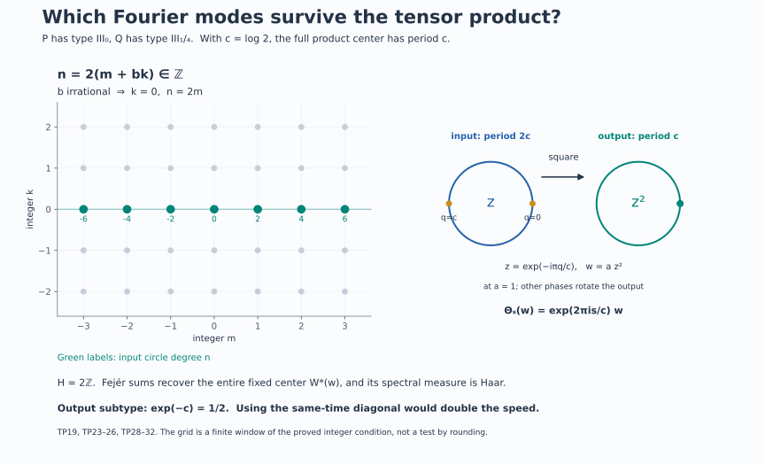
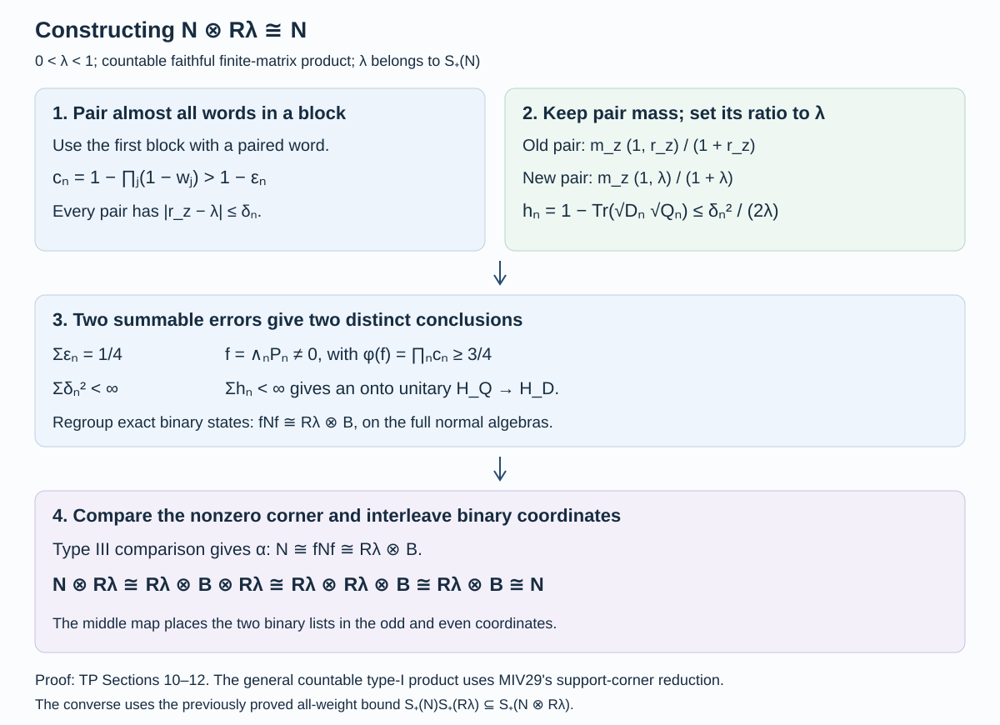
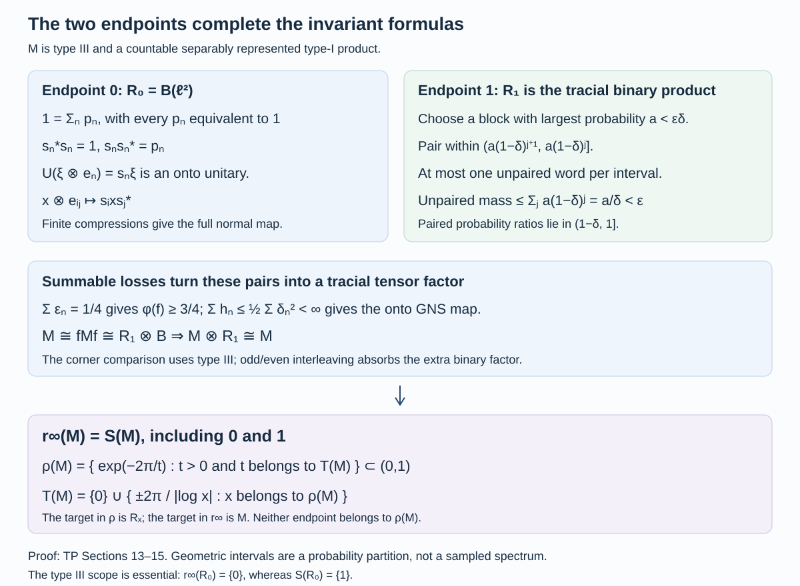

# Tensor periods, modular subtypes and absorption

For a nonzero factor \(P\), let
\[
 T(P)=\{t\in\mathbb R:\sigma_t^\varphi\text{ is inner}\},\qquad
 S_+(P)=\bigcap_{\psi}\bigl(\operatorname{Sp}(\Delta_\psi)\cap(0,\infty)\bigr),
 \tag{TP1}
\]
where the intersection ranges over every faithful normal semifinite weight. The definition of \(T(P)\) is independent of \(\varphi\), by the normalized cocycle relation between modular groups. Its exact center-flow form and the corresponding all-weight positive spectral identity are proved in [MIV2.h](OA-FLOW-MIV.md#miv-2) and [MIV5](OA-FLOW-MIV.md#miv-5).

The tensor product of a type \(\mathrm{III}_0\) factor and a type \(\mathrm{III}_\lambda\) factor need not have subtype \(\mathrm{III}_\lambda\) when \(0<\lambda<1\). The obstruction is a missing inner period. We prove the exact corrected subtype, including arbitrary preduals, and an explicit product of types \(\mathrm{III}_0\) and \(\mathrm{III}_{1/4}\) whose type is \(\mathrm{III}_{1/2}\). The endpoint with a type \(\mathrm{III}_1\) tensor factor is valid without a separability hypothesis.

## 1. Innerness of a tensor automorphism

For arbitrary nonzero factors \(P,Q\) and automorphisms \(\alpha,\beta\),
\[
 \alpha\bar\otimes\beta\text{ is inner}
 \quad\Longleftrightarrow\quad
 \alpha\text{ and }\beta\text{ are inner}.
 \tag{TP2}
\]
The reverse implication is implemented by the tensor product of two implementing unitaries. For the forward implication, let \(U\in\mathcal U(P\bar\otimes Q)\) implement the tensor automorphism. Then
\[
 U(x\otimes1)=(\alpha(x)\otimes1)U.
\]
Normal product functionals separate the spatial tensor product, so some normal slice
\(a=(\operatorname{id}\bar\otimes\omega)(U)\) is nonzero. It satisfies
\[
 ax=\alpha(x)a\qquad(x\in P).
 \tag{TP3}
\]
Taking adjoints in the same relation with \(x^*\) shows that \(a^*a\) commutes with \(P\), and \(aa^*\) commutes with \(\alpha(P)=P\). Both are positive nonzero scalar operators. In the polar decomposition \(a=v|a|\), the initial and final supports are therefore both \(1\). Thus \(v\) is a unitary and \(\alpha=\operatorname{Ad}v\).

The unitary \(V=(v^*\otimes1)U\) commutes with \(P\otimes1\). The [full tensor-commutant theorem TF1](OA-FLOW-TF.md#tf-tensors) gives
\[
 (P\otimes1)'\cap(P\bar\otimes Q)=1\otimes Q.
\]
Hence \(V=1\otimes w\) for a unitary \(w\in Q\), and the equation on \(1\otimes Q\) gives \(\beta=\operatorname{Ad}w\). All slices and maps are normal. No countable decomposition of either factor was used.

The [full product-weight theorem](../../OA-MOD/src/tensor-closed-operators-and-weights.md#tensor-hilbert-algebras-and-tomita-domains) and [TF's closed Tomita construction](OA-FLOW-TF.md#tf-tensors) give
\[
 \sigma_t^{\varphi\bar\otimes\psi}
       =\sigma_t^\varphi\bar\otimes\sigma_t^\psi
\]
for arbitrary faithful normal semifinite weights. Applying (TP2), and using weight independence at each fixed time, proves
\[
 \boxed{T(P\bar\otimes Q)=T(P)\cap T(Q).}
 \tag{TP4}
\]
TF's tensor commutant proof also makes \(P\bar\otimes Q\) a factor. This argument does not replace the intersection over all weights by an intersection over product weights.

## 2. Pointwise inner real flows have a continuous unitary group

The next lemma retains the separable-predual hypothesis needed for the arbitrary-starting-factor counterexample.

**Lemma.** If \(P\) is a factor with separable predual and
\(\alpha:\mathbb R\to\operatorname{Aut}(P)\) is a continuous action whose every \(\alpha_t\) is inner, there is a strongly continuous unitary group \(v_t\in P\) with \(\alpha_t=\operatorname{Ad}v_t\).

The automorphism topology is point-norm convergence on the predual. The [proved Polish automorphism and Borel-selection lemma](../../OA-ERGODIC/src/ancillary-actions-and-unitary-corrections.md#1-automorphisms-as-a-polish-group) supplies Borel implementers \(u_t\). Its proof normalizes the first nonzero matrix coefficient and applies the Borel-image theorem. It asserts Borelness, not closedness, of the inner subgroup. We must still produce a continuous group.

**The projective topology.** By [DS2](OA-FLOW-DS.md#ds-2), \(\mathcal U(P)\) is a Polish topological group for its strong-star topology. Its complete metric
\[
 d(u,v)=\sum_{j\ge1}2^{-j}
  \bigl(\min(1,\|(u-v)\xi_j\|)
             +\min(1,\|(u^*-v^*)\xi_j\|)\bigr)
 \tag{TP5}
\]
uses a dense sequence of unit-ball vectors in a faithful separable representation. It is invariant under simultaneous multiplication by a scalar in \(\mathbb T\). On \(V=\mathcal U(P)/\mathbb T\), put
\[
 \bar d([u],[v])=\min_{z\in\mathbb T}d(u,zv).
 \tag{TP6}
\]
Compactness gives a minimum and makes zero distance mean equality of the classes. Simultaneous scalar invariance proves the triangle inequality. The inverse image of a quotient ball is a union of open scalar translates; conversely saturation of any open set is open. Thus (TP6) gives exactly the quotient topology.

For completeness, choose from a quotient Cauchy sequence a subsequence with successive distances at most \(2^{-j}\). Adjust consecutive representatives by minimizing scalars; their successive \(d\)-distances have finite sum, so completeness gives a limit unitary. The quotient subsequence converges, and the original Cauchy sequence then converges. Images of a countable dense set give separability. The quotient homomorphism is open, so multiplication and inversion descend continuously. Hence \(V\) is Polish.

Factoriality makes \(t\mapsto[u_t]\) a Borel homomorphism. We recall why such a homomorphism \(f:\mathbb R\to V\) is continuous. Given an identity neighborhood \(O\), choose an open neighborhood \(W\) with \(W^{-1}W\subset O\). Countably many left translates of \(W\) cover \(V\). On a finite interval, one inverse-image piece has positive Lebesgue measure; call a finite positive-measure subset \(E\). For \(s,t\in E\), \(f(s)^{-1}f(t)\in W^{-1}W\), so \(E-E\subset f^{-1}(O)\). The function
\(\int1_E(x)1_E(x+h)\,dx\) is continuous in \(h\), by \(L^1\) continuity of translations, and is positive at zero. It follows that \(E-E\) contains a neighborhood of zero. This proves continuity at zero and hence everywhere. It is the [positive-Haar-set argument used in L42](OA-FLOW-L42.md#oa-flow.centerg.strict).

**Continuous local lifts.** Fix a normal state \(\omega\) on \(P\). On the saturated open set \(|\omega(u)|>0\), the expression
\[
 s([u])=\frac{\overline{\omega(u)}}{|\omega(u)|}\,u
 \tag{TP7}
\]
is unchanged under \(u\mapsto zu\). It is continuous on unitaries and descends continuously through the open quotient. It is a section near \([1]\), since \(\omega(1)=1\). Composing with the projective path gives continuous unitary lifts on a real interval about zero.

Consider the pullback group
\[
 E=\{(t,u)\in\mathbb R\times\mathcal U(P):
                           \operatorname{Ad}u=\alpha_t\},
 \quad (t,u)(s,v)=(t+s,uv).
 \tag{TP8}
\]
Its kernel over zero is the central circle. A local lift \(v_t\) identifies the inverse image of its interval \(I\) with \(I\times\mathbb T\) by
\((t,z)\mapsto(t,zv_t)\). The inverse is continuous: \(v_t^*u\) is scalar, and its scalar value is \(\omega(v_t^*u)\). Translates supply such charts everywhere. Thus \(E\) is locally compact Hausdorff, and its projection onto \(\mathbb R\) is open.

**The extension is abelian.** Commutators in \(E\) lie in the central circle because the quotient is abelian. They are independent of the chosen lifts and define a continuous alternating bicharacter
\[
 \kappa:\mathbb R\times\mathbb R\longrightarrow\mathbb T.
\]
The bicharacter identities follow from the elementary commutator identities when all commutators are central. Local lifts prove continuity. For integers \(m,k\) and \(n\ge1\),
\[
 \kappa(m/n,k/n)=\kappa(1/n,1/n)^{mk}=1.
 \tag{TP9}
\]
Density of rational pairs makes \(\kappa=1\). Hence \(E\) is an LCA group.

**Split the circle.** [L127, CN5](OA-FLOW-L127.md#oa-flow.l127.cn5), with the [full character-extension theorem in L118](OA-FLOW-L118.md#l118-dual-map), proves that a closed circle subgroup of any LCA group has a continuous character retraction. Apply it to the kernel circle of \(E\). If \(K\) is the kernel of that retraction, multiplication gives a topological isomorphism \(\mathbb T\times K\to E\), with inverse obtained by the retraction and division by its value. The original projection restricts to a bijective open continuous homomorphism \(K\to\mathbb R\). Its inverse has the form \(t\mapsto(t,v_t)\), a continuous homomorphic section. This proves the lemma, including both the group law and continuity.

Consequently, for a separable-predual factor,
\[
 T(P)=\mathbb R\quad\Longleftrightarrow\quad P\text{ is semifinite}.
 \tag{TP10}
\]
For the nontrivial direction apply the lemma to \(\sigma^\varphi\). Write \(v_t=e^{itH}\). Since the group commutes with itself, each \(v_t\) belongs to \(P_\varphi\); therefore \(H\) is affiliated with the centralizer. The positive injective density \(k=e^{-H}\) is densely defined. The [full unbounded weight theorem VR](../../OA-MOD/src/inner-flow-and-weight-rigidity.md#a-continuous-inner-modular-group-characterizes-semifiniteness) constructs \(\tau=\varphi_k\) and computes
\[
 \sigma_t^\tau
      =\operatorname{Ad}(k^{it})\sigma_t^\varphi
      =\operatorname{id}.
 \tag{TP11}
\]
Its whole-cone trace criterion makes \(\tau\) a faithful normal semifinite trace. Conversely such a trace gives \(T(P)=\mathbb R\), first in its own modular chart and then in every chart by the normalized cocycle formula. Pointwise innerness was not substituted for the continuous-group hypothesis in the weight theorem.

## 3. An obstruction for every initial separable type III-zero factor

For any factor \(Q\) of type \(\mathrm{III}_\lambda\), \(0<\lambda<1\), the [arbitrary-cardinality discrete decomposition theorem](OA-FLOW-DDP.md#dd-existence) proves
\[
 T(Q)=p\mathbb Z,\qquad p=\frac{2\pi}{-\log\lambda}.
 \tag{TP12}
\]
Therefore (TP4) shows that \(P\bar\otimes Q\) can have type \(\mathrm{III}_\lambda\) only if \(p\in T(P)\).

Let now \(P\) be any separable-predual type \(\mathrm{III}_0\) factor. By (TP10), \(T(P)\ne\mathbb R\). Since it is an additive group, choose \(p>0\) outside it and put \(\lambda=e^{-2\pi/p}\). We construct an actual suitable \(Q\) for this value, without presuming a model identification.

Let
\[
 D_\lambda=\sum_{j\in\mathbb Z}\mathbb Q\lambda^j,\qquad
 \Gamma_\lambda=\{x\mapsto\lambda^n x+d:
                            n\in\mathbb Z,\ d\in D_\lambda\}.
 \tag{TP13}
\]
The sum is algebraic. Both sets are countable, and \(D_\lambda\) contains the dense subgroup \(\mathbb Q\). On the line with Lebesgue measure, the action is nonsingular. Every nonidentity affine map has at most one fixed point; removing their countable invariant union makes the action free. Its rational translations are ergodic: convolving any invariant bounded function with continuous compact kernels makes it continuous and rational-translation invariant, hence constant; local \(L^1\) approximation recovers the original function.

The countable regular crossing \(Q=L^\infty(\mathbb R)\rtimes\Gamma_\lambda\) is a separable-predual factor by the [free diagonal theorem and normal relation identification](../../OA-ERGODIC/src/free-actions-and-the-crossed-product-diagonal.md#5-a-continuous-orbit-with-a-transverse-parameter). We check its ratio parameter. Every arrow derivative is \(\lambda^n\). For any positive-measure Borel set \(E\), first take a finite positive-measure subset. For fixed \(n\), the function
\[
 I(d)=\int 1_E(x)1_E(\lambda^n x+d)\,dx
\]
is continuous, by \(L^2\) translation continuity, and
\[
 \int_{\mathbb R}I(d)\,dd=\mu(E)^2>0.
 \tag{TP14}
\]
Thus it is positive on an open set containing a rational \(d\). A positive part of \(E\) returns to \(E\) with the exact derivative \(\lambda^n\). This holds in every positive-measure reduction. All derivative values belong to the same discrete multiplicative group, so its closed ratio set is
\(\{0\}\cup\lambda^{\mathbb Z}\).

The [full measured fixed-corner and all-weight theorem](../../OA-ERGODIC/src/ratio-sets-and-intrinsic-modular-spectra.md#3-identification-with-the-factor-invariant-including-zero) identifies this ratio set with \(S(Q)\), including zero and the sigma-finite measure case. Its [one-scale affine example](../../OA-ERGODIC/src/measurable-actions-and-compact-models.md#4-the-compact-space-and-its-nonsingular-measure) contains the same construction. Hence \(Q\) is type \(\mathrm{III}_\lambda\).

But \(p\notin T(P)\cap T(Q)=T(P\bar\otimes Q)\). Formula (TP12) rules out subtype \(\mathrm{III}_\lambda\) for the product. This produces a counterexample for every initial separable-predual type \(\mathrm{III}_0\) factor \(P\). The argument identifies \(Q\) as the stated affine crossed product; it makes no identification with the separately named Powers construction.

## 4. The exact tensor center and the surviving parameter

Write \((C_P,\theta^P)\), \((C_Q,\theta^Q)\) for the intrinsic center flows. We use the already proved [normal tensor-flow theorem TF](OA-FLOW-TF.md#tf-statement):
\[
 C_{P\bar\otimes Q}
 \cong
 \mathcal A:=
 (C_P\bar\otimes C_Q)^\delta,\qquad
 \delta_s=\theta^P_s\bar\otimes\theta^Q_{-s}.
 \tag{TP15}
\]
The surviving flow is
\[
 \Theta_s=(\theta^P_s\bar\otimes\operatorname{id})|_{\mathcal A}
         =(\operatorname{id}\bar\otimes\theta^Q_s)|_{\mathcal A}.
 \tag{TP16}
\]
These are statements about the whole centers.

We recall exactly which normal maps this use entails. In faithful product-weight charts, TF's core embedding sends coefficient tensors to their coefficient tensors and sends the core translation \(u(t)\) to \(u_P(t)\otimes u_Q(t)\). Its determinant-one shear realizes the whole opposite-flow fixed regular algebra and gives a normal inverse by compression against a unit vector in the redundant coordinate. The inverse is independent of that vector because it is an inverse on the entire range. TF's relative-commutant computation then identifies its entire center with (TP15).

The [second route in TF](OA-FLOW-TF.md#tf-duality) uses one biduality and checks the three generating families under its normal maps. It gives the same full fixed algebra and surviving action. Both routes apply to arbitrary von Neumann algebras and Hilbert cardinalities. TF's normalized product cocycle and chart square prove independence from both product charts and nonproduct initial weights. Thus selecting product weights in the computation does not reduce the quantifier in (TP1).

On \(\mathcal A\), the same-time diagonal action has a different parameter:
\[
 (\theta^P_s\bar\otimes\theta^Q_s)|_{\mathcal A}
          =\Theta_{2s}.
 \tag{TP17}
\]
Indeed the separate restrictions in (TP16) agree, so their product is the action at \(2s\). The circle calculations below always use \(\Theta_s\), not (TP17). [TF's solved circle diagnostics](OA-FLOW-TF.md#tf-models) already verify the equal and unequal period cases, both inverse maps, and this factor of two.

## 5. The full corrected subtype at arbitrary predual

**Theorem.** Let \(P\) be a type \(\mathrm{III}_0\) factor and \(Q\) a type \(\mathrm{III}_\lambda\) factor, \(0<\lambda<1\), with arbitrary preduals. Put
\[
 L=-\log\lambda,\qquad p=2\pi/L,\qquad
 H=\{n\in\mathbb Z:np\in T(P)\}.
 \tag{TP18}
\]
If \(H=\{0\}\), then \(P\bar\otimes Q\) is type \(\mathrm{III}_1\). If \(H=d\mathbb Z\) with \(d\ge1\), it is type
\(\mathrm{III}_{\lambda^{1/d}}\). In particular it has the source's claimed subtype \(\mathrm{III}_\lambda\) exactly when \(p\in T(P)\).

The subgroup alternatives follow immediately from \(H\le\mathbb Z\). The proof requires the entire fixed center, not just one eigenunitary.

The [full circle-center theorem DDP42](OA-FLOW-DDP.md#dd-center) identifies
\(C_Q=L^\infty(\mathbb R/L\mathbb Z)\) and gives a generating unitary \(u(p)\) with
\(\theta_s^Q(u(p))=e^{-ips}u(p)\).
Use the positive-frequency basis
\[
 e_n=(u(p)^*)^n,\qquad
 \theta_s^Q(e_n)=e^{inps}e_n.
 \tag{TP19}
\]
The adjoint is essential to the sign. Let \(h_Q\) be normalized Haar integration on this circle. For \(X\in C_P\bar\otimes C_Q\), put
\[
 b_n(X)=(\operatorname{id}\bar\otimes h_Q)
                   \bigl(X(1\otimes e_{-n})\bigr)\in C_P.
 \tag{TP20}
\]
These are bounded normal coefficient maps. If \(X\in\mathcal A\), apply \(\delta_s(X)=X\) and Haar invariance to get
\[
 \theta_s^P(b_n(X))=e^{inps}b_n(X).
 \tag{TP21}
\]
The [central eigenfrequency theorem MIV5](OA-FLOW-MIV.md#miv-5) proves that this eigenspace is zero unless \(np\in T(P)\), and otherwise is one-dimensional with a unitary generator. For clarity, the one-dimensional conclusion uses only ergodicity: \(b^*b\) is fixed, hence scalar; a nonzero \(b\) normalizes to an eigenunitary, and the quotient of two such eigenunitaries is fixed and scalar. The equivalence of existence with \(np\in T(P)\) is MIV5's full arbitrary-factor theorem.

We also need completeness of these coefficients. Circle Fejér averages give normal positive contractions
\[
 \mathcal F_N(X)=
 \sum_{|n|\le N}\left(1-\frac{|n|}{N+1}\right)b_n(X)\otimes e_n
 \ \longrightarrow X\quad\text{ultraweakly}.
 \tag{TP22}
\]
To justify the convergence at arbitrary predual, regard the sum as integration against the positive Fejér approximate identity for the second-coordinate circle action. That action is point-ultraweakly continuous: scalar circle translations are continuous on \(L^1\), and finite sums of normal tensor functionals are norm dense in the spatial tensor predual. The latter density follows by approximating vectors by finite Hilbert tensors and then truncating summable vector-functional series. Pairing with any normal functional reduces the approximate-identity assertion to a continuous scalar function on the compact circle. This proves (TP22) without direct-integral fields or a faithful normal state on \(C_P\).

If \(H=0\), only the scalar \(b_0\) survives. Equation (TP22) makes \(\mathcal A=\mathbb C1\).

If \(H=d\mathbb Z\), choose \(a\in\mathcal U(C_P)\) of frequency \(dp\), and set
\[
 w=a\otimes e_d.
 \tag{TP23}
\]
It is fixed by \(\delta\). The coefficient \(b_{kd}(X)\) is a scalar multiple of \(a^k\), and all other coefficients vanish. Thus every Fejér sum is a Laurent polynomial in \(w\); conversely all powers of \(w\) are fixed. Hence
\[
 \mathcal A=W^*(w).
 \tag{TP24}
\]

This is normally the full circle algebra. Here is the measure-class and faithfulness check. The conditional expectation
\(E=\operatorname{id}\bar\otimes h_Q\) is faithful on positive elements. Indeed \(E(Y)=0\), \(Y\ge0\), implies
\(h_Q((\omega\bar\otimes\operatorname{id})(Y))=0\) for every positive normal \(\omega\); faithfulness of \(h_Q\) makes every such slice zero, and separating product functionals make \(Y=0\). Moreover
\(E(w^k)=0\) for every nonzero integer \(k\), while \(E(1)=1\).
For every normal state \(\omega\) on \(C_P\), the spectral measure of \(w\) under \(\omega E\) therefore has precisely the Haar moments. Trigonometric polynomials are uniformly dense in continuous circle functions, so uniqueness of finite measures gives Haar measure. For every Borel set \(B\) on the circle, all these states consequently give
\[
 E(1_B(w))=h_{\mathbb T}(B)\,1.
 \tag{TP25}
\]
Faithfulness of \(E\) shows that \(1_B(w)=0\) exactly when \(B\) is Haar-null. For any normal positive functional \(\rho\) on the ambient tensor algebra, the finite spectral measure \(\nu_\rho(B)=\rho(1_B(w))\) is therefore absolutely continuous with respect to Haar measure. Its scalar Radon–Nikodym density \(g_\rho\in L^1(h_{\mathbb T})_+\) gives
\[
 \rho(f(w))=\int_{\mathbb T}f\,g_\rho\,dh_{\mathbb T}
 \qquad(f\text{ bounded Borel}).
\]
Thus the factored functional-calculus map on \(L^\infty(h_{\mathbb T})\) is normal, including for bounded increasing nets. It is faithful by the equality of null ideals. Its unit ball has ultraweakly compact image, so its image is a von Neumann algebra; containing \(w\) and lying in \(W^*(w)\), that image equals \(W^*(w)\). We have an injective normal onto map
\(L^\infty(\mathbb T,h_{\mathbb T})\to W^*(w)\), \(z\mapsto w\); its inverse is normal because bounded increasing suprema are preserved by this order isomorphism. There is no unobserved singular spectral summand.

By (TP16),
\[
 \Theta_s(w)=e^{idps}w,\qquad
 \ker\Theta=(L/d)\mathbb Z.
 \tag{TP26}
\]
When \(\mathcal A=\mathbb C\), its kernel instead is all of \(\mathbb R\). The [all-factor positive identity MIV2.h](OA-FLOW-MIV.md#miv-2) and the [center-kernel theorem L115, K43](OA-FLOW-L115.md#equation-k43) identify \(S_+\) with the exponential of this kernel. Thus it is \((0,\infty)\) in the first case, and \((\lambda^{1/d})^{\mathbb Z}\) in the second.

Every faithful modular spectrum is closed in the full scalar line. The displayed positive set contains a sequence tending to zero, so zero belongs to every spectrum. A semifinite factor would have a trace with spectrum \(\{1\}\), which is impossible here. The [full-corner trace construction in L18](OA-FLOW-L18.md#l18-6) says that a factor with a nonzero finite projection would have such a trace. Hence the factor is type III, and the computed full invariant gives its stated subtype in both cases. This completes the theorem.

## 6. A numerical exact counterexample

The [explicit coefficient model ZDC59–60](OA-FLOW-ZDC.md#zdc-8) is
\[
 D=R_{\mathrm f}\bar\otimes B(\ell^2\mathbb N),\qquad
 R_{\mathrm f}=\overline{\bigotimes_{j\ge1}(M_2,\operatorname{tr}_2)}^{\,\mathrm{GNS}},
 \qquad \operatorname{Tr}_D\gamma=\tfrac12\operatorname{Tr}_D.
 \tag{TP27}
\]
The cited proof constructs the factor \(R_{\mathrm f}\) from its finite tensor expectations and constructs \(\gamma\) by moving one matrix tensor factor across the infinite operator factor. It verifies the whole-positive trace equality and normal inverse.

Set \(c=\log2\), fix irrational \(b=(\sqrt5-1)/2\), and let
\[
 N=L^\infty(\mathbb T)\bar\otimes D,\qquad
 (\alpha X)(\omega+b)=\gamma(X(\omega)),\qquad
 P=N\rtimes_\alpha\mathbb Z.
 \tag{TP28}
\]
Its original center is diffuse, the central rotation is ergodic, and the faithful trace contracts by \(1/2\). The [full type III-zero construction and converse](OA-FLOW-ZDC.md#zdc-7) applies to this nonfactor coefficient and gives a separable-predual type \(\mathrm{III}_0\) factor \(P\), with constant roof \(c\).

The suspension coordinates
\[
 x=u/c\pmod1,\qquad y=\omega+b\,u/c\pmod1
 \tag{TP29}
\]
respect \((\omega,c)\sim(\omega+b,0)\). They give a measure-class preserving bijection with the two-torus, with inverse obtained from \(u=cx\in[0,c)\) and \(\omega=y-bx\pmod1\). The suspension point map translates by \((s/c,bs/c)\), and the center automorphism is \(\theta_s f(x,y)=f(x-s/c,y-bs/c)\). Its characters \(a_{m,k}(x,y)=e^{-2\pi i(mx+ky)}\) have the positive-convention frequencies
\[
 \frac{2\pi}{c}(m+bk),\qquad (m,k)\in\mathbb Z^2.
\]
Fourier completeness proves that these are all eigenfrequencies: if a nonzero eigenfunction has Fourier coefficients, any nonzero coefficient forces its frequency to be that of its character; irrationality makes the character unique. MIV5 therefore yields
\[
 T(P)=\frac{2\pi}{c}(\mathbb Z+b\mathbb Z).
 \tag{TP30}
\]
In particular \(a_{1,0}=e^{-2\pi ix}\) is a positive-frequency eigenunitary at \(2\pi/c\), in the same convention as (TP19).

Now take
\[
 Q=D\rtimes_{\gamma^2}\mathbb Z.
 \tag{TP31}
\]
The [arbitrary traced-factor converse, DDP Section 5, DDP19–20](OA-FLOW-DDP.md#dd-converse) gives type \(\mathrm{III}_{1/4}\), since \(\gamma^2\) scales by \(1/4\). Here \(L=2c\), \(p=\pi/c\), and
\[
 np\in T(P)
 \quad\Longleftrightarrow\quad
 n/2=m+bk\text{ for some integers }m,k.
\]
Irrationality forces \(k=0\); the condition is exactly that \(n\) is even. Hence \(H=2\mathbb Z\). The theorem of Section 5 gives
\[
 \boxed{P\text{ of type }\mathrm{III}_0,\quad
 Q\text{ of type }\mathrm{III}_{1/4},\quad
 P\bar\otimes Q\text{ of type }\mathrm{III}_{1/2}.}
 \tag{TP32}
\]
The entire output center is generated by the product of a \(2\pi/c\) eigenunitary of \(C_P\) and the second positive-frequency character of \(C_Q\). Its residual period is \(c\). This is an exact computation of a full center, not just the exclusion of subtype \(1/4\).

## 7. The all-weight positive lower bound and the type III-one endpoint

For arbitrary nonzero factors \(P,Q\),
\[
 \boxed{
 \overline{S_+(P)S_+(Q)}^{\,(0,\infty)}
      \subset S_+(P\bar\otimes Q).}
 \tag{TP33}
\]
Let \(K_P,K_Q\) be the kernels of their full center flows. On the fixed center in (TP15), the two separate actions agree. A member of \(K_P\) fixes it through the first factor; a member of \(K_Q\) fixes it through the second. Therefore
\[
 K_P+K_Q\subset\ker\Theta.
\]
The latter is closed, by point-ultraweak continuity of the flow, so it also contains \(\overline{K_P+K_Q}\). The all-weight center-kernel identity gives
\(S_+(P)=\exp K_P\), and similarly for \(Q\) and the tensor product. Exponentiation is a homeomorphism \(\mathbb R\to(0,\infty)\) and turns sums into products. This proves (TP33), with closure relative to \((0,\infty)\).

In particular, if \(Q\) is type \(\mathrm{III}_1\), then \(S_+(Q)=(0,\infty)\). Since \(S_+(P)\) contains \(1\), (TP33) forces \(S_+(P\bar\otimes Q)=(0,\infty)\). Closedness of each faithful modular spectrum adds zero. Thus
\[
 Q\text{ type }\mathrm{III}_1
       \quad\Longrightarrow\quad
 P\bar\otimes Q\text{ type }\mathrm{III}_1
 \tag{TP34}
\]
for every nonzero factor \(P\). The product is a factor by TF, and its positive invariant rules out a trace. No separability was introduced in this endpoint argument.

## 8. Solved period diagnostics

**A basic period can disappear while a multiple survives.** In (TP32), \(p=\pi/c\) is not in \(T(P)\), but \(2p=2\pi/c\) is. The output is neither forced to keep the input subtype nor forced to be type \(\mathrm{III}_1\). The index \(d=2\) records exactly the surviving multiples.

**The index is a root, not a power.** If \(H=d\mathbb Z\), the surviving frequency is \(dp\). Its period is \(2\pi/(dp)=L/d\), so the subtype is \(e^{-L/d}=\lambda^{1/d}\). Using \(\lambda^d\) would replace this period by \(dL\), contradicting the generator action (TP26).

**No surviving nonzero circle coefficient gives type III-one.** If \(np\notin T(P)\) for every nonzero integer \(n\), (TP21) kills all nonzero coefficients, and (TP22) makes the entire fixed center scalar. Merely failing the basic period \(p\) does not prove this stronger hypothesis.

**Keeping the whole input period group preserves the subtype.** If \(p\in T(P)\), the group property gives \(p\mathbb Z\subset T(P)\). Then \(d=1\), and the full fixed center has period \(L\). This proves sufficiency as well as the period obstruction.

**The same-time diagonal halves the apparent period.** In the \(d=2\) example the correct residual period is \(c\). Applying the same parameter to both tensor factors gives \(\Theta_{2s}\), with period \(c/2\); it is not the canonical product center flow. The factor of two comes from composing two equal residual actions, not from a Haar normalization.

**A full spectral measure requires faithfulness.** A single normal state with Haar moments need not exclude an additional singular summand if that state is not faithful. Section 5 uses the faithful expectation \(E=\operatorname{id}\otimes h_Q\), computes every spectral projection through all normal states, and then proves the normal circle isomorphism. This is the point that permits arbitrary predual.

**The positive lower bound must address nonproduct weights.** Testing only product modular operators proves statements about selected spectra, not the right side of (TP33). The full normal center identification and MIV's intersection over every faithful normal semifinite weight supply that quantifier. The zero point is then added by closedness in the full scalar line.

## 9. The surviving Fourier modes pictured

The lattice panel shows the exact condition \(n=2(m+bk)\), with \(b=(\sqrt5-1)/2\): integrality forces \(k=0\), and the surviving input circle degrees are the even integers \(n=2m\). It is a finite window in an infinite proved lattice, not a numerical test of irrationality. The circle panel shows the degree-two character on the input circle of length \(2c\); points separated by \(c\) have the same character, and the full fixed algebra is the output circle of length \(c\). Equations (TP19), (TP23)–(TP26), and (TP28)–(TP32) fix the signs, maps and periods.

## 10. Large paired corners and an exact two-point density

Fix \(0<\lambda<1\), and write
\[
 q_\lambda=\frac{(1,\lambda)}{1+\lambda},\qquad
 R_\lambda=\overline{\bigotimes_{n\ge1}}
       (M_2,\operatorname{Tr}(\operatorname{diag}(q_\lambda)\,\cdot)).
 \tag{TP35}
\]
This is the specified binary product of [MIV22](OA-FLOW-MIV.md#miv-absorption-periods), with its faithful normal product state. We first work with a countable product of faithful finite matrix states,
\[
 (N,\varphi)=\overline{\bigotimes_{i\ge1}}(M_{d_i},\varphi_i),
 \qquad \varphi_i=\operatorname{Tr}(\operatorname{diag}(p_i)\,\cdot).
 \tag{TP36}
\]
All entries of each \(p_i\) are strictly positive. Words on a finite set \(I\) have probabilities \(p_I(u)=\prod_{i\in I}p_{i,u_i}\).

Suppose the lists have the block condition at \(\lambda\): there are pairwise disjoint nonempty finite coordinate sets \(I_j\), disjoint word sets \(U_j,V_j\), and bijections \(\tau_j:U_j\to V_j\), with
\[
 \sum_j p_{I_j}(U_j)=\infty,\qquad
 \max_{u\in U_j}\left|\frac{p_{I_j}(\tau_j u)}{p_{I_j}(u)}
                              -\lambda\right|\longrightarrow0 .
 \tag{TP37}
\]
[MIV25](OA-FLOW-MIV.md#miv-block-ratios) proves this condition exactly when \(\lambda\in S_+(N)\). The construction below uses the displayed condition itself.

**Pairs occupying almost the whole mass.** Fix a finite head \(\{1,\ldots,k\}\), a number \(0<\epsilon<1\), and
\[
 0<\delta<\tfrac12\min(\lambda,1-\lambda).
\]
Discard the finitely many \(I_j\)'s meeting the head, and the finitely many pairs with ratio error exceeding \(\delta\). The domain-mass sum still diverges. Put
\(d_j=p_{I_j}(U_j)\), \(e_j=p_{I_j}(V_j)\), and \(w_j=d_j+e_j\).
Choose a finite ordered collection of the remaining blocks with
\[
 \prod_j(1-w_j)<\epsilon.
 \tag{TP38}
\]
Such a collection exists because \(\sum_jw_j\ge\sum_jd_j=\infty\) and \(1-w\le e^{-w}\); a zero factor already suffices.

Let \(\ell\) be the largest coordinate in this collection and use the entire interval \(B=(k,\ell]\), including any coordinates between the chosen blocks. On a word of \(B\), find the first chosen block whose word belongs to \(U_j\cup V_j\). If it lies in \(U_j\), replace it by its \(\tau_j\)-partner and leave every other coordinate unchanged. Pair that word with the resulting word. Words with no active block remain unselected.

Each selected word belongs to exactly one pair: the first active block and its orientation are determined uniquely, and the inverse replaces its \(V_j\)-word by \(\tau_j^{-1}\). The selected union has probability
\[
 c=1-\prod_j(1-w_j)>1-\epsilon.
 \tag{TP39}
\]
This is the finite independent-product identity. Coordinates of \(B\) outside the chosen blocks range over all their words and contribute total probability one. Write the pairs as \((u_z,v_z)\), \(z\in Z\). They satisfy
\[
 r_z=\frac{p_B(v_z)}{p_B(u_z)},\qquad
 |r_z-\lambda|\le\delta,\qquad 0<r_z<1.
 \tag{TP40}
\]

Let \(P\) be the sum of the rank-one diagonal projections of all selected words in the full matrix algebra on \(B\). Its normalized corner density has entries
\[
 d_{0,z}=\frac{m_z}{1+r_z},\qquad
 d_{1,z}=\frac{m_zr_z}{1+r_z},\qquad
 m_z=\frac{p_B(u_z)+p_B(v_z)}{c}>0,\quad
 \sum_zm_z=1.
 \tag{TP41}
\]
The basis permutation sending \(u_z\) to \((0,z)\) and \(v_z\) to \((1,z)\) identifies the entire matrix corner with \(M_2\bar\otimes M_{|Z|}\). Replace its density \(D\) by
\[
 Q=\operatorname{diag}(q_\lambda)\otimes\operatorname{diag}(m_z).
 \tag{TP42}
\]
Both densities are faithful and have trace one. This replacement keeps each pair's total mass and gives exactly the same two-point state in every pair.

**A uniform bound for this replacement.** For \(r>0\), set
\[
 v(r)=\frac{(1,\sqrt r)}{\sqrt{1+r}},\qquad
 A(r)=\sqrt{(1+r)(1+\lambda)}.
\]
A direct rationalization gives
\[
 \begin{split}
 1-\langle v(r),v(\lambda)\rangle
 &=1-\frac{1+\sqrt{r\lambda}}{A(r)}\\
 &=\frac{(\sqrt r-\sqrt\lambda)^2}
        {A(r)\bigl(A(r)+1+\sqrt{r\lambda}\bigr)}
 \le \frac{(r-\lambda)^2}{2\lambda}.
 \end{split}
 \tag{TP43}
\]
Indeed \(A(r)\ge1\), the second factor in the denominator is at least two, and
\((\sqrt r-\sqrt\lambda)^2=(r-\lambda)^2/(\sqrt r+\sqrt\lambda)^2
\le(r-\lambda)^2/\lambda\).
Weighting by the positive \(m_z\)'s in (TP41) proves
\[
 h:=1-\operatorname{Tr}(D^{1/2}Q^{1/2})
       =\sum_zm_z\bigl[1-\langle v(r_z),v(\lambda)\rangle\bigr]
       \le\frac{\delta^2}{2\lambda}.
 \tag{TP44}
\]
In particular the bound is independent of the number of words, the number of pairs and their individual masses. The squared distance between the normalized Hilbert–Schmidt reference vectors is \(2h\).

**A finite check.** Take two coordinates with probabilities \((1/2,3/10,1/5)\), and in each pair letter \(0\) with letter \(1\). The first-active rule gives
\[
 (00,10),\quad(01,11),\quad(02,12),\quad(20,21).
\]
Only \(22\) is unselected, so \(c=24/25\). Every ratio is \(3/5\), and the normalized pair masses, in this order, are
\[
 (m_z)_z=(5/12,1/4,1/6,1/6).
\]
For \(\lambda=1/2\), the old density is \((5/8,3/8)\otimes(m_z)_z\), and the replacement is exactly \((2/3,1/3)\otimes(m_z)_z\). Formula (TP44), with \(\delta=1/10\), gives \(h\le1/100\). These identities check both the whole selected corner and its normalized residual state.

## 11. A full product corner that absorbs the binary factor

For the product \(N\) in (TP36), assume \(\lambda\in S_+(N)\). We construct a normal isomorphism
\[
 N\bar\otimes R_\lambda\cong N.
 \tag{TP45}
\]
Use (TP37), and choose
\[
 \epsilon_n=2^{-n-2},\qquad
 \delta_n=2^{-n-2}\min(\lambda,1-\lambda),\qquad n\ge1 .
 \tag{TP46}
\]
Thus \(\sum_n\epsilon_n=1/4\) and \(\sum_n\delta_n^2<\infty\).

Start at \(k_0=0\). Apply Section 10 beyond \(k_{n-1}\), with errors \(\epsilon_n,\delta_n\), and let its endpoint be \(k_n\). The successive intervals
\(B_n=(k_{n-1},k_n]\) partition all coordinates: each has positive finite length, so \(k_n\to\infty\). Every coordinate omitted from the chosen witness blocks still occurs among the padding coordinates of some \(B_n\).

Let \(P_n\) be the selected projection on \(B_n\), and let \(c_n>1-\epsilon_n\) be its state value. The finite products of these commuting projections decrease strongly to
\[
 f=\bigwedge_{m\ge1}\prod_{n\le m}P_n\in N,\qquad
 c=\varphi(f)=\prod_{n\ge1}c_n
       \ge1-\sum_{n\ge1}(1-c_n)\ge\tfrac34.
 \tag{TP47}
\]
Normality of \(\varphi\) justifies the limit. In particular \(f\ne0\); its normalized corner state \(\psi=\varphi|_{fNf}/c\) is faithful and normal.

Write \(D_n\) for the normalized density (TP41) of the \(n\)-th finite corner. The whole pointed product of these corners is normally isomorphic to \((fNf,\psi)\). To check the range, a finite tensor of corner elements \(b_n\) maps to \(f\prod b_n\), and normal limits of finite products give
\[
 \psi\!\left(f\prod_{n\in F}b_n\right)
       =\prod_{n\in F}\frac{\varphi(b_n)}{c_n}.
 \tag{TP48}
\]
This preserves all GNS inner products. The product-state expectations \(E_m\) onto the first \(m\) whole intervals converge strongly* on every element, by the full product expectation theorem. With \(P_{\le m}=\prod_{n\le m}P_n\),
\[
 fE_m(x)f=f\bigl(P_{\le m}E_m(x)P_{\le m}\bigr)
                 \longrightarrow fxf
 \tag{TP49}
\]
strongly*, with bounded norm. The parenthesized element is in the finite tensor of the selected corners. Thus (TP48) gives an onto GNS unitary intertwining the full normal closures. Faithfulness and normality of the corner and product GNS representations give a normal isomorphism in both directions, as in [MIV29.g–i](OA-FLOW-MIV.md#miv-typei-corner).

Now change \(D_n\) to \(Q_n\) from (TP42). The errors
\[
 h_n=1-\operatorname{Tr}(D_n^{1/2}Q_n^{1/2})
       \le\frac{\delta_n^2}{2\lambda}
 \quad\hbox{satisfy}\quad \sum_nh_n<\infty .
 \tag{TP50}
\]
The unitary change of product representation in [MIV21.g–i](OA-FLOW-MIV.md#miv-periodic-realization) uses precisely this summability; its GNS argument does not require the lattice condition used elsewhere in that section. Here is its application on the entire Hilbert spaces.

On the pointed product of the finite Hilbert–Schmidt spaces with reference vectors \(D_n^{1/2}\), replace the first \(m\) reference vectors by \(Q_n^{1/2}\), obtaining \(\Xi_m\). For \(l>m\),
\[
 \|\Xi_l-\Xi_m\|^2
 =2\left(1-\prod_{n=m+1}^{l}(1-h_n)\right)
 \le2\sum_{n>m}h_n .
 \tag{TP51}
\]
Hence these unit vectors converge in norm to a unit vector \(\Xi\). Its state on every finite local matrix algebra is the \(Q\)-product state. The map \(x\Omega_Q\mapsto x\Xi\) therefore preserves all inner products and extends to an isometry \(V:H_Q\to H_D\), intertwining the local matrix actions.

For a finite head, the local left-multiplication operator
\[
 b_m=\bigotimes_{n\le m}D_n^{1/2}Q_n^{-1/2}
\]
is bounded, since each finite density is invertible. Applying it first to \(\Xi_l\), \(l\ge m\), and then taking the norm limit gives
\[
 \|b_m\Xi-\Omega_D\|^2\le2\sum_{n>m}h_n\longrightarrow0.
 \tag{TP52}
\]
The range of \(V\) is closed and invariant under every local matrix and its adjoint. It contains \(b_m\Xi\), hence \(\Omega_D\), whose local orbit is dense. Therefore \(V\) is onto. Conjugation by \(V\) and \(V^*\) identifies the full normal product algebras for \(Q\) and \(D\). This proves normal equivalence of the representations, not merely closeness of diagonal densities.

Each \(Q_n\) is exactly \(q_\lambda\otimes m^{(n)}\). Regrouping the two coordinates of every finite corner now gives a normal isomorphism
\[
 fNf\cong R_\lambda\bar\otimes B,\qquad
 (B,\eta)=\overline{\bigotimes_{n\ge1}}
       (M_{|Z_n|},\operatorname{Tr}(\operatorname{diag}(m^{(n)})\,\cdot)).
 \tag{TP53}
\]
For completeness, the regrouping map preserves products of finite-excitation inner products and has dense range in both pointed Hilbert products. It extends to an onto unitary, which carries the local algebras to their specified tensor copies. Thus it carries their full von Neumann closures onto the whole spatial tensor product.

The passage from \(fNf\) to \(N\) is also justified. Since \(\lambda\ne1\) belongs to \(S_+(N)\), the factor \(N\) is type III: otherwise [L18.6](OA-FLOW-L18.md#l18-6) gives a faithful n.s.f. trace, contradicting the trace spectrum \(\{1\}\) in [MG-5](OA-FLOW-MG.md#oa-flow.mg.5). Its faithful normal product state makes it countably decomposable by [PC-7](OA-FLOW-PC.md#oa-flow.pc.7). Therefore [PC-8](OA-FLOW-PC.md#oa-flow.pc.8) supplies \(v\in N\) with \(v^*v=1\), \(vv^*=f\). Conjugation by \(v\), followed by (TP53), gives a normal isomorphism
\[
 \alpha:N\longrightarrow R_\lambda\bar\otimes B.
 \tag{TP54}
\]

Finally let \(S:R_\lambda\bar\otimes R_\lambda\to R_\lambda\) interleave the two binary coordinate lists into the odd and even coordinates. The two-point state is identical in every coordinate. The finite-excitation inner-product argument therefore gives an onto Hilbert unitary implementing \(S\), with a normal inverse splitting odd and even coordinates. If \(\operatorname{flip}_{23}\) exchanges \(B\) and the last \(R_\lambda\), then
\[
 \boxed{\quad
 \Psi=\alpha^{-1}\circ(S\bar\otimes\operatorname{id}_B)
       \circ\operatorname{flip}_{23}
       \circ(\alpha\bar\otimes\operatorname{id}_{R_\lambda})
       :N\bar\otimes R_\lambda\longrightarrow N
 \quad}
 \tag{TP55}
\]
is the required normal isomorphism. Every map in this composition has a proved normal inverse. The final corner transfer need not preserve the original product state.

## 12. The two absorption conditions and their exact parameters

Let \(M\) be a countable separably represented type-I product as in [MIV29](OA-FLOW-MIV.md#miv-typei-corner). Its local factors may be infinite-dimensional, and its reference vector states need not be faithful. For \(0<\lambda<1\),
\[
 \boxed{\qquad
 M\bar\otimes R_\lambda\cong M
       \quad\Longleftrightarrow\quad
 \lambda\in S_+(M).
 \qquad}
 \tag{TP56}
\]

The forward implication in fact holds for every nonzero factor \(M\), without a product or cardinality assumption. Section 7 proves
\(S_+(M)S_+(R_\lambda)\subseteq S_+(M\bar\otimes R_\lambda)\)
using the whole center flow and every faithful n.s.f. weight. Since \(1\in S_+(M)\) and \(\lambda\in S_+(R_\lambda)\) by [MIV25.i](OA-FLOW-MIV.md#miv-block-ratios), the product's invariant contains \(\lambda\). A normal isomorphism with \(M\) transports every faithful n.s.f. weight and its whole modular operator, so it preserves \(S_+\). This proves necessity.

For sufficiency, [MIV29.g](OA-FLOW-MIV.md#miv-typei-corner) supplies a nonzero corner \(eMe\) normally isomorphic to a faithful finite-matrix product \(N\). The corner invariance proved in [MIV30](OA-FLOW-MIV.md#miv-corner-invariants) gives \(\lambda\in S_+(N)\). Section 11 constructs \(N\bar\otimes R_\lambda\cong N\). Moreover \(M\) is countably decomposable by MIV29.j and is type III by the same trace contradiction used above. PC-8 therefore identifies \(M\) normally with \(eMe\), hence with \(N\). Transporting (TP55) through this isomorphism proves (TP56) for the entire original factor.

Together with [MIV31](OA-FLOW-MIV.md#miv-typei-block-ratios), this gives the three equivalent conditions, in the stated scope:
\[
 \begin{gathered}
 M\bar\otimes R_\lambda\cong M,\\
 \lambda\in S_+(M),\\
 \text{the original eigenvalue lists have the divergent
 disjoint-block property (MIV31.a) at }\lambda .
 \end{gathered}
 \tag{TP57}
\]
Infinite eigenvalue lists, repeated labels and zero eigenvalues are included by the finite-selection and finite-lost-mass proof in MIV31.

There is a second absorption condition, with a different algebra on the right:
\[
 \boxed{\qquad
 M\bar\otimes R_\lambda\cong R_\lambda
       \quad\Longleftrightarrow\quad
 \frac{2\pi}{|\log\lambda|}\in T(M).
 \qquad}
 \tag{TP58}
\]
This is the already constructed [MIV32 absorption theorem](OA-FLOW-MIV.md#miv-typei-absorption). It has the same countable represented type-I product hypothesis. Equations (TP56) and (TP58) refer respectively to preserving the original factor and obtaining the specified binary factor. Neither statement replaces the right-hand algebra of the other.

**Powers and roots in a binary example.** For \(M=R_\mu\), \(0<\mu<1\), the earlier computations give \(S_+(R_\mu)=\mu^{\mathbb Z}\) and
\(T(R_\mu)=(2\pi/|\log\mu|)\mathbb Z\).
Consequently
\[
 \begin{aligned}
 R_\mu\bar\otimes R_\lambda\cong R_\mu
    &\quad\Longleftrightarrow\quad
          \lambda=\mu^n\ \text{for some integer }n\ge1,\\
 R_\mu\bar\otimes R_\lambda\cong R_\lambda
    &\quad\Longleftrightarrow\quad
          \lambda=\mu^{1/n}\ \text{for some integer }n\ge1.
 \end{aligned}
 \tag{TP59}
\]
For the second line, \(2\pi/|\log\lambda|=n\,2\pi/|\log\mu|\) is exactly the displayed root relation. For the first, \(\lambda\in(0,1)\cap\mu^{\mathbb Z}\) forces a positive exponent. The two conditions hold together exactly at \(\lambda=\mu\).

**A semifinite comparison.** If a product \(M\) in the stated class is semifinite, then \(S_+(M)=\{1\}\) and \(T(M)=\mathbb R\), by MIV30.b. No \(\lambda\in(0,1)\) satisfies (TP56), whereas every such \(\lambda\) satisfies (TP58). This includes both a finite matrix algebra and the infinite-dimensional single-leg example of MIV32.

These theorems concern \(0<\lambda<1\). They do not define binary factors at the endpoints or identify a disjoint-word condition at \(1\) with the ever-present modular spectral value \(1\). The zero point of a complete modular spectrum and the endpoint conventions for historical absorption sets are separate statements.

*Figure 2.* The probability loss and the change of normalized density are different estimates, (TP39) and (TP44). The first keeps the infinite corner nonzero, and the second gives an onto change of product representation. The final map is the explicit composition (TP55). [Editable vector source](../assets/almost-periodic-core/host-absorption.svg) and [component terms](../assets/almost-periodic-core/TERMS.md).

## 13. The endpoint factors and countable type III stability

The two endpoints use different factors. Define
\[
 R_0=B(\ell^2(\mathbb N)),\qquad
 (R_1,\tau)=\overline{\bigotimes_{n\ge1}}
                  (M_2,\operatorname{Tr}/2).
 \tag{TP60}
\]
These are the endpoint models for the algebraic absorption invariants. We first check their relation to the binary products and the facts needed below.

**The pure binary endpoint.** Realize each left matrix algebra on
\(\mathbb C^2\otimes\overline{\mathbb C^2}\), with reference vector
\(e_0\otimes\bar e_0\). Regrouping the pointed product gives
\[
 H_L\otimes H_R,\qquad
 H_L=\bigotimes_n^{e_0}\mathbb C^2,\quad
 H_R=\bigotimes_n^{\bar e_0}\overline{\mathbb C^2}.
\]
The regrouping is an onto Hilbert unitary: it preserves products of finite-excitation inner products, and those vectors span both completions densely. The algebra acts on \(H_L\) and trivially on \(H_R\). On \(H_L\) the local commutants are scalar, so the complete commutant theorem ITP 5.1 makes the generated algebra \(B(H_L)\), as in [MIV32's pure-state example](OA-FLOW-MIV.md#miv-typei-absorption). Finite bit excitations form a countably infinite orthonormal basis of \(H_L\). Thus this binary product is normally isomorphic to \(R_0\), including the original multiplicity space \(H_R\).

**The tracial binary endpoint.** ITP 5.1 makes \(R_1\) a factor, and ITP 5.2 makes its normal product state faithful. It is a trace on the entire algebra. Indeed the finite-head expectations \(E_m\) converge strongly* on every element, with bounded norms. For \(x,y\in R_1\), both \(E_m(x)E_m(y)\) and \(E_m(y)E_m(x)\) converge strongly* to the respective products. The normal vector functional \(\tau\) is continuous on these bounded strongly convergent sequences. Since each finite-head state is tracial, \(\tau(xy)=\tau(yx)\). Also \(\tau(1)=1\), so \(R_1\) is finite: a proper equivalence of a projection with a subprojection would contradict faithfulness of this trace.

There are no minimal projections in \(R_1\). Here is the finite-factor argument, without a classification theorem. Suppose a finite factor with faithful trace \(\tau(1)=1\) has a nonzero minimal projection \(p\). Then \(pAp=\mathbb Cp\), by the spectral theorem. Successively choose orthogonal copies \(p_i\sim p\). If their sum leaves a nonzero remainder \(q\), [PC-2](OA-FLOW-PC.md#oa-flow.pc.2) gives a nonzero polar bridge from \(p\) into \(q\); its initial projection is \(p\), by minimality, so another copy can be added. This process must stop, since every copy has trace \(\tau(p)>0\). Hence \(1=\sum_{i=1}^d p_i\). Partial isometries from \(p\) to the \(p_i\)'s identify the matrix entries of every \(x\in A\) with elements of \(pAp=\mathbb Cp\). They give \(A\cong M_d\). But \(R_1\) contains \(2^m\) mutually orthogonal nonzero projections for every \(m\), from its first \(m\) binary coordinates, which is impossible in any \(M_d\). Therefore \(R_1\) is a finite factor without minimal projections, of type \(\mathrm{II}_1\).

**Stability at zero.** Every nonzero countably decomposable type III factor \(A\) has a normal isomorphism
\[
 A\bar\otimes R_0\cong A.
 \tag{TP61}
\]
A minimal projection is finite, so every nonzero projection in \(A\) can be split into two nonzero parts. Recursively split the remaining part of \(1\), obtaining mutually orthogonal nonzero projections \(q_1,q_2,\ldots\). Their sum may leave a projection \(q_\infty\); add that remainder to \(q_1\). We obtain mutually orthogonal nonzero \(p_n\) with \(\sum_np_n=1\) strongly. By [PC-8](OA-FLOW-PC.md#oa-flow.pc.8), choose isometries \(s_n\in A\) with
\[
 s_n^*s_n=1,\qquad s_ns_n^*=p_n,\qquad
 s_i^*s_j=0\quad(i\ne j).
 \tag{TP62}
\]
In any faithful normal representation \(A\subseteq B(H)\), the map
\[
 U:H\otimes\ell^2(\mathbb N)\longrightarrow H,\qquad
 U(\xi\otimes e_n)=s_n\xi
 \tag{TP63}
\]
is isometric on finite sums. The ranges \(p_nH\) span \(H\), so it is onto.

Conjugation by \(U\) identifies the full algebras, with
\[
 U(x\otimes e_{ij})U^*=s_ixs_j^*.
 \tag{TP64}
\]
To verify both inclusions, finite matrix compressions of an element of \(A\bar\otimes B(\ell^2)\) have entries in \(A\), and their images under \(U\) are finite sums of the right side of (TP64). The bounded compressions converge strongly to the whole operator, so the image belongs to \(A\). Conversely, for \(x\in A\), the entries of \(U^*xU\) are \(s_i^*xs_j\in A\). All finite compressions belong to \(A\bar\otimes B(\ell^2)\), and their strong limit does too. Both conjugations are normal. This proves (TP61) on the entire tensor algebra, without a separability assumption on \(H\).

## 14. Geometric probability intervals and absorption at one

Let \(M\) be a type III factor in the countable separably represented type-I product setting of [MIV29](OA-FLOW-MIV.md#miv-typei-corner). We will prove
\[
 M\bar\otimes R_1\cong M.
 \tag{TP65}
\]
MIV29 supplies a nonzero corner normally isomorphic to a countable product \(N\) of faithful finite matrix states. The factor \(M\) is countably decomposable, and PC-8 identifies it normally with that corner. Thus \(N\cong M\) is type III. It suffices to construct (TP65) for \(N\).

Write \(p_i\) for its positive finite probability vectors and put \(a_i=\max_jp_{i,j}\). Every tail satisfies
\[
 \prod_{i>k}a_i=0.
 \tag{TP66}
\]
Suppose instead that one tail product were positive. Since every finite head product is positive, the full product \(\prod_i a_i\) would be positive. Choose a maximizing rank-one diagonal projection \(e_i\) in each coordinate and set \(e=\bigwedge_m\prod_{i\le m}e_i\). Normality gives \(\varphi(e)=\prod_i a_i>0\). For the full finite-head expectations,
\[
 eE_m(x)e
 =e\left(e_{\le m}E_m(x)e_{\le m}\right)\in\mathbb Ce,
 \qquad e_{\le m}=\prod_{i\le m}e_i .
\]
These compressions converge strongly* to \(exe\). Since \(\mathbb Ce\) is strongly closed, \(eNe=\mathbb Ce\). The nonzero projection \(e\) is minimal, hence finite, contradicting type III. This proves (TP66).

We now obtain pairs with ratio close to one by a direct finite argument. Fix \(0<\epsilon,\delta<1\) and a finite head. By (TP66), choose a whole subsequent finite interval \(B\) whose largest word probability is
\[
 a=\max_up_B(u)=\prod_{i\in B}a_i<\epsilon\delta .
 \tag{TP67}
\]
Divide its positive word probabilities into the intervals
\[
 \bigl(a(1-\delta)^{j+1},\,a(1-\delta)^j\bigr],
                 \qquad j=0,1,2,\ldots .
 \tag{TP68}
\]
They partition \((0,a]\), with the stated half-open boundaries. There are only finitely many words. Within each occupied interval, pair words arbitrarily, leaving at most one unpaired word. Orient each pair from its larger probability to its smaller probability, breaking ties in any fixed order. The paired words are distinct even when the probabilities agree. Every pair \((u_z,v_z)\) satisfies
\[
 1-\delta<r_z:=p_B(v_z)/p_B(u_z)\le1.
 \tag{TP69}
\]
There is at most one unpaired probability in each interval. Hence its total mass is at most
\[
 \sum_{j\ge0}a(1-\delta)^j=\frac a\delta<\epsilon .
 \tag{TP70}
\]
Thus the selected pairs have total mass \(c>1-\epsilon\). This estimate depends on the largest word probability, not on the number of words.

Apply this construction on successive whole intervals with
\[
 \epsilon_n=\delta_n=2^{-n-2},\qquad n\ge1.
\]
The intervals partition all coordinates. Normalize the selected corner on interval \(n\), retaining each pair's normalized total mass \(m_z^{(n)}\). Its density entries are
\(m_z^{(n)}(1,r_z)/(1+r_z)\), as in (TP41). Replace them by
\[
 Q_n=\operatorname{diag}(1/2,1/2)
                     \otimes\operatorname{diag}(m_z^{(n)}).
 \tag{TP71}
\]
The algebraic estimate (TP43) applies at \(\lambda=1\): it only uses positivity of \(r\) and \(\lambda\). Therefore the defects obey
\[
 h_n=1-\operatorname{Tr}(D_n^{1/2}Q_n^{1/2})
           \le\delta_n^2/2,\qquad \sum_nh_n<\infty .
 \tag{TP72}
\]
Both densities are faithful on their finite selected corners.

The range and normality arguments (TP47)–(TP53) now apply to these specified corners and densities. Their inputs are precisely \(\sum_n(1-c_n)\le1/4\), faithfulness of the finite states, and \(\sum_nh_n<\infty\), all just proved. They give a nonzero projection \(f\), with \(\varphi(f)\ge3/4\), and a normal isomorphism
\[
 fNf\cong R_1\bar\otimes B .
 \tag{TP73}
\]
More explicitly, compressed head expectations give the full corner product; the norm limits in (TP51) and the inverse-density operators in (TP52) give an onto GNS unitary; regrouping the exact equal two-point states gives \(R_1\) and leaves the residual matrix-state product \(B\). None of these steps uses a nonunit spectral value.

The host \(N\) is already known to be type III and countably decomposable. PC-8 therefore gives \(N\cong fNf\), so let \(\alpha:N\to R_1\bar\otimes B\) be the composite normal isomorphism. Odd/even interleaving gives a normal isomorphism \(S_1:R_1\bar\otimes R_1\to R_1\), since every binary coordinate carries the same trace state. The composition
\[
 \alpha^{-1}(S_1\bar\otimes\operatorname{id}_B)
      \operatorname{flip}_{23}
      (\alpha\bar\otimes\operatorname{id}_{R_1})
       :N\bar\otimes R_1\longrightarrow N
 \tag{TP74}
\]
has a normal inverse, by exactly the component maps in (TP55). Transporting it through \(M\cong N\) proves (TP65). The type III assumption supplies the corner comparison; no uniqueness theorem for approximately finite-dimensional factors is used.

## 15. Full asymptotic-ratio and period invariants for type III products

For a nonzero factor \(A\), define the algebraic asymptotic ratio set by the endpoint models (TP60), the binary models (TP35), and reciprocals:
\[
 \begin{aligned}
 x\in r_\infty(A),\quad 0\le x\le1
    &\quad\Longleftrightarrow\quad
         A\bar\otimes R_x\cong A,\\
 x>1,\quad x\in r_\infty(A)
    &\quad\Longleftrightarrow\quad
         x^{-1}\in r_\infty(A).
 \end{aligned}
 \tag{TP75}
\]
This is a subset of the nonnegative real numbers. Define the second invariant, with its different target, by
\[
 \rho(A)=\{x\in[0,1]:A\bar\otimes R_x\cong R_x\}.
 \tag{TP76}
\]
The interior \(\rho(A)\cap(0,1)\) is the set denoted \(\rho_{\rm abs}(A)\) in MIV and in Section 12.

If \(M\) is a type III factor in the countable separably represented type-I product setting, then
\[
 \boxed{\qquad r_\infty(M)=S(M).\qquad}
 \tag{TP77}
\]
For \(0<x<1\), this is (TP56). For \(x>1\), use the reciprocal convention in (TP75) and the inversion property of \(S_+(M)\), proved in [MIV2](OA-FLOW-MIV.md#miv-2). The value zero belongs to \(r_\infty(M)\) by (TP61), and belongs to every complete modular spectrum by [MIV3](OA-FLOW-MIV.md#miv-3). The value one belongs to \(r_\infty(M)\) by (TP65), and to \(S_+(M)\) by MIV2. These cases exhaust all nonnegative numbers; positivity of every modular operator excludes negative spectrum. This proves the full equality, including the endpoints.

Neither endpoint belongs to \(\rho(M)\). The constructions just given make \(M\bar\otimes R_0\) and \(M\bar\otimes R_1\) isomorphic to the type III factor \(M\). They cannot also be isomorphic to \(R_0\), which has minimal finite projections, or to the finite factor \(R_1\). Thus [MIV32](OA-FLOW-MIV.md#miv-typei-absorption) gives the full second invariant:
\[
 \boxed{\begin{aligned}
 \rho(M)
   &=\{\exp(-2\pi/t):t>0,\ t\in T(M)\}\subset(0,1),\\
 T(M)
   &=\{0\}\ \cup\
       \left\{\frac{\pm2\pi}{|\log x|}:x\in\rho(M)\right\}.
 \end{aligned}}
 \tag{TP78}
\]
Indeed the interior equivalence is \(x\in\rho(M)\) if and only if \(2\pi/|\log x|\in T(M)\). Innerness at time \(t\) is equivalent to innerness at time \(-t\), by taking the inverse automorphism, and time zero is always inner. This proves both lines. They refer to all inner times, without assuming that the group has a least positive member or that the originally specified product state realizes those periods.

**Binary models.** For \(0<\mu<1\), the previous calculations now give the complete sets
\[
 r_\infty(R_\mu)=\{0\}\cup\mu^{\mathbb Z},\qquad
 \rho(R_\mu)=\{\mu^{1/n}:n=1,2,\ldots\}.
 \tag{TP79}
\]
The values zero and one occur in the first set; neither occurs in the second. If a product in the stated type III setting has \(S(M)=\{0,1\}\), then its entire asymptotic ratio set is \(\{0,1\}\), while its \(\rho\)-set is still determined by its full group \(T(M)\) through (TP78).

**Why the type III hypothesis matters.** For the infinite type-I endpoint,
\[
 r_\infty(R_0)=\{0\},\qquad S(R_0)=\{1\}.
 \tag{TP80}
\]
The tensor product \(B(\ell^2)\bar\otimes B(\ell^2)\) is normally \(B(\ell^2\otimes\ell^2)\), by its matrix units and finite compressions. A bijection \(\mathbb N^2\to\mathbb N\) implements its normal isomorphism with \(B(\ell^2)\), so zero is in the first set. No interior parameter is in it, by the arbitrary-factor necessity in Section 12 and the trace value \(S_+(R_0)=\{1\}\). One is not in it either: the corner of \(R_0\bar\otimes R_1\) by a rank-one first-leg projection is \(R_1\), which has no minimal projections. Every nonzero corner of \(B(\ell^2)\) is \(B(P\ell^2)\) and has a minimal projection. An isomorphism of the whole factors would preserve that corner property, a contradiction. Reciprocals add no parameters. The canonical trace has modular spectrum \(\{1\}\), and one belongs to every modular spectrum, proving the second equality in (TP80). Thus the full equality (TP77) retains its stated type III scope.

*Figure 3.* The unpaired probability bound \(a/\delta\) in (TP70) comes from at most one unpaired word in each geometric interval. It gives the nonzero infinite corner used in (TP73). The endpoint-zero map is the onto unitary (TP63), with matrix entries (TP64). [Editable vector source](../assets/almost-periodic-core/endpoint-absorption.svg) and [component terms](../assets/almost-periodic-core/TERMS.md).

## Further reading

M. Takesaki, *Theory of Operator Algebras II*, Exercise XII.3.3, printed p. 403, is the source question. Its assertion for \(0<\lambda<1\) requires the correction in Section 5; its endpoint \(\lambda=1\) is (TP34). The affine factor construction supplies every needed parameter without asserting a Powers-model identification. The already proved tensor-flow theorem TF retains both the direct fixed-algebra and one-biduality routes and their exact parameter diagnostics.

The absorption conditions in Sections 10–12 correspond to Theorem 3.6.1 of Alain Connes, [*Une classification des facteurs de type III*](https://www.numdam.org/item/ASENS_1973_4_6_2_133_0/), printed pp. 203–205. Huzihiro Araki and E. J. Woods, [*A Classification of Factors*](https://ems.press/journals/prims/articles/2441), develops the product and block-ratio setting and the absorption construction. The proofs above use the earlier programme block theorem, a direct paired-density estimate, complete normal corner maps and binary interleaving.

The endpoint models and the complete algebraic definitions in Sections 13–15 follow Araki–Woods, Definitions 3.10, 6.1 and 11.1 (printed pp. 68, 87 and 119). The full invariant formulas here are proved for type III products, with the precise logarithmic conversion between the second absorption invariant and the modular-time group.
