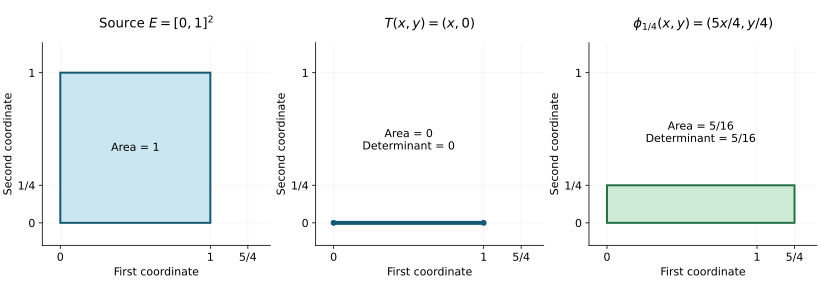

# Cubes, density and changes in volume

*Written and self-checked by GPT-6 Astra (OpenAI), Ultra reasoning effort, 4 October 2026. Original exposition is CC0. Independent review remains separate.*

This lesson supplies the geometric measure facts needed for [the Jacobian theorem on a measurable source set](relative-jacobian.md). The preceding [scalar measure lesson](scalar-integration-programme.md) proves the outer-measure construction and scalar convergence theorems. [Product integration](scalar-product-integration.md), PI1–PI4, proves uniqueness of measures on generating classes, finite Euclidean products and scalar Fubini. We use those written proofs here.

Fix an integer \(n\geq1\). Write \(|x|_\infty=\max_i|x_i|\), and let \(m\) denote completed Lebesgue measure on \(\mathbb R^n\), constructed from the product of the one-dimensional Borel measures. For matrices, \(\|A\|\) is the operator norm for \(|\cdot|_\infty\). A cube has sides parallel to the coordinate axes. Its volume is its side length to the power \(n\).

## GV1. Cube outer measure and regularity

Define \(\theta(E)\), for an arbitrary set \(E\subseteq\mathbb R^n\), as the infimum of the sums of volumes of countable open-cube covers of \(E\). This is an outer measure: the empty cover has cost zero, monotonicity is immediate, and combining covers with errors \(\varepsilon2^{-j}\) proves countable subadditivity when the sum of the infima is finite; the infinite case needs no estimate.

For a bounded coordinate rectangle \(B\) with side lengths \(\ell_1,\ldots,\ell_n\), of any endpoint type,
\[
 \theta(B)=\prod_{i=1}^n\ell_i.
 \tag{GV1.1}
\]
For the lower bound, the product measure already gives this value to \(B\), so any open-cube cover has at least this total volume by subadditivity of that measure. For the upper bound, take a grid of closed cubes of side \(d>0\). At most \(\prod_i(\ell_i/d+2)\) grid cubes meet \(B\). Enlarge this finite collection to open cubes by an arbitrarily small amount. Their total volume tends to a value at most \(\prod_i(\ell_i+2d)\). Let \(d\downarrow0\). This also proves the assertion for degenerate rectangles.

Each coordinate half-space satisfies the Carathéodory splitting condition for \(\theta\). Indeed, split every cube in a cover at its boundary hyperplane. The two resulting rectangles have volumes adding to the cube's volume; (GV1.1) bounds their outer measures by precisely those volumes. Sum, take covers with costs approaching \(\theta(E)\), and then let the excess cost tend to zero. This gives
\(\theta(E\cap H)+\theta(E\setminus H)\leq\theta(E)\); the reverse inequality is subadditivity. The preceding scalar lesson's Carathéodory theorem therefore makes every Borel set measurable, since coordinate half-spaces generate the Borel sigma-algebra. By PI1 and the box values, the restriction is the product Borel Lebesgue measure. Subsets of Borel null sets have outer measure zero, so the same equality holds for the completed measure. Thus \(\theta\) is the Lebesgue outer measure used below, and we write \(m^*\) for it.

The construction proves open approximation directly: if \(m^*(E)<\infty\) and \(\varepsilon>0\), a nearly optimal open-cube cover has open union \(O\supseteq E\) with
\[
 m(O)<m^*(E)+\varepsilon.
 \tag{GV1.2}
\]
For measurable \(E\) this says \(m(O\setminus E)<\varepsilon\).

We also need compact approximation. Closed bounded sets in \(\mathbb R^n\) are compact: the one-dimensional subsequence argument in the scalar lesson's Section 0, applied successively to the finitely many coordinates, gives a convergent subsequence of any bounded sequence. The limit lies in a closed set. To pass from this fact to the open-cover property, first select a countable subcover using the countable basis of rational open boxes. If no finite subfamily covers the set, choose a point outside each initial finite subfamily. A convergent subsequence then has its limit in a cover member, and eventually lies in that member, a contradiction. The countable-subcover assertion follows by choosing, for each basis box contained in some cover member, one such member; every covered point lies in one of these basis boxes.

If \(E\) is measurable and bounded, choose a closed bounding cube \(B\). Apply (GV1.2) to \(B\setminus E\). Then \(K=B\setminus O\) is compact, lies in \(E\), and \(m(E\setminus K)<\varepsilon\). A finite-measure unbounded \(E\) is first restricted to a sufficiently large bounding cube, losing arbitrarily little measure by continuity from below. Consequently every measurable set is the union of countably many compact subsets and a null remainder: apply the finite-measure result to \(E\cap[-j,j]^n\), with errors tending to zero, and collect all the resulting compact sets.

Coordinate hyperplanes are null, since each is a countable union of rectangles with one side length zero. Thus cube boundaries are null. Translations and uniform dilations preserve outer measure with factors one and \(|a|^n\), respectively, by transporting cube covers and using the inverse maps for the reverse inequalities.

## GV2. Lipschitz maps on arbitrary subsets

Suppose \(\phi:E\to\mathbb R^n\) satisfies
\( |\phi(x)-\phi(y)|_\infty\leq L|x-y|_\infty\) for \(x,y\in E\). Then
\[
 m^*(\phi(E))\leq L^n m^*(E).
 \tag{GV2.1}
\]
If \(L=0\), the image is empty or a singleton, hence null. Otherwise cover \(E\) by open cubes \(Q_j\) of side lengths \(d_j\). Every coordinate of \(\phi(E\cap Q_j)\) has range of length at most \(Ld_j\). Taking the infimum and supremum of each coordinate encloses this image in a rectangle of volume at most \(L^nd_j^n\). By (GV1.1), subadditivity and the infimum over covers give (GV2.1).

More generally, if the \(i\)-th coordinate increment is at most \(L_i|x-y|_\infty\), the same proof gives
\[
 m^*(\phi(E))\leq\left(\prod_{i=1}^nL_i\right)m^*(E).
 \tag{GV2.2}
\]
If one \(L_i=0\), apply the finite-cover estimate first to bounded portions of \(E\); their images have zero volume, and their countable union is null. This avoids any ambiguity in multiplying zero by infinite outer measure.

A Lipschitz map sends null sets to null sets. It also sends measurable sets to measurable sets, even without injectivity. To prove the latter assertion, write a measurable source set as countably many compact sets and a null remainder by GV1. The map is continuous on its domain, so the images of those compact sets are compact. The remaining image is null by (GV2.1). Their union is measurable for completed Lebesgue measure.

## GV3. The density theorem for cubes

Let \(C(x,r)=\{y:|y-x|_\infty\leq r\}\). For an integrable nonnegative \(u\), define
\[
 Mu(x)=\sup_{r>0}\frac{1}{(2r)^n}\int_{C(x,r)}u(y)\,dy.
 \tag{GV3.1}
\]
For fixed \(r>0\), the cube integral is continuous in its centre: as centres converge, their indicator functions converge pointwise off the limiting cube boundary, which is null by GV1; dominated convergence with majorant \(u\) applies. The same argument gives continuity in \(r>0\). Thus the supremum may be taken over positive rational radii, and \(\{Mu>t\}\) is open for \(t>0\).

We claim the weak bound
\[
 m\{Mu>t\}\leq\frac{3^n}{t}\int u.
 \tag{GV3.2}
\]
Let \(K\) be a compact subset of that open set. At each point of \(K\), choose a cube centred there whose average exceeds \(t\). The interiors cover \(K\); retain a finite subcover. From it select a cube of largest side, discard every cube meeting it, and repeat on the remaining finite family. The selected closed cubes are disjoint. Every discarded cube meets a selected cube of at least its side length, so is contained in the cube with the same centre and three times the selected side length. Hence
\[
 m(K)\leq 3^n\sum_jm(Q_j)
 <\frac{3^n}{t}\sum_j\int_{Q_j}u
 \leq\frac{3^n}{t}\int u.
 \tag{GV3.3}
\]
Taking compact subsets whose measures approach that of \(\{Mu>t\}\), as supplied by GV1 on bounded portions, proves (GV3.2).

**Density theorem.** For every measurable \(E\subseteq\mathbb R^n\), almost every \(x\in E\) satisfies
\[
 \lim_{r\downarrow0}\frac{m(E\cap C(x,r))}{(2r)^n}=1.
 \tag{GV3.4}
\]
First suppose \(m(E)<\infty\). Given \(\varepsilon>0\), take open \(O\supseteq E\) with \(m(O\setminus E)<\varepsilon\). Every \(x\in E\) has all sufficiently small centred cubes inside \(O\). On these cubes their fraction outside \(E\) is the average of \(1_{O\setminus E}\). Thus the set of points of \(E\) where the limsup of that fraction exceeds \(t>0\) is contained in \(\{M1_{O\setminus E}>t\}\), whose measure is at most \(3^n\varepsilon/t\). Let \(\varepsilon\downarrow0\), and then use \(t=1,1/2,1/3,\ldots\). This proves the assertion. The exceptional sets are measurable: continuity of the cube averages in centre and radius expresses each limsup using countable suprema over rational radii and an infimum over the upper bounds \(r<1/k\).

For general \(E\), apply the finite-measure result to \(E\cap[-j,j]^n\). Almost every point of each such set is a density point of that set, hence of \(E\), since the latter density fraction is larger and at most one. Their union is \(E\), giving (GV3.4).

At a density point \(x\) of \(E\) we have the useful geometric consequence
\[
 \frac{\operatorname{dist}_\infty(x+z,E)}{|z|_\infty}\longrightarrow0
 \quad(z\to0,\ z\ne0).
 \tag{GV3.5}
\]
Indeed, if the distance were greater than \(\eta|z|_\infty\), the cube of radius \(\eta|z|_\infty\) centred at \(x+z\) would miss \(E\), while lying in the cube centred at \(x\) of radius \((1+\eta)|z|_\infty\). Their volume ratio is \((\eta/(1+\eta))^n\), contradicting density one when \(z\) is sufficiently small. For every fixed \(\eta>0\) the distance is therefore at most \(\eta|z|_\infty\) for all sufficiently small \(z\), which proves (GV3.5).

## GV4. Linear substitutions in every finite dimension

For every invertible real \(n\)-by-\(n\) matrix \(A\),
\[
 m^*(AE)=|\det A|m^*(E)
 \quad(E\subseteq\mathbb R^n).
 \tag{GV4.1}
\]
We prove the Borel measure identity first. A coordinate permutation preserves the product measure by PI4. Scaling one coordinate by a nonzero \(a\) multiplies volume by \(|a|\), by the one-dimensional affine formula PI5.1 and scalar Fubini. Adding \(c\) times one coordinate to a different coordinate preserves volume: for a nonnegative Borel integrand, integrate first in the altered coordinate, apply one-dimensional translation invariance for each choice of the others, and then use Fubini. These statements hold for nonnegative integrals, including infinite values.

Gaussian elimination expresses every invertible matrix as a product of these operations: in the first column choose a nonzero pivot and move it into the first row, scale it to one, and subtract its multiples from the other rows. Repeat in the remaining square block, which is invertible because otherwise the full matrix would have a nonzero null vector. Finally eliminate the entries above the pivots. Reversing these operations gives the factorization. The determinant, defined by the alternating sum over permutations, is unchanged by a row addition, multiplied by the row-scaling factor, and changes sign under a row swap. These identities follow by multilinearity and alternation in that formula. Its multiplicativity follows by expanding the columns of a product multilinearly: terms with repeated chosen columns vanish, and the remaining terms are the permutation expansion of the second determinant times the first. The corresponding integral identities therefore give
\[
 \int h(Ax)\,dx=|\det A|^{-1}\int h(y)\,dy
 \tag{GV4.2}
\]
for every nonnegative Borel \(h\). Apply this to \(1_{AE}\) for a Borel \(E\); an invertible linear map is a homeomorphism, so \(AE\) is Borel. This proves its measure formula.

For an arbitrary \(E\) with finite outer measure, choose open supersets as in GV1. Their linear images are Borel and contain \(AE\), so the Borel formula gives \(m^*(AE)\leq|\det A|m^*(E)\). Apply the same argument to \(A^{-1}\) for the reverse inequality; the infinite cases follow from these two inequalities in the extended order. This proves (GV4.1). In particular invertible linear maps preserve null sets and completed measurability.

## GV5. Volume of a uniformly nearly linear image

**Lemma.** Given a matrix \(T\) and \(\varepsilon>0\), there is \(\delta(T,\varepsilon)>0\) with both of the following properties:

1. If \(\|S-T\|\leq\delta(T,\varepsilon)\), then \(\bigl||\det S|-|\det T|\bigr|\leq\varepsilon\).
2. If \(E\) is bounded and \(\phi:E\to\mathbb R^n\) satisfies
\[
 |\phi(x)-\phi(y)-T(x-y)|_\infty
 \leq\delta(T,\varepsilon)|x-y|_\infty\quad(x,y\in E),
 \tag{GV5.1}
\]
then
\[
 \bigl|m^*(\phi(E))-|\det T|m^*(E)\bigr|
 \leq\varepsilon m^*(E).
 \tag{GV5.2}
\]

*Proof.* Determinants are continuous polynomials in the entries, and each entry difference is at most \(\|S-T\|\), giving the first property after decreasing \(\delta\). We prove the second separately for invertible and singular \(T\).

If \(T\) is invertible, put \(\psi=\phi\circ T^{-1}\) on \(T(E)\), and let \(q=\delta\|T^{-1}\|<1\). Formula (GV5.1) gives
\[
 (1-q)|u-v|_\infty\leq|\psi(u)-\psi(v)|_\infty
 \leq(1+q)|u-v|_\infty.
 \tag{GV5.3}
\]
Thus \(\psi\) is injective, its inverse is \((1-q)^{-1}\)-Lipschitz, and GV2 applied in both directions, followed by GV4, gives
\[
 (1-q)^n|\det T|m^*(E)
 \leq m^*(\phi(E))
 \leq(1+q)^n|\det T|m^*(E).
 \tag{GV5.4}
\]
Choose \(\delta\) small enough that both coefficients differ from \(|\det T|\) by at most \(\varepsilon\).

If \(T\) is singular, row and column elimination gives
\(T=P\,\operatorname{diag}(I_k,0)\,Q\) for invertible \(P,Q\) and \(k<n\). For completeness, select any nonzero entry as a pivot, move it to the first diagonal position by row and column swaps, scale it to one, and clear its row and column by additions. Repeat in the remaining block until it is zero. If this process had \(n\) pivots the original matrix would be invertible, so \(k<n\). Reversing the operations yields the stated factorization; when \(T=0\), take \(k=0\) and \(P=Q=I\).

On \(Q(E)\) define \(\psi=P^{-1}\phi Q^{-1}\). Its difference from \(u\mapsto\operatorname{diag}(I_k,0)u\) has Lipschitz constant at most
\(\eta=\|P^{-1}\|\delta\|Q^{-1}\|\). Therefore its first \(k\) coordinates have Lipschitz constants at most \(1+\eta\), and its remaining coordinates at most \(\eta\). By (GV2.2) and (GV4.1),
\[
 m^*(\phi(E))
 \leq |\det P|\,|\det Q|\,(1+\eta)^k\eta^{n-k}m^*(E).
 \tag{GV5.5}
\]
Since \(n-k>0\), the coefficient tends to zero as \(\delta\downarrow0\). Choose it at most \(\varepsilon\). Now \(\det T=0\), so this is exactly (GV5.2). All outer measures in (GV5.2) are finite: \(E\) is bounded and \(\phi\) is Lipschitz by (GV5.1). This completes the proof. \(\square\)

**Exact example of the singular estimate.** On \(E=[0,1]^2\), let \(T(x,y)=(x,0)\) and \(\phi_\eta(x,y)=((1+\eta)x,\eta y)\). The difference \(\phi_\eta-T\) has maximum-norm Lipschitz constant \(\eta\). Its image has area \((1+\eta)\eta\), attaining the bound (GV5.5) with \(P=Q=I\), \(n=2\), \(k=1\). The figure uses \(\eta=1/4\), hence exact area \(5/16\); it is a coordinate drawing, not a numerical estimate. As \(\eta\downarrow0\), the area tends to zero while the source area stays one. The [figure source](../../figures/draw-singular-volume.py) preserves these exact parameters. The general proof is GV5; the related free human reference is Fremlin 263C below.

## Free reference and the next step

[D. H. Fremlin, *Measure Theory*, Chapter 26](https://www1.essex.ac.uk/maths/people/fremlin/chap26.pdf), Sections 262–263, provides a free human treatment of the relative-differentiability route. In particular GV5 supplies the kind of estimate used in 263C. Here the estimate is proved using coordinate cubes, including a separate proof for singular matrices. The density theorem and all geometric measure assertions used in this lesson have been proved above. The following [relative Jacobian lesson](relative-jacobian.md) proves the measurable decomposition, integral formula and full integrability equivalence.
