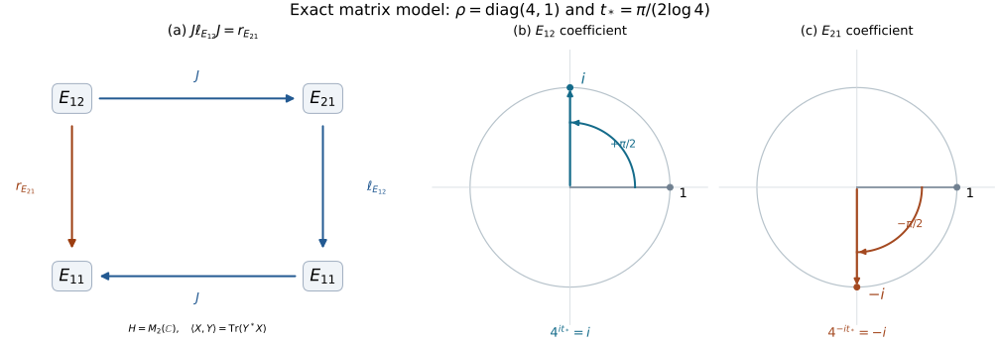

# The commutant theorem and the full Hilbert algebra

**Original exposition and proof: OpenAI Codex (GPT-6 Astra, Ultra), October 2026. CC0-1.0.**

The [integral and uniqueness proof IK](bounded-modular-integral.md) gave one commutant inclusion. This note proves the reverse inclusion, invariance under the constructed unitary group, and the full-algebra conclusions. It also identifies the original closed involution with the involution determined by the real subspace. The human source is Rieffel and Van Daele's [free publisher PDF](https://msp.org/pjm/1977/69-1/pjm-v69-n1-p17-s.pdf), Lemmas 5.11–5.12 and Theorems 5.13–5.15, printed pages 216–218.

The inputs are the written proofs [RC](real-coercive-equations.md), [GP](bounded-right-multiplier.md), [RS](bounded-real-subspaces.md), and [IK](bounded-modular-integral.md), with IK's written analytic prerequisites. In particular GP0 supplies bounded continuous calculus and bounded-adjoint norm identities. We prove the approximate-identity argument below. Neither a bicommutant closure theorem nor a density theorem for operator unit balls is assumed.

Write \(\mathcal A\) for the left Hilbert algebra, \(x^\sharp\) for its involution, \(L_x\) for left multiplication, and \(M=L(\mathcal A)''\). Its right algebra \(\mathcal A'\) has involution \(\flat\), multiplication \(w\circ z=R_wz\), and \(R_{w\circ z}=R_wR_z\). Primes on operator sets denote commutants; primes on the vector algebras denote this right-algebra construction. The distinction will be made explicit whenever it matters. All Hilbert spaces may be nonseparable and all algebras may lack an identity.

## MC1. Nondegeneracy, right products, and closability

First the left multipliers act nondegenerately:
\[
\bigcap_{x\in\mathcal A}\ker L_x=\{0\}.
\tag{MC1.1}
\]
If \(L_xv=0\) for every \(x\), then \(v\) is orthogonal to every \(L_x^*y=x^\sharp y\); these products span a dense subspace. This proves (MC1.1).

The right multipliers also act nondegenerately:
\[
\bigcap_{w\in\mathcal A'}\ker R_w=\{0\}.
\tag{MC1.2}
\]
Indeed IK6.4 at \(t=0\) gives \(R_{Jx}=JL_xJ\) for \(x\in\mathcal A^2\). A vector in the left side of (MC1.2) therefore has \(L_xJv=0\) for all such \(x\). The norm approximation in IK7 extends this equality to all \(x\in\mathcal A\), so (MC1.1) gives \(v=0\).

RS5 already proves that \(\mathcal A'\) is dense in \(H\). If \(v\) is orthogonal to every right product \(R_wz\), \(w,z\in\mathcal A'\), then \(R_w^*v=0\) for every \(w\), by that density. Since \(R_w^*=R_{w^\flat}\) and \(\flat\) is onto, (MC1.2) implies \(v=0\). The projection theorem now gives
\[
\overline{\operatorname{span}_{\mathbb C}
 \{w\circ z:w,z\in\mathcal A'\}}=H.
\tag{MC1.3}
\]

The involution \(\flat\) is closable as well. Suppose \(w_n\to0\) and \(w_n^\flat\to v\). The two self-adjoint parts
\[
\frac{w_n+w_n^\flat}{2},\qquad
\frac{w_n-w_n^\flat}{2i}
\]
belong to the closed standard real subspace \(E=(iK)^{\perp_{\mathbb R}}\), by GP1.5 and RS2. Their limits are \(v/2\) and \(iv/2\), respectively. Thus \(v\in E\cap iE=\{0\}\). A sequence suffices for graph closability because \(H\oplus H\) is a metric space. Together with RS4.5, the bounded multiplier and adjoint identities, density, and (MC1.3), this proves that \(\mathcal A'\) is itself a left Hilbert algebra, with left multiplication \(w\mapsto R_w\).

This argument applies to every left Hilbert algebra. In particular it may later be applied to \(\mathcal A'\); it has not used a commutant equality or a full-algebra assertion.

## MC2. A proved approximate identity and the generated right algebra

We need the following elementary operator lemma. Let \(\mathscr D\) be a complex *-subalgebra of \(B(H)\) such that \(\overline{\operatorname{span}\mathscr D H}=H\). Its operator-norm closure \(C\) is again an algebra closed under adjoints: approximate each factor and use
\(\|a_nb_n-ab\|\leq\|a_n\|\|b_n-b\|+\|a_n-a\|\|b\|\).
For a finite subset \(F\subset\mathscr D\) and \(\varepsilon>0\), set
\[
h_F=\sum_{a\in F}aa^*,\qquad
e_{F,\varepsilon}=h_F(h_F+\varepsilon I)^{-1}.
\tag{MC2.1}
\]
GP0 defines this as the continuous function \(s/(s+\varepsilon)\) of the positive \(h_F\). The inverse function is bounded on its compact interval. If \(h_F=0\), set \(e_{F,\varepsilon}=0\). Since the displayed function vanishes at zero, its uniformly approximating polynomials may be chosen with zero constant term, by subtracting their values at zero. Consequently
\[
e_{F,\varepsilon}\in C,\qquad 0\leq e_{F,\varepsilon}\leq I.
\tag{MC2.2}
\]
For \(a\in F\), positivity of \(h_F-aa^*\) gives
\[
\begin{aligned}
\|(I-e_{F,\varepsilon})a\|^2
&=\|(I-e_{F,\varepsilon})aa^*(I-e_{F,\varepsilon})\|\\
&\leq\|(I-e_{F,\varepsilon})h_F(I-e_{F,\varepsilon})\|\\
&\leq\sup_{s\geq0}\frac{\varepsilon^2s}{(s+\varepsilon)^2}
=\varepsilon/4.
\end{aligned}
\tag{MC2.3}
\]
Sandwiching preserves positivity because its quadratic form is evaluated on \((I-e_{F,\varepsilon})u\); the norm inequality for positive operators is GP0.1.

Order the pairs \((F,\varepsilon)\) by increasing \(F\) and decreasing \(\varepsilon\). Equation (MC2.3) proves convergence to zero of \((I-e_{F,\varepsilon})v\) for \(v\) in the span of \(\mathscr D H\). The uniform bound \(\|I-e_{F,\varepsilon}\|\leq1\) extends it to every vector by approximation. Thus
\[
e_{F,\varepsilon}\longrightarrow I
\quad\hbox{strongly}.
\tag{MC2.4}
\]
This is the approximate identity needed here; no countable dense set is required.

Apply the lemma to \(\mathscr D=R(\mathcal A')\). Its nondegeneracy follows from (MC1.2) and closure under adjoints: a vector orthogonal to \(\mathscr D H\) lies in every kernel of \(\mathscr D^*=\mathscr D\). We claim
\[
R(\mathcal A')''=M'.
\tag{MC2.5}
\]
GP1 proves \(\mathscr D\subset M'\). As \(M'\) is a commutant, \((M')''=M'\) by the elementary triple-commutant identity proved in IK7. Hence \(\mathscr D''\subset M'\).

For the other inclusion, take \(X\in M'\) and \(w,z\in\mathcal A'\). The vectors
\[
u=R_wXz,\qquad v=R_z^*X^*w^\flat
\]
satisfy, for all \(x\in\mathcal A\),
\[
L_xu=R_wXR_zx,\qquad
L_xv=R_z^*X^*R_w^*x.
\tag{MC2.6}
\]
Here \(X,X^*\) and the right multipliers commute with every \(L_x\). The two identities are exactly the defining right-vector tests, so
\[
R_wXR_z\in\mathscr D.
\tag{MC2.7}
\]
Approximating both factors in operator norm shows \(aXb\in C\) for \(a,b\in C\). In particular \(e_{F,\varepsilon}Xe_{F,\varepsilon}\in C\). These operators converge strongly to \(X\), since, for each \(v\),
\[
\|eXe\,v-Xv\|
\leq\|X\|\|(e-I)v\|+\|(e-I)Xv\|.
\tag{MC2.8}
\]
Every member of \(\mathscr D'\) commutes with \(C\), and therefore with \(X\) by this strong limit. It follows that \(X\in\mathscr D''\), proving (MC2.5). This also proves strong density of \(C\) in \(M'\) by an explicit net; we did not infer it from an unproved closure theorem.

## MC3. The two real subspaces

We first prove
\[
K=\overline{\{x\in\mathcal A:x^\sharp=x\}}.
\tag{MC3.1}
\]
The set inside the closure is a real linear subspace. The inclusion of \(K\) into its closure follows because all the square vectors generating \(K\) are self-adjoint.

Conversely, let \(x^\sharp=x\) and put \(C_x=L_x=C_x^*\). Let \(e\) be the orthogonal projection onto \(\overline{\operatorname{ran}C_x}\). The real projection theorem gives a complex orthogonal projection because this subspace and its orthogonal complement are complex linear. Also
\[
H=\overline{\operatorname{ran}C_x}\oplus\ker C_x.
\]
This follows by moving \(C_x\) across the inner product. Define
\[
e_\varepsilon=C_x^2(C_x^2+\varepsilon I)^{-1}.
\tag{MC3.2}
\]
It kills \(\ker C_x\), is a positive contraction, and
\[
\|(I-e_\varepsilon)C_x\|^2\leq\varepsilon/4.
\tag{MC3.3}
\]
The estimate is the same scalar calculus computation as (MC2.3). It proves convergence to the identity on the range of \(C_x\), then on its closure by the uniform bound. Thus \(e_\varepsilon\to e\) strongly. In particular \(eC_x=C_x\).

The function in (MC3.2) is approximable by real zero-constant polynomials in \(C_x^2\). Applied to \(x\), these give real combinations of odd powers \(x^{2j+1}\), \(j\geq1\), which are self-adjoint elements of \(\mathcal A^2\). RS4 identifies that self-adjoint part with the real square span, so these vectors lie in \(K\). First taking the polynomial limit and then \(\varepsilon\downarrow0\) gives \(ex\in K\).

Every \(R_w\) commutes with \(C_x\), hence with \(e_\varepsilon\) by GP0 and with \(e\) by strong convergence. Therefore
\[
R_w(x-ex)=(I-e)R_wx=(I-e)L_xw=0
\quad(w\in\mathcal A').
\tag{MC3.4}
\]
By (MC1.2), \(x=ex\in K\). This proves (MC3.1); it also proves \(K\cap\mathcal A=\mathcal A_{\rm sa}\), since RS4.2 gives the converse inclusion.

Let \(K'\) denote the closed real square span for the left Hilbert algebra \(\mathcal A'\). Applying (MC3.1) to that algebra is legitimate: MC1 applies to every left Hilbert algebra, so its right multipliers too are nondegenerate. It gives \(K'=\overline{(\mathcal A')_{\rm sa}}\). GP1.5 places these self-adjoint vectors in \(E\), and RS5 proves that they are dense in \(E\). Hence
\[
K'=E=(iK)^{\perp_{\mathbb R}}.
\tag{MC3.5}
\]
The geometry proved in RS2–RS3 now identifies the conjugation and group belonging to \(\mathcal A'\):
\[
J'=J,\qquad U'_t=U_{-t}.
\tag{MC3.6}
\]
The change of sign follows from \(R_E=2I-R\) in the actual bounded functional-calculus formula for the group.

## MC4. Commutant equality and invariance

We can now prove the symmetric conclusion:
\[
JMJ=M',\qquad U_tMU_{-t}=M\quad(t\in\mathbb R).
\tag{MC4.1}
\]
IK7 gives \(U_tJMJU_{-t}\subset M'\). Apply the same already-proved result to \(\mathcal A'\), using (MC2.5) and (MC3.6), to get
\[
U_{-t}JM'JU_t\subset M.
\tag{MC4.2}
\]
At zero, these two inclusions give \(JMJ\subset M'\) and \(JM'J\subset M\). Conjugating the second by \(J\) proves the reverse inclusion and hence the first equality in (MC4.1).

Substitute \(JMJ=M'\) into the original inclusion. It becomes \(U_tM'U_{-t}\subset M'\). The same assertion at \(-t\), conjugated by \(U_t\), proves the reverse inclusion. Thus \(U_tM'U_{-t}=M'\). Conjugating commutation equations by the unitary \(U_t\) carries commutants to commutants. Taking commutants proves \(U_tMU_{-t}=M\), since \(M''=M\). This proves both claims using bounded operators throughout.

## MC5. The original closed involution has the real-subspace graph

Let \(S\) be the closure of \(x\mapsto x^\sharp\) on the original \(\mathcal A\). Define
\[
D(S_K)=K+iK,\qquad S_K(k+i\ell)=k-i\ell.
\tag{MC5.1}
\]
The decomposition is unique because \(K\cap iK=\{0\}\). This densely defined conjugate-linear operator is closed. Indeed if \(z_n\to z\) and \(S_Kz_n\to y\), then
\[
k_n=\frac{z_n+S_Kz_n}{2}\longrightarrow\frac{z+y}{2}\in K,
\quad
\ell_n=\frac{z_n-S_Kz_n}{2i}\longrightarrow\frac{z-y}{2i}\in K.
\tag{MC5.2}
\]
These limits give \(z\in D(S_K)\) and \(S_Kz=y\).

By (MC3.1), the real and imaginary self-adjoint parts of any \(x\in\mathcal A\) lie in \(K\), and \(S_Kx=x^\sharp\). Closedness yields \(S\subset S_K\). Conversely approximate \(k,\ell\in K\) by self-adjoint \(k_n,\ell_n\in\mathcal A\), using (MC3.1). Then
\(k_n+i\ell_n\to k+i\ell\) and
\((k_n+i\ell_n)^\sharp=k_n-i\ell_n\to k-i\ell\).
Consequently
\[
S=S_K
\tag{MC5.3}
\]
as operators, including equality of domains. Applied to \(\mathcal A'\), this proves that its closed involution is \(S_E\). Equality (MC5.3) identifies the original graph. The continuation [The unbounded modular operator and its exact domains](bounded-modular-polar.md) supplies the positive-operator and polar identifications.

## MC6. All vectors and the full completion

The full vector version of IK6 is now immediate without another limiting multiplier argument. If \(x=x^\sharp\in\mathcal A\), (MC3.1) puts \(x\) in \(K\), so IK6.3 applies. Decompose a general \(x\) into its two self-adjoint parts, as in IK6.4. For every \(x\in\mathcal A\),
\[
U_tJx\in\mathcal A',\qquad
R_{U_tJx}=U_tJL_xJU_{-t},\qquad
(U_tJx)^\flat=U_tJx^\sharp.
\tag{MC6.1}
\]
Both maps involving \(J\) are conjugate-linear in \(x\), which is the scalar convention needed for this extension.

Define \(\mathcal A''=(\mathcal A')'\). Its defining multiplier is denoted \(L_x\), and its involution again \(\sharp\): explicitly, \(x\in\mathcal A''\) means that bounded \(L_x\) and a vector \(x^\sharp\) satisfy
\[
R_wx=L_xw,\qquad R_wx^\sharp=L_x^*w
\quad(w\in\mathcal A').
\tag{MC6.2}
\]
MC1 makes \(\mathcal A''\) a left Hilbert algebra, with product \(xy=L_xy\). Every original \(x\in\mathcal A\) satisfies these identities, by the definition of \(\mathcal A'\). Uniqueness of the right-algebra construction shows that its multiplier, involution and multiplication are unchanged. Thus \(\mathcal A\subset\mathcal A''\) as involutive algebras of vectors. MC2 applied to \(\mathcal A'\) gives
\[
L(\mathcal A'')''=R(\mathcal A')'=M.
\tag{MC6.3}
\]

Furthermore
\[
\mathcal A'''=\mathcal A',\qquad
\mathcal A''''=\mathcal A''.
\tag{MC6.4}
\]
For the first inclusion, a vector in \(\mathcal A'''\), tested only against the subset \(\mathcal A\subset\mathcal A''\), satisfies the definition of \(\mathcal A'\). Conversely (MC6.2), applied to \(w\) and \(w^\flat\), proves
\(L_xw=R_wx\) and \(L_xw^\flat=R_w^*x\) for every \(x\in\mathcal A''\). These are the two defining tests placing \(w\in\mathcal A'''\). Uniqueness identifies the involutions and multipliers as well. Taking the right-algebra construction again gives the second equality.

An algebra \(\mathcal B\) is called **full** when \(\mathcal B=\mathcal B''\). Thus both \(\mathcal A'\) and \(\mathcal A''\) are full. Applying (MC3.5) to \(\mathcal A'\) shows that the real subspace for \(\mathcal A''\) is
\[
(iE)^{\perp_{\mathbb R}}=K.
\tag{MC6.5}
\]
Here \(iE=K^{\perp_{\mathbb R}}\) by RS2, and a closed real subspace equals its double orthogonal complement by the projection theorem. Hence the completion retains the original \(J,U_t\), and, by MC5, the same closed involution \(S_K\).

## MC7. Covariance on a full algebra

Suppose now that \(\mathcal A\) is full. Formula (MC6.1) at zero gives \(J\mathcal A\subset\mathcal A'\). Applying it to \(\mathcal A'\) gives \(J\mathcal A'\subset\mathcal A''=\mathcal A\). Conjugating the latter inclusion by \(J\) proves
\[
J\mathcal A=\mathcal A',\qquad
R_{Jx}=JL_xJ.
\tag{MC7.1}
\]
Apply (MC6.1) to \(\mathcal A'\) at parameter \(-t\), with \(w=Jx\). Its group is \(U_{-s}\) at parameter \(s\), by (MC3.6). Therefore
\[
U_tx\in\mathcal A,\qquad
L_{U_tx}=U_tJ R_{Jx}J U_{-t}
         =U_tL_xU_{-t},\qquad
(U_tx)^\sharp=U_tx^\sharp.
\tag{MC7.2}
\]
For the last identity use \((Jx)^\flat=Jx^\sharp\), from (MC6.1) at zero. The opposite parameter supplies the inverse, so \(U_t\mathcal A=\mathcal A\).

Multiplication is also preserved. The map \(x\mapsto L_x\) is faithful: if \(L_x=0\), then \(R_wx=L_xw=0\) for all \(w\in\mathcal A'\), and (MC1.2) gives \(x=0\). Consequently
\[
L_{U_t(xy)}
=U_tL_xL_yU_{-t}
=L_{U_tx}L_{U_ty}
=L_{(U_tx)(U_ty)}
\]
implies \(U_t(xy)=(U_tx)(U_ty)\). Thus the group acts by algebra and involution automorphisms on every full algebra, in particular on the full completion \(\mathcal A''\).

## MC8. A matrix model showing both sides of the theorem

Take \(H=M_2(\mathbb C)\) with
\(\langle X,Y\rangle=\operatorname{Tr}(Y^*X)\), and let
\(d=\operatorname{diag}(2,1)\), \(\rho=d^2=\operatorname{diag}(4,1)\).
The algebra of vectors is all of \(H\), with
\[
X\mathbin{\star}Y=Xd^{-1}Y,\qquad
X^\sharp=d^{-1}X^*d,\qquad
L_XZ=(Xd^{-1})Z.
\tag{MC8.1}
\]
Associativity follows by multiplying matrices; the involution reverses the product and squares to the identity by the same computation. The adjoint of \(L_X\) is left multiplication by \(d^{-1}X^*=X^\sharp d^{-1}\). The identity vector is \(d\), so products span \(H\). All maps are bounded in this finite-dimensional space, proving the left Hilbert algebra axioms directly.

Every vector \(W=db\) is a right vector, with
\[
R_WZ=Zb,\qquad W^\flat=db^*.
\tag{MC8.2}
\]
Substitution in the two defining tests verifies this. Hence \(\mathcal A'=\mathcal A''=H\) as vector spaces, with their specified, generally different products and involutions.

For operator clarity write \(\ell_a(Z)=aZ\) and \(r_b(Z)=Zb\). If \(X=ad\), then \(L_X=\ell_a\). Any linear operator commuting with all \(\ell_a\) is \(r_b\): apply it to \(Z=\ell_Z I\), with \(b\) its value at \(I\). Conversely right multiplication commutes with every left multiplication by associativity. The same argument with sides exchanged proves
\[
M=\{\ell_a:a\in M_2(\mathbb C)\},\qquad
M'=\{r_b:b\in M_2(\mathbb C)\}.
\tag{MC8.3}
\]
On diagonal entries, \(K=\{ad:a=a^*\}\) is the real coordinate plane. On the two off-diagonal coefficients it is the subspace \(K_2\) from RS7. The explicit formulas there, together with conjugation and the identity group on the diagonal coordinates, therefore give
\[
JZ=Z^*,\qquad U_tZ=\rho^{it}Z\rho^{-it},
\qquad J\ell_aJ=r_{a^*}.
\tag{MC8.4}
\]
The last equality also follows immediately by taking two matrix adjoints. In particular
\[
U_tE_{12}=4^{it}E_{12},\quad
U_tE_{21}=4^{-it}E_{21},\quad
U_tE_{11}=E_{11},\quad U_tE_{22}=E_{22}.
\tag{MC8.5}
\]
Here the \(E_{ij}\) are an orthonormal basis for the stated Hilbert metric. At \(t_*=\pi/(2\log4)\), the off-diagonal factors are exactly \(i\) and \(-i\). This also displays why \(JU_t=U_tJ\): \(J\) exchanges the two off-diagonal positions and conjugates their coefficients.

*The left panel evaluates \(J\ell_{E_{12}}J=r_{E_{21}}\) on \(E_{12}\): both paths end at \(E_{11}\). Every arrow acts on \(H=M_2(\mathbb C)\) with the Hilbert–Schmidt metric; arrows labelled \(J\) are conjugate-linear. The two phase panels show coefficient rotations in the distinct \(E_{12}\) and \(E_{21}\) coordinate planes, at the exact time \(t_*\); the diagonal coefficients stay fixed. The unit circles are coefficient-plane geometry, not a drawing of all eight real dimensions of \(H\). Proofs and parameters: (MC8.1–5). [Reproducible figure source](../../figures/draw-bounded-modular-commutant.py).*

**Free source and remaining scope.** Marc A. Rieffel and Alfons Van Daele, *A bounded operator approach to Tomita–Takesaki theory*, Pacific Journal of Mathematics **69** (1977), 187–221, [free publisher PDF](https://msp.org/pjm/1977/69-1/pjm-v69-n1-p17-s.pdf). The complete selected passages are Lemmas 5.11–5.12 and Theorems 5.13–5.15, printed 216–218. MC1–MC7 prove their conclusions with an explicit approximate identity and continuous support cutoffs, and additionally prove the exact original-involution graph identity (MC5.3). The continuation [The unbounded modular operator and its exact domains](bounded-modular-polar.md) identifies the traditional positive operator and its relation to \(J,U_t\). The full legacy MF reconstruction and the remaining course prerequisites still require integration and review.
