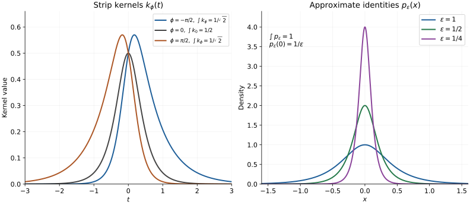

# The integral kernel and the first modular commutation identities

**Original exposition and proof: OpenAI Codex (GPT-6 Astra, Ultra), October 2026. CC0-1.0.**

The bounded equations in [RS6](bounded-real-subspaces.md) determine both a right multiplier and its vector by the same scalar kernel. We prove those integral representations and the uniqueness argument that recovers pointwise commutation. The human source is Rieffel and Van Daele's [free publisher PDF](https://msp.org/pjm/1977/69-1/pjm-v69-n1-p17-s.pdf), Lemmas 4.6–4.8 and 5.9–5.10, printed pages 204–205 and 215. Fourier uniqueness is proved here using a kernel obtained from the same strip formula.

Read the written proofs of [complex integration and identity, Lemma 0.1 and Theorem 3.7](../analytic-programme/scalar-complex-programme.md), [the one-pole rectangle formula SC5](../analytic-programme/scalar-complex-boundaries.md), [scalar dominated convergence, Theorem 2.2](../analytic-programme/scalar-integration-programme.md), and [absolutely integrable Fubini, PI3](../analytic-programme/scalar-product-integration.md). Those programme proofs, RC/GP, and RS are the inputs. We use the same elementary exponential and trigonometric conventions as the complex-analysis programme. No assertion in the legacy modular manuscript is an input.

## IK1. The integrals and the scalar strip formula

For \(-\pi<\phi<\pi\), put
\[
\lambda=e^{i\phi/2},\qquad
w(t)=\frac1{e^{\pi t}+e^{-\pi t}},\qquad
k_\phi(t)=e^{-\phi t}w(t).
\tag{IK1.1}
\]
This is a positive continuous kernel, with
\[
0<k_\phi(t)\leq e^{-(\pi-|\phi|)|t|}.
\tag{IK1.2}
\]
For a bounded continuous Hilbert-valued function \(v\), define \(\int_{\mathbb R}k_\phi(t)v(t)\,dt\) by its finite-interval Riemann integrals and the limit at both endpoints. Programme Lemma 0.1 constructs those integrals. Their differences are bounded in norm by \(\sup_t\|v(t)\|\) times the omitted scalar kernel integrals, which tend to zero by (IK1.2). Completeness gives the limit and the same norm bound. Bounded linear maps commute with it by the corresponding finite-interval result and continuity.

For a uniformly bounded strongly continuous operator family \(X_t\), integrate \(k_\phi(t)X_tu\) for each vector \(u\). These integrals define a bounded operator, with norm at most \(\sup_t\|X_t\|\int k_\phi\). This construction does not require operator-norm continuity of \(X_t\).

**Strip identity.** If \(f\) is bounded and continuous on \(|\operatorname{Re}z|\leq1/2\), and holomorphic inside, then
\[
f(0)=\int_{\mathbb R}k_\phi(t)
\left[\lambda f(1/2+it)+\overline\lambda f(-1/2+it)\right]dt.
\tag{IK1.3}
\]

**Proof.** Set \(g(z)=\pi e^{i\phi z}f(z)/\sin(\pi z)\). Its only pole in the strip is zero, and the residue there is \(f(0)\), because \(\sin(\pi z)/z\to\pi\). Apply SC5 to the rectangle with vertical sides at \(\pm(1/2-\varepsilon)\) and horizontal sides at \(\pm iL\), \(L>0\). For fixed \(L\), let \(\varepsilon\downarrow0\). Uniform continuity on the compact boundary, which avoids zero, passes all four integrals to the closed-strip boundary. Thus no extension of \(f\) across that boundary is assumed.

On a horizontal side, for \(|x|\leq1/2\),
\[
|\sin\pi(x\mathbin{\pm}iL)|^2
=\sin^2(\pi x)+\sinh^2(\pi L)\geq\sinh^2(\pi L).
\]
The absolute integral on the top is bounded by \(\pi\|f\|_\infty e^{-\phi L}/\sinh(\pi L)\); on the bottom replace \(\phi\) by \(-\phi\). Both tend to zero since \(|\phi|<\pi\). On the vertical sides,
\[
\sin\pi(1/2+it)=\cosh(\pi t),\qquad
\sin\pi(-1/2+it)=-\cosh(\pi t).
\]
The right side is traversed upwards and the left downwards. Their contributions, divided by \(2\pi i\), therefore add to the integrand in (IK1.3). Its absolute integrability follows from (IK1.2), so passage to \(L\to\infty\) proves the formula. \(\square\)

Taking \(f=1\) gives the exact normalization
\[
\int_{\mathbb R}k_\phi(t)\,dt
=\frac1{2\cos(\phi/2)}.
\tag{IK1.4}
\]
In particular \(\int w=1/2\). The modular kernel is not itself a probability density.

## IK2. Bounded complex powers on a closed strip

Retain \(R,T,J,U_t\) from RS. For \(|\operatorname{Re}z|\leq1/2\), define by the bounded continuous calculus on \((0,2)\) of RS3
\[
A_z=a_z(R),\qquad
a_z(r)=r^{1/2-z}(2-r)^{1/2+z}.
\tag{IK2.1}
\]
The powers use the real logarithms of the positive scalars. Their absolute values obey
\[
|a_z(r)|=r^{1/2-\operatorname{Re}z}(2-r)^{1/2+\operatorname{Re}z}\leq2,
\quad 0<r<2,
\tag{IK2.2}
\]
because both factors have nonnegative exponents summing to one, and both bases are at most two. Hence \(\|A_z\|\leq2\) on the entire closed strip.

This family is strongly continuous on the closed strip and holomorphic in operator norm inside. Here are the endpoint and derivative details. Put \(D=R(2I-R)\). On any compact set of parameters in the closed strip, the functions \(a_z(r)r(2-r)\) are jointly continuous for \(0<r<2\) and uniformly small near the endpoints, by (IK2.2). They extend by zero there. Thus \(\|(A_z-A_{z_0})D\|\to0\). The dense range of \(D\) and the uniform operator bound prove strong continuity.

For norm holomorphy, restrict the real part to \([-1/2+\delta,1/2-\delta]\), \(\delta>0\), and write \(\ell(r)=\log((2-r)/r)\). The derivative of \(a_z(r)\) is \(a_z(r)\ell(r)\). Taylor's exponential estimate gives
\[
|a_{z+h}(r)-a_z(r)-h a_z(r)\ell(r)|
\leq\tfrac12|h|^2|a_z(r)|\ell(r)^2e^{|h||\ell(r)|}.
\tag{IK2.3}
\]
For \(|h|\leq\delta/2\), the factor after \(|h|^2/2\) is uniformly bounded in \(r\). At an endpoint it is bounded by a constant times \(r^{\delta/2}(1+|\log r|^2)\), or its counterpart with \(2-r\). These are bounded and tend to zero: put \(r=e^{-u}\) and use the exponential series to dominate any fixed power of \(u\). Away from the endpoints the bound is immediate. The norm bound of RS3 now passes (IK2.3) to operators, proving the derivative in norm.

At the middle and the two edges,
\[
A_0=T,\qquad
A_{1/2+it}=(2I-R)U_t,\qquad
A_{-1/2+it}=RU_t.
\tag{IK2.4}
\]
These are bounded-calculus identities; no products of undefined unbounded powers occur.

## IK3. Solving the bounded equation by integration

Suppose bounded operators \(Y,W\) satisfy
\[
TWT=\lambda(2I-R)YR+\overline\lambda RY(2I-R).
\tag{IK3.1}
\]
Then
\[
Y=\int_{\mathbb R}k_\phi(t)U_tWU_{-t}\,dt,
\qquad
\|Y\|\leq\frac{\|W\|}{2\cos(\phi/2)}.
\tag{IK3.2}
\]
The integral is the vectorwise operator integral in IK1. In particular a bounded solution of (IK3.1) is unique. Existence for the modular equation is already supplied by RS6.

**Proof.** For arbitrary \(u,v\in H\), use the scalar function
\[
f(z)=\langle A_zY A_{-z}u,v\rangle.
\tag{IK3.3}
\]
IK2 and the product rule make it holomorphic inside. It is continuous on the closed strip, because products of uniformly bounded strongly continuous operators are strongly continuous; the difference is estimated by adding and subtracting the product with one factor fixed. It is bounded by \(4\|Y\|\|u\|\|v\|\).

Formula (IK2.4) shows that the weighted sum of its two boundary values is
\[
\begin{aligned}
&\lambda f(1/2+it)+\overline\lambda f(-1/2+it)\\
&\quad=\langle U_t[\lambda(2I-R)YR+\overline\lambda RY(2I-R)]U_{-t}u,v\rangle\\
&\quad=\langle TU_tWU_{-t}Tu,v\rangle.
\end{aligned}
\tag{IK3.4}
\]
Also \(f(0)=\langle TYTu,v\rangle\). Apply (IK1.3) and commute the bounded \(T\) through the vector integrals. If \(Z\) denotes the right side of (IK3.2), this yields \(TYT=TZT\). Since \(\operatorname{ran}T\) is dense, the bounded sesquilinear forms of \(Y\) and \(Z\) agree everywhere. This proves equality without using an unbounded inverse of \(T\). The norm estimate follows from unitarity and (IK1.4). \(\square\)

The orbit in this integral is strongly continuous. Explicitly,
\[
\|U_tWU_{-t}u-U_sWU_{-s}u\|
\leq\|W\|\|(U_{-t}-U_{-s})u\|
+\|(U_t-U_s)WU_{-s}u\|,
\]
which tends to zero as \(t\to s\). No continuity in operator norm has been substituted.

## IK4. The operator and vector representations use the same kernel

Let \(\mathcal A,K\) be as in RS4 and \(\xi\in K\cap\mathcal A\). For each \(-\pi<\phi<\pi\), let \(\eta_\phi\) be the right-algebra vector constructed in RS6 with \(\lambda=e^{i\phi/2}\). Then
\[
R_{\eta_\phi}
=\int_{\mathbb R}k_\phi(t)U_tJL_\xi JU_{-t}\,dt,
\tag{IK4.1}
\]
and
\[
\eta_\phi=\int_{\mathbb R}k_\phi(t)U_tJ\xi\,dt.
\tag{IK4.2}
\]

For (IK4.1), RS6.2 is (IK3.1) with \(Y=R_{\eta_\phi}\), \(W=JL_\xi J\), because \(B=TJ=JT\). Apply IK3.

For (IK4.2), fix \(v\in H\) and apply (IK1.3) to \(f(z)=\langle A_z\eta_\phi,v\rangle\). Its weighted boundary sum is
\[
\langle U_t[\lambda(2I-R)+\overline\lambda R]\eta_\phi,v\rangle
=\langle TU_tJ\xi,v\rangle
\]
by RS6.3. The value at zero is \(\langle T\eta_\phi,v\rangle\). Separation by all Hilbert pairings gives equality after applying \(T\), and its injectivity gives (IK4.2). This proves the two assertions of the source's Lemma 5.9, with their full vectorwise meaning and normalization.

## IK5. Fourier uniqueness from this strip kernel

First apply (IK1.3) at \(\phi=0\) to \(f(z)=e^{sz}\), \(s\in\mathbb R\). It is bounded on the vertical strip, so
\[
\int_{\mathbb R}w(t)e^{ist}\,dt
=\frac1{2\cosh(s/2)}.
\tag{IK5.1}
\]
Replacing \(s\) by \(-s\) gives the same value. For \(\varepsilon>0\), put
\[
p_\varepsilon(x)=\frac1{\varepsilon\cosh(\pi x/\varepsilon)}.
\tag{IK5.2}
\]
The kernel is nonnegative and has integral one, by (IK1.4) and substitution. Substituting \(t=\varepsilon s/(2\pi)\) in (IK5.1), with its frequency equal to \(2\pi x/\varepsilon\), gives the explicit representation
\[
p_\varepsilon(x)
=\frac1{2\pi}\int_{\mathbb R}
\frac{e^{isx}}{\cosh(\varepsilon s/2)}\,ds.
\tag{IK5.3}
\]
Both sides are absolutely integrable in the variables in which they will be used.

**Fourier uniqueness for continuous integrable functions.** If \(h\in C(\mathbb R)\cap L^1(\mathbb R)\) and
\[
\widehat h(s)=\int_{\mathbb R}e^{-ist}h(t)\,dt=0
\quad(s\in\mathbb R),
\]
then \(h=0\) everywhere. No global boundedness of \(h\) is assumed.

Indeed (IK5.3) and PI3 Fubini give
\[
(p_\varepsilon*h)(x)
=\frac1{2\pi}\int_{\mathbb R}
\frac{e^{isx}\widehat h(s)}{\cosh(\varepsilon s/2)}\,ds=0.
\tag{IK5.4}
\]
The interchange is justified by the integrable product majorant
\(|h(t)|/\cosh(\varepsilon s/2)\).
We show directly that these convolutions converge to \(h(x)\). Given \(\tau>0\), continuity at \(x\) supplies \(\delta>0\) with \(|h(x-y)-h(x)|<\tau\) for \(|y|<\delta\). That part of the error is at most \(\tau\). On the complement,
\[
p_\varepsilon(y)\leq\frac2\varepsilon e^{-\pi|y|/\varepsilon},
\qquad
\int_{|y|\geq\delta}p_\varepsilon(y)\,dy
\leq\frac4\pi e^{-\pi\delta/\varepsilon}.
\tag{IK5.5}
\]
Hence the remainder is at most
\[
\frac2\varepsilon e^{-\pi\delta/\varepsilon}\|h\|_1
+|h(x)|\frac4\pi e^{-\pi\delta/\varepsilon},
\]
which tends to zero. Since \(\tau\) was arbitrary, (IK5.4) implies \(h(x)=0\). This supplies the needed Fourier theorem by a written proof.

**Weighted uniqueness.** If a bounded continuous scalar function \(g\) satisfies
\[
\int_{\mathbb R}k_\phi(t)g(t)\,dt=0
\quad(-\pi<\phi<\pi),
\tag{IK5.6}
\]
then \(g(t)=0\) for every real \(t\).

Define \(F(z)=\int_{\mathbb R}e^{-zt}w(t)g(t)\,dt\) on \(|\operatorname{Re}z|<\pi\). On any smaller closed strip the integrand and its derivative in \(z\) are bounded by constants times \(e^{-\delta|t|}\) and \(|t|e^{-\delta|t|}\), for some \(\delta>0\). Difference quotients are dominated by a slightly smaller exponential rate, using \(|(e^{-ht}-1)/h|\leq |t|e^{|h||t|}\). Scalar dominated convergence therefore proves that \(F\) is holomorphic. It vanishes on the real interval by (IK5.6), so the programme identity theorem makes it zero throughout the connected strip. At \(z=is\), it is the Fourier transform of the continuous integrable function \(wg\). The theorem just proved gives \(wg=0\); strict positivity of \(w\) gives \(g=0\).

The same conclusion holds for a bounded continuous Hilbert-valued \(g\), by pairing separately with every vector. This argument needs no countable family separating the Hilbert space.

## IK6. Pointwise modular covariance on the algebraic core

For \(\xi\in K\cap\mathcal A\) and \(x\in\mathcal A\), right multiplication gives \(L_x\eta_\phi=R_{\eta_\phi}x\). Substitute (IK4.1–2) to obtain
\[
\int_{\mathbb R}k_\phi(t)
\left[L_xU_tJ\xi-U_tJL_\xi JU_{-t}x\right]dt=0
\quad(-\pi<\phi<\pi).
\tag{IK6.1}
\]
The bracket is a bounded continuous Hilbert-valued function of \(t\). Weighted uniqueness gives
\[
L_xU_tJ\xi=U_tJL_\xi JU_{-t}x
\quad(t\in\mathbb R,\ x\in\mathcal A).
\tag{IK6.2}
\]
Since \(K\) is fixed by the closed involution and \(\xi\in\mathcal A\), one has \(\xi^\sharp=\xi\) and \(L_\xi^*=L_\xi\). Antiunitary conjugation preserves the adjoint identity: it follows by applying \(\langle Ju,Jv\rangle=\overline{\langle u,v\rangle}\) to the defining adjoint equality. Thus \(X_t=U_tJL_\xi JU_{-t}\) is bounded and self-adjoint. Equation (IK6.2) and the same identity for \(X_t^*=X_t\) are exactly the two tests in the definition of a right-algebra vector. Consequently
\[
U_tJ\xi\in\mathcal A',\quad
(U_tJ\xi)^\flat=U_tJ\xi,\quad
R_{U_tJ\xi}=U_tJL_\xi JU_{-t}.
\tag{IK6.3}
\]

Every \(\xi\in\mathcal A^2\) decomposes into the two vectors in \(K\cap\mathcal A^2\) in RS4.4. Both \(\xi\mapsto U_tJ\xi\) and \(\xi\mapsto U_tJL_\xi JU_{-t}\) are conjugate-linear, while right multiplication is linear in its vector. Extending (IK6.3) through that decomposition gives
\[
U_tJ\mathcal A^2\subseteq\mathcal A',\qquad
R_{U_tJ\xi}=U_tJL_\xi JU_{-t},\qquad
(U_tJ\xi)^\flat=U_tJ\xi^\sharp
\quad(\xi\in\mathcal A^2).
\tag{IK6.4}
\]
In particular the multiplier norm is exactly \(\|L_\xi\|\). This includes the source's Lemma 5.10 for \(\xi=x^\sharp x\), and gives its linear-span form.

## IK7. The first generated-commutant inclusion

Set \(M=\{L_x:x\in\mathcal A\}''\). We prove
\[
U_tJMJU_{-t}\subseteq M'\quad(t\in\mathbb R).
\tag{IK7.1}
\]
There is a small norm-density point to justify before taking generated algebras.

For \(x\in\mathcal A\), put \(H_x=L_x^*L_x=L_{x^\sharp x}\). GP0, after scaling the positive operator to a contraction, gives \(f_\varepsilon(H_x)\) for \(f_\varepsilon(s)=s/(s+\varepsilon)\). Since \(f_\varepsilon(0)=0\), it is uniformly approximable on \([0,\|H_x\|]\) by polynomials with zero constant term: subtract the value at zero from any uniformly approximating polynomial. Every \(L_xp(H_x)\) is then left multiplication by an element of \(\mathcal A^2\). Moreover
\[
\begin{aligned}
\|L_x-L_xf_\varepsilon(H_x)\|^2
&=\|\varepsilon^2 H_x(H_x+\varepsilon I)^{-2}\|\\
&\leq\sup_{s\geq0}\frac{\varepsilon^2s}{(s+\varepsilon)^2}
=\varepsilon/4.
\end{aligned}
\tag{IK7.2}
\]
The equality of the norm square uses the bounded adjoint identity from GP0; the scalar maximum follows from \((s-\varepsilon)^2\geq0\). If \(H_x=0\), then \(L_x=0\) and there is nothing to approximate. Thus \(L(\mathcal A^2)\) is norm-dense in \(L(\mathcal A)\) in the precise sense needed here.

By GP1, every right multiplier commutes with every \(L_x\). Equation (IK6.4), the approximation just proved, and norm-closedness of a commutant imply
\[
U_tJ L(\mathcal A)J U_{-t}\subseteq M'.
\]
Conjugation by the antiunitary \(U_tJ\) carries commutants to commutants: test each commutation equation after conjugating by its inverse. Taking double commutants therefore gives (IK7.1). We used only the elementary identity \(S'''=S'\) for any set of operators: \(S\subseteq S''\) gives one inclusion, and the definition of \(S''\) gives the other. No separate closure theorem is hidden at this step.

The reverse commutant inclusion and equality are not consequences of (IK7.1) alone. The continuation [The commutant theorem and the full Hilbert algebra](bounded-modular-commutant.md) proves right-product density, identifies the dual real subspace and applies the symmetric construction. It also supplies the full-algebra conclusions and identifies the original closed-involution graph.

## IK8. The two kernels in the argument

*The left panel samples exactly the functions \(k_\phi\) in (IK1.1) at \(\phi=-\pi/2,0,\pi/2\). Their integrals are respectively \(1/\sqrt2,1/2,1/\sqrt2\), proved by (IK1.4); positive \(\phi\) increases the negative tail. The right panel samples (IK5.2) at \(\varepsilon=1,1/2,1/4\); each has integral one and height \(1/\varepsilon\) at zero. These are finite plotting windows, not numerical evaluations of the whole integrals. The tail estimates and convergence proof are (IK1.2) and (IK5.5). [Reproducible figure source](../../figures/draw-bounded-modular-kernels.py).*

**Free source and achieved scope.** Marc A. Rieffel and Alfons Van Daele, *A bounded operator approach to Tomita–Takesaki theory*, Pacific Journal of Mathematics **69** (1977), 187–221, [publisher PDF](https://msp.org/pjm/1977/69-1/pjm-v69-n1-p17-s.pdf). The complete selected source passages are Lemmas 4.6–4.8 and 5.9–5.10. IK1–IK7 provide the strip formula, the two integral representations, the uniqueness proof, core covariance and the first generated-commutant inclusion. The source's Fourier injectivity invocation is replaced by IK5's explicit approximate-identity proof. This advances the general free-source reconstruction; it does not certify the full modular theorem or the legacy manuscript.
