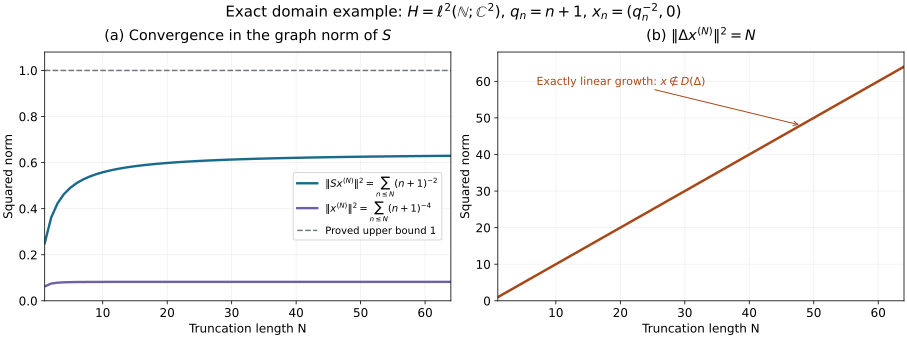

# The unbounded modular operator and its exact domains

**Original exposition and proof: OpenAI Codex (GPT-6 Astra, Ultra), October 2026. CC0-1.0.**

The [commutant proof MC](bounded-modular-commutant.md) constructs \(J,U_t\) and identifies the original closed involution with \(S_K\). We now prove that these are the polar conjugation and imaginary powers of the original modular operator \(S^*S\). The human source is the complete proposition and proof in the appendix of Rieffel and Van Daele's [free paper](https://msp.org/pjm/1977/69-1/pjm-v69-n1-p17-s.pdf), printed pages 219–220. We supply the unbounded-operator arguments by bounded graph parametrizations, including positive-square-root uniqueness.

The inputs are the written [RC](real-coercive-equations.md), [GP](bounded-right-multiplier.md), [RS](bounded-real-subspaces.md), [IK](bounded-modular-integral.md), and [MC](bounded-modular-commutant.md) proofs, with their stated programme prerequisites. No assertion from the legacy modular manuscript is used. In particular we use GP0's proved bounded continuous calculus, not an unproved unbounded spectral theorem.

Inner products are linear in the first variable. Recall the closed standard real subspaces \(K,E=(iK)^{\perp_{\mathbb R}}\), their projections \(P,Q\) onto \(K,iK\), and
\[
R=P+Q,\quad B=P-Q,\quad T=[R(2I-R)]^{1/2},\quad B=JT=TJ.
\tag{MP0.1}
\]
Both \(R\) and \(2I-R\) are injective positive bounded operators with dense range. MC5 identifies the original closed involution as
\[
D(S)=K+iK,\qquad S(k+i\ell)=k-i\ell.
\tag{MP0.2}
\]
All equalities of unbounded operators below include their domains.

## MP1. The conjugate-linear adjoint

For a densely defined conjugate-linear operator \(V\), define \(y\in D(V^*)\) when there exists \(z\) such that
\[
\langle Vx,y\rangle=\langle z,x\rangle
\quad(x\in D(V)),
\qquad V^*y=z.
\tag{MP1.1}
\]
Density makes \(z\) unique. This definition is equivalent to the real-adjoint equality
\(\operatorname{Re}\langle Vx,y\rangle=\operatorname{Re}\langle x,z\rangle\).
For the imaginary parts, substitute \(ix\) and use conjugate-linearity of \(V\). This explains the order of the pairing in (MP1.1); it is not the linear-adjoint convention.

Let \(F=S_E\), with domain \(E+iE\). For \(y,z\in H\), testing the real-adjoint equality for \(S\) separately on \(k\in K\) and on \(i\ell\in iK\) gives precisely
\[
y-z\in K^{\perp_{\mathbb R}}=iE,\qquad
y+z\in(iK)^{\perp_{\mathbb R}}=E.
\tag{MP1.2}
\]
These conditions say that \(y=u+iv\), \(u,v\in E\), and \(z=u-iv\). They are also sufficient, by adding the two real pairing equalities. Hence
\[
S^*=F,\qquad D(S^*)=E+iE.
\tag{MP1.3}
\]
Since \(JK=E\), conjugate-linearity and \(J^2=I\) give
\[
F=JSJ,\qquad D(F)=J D(S).
\tag{MP1.4}
\]
For example \(y=Jk+iJ\ell=J(k-i\ell)\) is sent by \(JSJ\) to \(Jk-iJ\ell\), exactly as required.

The complex-linear operator \(JS\), on \(D(S)\), is self-adjoint. To see both its action and its adjoint domain, for \(x\in D(S)\),
\[
\langle JSx,y\rangle=\overline{\langle Sx,Jy\rangle}.
\]
Thus \(y\) is in its linear-adjoint domain exactly when \(Jy\in D(S^*)\), and its adjoint there is \(S^*Jy\). Equations (MP1.3–4) make this domain \(D(S)\) and this value \(JSy\). Closedness also follows directly from closedness of \(S\) and continuity of the invertible isometry \(J\).

## MP2. A positive self-adjoint operator from two bounded coordinates

In this note set
\[
C=R^{1/2},\qquad D=(2I-R)^{1/2}.
\tag{MP2.1}
\]
The letter \(D\) here denotes this bounded operator; \(D(V)\) still denotes an operator domain. GP0 gives commuting positive injective \(C,D\), with
\[
C^2+D^2=2I,\qquad CD=T.
\tag{MP2.2}
\]
Their ranges are dense, since the orthogonal complement of the range of a bounded self-adjoint operator is its kernel.

Define
\[
D(A)=\operatorname{ran}C,\qquad A(Cu)=Du.
\tag{MP2.3}
\]
Injectivity of \(C\) makes this well-defined. Its graph is the image of \(u\mapsto(Cu,Du)\), and
\[
\|Cu\|^2+\|Du\|^2=2\|u\|^2.
\tag{MP2.4}
\]
Consequently that graph is closed: convergence of both coordinates makes \(u\) Cauchy, so completeness gives the limiting preimage. The domain is dense. Commutation of \(C,D\) proves symmetry, and
\[
\langle A(Cu),Cu\rangle=\langle Tu,u\rangle\geq0
\tag{MP2.5}
\]
proves positivity.

We verify self-adjointness, rather than inferring it from symmetry. The linear-adjoint condition \(A^*x=y\) is equivalent, by testing on \(Cu\), to
\[
Dx=Cy.
\tag{MP2.6}
\]
If this holds, put \(u=(Cx+Dy)/2\). Commutation and (MP2.2) give
\[
Cu=(C^2x+CDy)/2=(C^2+D^2)x/2=x,
\]
and similarly \(Du=y\). Conversely \(x=Cu,y=Du\) satisfies (MP2.6). Thus \(D(A^*)=\operatorname{ran}C=D(A)\) and \(A^*=A\). The operator \(A\) is injective with dense range \(\operatorname{ran}D\); its inverse is given by \(A^{-1}(Du)=Cu\).

## MP3. The square, with its domain computed

The domain of \(A^2\) is exactly \(\operatorname{ran}C^2=\operatorname{ran}R\). Indeed, if \(x=Cu\) and \(Ax=Du=Cv\), then
\[
u=(C^2u+D^2u)/2=C(Cu+Dv)/2\in\operatorname{ran}C.
\]
So \(x\in\operatorname{ran}C^2\). Conversely, \(x=C^2u\) has \(Ax=CDu\in\operatorname{ran}C\), and \(A^2x=D^2u\). Define
\[
\Delta=A^2,\qquad
D(\Delta)=\operatorname{ran}R,\qquad
\Delta(Ru)=(2I-R)u.
\tag{MP3.1}
\]
In particular \((2I-R)R^{-1}\) denotes this operator on \(\operatorname{ran}R\), not an everywhere-defined product.

Its self-adjointness can also be verified directly. The graph is \(u\mapsto(Ru,(2I-R)u)\). If its two coordinates converge, their half-sum \(u\) converges, so the graph is closed. The adjoint condition \(\Delta^*x=y\) is
\[
(2I-R)x=Ry.
\]
It implies \(x=R(x+y)/2\) and \(y=(2I-R)(x+y)/2\), which are precisely the graph conditions in (MP3.1). Symmetry gives the converse. Positivity follows from
\[
\langle\Delta(Ru),Ru\rangle
=\langle R(2I-R)u,u\rangle=\|Tu\|^2\geq0.
\tag{MP3.2}
\]
Both factors are injective, so \(\Delta\) is injective with dense range \(\operatorname{ran}(2I-R)\). Its inverse has domain that range and sends \((2I-R)u\) to \(Ru\).

The resolvent at \(-1\) is especially simple:
\[
(I+\Delta)^{-1}=R/2.
\tag{MP3.3}
\]
This is an equality on all of \(H\), since \((I+\Delta)Ru=2u\). Thus the bounded coordinate \(R\) is recovered from \(\Delta\) itself.

## MP4. Identifying the original involution and modular operator

For \(x=k+i\ell\in D(S)\), put \(q=i\ell\in iK\). Expanding the projections, using \(Pk=k\) and \(Qq=q\), gives
\[
\begin{aligned}
(2I-R)Sx
&=(2I-P-Q)(k-q)\\
&=(I-Q)k-(I-P)q\\
&=(P-Q)(k+q)=Bx=JTx.
\end{aligned}
\tag{MP4.1}
\]
Apply \(J\). Since \(J(2I-R)=RJ\) and \(JTJ=T\), this yields
\[
R(JS)x=Tx\quad(x\in D(S)).
\tag{MP4.2}
\]
Using \(R=C^2,T=CD\) and canceling the bounded injective \(C\), we get \(C(JS)x=Dx\). By (MP2.6), this says \(x\in D(A)\) and \(Ax=JSx\). Hence \(JS\subset A\).

Both operators are self-adjoint, so they are equal. The short maximality argument is as follows: an inclusion \(V\subset W\) of densely defined linear operators gives \(W^*\subset V^*\), directly by restricting the adjoint tests. If both operators are self-adjoint, this is the opposite inclusion. Consequently
\[
JS=A,\qquad S=JA,\qquad
D(S)=\operatorname{ran}R^{1/2}=K+iK.
\tag{MP4.3}
\]

This also identifies \(\Delta\) with the original product \(S^*S\). For \(x\in D(S)\), the condition \(Sx\in D(S^*)=J D(S)\) is, by \(Sx=JAx\), exactly \(Ax\in D(A)\). On this domain, \(S^*J=JS=A\) by MP1, so
\[
S^*Sx=A^2x,\qquad
S^*S=\Delta,\qquad D(S^*S)=\operatorname{ran}R.
\tag{MP4.4}
\]
Thus the product, positivity, self-adjointness and domain have all been proved for the original closed involution.

## MP5. Positive-square-root uniqueness and the polar decompositions

Adjoints are closed: if both coordinates of an adjoint graph converge, passage to the limit in each defining pairing preserves the adjoint condition. Hence every self-adjoint operator used below is closed.

We justify the notation \(A=\Delta^{1/2}\) by proving uniqueness among positive self-adjoint square roots.

Let \(\Gamma\) be any positive self-adjoint operator with \(\Gamma^2=\Delta\), including equality of domains. The operator \(I+\Gamma\) is one-to-one, onto, and has inverse \(b\) with \(\|b\|\leq1\). Indeed
\[
\|(I+\Gamma)x\|\|x\|\geq
\langle(I+\Gamma)x,x\rangle\geq\|x\|^2.
\tag{MP5.1}
\]
Its range is closed: convergence of \((I+\Gamma)x_n\) makes \(x_n\) Cauchy by this bound, and then \(\Gamma x_n\) converges; closedness of \(\Gamma\) finishes the argument. Its range is dense, because a vector orthogonal to that range is in \(D(\Gamma^*)\) with \(\Gamma^*y=-y\), impossible for a positive operator unless \(y=0\). The projection theorem therefore makes the range all of \(H\).

The inverse \(b=(I+\Gamma)^{-1}\) is a positive self-adjoint contraction. Symmetry follows by writing each test vector as \((I+\Gamma)x\); positivity follows from
\(\langle b(I+\Gamma)x,(I+\Gamma)x\rangle=\|x\|^2+\langle x,\Gamma x\rangle\).
Bounded symmetry on all of \(H\) is self-adjointness, by the bounded-adjoint definition.

Moreover \(\Gamma b=I-b\) and
\[
D(\Gamma^2)=\operatorname{ran}b^2,\qquad
\Gamma^2b^2=(I-b)^2.
\tag{MP5.2}
\]
For the domain assertion, write \(x=bu\). The condition \((I-b)u\in\operatorname{ran}b\) implies \(u=bu+(I-b)u\in\operatorname{ran}b\); the converse and the action follow from \(\Gamma b=I-b\).

The continuous function \(h(s)=s^2+(1-s)^2\) is at least \(1/2\) on \([0,1]\), so GP0 gives a bounded inverse for \(h(b)\). Equation (MP5.2) now yields
\[
(I+\Delta)^{-1}
=b^2[b^2+(I-b)^2]^{-1}=q(b),
\qquad q(s)=\frac{s^2}{s^2+(1-s)^2}.
\tag{MP5.3}
\]
The continuous inverse of \(q\) on \([0,1]\) is
\[
g(t)=\frac{\sqrt t}{\sqrt t+\sqrt{1-t}}.
\]
Direct substitution verifies both inverse identities. The composition rule for GP0 follows first for a polynomial outer function and then by uniform polynomial approximation. Applying it to \(g(q(b))\), and using (MP3.3), gives
\[
b=g(R/2)=C(C+D)^{-1}.
\tag{MP5.4}
\]
The inverse of \(C+D\) is bounded: its scalar function \(\sqrt r+\sqrt{2-r}\) is at least \(\sqrt2\) on \([0,2]\), so GP0 supplies the reciprocal. Formula (MP2.3) also gives
\((I+A)^{-1}=C(C+D)^{-1}\).
Thus \(I+\Gamma\) and \(I+A\) have the same inverse, and consequently the same domains and actions. This proves \(\Gamma=A\).

We may therefore write
\[
\Delta^{1/2}=A,\qquad S=J\Delta^{1/2}.
\tag{MP5.5}
\]
This is the polar decomposition: its positive factor is the uniquely determined positive square root of \(S^*S\), and \(J\) is antiunitary. The isometric factor is unique because the range of \(A\) is dense; equality of two such factors after \(A\) gives equality on that dense range, and then everywhere by continuity.

The bounded conjugation identity \(JRJ=2I-R\), transported through real continuous functions, gives \(JCJ=D\) and \(JDJ=C\). Applying these to the graph in (MP2.3) proves
\[
JAJ=A^{-1},\qquad D(A^{-1})=\operatorname{ran}D.
\tag{MP5.6}
\]
Thus, from MP1,
\[
S^*=JSJ=AJ=JA^{-1}=J\Delta^{-1/2},
\qquad D(S^*)=\operatorname{ran}(2I-R)^{1/2}.
\tag{MP5.7}
\]
Likewise conjugating the graph (MP3.1) gives
\[
J\Delta J=\Delta^{-1},
\quad D(\Delta^{-1})=\operatorname{ran}(2I-R),
\quad SS^*=\Delta^{-1}.
\tag{MP5.8}
\]
For the last identity, apply the same product-domain argument as in (MP4.4) to \(S^*=JA^{-1}\); equivalently repeat MP3–MP4 with \(R\) replaced by \(2I-R\). This records the domains, not just formal reciprocal symbols.

## MP6. The continuous calculus and imaginary powers

For a bounded continuous function \(f:(0,\infty)\to\mathbb C\), define
\[
f(\Delta)=
\left[r\longmapsto f\left(\frac{2-r}{r}\right)\right](R).
\tag{MP6.1}
\]
The right side is precisely the endpoint calculus already constructed in RS3. It is a unital, norm-bounded *-homomorphism. It is intrinsic to \(\Delta\), because (MP3.3) recovers \(R\) from \(\Delta\).

For compactly supported \(f\), the function on the right extends by zero to both endpoints, so (MP6.1) uses only GP0's continuous calculus on a compact interval. For general bounded \(f\), RS3 obtains it by those same bounded continuous endpoint cutoffs and strong convergence. Thus the extension is fixed by its compact-interval calculus and that exhaustion; no spectral measure or unproved Borel-calculus rule is needed here.

It agrees with the actual positive resolvents. For \(\alpha>0\),
\[
(\Delta+\alpha I)^{-1}
=R[(2I-R)+\alpha R]^{-1}
=\left[r\longmapsto\frac{r}{2-r+\alpha r}\right](R).
\tag{MP6.2}
\]
The denominator is at least \(2\min\{1,\alpha\}>0\). The displayed operator has range in \(D(\Delta)=\operatorname{ran}R\), and multiplying on that domain verifies both inverse identities directly.

In particular \(\lambda\mapsto\lambda^{it}=\exp(it\log\lambda)\) is bounded and continuous on \((0,\infty)\). Its value under (MP6.1) is
\[
\Delta^{it}
=\left[r\longmapsto
\exp\left(it\log\frac{2-r}{r}\right)\right](R)
=U_t.
\tag{MP6.3}
\]
RS3 already proves unitarity, the group law and strong continuity of this exact family. Combining (MP6.3) with MC4 proves the modular theorem in its usual notation:
\[
JMJ=M',\qquad
\Delta^{it}M\Delta^{-it}=M
\quad(t\in\mathbb R),
\tag{MP6.4}
\]
where now \(\Delta=S^*S\) for the original involution.

The conjugation rule is
\[
Jf(\Delta)J=\widetilde f(\Delta),
\qquad \widetilde f(\lambda)=\overline{f(\lambda^{-1})}.
\tag{MP6.5}
\]
This is RS3.4 after the change of scalar coordinate. At \(f(\lambda)=\lambda^{it}\), complex conjugation and inversion cancel, giving \(J\Delta^{it}J=\Delta^{it}\). This is consistent with (MP5.8), which concerns the positive operator rather than its imaginary powers.

## MP7. Graph norms and a concrete common core

The bounded coordinates also make graph approximation explicit. From \(x=Cu\) and \(Sx=JDu\),
\[
\|x\|^2+\|Sx\|^2=2\|u\|^2.
\tag{MP7.1}
\]
Thus \(\operatorname{ran}C\), with the graph norm of \(S\), is parametrized by \(H\) through a scaled isometry. This does not make \(S\) bounded in the original Hilbert norm.

Let \(g_n(r)=\min\{1,nr,n(2-r)\}\) be the symmetric cutoffs of RS3, and put \(G_n=g_n(R)\). Since \(g_n(r)/r\) is bounded and continuous on \((0,2)\),
\[
G_n=R[g_n(r)/r](R),\qquad
G_nH\subset D(\Delta).
\tag{MP7.2}
\]
Also \(G_n\to I\) strongly. Bounded multiplicativity and the graph parametrizations prove, on their indicated domains,
\[
AG_nx=G_nAx,\quad
\Delta G_ny=G_n\Delta y,\quad
SG_nx=G_nSx.
\tag{MP7.3}
\]
For example \(x=Cu\) gives \(G_nx=CG_nu\) and \(AG_nx=DG_nu=G_nDu\). For \(\Delta\), use \(y=Ru\). For \(S=JA\), use also \(JG_n=G_nJ\), which follows from symmetry and reality of \(g_n\).

Consequently \(G_nx\to x\) in the graph norm of \(A\) and \(S\), and \(G_ny\to y\) in the graph norm of \(\Delta\). In particular \(D(\Delta)\) is a core for \(S\) and \(\Delta^{1/2}\): restricting either operator to that domain and closing its graph recovers the entire operator. This is a density-in-graph-norm conclusion; the domains themselves may be strictly different.

## MP8. An example in which the domains really differ

Let \(H=\ell^2(\mathbb N;\mathbb C^2)\), with \(\mathbb N=\{1,2,\ldots\}\), standard sum inner product, and \(q_n=n+1\). This is a Hilbert space: a Cauchy sequence has coordinatewise limits; bounds on finite sums pass to the limit, and a Cauchy estimate applied first to each finite partial sum and then to their supremum gives convergence in the sum norm. Finite-support vectors are dense by truncating the defining convergent norm series.

Take
\[
K=\{(z_n,q_n\overline{z_n})_{n\geq1}\in H\}.
\tag{MP8.1}
\]
It is closed, since its defining coordinate equalities survive norm convergence. The same coordinate comparison as in RS7 gives \(K\cap iK=\{0\}\). Every finite-support vector belongs to \(K+iK\), by the two-coordinate decomposition in RS7, so this sum is dense.

The projection formulas of RS7 apply in each coordinate block. Their direct sum is a bounded orthogonal projection because each block is a contraction and satisfies the same projection and real-orthogonality identities; the norm sums pass these identities to \(H\). It follows that
\[
\begin{aligned}
R(u,v)_n&=\left(\frac{2u_n}{1+q_n^2},
                 \frac{2q_n^2v_n}{1+q_n^2}\right),\\
J(u,v)_n&=(\overline{v_n},\overline{u_n}),\\
\Delta^{1/2}(u,v)_n&=(q_nu_n,q_n^{-1}v_n),\\
\Delta(u,v)_n&=(q_n^2u_n,q_n^{-2}v_n).
\end{aligned}
\tag{MP8.2}
\]
The bounded continuous calculus in each block agrees with these formulas by polynomial approximation; its strong endpoint limits agree by finite-support approximation and uniform boundedness.

The range characterizations in MP3–MP4 give the exact domains
\[
\begin{aligned}
D(S)=D(\Delta^{1/2})
 &=\left\{(u,v)\in H:
    \sum_n(q_n^2|u_n|^2+q_n^{-2}|v_n|^2)<\infty\right\},\\
D(\Delta)
 &=\left\{(u,v)\in H:
    \sum_n(q_n^4|u_n|^2+q_n^{-4}|v_n|^2)<\infty\right\}.
\end{aligned}
\tag{MP8.3}
\]
For example membership in \(\operatorname{ran}R^{1/2}\) says that the sum with weights \((1+q_n^2)/2\) and \((1+q_n^{-2})/2\) is finite; since \((u,v)\in H\), this is exactly the first condition. Squaring the reciprocal coefficients of \(R\), and using \(2a\leq1+a^2\) for \(a\geq0\), proves the second.

Let \(x_n=(q_n^{-2},0)\). Then \(x\in D(S)\), because
\[
\sum_{n=1}^\infty q_n^{-2}
\leq\sum_{k=2}^\infty\frac1{k(k-1)}=1.
\tag{MP8.4}
\]
The equality on the right follows by telescoping \(1/[k(k-1)]=1/(k-1)-1/k\); the norm series for \(x\) is even smaller. But the first coordinate of \(\Delta x\) would be one in every block, so \(x\notin D(\Delta)\). Similarly \(y_n=(q_n^{-1},0)\) belongs to \(H\) but not to \(D(S)\). Therefore
\[
D(\Delta)\subsetneq D(S)\subsetneq H.
\tag{MP8.5}
\]

For the finite truncation \(x^{(N)}\), the quantities drawn below are exactly
\[
\|x^{(N)}\|^2=\sum_{n=1}^Nq_n^{-4},\quad
\|Sx^{(N)}\|^2=\sum_{n=1}^Nq_n^{-2}\leq1,\quad
\|\Delta x^{(N)}\|^2=N.
\tag{MP8.6}
\]
The first two converge, while the third diverges. This illustrates graph approximation for \(S\) and the strict product-domain restriction.

*Both panels use \(q_n=n+1\), \(x_n=(q_n^{-2},0)\), and truncations \(1\leq N\leq64\) in the stated sum Hilbert metric. The left dashed line is the proved bound \(1\) in (MP8.4), not an estimated limit. The right panel is the exact identity \(\|\Delta x^{(N)}\|^2=N\). Finite plotted samples illustrate the domain separation; the infinite assertions are proved in (MP8.3–5). [Reproducible figure source](../../figures/draw-bounded-modular-polar.py).*

**Free source and achieved scope.** Marc A. Rieffel and Alfons Van Daele, *A bounded operator approach to Tomita–Takesaki theory*, Pacific Journal of Mathematics **69** (1977), 187–221, [publisher PDF](https://msp.org/pjm/1977/69-1/pjm-v69-n1-p17-s.pdf). The selected appendix proposition and its complete proof are on printed pages 219–220. MP1–MP7 prove the original adjoint and polar identifications, positivity and self-adjointness of \(S^*S\), uniqueness of its positive square root, the imaginary-power identification, and a concrete common core. Together with RC/GP/RS/IK/MC this completes the general modular commutant and invariance proof from the stated Hilbert-algebra hypotheses. The actual legacy MF chapters, further analytic-algebra results and remaining course prerequisites still require reconstruction and integration.
