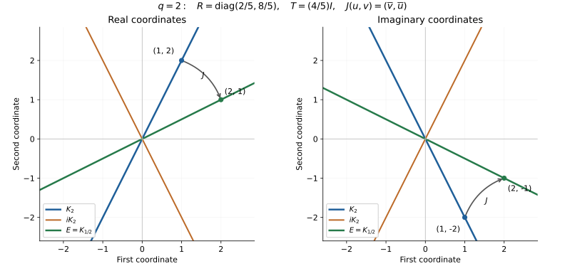

# Real subspaces and the bounded modular equation

**Original exposition and proof: OpenAI Codex (GPT-6 Astra, Ultra), October 2026. CC0-1.0.**

This continuation of [the bounded right-multiplier proof](bounded-right-multiplier.md) constructs the operators associated with a standard real subspace, applies them to a left Hilbert algebra, and proves the bounded equation needed for the next integral step. The human source is Rieffel and Van Daele's [freely readable paper](https://msp.org/pjm/1977/69-1/pjm-v69-n1-p17-s.pdf), Proposition 2.2, Propositions 3.1–3.3, Corollary 5.7 and Lemma 5.8. Each used conclusion is proved below.

Inner products are linear in the first variable. Orthogonality of real subspaces uses \((x,y)_{\mathbb R}=\operatorname{Re}\langle x,y\rangle\). The real projection and Riesz proofs are in [RC](real-coercive-equations.md); the required bounded continuous calculus and operator-norm completeness are proved in GP0 of the preceding note. No spectral measure, unbounded polar decomposition, or modular commutant theorem is an input here.

## RS1. The sum and difference of the real projections

Let \(K\) be a closed real subspace of a complex Hilbert space \(H\), satisfying
\[
K\cap iK=\{0\},\qquad \overline{K+iK}=H.
\tag{RS1.1}
\]
Write \(P,Q\) for the real orthogonal projections onto \(K,iK\), and put
\[
R=P+Q,\qquad B=P-Q.
\tag{RS1.2}
\]
Projection uniqueness gives \(Q(ix)=iPx\) and \(P(ix)=iQx\). Thus \(R\) is complex-linear and \(B\) is conjugate-linear. Both are self-adjoint as real operators. A complex-linear real-self-adjoint operator is complex-self-adjoint: its real pairing equality, tested also after multiplying one vector by \(i\), gives the imaginary equality. In particular
\[
0\leq R\leq2I,\qquad
\langle Rx,x\rangle=\|Px\|^2+\|Qx\|^2.
\tag{RS1.3}
\]
If \(Rx=0\), then \(Px=Qx=0\), and density of \(K+iK\) forces \(x=0\). Similarly
\[
\langle(2I-R)x,x\rangle
=\|(I-P)x\|^2+\|(I-Q)x\|^2
\]
shows that \(2I-R\) is injective, because \(K\cap iK=\{0\}\).

Direct multiplication of the projection identities gives
\[
B^2=P+Q-PQ-QP=R(2I-R),
\quad B^2P=PB^2,
\quad B^2Q=QB^2.
\tag{RS1.4}
\]
By GP0 applied to the positive contraction \(R/2\), define
\[
T=\bigl(R(2I-R)\bigr)^{1/2}.
\tag{RS1.5}
\]
The scalar inequalities \(0\leq r(2-r)\leq1\) on \([0,2]\) imply \(0\leq T\leq I\). It is complex-linear and commutes with \(R\). It also commutes with \(P,Q,B\): approximate the square-root function of \(B^2\) uniformly by real polynomials and use (RS1.4), remembering that real coefficients commute with a conjugate-linear operator. The product \(R(2I-R)\) is injective because its two commuting factors are injective, so \(T\) is injective.

For a bounded self-adjoint complex operator, the orthogonal complement of its range is its kernel: this follows by moving the operator across each inner product. Hence \(T\) and \(T^2\) have dense range. Also
\[
\|Bx\|^2=(B^2x,x)_{\mathbb R}=\|Tx\|^2.
\tag{RS1.6}
\]
The first equality uses real self-adjointness of \(B\); it is not a complex-adjoint formula for an antilinear map.

## RS2. Construction of the conjugation and the dual real subspace

On the dense range of \(T\), define
\[
J(Tx)=Bx.
\tag{RS2.1}
\]
Injectivity of \(T\) makes this well-defined, and (RS1.6) makes it an isometry. It extends uniquely to a conjugate-linear isometry on all \(H\), by completeness. The range of \(B\) is real-dense: a vector real-orthogonal to it lies in \(\ker B\), which is zero by (RS1.6). Thus the extended isometry has dense range; its range is closed because convergent images have Cauchy preimages. Consequently \(J\) is onto.

The commutation of \(B\) and \(T\) proves \(JT=TJ\), first on \(\operatorname{ran}T\) and then by continuity. Since \(B=JT=TJ\),
\[
J^2T^2=B^2=T^2.
\]
Density of \(\operatorname{ran}T^2\) gives \(J^2=I\). Norm preservation and the polarization identity show
\[
\langle Jx,Jy\rangle=\overline{\langle x,y\rangle},
\qquad \langle Jx,y\rangle=\langle Jy,x\rangle.
\tag{RS2.2}
\]
For example, polarization recovers the real part from the norms of sums and differences, and the imaginary part from the norms with \(iy\); conjugate-linearity reverses that latter sign. This proves antiunitarity directly.

Multiplying the projections gives \(BP=(I-Q)B\) and \(BQ=(I-P)B\). Since \(T\) commutes with \(P,Q\), substitute \(B=TJ\) and cancel the injective \(T\). We obtain
\[
JP=(I-Q)J,\qquad JQ=(I-P)J,
\qquad JR=(2I-R)J.
\tag{RS2.3}
\]
Set
\[
E=(iK)^{\perp_{\mathbb R}}=\ker Q.
\]
Equations (RS2.3) and \(J^2=I\) imply
\[
JK=E,\qquad J(iK)=K^{\perp_{\mathbb R}}.
\tag{RS2.4}
\]
For example the first identity follows from \(JPJ=I-Q\) by equality of ranges, not just an inclusion.

The subspace \(E\) is again standard. Indeed \(iE=K^{\perp_{\mathbb R}}\), so \(E\cap iE=(K+iK)^{\perp_{\mathbb R}}=\{0\}\), while the real orthogonal complement of \(E+iE\) is \(iK\cap K=\{0\}\). A proper closed real subspace would have a nonzero orthogonal residual by the projection theorem, proving density. Its projections are \(P_E=I-Q\) and \(Q_E=I-P\). Consequently its associated operators are
\[
R_E=2I-R,\qquad B_E=B,\qquad T_E=T,\qquad J_E=J.
\tag{RS2.5}
\]
Here equality of \(T_E\) follows from the identical defining continuous function, and equality of \(J_E\) follows from (RS2.1) on the same dense range.

## RS3. The unitary group from bounded continuous functions

The function \(r\mapsto((2-r)/r)^{it}\) need not extend continuously to either endpoint of \([0,2]\). We construct its operator without importing a Borel calculus.

For \(n\geq1\), set
\[
g_n(r)=\min\{1,nr,n(2-r)\}\quad(0\leq r\leq2),
\qquad D=R(2I-R).
\tag{RS3.1}
\]
The functions are symmetric under \(r\mapsto2-r\), vanish at the endpoints and lie between zero and one. They equal one on \([1/n,2-1/n]\). Hence
\[
\|(I-g_n(R))D\|\leq2/n.
\tag{RS3.2}
\]
The operator \(D\) has dense range, being self-adjoint and injective. Since \(\|I-g_n(R)\|\leq1\), (RS3.2) proves \(g_n(R)x\to x\) for every \(x\): approximate \(x\) by a vector in the range of \(D\), and then use the uniform bound on the approximation error.

If \(f\) is bounded and continuous on \((0,2)\), the function \(fg_n\) extends continuously by zero at the endpoints. Its operators have norm at most \(\|f\|_\infty\), and on vectors in \(\operatorname{ran}D\),
\[
\|((fg_n)(R)-(fg_m)(R))Dx\|
\leq\|f\|_\infty(2/n+2/m)\|x\|.
\tag{RS3.3}
\]
Density and the uniform bound therefore give a strong limit, denoted \(f(R)\), with \(\|f(R)\|\leq\|f\|_\infty\). It agrees with GP0 when \(f\) extends continuously to \([0,2]\), because the corresponding product with \(g_n(R)\) converges strongly.

This extension preserves sums, products and adjoints. To check products, the approximating product is \((fhg_n^2)(R)\). Its difference from \((fhg_n)(R)\), tested after \(D\), tends to zero by the same bound as (RS3.2); the uniform operator bounds extend convergence to all vectors. Products of uniformly bounded strongly convergent operators converge strongly, since
\[
\|(A_nB_n-AB)x\|
\leq\|A_n\|\|(B_n-B)x\|+\|(A_n-A)Bx\|.
\]
For adjoints, pass to the limit in the inner-product equality between \((fg_n)(R)\) and \((\overline f g_n)(R)\). In particular \(1(R)=I\). Real polynomial transport in (RS2.3), complex conjugation of coefficients by \(J\), and the symmetry of \(g_n\) give
\[
Jf(R)J=\widetilde f(R),\qquad
\widetilde f(r)=\overline{f(2-r)}.
\tag{RS3.4}
\]

For real \(t\), define
\[
U_t=f_t(R),\qquad
f_t(r)=\exp\left(it\log\frac{2-r}{r}\right).
\tag{RS3.5}
\]
Multiplicativity, conjugation and \(|f_t|=1\) give \(U_{s+t}=U_sU_t\), \(U_0=I\), and \(U_t^*=U_{-t}\). Thus every \(U_t\) is unitary. To prove strong continuity, first observe that
\[
\sup_{0<r<2}|f_t(r)-f_s(r)|r(2-r)\longrightarrow0
\quad\text{as }t\to s.
\tag{RS3.6}
\]
Near the endpoints the last factor is uniformly small and the first factor is at most two. On any remaining compact interval, the logarithm is bounded and the exponentials converge uniformly. Equation (RS3.6) proves continuity on \(\operatorname{ran}D\); the unitary norm bound and density extend it to all \(H\).

Since \(\widetilde f_t=f_t\), (RS3.4) gives \(JU_t=U_tJ\). The group also commutes with \(R,T\), and hence with \(B=TJ\). The identities \(P=(R+B)/2\), \(Q=(R-B)/2\), regarded as real-operator identities, give
\[
U_tK=K,\qquad U_tE=E.
\tag{RS3.7}
\]
Both inclusions are equalities by using \(-t\). For the dual real subspace \(E\), (RS2.5) reverses the ratio in (RS3.5), so its group is \(U_{-t}\).

This constructs a group determined by \(K\). Its identification with the modular powers for the original closed algebra involution requires the later core identification; it is not assumed here.

## RS4. The real subspace of a left Hilbert algebra

Now let \(\mathcal A\subset H\) have the three properties in GP1 and suppose that its conjugate-linear involution \(x\mapsto x^\sharp\) is closable. Write \(S\) for its closure and put
\[
K=\overline{\operatorname{span}_{\mathbb R}\{x^\sharp x:x\in\mathcal A\}}.
\tag{RS4.1}
\]
The closure is a conjugate-linear operator because its graph is the closure of the graph of a conjugate-linear map, and closability excludes two output values for one input. Each vector in the real span in (RS4.1) is fixed by the involution. Closedness of \(S\) therefore gives
\[
K\subseteq D(S),\qquad Sk=k\quad(k\in K).
\tag{RS4.2}
\]
If \(k\in K\cap iK\), conjugate-linearity gives both \(Sk=k\) and \(Sk=-k\), so \(k=0\).

Products are in the complex span of the square vectors. Explicitly,
\[
x^\sharp y=\frac14\sum_{j=0}^3 i^{-j}
(x+i^jy)^\sharp(x+i^jy).
\tag{RS4.3}
\]
Expansion proves the identity: the coefficients of \(x^\sharp x\), \(y^\sharp y\), and \(y^\sharp x\) sum to zero, while the coefficient of \(x^\sharp y\) is one. Every product \(uv\) has this form with \(x=u^\sharp\), \(y=v\). Thus \(\mathcal A^2\subset K+iK\), and the assumed density of products proves (RS1.1).

The space \(\mathcal A^2\) is stable under \(\sharp\). Its self-adjoint part is exactly the real span of the square vectors: use (RS4.3) for one inclusion, and replace each complex coefficient by its real part in \(x=(x+x^\sharp)/2\) for the other. Consequently every \(x\in\mathcal A^2\) has
\[
x=u+iv,\qquad u,v\in K\cap\mathcal A^2,
\quad u=\frac{x+x^\sharp}{2},\quad
v=\frac{x-x^\sharp}{2i}.
\tag{RS4.4}
\]

We use the right-algebra definition (GP1.4), with operators \(R_w\). The symbol \(R\) without a subscript continues to mean the projection sum (RS1.2). Besides the linear and involution properties proved in GP1, the right vectors form a *-algebra under
\[
u\circ v=R_uv,
\quad R_{u\circ v}=R_uR_v,
\quad (u\circ v)^\flat=v^\flat\circ u^\flat.
\tag{RS4.5}
\]
Indeed commutation with every \(L_x\) gives
\(L_x(R_uv)=R_uR_vx\). The vector \(R_v^*u^\flat\) represents the adjoint product, since \(L_x(R_v^*u^\flat)=R_v^*R_u^*x\). This proves (RS4.5) by the uniqueness in GP1. That same uniqueness makes \(w\mapsto R_w\) injective, so associativity and the involution rules follow from the corresponding operator identities. This product order is stated explicitly and will be used below.

## RS5. Bounded right vectors from the projection difference

For \(x\in K\cap\mathcal A\), (RS1.2) gives
\[
Bx=(I-Q)x=P_Ex.
\tag{RS5.1}
\]
The latter is the solution of the real equation (GP1.2) at \(\lambda=1\). The complete multiplier theorem GP1–GP5 therefore gives
\[
Bx\in\mathcal A',\qquad (Bx)^\flat=Bx,
\qquad \|R_{Bx}\|\leq\|L_x\|.
\tag{RS5.2}
\]
Apply this to the two vectors in (RS4.4). Since \(B\) and \(\flat\) are conjugate-linear,
\[
B\mathcal A^2\subseteq\mathcal A',\qquad
(Bx)^\flat=Bx^\sharp\quad(x\in\mathcal A^2).
\tag{RS5.3}
\]
For every such \(x\), the same real-and-imaginary decomposition gives
\[
Bx=(2I-R)x^\sharp.
\tag{RS5.4}
\]
For example, on \(u\in K\) both sides reduce to \((I-Q)u\), and multiplication by \(i\) conjugates the sign on both sides.

For \(w\in\mathcal A'\), its flat-self-adjoint parts belong to \(E\) by GP1.5. Since \(Q=0\) there, the corresponding identity is
\[
Bw=Rw^\flat\quad(w\in\mathcal A').
\tag{RS5.5}
\]
These two formulas have different involutions and different coefficients. Their distinction is essential in the next calculation.

There are already enough right vectors for Hilbert-space density. The range of \(B\) is dense, and \(\mathcal A^2\) is dense; boundedness of \(B\) therefore makes \(B\mathcal A^2\) dense in \(H\). By (RS5.3), \(\mathcal A'\) is dense. More precisely, its flat-self-adjoint vectors are dense in \(E\): the real square span is dense in \(K\), and \(BK\) is dense in \(E\). For this last assertion, a vector \(z\in E\) real-orthogonal to \(BK=(I-Q)K\) is real-orthogonal to \(K\); it is also real-orthogonal to \(iK\), since \(z\in E\). Standardness forces \(z=0\), and the projection theorem proves density.

We have not yet proved density of right products or identified the von Neumann algebra generated by the right multipliers. Neither conclusion is inferred from vector density alone.

## RS6. The bounded operator equation and its vector identity

Fix \(\xi\in K\cap\mathcal A\), and let \(\lambda=\alpha+i\beta\), \(\alpha>0\). Apply the multiplier theorem to the input \(\xi/2\). It gives \(\eta\in\mathcal A'\) with \(\eta^\flat=\eta\) and
\[
\langle\xi,z\rangle
=\lambda\langle\eta,z\rangle
+\overline\lambda\langle z^\flat,\eta\rangle
\quad(z\in\mathcal A'),
\qquad \|R_\eta\|\leq\frac{\|L_\xi\|}{2\alpha}.
\tag{RS6.1}
\]
The identity for all right vectors is exactly the extension proved in GP3.3, with this half-sized input. It is not restricted to self-adjoint tests.

**Theorem.** With the bounded operators constructed above,
\[
BL_\xi B
=\lambda(2I-R)R_\eta R
+\overline\lambda R R_\eta(2I-R),
\tag{RS6.2}
\]
and
\[
B\xi=\bigl(\lambda(2I-R)+\overline\lambda R\bigr)\eta.
\tag{RS6.3}
\]
All displayed products are everywhere-defined bounded operators; the first is complex-linear because it contains two conjugate-linear factors.

**Proof.** In (RS6.1), take \(z=z_2^\flat\circ z_1=R_{z_2}^*z_1\), for \(z_1,z_2\in\mathcal A'\). Equations (RS4.5) and (GP1.4) give
\[
\langle L_\xi z_2,z_1\rangle
=\lambda\langle z_2\circ\eta,z_1\rangle
+\overline\lambda\langle z_2,z_1\circ\eta\rangle.
\tag{RS6.4}
\]
Now put \(z_j=Bx_j\), with \(x_j\in\mathcal A^2\). They are right vectors by (RS5.3). Using (RS5.5), (RS4.5), (RS5.3), and finally (RS5.4), in that order, gives
\[
\begin{aligned}
B(z_j\circ\eta)
&=R(z_j\circ\eta)^\flat
=R(\eta\circ z_j^\flat)\\
&=R R_\eta Bx_j^\sharp
=R R_\eta(2I-R)x_j.
\end{aligned}
\tag{RS6.5}
\]
The real-self-adjoint antilinear operator \(B\) satisfies
\(\langle Bu,v\rangle=\langle Bv,u\rangle\), and hence
\(\langle u,Bv\rangle=\langle v,Bu\rangle\). To verify the first identity, real self-adjointness gives its real part; substitute \(iu\) and use conjugate-linearity to obtain the imaginary part. Substitution into (RS6.4) yields
\[
\begin{aligned}
\langle x_1,BL_\xi Bx_2\rangle
={}&\lambda\langle x_1,R R_\eta(2I-R)x_2\rangle\\
&+\overline\lambda\langle x_1,(2I-R)R_\eta R x_2\rangle.
\end{aligned}
\tag{RS6.6}
\]
Here \(R_\eta\) is self-adjoint. Moving the scalar coefficients into the second argument conjugates them. Equation (RS6.6), density of \(\mathcal A^2\), and boundedness therefore prove exactly (RS6.2).

For the vector identity, use \(z=Bx\), \(x\in\mathcal A^2\), in (RS6.1). Since \(B\eta=R\eta\) and \((Bx)^\flat=Bx^\sharp=(2I-R)x\),
\[
\langle x,B\xi\rangle
=\lambda\langle x,R\eta\rangle
+\overline\lambda\langle x,(2I-R)\eta\rangle.
\tag{RS6.7}
\]
Conjugating the scalar coefficients upon moving them into the second argument, and using density again, proves (RS6.3). \(\square\)

For later use, the vector equation can be solved explicitly. Its continuous scalar denominator is
\[
d_\lambda(r)=\lambda(2-r)+\overline\lambda r
=2\alpha+2i\beta(1-r),
\qquad |d_\lambda(r)|\geq2\alpha.
\]
GP0 gives a bounded reciprocal on \([0,2]\). Thus
\[
\eta=d_\lambda(R)^{-1}TJ\xi,
\qquad \|\eta\|\leq\frac{\|\xi\|}{2\alpha}.
\tag{RS6.8}
\]
The factor \(1/2\) comes from the input in (RS6.1); it must be retained when this formula is converted into an integral kernel.

## RS7. An exact two-coordinate model

In \(H=\mathbb C^2\), with its usual inner product, let
\[
K_q=\{(z,q\overline z):z\in\mathbb C\},\qquad q>0.
\tag{RS7.1}
\]
It is closed. Comparing the two coordinates of a vector in \(K_q\cap iK_q\) gives zero. Also any \((u,v)\) has a decomposition into \((z,q\overline z)+i(w,q\overline w)\): solve \(z+iw=u\), \(z-iw=\overline v/q\), which yields \(z=(u+\overline v/q)/2\) and \(w=(u-\overline v/q)/(2i)\). Hence it is standard.

Minimizing \(|u-z|^2+|v-q\overline z|^2\), or completing its square, gives
\[
P(u,v)=\frac{(u+q\overline v,\ q\overline u+q^2v)}{1+q^2},
\quad
Q(u,v)=\frac{(u-q\overline v,\ -q\overline u+q^2v)}{1+q^2}.
\tag{RS7.2}
\]
Therefore
\[
R=\begin{pmatrix}2/(1+q^2)&0\\0&2q^2/(1+q^2)\end{pmatrix},
\quad T=\frac{2q}{1+q^2}I,
\quad J(u,v)=(\overline v,\overline u),
\tag{RS7.3}
\]
and
\[
JK_q=K_{1/q},\qquad
U_t=\begin{pmatrix}q^{2it}&0\\0&q^{-2it}\end{pmatrix}.
\tag{RS7.4}
\]
For the first identity, write \((qz,\overline z)=(w,q^{-1}\overline w)\). At \(q=2\), the eigenvalues of \(R\) are \(2/5\) and \(8/5\), while \(T=(4/5)I\).

*Both panels use exact coordinates from (RS7.1–RS7.4) at \(q=2\). In the real plane, \(J\) sends \((1,2)\) to \((2,1)\); in the imaginary plane it sends the coordinate vector \((1,-2)\) to \((2,-1)\), because conjugation changes both signs before exchanging the coordinates. The dual line is perpendicular to the \(iK\) line in each panel. Together the panels describe these real subspaces of the four-dimensional real space underlying \(\mathbb C^2\). [Reproducible figure source](../../figures/draw-bounded-real-subspaces.py).*

## The integral continuation and remaining identifications

RS1–RS3 establish the real-subspace operators and their strongly continuous group. RS4–RS5 supply the algebraic core, right-vector density and involution identities; RS6 supplies both bounded equations. The continuation [The integral kernel and the first modular commutation identities](bounded-modular-integral.md) proves their integral representations, weighted uniqueness, covariance on the product core and the first generated-commutant inclusion. The subsequent [commutant and full-algebra proof](bounded-modular-commutant.md) supplies the symmetric inclusion, right-product density, full-algebra identities and equality with the original closed involution. The [unbounded modular-operator proof](bounded-modular-polar.md) then identifies the positive operator, polar data and imaginary powers, with exact domains. No whole modular theorem or whole-course prerequisite closure is claimed here.

**Free source.** Marc A. Rieffel and Alfons Van Daele, *A bounded operator approach to Tomita–Takesaki theory*, Pacific Journal of Mathematics **69** (1977), 187–221. [Publisher PDF](https://msp.org/pjm/1977/69-1/pjm-v69-n1-p17-s.pdf). Selected passages: Definition 2.1 and Proposition 2.2, printed 188–189; Proposition 3.1, Definition 3.2 and Proposition 3.3, printed 193–194; Corollary 5.7 and Lemma 5.8, printed 213–214. The continuous-cutoff construction in RS3 proves the required group properties directly instead of invoking the spectral measure used in the source.
