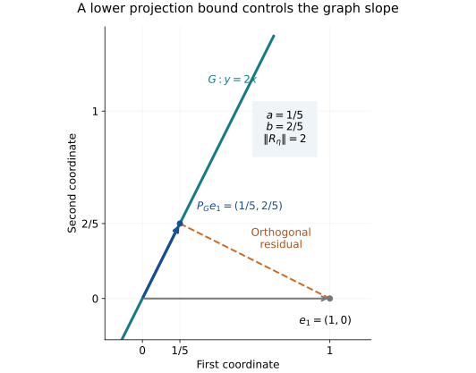

# From a coercive vector equation to bounded multiplication

**Original exposition and proof: OpenAI Codex (GPT-6 Astra, Ultra), October 2026. CC0-1.0.**

A solution in the Hilbert norm need not be a bounded multiplier. This note proves the extra conclusion needed in the bounded construction of the modular theorem. It develops the graph argument in Rieffel and Van Daele's [Lemmas 5.4 and 5.6, printed pages 209–213](https://msp.org/pjm/1977/69-1/pjm-v69-n1-p17-s.pdf#page=24), starting with the corrected real equation in [RC.1–RC.5](real-coercive-equations.md). The proof below uses continuous cutoffs and proves the required bounded calculus explicitly.

All Hilbert spaces may be nonseparable. Inner products are linear in the first variable. The only Hilbert geometry used is completeness and the inner-product axioms, together with the projection and real Riesz proofs in the preceding note. No modular commutant theorem, right-algebra density theorem, unbounded spectral theorem, or polar decomposition is an input.

## GP0. The bounded calculus used in the proof

Norm limits of bounded operators exist whenever the operator sequence is Cauchy: for each vector \(x\), completeness of \(H\) gives \(Tx=\lim_n T_nx\). Passing to the limit proves linearity and boundedness; a uniform Cauchy estimate \(\|(T_n-T_m)x\|\leq\varepsilon\|x\|\) then proves operator-norm convergence as \(m\to\infty\). In particular an operator series whose norms have finite sum converges in operator norm. This justifies the calculus limits and the geometric inverse below.

We record the tools so that the later cutoff is an actual proof step. Cauchy–Schwarz follows by applying positivity to \(x-ty\) and minimizing over the complex scalar \(t\); the same argument applies to any positive semidefinite sesquilinear form. For a bounded positive operator \(A\), put
\[
m=\sup_{\|x\|=1}\langle Ax,x\rangle.
\]
Form Cauchy–Schwarz and the identity \(\|v\|=\sup_{\|y\|=1}|\langle v,y\rangle|\) give
\[
\|Ax\|^2\leq m\langle Ax,x\rangle\leq m^2\|x\|^2.
\tag{GP0.1}
\]
Thus \(\|A\|=m\). In particular, if \(0\leq A\leq I\), then \(A-A^2\geq0\).

Bounded adjoints require no extra representation theorem here. The real Riesz proof gives a vector representing the real part of a bounded complex-linear functional. Testing also at \(ix\) recovers its imaginary part, and hence its representation as \(x\mapsto\langle x,v\rangle\). Applying this to \(x\mapsto\langle Tx,y\rangle\) defines \(T^*y\); the defining equality proves linearity, the product rule, and \(\|T^*\|=\|T\|\). It also gives \(\|T^*T\|=\|T\|^2\): one inequality is the operator norm bound, and the other follows from \(\|Tx\|^2=\langle T^*Tx,x\rangle\).

Here is continuous calculus for a positive contraction \(A\), in precisely the form we need. For a continuous real function \(f\) on \([0,1]\), its Bernstein polynomial is
\[
B_n f(t)=\sum_{k=0}^n f(k/n){n\choose k}t^k(1-t)^{n-k}.
\tag{GP0.2}
\]
These polynomials converge uniformly to \(f\). Indeed the nonnegative binomial weights sum to one, have mean \(t\), and have variance \(t(1-t)/n\leq1/(4n)\); the mean and variance follow by differentiating \((s+t)^n\) once and twice and then setting \(s=1-t\). Uniform continuity gives, for every \(\varepsilon>0\), a \(\delta>0\) on which the oscillation of \(f\) is at most \(\varepsilon\). The sum of the weights with \(|k/n-t|\geq\delta\) is at most \(1/(4n\delta^2)\), by multiplying each of those weights by the lower bound for its squared deviation. Consequently
\[
|B_nf(t)-f(t)|\leq\varepsilon+\frac{2\|f\|_\infty}{4n\delta^2}.
\tag{GP0.3}
\]
The uniform continuity used here follows from interval compactness: otherwise pairs at distance tending to zero with a fixed positive oscillation have a common convergent subsequence, contradicting continuity. Interval compactness follows by nested bisection and completeness of the real numbers.

Each operator \(A^k(I-A)^{n-k}\) is positive. Remove the even powers as the same polynomial factor on both sides of a quadratic form; the remaining factor is one of \(I,A,I-A,A(I-A)\), all positive by (GP0.1). The operator binomial weights therefore are positive and sum to \(I\). It follows that
\[
-\|f\|_\infty I\leq B_nf(A)\leq\|f\|_\infty I,
\qquad \|B_nf(A)\|\leq\|f\|_\infty.
\tag{GP0.4}
\]
For the last norm estimate, a self-adjoint \(T\) with \(-cI\leq T\leq cI\) has norm at most \(c\): for \(c>0\), apply (GP0.1) to \((T+cI)/(2c)\) to obtain \(T^2\leq c^2I\); the case \(c=0\) follows by polarization.

For a fixed polynomial \(p\), the coefficients of \(B_np\) converge to those of \(p\). One elementary verification for the monomial \(t^j\) is to express \(k^j\) as a linear combination of the falling products \(k(k-1)\cdots(k-r+1)\), \(0\leq r\leq j\), whose highest coefficient is one. Binomial differentiation gives the expectation of that product as \(n(n-1)\cdots(n-r+1)t^r\). After division by \(n^j\), only \(r=j\) survives in the limit. Linearity proves the assertion. Thus (GP0.4) implies \(\|p(A)\|\leq\|p\|_\infty\) for real polynomials. For a complex polynomial use \(p(A)^*p(A)=(\overline p p)(A)\) and the adjoint norm identity.

Uniform polynomial approximation now defines \(f(A)\) for every continuous complex \(f\). The limit is independent of the approximating sequence, preserves sums, products and conjugation, and has norm at most \(\|f\|_\infty\). Positivity follows by using the nonnegative Bernstein weights when \(f\geq0\); hence scalar inequalities are preserved. An operator commuting with \(A\) commutes with every \(f(A)\), by polynomial approximation. In particular square roots of positive contractions are available, and
\[
\langle Ax,x\rangle=\|A^{1/2}x\|^2.
\tag{GP0.5}
\]
Positive operators of arbitrary finite norm are reduced to contractions by scaling. This proves all the continuous calculus needed below. It makes no Borel or unbounded calculus assertion.

## GP1. Algebraic setting and the coercive vector

Let \(\mathcal A\) be a dense complex involutive algebra in a Hilbert space \(H\), with involution \(x\mapsto x^\sharp\). Assume:

1. Each left multiplication \(L_x y=xy\) extends boundedly to \(H\).
2. \(L_x^*=L_{x^\sharp}\).
3. The linear span \(\mathcal A^2\) of products is dense in \(H\).

Every left Hilbert algebra has these properties. We will not need its additional closability axiom for the assertion in this note. Define
\[
K=\overline{\operatorname{span}_{\mathbb R}\{x^\sharp x:x\in\mathcal A\}},
\qquad E=(iK)^{\perp_{\mathbb R}}.
\tag{GP1.1}
\]
For \(\xi\in K\), \(\lambda\in\mathbb C\), and \(\alpha=\operatorname{Re}\lambda>0\), the preceding real coercivity proof supplies a unique \(\eta\in E\) such that
\[
\langle\xi,z\rangle
=\operatorname{Re}(\lambda\langle\eta,z\rangle)
\quad(z\in E),\qquad
\|\eta\|\leq\alpha^{-1}\|\xi\|.
\tag{GP1.2}
\]

**Theorem.** If in addition \(\xi\in\mathcal A\), there is a bounded self-adjoint operator \(R_\eta\) satisfying
\[
R_\eta x=L_x\eta\quad(x\in\mathcal A),\qquad
R_\eta L_x=L_xR_\eta,
\qquad
\|R_\eta\|\leq\frac{\|L_\xi\|}{\alpha}.
\tag{GP1.3}
\]
Thus \(\eta\) is a bounded right-algebra vector with \(\eta^\flat=\eta\). The conclusion retains arbitrary Hilbert spaces and nonunital algebras.

For use in the proof, define \(\mathcal A'\) to consist of vectors \(w\) for which bounded \(R_w\) and a vector \(w^\flat\) obey
\[
R_w x=L_xw,\qquad R_w^*x=L_xw^\flat\quad(x\in\mathcal A).
\tag{GP1.4}
\]
Both objects are unique. Density of \(\mathcal A\) determines the operator. If \(L_xv=0\) for every \(x\), then \(v\) is orthogonal to every \(L_x^*y=x^\sharp y\), and density of products gives \(v=0\). This determines the vector. Taking adjoints proves \((w^\flat)^\flat=w\). Linear combinations are in \(\mathcal A'\), with the usual conjugate coefficients for their flat vectors.

Every \(R_w\) commutes with all \(L_y\): on \(x\in\mathcal A\), associativity gives
\[
R_wL_yx=L_{yx}w=L_yL_xw=L_yR_wx.
\]
If \(w=w^\flat\), then \(R_w\) is self-adjoint and
\[
\langle w,x^\sharp x\rangle=\langle L_xw,x\rangle
=\langle R_wx,x\rangle\in\mathbb R.
\tag{GP1.5}
\]
So \(w\in E\). Every \(w\in\mathcal A'\) decomposes as \(u+iv\), where \(u=(w+w^\flat)/2\) and \(v=(w-w^\flat)/(2i)\) are flat-self-adjoint and belong to \(E\). No density of \(\mathcal A'\) has been assumed.

## GP2. A closed graph subspace and its four blocks

For the vector \(\eta\in E\) in (GP1.2), form the closed complex subspace
\[
G=\overline{\{(x,L_x\eta):x\in\mathcal A\}}\subset H\oplus H.
\tag{GP2.1}
\]
We initially use only a closed subspace, without assuming that its closure is the graph of an everywhere-defined operator. The projection proof in the preceding note applies to \(G\) as a real subspace. Since \(G\) and its real orthogonal complement are stable under multiplication by \(i\), the projection is complex-linear; its real orthogonality is also complex orthogonality. Write it as
\[
P_G=\begin{pmatrix}a&b\\b^*&c\end{pmatrix}.
\tag{GP2.2}
\]
Diagonal left multiplication preserves the generating graph and its closure. The same is true for its adjoint, by assumption 2. It follows that the orthogonal complement is invariant too, so the projection commutes with diagonal left multiplication. Thus \(a,b,c\) all commute with every \(L_x\). Positivity, contractivity and \(P_G^2=P_G\) give
\[
0\leq a,c\leq I,\quad bb^*=a(I-a),\quad
b^*b=c(I-c),\quad bc=(I-a)b.
\tag{GP2.3}
\]
Since \((x,L_x\eta)\in G\), applying the projection and moving its blocks past \(L_x\) yields
\[
L_xb\eta=(I-a)x,\qquad L_x(I-c)\eta=b^*x.
\tag{GP2.4}
\]

The condition \(\eta\in E\) says that \(\langle L_x\eta,x\rangle=\langle\eta,x^\sharp x\rangle\) is real. Polarization gives
\[
\langle L_x\eta,y\rangle=\langle x,L_y\eta\rangle
\quad(x,y\in\mathcal A).
\tag{GP2.5}
\]
For completeness, subtract the two sides to form a sesquilinear form \(D(x,y)\) with \(D(x,x)=0\). Substitution of \(x+y\) and \(x+iy\) gives \(D(x,y)+D(y,x)=0\) and \(-iD(x,y)+iD(y,x)=0\), forcing both terms to vanish. Hence \((L_x\eta,-x)\in G^\perp\). The zero projection of this vector gives
\[
L_xa\eta=bx,\qquad L_xb^*\eta=cx.
\tag{GP2.6}
\]

The first block is injective. If \(av=0\), then (GP2.3) gives \(\|b^*v\|^2=\langle a(I-a)v,v\rangle=0\). Therefore \(P_G(v,0)=0\). Orthogonality to (GP2.1) implies \(\langle v,x\rangle=0\) for every \(x\in\mathcal A\), so \(v=0\). Injectivity alone does not yet give a bounded inverse.

## GP3. Cutoff vectors that may be tested in the equation

Let \(e=f(a)\), where \(f\geq0\) is continuous on \([0,1]\). It commutes with \(a\) and all \(L_x\), but we do not assume that it commutes with \(b\). Set
\[
w=e bb^*\eta=e a(I-a)\eta,
\qquad w^\flat=b^*e b\eta,
\qquad d=e(I-a)b.
\tag{GP3.1}
\]
These names satisfy the right-algebra definition: equations (GP2.4–6) give
\[
L_xw=e b c x=e(I-a)b x=dx,
\qquad L_xw^\flat=b^*e(I-a)x=d^*x.
\tag{GP3.2}
\]
Consequently \(w\in\mathcal A'\) with exactly the flat vector displayed in (GP3.1).

Equation (GP1.2), first applied to the flat-self-adjoint parts of a vector \(z\in\mathcal A'\), gives the complex identity
\[
2\langle\xi,z\rangle
=\lambda\langle\eta,z\rangle
+\overline\lambda\langle z^\flat,\eta\rangle.
\tag{GP3.3}
\]
Indeed it holds for a flat-self-adjoint \(z\in E\) by taking a real part; writing \(z=u+iv\) then proves the formula, because both sides are conjugate-linear in this decomposition variable. This justification is needed before using a cutoff vector which need not itself belong to \(E\).

Substitute \(z=w^\flat\) in (GP3.3). The numbers \(\langle\eta,b^*eb\eta\rangle\) and \(\langle e a(I-a)\eta,\eta\rangle\) are real and nonnegative. Taking real parts and using the weighted inequality \(2rs\leq\alpha^{-1}r^2+\alpha s^2\) gives
\[
\begin{aligned}
\alpha\bigl(\|e^{1/2}b\eta\|^2+\langle ea(I-a)\eta,\eta\rangle\bigr)
&=2\operatorname{Re}\langle e^{1/2}b\xi,e^{1/2}b\eta\rangle\\
&\leq\alpha^{-1}\|e^{1/2}b\xi\|^2
 +\alpha\|e^{1/2}b\eta\|^2.
\end{aligned}
\tag{GP3.4}
\]
All terms are finite. Cancel the common term and use \(b\xi=L_\xi a\eta\) from (GP2.6). Since \(e^{1/2}\) commutes with \(L_\xi\), we obtain, with \(C=\|L_\xi\|/\alpha\),
\[
\langle ea(I-a)\eta,\eta\rangle
\leq C^2\langle ea^2\eta,\eta\rangle.
\tag{GP3.5}
\]

## GP4. A lower bound for the projection block

Put \(\delta=(1+C^2)^{-1}\). We prove
\[
a\geq\delta I.
\tag{GP4.1}
\]
Choose \(0<\varepsilon<\delta\), and a nonnegative continuous \(f\) supported in \([0,\varepsilon]\); put \(e=f(a)\). The scalar inequality on its support and GP0 give
\[
\bigl(1-(1+C^2)\varepsilon\bigr)\langle ea\eta,\eta\rangle
\leq\langle ea(I-(1+C^2)a)\eta,\eta\rangle\leq0.
\tag{GP4.2}
\]
The coefficient is positive. Since \(ea\geq0\), (GP0.5) gives \(ea\eta=0\). For every \(x\in\mathcal A\),
\[
ebx=eL_xa\eta=L_xea\eta=0.
\]
Density implies \(eb=0\), and hence \(ea(I-a)=ebb^*=0\). Choose a continuous function \(h\) on \([0,1]\) which equals \((1-t)^{-1}\) on \([0,\varepsilon]\). Multiplying by \(h(a)\) gives \(ea=0\). Injectivity of \(a\), proved in GP2, now implies \(e=0\).

In particular take \(f(t)=(\varepsilon-t)_+\). We have proved \((\varepsilon I-a)_+=0\). Since the scalar identity
\[
t-\varepsilon=(t-\varepsilon)_+-(\varepsilon-t)_+
\]
is preserved by GP0, it follows that \(a\geq\varepsilon I\). Letting \(\varepsilon\uparrow\delta\) in each quadratic form proves (GP4.1). This is a continuous-cutoff proof of a lower spectral bound; no spectral projection has been imported.

Now \(0\leq I-a\leq(1-\delta)I\), so (GP0.1) gives \(\|I-a\|\leq1-\delta<1\). The norm-convergent geometric series \(\sum_{n\geq0}(I-a)^n\) is a two-sided inverse of \(a\). It lies in the same commutant, and \(\|a^{-1}\|\leq\delta^{-1}\).

## GP5. The bounded multiplier and its sharp estimate

Define \(R=a^{-1}b\). Equation (GP2.6) gives
\[
Rx=a^{-1}L_xa\eta=L_x\eta\quad(x\in\mathcal A).
\tag{GP5.1}
\]
It commutes with every \(L_x\). Equation (GP2.5) shows that \(\langle Rx,y\rangle=\langle x,Ry\rangle\) on the dense algebra; boundedness extends the equality to all \(H\), so \(R=R^*\). This proves that \(\eta\in\mathcal A'\) with \(\eta^\flat=\eta\).

Finally (GP2.3) gives the exact operator identity
\[
R^2=RR^*=a^{-1}bb^*a^{-1}=a^{-1}-I.
\tag{GP5.2}
\]
The positive inverse has norm at most \(\delta^{-1}\), whence
\[
0\leq R^2\leq(\delta^{-1}-1)I=C^2I,
\qquad \|R\|\leq C.
\tag{GP5.3}
\]
This proves the theorem, including its multiplier norm bound. If \(C=0\), then \(a=I\), \(b=0\), \(R=0\), and nondegeneracy gives \(\eta=0\); the same argument therefore covers that endpoint.

The closure (GP2.1) is now the graph of \(R\), because \(\mathcal A\) is dense and \(R\) is bounded. Moreover (GP5.2) identifies
\[
a=(I+R^2)^{-1},\qquad b=aR,
\qquad c=R^2(I+R^2)^{-1}.
\tag{GP5.4}
\]
For the last formula, the projection onto the graph of a bounded self-adjoint \(R\) sends \((u,v)\) to \((x,Rx)\), where orthogonality to all \((y,Ry)\) gives \((I+R^2)x=u+Rv\). This proves the entire block formula and explains the geometry of (GP4.1).

## GP6. Equality example and the next modular step

For \(H=\mathbb C\) and \(\mathcal A=\mathbb C\) with ordinary multiplication and inner product, \(K=E=\mathbb R\). Choose \(\lambda=\alpha>0\), \(\xi=\alpha C\), \(C\geq0\). Then \(\eta=C\), \(R_\eta=CI\), and equality holds in both the multiplier estimate and the projection-block bound. At \(C=2\), the graph projection is
\[
P_G=\frac15\begin{pmatrix}1&2\\2&4\end{pmatrix},
\qquad P_G(1,0)=(1/5,2/5).
\tag{GP6.1}
\]

*Exact real coordinate slice of the complex graph in (GP6.1). The dashed segment is perpendicular to the graph: its direction \((4/5,-2/5)\) has zero dot product with \((1,2)\). If \(\theta\) is the graph angle, then \(a=\cos^2\theta=1/5\) and \(\|R_\eta\|=\tan\theta=2\). Thus the lower bound for the first projection block gives the upper bound for the multiplier. This is an equality example, not a claim that all graph subspaces are two-dimensional. [Reproducible figure source](../../figures/draw-bounded-right-graph.py).*

Together with RC.5, GP1–GP5 prove both assertions of the free paper's Lemma 5.6, and quantify the second for every \(\operatorname{Re}\lambda>0\). Its later real-subspace identities, integral kernels and modular commutant theorem are separate steps. In particular this note does not assert that \(\mathcal A'\) is dense or that the current full modular manuscript has been reconstructed. It supplies the corrected vector-and-multiplier input for that reconstruction.

The continuation [Real subspaces and the bounded modular equation](bounded-real-subspaces.md) now proves the associated bounded geometry, the unitary group, right-vector density, and both equations corresponding to Lemma 5.8.

**Free mathematical source.** Marc A. Rieffel and Alfons Van Daele, *A bounded operator approach to Tomita–Takesaki theory*, Pacific Journal of Mathematics **69** (1977), 187–221, [freely readable publisher PDF](https://msp.org/pjm/1977/69-1/pjm-v69-n1-p17-s.pdf). The selected source material is Notation 5.1, Definition 5.2, Proposition 5.3, Lemma 5.4 and Lemma 5.6, printed pages 208–213. The nonsymmetric existence step is replaced by RC.1–RC.5. Continuous cutoffs replace the source's spectral projections in the proof above, and the exact multiplier bound is derived in GP5.
