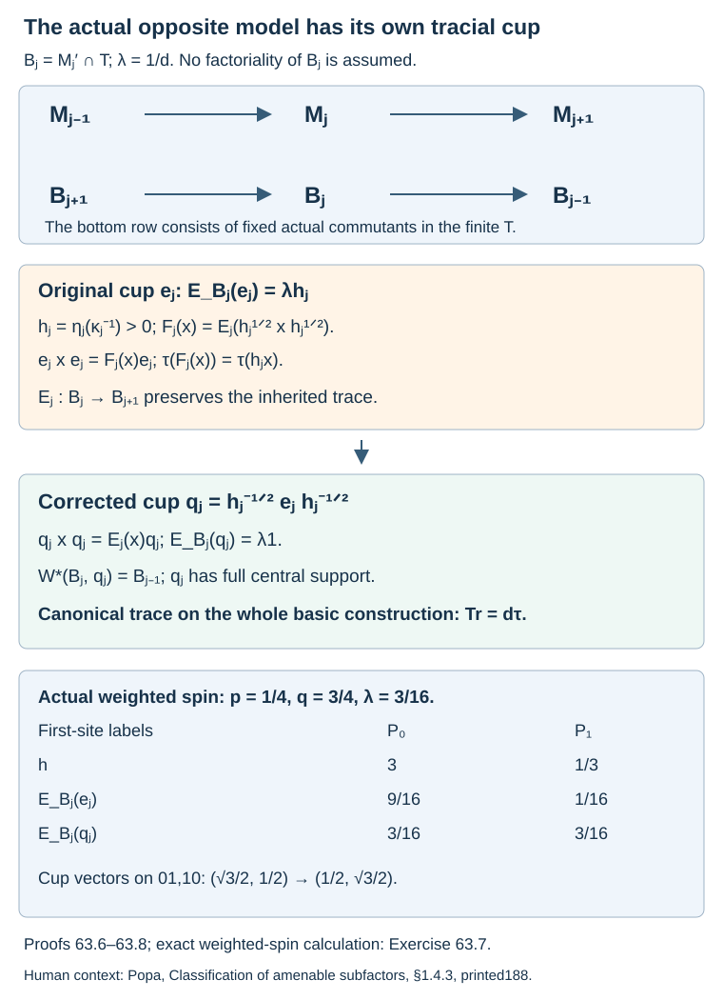
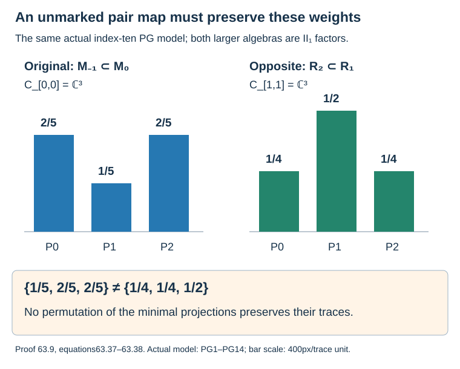
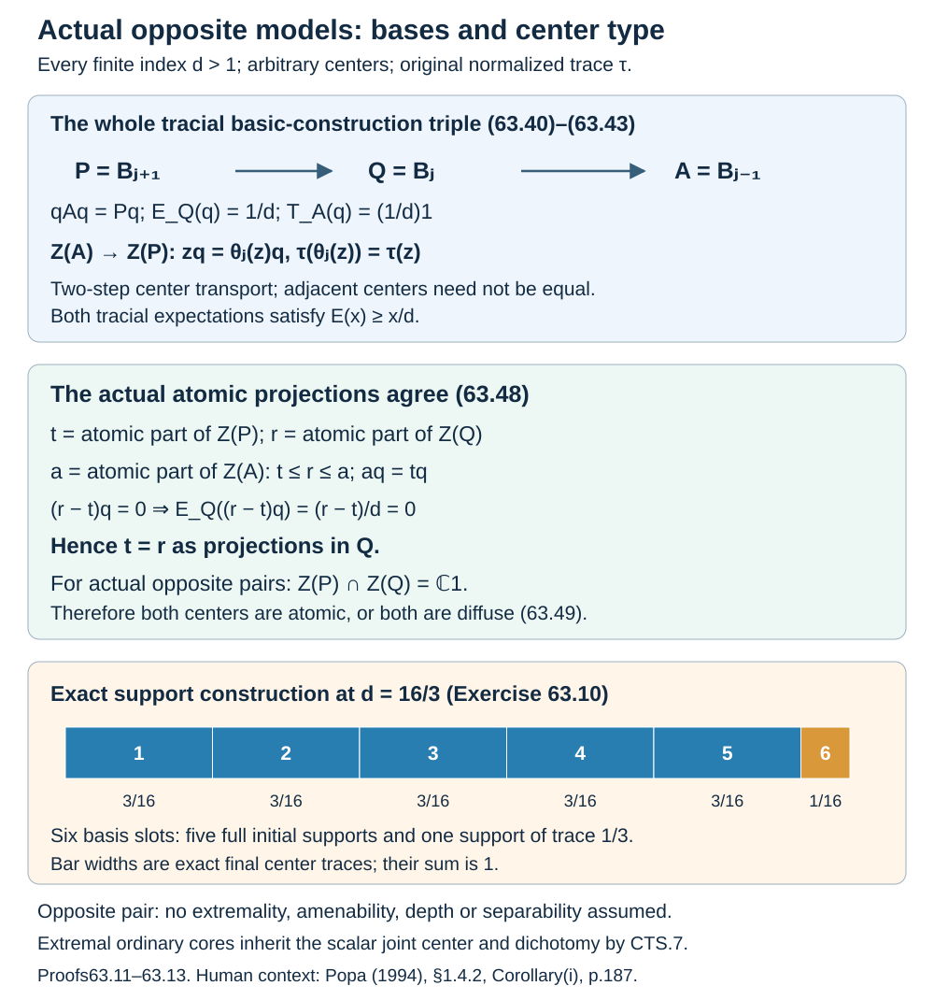
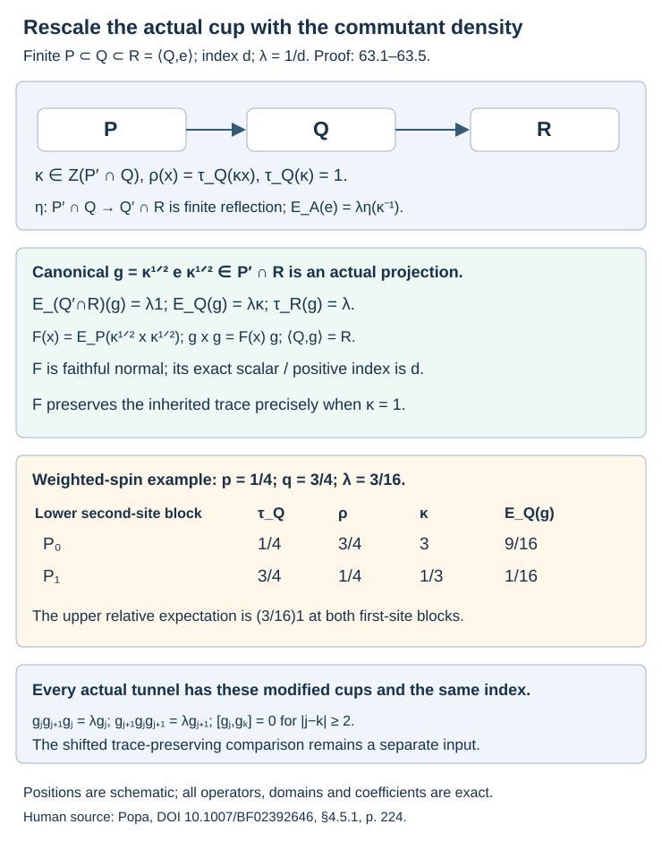

# Canonical rescaling of Jones cups

A Jones cup can be rescaled inside its actual basic construction so that its expectation onto the upper relative commutant becomes scalar. The resulting projection retains its deeper commutation and implements a faithful normal expectation with the original index. The density formula and its inverse under finite duality give all Jones relations in a prescribed tunnel. In the actual opposite-model commutants, the same rescaled cup implements the trace-preserving basic construction at every depth, including arbitrary centers. An unmarked index-ten pair obstruction distinguishes that construction from original-pair reconstruction; the latter holds at arbitrary depth under the stated extremal strong-amenability hypotheses. The full actual model also has finite bounded bases, trace-preserving center transport two steps apart, and a common atomic center projection. Both opposite centers are atomic or both are diffuse; extremal ordinary cores inherit the same dichotomy without a depth bound.

We use [the local-index formula](module-dimension-and-local-index.md), Theorem2.4; [finite common bases](finite-bases-and-positive-index.md), Lesson3; [the tracial basic construction and Markov expectation](towers-and-tunnels.md), Lesson4; [normal finite expected constructions](smooth-representations-and-tower-compression.md), Theorem61.2; and [the cup functional and representation independence](scalar-commutants-and-tracial-tunnels.md), Lemma62.2. The finite-factor calculations63.1–63.5 use faithful normal representations of finite factors. The opposite-model algebras in63.6–63.8 may have arbitrary centers; their full-corner maps and traces use31.2,43.1 and52.2a, including the complete uniqueness argument52.7j.1–52.7j.4. The abstract-pair comparison63.9–63.10 uses the existing actual PG model, SA.7, CTS.7 and40.1.

## The two traces and their central density

**Proposition 63.1.** The normalized commutant trace has the central density (63.3)–(63.4), and the original cup has relative expectation (63.5).

**Proof.**

Let \(P\subset Q\) be II₁ factors of index \(d\), let \(\lambda=d^{-1}\), and write
\[
R=\langle Q,e_P\rangle,\qquad B=P'\cap Q,\qquad A=Q'\cap R.
\]
We represent \(R\) on \(L^2(Q)\). Put
\[
\eta(x)=J_Qx^*J_Q\quad(x\in B).
\tag{63.1}
\]
This is a linear *-anti-isomorphism \(B\to A\), represented by right multiplication. Define
\[
\rho(x)=\tau_R(\eta(x))\quad(x\in B).
\tag{63.2}
\]
It is the restriction to \(B\) of the normalized trace of the commutant of left \(P\) on \(L^2(Q)\). Indeed \(J_QRJ_Q=P'\); the anti-isomorphism between these finite factors preserves their unique normalized traces.

Both \(\rho\) and \(\tau_Q|_B\) are faithful normalized traces on the finite-dimensional algebra \(B\). Therefore there is a unique positive invertible central element \(\kappa\in Z(B)\) with
\[
\rho(x)=\tau_Q(\kappa x),\qquad \tau_Q(\kappa)=1.
\tag{63.3}
\]
To construct it explicitly, on each matrix block choose a minimal projection \(f_i\), put \(t_i=\tau_Q(f_i)\), and put
\(\delta_i=[f_iQf_i:Pf_i]\). The local formula 2.4 gives
\(\rho(f_i)=\delta_i/(dt_i)\). Hence the coefficient of \(\kappa\) on that block is
\[
\kappa_i=\frac{\delta_i}{dt_i^2}.
\tag{63.4}
\]
Equivalent minimal projections in a matrix block have the same two trace values, so this coefficient is independent of the choice. Formula (63.3) follows on every matrix unit. We may instead list all diagonal minimal projections in all blocks; this convention will be used for sums below.

The cup functional 62.2 gives
\(\tau_R(e_P\eta(x))=\lambda\tau_Q(x)\). Pairing with every \(x\in B\) and using (63.3) now yields
\[
E_A(e_P)=\lambda\eta(\kappa^{-1}).
\tag{63.5}
\]
For example,
\(\tau_R(\eta(\kappa^{-1})\eta(x))
=\rho(x\kappa^{-1})=\tau_Q(x)\).
The normalized trace of the commutant of \(Q\) on \(L^2(Q)\) is \(\tau_Q\) under \(\eta\), whereas the inherited \(R\)-trace is \(\rho\) under \(\eta\). These traces are identified only when \(\kappa=1\), namely when \(P\subset Q\) is extremal.

## Rescaling inside the actual basic construction

More generally let \(b\in B\) be positive invertible with \(\tau_Q(b)=1\). Define
\[
\begin{gathered}
F_b(x)=E_P(b^{1/2}xb^{1/2}),\\
(x\in Q),\\
g_b=b^{1/2}e_Pb^{1/2}\in R.
\end{gathered}
\tag{63.6}
\]

**Theorem 63.2.** \(F_b\) is a faithful normal UCP conditional expectation onto \(P\). The operator \(g_b\) is an actual projection in \(P'\cap R\), of trace \(\lambda\), satisfying
\[
\begin{gathered}
g_bxg_b=F_b(x)g_b,\\
\langle Q,g_b\rangle=R.
\end{gathered}
\tag{63.7}
\]
Its two inherited tracial expectations are
\[
\begin{gathered}
E_Q(g_b)=\lambda b,\\
E_A(g_b)=\lambda\eta(b\kappa^{-1}).
\end{gathered}
\tag{63.8}
\]
In particular \(g_\kappa\) has scalar \(A\)-expectation \(\lambda1\). It retains the deeper commutation \(g_\kappa\in P'\cap R\) and implements the generally nontracial expectation \(F_\kappa\).

**Proof.** Since \(b\) commutes with \(P\), \(E_P(b)\) is central in \(P\), and its trace makes it \(1\). This proves that \(F_b\) is unital, fixes \(P\) and is \(P\)-bimodular. Normality and complete positivity follow from its formula. If \(x\ge0\) and \(F_b(x)=0\), faithfulness of \(E_P\) gives \(b^{1/2}xb^{1/2}=0\); invertibility gives \(x=0\).

The basic relation \(e_Pbe_P=E_P(b)e_P=e_P\) gives \(g_b^2=g_b\). Self-adjointness is immediate. Both factors in its formula commute with \(P\), so \(g_b\in P'\cap R\). The Markov formula gives \(\tau_R(g_b)=\lambda\tau_Q(b)=\lambda\) and the first identity in (63.8).

For \(x\in Q\), compress \(b^{1/2}xb^{1/2}\) by \(e_P\). Because \(F_b(x)\in P\) commutes with \(b^{1/2}\) and \(e_P\), this gives (63.7). The bounded inverse gives
\(e_P=b^{-1/2}g_bb^{-1/2}\), so the generated upper algebra is exactly \(R\).

For \(b\in B\), right multiplication by \(b^{1/2}\) and left multiplication by \(b^{1/2}\) agree on \(L^2(P)\), since \(b\) commutes with \(P\). Taking adjoints of this relation shows
\[
g_b=\eta(b^{1/2})e_P\eta(b^{1/2}).
\tag{63.9}
\]
Bimodularity of \(E_A\), followed by (63.5), proves its formula in (63.8). Although \(\eta\) reverses products, \(b\) commutes with the central \(\kappa\), so no order issue arises in that formula.

The expectation \(F_b\) also has the useful pairing expression
\[
F_b(x)=E_P(xb)=E_P(bx).
\tag{63.10}
\]
For each \(p\in P\), cyclicity and commutation with \(b\) make the three pairings with \(p\) equal. Faithfulness of the \(P\)-trace proves the equality. This does not assert that \(xb\) is positive.

Finally \(\tau_Q(F_b(x))=\tau_Q(bx)\). Thus \(F_b\) preserves \(\tau_Q\) precisely when \(b=1\). The scalar relative expectation in (63.8) occurs precisely when \(b=\kappa\). Consequently the two properties hold together precisely in the extremal case.

## A finite basis and the unchanged scalar index

**Theorem 63.3.** The rescaled expectation has the common basis (63.14) and exact positive index (63.15). The canonical choice retains the original index. The minimum within the stated rescaling family is (63.16).

**Proof.**

Choose a finite common basis \(a_1,\ldots,a_n\in Q\) for the original tracial \(E_P\):
\[
\begin{gathered}
x=\sum_i a_iE_P(a_i^*x),\\
\sum_i a_ie_Pa_i^*=1.
\end{gathered}
\tag{63.11}
\]
No orthogonality of this basis is required. For \(z\in B\), set \(T(z)=\sum_i a_iza_i^*\).

The value \(T(z)\) is central in \(Q\). To see this for \(y\in Q\), put \(p_{ji}=E_P(a_j^*ya_i)\in P\), and expand \(ya_i\) with (63.11):
\[
\begin{gathered}
yT(z)=\sum_{i,j}a_jp_{ji}za_i^*\\
=\sum_j a_jz\left(\sum_i p_{ji}a_i^*\right)\\
=T(z)y.
\end{gathered}
\tag{63.12}
\]
The second equality uses \(z\in P'\); the last equality is the adjoint reconstruction identity for \(a_j^*y\). Hence \(T(z)\) is scalar.

Its scalar value is
\[
T(z)=d\rho(z)1.
\tag{63.13}
\]
Indeed \(\eta(z)\) commutes with every \(a_i\). Apply \(\tau_R\) to (63.11) times \(\eta(z)\). Cyclicity and compression by \(e_P\) give
\[
\begin{aligned}
\rho(z)
&=\sum_i\tau_R(e_Pa_i^*a_i\eta(z)e_P)\\
&=\lambda\sum_i\tau_Q(a_i^*a_i z)
=\lambda\tau_Q(T(z)).
\end{aligned}
\]
For the compression identity used here, if \(\xi\in P\), then
\(e_PL_c\eta(z)e_P\widehat\xi
=\widehat{E_P(cz)\xi}\); it follows first on \(P\) and then by continuity on \(L^2(P)\).

Now put \(c_i=a_ib^{-1/2}\). Equation (63.10) and commutation of \(b\) with \(P\) give
\[
\begin{gathered}
x=\sum_i c_iF_b(c_i^*x),\\
\sum_i c_ig_bc_i^*=1,\\
\sum_i c_ic_i^*=d\rho(b^{-1})1.
\end{gathered}
\tag{63.14}
\]
For example the reconstruction sum equals
\(\sum_i a_i E_P(a_i^*xb^{1/2})b^{-1/2}=x\).
Taking adjoints gives the left reconstruction identity. Thus the finite normal expected basic-construction argument of 61.2 applies, with scalar index
\[
D_b=d\rho(b^{-1})=d\tau_Q(\kappa b^{-1}).
\tag{63.15}
\]
This is the scalar common-basis index. The same finite coefficient/Schwarz argument of 61.2 gives \(F_b(x)\ge D_b^{-1}x\) for \(x\ge0\). Here is an actual witness proving optimality without assuming a tracial \(F_b\). Downward construction 4.4 gives \(S\subset P\) and a cup \(u\in Q\) with \(E_P(u)=\lambda1\). In its finite representation on \(L^2(P)\), the cup compression of \(b^{-1}\in P'\cap Q\) is the normalized \(P'\)-trace times \(u\). Representation independence in 62.2 identifies that trace with \(\rho\), so \(ub^{-1}u=\rho(b^{-1})u\). Thus
\[
w_b=\rho(b^{-1})^{-1}b^{-1/2}ub^{-1/2}
\]
is a nonzero projection in \(Q\), and \(F_b(w_b)=D_b^{-1}1\). Any inequality \(F_b(x)\ge c x\) for all \(x\ge0\), applied to \(w_b\) and compressed by it, forces \(c\le D_b^{-1}\). This proves the exact positive index as well as the common-basis index.

For the canonical choice \(b=\kappa\), (63.3) yields \(D_\kappa=d\). Hence the canonical modified expectation has precisely the original scalar index. Its trace density may be nonconstant even though its index is unchanged.

Within this positive-invertible rescaling family, the smallest index is
\[
\begin{gathered}
\min_bD_b=d\,\tau_Q(\kappa^{1/2})^2\\
=\left(\sum_i\sqrt{\delta_i}\right)^2,\\
b_{\min}=\frac{\kappa^{1/2}}{\tau_Q(\kappa^{1/2})}.
\end{gathered}
\tag{63.16}
\]
Apply the finite tracial Cauchy–Schwarz inequality to \(b^{1/2}\) and \(\kappa^{1/2}b^{-1/2}\); their trace pairing is \(\tau_Q(\kappa^{1/2})\), and \(\tau_Q(b)=1\). Equality holds precisely for the displayed proportionality. The final formula follows from (63.4), listing every diagonal minimal projection in every block. This is a minimum over the stated rescaling family; no classification of all normal expectations is imported here.

## Adjacent densities are inverse under finite reflection

**Proposition 63.4.** The two adjacent densities satisfy (63.17).

**Proof.**

For the dual inclusion \(Q\subset R\), let \(\kappa^\vee\in Z(A)\) be the density of its normalized commutant trace relative to \(\tau_R|_A\). Then
\[
\kappa^\vee=\eta(\kappa^{-1}).
\tag{63.17}
\]
The finite representation of \(R\) on \(L^2(Q)\) has normalized \(Q'\)-trace \(\tau_Q\) under \(\eta\). By the representation-independence proof of 62.2, its restriction to \(A\) is the same normalized commutant trace used to define \(\kappa^\vee\) in the standard representation of \(R\). Its inherited trace is \(\rho\) under \(\eta\). Equations (63.3)–(63.5) therefore prove (63.17) on every element of \(A\).

In particular this is a statement about each finite dual inclusion. It does not extend the infinite tracial tower normally to a fixed \(L^2\)-space.

## Canonical modified cups throughout a prescribed tunnel

**Theorem 63.5.** Every prescribed Jones tunnel has the actual modified cups (63.18), with all properties (63.19) and every Jones relation (63.20).

**Proof.**

Let \(M_0\supset M_{-1}\supset M_{-2}\supset\cdots\) be any actual Jones tunnel of consecutive index \(d\). Its cup \(f_j=e_{-j}\in M_{-j+1}\), for \(j\ge1\), implements the tracial expectation of \(M_{-j}\) onto \(M_{-j-1}\). Let \(\kappa_j\) be the density of 63.1 for the inclusion \(M_{-j-1}\subset M_{-j}\). Define
\[
g_j=\kappa_j^{1/2}f_j\kappa_j^{1/2}.
\tag{63.18}
\]
Theorem 63.2 and (63.15) prove, without changing the tunnel factors,
\[
\begin{gathered}
g_j\in M_{-j-1}'\cap M_{-j+1},\\
\tau(g_j)=\lambda,\\
E_{M_{-j}'\cap M_{-j+1}}(g_j)=\lambda1,\\
F_j(x)=E_{M_{-j-1}}(\kappa_j^{1/2}x\kappa_j^{1/2}),\\
g_jxg_j=F_j(x)g_j,\\
\langle M_{-j},g_j\rangle=M_{-j+1},\\
D_{F_j}=d.
\end{gathered}
\tag{63.19}
\]
They also satisfy the same adjacent and distant Jones relations:
\[
\begin{gathered}
g_jg_{j+1}g_j=\lambda g_j,\\
g_{j+1}g_jg_{j+1}=\lambda g_{j+1},\\
[g_j,g_k]=0\ (|j-k|\ge2).
\end{gathered}
\tag{63.20}
\]

**Proof of (63.20).** Represent the finite triple
\(M_{-j-2}\subset M_{-j-1}\subset M_{-j}\) on \(L^2(M_{-j-1})\). Its cup is \(f_{j+1}\). Formula (63.17) says
\(\kappa_j=\eta_{j+1}(\kappa_{j+1}^{-1})\).
As in (63.9), right and left multiplication by \(\kappa_{j+1}^{-1}\) agree on the cup range. Thus
\[
\begin{gathered}
F_j(f_{j+1})\\
=E_{M_{-j-1}}(\kappa_j f_{j+1})\\
=\lambda\kappa_{j+1}^{-1}.
\end{gathered}
\tag{63.21}
\]
The first equality is (63.10); the last uses the tracial Markov expectation for this finite triple.

The projection \(g_j\) commutes with \(M_{-j-1}\), so it commutes with \(\kappa_{j+1}\). Compressing \(f_{j+1}\) by (63.19) gives
\[
g_jg_{j+1}g_j
=\kappa_{j+1}^{1/2}F_j(f_{j+1})g_j\kappa_{j+1}^{1/2}
=\lambda g_j.
\]
For the reverse relation, \(v=\lambda^{-1/2}g_{j+1}g_j\) has \(v^*v=g_j\) and \(vv^*\le g_{j+1}\). Both projections have inherited trace \(\lambda\) in the same finite upper factor. Faithfulness of its trace gives \(vv^*=g_{j+1}\), proving the second identity. If \(k\ge j+2\), then \(g_k\in M_{-k+1}\subset M_{-j-1}\), which commutes with \(g_j\); this gives distant commutation.

No actual generating hypothesis or extremality was used in 63.1–63.5. The placements and scalar relative expectations needed in the modified-cup criterion 62.4 are therefore available for every prescribed tunnel. Applying that criterion in the general nonextremal case still requires the normal trace-preserving comparison with every fixed endpoint and the stated cup images. Neither (63.19) nor the Jones relations alone supplies that map.

## The tracial tower in the actual opposite model

The canonical modified cup also has a tracial interpretation. Inside the actual opposite-model algebras it is the Jones projection for their inherited traces. This conclusion holds at every depth, even when those algebras have centers. It requires no amenability or generating hypothesis.

Let \(M_{-1}=N\subset M_0=M\subset M_1\subset\cdots\) be the actual tracial tower, with \(d=[M:N]>1\), \(\lambda=d^{-1}\), and cup \(e_j\in M_{j+1}\) implementing \(M_{j-1}\subset M_j\). Let \(\mathcal T\) be its canonical tracial von Neumann completion, with trace \(\tau\). Put
\[
\begin{gathered}
B_{-1}=N'\cap\mathcal T,\qquad
B_j=M_j'\cap\mathcal T\quad(j\geq0),\\
B_{j+1}\subset B_j\subset B_{j-1}.
\end{gathered}
\tag{63.22}
\]
These are the fixed actual commutants, rather than newly represented copies. Write \(E_j:B_j\to B_{j+1}\) for the inherited trace-preserving expectation. The cup density for the finite factor inclusion \(M_{j-1}\subset M_j\) is \(\kappa_j\), as in 63.1, and
\[
\begin{gathered}
\eta_j:M_{j-1}'\cap M_j\longrightarrow M_j'\cap M_{j+1},\\
h_j=\eta_j(\kappa_j^{-1})>0,\\
q_j=h_j^{-1/2}e_jh_j^{-1/2}
    =\kappa_j^{1/2}e_j\kappa_j^{1/2}.
\end{gathered}
\tag{63.23}
\]
The positive densities are bounded and invertible. The last equality is precisely the existing identity (63.9); thus \(q_j\) is the canonical cup of 63.2 applied to this upward triple.

**Lemma 63.6 — the original compression and its density.** For every \(j\geq0\),
\[
\begin{gathered}
e_j B_{j-1}e_j=B_{j+1}e_j,\\
E_{B_j}^{\mathcal T}(e_j)=\lambda h_j,\qquad
E_{B_{j+1}}^{\mathcal T}(e_j)=\lambda1.
\end{gathered}
\tag{63.24}
\]
Compression by \(e_j\) determines a faithful normal conditional expectation \(F_j:B_j\to B_{j+1}\), and its exact formula is
\[
\begin{gathered}
e_jxe_j=F_j(x)e_j,\\
F_j(x)=E_j(h_j^{1/2}xh_j^{1/2}),\\
\tau(F_j(x))=\tau(h_jx)\qquad(x\in B_j).
\end{gathered}
\tag{63.25}
\]

**Proof.** Fix a finite physical partial basis \((u_r)\) for \(M_j\) over \(M_{j-1}\). It satisfies \(\sum_r u_re_ju_r^*=1\). The full-corner commutant isomorphism proved in 31.2, with smaller algebra \(M_{j+1}\), ambient algebra \(\mathcal T\), and full projection \(e_j\), identifies
\[
M_{j+1}'\cap\mathcal T
\longrightarrow
(M_{j-1}e_j)'\cap e_j\mathcal T e_j,
\qquad z\longmapsto ze_j.
\tag{63.26}
\]
The inverse sends \(y\) to \(\sum_r u_ryu_r^*\). Since \(e_j\) commutes with \(M_{j-1}\), the target is exactly \(e_jB_{j-1}e_j\). This proves the first equality in (63.24), including its full range and faithful inverse, without factoriality of any \(B_i\).

For \(x\in B_j\), apply that inverse to \(e_jxe_j\). The resulting map
\[
F_j(x)=\sum_r u_re_jxe_ju_r^*
\tag{63.27}
\]
is normal and completely positive, has range in \(B_{j+1}\), is unital and fixes that range. Elements of \(B_{j+1}\) commute with every \(u_r,e_j\), which proves bimodularity.

The tracial expectation onto a commutant carries a fixed finite factor stage into itself: its least-norm unitary-orbit construction remains in that stage. Thus the expectation of \(e_j\) onto \(B_j\) is its expectation onto \(M_j'\cap M_{j+1}\), namely \(\lambda h_j\) by (63.5). Averaging instead over \(M_{j+1}\) gives its scalar trace \(\lambda\), proving the second identity in (63.24). Here only expectations in the finite tracial algebra \(\mathcal T\) are used.

For \(y\in B_{j+1}\), (63.24) gives \(\tau(ye_j)=\lambda\tau(y)\). Consequently the compression identity implies
\[
\lambda\tau(F_j(x))=\tau(F_j(x)e_j)
=\tau(e_jxe_j)=\lambda\tau(h_jx).
\tag{63.28}
\]
Moreover \(h_j\in M_j'\cap M_{j+1}\) commutes with \(B_{j+1}\). Apply (63.28) to \(yx\), use bimodularity and traciality, and pair with every \(y\in B_{j+1}\). The trace pairing proves the middle formula in (63.25). In particular \(E_j(h_j)=1\), and positivity and invertibility of \(h_j\) make \(F_j\) faithful. This completes the proof. \(\square\)

**Lemma 63.7 — the entire upper algebra is generated.** For every \(j\geq0\),
\[
B_{j-1}=W^*(B_j,e_j)=W^*(B_j,q_j).
\tag{63.29}
\]
Both cups have full central support in this algebra.

**Proof.** Let \(D=W^*(B_j,e_j)\subset B_{j-1}\), and let \(z\) be the central support of \(e_j\) in \(D\). Every \(e_n\), \(n\geq j+1\), belongs to \(B_j\). The adjacent relation \(e_ne_{n-1}e_n=\lambda e_n\) successively gives \(e_n\leq z\). For example, if \(e_{n-1}\leq z\), the right side is killed by \(1-z\), since \(z\) commutes with \(e_n\); hence \(e_n(1-z)=0\).

Choose the mutually commuting cups \(e_{j+1},e_{j+3},\ldots,e_{j+2m-1}\). Successive physical Markov expectations in the original factor tower give
\[
0\leq\tau(1-z)
\leq\tau\left(\prod_{r=0}^{m-1}(1-e_{j+1+2r})\right)
=(1-\lambda)^m.
\tag{63.30}
\]
At each step the earlier product is in the algebra onto which the next cup has expectation \(\lambda1\); distant commutation makes the product a projection. Letting \(m\) increase and using faithfulness proves \(z=1\).

By (63.24), \(e_jB_{j-1}e_j=B_{j+1}e_j\subset D\). Thus \(e_jB_{j-1}e_j=e_jDe_j\), and full-corner recognition 43.1 gives \(D=B_{j-1}\). Since \(h_j\) and its inverse belong to \(B_j\), (63.23) gives the second generated-algebra equality. Finally
\[
v_j=h_j^{-1/2}e_j,\qquad
v_j^*v_j=e_j,\qquad v_jv_j^*=q_j,
\tag{63.31}
\]
because (63.25) gives \(e_jh_j^{-1}e_j=e_j\). These are actual partial isometries in \(D\), so the two cups have the same, full, central support. \(\square\)

**Theorem 63.8 — the canonical tracial opposite-model tower.** For every \(j\geq0\), the actual algebra \(B_{j-1}\) is normally isomorphic to the standard basic construction of \(B_{j+1}\subset B_j\) with expectation \(E_j\). The isomorphism fixes \(B_j\) and sends \(q_j\) to its standard Jones projection. In the actual algebras,
\[
\begin{gathered}
q_jxq_j=E_j(x)q_j\quad(x\in B_j),\\
E_{B_j}^{B_{j-1}}(q_j)=\lambda1,\qquad \tau(q_j)=\lambda,\\
\operatorname{Tr}_{\langle B_j,e_{B_{j+1}}\rangle}
=d\,\tau|_{B_{j-1}}.
\end{gathered}
\tag{63.32}
\]
The last equality uses the displayed isomorphism and holds on the entire positive cone. In particular the canonical basic-construction trace of the unit is \(d\). The cups satisfy
\[
\begin{gathered}
q_jq_{j+1}q_j=\lambda q_j,\qquad
q_{j+1}q_jq_{j+1}=\lambda q_{j+1},\\
[q_j,q_k]=0\quad(|j-k|\geq2).
\end{gathered}
\tag{63.33}
\]
Thus (63.22), with these projections and inherited traces, is a tracial Markov tunnel at every depth. Its algebras need not be factors.

**Proof.** Formula (63.25) gives
\(F_j(h_j^{-1/2}xh_j^{-1/2})=E_j(x)\).
Compression therefore gives the first identity in (63.32). Expectation bimodularity and (63.24) give
\(E_{B_j}(q_j)=h_j^{-1/2}(\lambda h_j)h_j^{-1/2}=\lambda1\).
Trace preservation gives the stated cup trace. In particular multiplication by \(q_j\) is faithful on \(B_{j+1}\), and \(q_jB_{j-1}q_j=B_{j+1}q_j\), by generation and the compression identity.

Here is the normal standard-form identification, including its Hilbert space. Put \(A=B_{j-1}\), \(Q=B_j\), \(P=B_{j+1}\), and \(q=q_j\). The map
\[
U:L^2(Q,\tau)\longrightarrow L^2(A,\tau)q,
\qquad U\widehat x=\lambda^{-1/2}\widehat{xq}
\tag{63.34}
\]
is an isometry, since \(\tau(qx^*xq)=\lambda\tau(x^*x)\). It is onto: words in \(Q,q\) ending in \(q\) reduce to \(Qq\), and bounded density of those words in \(A\) gives density in the right-\(q\) Hilbert space. Left multiplication by \(A\) on this space is normal and faithful because \(q\) has full central support. Under \(U\), left multiplication by \(x\in Q\) is the standard left action, and left multiplication by \(q\) is the orthogonal projection onto \(L^2(P,\tau)\), by the compression identity. Generation (63.29) proves the asserted normal isomorphism.

On the full corner \(Pq=qAq\), the trace \(d\tau\) takes \(yq\), \(y\in P_+\), to \(\tau(y)\). This is exactly the defining corner trace of the canonical basic construction. The arbitrary-frame full-corner trace construction and uniqueness proved in (52.7j.1)–(52.7j.4) identify the traces on all positive elements of \(A\), not only on a finite spanning set. This proves the last line of (63.32) with its normalization, including arbitrary centers.

Finally \(q_{j+1}\in B_j\) has \(E_j(q_{j+1})=\lambda1\), so the first adjacent relation follows by compression. The partial isometry \(\lambda^{-1/2}q_{j+1}q_j\) has initial projection \(q_j\) and final projection at most \(q_{j+1}\). Their equal finite trace makes the final projection exactly \(q_{j+1}\), giving the reverse relation. For \(k\geq j+2\), \(q_k\in B_{k-1}\subset B_{j+1}\), which commutes with \(q_j\). This proves distant commutation. \(\square\)

For index one every relative commutant is scalar and every cup is one; the same identities reduce to the identity basic construction. For proper index the proof above uses no extremality, core factoriality, finite depth, separability, amenability or generating assumption.

This theorem identifies the canonical trace and Jones projections of the actual opposite-model tower. It does not identify the physical standard model with that opposite model, extend the specified finite reflection normally, or prove the general physical bicommutant. Those are distinct assertions about different maps and completions.

*Figure 63.2. All three bottom algebras are the actual commutants (63.22). The finite density is (63.23); (63.24)–(63.34) prove full corner, generation, normal basic-construction identification and the all-positive-cone trace normalization. The weighted-spin table uses the actual first-site labels and cup block of the worked example below, with \(p=1/4,q=3/4\). Its bars display conditional-expectation coefficients, not whole projection probabilities. Positions are schematic. Human context: Popa, Section 1.4.3, printed p.188. [Reproducible figure source and exact checks](figures/opposite-tracial-tower.py).*

## Which abstract pair can be reconstructed

Changing the cup in the opposite-model tower does not identify that pair with the original inclusion. In fact the existing index-ten model rules out such an identification even when the comparison map is allowed to be arbitrary.

**Theorem 63.9 — an unmarked opposite-pair obstruction.** For the actual separable hyperfinite strongly amenable index-ten inclusion of [Theorem PG](finite-shifted-comparisons-without-coherence.md), let \(\mathcal T\) be its canonical tracial tower completion. Then
\[
N\subset M
\quad\text{is neither isomorphic nor anti-isomorphic to}\quad
M_1'\cap\mathcal T\subset M'\cap\mathcal T.
\tag{63.36}
\]
No prescribed finite restriction, cup image or compatibility with the specified reflection is imposed on the forbidden map. Both endpoint algebras of the opposite pair are II₁ factors. Its tracial Jones tower exists by 63.8.

**Proof.** Keep the actual two-sided interval algebras of PG1–PG14, with left factors \(M_b\), right factors \(R_a\), and physical finite trace. The union of the \(M_b\), \(b\geq0\), contains every finite interval algebra, so its canonical tracial completion is exactly the actual \(T\) used there. For every \(j\geq0\), PG8 and normal expectations onto \(M_b\), \(b\geq j\), give
\[
M_j'\cap T=R_{j+1}.
\tag{63.37}
\]
Indeed the expectations of a commuting element lie in \(M_j'\cap M_b=C_{[j+1,b]}\), converge in tracial \(L^2\), and hence belong to \(R_{j+1}\) in the limit. Conversely disjoint left and right intervals commute, and their normal closures retain that commutation. PG9 proves that every \(R_a\) is a II₁ factor.

Thus the original pair is \(M_{-1}\subset M_0\), and the opposite pair is \(R_2\subset R_1\). Their first relative commutants, with the actual ambient traces, are
\[
\begin{array}{c|c|c}
\text{pair}&\text{relative commutant}&\text{minimal-projection weights}\\\hline
M_{-1}\subset M_0&C_{[0,0]}=\mathbb C^3&(2/5,1/5,2/5)\\
R_2\subset R_1&C_{[1,1]}=\mathbb C^3&(1/4,1/2,1/4).
\end{array}
\tag{63.38}
\]
The algebra equalities are PG8–PG9; the trace values are the original even- and odd-site weights PG2. These are therefore invariants of the actual limiting inclusions, not only of a finite pair chosen inside them.

An inclusion isomorphism or anti-isomorphism carries the smaller algebra's commutant inside the larger algebra onto the corresponding relative commutant. It also preserves the normalized factor traces. For an abstract von Neumann algebra isomorphism this normality does not need to be added: its positive order isomorphism preserves every bounded increasing supremum, so the map is normal; the same holds for an anti-isomorphism by passage to the opposite algebra. Trace transport and uniqueness of the normalized normal factor trace then give trace preservation. A map between the two displayed \(\mathbb C^3\) algebras must permute their minimal projections. Their weight multisets differ, so no such trace-preserving map exists. This proves (63.36).

The same model already has the actual generating ordinary tunnel and the every-smooth-representation amenability proved in PG3–PG4. Thus none of those hypotheses removes this abstract-pair obstruction. This uses the existing PG model; it is a further invariant consequence of that model, not a second construction. \(\square\)

**Corollary 63.10 — arbitrary-depth reconstruction in the extremal case.** Let \(N\subsetneq M\) have finite index and separable predual. Assume the original representation amenability: every smooth nondegenerate normal expected representation admits a compatible physical-factor-central state. Assume also ergodicity of the actual ordinary core, as in SA.6–SA.7, and extremality of the inclusion. Then
\[
(N\subset M)\ \cong_{\mathrm{anti}}\
(M_1'\cap\mathcal T\subset M'\cap\mathcal T)
\tag{63.39}
\]
by a normal trace-preserving map. Finite depth is not required.

**Proof.** SA.7 constructs an actual generating ordinary tunnel at exactly these strong-amenability and separability hypotheses. Hence its physical standard-part pair is \(N\subset M\), with the inherited traces. CTS.7 gives equality of the physical and reflected canonical traces at every finite stage under extremality. The normal tracial-extension construction 40.1 therefore extends those compatible finite anti-isomorphisms to the two specified limiting endpoints. In particular reflecting \(N,M\) gives \(M_1'\cap\mathcal T,M'\cap\mathcal T\), rather than the distinct dual pair \(M'\cap\mathcal T\subset N'\cap\mathcal T\). This proves (63.39) at arbitrary depth. \(\square\)

The universal statement in 63.39 cannot omit extremality: Theorem 63.9 meets the other hypotheses and refutes that extension even for arbitrary unmarked maps. This does not make extremality necessary for each individual pair; the different corrected maps in the nonextremal weighted-spin example 62.6 do give an opposite-pair anti-isomorphism there. The tracial opposite tower 63.8, the specified-reflection criterion CTS.7 and the abstract-pair obstruction 63.9 concern three different assertions. None proves a general nonextremal bicommutant or a different represented-core comparison.

*Figure 63.3. Equation (63.37) identifies the actual opposite endpoints. The six bars are the exact minimal-projection traces in (63.38), with heights proportional to those traces. An unmarked pair isomorphism or anti-isomorphism would have to permute the three bars while preserving their values. The two multisets differ. This is the existing strongly amenable PG model; its bicommutant is already proved by PG14. Human context: Popa, Section 1.4.1 and Theorem 5.1.1, where the opposite-model reconstruction carries the extremality hypothesis. [Reproducible figure source and exact checks](figures/opposite-tracial-tower.py).*

## Finite bases and the centers of the actual models

Continue with the actual algebras (63.22), and put \(P=B_{j+1}\), \(Q=B_j\), \(A=B_{j-1}\), \(q=q_j\). All traces are restrictions of the original \(\tau\). Theorem 63.8 identifies this triple with the standard tracial basic construction, including the normal expectations and the canonical trace on the entire positive cone. The full-corner center theorem and projection comparison used next are the existing proofs 52.7j and 52.4, together with their linked center-valued trace providers. No new general trace theorem is assumed.

The unital original cup tail \(K=W^*(e_j,e_{j+1},\ldots)\subset A\) is the Markov II₁ factor: the word trace is the Jones Markov trace, and the faithful path-factor identification is 11.2 and 50.5. This is the same cup-factor input used throughout the core constructions. It applies at every allowed proper finite index.

**Theorem 63.11 — finite opposite bases and center trace transport.** There are at most \(m=\lceil d\rceil\) elements \(u_r\in Q\), and projections \(f_r\in P\), such that
\[
\begin{gathered}
E_P^Q(u_r^*u_s)=\delta_{rs}f_r,\qquad u_rf_r=u_r,\\
x=\sum_{r=1}^m u_r E_P^Q(u_r^*x)\quad(x\in Q),\\
\sum_r u_rq u_r^*=1_A,\qquad
\sum_r u_ru_r^*=d1_Q,\qquad \|u_r\|\le\sqrt d.
\end{gathered}
\tag{63.40}
\]
Zero entries may be added to obtain exactly \(m\) slots. The elements
\(v_r=\sqrt d\,u_rq\in A\) form a partial orthonormal basis for \(A\) over \(Q\), with the same support projections and \(\sum_rv_rv_r^*=d1_A\). In particular both *actual tracial* expectations satisfy
\[
E_P^Q(x)\ge d^{-1}x\quad(x\in Q_+),\qquad
E_Q^A(y)\ge d^{-1}y\quad(y\in A_+).
\tag{63.41}
\]
There is also a normal trace-preserving center isomorphism
\[
\theta_j:Z(A)\longrightarrow Z(P),\qquad
zq=\theta_j(z)q,\qquad
\tau(\theta_j(z))=\tau(z).
\tag{63.42}
\]
Thus the centers two steps apart are compared with their actual inherited measures. This is not an identification of two adjacent centers.

**Proof.** Write \(T_A:A\to Z(A)\) for the normalized center-valued trace. If \(z\in Z(A)_+\) is nonzero, the functional \(a\mapsto\tau(za)/\tau(z)\) restricts to a normalized normal trace on the unital factor \(K\). Uniqueness of the factor trace gives \(\tau(ze_j)=\lambda\tau(z)\). Center trace factorization, tested on every such \(z\), proves \(T_A(e_j)=\lambda1\). The partial isometry in 63.7 makes \(e_j\) equivalent to \(q\) in \(A\); hence
\[
T_A(q)=\lambda1_A.
\tag{63.43}
\]
The type II condition for \(A\) follows from its unital II₁ cup factor, exactly as in 50.5. In particular center-valued projection prescription and comparison are applicable even when \(Z(A)\) is diffuse.

Use(63.43) to fill \(1_A\) by orthogonal final projections of partial isometries \(w_r\in Aq\). Take \(\lfloor d\rfloor\) copies with initial projection \(q\) when \(d\) is not an integer, leaving central trace \(1-\lfloor d\rfloor/d<\lambda\); a subprojection of \(q\) with that remaining central trace fills the remainder. If \(d\) is an integer, take exactly \(d\) copies and no remainder. At each step comparison is valid on every central component because the displayed center traces are scalar. Thus at most \(m\) entries suffice, and
\[
w_r^*w_r\le q,\qquad w_r^*w_s=0\ (r\ne s),\qquad
\sum_rw_rw_r^*=1_A.
\tag{63.44}
\]
Here 52.4 is used only for its already proved projection prescription and equivalence argument in a finite type II corner.

Every bounded \(w\in Aq\) has the bounded pull-down
\[
w=u q,\qquad u=\lambda^{-1}E_Q^A(w)\in Q.
\tag{63.45}
\]
To verify it, first take \(w=aqbq=aE_P^Q(b)q\), \(a,b\in Q\). The formula follows from \(E_Q^A(xq)=\lambda x\). Finite sums give the same identity on the Jones ideal multiplied by \(q\). Its norm closure is strongly dense in \(A\); a contractive approximate identity and Kaplansky density give bounded ultraweak approximants after multiplication by \(q\). Normality of \(E_Q^A\) and bounded multiplication extend the identity to all of \(Aq\). This also proves \(Qq=Aq\) as spaces of bounded operators, without assuming boundedness of a merely \(L^2\) coefficient.

Set \(u_r=\lambda^{-1}E_Q^A(w_r)\). The full corner \(qAq=Pq\) makes \(w_r^*w_r=f_rq\) for a unique projection \(f_r\in P\). Compression gives
\(E_P^Q(u_r^*u_s)q=\delta_{rs}f_rq\).
Multiplication by \(q\) on \(P\) is faithful, so the first equality in(63.40) follows. The same faithfulness, or application of \(E_Q^A\) to \((u_r-u_rf_r)q=0\), proves the support equality. The identity sum in(63.44), acting on the standard \(L^2(Q)\) identified in 63.8, gives the reconstruction formula. Applying \(E_Q^A\) to that sum gives \(\sum_ru_ru_r^*=\lambda^{-1}1\), and therefore the asserted norm bound.

For \(a=xqy\), \(x,y\in Q\), direct compression gives
\[
E_Q^A(v_r^*a)=d^{-1/2}E_P^Q(u_r^*x)y,\qquad
\sum_rv_rE_Q^A(v_r^*a)=a.
\tag{63.46}
\]
Normality extends this finite sum to every \(a\in A\). Moreover
\(E_Q^A(v_r^*v_s)=\delta_{rs}f_r\) and \(\sum_rv_rv_r^*=d1\), proving the dual basis assertions.

For either of these bases, write \(x=\sum_rb_rc_r\), with \(c_r=E(b_r^*x)\). The row \((b_r)\) has squared norm \(\|\sum_rb_rb_r^*\|=d\). Operator Cauchy–Schwarz yields
\(x^*x\le d\sum_rc_r^*c_r=dE(x^*x)\);
the last equality follows by applying \(E\) to \(x^*\sum_rb_rc_r\). Every positive element is such an \(x^*x\), proving(63.41) for both expectations. This derives the positive bounds from the actual finite rows, rather than inferring them from a scalar total trace alone.

The existing full-corner center isomorphism identifies \(zq\) with \(\theta_j(z)q\). Canonical trace normalization 63.8 and(63.43) give
\[
\tau(\theta_j(z))=d\tau(zq)=\tau(z)\quad(z\in Z(A)_+).
\tag{63.47}
\]
Linearity proves(63.42), including its trace convention. Normality of both center maps is part of the full-corner theorem. \(\square\)

The next center argument also applies to a tracial basic-construction triple supplied by a common finite basis for an ordinary core. For such a core the actual two bases and scalar row sums are 52.1 and the finite expected-tower construction 61.2; the Cauchy–Schwarz argument just given supplies the same positive bounds. No factoriality of a core is needed.

**Theorem 63.12 — the atomic parts of adjacent centers agree.** Let \(P\subset Q\subset A=\langle Q,e_P\rangle\) be a finite tracial basic-construction triple with faithful normal tracial expectations, the two positive bounds(63.41), and full corner \(qAq=Pq\), where \(E_Q^A(q)=d^{-1}1\). Let \(t\in Z(P)\) and \(r\in Z(Q)\) be the sums of all their minimal central projections. Then
\[
t=r\quad\text{as actual projections in }Q.
\tag{63.48}
\]
Consequently this applies to every adjacent actual opposite-model pair and to every ordinary core \(S\subset R\). If one such common projection is neither zero nor one, both centers have that same atomic summand and that same diffuse complement. On the central support in \(Q\) of one minimal central projection of \(P\), the center of \(Q\) has at most \(\lfloor d\rfloor\) atoms.

**Proof.** First note an elementary consequence of a tracial expectation \(F:D\to C\) onto a finite factor with \(F(x)\ge d^{-1}x\). A projection \(p\in C'\cap D\) has \(F(p)=\tau_D(p)1\), with normalized traces. If \(p\ne0\), testing the positive bound on its range gives \(\tau_D(p)\ge d^{-1}\). There can therefore be at most \(\lfloor d\rfloor\) nonzero orthogonal projections in \(C'\cap D\). In particular \(Z(D)\) is a finite-dimensional atomic algebra with at most that many atoms. A diffuse central part or more atoms would supply a longer finite orthogonal list. This uses the factor hypothesis only for this explicitly indicated corner.

For a minimal central projection \(t_i\in P\), the corner \(t_iPt_i\) is a factor. Compression of \(E_P^Q\) gives a trace-preserving expectation
\(t_iQt_i\to t_iPt_i\) with the same positive bound. The preceding observation makes \(Z(t_iQt_i)\) finite-dimensional. The full-corner center theorem identifies it with \(Z(Q)c_Q(t_i)\), where \(c_Q(t_i)\) is the central support in \(Q\). Hence \(c_Q(t_i)\le r\), with the asserted atom-count bound. Summing \(t_i\le r\) normally gives \(t\le r\).

Let \(a\in Z(A)\) be the atomic part of its center. If \(r_k\) is a minimal central projection of \(Q\), compression of \(E_Q^A\) to \(r_kAr_k\to Qr_k\) has the same properties and factor target. Its center is finite-dimensional, so \(c_A(r_k)\le a\). Summing gives \(r\le a\) inside \(A\).

The full-corner normal center isomorphism preserves minimal central projections and their suprema. Therefore its atomic parts satisfy \(aq=tq\). Combining the inequalities just proved gives
\((r-t)q=0\). Since \(r-t\in Q\), applying \(E_Q^A\) gives
\(d^{-1}(r-t)=0\). This proves(63.48). No equality between the adjacent center algebras, and no common-center hypothesis on an independently chosen support, has been assumed. \(\square\)

**Corollary 63.13 — weak irreducibility and the full extremal core corollary.** For every actual opposite-model pair, without extremality or amenability,
\[
Z(B_{j+1})\cap Z(B_j)=\mathbb C1.
\tag{63.49}
\]
Its two centers are therefore either both purely atomic or both diffuse. If the original inclusion is extremal, every associated ordinary core \(S\subset R\) also has
\[
Z(S)\cap Z(R)=\mathbb C1,
\qquad Z(S),Z(R)\text{ both atomic or both diffuse}.
\tag{63.50}
\]
These assertions require neither finite depth nor a separable predual. Atomicity does not assert factoriality.

**Proof.** An element \(z\) in the left side of(63.49) belongs to \(B_{j+1}\), so it commutes with \(M_{j+1}\). Its centrality in \(B_j\) makes it commute with all original cups \(e_{j+1},e_{j+2},\ldots\), which belong to \(B_j\). Those cups and \(M_{j+1}\) generate \(T\). Thus \(z\in Z(T)=\mathbb C1\), proving(63.49).

By 63.12 the atomic-part projections of the two centers agree as one projection. It belongs to both centers and hence is zero or one by(63.49). Zero means that neither center has an atom; one means that both are purely atomic. This proves the dichotomy without excluding nonfactor algebras.

Under extremality, CTS.7 and 40.1 give the actual normal trace-preserving anti-isomorphism from the whole ordinary core pair to \(B_1\subset B_0\), for every tunnel. It carries the two centers, their intersection and their atomic-part projections to the corresponding objects. Transporting(63.49) and the dichotomy proves(63.50). The extension theorem retains arbitrary core centers and has no finite-depth or separability restriction. \(\square\)

The ordinary-core statement in(63.50) is the full scope of Popa, Section 1.4.2, Corollary(i), printed p.187. The separate common-atomic-part statement 63.12 allows a mixed common summand for a nonextremal ordinary core; the opposite pair still satisfies(63.49). Neither the center dichotomy nor the finite bases prove the original general physical bicommutant, the common-support BF assertion, or the fixed-WM invariant endpoint.

At index one the original inclusion is the identity, every finite relative commutant and both model endpoints are scalar, and the center assertions hold directly.

*Figure 63.4. The top row is the actual triple of 63.11. The center arrow goes two steps; it does not identify adjacent centers. The middle proof uses the dual expectation before pulling down the common atomic projection. Scalar joint center is proved for the actual opposite pair in the factor envelope. The six bar widths are the exact final center traces3/16,3/16,3/16,3/16,3/16,1/16 at index16/3, not the traces of six equivalent full projections. The sixth initial support has trace1/3. The extremal ordinary-core statement uses the full-pair extension CTS.7 at arbitrary depth. Human context: Popa, Section 1.4.2, Corollary(i), printed p.187. [Editable figure source and exact finite-fixture checks](figures/opposite-core-centers.py).*

## Exact worked examples

1. **Weighted spin.** In the lower relative commutant at the second site, \(p=1/4,q=3/4\) give \(\tau(P_0)=1/4,\tau(P_1)=3/4\), \(\rho(P_0)=3/4,\rho(P_1)=1/4\), and \(\kappa=3P_0+(1/3)P_1\). On the basis \(01,10\), the second-site \(\kappa^{1/2}\) has coefficients \(1/\sqrt3,\sqrt3\). Conjugating the old cup with diagonal \(3/4,1/4\) gives the modified cup with diagonal \(1/4,3/4\) and the same off-diagonal \(\sqrt3/4\). The first-site relative expectation is \((3/16)1\), while the second-site inherited expectation is \((9/16)P_0+(1/16)P_1\). The implemented expectation has reversed weights \((3/4,1/4)\), and its scalar index remains \(16/3\).

2. **Original versus canonical versus minimizing density.** In the same inclusion, \(b=1\) gives the original trace expectation of index \(16/3\). The canonical \(b=\kappa\) also has index \(16/3\), now with scalar upper relative cup expectation. The minimizing density is \(b_{\min}=2P_0+(2/3)P_1\), since \(\tau(\sqrt\kappa)=\sqrt3/2\); (63.16) gives index \(4\). Its scalar relative cup condition fails: in the reflected order \(\eta(P_0),\eta(P_1)\), (63.8) gives cup-expectation coefficients \(1/8,3/8\). Thus minimal index and scalar relative cup are distinct requirements.

3. **An extremal matrix example.** For \(P=1_n\otimes H\subset Q=\operatorname{Mat}_n\overline\otimes H\), with \(H\) a II₁ factor, \(B=\operatorname{Mat}_n\otimes1\), \(d=n^2\), and all diagonal minimal \(f_i\) have \(t_i=1/n,\delta_i=1\). Formula (63.4) gives \(\kappa=1\). Thus the canonical cup is the original cup, and both expectations are \(n^{-2}1\). Formula (63.16) also gives \(n^2\); there is no smaller index within this rescaling family.

4. **Noncommutative rescaling inside an extremal block.** In the preceding example take \(n=2\), and let \(b\) have eigenvalues \(1/2,3/2\) in \(B=\operatorname{Mat}_2\). Its normalized trace is one. Formula (63.15) gives \(D_b=4\cdot(2+2/3)/2=16/3\). In the maximally entangled cup model the rescaled rank-one vector has coordinates proportional to \(1,\sqrt3\); the actual normalized cup trace stays \(1/4\). The upper relative expectation is \((1/4)\eta(b)\), with eigenvalues \(1/8,3/8\). Positivity, finite index and the deeper commutation all survive, although neither expectation-preserved trace nor the scalar relative condition survives. Conjugating \(b\) by any unitary of \(B\) gives the same calculations, showing that \(b\) need not be central.

## Exercises with complete solutions

### Exercise 63.1 — the two density columns (basic)

In the weighted-spin example, put \(p=1/4,q=3/4\), and label the lower second-site projections \(P_0,P_1\). Compute \(\kappa\), the original cup's expectation onto \(A\) in the order \(\eta(P_0),\eta(P_1)\), and both expectations of the canonical cup.

**Solution.** The two traces give \(\kappa=3P_0+(1/3)P_1\). Since \(\lambda=3/16\), formula (63.5) gives original coefficients \(1/16,9/16\) in the reflected order. The canonical cup has \(E_A(g)=(3/16)1\), while \(E_Q(g)=(9/16)P_0+(1/16)P_1\). Under the actual spin reflection \(\eta(P_0)\) is the upper first-site \(P_1\). Thus the original expectation in first-site order is \(9/16,1/16\), consistently with Exercise62.3. The labeling accounts for the apparent reversal.

### Exercise 63.2 — normalization makes a projection (basic)

Let \(b\in B\) be positive invertible, without assuming its trace is one. Determine when \(b^{1/2}e_Pb^{1/2}\) is a projection, and compute its inherited trace.

**Solution.** \(E_P(b)=\tau_Q(b)1\), because \(b\) commutes with the factor \(P\). Hence \(g_b^2=\tau_Q(b)g_b\). Invertibility of \(b\) and \(e_P\ne0\) make \(g_b\ne0\), so it is a projection exactly when \(\tau_Q(b)=1\). The Markov trace gives \(\tau_R(g_b)=\lambda\tau_Q(b)\). With normalization this is \(\lambda\), even when \(F_b\) is not tracial.

### Exercise 63.3 — three different expectations (intermediate)

For the same spin example, write \(b=sP_0+(4-s)P_1/3\), where \(0<s<4\). Compute \(D_b\). Identify the tracial, scalar-relative-cup and minimizing choices of \(s\).

**Solution.** The normalization is \((1/4)s+(3/4)(4-s)/3=1\). Using \(\rho(P_0)=3/4,\rho(P_1)=1/4\), formula (63.15) gives
\[
D_b=4\left(\frac1s+\frac1{4-s}\right).
\]
The original tracial choice is \(s=1\), of index \(16/3\). The canonical relative-scalar choice is \(s=3\), also of index \(16/3\). The minimum occurs at \(s=2\), either by (63.16) or by \(s(4-s)\le4\); its index is \(4\). Its cup has \(E_A\)-coefficients \(1/8,3/8\) in the reflected order and therefore fails the scalar-relative test.

### Exercise 63.4 — a noncentral density and the sharp witness (advanced)

In \(B=\operatorname{Mat}_2\), with normalized trace and \(\kappa=1\), put
\[
C=\frac15\begin{pmatrix}4&3\\3&4\end{pmatrix},
\qquad b=C^2.
\]
Use the actual inclusion \(1_2\otimes H\subset\operatorname{Mat}_2\overline\otimes H\), of index \(4\). Compute \(b,D_b\), and the value of \(F_b\) on the optimal-bound witness in Theorem63.3.

**Solution.** \(C\) has positive eigenvalues \(7/5,1/5\), and
\[
b=\begin{pmatrix}1&24/25\\24/25&1\end{pmatrix}.
\]
Its eigenvalues are \(49/25,1/25\), and its normalized trace is one. The normalized trace of \(b^{-1}\) is \((25/49+25)/2=625/49\). Thus \(D_b=2500/49\). For any downward cup \(u\), the witness is \(w=(49/625)b^{-1/2}ub^{-1/2}\), a nonzero projection, and \(F_b(w)=(49/2500)1\). This forces the upper bound on every possible positive-index constant. The canonical density is still \(1\); this noncentral \(b\) is an allowed rescaling but is not the canonical choice.

### Exercise 63.5 — inverse dual density and an adjacent cup (intermediate)

Take \(\kappa=3P_0+(1/3)P_1\). Find \(\kappa^\vee\) in reflected order, verify its inherited trace is one, and compute \(F_j(f_{j+1})\) when \(\kappa_{j+1}\) has those coefficients and \(\lambda=3/16\).

**Solution.** Equation (63.17) gives \(\kappa^\vee=(1/3)\eta(P_0)+3\eta(P_1)\). The inherited weights of these reflected projections are \(3/4,1/4\); their weighted sum is \(1/4+3/4=1\). Equation (63.21) gives \(F_j(f_{j+1})=(1/16)P_0+(9/16)P_1\). Multiplication by \(\kappa_{j+1}^{1/2}\) on both sides cancels its inverse density and yields \(\lambda1\), which is precisely the cancellation in the adjacent Jones relation.

### Exercise 63.6 — placement and comparison (advanced)

Explain which hypotheses of the modified-cup criterion62.4 are supplied by Theorem63.5, and which still require a separate proof for a general nonextremal generating tunnel.

**Solution.** For every \(j\), Theorem63.5 gives an actual projection \(g_j\in M_{-j+1}\), with the stronger commutation \(g_j\in M_{-j-1}'\), and \(E_{M_{-j}'\cap M_{-j+1}}(g_j)=\lambda1\). It also proves the actual upper factor is unchanged. To use62.4, one still needs a normal trace-preserving anti-isomorphism \(\gamma:M\to M'\cap\mathcal T\) with every fixed endpoint and \(\gamma(g_j)=e_j\), together with the actual generating hypothesis. Neither the Jones relations nor the scalar relative expectations alone establishes those maps. Theorem62.6 supplies them for its explicit weighted-spin family; Theorem47.5 still refutes the different specified unmodified reflection in that family.

**Exercise 63.7 — exact weighted-spin opposite cup.** Use the actual weighted-spin triple in the first worked example. In the basis \(01,10\), its original cup is the projection onto \((\sqrt3/2,1/2)\). The inherited first-site weights are \((1/4,3/4)\). Compute \(h\), the corrected cup \(q\), and both first-site expectations. Check the compressed expectations on a first-site diagonal element with entries \(a,b\).

**Solution.** Here \(\lambda=3/16\). Weighted partial trace over the second site gives \(E_{B_j}(e)=(9/16)P_0+(1/16)P_1\), so \(h=3P_0+(1/3)P_1\). Multiplying the cup vector by the first-site \(h^{-1/2}\) gives \((1/2,\sqrt3/2)\), already of norm one. Consequently
\[
e=\begin{pmatrix}3/4&\sqrt3/4\\\sqrt3/4&1/4\end{pmatrix},\qquad
q=\begin{pmatrix}1/4&\sqrt3/4\\\sqrt3/4&3/4\end{pmatrix},\qquad
E_{B_j}(q)=\frac3{16}1.
\tag{63.35}
\]
The first-site trace of \(h\) is \((1/4)3+(3/4)(1/3)=1\). The original compression gives \((3a/4+b/4)e\), while the corrected compression gives \((a/4+3b/4)q\). The latter coefficient is the inherited first-site trace. Both cup projections have full inherited trace \(3/16\), because that is the minimal-projection weight in the charge-one matrix block. Thus the canonical basic-construction trace is \((16/3)\tau\), with cup trace one and unit trace \(16/3\). These first-site expectations differ from the expectation onto the second-site factor in the original finite triple.

**Exercise 63.8 — canonical trace and reconstruction.** Suppose the algebras in (63.22) have centers. Why does checking the canonical trace only on the full corner still determine its values on the entire positive cone? Does the normal isomorphism (63.34), available separately at every \(j\), prove a normal anti-isomorphism from the physical ordinary core to the opposite model?

**Solution.** Choose an arbitrary maximal family of partial isometries \(w_i\in Aq\) with orthogonal final projections summing to one, as in (52.7j.1). For every positive \(a\in A\), any normal trace extending the corner trace has value \(\sum_i\tau_P(w_i^*aw_i)\), with the sum interpreted as the supremum of finite partial sums. Thus equality on the full corner implies equality on every positive element, even with an arbitrary center or an uncountable family; here it gives \(d\tau_A\). In contrast, (63.34) represents each actual opposite-model basic construction on its own tracial Hilbert space. It introduces no anti-isomorphism from the physical core and makes no comparison of the two AF tracial completions. The nonextremal specified-reflection obstruction CTS.7 therefore remains in force, and the separate corrected reconstruction and bicommutant assertions require their own proofs.

**Exercise 63.9 — an arbitrary map still preserves root weights.** In the index-ten example, can replacing the original cup by the tracial cup of 63.8 remove the obstruction (63.38)? Explain the role of normality, the chosen map and the Jones marking. Contrast the answer with the weighted-spin parameters \(p=1/4,q=3/4\).

**Solution.** Changing the cup preserves the actual endpoint algebras and their inherited traces, so the relative commutants and all six trace weights in (63.38) are unchanged. Every abstract pair isomorphism or anti-isomorphism is normal by preservation of increasing positive suprema, and hence preserves the unique normalized factor trace. It must permute the minimal projections of the first relative commutant. The multisets \(\{1/5,2/5,2/5\}\) and \(\{1/4,1/4,1/2\}\) differ, regardless of the chosen cup or the map's finite restrictions. In the two-label weighted-spin example, the original and opposite weight multisets are both \(\{1/4,3/4\}\), so this invariant gives no obstruction; the corrected maps in 62.6 actually construct the anti-isomorphism. Equality of that one invariant alone would not prove the existence of such a map for a general model.

### Exercise 63.10 — a nonintegral finite basis

For the actual weighted-spin example \(d=16/3\), compute the center traces of the initial and final projections in the construction 63.44. How many slots are needed, and what are the two positive constants in 63.41?

**Solution.** Here \(\lambda=3/16\). Five full initial projections \(q\) give five orthogonal final projections, each of center trace \(3/16\); their sum has center trace \(15/16\). A subprojection of \(q\) with center trace \(1/16\) fills the last corner. Thus six slots suffice. Its corresponding \(f_6\in P\) has trace \(d/16=1/3\), while the first five \(f_r\) are1. The basis reconstruction and row sum are(63.40), with \(\|u_r\|\le4/\sqrt3\). Both tracial expectations have the positive bound \(3/16\). These six columns belong to the actual opposite inclusion; they are not a new Følner selection or a common-support BF frame in the original representation.

### Exercise 63.11 — why the second basic construction is needed

In 63.12 explain why the first inequality \(t\le r\) alone does not prove equality. Locate the dual positive bound and the exact pull-down step that supply the reverse implication.

**Solution.** The first bound only says that an atomic central corner in \(P\) has atomic central support in \(Q\); it does not exclude atoms of \(Q\) lying over a diffuse part of \(P\). Apply the second positive bound to each factor corner \(Qr_k\subset r_kAr_k\). It gives \(r\le a\), where \(a\) is the atomic part of \(Z(A)\). Full-corner center transport gives \(aq=tq\), so the positive projection \(r-t\in Q\) annihilates \(q\). The exact formula \(E_Q((r-t)q)=d^{-1}(r-t)\) makes it zero. A statement that adjacent centers are merely abstractly related would not supply this actual equality of projections.

### Exercise 63.12 — a center isomorphism is not equality of centers

Let \(P=L^\infty([0,1])\bar\otimes\mathcal R\), \(Q=\operatorname{Mat}_2\bar\otimes P\), with normalized traces and embedding \(x\mapsto1_2\otimes x\). Its tracial basic construction is \(A=\operatorname{Mat}_4\bar\otimes P\), of index4. Compute the common atomic-part projection and the number of basis slots. Does 63.13 imply this tensor-product pair has scalar joint center?

**Solution.** Both centers are the same diffuse \(L^\infty([0,1])\), so both atomic-part projections are0. Four slots suffice, and the trace-preserving expectations in the basic-construction triple have the bound \(1/4\). Here \(Z(P)\cap Z(Q)=L^\infty([0,1])\), which is nonscalar. The general center comparison 63.12 applies, whereas the scalar-joint-center assertion 63.49 uses the actual opposite-model realization inside the factor \(T\). This tensor-product triple is only a model of the Markov-center argument and is not asserted to be an actual opposite pair. Thus the factor-envelope hypothesis in that part of the proof has not been suppressed.

## Sources and exact scope

**Figure 63.1.** The triple and operator mechanisms are proved in 63.1–63.5; positions are schematic. The table uses the actual weighted-spin inclusion in the first worked example and identifies its lower relative commutant with the second site. Its inherited trace, normalized commutant trace and density are distinct columns. The upper first-site relative expectation of the modified cup is scalar, while its expectation onto \(Q\) has the displayed second-site coefficients. [Reproducible source](figures/canonical-cup-rescaling.py).

The human source for the distinction between original and trace-preserving opposite-model cups is Popa, Section1.4.3, printed p.188; the extremal opposite-model comparison is Section1.4.1 and Theorem5.1.1. The full-corner construction and root-weight argument63.6–63.10 are supplied above. The human source for the modified-projection requirement is Sorin Popa, [*Classification of amenable subfactors of type II*](https://doi.org/10.1007/BF02392646), Section4.5.1, printed p.224. The projection construction there is credited to Pimsner and Popa, [*Entropy and index for subfactors*](https://www.numdam.org/articles/10.24033/asens.1504/). Propositions63.1 and63.4 and Theorems63.2–63.3 and63.5 give the full finite rescaling proof using Lemma62.2. Popa cites a separate [Po12] comparison for the shifted trace-preserving maps; the cup construction does not supply those maps.

The modified cups63.5 exist in every prescribed tunnel. Theorem63.8 gives their canonical tracial basic-construction interpretation in the actual opposite model, and63.10 gives the original-pair reconstruction at the stated extremal strong-amenability hypotheses. Theorem63.9 refutes the unrestricted nonextremal extension even for arbitrary unmarked pair maps. The whole ordinary-model comparison at arbitrary depth and the extremal physical opposite-model characterization, at their stated hypotheses, are proved in [17.8–17.18](generating-tunnels-and-classification.md#the-ordinary-standard-model-at-arbitrary-depth). The universal nonextremal inherited-trace pair comparison and the embedded-core assertion have the separate counterexamples 63.9 and 51.7–51.8. The separate unrestricted nonextremal physical bicommutant remains open; the weighted-group case with factorial left balanced completion is proved in [PH.29–PH.31](general-tail-supports-and-controlled-tunnels.md#physical-bicommutants-for-weighted-group-models).
