# General tail supports and controlled tunnels

We prove the full finite-partition theorem for every amenable proper finite-index II₁ inclusion, retaining every prescribed ordinary prefix. Repeated actual even fusion blocks give exact permutation-orbit trace exchanges: the physical cuts can be arbitrarily small, and the entire residual has an actual finite whole-tunnel origin. Both original trace systems and all three supported expectation rows remain explicit. Original strong amenability also supplies the factorial-core hypothesis for finite prefix approximation and separable generation.

The finite constructions and counterexamples below have distinct mathematical scopes. POR.5 proves the unrestricted full finite family and entire residual under the original representation-amenability hypothesis. SA.6–SA.7 gives the original forward approximation and separable generating conclusions. The full compatible-hypertrace converse and strong-amenability/generating equivalence are [61.13–61.16](smooth-representations-and-tower-compression.md#extending-a-smooth-representation-down-the-original-tunnel); the global finite-set equivalence without ambient separability is [61.17–61.20](smooth-representations-and-tower-compression.md#global-finite-approximation-without-a-separability-assumption). Whole ordinary models, their actual traces and the full extremal opposite-model characterization are [17.8–17.18](generating-tunnels-and-classification.md). Universal simultaneous small joint defect and physical centrality is false by AH/AB/AO. The original fixed weighted-model invariant endpoint and general nonextremal physical bicommutant remain unresolved.

CTS.1–CTS.7 gives the exact normal-extension correction for finite reflection: the specified map extends normally precisely for extremal inclusions. Actual nonextremal Jones projections separate its two trace completions after every prefix, even with nonfactor cores. MCF determines the modified cup, its dual expectation and its persistent physical distance. The direct physical calculations below give a positive spectral gap at every fixed finite stage; the uniform-depth estimate and original general bicommutant conclusion remain unresolved.

The physical canonical-density bias in a natural modified-cup return is isolated exactly below. The actual weighted-spin tower also gives a complete whole-stage Haar spectrum and an explicit noncommuting finite-expectation witness. These corrections retain the original physical trace and ordinary cups; the unrestricted nonextremal bicommutant theorem remains unresolved.

## The original finite-partition theorem

Popa4.4.1(1), printed p.222, assumes an amenable proper finite-index inclusion \(N\subsetneq M\) of II₁ factors. For every finite \(Y\subset M\) and \(\varepsilon>0\), it asserts unital finite-dimensional \(Q_*\subset P_*\subset M\), \(Q_*\subset N\), satisfying

\[
 E_{P_*}E_N=E_NE_{P_*}=E_{Q_*},\qquad
 \|y-E_{P_*}(y)\|_2<\varepsilon\quad(y\in Y),
 \tag{GTB.0}
\]

and a finite orthogonal partition \(\sum_i s_i=1\), with an individual actual whole-inclusion finite tunnel for every cell, such that

\[
\begin{gathered}
 s_i\in (N_{k_i}^{(i)})'\cap N,\\
 P_*=\bigoplus_i s_i((N_{k_i}^{(i)})'\cap M)s_i,\\
 Q_*=\bigoplus_i s_i((N_{k_i}^{(i)})'\cap N)s_i.
\end{gathered}
\tag{GTB.1}
\]

The source prints the first expectation order; its \(L^2\) adjoint gives the other. Orthogonality follows from the projection sum, as in [FP.0–FP.1](finite-residual-cells-and-canonical-overlap.md). No separability, finite depth, extremality, factorial core or unique norm trace is added. A common stage, retention of an arbitrary ordinary prefix and generation are separate obligations. The original residual must be covered by finitely many actual cells, not left as an arbitrary finite-dimensional summand.

Popa's §1.3.2 states the skipped basic construction; the complete finite representation proof is [14.1–14.2 and 14.8](reflected-traces-and-uniform-bounds.md). The preceding §4.4 argument selects supports in tail **factors**, compresses their tunnels and uses actual corner-tunnel uniqueness. Its unrestricted finite-partition statement does not identify the whole-stage supports of [76.2](whole-relative-commutant-blocks.md) with tail-factor supports. [OT.1](tail-supports-and-compressed-tunnel-depth.md) gives the finite completion once an actual tail-supported near-cover is available. We examine the missing change of support class.

## Earlier proofs used in this reading

| Proof scope | Earlier reading |
| --- | --- |
| 1.2, actual basic construction and strong generation | [The projection and basic construction](projection-and-basic-construction.md) |
| 2.1, 2.4 and 2.9, module restriction, two local traces and common compression | [Module dimension and local index](module-dimension-and-local-index.md) |
| 4.4–4.5, actual downward construction and finite marked uniqueness | [Towers and tunnels](towers-and-tunnels.md) |
| 14.1–14.2 and 14.8, finite reflected representations and skipped triples | [Reflected traces and uniform bounds](reflected-traces-and-uniform-bounds.md) |
| 53.1, both expectation orders | [Bounded frames with central support](bounded-frames-with-central-support.md) |
| 57.3, finite marked tunnel alignment | [Actual supported local approximation](actual-supported-local-approximation.md) |
| 61.1–61.2, complete nondegenerate expected and smooth representation definitions | [Smooth representations and tower compression](smooth-representations-and-tower-compression.md) |
| 76.2–76.4, whole-stage near-covers and exact residual scope | [Whole relative-commutant blocks](whole-relative-commutant-blocks.md) |
| OT.1–OT.2, finite tail-family return and both whole-support traces | [Tail supports and compressed tunnel depth](tail-supports-and-compressed-tunnel-depth.md) |
| FP.0–FP.1, the original full finite-partition scope | [Finite residual cells and canonical overlap](finite-residual-cells-and-canonical-overlap.md) |
| HB2.1–HB2.3 and WT2.1–WT3.1, complete state extension and dual compactness | [Finite algebras and normal traces: supporting proofs](finite-algebras-and-normal-traces.md) |

## A full-corner identity, with its actual maps

**Lemma GTB.1 — common-corner comparison.** Let \(A\subset B\) be II₁ factors of finite index \(I\), and \(0\ne r\in A\) a projection. Common compression gives \([rBr:rAr]=I\). If \(A\subset B\subset B_1\subset\cdots\) is its canonical Jones tower, then \(rAr\subset rBr\subset rB_1r\subset\cdots\), with projections \(re_j\), is its canonical common-corner tower. On every higher relative commutant the map

\[
 A'\cap B_j\longrightarrow (rAr)'\cap rB_jr,
 \qquad x\longmapsto rxr=rx,
 \tag{GTB.2}
\]

is a normal unital trace-preserving *-isomorphism. It carries the actual Jones projections to their common compressions and commutes with the inherited expectations. The same assertion holds for rectangles of this tower when \(r\) belongs to their smaller factor.

**Proof.** Right compression of \(L^2(B)\) by \(r\) multiplies its left-\(B\) dimension by \(\tau(r)\). Restriction to \(A\) multiplies this by \(I\). Left algebra compression by \(r\in A\) divides by \(\tau(r)\), giving \(I\). These are the actual module maps and trace normalizations of2.1/2.9, so this argument does not equate two different relative-commutant traces.

For the commutant assertion, choose finitely many partial isometries \(v_a\in A\) with \(v_a^*v_a\le r\) and mutually orthogonal final projections summing to1. Such a finite cover follows from projection comparison in a finite factor: split1 into finitely many projections of trace at most \(\tau(r)\), then compare each with a subprojection of \(r\). If \(z\in(rAr)'\cap rB_jr\), define

\[
 \widetilde z=\sum_a v_a z v_a^*\in B_j.
 \tag{GTB.3}
\]

For \(a\in A\), each \(v_i^*av_j\in rAr\) commutes with \(z\); inserting the covering sum on both sides proves \(a\widetilde z=\widetilde z a\). Furthermore, using \(rv_a\in rAr\) and the same covering sum gives \(r\widetilde z r=z\). Conversely, any \(x\in A'\cap B_j\) obeys \(\sum_a v_a(rxr)v_a^*=x\). Thus(GTB.2) has the displayed inverse. It is a *-homomorphism because \(x\) commutes with \(r\); the constructions are normal. For positive \(x\) commuting with the factor \(A\), the normal functional \(a\mapsto\tau(ax)\) on \(A\) is tracial, so \(\tau(rx)=\tau(r)\tau(x)\). This proves the normalized corner-trace assertion.

Every Jones projection commutes with \(A\), hence with \(r\). Compressing \(e_jbe_j=E_{B_{j-1}}(b)e_j\) gives the corner identity, and the compressed expectation is \(b\mapsto rE_{B_{j-1}}(b)r\) on the corner, by bimodularity and trace pairing. The compressed projection has its original Jones weight: \(\tau(re_j)/\tau(r)=\tau(e_j)\). The spanning identity survives: insert the finite covering sum \(\sum_a v_av_a^*=1\) on both sides of each uncompressed middle-algebra multiple of \(e_j\), and move \(v_a\) past \(e_j\). This expresses the whole larger corner as the weak span of corner-middle multiples of \(re_j\). Basic-construction recognition now fixes all projections and expectations. Iteration proves the tower and rectangle assertions. \(\square\)

## The correct skipped full corner does not change the compressed local index

Fix an actual ordinary tunnel \(N=N_0\supset N_1\supset\cdots\), with \(d=[M:N]>1\). Write \(A_m=N_m'\cap M\), \(B_m=N_m'\cap N\). Take \(m\ge1\), \(F=N_m\), and a nonzero projection \(p\in B_m\). Let \(\rho_F\) denote the intrinsic left-\(F\) commutant dimension trace on \(L^2(N)\), normalized to total mass1. Put

\[
 t=\tau(p),\quad u=\rho_F(p),\quad
 \theta=tu,\quad I_p=d^m\theta=[pNp:Fp].
 \tag{GTB.4}
\]

The factor \(Fp\subset pNp\), its normalized trace, and the exact identities \((Fp)'\cap pMp=pA_mp\), \((Fp)'\cap pNp=pB_mp\), are established in [OT.2](tail-supports-and-compressed-tunnel-depth.md). The two numbers \(t,u\) are not silently identified. The trace \(T_F\) is the intrinsic faithful normal finite trace on \(F'\subset B(L^2(N))\), with \(T_F(1)=d^m\); \(\rho_F=T_F/d^m\) is its normalized trace. These traces are evaluated on the actual left support projection, not on an abstract matrix rank.

**Theorem GTB.2 — actual cup padding.** For \(h\ge1\), set \(S=N_{m+h}\), \(T=N_{m+2h}\). The actual skipped triple \(T\subset S\subset F\) has a Jones projection \(q_h\in F\) such that

\[
\begin{gathered}
 q_h\in T'\cap F,\quad
 q_h x q_h=E_T^S(x)q_h\quad(x\in S),\\
 E_S^F(q_h)=d^{-h}1,\quad
 \tau(q_h)=d^{-h},\quad q_hFq_h=Tq_h.
\end{gathered}
\tag{GTB.5}
\]

For the actual support \(r=pq_h\), all of the following hold:

\[
\begin{gathered}
 0\ne r\in T'\cap N,\quad r\le p,\quad
 \tau(r)=td^{-h},\\
 \rho_T(r)=ud^{-h},\quad
 \tau(r)\rho_T(r)=\theta d^{-2h},\\
 r(Fp)r=Tr,\quad
 [rNr:Tr]=I_p,\quad [rMr:rNr]=d,\\
 rA_mr\subset r(T'\cap M)r,\quad
 rB_mr\subset r(T'\cap N)r.
\end{gathered}
\tag{GTB.6}
\]

Both the standard invariant of \(Fp\subset pNp\), with index \(I_p\), and that of the physical inclusion \(pNp\subset pMp\), with index \(d\), are preserved by their respective common-corner maps. These are two different towers; neither is being identified with the other, even when their index values happen to agree.

**Proof.** The finite proof of14.8 uses the tracial standard representation at the middle level \(S\). Its coherently identified larger level is \((J_STJ_S)'\), the basic construction of \(T\subset S\), by1.2. Lemma14.1 and the repeated finite identifications14.2 match the marked ordinary Jones triples of the given tunnel with this representation. They preserve the factor traces and actual marked projections, rather than merely the index. This supplies the actual skipped projection \(q_h\), its compression identity, its middle expectation and the spanning identity \(F=\overline{Sq_hS}^{\,w}\). Compressing that span and using \(q_hSq_h=Tq_h\) proves the last equality in(GTB.5). This finite argument uses no finite-depth/trace-uniqueness part of14.3–14.7 and no assertion about an infinite representation. For \(h=1\), \(q_h\) is the specified ordinary marked cup at this triple.

Since \(p\) commutes with all of \(F\), \(r=pq_h\) is a projection and commutes with \(T\). The functional \(x\mapsto\tau(px)\) is normal tracial on the factor \(F\); hence \(\tau(px)=t\tau(x)\). This gives \(\tau(r)=td^{-h}>0\). The map \(F\to Fp\), \(x\mapsto xp\), is an actual faithful normal trace-preserving factor isomorphism, so

\[
 r(Fp)r=pq_hFq_hp=T(pq_h)=Tr.
 \tag{GTB.7}
\]

Here \(r\in Fp\). Apply GTB.1 to \(Fp\subset pNp\): its common corner is exactly \(Tr\subset rNr\), with index \(I_p\), and with the marked tower/trace identifications proved there. Also apply GTB.1 to \(pNp\subset pMp\), using \(r\in pNp\), to retain its physical index \(d\) and its own marked tower.

The larger inclusion \(T\subset N\) has index \(d^{m+2h}\). Local formula2.4 at its actual relative-commutant projection \(r\) therefore reads

\[
 d^{m+2h}\tau(r)\rho_T(r)
 =[rNr:Tr]=d^mtu.
 \tag{GTB.8}
\]

Substitution of \(\tau(r)=td^{-h}\) and cancellation of the strictly positive \(t\) prove \(\rho_T(r)=ud^{-h}\). Thus the second support trace is computed through the proved actual corner construction, not guessed by a tensor model or an assumed extremality. Finally \(A_m\subset T'\cap M\), \(B_m\subset T'\cap N\), and \(r\) commutes with \(pA_mp\). This proves the physical operator inclusions in(GTB.6). \(\square\)

If \(p\) is proper, OT.2 gives \(\theta<1\). For the padded smaller factor \(Tr\) to be a terminal factor at length \(k\ge0\) in an actual tunnel of \(rNr\subset rMr\), it is necessary that

\[
 I_p=d^k,
 \qquad\theta=d^{-(m-k)}.
 \tag{GTB.9}
\]

This condition is independent of \(h\). In the padded whole stage the support product becomes \(\theta d^{-2h}\), while its level becomes \(m+2h\); the two changes cancel in the compressed index. A larger-depth full-corner cup does not repair a failed resonance. If(GTB.9) holds, it is still insufficient: the actual corner chain and its marked Jones identities remain necessary. Nothing here infers such a chain from equality of two numerical traces.

## Arbitrarily small physical mass loss is possible, but the support class stays whole-stage

**Corollary GTB.3 — actual finite orthogonal refinement.** For one \(p\) as above, let \(L=\lfloor d^h\rfloor\). Inside the factor \(F\), choose mutually orthogonal projections \(q_1,\ldots,q_L\) of trace \(d^{-h}\). Each is unitarily conjugate in \(F\) to the actual \(q_h\). Conjugate the continuation separately for each \(q_a\), fixing the older prefix, and put \(r_a=pq_a\). These are actual whole-stage cells with individual continuations, and

\[
\begin{gathered}
 \sum_{a=1}^Lr_a\le p,\qquad
 0\le\tau\left(p-\sum_a r_a\right)<td^{-h},\\
 [r_aNr_a:T_a r_a]=I_p,\qquad
 r_aA_mr_a\subset r_a(T_a'\cap M)r_a.
\end{gathered}
\tag{GTB.10}
\]

If \(d^h\) is an integer, this refinement covers \(p\) exactly. This assertion covers an already realized whole cell, not the original arbitrary residual.

**Proof.** Prescribe the projections successively in \(F\), using \(Ld^{-h}\le1\), and use finite-factor unitary comparison. If \(q_a=v_aq_hv_a^*\), \(v_a\in\mathcal U(F)\), rotate all future factors and cups by this specified unitary. It fixes \(p\), \(A_m\), \(B_m\) and the older tunnel factors, since \(p,A_m,B_m\) commute with \(F\) and \(v_a\) belongs to those older factors. The new terminal factor is \(T_a=v_aTv_a^*\). GTB.2 applies literally to it and \(q_a\); orthogonality is physical because the \(q_a\) commute with \(p\). The residual trace is \(t(1-Ld^{-h})<td^{-h}\). Its vanishing in the integer case gives exact coverage by faithfulness. \(\square\)

For a finite old family \(p_i\), these refinements may discard total additional trace less than any prescribed \(\kappa>0\), by selecting finite \(h_i\) with \(\sum_i\tau(p_i)d^{-h_i}<\kappa\). If its old finite algebra has residual \(fA_0\), \(A_0=N'\cap M\), let \(b_y=E_{P_0}(y)\), \(R=\max(\{1\}\cup\{\|y\|:y\in Y\})\). All \(r_{ia}\) commute with \(b_y\). The retained candidate \(c_y=\sum_{i,a}r_{ia}b_yr_{ia}\) lies in the enlarged full supported relative-commutant cells, and

\[
 \|y-c_y\|_2
 \le\|y-E_{P_0}(y)\|_2
       +R\sqrt{\tau(f)+\kappa}.
 \tag{GTB.11}
\]

Indeed the difference from \(b_y\) is exactly \(f'b_yf'\), with \(\tau(f')<\tau(f)+\kappa\). Both expectation orders hold for the refined square with its displayed residual summand, by53.1 and trace pairing. Its supported \(A_0\) pieces reconstruct \(A_0\). This is a proved fixed-operator estimate with actual finite cells, but \(f'\) has not acquired a full finite origin. Nor have the new good cells acquired tail-factor membership. Thus(GTB.11) does not settle(GTB.0)–(GTB.1).

## The exact finite operator/tower criterion for a tail reclassification

For a physical projection \(0\ne p\in N\), let \(G\subset pMp\) be finite dimensional with unit \(p\), and set \(C_G=G'\cap pNp\). No factoriality of \(C_G\) is inferred.

**Theorem GTB.4 — exact tail-retention equivalence at a finite length.** For an integer \(k\ge0\), the following two actual constructions are equivalent:

1. An ordinary finite whole tunnel \(M\supset N\supset T_1\supset\cdots\supset T_k\), with \(p\in T_k\) and \(G\subset p(T_k'\cap M)p\).
2. An actual finite corner tunnel \(pMp\supset pNp\supset S_1\supset\cdots\supset S_k\), with every ordinary Jones projection, expectation and generation identity, such that \(S_k\subset C_G\).

At \(k=0\), these mean \(G\subset pA_0p\). In direction2→1 the lifted supported algebra contains the **same physical operators** of \(G\). Equal indices or an abstract isomorphism of standard invariants alone are not the input in2.

**Proof.** For1→2, compress the actual whole chain by its common smaller-factor projection \(p\in T_k\). GTB.1 proves all the corner Jones identities and gives

\[
 (pT_kp)'\cap pMp=p(T_k'\cap M)p.
 \tag{GTB.12}
\]

Thus \(S_j=pT_jp\) is the required actual chain and commutes with \(G\).

For2→1 with \(k\ge1\), choose any ordinary whole tunnel to length \(k\). Its terminal factor is II₁, so prescribe a projection there of trace \(\tau(p)\). A unitary in \(N\) sends that projection to the physical \(p\); conjugating this reference tunnel makes \(p\) belong to every factor of the finite chain. GTB.1 compresses it to an actual corner tunnel of the **fixed** physical inclusion \(pNp\subset pMp\).

The finite uniqueness4.5, iterated as in57.3, supplies one unitary \(w\in\mathcal U(pNp)\) aligning that compressed chain with the specified chain in2, including its marked Jones projections. This is a comparison of two already constructed actual tunnels of the same physical inclusion, not a comparison inferred from their index. Extend \(w\) to \(w+(1-p)\in\mathcal U(N)\) and conjugate the reference whole tunnel. Denote its terminal factor by \(T_k\). It still contains \(p\), and satisfies \(pT_kp=S_k\) exactly. Apply(GTB.12), proved by the explicit common-corner map, to conclude

\[
 G\subset S_k'\cap pMp=p(T_k'\cap M)p.
 \tag{GTB.13}
\]

The comparison is the identity on the physical operators in(GTB.13): the tunnel was changed and the candidates were kept fixed. The placement unitary need not be close to1. The case \(k=0\) is immediate. \(\square\)

**Corollary GTB.5 — one concrete sufficient missing input.** Suppose the actual finite nonempty near-cover of76.4 at zero prefix has \(\tau(f)<\varepsilon^2/(16R^2)\), and has its displayed residual \(fA_0\) and candidates \(b_y\in P_0\) with \(\|y-b_y\|_2<\varepsilon/2\), \(\|b_y\|\le R\). For each good cell \(p_i\), let \(G_i\) be the finite algebra with unit \(p_i\) generated by its blocks \(p_ib_yp_i\) and their adjoints. If actual corner tunnels as in GTB.4(2) are supplied in every \(C_{G_i}\), then the original full finite conclusion(GTB.0)–(GTB.1) follows.

**Proof.** Lift each of these finitely many chains by GTB.4. The physical supports \(p_i\) now belong to individual actual tail factors. Their full supported relative-commutant algebras contain all the retained blocks \(p_ib_yp_i\), while the residual \(fA_0\) retains \(fb_yf\). Thus the new tail-supported square has the same candidates \(b_y\), so its expectation errors are below \(\varepsilon/2\). Its \(A_0\) is retained: every \(p_iA_0p_i\) commutes with \(p_iNp_i\), and hence belongs to the lifted supported algebra by(GTB.12); \(A_0\) commutes with all physical support projections. The inherited expectation onto \(N\) maps each good algebra \(p_i(T_i'\cap M)p_i\) onto \(p_i(T_i'\cap N)p_i\), by bimodularity and finite-stage trace pairing; it maps \(fA_0\) onto \(\mathbb Cf\). Taking \(L^2\) adjoints proves the other order. This checks the entire actual tail-family input of [OT.1](tail-supports-and-compressed-tunnel-depth.md). Apply that established construction, with its unchanged strict error constants, to cut only controlled physical mass, place its finite cup-certified residual, and obtain the exact finite full partition. The physical \(y\) have never been conjugated. \(\square\)

A sufficient stronger version of this input would give the actual corner chains inside \(N_{m_i}^{(i)}p_i\), since that factor commutes with the whole old supported algebra. GTB.2 shows that simply padding that factor by skipped cups does not furnish such a chain: it preserves its actual local index \(I_{p_i}\). More generally GTB.4 allows another actual terminal factor inside \(C_{G_i}\), and therefore does not declare the numerical resonance necessary for every conceivable construction of the original theorem.

## A genuine Jones calculation where padding preserves a nonresonant index

This example tests the proposed padding mechanism, not the unrestricted theorem. Let \(\mathcal R\) be any II₁ factor, take \(n=3\), and label four matrix legs \(a,b,c,e\). Set

\[
\begin{gathered}
 M=\operatorname{Mat}_3^{(a)}\bar\otimes
   \operatorname{Mat}_3^{(b)}\bar\otimes
   \operatorname{Mat}_3^{(c)}\bar\otimes
   \operatorname{Mat}_3^{(e)}\bar\otimes\mathcal R,\\
 N=1_a\bar\otimes\operatorname{Mat}_3^{(b)}\bar\otimes
   \operatorname{Mat}_3^{(c)}\bar\otimes
   \operatorname{Mat}_3^{(e)}\bar\otimes\mathcal R,\\
 F=N_1=1_a\bar\otimes1_b\bar\otimes
   \operatorname{Mat}_3^{(c)}\bar\otimes
   \operatorname{Mat}_3^{(e)}\bar\otimes\mathcal R,\\
 S=N_2=1_a\bar\otimes1_b\bar\otimes1_c\bar\otimes
   \operatorname{Mat}_3^{(e)}\bar\otimes\mathcal R,
 \qquad T=N_3=\mathcal R.
\end{gathered}
\tag{GTB.14}
\]

For each adjacent pair of legs define its actual marked cup

\[
 e_{uv}=\frac13\sum_{i,j=1}^3E_{ij}^{(u)}\otimes E_{ij}^{(v)}.
 \tag{GTB.15}
\]

Each is the rank-one Bell projection. Matrix multiplication gives \(e_{uv}^2=e_{uv}=e_{uv}^*\), middle expectation \(1/9\), and the Jones compression identity. For the generic triple \(\mathcal R\subset\operatorname{Mat}_3\otimes\mathcal R\subset\operatorname{Mat}_3\otimes\operatorname{Mat}_3\otimes\mathcal R\), the spanning identity is

\[
 3(E_{ui}\otimes1)e(E_{jv}\otimes1)
 =E_{uv}\otimes E_{ij}.
 \tag{GTB.16}
\]

Thus the three consecutive triples in(GTB.14), with cups \(e_{ab},e_{bc},e_{ce}\), are actual basic constructions, with \(d=9\). This supplies their marked projections, expectations and generation; it is not a numerical index assignment.

Take \(p=(E_{11}^{(b)}+E_{22}^{(b)})\otimes1\in F'\cap N\), \(q=e_{ce}\in F\), and \(r=pq\). The actual supported factors are

\[
\begin{gathered}
 pNp\cong\operatorname{Mat}_2\bar\otimes F,
 \qquad Fp\cong F,\qquad [pNp:Fp]=4,\\
 rNr\cong\operatorname{Mat}_2\bar\otimes\mathcal R,
 \qquad Tr\cong\mathcal R,\qquad [rNr:Tr]=4,\\
 rMr\cong\operatorname{Mat}_3\bar\otimes
                  \operatorname{Mat}_2\bar\otimes\mathcal R,
 \qquad [rMr:rNr]=9.
\end{gathered}
\tag{GTB.17}
\]

The indices4 and9 can also be checked by restricting the standard modules: \(L^2(\operatorname{Mat}_2)\) has dimension4 over its scalar base, and the removed \(\operatorname{Mat}_3\) leg contributes9. On the original standard \(F\)-module, left \(p\) has normalized rank \(2/3\), so \(\tau(p)=\rho_F(p)=2/3\). On the standard \(T\)-module, left \(r\) has normalized rank \(2/27\), so \(\tau(r)=\rho_T(r)=2/27\). Consequently

\[
 9\cdot\frac49=4,
 \qquad 9^3\cdot\frac4{729}=4.
 \tag{GTB.18}
\]

The old physical supported pair is retained **exactly**:

\[
 rA_1r=rA_3r\cong\operatorname{Mat}_3\otimes\operatorname{Mat}_2,
 \qquad rB_1r=rB_3r\cong\operatorname{Mat}_2.
 \tag{GTB.19}
\]

These equalities follow from the rank-one \(ce\)-corner, not a conjectural transfer. Yet4 is not \(9^k\) for any integer \(k\ge0\) (the value is1 at \(k=0\), and at least9 thereafter), so neither \(Fp\) nor \(Tr\) can be the stipulated terminal factor of an actual ordinary tunnel of its physical corner inclusion. They are nevertheless perfectly valid whole-stage cells of the displayed original tunnel. This is an actual example of the failure of that **particular tail reclassification**, not a Jones counterexample to(GTB.0)–(GTB.1), not a claim that every possible \(S_k\subset C_G\) fails, and not an extra general amenability assumption.

## Exact retention can fail at every finite depth in the same Jones example

**Theorem GTB.6 — the finite matrix divisibility obstruction.** In the actual example (GTB.14)–(GTB.19), choose \(\mathcal R\) to be the tracial von Neumann closure of \(\bigotimes_{j\ge1}\operatorname{Mat}_3\). Retain the same rank-two projection \(p\), and let

\[
\begin{gathered}
 D=pNp=\operatorname{Mat}_2\bar\otimes F,\\
 C=pMp=\operatorname{Mat}_3\bar\otimes D,\\
 G=pA_1p=\operatorname{Mat}_3\otimes\operatorname{Mat}_2\otimes1_F,
 \qquad [C:D]=9.
\end{gathered}
\tag{GTB.20}
\]

There is no actual finite tunnel of \(D\subset C\), of any length \(j\ge0\), whose terminal factor commutes with all of the same physical \(G\). Equivalently, GTB.4's exact input fails for this \(p,G\) at every finite length. This strengthens the analysis of the **same** marked Jones example; it is not a second counterexample, nor a refutation of the original global approximation theorem.

**Proof.** The finite tensor expectations of \(\mathcal R\) converge in \(L^2\). A central element has scalar expectation at every finite tensor stage, hence is scalar. The unbounded matrix sizes exclude a finite-dimensional factor. Thus \(\mathcal R\) is an actual II₁ factor. Removing its first tensor leg identifies it as \(\operatorname{Mat}_3\bar\otimes\mathcal R_1\), with the product trace and an explicitly specified remaining tail. The same holds after any finite number of legs. No abstract isomorphism is used to move a fixed target.

For the fixed corner inclusion \(D\subset C\), choose the reference downward tunnel by successively removing the actual \(\operatorname{Mat}_3\) legs of \(F=\operatorname{Mat}_3^{(c)}\bar\otimes\operatorname{Mat}_3^{(e)}\bar\otimes\mathcal R\), leaving the \(\operatorname{Mat}_2\) leg in its terminal factor. The Bell cups (GTB.15), at each successive pair of removed legs, satisfy compression, scalar expectation and generation by (GTB.16). Hence this is an actual marked tunnel of index nine. If \(D_j\) is its terminal factor at length \(j\), its smaller relative commutant is

\[
 D_j'\cap D\cong\operatorname{Mat}_{3^j},\qquad j\ge0,
\tag{GTB.21}
\]

with the normalized matrix trace. The identification sends matrix units to the actual first \(j\) removed legs; it is a unital trace-preserving *-isomorphism. Here \(\operatorname{Mat}_{3^0}=\mathbb C\).

Every other actual tunnel of this fixed physical inclusion through length \(j\) is carried to this reference tunnel by a unitary in \(D\), by the complete finite uniqueness proof 4.5/57.3. Taking commutants transfers (GTB.21) to its terminal factor \(S_j\). If \(G\subset S_j'\cap C\), then its physical unital \(\operatorname{Mat}_2\subset D\) is contained in \(S_j'\cap D\). This would give a unital *-embedding

\[
 \operatorname{Mat}_2\longrightarrow\operatorname{Mat}_{3^j}.
\tag{GTB.22}
\]

The images of the two diagonal matrix units are orthogonal equal-rank projections summing to the identity: their ranks agree because the off-diagonal matrix unit is a partial isometry between them. Therefore \(3^j\) would be even. It is odd for every \(j\), a contradiction. The argument covers \(j=0\) too.

The tensor-strip core has a compatible relative hypertrace, but that one-core calculation alone does not prove Popa's full amenability hypothesis, which quantifies every smooth representation. The full hypothesis for this example is established by the explicit smooth-representation construction below. The obstruction refutes only the additional universal exact-retention input for arbitrary already selected whole cells, and does not refute the original global theorem. \(\square\)

## Full amenability of this explicit tensor model

**Lemma GTB.6a — every smooth representation has the required hypertrace.** Let \(D\) be a II₁ factor with an increasing sequence of unital finite matrix factors \(F_l\) whose union is \(L^2\)-dense. Let \(C=\operatorname{Mat}_n\bar\otimes D\), \(n\ge2\), with its normalized product trace and smaller inclusion \(D=1_n\otimes D\). Then \(D\subset C\) satisfies **full** amenability as defined in Popa3.1.1, not only amenability relative to its tensor-strip core.

**Proof.** Fix an arbitrary smooth representation \(\mathcal A\subset\mathcal B\) of this physical inclusion, with conditional expectation \(\mathscr E:\mathcal B\to\mathcal A\). Thus \(D\subset\mathcal A\), \(C\subset\mathcal B\), \(\mathscr E|_C=E_D\), the weak span of \(C\mathcal A\) equals \(\mathcal B\), and smoothness at the first level gives

\[
 C\cap D'=\operatorname{Mat}_n\otimes1
 \subset\mathcal A'\cap\mathcal B.
\tag{GTB.32}
\]

The higher smoothness conditions need not be weakened or omitted: they are assumed, while these first-level consequences already suffice for the construction. Denote the actual matrix units of this commuting \(\operatorname{Mat}_n\) by \(e_{uv}\).

The multiplication map

\[
 \Xi:\operatorname{Mat}_n\bar\otimes\mathcal A\longrightarrow\mathcal B,
 \qquad [a_{uv}]\longmapsto\sum_{u,v}e_{uv}a_{uv}
\tag{GTB.33}
\]

is a normal unital *-isomorphism. Here finite matrices over \(\mathcal A\) use their ordinary von Neumann matrix-algebra topology. Products and adjoints are preserved because the matrix units commute with \(\mathcal A\). Its actual inverse coefficients are

\[
 a_{uv}(T)=\sum_{k=1}^n e_{ku}T e_{vk},\qquad T\in\mathcal B.
\tag{GTB.34}
\]

For \(T=\sum e_{rs}a_{rs}\), matrix multiplication proves that (GTB.34) recovers exactly \(a_{uv}\). The coefficient maps are ultraweakly continuous. Since \(C\mathcal A=\operatorname{Mat}_n\mathcal A\) has weakly dense span, the coefficients lie in the ultraweakly closed \(\mathcal A\) for every \(T\in\mathcal B\); the finite recombination identity then passes to that weak closure. This proves surjectivity, injectivity and normality of both maps without an abstract invariant identification. Bimodularity and \(\mathscr E(e_{uv})=\delta_{uv}1/n\) give the actual expectation

\[
 \mathscr E\Xi([a_{uv}])=\frac1n\sum_u a_{uu}.
\tag{GTB.35}
\]

Construct a \(D\)-central state \(\psi\) on the arbitrary \(\mathcal A\). First extend \(\tau_D\) to a state \(\psi_0\) on \(\mathcal A\). Explicitly extend its norm-one real functional on \(D_{\rm sa}\) to \(\mathcal A_{\rm sa}\) by Hahn–Banach, keeping value one at the identity. For \(0\le x\le1\), the extension's value is \(1-\psi_0(1-x)\ge0\), since \(\|1-x\|\le1\). Scaling gives positivity, and complexification gives a unital positive linear state. Positivity's elementary Cauchy–Schwarz inequality proves boundedness and norm one.

Write \(F_l=\operatorname{Mat}_{m_l}\). In its actual matrix units choose the clock and cyclic shift unitaries \(U_l,V_l\), with \(U_lV_l=\zeta_lV_lU_l\), \(\zeta_l=\exp(2\pi i/m_l)\). Define states

\[
 \psi_l(T)=\frac1{m_l^2}\sum_{r,s=0}^{m_l-1}
 \psi_0\bigl(U_l^rV_l^s T V_l^{-s}U_l^{-r}\bigr),
 \qquad T\in\mathcal A.
\tag{GTB.36}
\]

The sum is finite. Conjugation by \(U_l\) or \(V_l\) permutes its terms, with scalar phases cancelling. Hence \(\psi_l\) is invariant under those conjugations, and central for their powers and products. The \(m_l^2\) Weyl matrices span \(F_l\): diagonal clock powers separate the diagonal coordinates by the finite Fourier sum, and shift powers then give every off-diagonal matrix unit. Thus \(\psi_l(xT)=\psi_l(Tx)\) for all \(x\in F_l\). Also \(\psi_l|_D=\tau_D\), because \(\tau_D\) is invariant under these unitaries.

The state extension uses the full Hahn–Banach proofs HB2.1–HB2.3. Compactness uses the complete ultrafilter/Tychonoff and Banach–Alaoglu arguments WT2.1–WT3.1. The earlier [finite-algebra reading](finite-algebras-and-normal-traces.md) identifies these programme prerequisites and their full proofs. The states lie in the weak-star compact state space in \(\mathcal A^*\), by Banach–Alaoglu and closed positivity/unitality. Take a cluster subnet of the sequence, with indices tending to infinity. Its state \(\psi\) restricts to \(\tau_D\) and is central for every \(F_l\). For arbitrary \(x\in D\), put \(x_l=E_{F_l}^D(x)\). Increasing orthogonal expectation ranges give \(\|x-x_l\|_{2,\tau_D}\to0\). Cauchy–Schwarz for this possibly nonnormal state, using its **exact** restriction to \(D\), gives

\[
\begin{gathered}
 |\psi(xT)-\psi(Tx)|\le
 2\|T\|\|x-x_l\|_{2,\tau_D}\longrightarrow0,
 \qquad T\in\mathcal A.
\end{gathered}
\tag{GTB.37}
\]

Indeed bound each term involving \(x-x_l\) by \(\|T\|\|x-x_l\|_2\); traciality of \(\psi|_D\) equates the two possible squared trace norms. This extends centrality to all of \(D\), without passing an ultraweak limit through \(\psi\) or asserting its normality.

Finally define a state on the original smooth representation by

\[
 \varphi\bigl(\Xi([a_{uv}])\bigr)=\frac1n\sum_u\psi(a_{uu}).
\tag{GTB.38}
\]

A positive matrix has positive diagonal entries, so the formula is positive and unital. It restricts to \(\tau_C\). For \(x\in D\), matrix multiplication and \(\psi(xa)=\psi(ax)\) prove
\(\varphi((e_{uv}x)T)=\varphi(T(e_{uv}x))\). Every element of the physical \(C\) is a finite sum of these matrix entries, so \(\varphi\) is \(C\)-central. Equation (GTB.35) gives \(\varphi\mathscr E=\varphi\) on every \(T\in\mathcal B\). This is the required compatible hypertrace for the **arbitrary** smooth representation. Therefore the full definition holds.

For (GTB.14), \(N\) has the concrete increasing matrix factors \(\operatorname{Mat}_{3^{l+3}}\). Its rank-two corner \(D=pNp=\operatorname{Mat}_2\bar\otimes F\) has \(F_l=\operatorname{Mat}_{2\cdot3^{l+2}}\). Apply this proof directly, with \(n=3\), to both physical inclusions. The exact all-depth rank obstruction of GTB.6 thus satisfies the original full amenability hypothesis. \(\square\)

Compatibility in one generating core does not by itself establish full amenability. Equations (GTB.32)–(GTB.38) give the universal representation argument. No converse from one-core amenability in Popa's Theorem4.1.1 is used.

## A controlled approximation in that actual corner

**Lemma GTB.7 — odd matrix stages can approximate the retained block.** Keep the fixed inclusion (GTB.20) and its normalized corner trace \(\tau_D\). For every \(j\ge1\), put \(L=3^j\), \(q=(L-1)/2\). There is an actual finite tunnel of \(D\subset C\) whose full stage pair \(Q_j\subset P_j\) has

\[
\begin{gathered}
 Q_j\cong\operatorname{Mat}_L,\qquad
 P_j=\operatorname{Mat}_3\otimes Q_j,\\
 E_D E_{P_j}=E_{P_j}E_D=E_{Q_j},\\
 \operatorname{dist}_{2,\tau_C}
 (E_{uv}^{(a)}\otimes E_{ab}^{(b)},P_j)
 \le (6L)^{-1/2}
\end{gathered}
\tag{GTB.23}
\]

for every \(1\le u,v\le3\), \(1\le a,b\le2\), with the identity on all unlisted factors. The physical targets remain fixed. No exact embedding (GTB.22) is asserted.

**Proof.** In the diffuse factor \(F\), choose \(z\) of trace \(1-1/L\). Split it into \(q\) equivalent projections of trace \(2/L\), and complete matrix units \((h_{rs})\) with unit \(z\). Then
\(E_{ab}^{(b)}\otimes h_{rs}\), indexed by \((a,r),(b,s)\), are actual \(L-1\) matrix units in \(D\), each diagonal of normalized trace \(1/L\), with sum \(1_2\otimes z\). The residual \(t=1_2\otimes(1-z)\) also has trace \(1/L\). Factor comparison supplies partial isometries connecting it to these diagonal projections. Explicitly, label them \(f_1,\ldots,f_{L-1}\), choose \(v_1=f_1\), \(v_i^*v_i=f_1,v_iv_i^*=f_i\) realizing the existing units, and choose \(v_L^*v_L=f_1,v_Lv_L^*=t\). The units \(v_iv_l^*\) extend the existing units and generate a unital \(Q_j\cong\operatorname{Mat}_L\) in the **same physical** \(D\).

The candidates \(E_{ab}^{(b)}\otimes z=\sum_{r=1}^q E_{ab}^{(b)}\otimes h_{rr}\) belong to \(Q_j\). Their differences from the fixed \(E_{ab}^{(b)}\otimes1\) have squared \(D\)-norm

\[
 \tau_D\bigl((E_{ab}\otimes(1-z))^*
                    (E_{ab}\otimes(1-z))\bigr)=\frac1{2L}.
\tag{GTB.24}
\]

The physical \(\operatorname{Mat}_3\) matrix unit has squared norm \(1/3\), giving (GTB.23)'s \(1/(6L)\). In the original inherited \(M\)-norm the squared error is \(\tau(p)/(6L)=1/(9L)\), because \(\tau(p)=2/3\).

Both \(Q_j\) and the reference smaller stage of (GTB.21) are unital matrix factors of size \(L\) in \(D\). An actual unitary in \(D\) sends the reference matrix units to those just constructed: compare their first diagonal projections, use a partial isometry between them, and sum the resulting matrix-unit transports over their \(L\) diagonal supports. Conjugate the **reference tunnel**, including its Bell cups, by this unitary. Its full smaller stage becomes \(Q_j\). Its full larger stage is exactly \(\operatorname{Mat}_3\otimes Q_j\), since the unitary belongs to \(D\) and commutes with the physical first matrix leg. This proves actual tunnel origin, not merely an abstract matrix-algebra fit. The inherited expectation onto \(D\) removes that first leg and maps \(P_j\) onto \(Q_j\); trace pairing and adjoints give both displayed orders.

This realizes a controlled return for this explicit amenable corner. The whole-corner lifting of GTB.4 applies to these **approximating candidates**, not to all of the exact \(G\). It gives a tail-supported near-cover when combined with the other selected cells and their error budgets. No universal construction for a general centered standard invariant follows from this tensor calculation. \(\square\)

## Quantitative return to the original full partition

**Proposition GTB.8 — approximate corner-chain input is sufficient.** Take an actual finite nonempty near-cover supplied by 76.4 at zero prefix. Such a nonempty finite selection can always be taken from its nonempty maximal orthogonal family. When the target set is empty, adjoin the target1 for the construction; its conclusion also answers the original empty target request. Write its orthogonal good supports as \(p_i\), residual as \(f=1-\sum_i p_i\), and its norm-contracting candidates as \(b_y=E_{P_0}(y)\), \(y\in Y\). Put \(R=\max(\{1\}\cup\{\|y\|:y\in Y\})\). Suppose

\[
 \tau(f)<\frac{\varepsilon^2}{16R^2},\qquad
 \max_{y\in Y}\|y-b_y\|_2<\varepsilon_0.
\tag{GTB.25}
\]

For each good support, suppose an **actual** finite tunnel of the fixed corner inclusion \(p_iNp_i\subset p_iMp_i\) is constructed, with terminal factor \(S_i\). Let

\[
 \mathcal P_i=S_i'\cap p_iMp_i,\qquad
 \mathcal Q_i=S_i'\cap p_iNp_i.
\tag{GTB.26}
\]

The corner expectations have these finite-dimensional ranges. Assume actual physical error bounds

\[
\begin{gathered}
 \|p_i b_yp_i-E_{\mathcal P_i}(p_i b_yp_i)\|_2
 \le\delta_i(y),\\
 \varepsilon_0+
 \max_{y\in Y}\Bigl(\sum_i\delta_i(y)^2\Bigr)^{1/2}
 <\varepsilon/2.
\end{gathered}
\tag{GTB.27}
\]

Then the original finite full conclusion (GTB.0)–(GTB.1) follows. The norms in (GTB.25)–(GTB.27) are the inherited physical \(M\)-norms, not normalized corner norms. A normalized corner bound \(\eta_i(y)\) gives \(\delta_i(y)=\sqrt{\tau(p_i)}\eta_i(y)\).

**Proof.** Each \(\mathcal P_i\) commutes with its actual terminal factor \(S_i\). Use GTB.4 with \(G=\mathcal P_i\): it lifts this already constructed corner tunnel to a whole tunnel retaining the physical \(p_i\) in its terminal factor \(T_i\). The explicit common-corner comparison gives equalities of the **same** finite algebras

\[
 \mathcal P_i=p_i(T_i'\cap M)p_i,\qquad
 \mathcal Q_i=p_i(T_i'\cap N)p_i.
\tag{GTB.28}
\]

The equality follows from \(p_iT_ip_i=S_i\) and GTB.1's typed commutant map; no trace-product or abstract invariant fit is used in place of the actual chain.

Define the tail-family algebras and candidates

\[
\begin{gathered}
 P'=\bigoplus_i\mathcal P_i\ \oplus\ fA_0,\\
 Q'=\bigoplus_i\mathcal Q_i\ \oplus\mathbb Cf,\\
 c_y=\sum_iE_{\mathcal P_i}(p_i b_yp_i)+fb_yf.
\end{gathered}
\tag{GTB.29}
\]

Omit a zero residual summand. The supports remain the original orthogonal physical projections, and the candidates have norm at most \(R\) by positivity and unitality in each block. On \(p_iMp_i\), the normalized corner expectation onto \(p_iNp_i\) is \(x\mapsto p_iE_N(x)p_i\). Its bimodularity over \(S_i\) makes its image on \(\mathcal P_i\) exactly \(\mathcal Q_i\). Multiplying normalized corner traces by \(\tau(p_i)\) identifies these expectations with the inherited-trace block restrictions. The residual expectation maps \(fA_0\) onto \(\mathbb Cf\). Trace pairing and self-adjointness of the \(L^2\) projections therefore give

\[
 E_NE_{P'}=E_{P'}E_N=E_{Q'}.
\tag{GTB.30}
\]

Every physical \(p_iA_0p_i\) commutes with all of \(p_iNp_i\), hence with \(S_i\), and belongs to \(\mathcal P_i\). Since \(A_0\) commutes with all the projections in \(N\), the good pieces and \(fA_0\) sum to each element of \(A_0\). Thus \(A_0\subset P'\), as required by OT.1.

The old \(b_y\) is block diagonal for these same supports. Its residual block is unchanged. Orthogonality of the good block differences proves

\[
\begin{gathered}
 \|b_y-c_y\|_2^2
 =\sum_i\|p_i b_yp_i-E_{\mathcal P_i}(p_i b_yp_i)\|_2^2,\\
 \|y-c_y\|_2
 \le\|y-b_y\|_2+\Bigl(\sum_i\delta_i(y)^2\Bigr)^{1/2}
 <\varepsilon/2.
\end{gathered}
\tag{GTB.31}
\]

The first identity concerns only mutually orthogonal block supports. It does not incorrectly assert that the old expectation error is orthogonal to the new finite algebras. Best approximation bounds the new expectation error by the candidate error. Equations (GTB.25), (GTB.28)–(GTB.31) supply every actual tail-family hypothesis of [OT.1](tail-supports-and-compressed-tunnel-depth.md). Apply its already proved finite cup-budget cutting and residual placement to obtain an exact finite whole-cell partition of one with both expectation orders and strict final target error. The physical \(y\) were kept fixed throughout. \(\square\)

GTB.6 refutes the universal **exact** version of the input for arbitrary selected blocks. GTB.7 verifies the **approximate** version in one explicit amenable tensor model. MR.1–MR.29 below refute deriving (GTB.26)–(GTB.27) for an arbitrary selected good-cell near-cover from plain amenability. The conditional GTB.8 implication remains valid. The general construction proving (GTB.0)–(GTB.1) is supplied by the later permutation-orbit return, Corollary POR.5. This conditional sufficient input is not substituted for that unrestricted theorem.

## Finite columns, an actual projection and a retained Jones prefix

We now construct a nonzero finite projection from the actual compatible hypertrace, in a realized matrix complement of the same physical core. The construction controls any prescribed finite physical target list, retains any prescribed finite ordinary Jones prefix and charges the full cost of a central band cut. The matrix size may depend on the finite column count. It also preserves the later common-basis tests approximately, with an explicit physical error. Its joint defect converges to the actual defect of the density. The later AH/AB/AO counterexample disproves that this defect can always be made small from unrestricted amenability; Corollary POR.5 proves the full finite partition by a different construction.

Use [49.3–49.4](relative-hypertraces-and-folner-projections.md) for expectation compatibility and convex separation, [50.1–50.5](relative-tensor-absorption.md) for local repair and common-factor absorption, [51.4–51.5](transporting-a-core-through-a-tensor-factor.md) for specified-map realization and the entire new core, and [52.1–52.3](canonical-core-traces-and-integer-rounding.md) for common bases, both canonical traces and their actual tensor models. The analytic cutoff estimate is the existing [trace-inequality provider, Theorem 3.1 and Proposition 4.3](../../injective-factors/trace-inequalities-for-finite-von-neumann-algebras.html). That provider is outside this course download; its complete proof is available in the linked programme. No new copy of that proof is needed here.

The following proof uses the actual expected canonical pair

\[
 e=e_R^M,\qquad A=\langle N,e\rangle\subset
 B=\langle M,e\rangle,
 \qquad E_A:B\longrightarrow A,
 \tag{FC.3}
\]

with its canonical faithful normal semifinite trace Tr, Tr(e)=1, and inherited finite-corner traces. The actual core S⊂R may have nonfactor centers. The representation is on H=L²(M,τ); H_N=L²(N,τ) reduces A. Its restriction is the faithful canonical A≅⟨N,e_S^N⟩. These are the existing actual canonical providers, not consequences of the new approximation argument.

For clarity, faithfulness of the restriction follows directly from the full corner. The kernel of the normal restriction to H_N is Az for a central projection z of A. If it vanishes there, its e-corner is s e with s∈S and s annihilates Ω. Faithfulness of τ on S gives s=0; hence ze=0. Fullness of e in A forces z=0. On either full corner,

\[
 eTe=E_R^M(T)e\quad(T\in M),\qquad
 \operatorname{Tr}(xe)=\tau(x)\quad(x\in R).
 \tag{FC.4}
\]

For arbitrary bounded T∈B, eTe=r_Te with r_T∈R, and therefore

\[
 \operatorname{Tr}(eTe)=\langle T\Omega,\Omega\rangle.
 \tag{FC.5}
\]

This bounded corner identity is used below instead of an unproved affiliated Radon–Nikodym correction.

### Finite Jones columns with an exact physical trace

**Theorem.** Let φ be an actual M-central E_A-compatible state on B, φ|M=τ. For every finite U⊂U(M), every η>0, and every finite bounded test list T₁,…,T_q∈B, there are finitely many a₁,…,a_L∈N satisfying

\[
 \sum_{i=1}^L a_i a_i^*=1,\qquad
 h=\sum_i a_i e a_i^*\in A,
 \qquad 0\le h\le1,\quad \operatorname{Tr}(h)=1,
 \tag{FC.6}
\]

such that the normal state ψ_h(T)=Tr(hT) has

\[
 \psi_h E_A=\psi_h,\qquad
 \psi_h|_M=\tau,\qquad
 \|\psi_h\circ\operatorname{Ad}(u)-\psi_h\|<\eta
 \quad(u\in U).
 \tag{FC.7}
\]

The finite test values ψ_h(T_j) can simultaneously be made arbitrarily close to φ(T_j). All norm errors in(FC.7) are full predual/state norms on B, not tests only on the listed T_j. Neither φ nor the represented-center restrictions are assumed normal.

**Proof, first step: finite columns are weak-star sufficient.** For n∈N, put h_n=n e n* and normalize by τ(nn*) if n≠0. Equation(FC.5) gives

\[
 \operatorname{Tr}(n e n^*T)
 =\langle Tn\Omega,n\Omega\rangle.
 \tag{FC.8}
\]

For T=T*∈A, its upper spectral bound is the same in the faithful restriction to H_N. Unit vectors in NΩ are dense in the unit sphere of H_N. Thus the supremum of the normalized evaluations(FC.8) is maxσ(T). It is also the supremum over all states of A. If a state of A were outside the weak-star closed convex hull of these column states, the real Hahn–Banach separating functional would be evaluation at a self-adjoint element of A, contradicting these equal suprema. Hence finite convex sums of the column states are weak-star dense in the state space of A.

Write a finite convex sum as a positive bounded finite-column density

\[
 h_0=\sum_i n_i e n_i^*,\qquad
 \operatorname{Tr}(h_0)=\sum_i\tau(n_i^*n_i)=1.
 \tag{FC.9}
\]

The coefficients absorb the square roots of the convex weights. By 49.3 and h₀∈A, ψ_{h₀}E_A=ψ_{h₀}. Since φ=φ|A∘E_A, the same finite-column states, viewed on B through E_A, converge weak-star to φ. This argument has no countability or σ-finiteness requirement.

**Second step: keep a marginal coordinate in the Day argument.** Put

\[
 f_0=\sum_i n_i n_i^*\in N_+.
 \tag{FC.10}
\]

For every x∈M, the physical-corner trace in(FC.4) gives

\[
 \psi_{h_0}(x)=\sum_i\tau(n_i^*xn_i)=\tau(f_0x).
 \tag{FC.11}
\]

In particular the restriction is a normal functional with a bounded density in N, and

\[
 \|\psi_{h_0}|_N-\tau|_N\|=\tau(|f_0-1|).
 \tag{FC.12}
\]

Consider the finite product Banach space of the B-predual commutator coordinates ψ∘Ad(u)−ψ, the N-predual marginal coordinate ψ|N−τ, and the finitely many scalar coordinates ψ(T_j)−φ(T_j). As ψ ranges over the convex finite-column states, this is a convex set. Weak-star convergence to φ makes its coordinates converge weakly to zero: the duality of each predual is with its actual von Neumann algebra, centrality kills the commutator coordinates, and φ|N=τ kills the marginal. The scalar coordinates also tend to zero. Hahn–Banach separation proves that weak and norm closures of a convex subset of this Banach space coincide, exactly as in 49.4. Therefore, for any δ>0, one finite-column h₀ can be chosen with

\[
 \|\psi_{h_0}\circ\operatorname{Ad}(u)-\psi_{h_0}\|<\delta,
 \quad \tau(|f_0-1|)<\delta,
 \quad |\psi_{h_0}(T_j)-\varphi(T_j)|<\delta.
 \tag{FC.13}
\]

This strengthens 49.4 by retaining the physical marginal coordinate, and already keeps expectation compatibility exactly.

**Third step: a bounded correction inside N.** Choose 0<δ<1, mix h₀ with the existing normal column e:

\[
 h_1=(1-\delta)h_0+\delta e,
 \qquad f_1=(1-\delta)f_0+\delta1\ge\delta1.
 \tag{FC.14}
\]

Both are bounded; τ(f₁)=Tr(h₁)=1. The inverse x=f₁^{-1/2} is an ordinary bounded element of N. Put

\[
 h=xh_1x,
 \quad a_i=\sqrt{1-\delta}\,xn_i,
 \quad a_{L}=\sqrt\delta\,x
 \tag{FC.15}
\]

with the last coefficient added to the old list. Then

\[
 \sum_i a_i a_i^*=xf_1x=1,
 \qquad h=\sum_i a_i e a_i^*.
 \tag{FC.16}
\]

Since 0≤e≤1, summing the positive inequalities a_i e a_i*≤a_i a_i* proves 0≤h≤1. Cyclicity and the corner normalization give Tr(h)=τ(Σa_i a_i*)=1. Formula(FC.11) now proves ψ_h|M=τ exactly, not merely on a finite target set. Since x∈N⊂A, h∈A and 49.3 still gives ψ_hE_A=ψ_h exactly.

**Fourth step: the correction has a quantitative state bound.** Represent ψ_{h₁} as the finite vector sum with vectors b_iΩ, where b_i are its mixed columns; their squared norms sum to one. Represent ψ_h by xb_iΩ; their squared norms also sum to one. In the finite direct-sum Hilbert space their vector difference has squared norm

\[
 \sum_i\|b_i\Omega-xb_i\Omega\|^2
 =\tau\bigl(f_1(1-f_1^{-1/2})^2\bigr)
 =\tau\bigl((\sqrt{f_1}-1)^2\bigr)
 \le\tau(|f_1-1|)<\delta.
 \tag{FC.17}
\]

The last inequality is the scalar inequality (√t−1)²≤|t−1|, applied by bounded functional calculus. No noncommuting square-root inequality or affiliated density is needed. Expanding the difference of the quadratic vector forms gives

\[
 \|\psi_h-\psi_{h_1}\|<2\sqrt\delta.
 \tag{FC.18}
\]

The e-state can have commutator norm at most two; mixing adds at most2δ to(FC.13). The correction adds at most twice(FC.18) to a commutator. Hence

\[
 \|\psi_h\circ\operatorname{Ad}(u)-\psi_h\|
 <3\delta+4\sqrt\delta.
 \tag{FC.19}
\]

For the finite test list,

\[
 |\psi_h(T_j)-\varphi(T_j)|
 <\delta+(2\delta+2\sqrt\delta)\|T_j\|.
 \tag{FC.20}
\]

Taking δ sufficiently small proves all claims. For η′=min(η,1), the explicit choice δ=(η′/16)² makes(FC.19) strictly less than η. This completes the proof. □

The theorem uses the compatible hypertrace supplied by amenability in the actual smooth canonical representation. The physical inclusion and inherited trace are unchanged.

### The two center profiles of the same columns

The bounded coisometric row has a second physical sum

\[
 g=\sum_i a_i^*a_i\in N_+,
 \qquad 0\le g\le L1,\quad \tau(g)=1.
 \tag{FC.21}
\]

Each a_i is a contraction because a_i a_i*≤1. That proves the bound. The left identity in(FC.6) does not imply g=1.

Let s∈Z(S) and r∈Z(R), and let ŝ∈Z(A), r̂∈Z(B) be their actual canonical full-corner lifts from 52.2. The two traces below are the actual canonical traces on A and B, whose restrictions agree; they are not identified by changing the inherited physical trace. Since both lifts commute with N and eŝ=se, er̂=re, cyclicity gives

\[
 \operatorname{Tr}_A(h\widehat s)=\tau(gs),
 \qquad
 \operatorname{Tr}_B(h\widehat r)=\tau(gr).
 \tag{FC.22}
\]

Thus, relative to the inherited finite center measures specified in 52.2,

\[
 C_A(h)=E_{Z(S)}^N(g),\qquad
 C_B(h)=E_{Z(R)}^M(g).
 \tag{FC.23}
\]

Both are normal positive integrable profiles of total mass one. Since g∈N and the actual square has E_R|N=E_S, the larger profile is the larger-center expectation of the smaller one. This is a trace-disintegration statement, not their equality as physical operators in different centers.

The proof of(FC.22) is fully finite. For example,

\[
 \operatorname{Tr}(a_i e a_i^*\widehat s)
 =\operatorname{Tr}(e a_i^*a_i\widehat s e)
 =\tau(E_S(a_i^*a_i)s)=\tau(a_i^*a_i s).
 \tag{FC.24}
\]

Sum over i; the r version uses E_R. This is the precise center information available from the new exact physical marginal. It supplies no identity E_{Z(S)}g=1, no joint-center equality, and no vanishing of the original actual canonical cost.

There is an exact compactness boundary here. If the column counts of an approximating net could all be bounded by one fixed L, then(FC.21)–(FC.23) would give ψ_h(ŝ)≤Lτ(s) for all positive s∈Z(S). Every cluster state's smaller represented-center restriction would retain that inequality and would be normal: for positive projections s_α decreasing to zero, its values are at most Lτ(s_α), which tends to zero by normality of the inherited trace. The same assertion holds for the larger center. The proof above supplies a finite L for each finite test/tolerance; it supplies no uniform L. An unproved uniform column bound cannot be used to eliminate the actual singular-center branch, and contraction0≤h≤1 by itself gives no such bound on a semifinite represented center. This identifies the precise failure of a proposed compactness shortcut while retaining the genuine exact marginal.

For a fixed actual φ whose smaller represented-center restriction ν is a nonzero purely singular state, the failure can be witnessed by a **finite** test. For each proposed bound L, ν is not dominated by Lτ: such domination would make it normal by the preceding decreasing-projection argument, contradicting pure singularity and ν(1)=1. Choose a positive contraction s∈Z(S) and c>0 with ν(s)>Lτ(s)+2c. Include the one actual bounded operator ŝ in the test list and require |ψ_h(ŝ)−φ(ŝ)|<c. A row with at most L columns would give ψ_h(ŝ)≤Lτ(s), contradicting that test. Thus this actual singular φ forces unbounded finite column counts under complete state approximation. It does not exclude selection of a different suitable hypertrace or refute the original amenability-to-partition theorem.

## V8.1. The finite-column support is genuinely finite

Use the actual canonical pair and the finite-column normalization:
\[
\begin{gathered}
e=e_R^M,\qquad A=\langle N,e\rangle\subset B=\langle M,e\rangle,\\
h=\sum_{\ell=1}^{L}a_\ell e a_\ell^*,\quad a_\ell\in N,\quad
\sum_\ell a_\ell a_\ell^*=1,\quad
0\le h\le1,\quad\operatorname{Tr}(h)=1.
\end{gathered}
\tag{V8.1}
\]
The density h and exact physical M-trace and expectation compatibility are supplied by the finite-column theorem above from an actual compatible hypertrace. For each finite physical unitary target \(u\), write
\[
\epsilon_u=\|uhu^*-h\|_{1,\operatorname{Tr}}.
\tag{V8.2}
\]
The finite-column Day/correction argument makes these errors arbitrarily small for a prescribed finite target list.

Let \(q=\operatorname{supp}h\) and \(\ell=\operatorname{Tr}(q)\). Then
\[
1\le\ell\le L,\qquad C_A(q)\le L1.
\tag{V8.3}
\]
To prove this, the polar decomposition of \(a_\ell e\in A\) makes the support of \(a_\ell e a_\ell^*\) equivalent to a projection below e. Its trace is at most1 and its canonical central dimension is at most1. The support of the sum is the join of these finitely many supports. The projection parallelogram law gives scalar trace subadditivity under joins. The same law tested against every positive central element gives central-dimension subadditivity. Therefore q has trace at most L and central dimension at most L. Finally h≤q and Tr(h)=1 give the lower bound.

Thus the mesh estimate below uses an actual finite support and a known finite column count. It does not bound the count uniformly across the amenability net.

## V8.2. A right matrix ancilla in the actual changed core

Choose a unital \(D\cong\operatorname{Mat}_n\) in S and put \(S^0=D'\cap S\), \(R^0=D'\cap R\). Corollary 51.5 constructs this as the core of an actual new marked tunnel of the same N⊂M. In the exact tensor model of 52.3,
\[
\begin{gathered}
H=L^2(M^0)\otimes L^2(D),\quad M=M^0\bar\otimes D,\\
A=A^0\bar\otimes L(D),\quad B=B^0\bar\otimes L(D),\\
\widetilde A=A^0\bar\otimes B(L^2(D)),\quad
\widetilde B=B^0\bar\otimes B(L^2(D)).
\end{gathered}
\tag{V8.4}
\]
Here \(\widetilde A=\langle N,e_{R^0}^M\rangle\) and similarly for \(\widetilde B\). Both old represented centers remain the identical operator algebras.

Define the right action \(\rho_D(b)\widehat x=\widehat{xb}\); it is a *-anti-representation. Choose its n orthogonal rank-n Hilbert-space projections
\[
r_j=\rho_D(E_{jj}),\quad 0\le j<n,\qquad \sum_jr_j=1.
\tag{V8.5}
\]
The r_j commute with old B and with physical M, since left and right multiplication commute. The algebras L(D) and \(\rho_D(D)\) generate all \(B(L^2(D))\), as follows by applying their matrix units to the basis \(\sqrt n\,\widehat{E_{ab}}\). Thus these r_j belong to the new smaller algebra; this is an actual n-fold commuting ancilla inside the realized core deletion.

The trace factor on one right coordinate is n, not \(n^2\). For any positive old integrable T,
\[
\widetilde{\operatorname{Tr}}(T r_j)
=n\,\operatorname{Tr}(T).
\tag{V8.6}
\]
Indeed on the n-dimensional right-coordinate subspace, the ordinary Hilbert-space trace of \(L_b r_j\) is \(\operatorname{Tr}_n(b)=n\operatorname{tr}_n(b)\). Combine this with the exact first-leg trace of 52.14 and extend normally from finite tensor sums. Summing j recovers the old-to-new \(n^2\) factor. Testing the same equality on old represented central elements proves, in both rows,
\[
C_{\widetilde A}(t r_j)=nC_A(t),\quad
C_{\widetilde B}(t r_j)=nC_B(t)
\tag{V8.7}
\]
for old finite projections t. Neither trace is normalized away.

## V8.3. One actual spectral stack, with the complete estimates

For \(0<\theta<1\) and \(0\le j<n\), put
\[
t_j=(j+\theta)/n,\quad p_{t_j}=1_{(t_j,\infty)}(h),\quad
P_{n,\theta}=\sum_{j=0}^{n-1}p_{t_j}r_j.
\tag{V8.8}
\]
This is an actual projection in \(\widetilde A\), because the two families commute and the right supports are orthogonal. It has finite new trace. Also put the old density
\[
H_{n,\theta}=\frac1n\sum_jp_{t_j}.
\tag{V8.9}
\]
For each scalar eigenvalue \(0\le a\le1\), counting the n thresholds gives error at most1/n between a and its count divided by n. The spectral calculus therefore gives
\[
|H_{n,\theta}-h|\le q/n,\qquad
\|H_{n,\theta}-h\|_1\le\ell/n.
\tag{V8.10}
\]
This holds for every shift, including all endpoint conventions. Let \(\eta=\ell/n<1\) and \(s_{n,\theta}=\operatorname{Tr}(H_{n,\theta})\). Then
\[
1-\eta\le s_{n,\theta}\le1+\eta,\quad
\widetilde{\operatorname{Tr}}(P_{n,\theta})=n^2s_{n,\theta}>0.
\tag{V8.11}
\]

Write \(\zeta_h=C_A(h)\), \(\beta_h=P_0\zeta_h\) and \(J_h=\|\zeta_h-\beta_h\|_{L^1(D_0,\tau)}\). The central trace extends linearly on the positive trace ideal, by its pairing definition 52.7. Its L1 norm is contractive: for self-adjoint x in that ideal, positivity gives \(|C_A(x)|\le C_A(|x|)\) in the abelian center. Thus (V8.10), (V8.7), ordinary P0 contraction and the triangle inequality prove
\[
\begin{gathered}
\frac{C_{\widetilde A}(P_{n,\theta})}{n^2}
=C_A(H_{n,\theta}),\qquad
\frac{C_{\widetilde B}(P_{n,\theta})}{n^2}
=P_0 C_A(H_{n,\theta}),\\
\frac{\|C_{\widetilde A}(P_{n,\theta})
-P_0C_{\widetilde A}(P_{n,\theta})\|_1}
{\widetilde{\operatorname{Tr}}(P_{n,\theta})}
\le \frac{J_h+2\eta}{1-\eta},\\
0\le C_{\widetilde A}(P_{n,\theta})\le n^2L1.
\end{gathered}
\tag{V8.12}
\]
The physical centers and their inherited probability measures agree before and after deletion, so P0 is the same actual ordinary map. This is not an equality of the two profiles; their actual difference is retained.

For the physical targets, because every u commutes with every r_j, orthogonality and (V8.6) give
\[
\frac{\|[u,P_{n,\theta}]\|_{2,\widetilde{\operatorname{Tr}}}^2}{n^2}
=\frac1n\sum_j\|[u,p_{t_j}]\|_{2,\operatorname{Tr}}^2.
\tag{V8.13}
\]
Integrating theta from0 to1 turns the right side into the integral over t from0 to1. The Powers–Størmer and integrated spectral-cutoff inequalities used and proved by the providers of 49.12 give
\[
\int_0^1\|[u,p_t]\|_2^2\,dt
\le 2\sqrt{\epsilon_u}.
\tag{V8.14}
\]
Here \(\|\sqrt h\|_2=1\), and the square-root difference has squared norm at most \(\epsilon_u\); the sum norm is at most2. This is the correct integrated estimate, not the generally false direct trace-norm bound for projection cutoffs.

Sum over the entire finite list U before selecting theta. At some single theta,
\[
\sum_{u\in U}
\frac{\|[u,P_{n,\theta}]\|_{2,\widetilde{\operatorname{Tr}}}^2}
{\widetilde{\operatorname{Tr}}(P_{n,\theta})}
\le \frac{2\sum_{u\in U}\sqrt{\epsilon_u}}{1-\eta}.
\tag{V8.15}
\]
The joint estimate (V8.12) holds for every theta, so the same selected theta satisfies both statements. Measurability follows from the scalar spectral measures, or normal trace pairings, exactly as in 49.15–49.17.

The normalized projection state is exactly compatible with the new canonical expectation, since the projection belongs to \(\widetilde A\). On the old B, its restriction is the state with old density \(H_{n,\theta}/s_{n,\theta}\). Consequently
\[
\left\|
\frac{\widetilde{\operatorname{Tr}}(P_{n,\theta}\,\cdot)}
{\widetilde{\operatorname{Tr}}(P_{n,\theta})}\bigg|_B
-\operatorname{Tr}(h\,\cdot)
\right\|
\le\frac{2\eta}{1-\eta}.
\tag{V8.16}
\]
In particular its physical M restriction is within this norm of the original exact tau marginal; all finite old test values are retained with this bound. No assertion of a whole-Btilde state-distance bound is made.

For any one h supplied by the finite-column theorem and any \(\eta_0>0\), choose n after h with \(n>L/\eta_0\). Then \(\eta<\eta_0\). This solves the density-to-actual-projection amplification with a varying finite column count. It requires no relation between the initially requested centrality tolerance and an unknown uniform L.

## V8.4. The finite deletion can retain a prescribed ordinary prefix

Fix the original ordinary prefix through \(N_k\), and put \(F=N_k'\cap M\). This is a finite-dimensional algebra by the actual finite-index relative-commutant theorem. It contains all marked cups needed to determine that prefix. The actual tail factor \(T_k\subset S\cap N_k\) of 50.5 commutes with F. Choose the prescribed finite D inside T_k, so \(D\) commutes with \(F\), and \(F\subset R^0\).

The relative tensor-absorption construction 50.4 can be carried out for \(S^0\subset R^0\) with its common hyperfinite tensor factor commuting with F exactly. Here is the required repair of its local step, rather than an invocation of an unspecified fixed-pair isomorphism.

At any stage let D_m be the existing finite matrix algebra in S⁰∩F′. For a finite list \(G\subset R^0\), approximate its elements and the matrix units of the original physical D and D_m by one sufficiently late original finite relative commutant \(N_l'\cap M\), with l≥k. Choose raw binary units in the actual later tail factor T_l. They commute with F exactly, and have arbitrarily small commutators with G and the finite matrix units. Average these raw units over the already fixed finite matrix algebra \(D\vee D_m\). This algebra is a matrix tensor product because D_m⊂D'. The explicit finite average 50.7 preserves F-commutation and puts the approximants in
\[
S\cap F'\cap D'\cap D_m'=S^0\cap F'\cap D_m'.
\tag{V8.17}
\]
Their matrix defects and commutators with G tend to zero, by 50.8 and the bounded product estimates. This containing algebra is type II: S∩F' contains the unital II₁ factor T_k and hence has no typeI central summand by the explicit argument of 50.5; deleting the finite matrix algebra D∨D_m makes a type II corner. Lemma 50.1's polar and complementary-halving repair therefore occurs inside (V8.17). The exact repaired units still commute with F and every earlier chosen unit.

Repeat the complete coefficient/back-and-forth construction 50.4 with these units. Its summable estimates, dense sequences in S0 and R0, bounded limits and simultaneous multiplication isomorphisms are unchanged. They produce
\[
S^0=P_S\bar\otimes\mathcal R_0,\quad
R^0=P_R\bar\otimes\mathcal R_0,\quad
\mathcal R_0\subset F'\cap S^0,\quad F\subset P_R.
\tag{V8.18}
\]
Core preduals are separable because their defining finite relative commutants form a countable union; no ambient separability assumption was added.

Absorb Mat_n in the last common hyperfinite factor exactly as in 50.10. The resulting trace-preserving pair isomorphism
\[
\theta_0:(S^0\bar\otimes D\subset R^0\bar\otimes D)
\longrightarrow(S^0\subset R^0)
\tag{V8.19}
\]
fixes F⊗1 pointwise, because it is identity on P_R and acts only on the common last factor. Composing with the actual physical matrix decomposition gives \(\theta:(S\subset R)\to(S^0\subset R^0)\) fixing F. In Corollary 51.5's specified map
\[
\sigma=\mu\circ(\theta\bar\otimes\mathrm{id}_D),
\tag{V8.20}
\]
one consequently has \(\sigma(x\otimes1)=x\) for every x∈F.

Thus every old marked cup needed for the chosen prefix is fixed by the transported cup formula 51.11. The actual predecessor recurrence and the complete recognition/generation proof 51.13–51.21 produce a tunnel whose prefix is the original one and whose complete core is \(S^0\subset R^0\). There is no inference of an exact finite-pair embedding from a trace budget or index equality.

This proof retains an arbitrary finite prefix during the actual amplification used in V8.3. It does not claim that the newly produced tunnel is globally generating or that the separate corner-chain maps of GTB.26 have been constructed.

## V8.5. A band can be obtained without an uncounted central-cut cost

For the projection P produced above, put \(c=\widetilde{\operatorname{Tr}}(P)\), \(\zeta=C_{\widetilde A}(P)\), \(J=\|\zeta-P_0\zeta\|_1\). Its upper bound \(n^2L\) is already actual. Choose a>0 and cut \(z=1_{[a,\infty)}(\zeta)\), \(P'=P\widehat z\). The lost trace t is at most a because the inherited center measure is a probability measure. If \(r=t/c<1\), then
\[
\begin{gathered}
\widetilde{\operatorname{Tr}}(P')=c(1-r),\\
\frac{\|C_{\widetilde A}(P')-P_0C_{\widetilde A}(P')\|_1}
{\widetilde{\operatorname{Tr}}(P')}
\le\frac{J/c+2r}{1-r},\\
\left(\sum_{u\in U}\frac{\|[u,P']\|_2^2}
{\widetilde{\operatorname{Tr}}(P')}\right)^{1/2}
\le
\frac{\left(\sum_{u\in U}\|[u,P]\|_2^2/c\right)^{1/2}
+2\sqrt{|U|r}}{\sqrt{1-r}}.
\end{gathered}
\tag{V8.21}
\]
The first estimate follows from removing a positive central dimension of mass t and ordinary P0 contraction. For the commutators, use the direct-sum triangle inequality and \(\|[u,P-P']\|_2\le2\sqrt t\). Thus the cut is charged in the actual inherited new trace; it is not dismissed because its label is central in the smaller algebra.

The positive spectrum after this cut is in [a,n²L]. A further finite matrix deletion multiplies both dimensions and scalar trace by b² and preserves the old relative commutator and normalized joint estimates exactly. Choose b with b²a≥K for any required positive integer K. The prefix-preserving argument V8.4 applies again. This gives an actual dimension band, with every cut and trace factor charged. To use 71.5–71.6 and 70.4 one must also control the common-basis and coefficient tests of the changed core; V8.7–V8.8 below prove that additional step. Small joint defect remains necessary.

### Equality of prefix algebras is different from pointwise fixation by the tensor map

The map \(\sigma\) fixes \(F\) pointwise and fixes the required marked cups. Their ambient predecessor recurrence gives equality of every embedded prefix algebra. It need not fix all of \(N_k\) pointwise: \(N_k\) need not even be in its domain \(R\).

There is an exact counterexample to that stronger assertion even when \(R=M\). In the actual index-four Bell-cup tunnel of [51.6](transporting-a-core-through-a-tensor-factor.md), \(M=\bar\bigotimes_{s\ge1}M_2\), \(N=1\otimes\bar\bigotimes_{s\ge2}M_2\), and each predecessor is the corresponding tensor tail. The finite relative commutants generate \(M\) and \(N\), so this core is generating. Choose a noncommutative \(D\cong M_2\) in \(T_k\subset N_k\). Since \(\sigma(R\otimes1)=D'\cap R\), pointwise fixation of \(N_k\) would force \(D\subset D'\cap R\), making \(D\) commutative. Its matrix units contradict this. The valid prefix conclusion in V8.4 is preserved.

## V8.7. Choosing the physical tests before either deletion

The common basis can change when the core is deleted. We now control that change quantitatively. This is needed to apply [Theorem 70.4 and Corollary 70.5](joint-projection-transfer-and-partition-flow.md), whose coefficient tests are physical operators depending on the common basis. The argument also controls the basis tests in [Theorem 71.5](entropy-and-logarithmic-partition-boundary.md). No later coefficient is declared to have been tested in advance.

Fix a common bounded basis \(b_1=1,b_2,\ldots,b_t\in R\), \(t=\lceil d\rceil\), as in [68.1](core-central-transition-bounds.md), with \(\|b_i\|\le\sqrt d\). Fix physical target unitaries \(u_a\). Before choosing the finite density \(h\), form

\[
n_{ia}=E_N(b_i^*u_a)\in N.
\tag{V8.24}
\]

Take four-unitary decompositions of the \(b_i\) in \(M\), and of all nonzero \(n_{ia}\) in \(N\). Include all these unitaries and all \(u_a\) in the finite list used by the finite-column theorem. The decomposition has sum of absolute coefficients at most twice the operator norm, by (58.14). Thus the projection and band estimates control these fixed operators as well as the original target unitaries.

**Lemma V8.7 — approximate basis preservation.** For every \(\delta>0\), the first deletion can retain the prescribed prefix and have a common basis \(b_i^0\) satisfying

\[
\|b_i^0-b_i\|_{2,\tau}<2\delta,
\qquad \|b_i^0\|=\|b_i\|,
\qquad b_1^0=1.
\tag{V8.25}
\]

A second deletion can retain that prefix and have a common basis \(b_i^{00}\) with

\[
\|b_i^{00}-b_i\|_{2,\tau}<4\delta,
\qquad \|b_i^{00}\|=\|b_i\|,
\qquad b_1^{00}=1.
\tag{V8.26}
\]

**Proof.** The increasing finite relative commutants have closure \(R\). Choose a stage \(k\), at least as long as the prescribed prefix, and \(f_i\in F=N_k'\cap M\) with \(\|b_i-f_i\|_2<\delta\). V8.4 supplies a trace-preserving normal pair isomorphism \(\theta:(S\subset R)\to(S^0\subset R^0)\) fixing \(F\). Set \(b_i^0=\theta(b_i)\). Since \(\theta(f_i)=f_i\),

\[
\|\theta(b_i)-b_i\|_2
\le\|\theta(b_i-f_i)\|_2+\|f_i-b_i\|_2
<2\delta.
\tag{V8.27}
\]

Trace preservation makes \(\theta\) an isometry for these inherited \(L^2\) norms. It preserves operator norms and the identity. Uniqueness of the trace-preserving expectation gives \(\theta E_S=E_{S^0}\theta\), so it transports the right basis and its supports exactly. This is an exact basis for \(R^0/S^0\), despite its merely approximate agreement with the old physical vectors.

It is also a basis for the unchanged \(M/N\). Indeed \(E_N|_{R^0}=E_{S^0}\), so it has the same physical partial orthonormality relations. In \(\langle M,e_N\rangle\), its orthogonal range sum \(\sum_i b_i^0e_N(b_i^0)^*\) is a projection of canonical trace \(\sum_i\tau(\theta(f_i^{\mathrm{supp}}))=d=\operatorname{Tr}(1)\). Faithfulness makes this projection \(1\), exactly as in 52.1. Here \(f_i^{\mathrm{supp}}\) denotes the original basis support, not the finite approximation \(f_i\). The expansion therefore holds on all of \(M\).

For the second deletion, approximate the finitely many \(b_i^0\) in a sufficiently long finite relative commutant of the new tunnel. Retain that longer prefix and repeat the same argument. The two physical errors add to less than \(4\delta\). The retained new prefix already contains the original chosen prefix. This proves (V8.26). \(\square\)

**Proposition V8.8 — the later tests have a charged error.** Let \(P'\) be the band projection from V8.5, retained as an old projection under the second deletion. Its normalized state \(\psi\) has

\[
\|\psi|_M-\tau\|\le\chi,
\qquad \chi=\frac{2\eta}{1-\eta}+2r.
\tag{V8.28}
\]

The second deletion multiplies its trace and state numerator equally, so this physical state and bound are unchanged. For any physical \(x\in M\), put \(D_{P'}(x)=\|[x,P']\|_2/\sqrt{\operatorname{Tr}(P')}\), using the current canonical trace. Then

\[
D_{P'}(x)
\le\sqrt{\psi(x^*x)}+\sqrt{\psi(xx^*)}
\le2\sqrt{\|x\|_{2,\tau}^2+\chi\|x\|^2}.
\tag{V8.29}
\]

Consequently, for the actual final coefficients
\(n_{ia}^{00}=E_N((b_i^{00})^*u_a)\),

\[
\begin{gathered}
D_{P'}(b_i^{00})
\le D_{P'}(b_i)+4\sqrt{4\delta^2+\chi d},\\
D_{P'}(n_{ia}^{00})
\le D_{P'}(n_{ia})+4\sqrt{4\delta^2+\chi d}.
\end{gathered}
\tag{V8.30}
\]

**Proof.** The difference between the normalized states of \(P\) and \(P'\) is exactly \(2r\). Their densities on the orthogonal projections \(P'\) and \(P-P'\) have opposite signs; the sum of the absolute trace masses is \(2r\). Combine this with (V8.16) to obtain (V8.28).

The triangle inequality applied to \(xP'-P'x\), followed by trace cyclicity, gives the first inequality of (V8.29). The physical state estimate bounds each positive term by its \(\tau\)-value plus \(\chi\|x\|^2\). The two \(\tau\)-values coincide by traciality. No estimate of the entire new state by an old state is used.

For \(x=b_i^{00}-b_i\), (V8.26) gives \(\|x\|_2<4\delta\) and \(\|x\|\le2\sqrt d\). For \(x=n_{ia}^{00}-n_{ia}\), multiplication by the unitary \(u_a\) and the expectation \(E_N\) are \(L^2\) contractions, and \(E_N\) is an operator-norm contraction. The same two bounds follow. Substitution into (V8.29), and the commutator triangle inequality, prove (V8.30). \(\square\)

The choices now have a valid order. Fix the old basis, targets and coefficient decompositions; choose \(h\) with their small centrality errors; choose \(\delta\) and a long prefix; choose the first deletion size with small \(\eta\); charge a small relative band loss \(r\); then enlarge the dimension band by a second deletion retaining a sufficiently long new prefix. The errors in (V8.30) tend to zero as \(\delta,\eta,r\) do. This supplies all actual later finite tests for the rounding estimates. Their joint-distance hypothesis still requires small \(J_h\); test scheduling does not establish that hypothesis.

## V8.9. The exact missing joint-state input

Write \(D_0=Z(S)\vee Z(R)\), and let \(\iota:D_0\to Z(A)\vee Z(B)\) be the actual full-corner lift. For a compatible state \(\varphi\), define \(\alpha_\varphi(t)=\varphi(\iota(t))\). The following equivalence describes the remaining input without assuming it follows from amenability:

- There is an actual compatible \(M\)-central state \(\varphi\), \(\varphi|_M=\tau\), satisfying \(\alpha_\varphi=\alpha_\varphi P_0\) on the original bounded \(D_0\).
- For every finite physical unitary list and tolerance, the finite-column theorem can supply \(h\) with both its full centrality errors and \(J_h\) smaller than that tolerance.

**Proof.** For the forward direction, add the coordinate
\(\alpha_{h_0}-\alpha_{h_0}P_0\in(D_0)_*\)
to the same finite product Banach space used for the column theorem. Both maps \(\iota\) and \(\iota P_0\) are fixed normal contractions, so every coordinate is normal and converges weakly to zero when the finite-column states approximate this particular \(\varphi\). Its vanishing limit uses precisely the displayed joint-state identity. Convex separation then gives \(J_{h_0}<\delta\) simultaneously with the old coordinates.

The mixed column \(e\) has \(C_A(e)=1=P_01\), so mixing adds no joint defect. The bounded marginal correction changes state norm by less than \(2\sqrt\delta\); restriction along the two contractive maps changes joint norm by less than \(4\sqrt\delta\). Thus the corrected density has

\[
J_h<\delta+4\sqrt\delta,
\qquad \max_u\|uhu^*-h\|_1<3\delta+4\sqrt\delta.
\tag{V8.31}
\]

For the reverse direction, direct the finite lists by inclusion and let the tolerance tend to zero. Weak-star compactness of the actual state space of \(B\) gives a cluster state. Exact expectation compatibility and the exact physical marginal pass to the limit; full state-norm centrality gives \(M\)-centrality. Full-corner trace adjointness gives

\[
\operatorname{Tr}(h\iota(t))=\tau(\zeta_h t),
\qquad
\operatorname{Tr}(h\iota(P_0t))=\tau((P_0\zeta_h)t).
\tag{V8.32}
\]

Their difference is bounded by \(J_h\|t\|\), so the cluster state satisfies the original joint-state identity. Neither this state nor its central restriction is required to be normal. \(\square\)

For an arbitrary amenability-supplied state, the extra coordinate need not have zero limit. Putting it into a separation argument and declaring that limit zero would assume the missing conclusion. Nor does amplification remove it: in addition to (V8.12), the actual stack satisfies

\[
\frac{\|C_{\widetilde A}(P)-P_0C_{\widetilde A}(P)\|_1}
{\widetilde{\operatorname{Tr}}(P)}
\ge\frac{\max(0,J_h-2\eta)}{1+\eta}.
\tag{V8.33}
\]

This follows by the reverse triangle inequality and the same two contractive profile maps. It is an exact obstruction for a specified density, not a counterexample to the unrestricted finite-partition theorem. That theorem still requires construction of the suitable joint state or another general route, the actual marked corner chains, the full residual partition and the separately stated generating-tunnel conclusions.

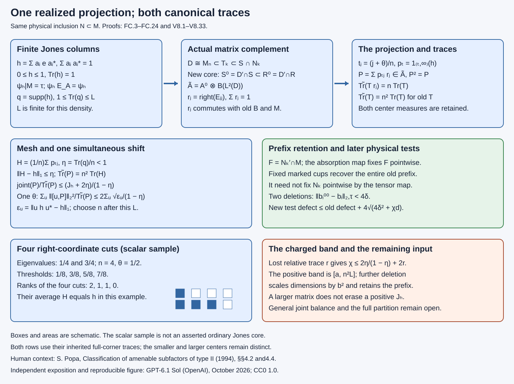

Figure V8.1. A right-coordinate stack realizes the sum of spectral cuts as one actual projection. The two trace factors are \(n\) per right coordinate and \(n^2\) on the old algebra. The lower panels state the prefix and test-preservation mechanisms and the remaining joint input. Rectangles are coordinate diagrams, not areas proportional to canonical trace. Proofs: FC.3–FC.24 and V8.1–V8.33. Human context: Popa (1994), §§4.2 and4.4, printed pp.213–217 and220–222. [Open the full figure](figures/spectral-stack-and-prefix-v8.svg) or use its [editable source](figures/spectral-stack-and-prefix-v8.py).

## V9.1. The joint defect is the norm of the original state discrepancy

Retain the actual core and the original expectations:
\(U=Z(S)\), \(V=Z(R)\), \(D_0=U\vee V\), \(Q=E_U\), and \(P_0=E_V\).
The full-corner identification is \(\iota:D_0\to Z(A)\vee Z(B)\).
For an actual compatible \(M\)-central state \(\varphi\), put
\(\alpha(t)=\varphi(\iota(t))\) and \(\gamma=\alpha P_0\).
These are bounded functionals on the original algebra, including when they are singular.
For a common identity-containing basis \((b_i)\), set
\[
\begin{gathered}
g=\sum_i b_i^*b_i,\quad z=E_{N'\cap M}(g),\\
w=d^{-1}E_{D_0}(g),\quad \ell=d^{-1}E_{D_0}(z),\\
\mathfrak a=\iota\bigl(dQ(|w-\ell|)\bigr).
\end{gathered}
\tag{V9.1}
\]
These are the original cost and density labels of [82.11–82.13](finite-cup-densities-and-positive-cost.md). In particular \(d^{-1}1\le w\le (b_d/d)1\), where \(b_d=1+d(\lceil d\rceil-1)\).

**Proposition V9.1.** Every such state satisfies
\[
\begin{gathered}
\gamma(t)=\alpha((\ell/w)t),\\
\Delta(\varphi):=\|\alpha-\alpha P_0\|
=\alpha(|1-\ell/w|),\\
\Delta(\varphi)\le\varphi(\mathfrak a)
=d\alpha\bigl(w|1-\ell/w|\bigr)
\le b_d\Delta(\varphi).
\end{gathered}
\tag{V9.2}
\]
Thus zero original cost and zero original joint discrepancy are exactly the same requirement. Together with V8.9, this identifies the missing input for simultaneous small \(J_h\) and physical centrality, without assuming that it exists.

**Proof.** Compatibility gives \(\alpha=\nu Q\). The actual basis transfer of68.2 sends \(\iota(t)\) to the central lift of \(dP_0(wt)\). Physical centrality turns its state value into \(\varphi(\iota(t)g)\). The norm averages of81.2 replace \(g\) by \(z\): \(\iota(t)\) commutes with \(N\), each conjugate has the same state pairing, and a bounded functional is norm continuous even when singular. Since \(z\in N'\cap M\subset R\), it commutes with both generators of \(A\). Canonical corner compression followed by compatibility gives \(\varphi(\iota(t)z)=d\alpha(\ell t)\). Consequently \(\gamma(wt)=\alpha(\ell t)\); the bounded inverse of \(w\) gives the first line of(V9.2).

For a bounded real \(v\) in an abelian von Neumann algebra, the functional \(t\mapsto\alpha(vt)\) has norm \(\alpha(|v|)\). Its positive and negative parts give the upper bound; evaluation at the bounded sign function gives equality. Apply this to \(v=1-\ell/w\). Compatibility gives \(\varphi(\mathfrak a)=d\alpha(|w-\ell|)\), and the bounds on \(w\) give the last line. All tests are bounded original-algebra elements. \(\square\)

## V9.2. Endpoint density forces an actual physical projection

An unequal-trace diagonal inclusion does not provide a positive-defect counterexample. Its physical dual density forces a stronger operator identity, for every ordinary tunnel.

**Lemma V9.2 — projection rigidity.** In a finite tracial von Neumann algebra, if \(f\) is a projection and the trace-preserving conditional expectation onto a subalgebra \(C\) satisfies \(E_C(f)=c\) for a projection \(c\in C\), then \(f=c\).

**Proof.** Trace preservation gives \(\tau(f)=\tau(c)\), and trace adjointness gives \(\tau(fc)=\tau(E_C(f)c)=\tau(c)\). Hence
\[
\|f-c\|_{2,\tau}^2
=\tau(f)+\tau(c)-2\operatorname{Re}\tau(fc)=0.
\tag{V9.3}
\]
Faithfulness gives equality of the physical operators. No state normality or amenability hypothesis is used. \(\square\)

For \(d>4\), write \(t=(1-\sqrt{1-4/d})/2\) and \(s=1-t\).
The actual cup density computed in [T.5–T.7](cup-tail-commutants-and-central-comparison.md) is
\[
k_F=(s/t)f+(t/s)(1-f),\qquad \tau(f)=t.
\tag{V9.4}
\]
The complete finite cup reduction82.5 gives \(E_C(k_F)=k_C\), where \(C=N'\cap M\) and \(k_C\) is the ambient normalized dual-trace density.

**Theorem V9.3 — endpoint correction in every actual core.** Suppose this actual ambient density is
\[
k_C=(s/t)c+(t/s)(1-c)
\quad\text{for a projection }c\in C.
\tag{V9.5}
\]
Then the actual smaller-trace cup atom is \(f=c\), for every ordinary tunnel. Moreover
\[
\begin{gathered}
k_F=k_C=k_0,\quad k_0=E_{S'\cap R}(k_F),\\
w=\ell,\quad \mathfrak a=0,\quad
\alpha=\alpha P_0
\end{gathered}
\tag{V9.6}
\]
for every available compatible \(M\)-central state, including singular states. The canonical rescaled core expectation and the restricted ambient rescaled expectation agree on all of \(R\).

**Proof.** Subtract the common scalar term in \(E_C(k_F)=k_C\). Since \(s/t\ne t/s\), (V9.4)–(V9.5) give \(E_C(f)=c\). Lemma V9.2 proves \(f=c\). Since \(C\subset S'\cap R\), conditional expectation onto that relative commutant fixes \(k_C\), proving the first line of(V9.6). The two original joint labels are therefore identical, so the cost vanishes. Proposition V9.1 gives the state identity. Equality of the two rescaled expectations is precisely82.4, now with its actual density equality proved. \(\square\)

This applies to the concrete inclusion of [HC9, C15–C17](hyperfinite-corners-and-diagonal-indices.md). Let \(\mathcal H\) be the separable hyperfinite II₁ factor, \(\tau(c)=t\), and let \(\vartheta:c\mathcal Hc\to(1-c)\mathcal H(1-c)\) preserve normalized corner traces. Put
\[
N=\{x+\vartheta(x):x\in c\mathcal Hc\}
\subset M=\mathcal H.
\tag{V9.7}
\]
Its index is \(d=1/t+1/s\). Its relative commutant is \(\mathbb Cc\oplus\mathbb C(1-c)\): the diagonal corners are scalar because the corresponding physical corner inclusions are identities. A nonzero off-diagonal commuting operator would, by polar decomposition, yield a partial isometry with initial projection \(1-c\) and final projection \(c\); their unequal traces rule this out.

The module dimensions C17 are \(1/t\) and \(1/s\). Standard conjugation transfers them to the corresponding right-module projection dimensions. Dividing by \(d\) gives the normalized dual weights \(s,t\), whereas the physical weights are \(t,s\). Thus its density is exactly(V9.5). The table records both traces without renormalizing either corner separately:

| Physical projection | Inherited \(\tau\) | Normalized ambient dual trace |
| --- | ---: | ---: |
| \(c\) | \(t\) | \(s\) |
| \(1-c\) | \(s\) | \(t\) |

The conclusion(V9.6) is unconditional for these actual operators; it does not depend on a universal-amenability argument for(V9.7). Theorem V9.5 below constructs a compatible hypertrace for every smooth representation of this family. V8.9 then supplies finite coisometric Jones columns with simultaneous small \(J_h\) and physical centrality in this example. It supplies neither the marked corner chains nor the full residual partition for an arbitrary inclusion. For \(d=4\), T.4 already gives \(k_F=k_C=1\) and zero cost.

## V9.3. The singular abelian identities alone still allow positive defect

The endpoint proof uses an actual physical projection and a faithful inherited trace. Those are extra data beyond the marginal and twisted state identities. Here is an exact counterexample to deriving zero defect from those identities alone.

Let \(D_0=\ell^\infty(\mathbb N_0\times\{0,1\})\), with probability trace
\[
\mu(j,0)=2^{-j}/3,\qquad \mu(j,1)=2^{-j-1}/3.
\tag{V9.8}
\]
The smaller label of \((j,0)\) is \(s_j\), and that of \((j,1)\) is \(s_{j+1}\). Both atoms have larger label \(r_j\). Their label algebras \(U,V\) generate \(D_0\). The inherited expectations are
\[
\begin{gathered}
(P_0x)(r_j)=\tfrac23x(j,0)+\tfrac13x(j,1),\\
(Qx)(s_0)=x(0,0),\\
(Qx)(s_k)=\tfrac12x(k,0)+\tfrac12x(k-1,1)\quad(k\ge1).
\end{gathered}
\tag{V9.9}
\]
Put \(w=1\) and
\[
\ell(0,0)=1,\quad\ell(j,0)=4/3\ (j\ge1),
\quad\ell(j,1)=2/3\ (j\ge0).
\tag{V9.10}
\]
Then \(Qw=P_0w=Q\ell=1\), while \(P_0\ell\) equals \(8/9\) at \(r_0\) and \(10/9\) at every other \(r_j\).

For \(L\ge2\), let \(f_L(s_k)=2^k\) for \(k<L\), and zero otherwise. Its mass is \(c_L=(2L-1)/3\). The normal states \(\alpha_L(x)=\tau(f_Lx)/c_L\) satisfy \(\alpha_L=\alpha_LQ\), and
\[
\begin{gathered}
\|\alpha_LP_0-\ell\alpha_L\|
=\frac4{3(2L-1)},\\
\alpha_L(|1-\ell|)
=\frac{2(L-1)}{3(2L-1)}.
\end{gathered}
\tag{V9.11}
\]
Here \(\ell\alpha_L\) denotes \(x\mapsto\alpha_L(\ell x)\). Before division by \(c_L\), the densities \(P_0f_L\) and \(\ell f_L\) differ on exactly \((0,0),(L-1,0),(L-1,1)\); their absolute weighted differences are \(1/9,2/9,1/9\). Every other atom cancels. The second formula counts \(L-1\) active atoms of each type, each contributing \(1/9\). This proves both identities, including the case \(L=2\).

A weak-star cluster state \(\alpha\) therefore satisfies the exact identities
\[
\alpha=\alpha Q,\qquad
\alpha P_0=\ell\alpha,\qquad
\|\alpha-\alpha P_0\|=1/3.
\tag{V9.12}
\]
The last equality follows from the sign-test norm formula and the fixed bounded test \(|1-\ell|\) in(V9.11). Every finite set of atoms has mass tending to zero; hence \(\alpha\) is singular relative to the inherited atomic trace. A normal state would be the sum of its point masses, which here all vanish.

In its abelian GNS completion, quotienting by the common null ideal makes both \(\alpha\) and \(\ell\alpha\) faithful normal traces, since \(2/3\le\ell\le4/3\). The original discrepancy remains \(1/3\) on the original bounded tests. Normality in that completion does not identify the original \(P_0\) with the \(\alpha\)-preserving expectation. This model supplies no physical \(N\subset M\), actual Jones core or smooth representation. It refutes the abelian-only deduction, and leaves the original unrestricted amenability assertion intact.

## V9.4. Two further constraints use the actual finite ambient density

**Proposition V9.4 — scalar density and a quantitative bound.** In the actual index-above-four pair, put \(r=t/s>0\), \(k_C=E_C(k_F)\), and \(\Delta_C=\tau(|k_C-1|)\). Every compatible \(M\)-central state satisfies
\[
\varphi(\mathfrak a)
\le d\bigl(\sqrt{\Delta_C/r}+\Delta_C\bigr).
\tag{V9.13}
\]
In particular \(k_C=1\) forces zero original cost and exact original joint balance, even for singular states and nonfactor cores. Amenability then supplies the required finite columns through V8.9 in this scalar-density branch.

**Proof.** Put \(\delta=\alpha(|\ell-1|)\). The actual cup spectrum gives \(w=E_{D_0}(k_F)\ge r1\). Since \(Qw=1\), \(\alpha=\alpha Q\) and \(\alpha(\ell/w)=1\),
\[
0\le\alpha((w-1)^2/w)
=\alpha((1-\ell)/w)\le\delta/r.
\tag{V9.14}
\]
State Cauchy–Schwarz applied to \(|w-1|/\sqrt w\) and \(\sqrt w\) gives \(\alpha(|w-1|)\le\sqrt{\delta/r}\). Thus(V9.2) and the triangle inequality bound the cost by \(d(\sqrt{\delta/r}+\delta)\). Positivity gives \(|\ell-1|\le E_{D_0}|k_C-1|\). Because \(|k_C-1|\in C\), its expectation onto the factor \(N\) is the scalar \(\Delta_C\). Expectation onto \(U\subset N\), followed by \(\alpha=\alpha Q\), therefore gives \(\delta\le\Delta_C\). This proves(V9.13) with original bounded tests throughout. \(\square\)

The abelian witness cannot simply be promoted to a matching physical model with two ambient density values. Suppose a faithful tracial extension of its \(D_0\) had \(C\) commuting with \(D_0\), projections \(c_++c_-=1\),
\(k_C=(4/3)c_++(2/3)c_-\), and an actual cup projection \(f\), satisfying
\[
E_{D_0}(k_C)=\ell,\qquad
E_C(f)=\frac{k_C-r}{R_*-r},\qquad
E_{D_0}(f)=\frac{1-r}{R_*-r}1,
\quad 0<r<1<R_*.
\tag{V9.15}
\]
Trace normalization forces \(\tau(c_+)=\tau(c_-)=1/2\). For \(z=1_{\{\varepsilon=1\}}\in D_0\), \(\tau(z)=1/3\) and \(E_{D_0}(c_+)z=0\), because \(\ell=2/3\) there. Faithfulness and commutation give \(z\le c_-\). Positivity now forces
\[
\frac{1-r}{3(R_*-r)}=\tau(zf)
\le\tau(c_-f)
=\frac{2/3-r}{2(R_*-r)}
\quad\Longrightarrow\quad r/6\le0.
\tag{V9.16}
\]
This contradicts the actual positive lower radius \(r>0\). The comparison follows by sandwiching \(c_--z\ge0\) with \(f\), so it does not assume that \(f\) commutes with either algebra. It rules out this precise physical realization; other ambient spectra and the unrestricted joint-state problem remain to be analyzed.

## V9.5. The diagonal family satisfies the full smooth-representation hypothesis

We can also verify amenability for the actual hyperfinite diagonal family(V9.7), rather than assume it from amenability in one chosen core. Let
\(\mathcal U\subset_E\mathcal V\) be **any** smooth normal nondegenerate expected representation of this physical \(N\subset M\). Thus \(E|_M=E_N\), \(\overline{\operatorname{span}(M\mathcal U)}^{\,w}=\mathcal V\), and the original \(N'\cap M_j\) commutes with \(\mathcal U\) at every represented physical tower level. The exact source definition is Popa (1994), Definition3.1.1, printed p.203; the representation convention is Definition2.1.1, printed p.191.

**Theorem V9.5.** For every such representation there is a possibly nonnormal conditional expectation \(F:\mathcal V\to M\) such that
\[
F(\mathcal U)\subset N,\qquad E_NF=FE.
\tag{V9.17}
\]
Consequently \(\tau F\) is a compatible \(M\)-central state with the exact physical trace. The diagonal inclusion is amenable under the unrestricted all-smooth quantifier. Its simultaneous finite-column joint-balance input follows from V9.3 and V8.9 in every actual ordinary core.

**Proof of the represented corner maps.** Write \(c'=1-c\) and retain the physical corner isomorphism \(\vartheta\). Smoothness at degree zero gives \([c,\mathcal U]=0\). Since \(cMc=Nc\), nondegeneracy gives \(c\mathcal Vc=\mathcal Uc\): on a spanning term \(mu\), compression is \((cmc)(uc)\), which lies in \(\mathcal Uc\). The map \(u\mapsto uc\) is a faithful normal homomorphism. Indeed \(E(c)=t1\), so \(uc=0\) implies \(0=E(u^*cu)=tu^*u\). Its range is therefore ultraweakly closed. The same argument gives \(c'\mathcal Vc'=\mathcal Uc'\). Hence
\(\widetilde\vartheta(uc)=uc'\) is a normal isomorphism between these represented corners, extending the physical \(\vartheta\).

**Proof of the semifinite expectation.** Stabilize with \(\mathcal B=B(\ell^2(\mathbb N))\), and write \(M^\infty=M\bar\otimes\mathcal B\), \(\mathcal V^\infty=\mathcal V\bar\otimes\mathcal B\), \(c^\infty=c\otimes1\), and similarly \(c'^\infty\). There is \(v\in M^\infty\) with \(v^*v=c^\infty\) and \(vv^*=c'^\infty\). To construct it even for irrational \(t\), match the ordered finite projections \(c\otimes e_{nn}\) and \(c'\otimes e_{nn}\). At each step cut the larger remaining piece to the smaller piece's trace and compare the two in a finite matrix corner over \(M\). At least one piece is exhausted at each step; no finite piece can absorb infinitely many complete opposite pieces of fixed positive trace. The matched pieces exhaust both infinite projections. The strong sum of their partial isometries is \(v\).

Put \(P=c^\infty M^\infty c^\infty\) and \(\widetilde P=c^\infty\mathcal V^\infty c^\infty\). We first construct a UCP projection \(\beta_0:\widetilde P\to P\). The complete HC4–HC7 construction gives increasing full matrix algebras \(H_j\) generating the finite hyperfinite corner \(cMc\). Decompose \(c\mathcal Vc=H_j\bar\otimes(H_j'\cap c\mathcal Vc)\). Extend the normalized trace of \(H_j'\cap cMc\) to a state on the larger complementary algebra. Applying that state to finite matrix coefficients gives a UCP map into \(H_j\), whose restriction to \(cMc\) is its trace expectation onto \(H_j\). A point-ultraweak cluster has range in \(cMc\) and fixes every physical element, because those trace expectations converge in physical \(L^2\), hence ultraweakly. It gives a UCP projection \(\beta^{\mathrm{fin}}:c\mathcal Vc\to cMc\). Apply it entrywise to the \(\mathcal B\)-matrix coefficients. Complete positivity bounds every finite compression by the original norm, so the entries define one bounded operator in \(P\). This constructs \(\beta_0\) and shows it fixes all of \(P\). No tracial state on the type II∞ algebra is needed.

**Proof of the cyclic averaging and finite return.** The automorphism
\(\widetilde a=\operatorname{Ad}(v^*)\circ(\widetilde\vartheta\bar\otimes\mathrm{id})\) of \(\widetilde P\) restricts to an automorphism \(a\) of \(P\). Its physical semifinite trace scale is \(s/t\). Define
\[
\beta_L=\frac1L\sum_{n=0}^{L-1}a^{-n}\beta_0\widetilde a^n,
\qquad
\|a^{-1}\beta_L\widetilde a(X)-\beta_L(X)\|
\le\frac{2\|X\|}{L}.
\tag{V9.18}
\]
Each map is UCP and fixes \(P\). Product weak-star compactness of output balls gives a point-ultraweak cluster \(\beta\). Normality of \(a\) passes the displayed relation to \(\beta\widetilde a=a\beta\). The resulting UCP projection is \(P\)-bimodular by the multiplicative-domain identity for a map fixing a unital star subalgebra.

The two columns \(v_1=c^\infty,v_2=v\) have orthogonal range projections summing to one and the same initial projection. Their coefficients identify the stabilized algebras with \(M_2(\widetilde P)\) and \(M_2(P)\). Thus
\[
F^\infty(X)=\sum_{i,j=1}^2
v_i\beta(v_i^*Xv_j)v_j^*
\tag{V9.19}
\]
is a UCP projection onto \(M^\infty\). For \(u\in\mathcal U\bar\otimes\mathcal B\), the off-diagonal coefficients vanish because \(u\) commutes with \(c^\infty\). The diagonal coefficients are \(uc^\infty\) and \(\widetilde a(uc^\infty)\). Equivariance gives
\(F^\infty(u)=\beta(uc^\infty)+(\vartheta\bar\otimes\mathrm{id})(\beta(uc^\infty))\in N\bar\otimes\mathcal B\).
Compress by \(h=1\otimes e_{00}\in N\bar\otimes\mathcal B\). Since \(F^\infty\) fixes \(M^\infty\), bimodularity makes its restriction to \(h\mathcal V^\infty h\) a UCP conditional expectation \(F:\mathcal V\to M\), with \(F(\mathcal U)\subset N\).

Finally choose a complete finite partial orthonormal physical basis \((b_i)\) for \(M/N\), and put \(u_i=E(b_i^*X)\in\mathcal U\). The normal finite basis row fixes \(M\mathcal U\), so nondegeneracy gives \(X=\sum_i b_i u_i\) on all of \(\mathcal V\). Bimodularity and \(F(u_i)\in N\) yield
\[
E_NF(X)=\sum_i E_N(b_i)F(u_i)
=F\left(\sum_iE_N(b_i)u_i\right)=FE(X).
\tag{V9.20}
\]
The state \(\tau F\) is \(M\)-central because \(F\) is \(M\)-bimodular, and is compatible by(V9.20). This proves the full source definition for the arbitrary smooth representation. The same argument works at \(t=1/2\); the trace scale is then one. The endpoint cost uses T.4 there, as already stated. \(\square\)

The stabilization, state extension, multiplicative domain and compactness used here retain their standard programme prerequisites. The argument constructs the expectations and the actual finite return; it does not infer full amenability merely from a generating core or from the hyperfiniteness of the two physical factors. It closes this diagonal example and leaves the unrestricted nonextremal problem for other inclusions, marked corner chains and full residual partition at their original scope.

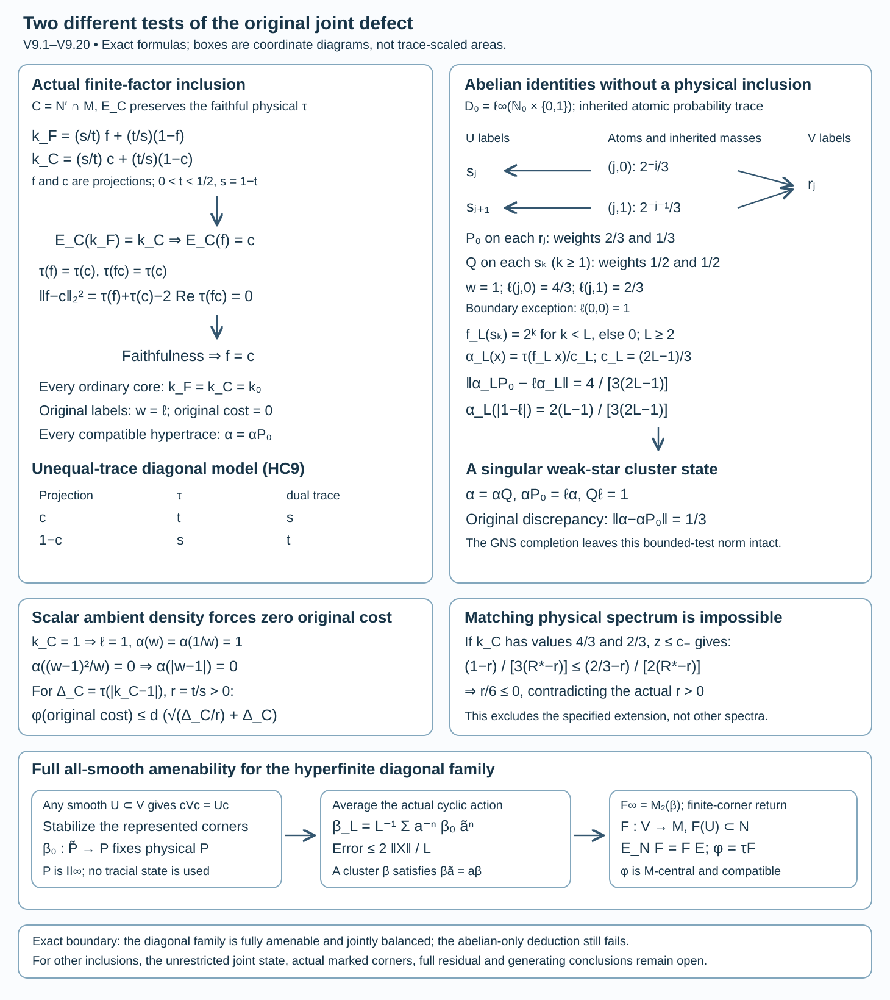

Figure V9.1. The left panel uses actual physical projections and the inherited trace; the right panel is an abelian witness with no physical inclusion. The lower panels show the scalar-density bound and the obstruction to its matching physical realization. The weights, expectation coefficients and defect formulas are exact. The arrows identify maps and deductions, not geometric lengths or trace-scaled areas. Proof locators: V9.1–V9.20, including the full smooth-representation averaging in the lower panel. Mathematical context and exact programme providers are linked above. [Full figure](figures/joint-endpoint-and-singular-witness-v9.svg), [editable source](figures/joint-endpoint-and-singular-witness-v9.py).

## V10.1. Right moves act on Jones rows, and can destroy physical centrality

The finite-column proof allows a varying finite number of columns. Requiring their right sum to equal one is stronger than the original joint condition. A proposed right-column averaging argument must also retain the physical targets. We give an actual fully amenable Jones model in which an arbitrary such move fails to do so.

Retain the original expected pair \(A\subset_{E_A}B\), the cup \(e=e_R^M\), and a coisometric row \(a=(a_i)_{i=1}^L\subset N\). Put
\[
\begin{gathered}
\sum_i a_i a_i^*=1,\qquad h_a=\sum_i a_i e a_i^*,\\
g_a=\sum_i a_i^*a_i,\qquad
\zeta_a=E_{Z(S)}^N(g_a),\\
J_a=\|\zeta_a-P_0\zeta_a\|_1.
\end{gathered}
\tag{V10.1}
\]
The original trace, expected-square identities and full-center norm are those of FC.3–FC.7 and V8.8. If \(v\in\mathcal U(N)\), the row \(av=(a_i v)_i\) remains coisometric and \(g_{av}=v^*g_av\). A probability-weighted concatenation of such rows has right sum equal to the corresponding convex average of these conjugates. It preserves the exact physical marginal and expectation compatibility. These identities alone give no estimate for a previously controlled physical commutator.

When \(v\in S\), the cup commutes with \(v\), so \(h_{av}=h_a\). Trace pairing against every \(z\in Z(S)\) also gives \(\tau(v^*g_avz)=\tau(g_az)\); thus \(\zeta\) and \(J\) are unchanged. A right move that changes the joint profile must therefore use additional operators or data.

### An ordinary index-four tensor-strip tunnel

Let
\[
\begin{gathered}
Q=\overline{\bigotimes_{j\ge0}(M_2^{(q_j)},\operatorname{tr}_2)}^{\,w},\qquad
D=\overline{\bigotimes_{j\ge1}(M_2^{(d_j)},\operatorname{tr}_2)}^{\,w},\\
M=Q\bar\otimes D,\qquad
N=1_{q_0}\otimes Q_{\ge1}\bar\otimes D.
\end{gathered}
\tag{V10.2}
\]
The closures are in the product-trace GNS representations. These are hyperfinite II₁ factors: finite tensor expectations converge in \(L^2\), and the expectation of a central element onto each finite full matrix algebra is scalar. The unbounded matrix degrees exclude finite-dimensional factors. The inclusion has index four, by the four-dimensional scalar-base space \(L^2(M_2,\operatorname{tr}_2)\). It has full all-smooth amenability by GTB.6a, applied with the physical factor \(Q_{\ge1}\bar\otimes D\), which has an increasing \(L^2\)-dense sequence of full matrix algebras. That lemma constructs a compatible state for every smooth expected representation.

Set \(L_j=1_{q_0,\ldots,q_{j-1}}\otimes Q_{\ge j}\bar\otimes D\), so \(L_0=M,L_1=N\). The adjacent cups are the actual Bell projections
\[
f_j=\frac12\sum_{a,b=1}^2 E_{ab}^{(q_j)}E_{ab}^{(q_{j+1})}.
\tag{V10.3}
\]
Compression of \(1\otimes x\) in these two coordinates gives \(f_j(1\otimes x)f_j=\operatorname{tr}_2(x)f_j\), and partial trace gives \(E_{L_{j+1}}(f_j)=1/4\). Moreover

\[
(1\otimes E_{ai})f_j(1\otimes E_{jb})
=\tfrac12E_{ij}\otimes E_{ab}.
\tag{V10.4}
\]
Together with the untouched tail, these words generate \(L_j\). Thus each triple is the actual tracial basic construction, with its inherited Markov trace and index four. The relative commutants are the removed finite \(Q\)-legs; their closures give the ordinary core
\[
R=Q\otimes1_D,\qquad S=1_{q_0}\otimes Q_{\ge1}\otimes1_D.
\tag{V10.5}
\]
Both centers are scalar. Consequently every coisometric row in this example has \(J_a=0\).

On \(L^2(M)=L^2(Q)\otimes L^2(D)\), the core cup is \(e=1\otimes e_{\mathbb C}^D\), where \(e_{\mathbb C}^D\) projects onto the trace vector. Left \(D\) and this projection generate \(B(L^2(D))\): their commutant is contained in right \(D\), and commutation with the trace-vector projection forces the right multiplier to be scalar. Hence the actual pair is
\[
\begin{gathered}
A=1_{L^2(M_2^{(q_0)})}\otimes L(Q_{\ge1})\bar\otimes B(L^2(D)),\\
B=L(Q)\bar\otimes B(L^2(D)).
\end{gathered}
\tag{V10.6}
\]
Its canonical traces are \(\tau_{Q_{\ge1}}\otimes\operatorname{Tr}_{L^2(D)}\) and \(\tau_Q\otimes\operatorname{Tr}_{L^2(D)}\), respectively. They agree on \(A\) and give \(\operatorname{Tr}(e)=1\). The canonical \(E_A\) is normalized partial trace on the left \(q_0\)-leg.

### Balanced rows with vanishing physical defects

Let \(F_m=\bigotimes_{j=1}^m M_2^{(d_j)}\cong M_{k_m}\), \(k_m=2^m\), and let \(W_{m,r,t}\), \(0\le r,t<k_m\), be its clock-and-shift Weyl unitaries. The row \(a_{m,r,t}=k_m^{-1}W_{m,r,t}\) has both physical sums one. Its \(k_m^2\) vectors \(W_{m,r,t}\Omega_D\) form an orthonormal basis of \(L^2(F_m)\), so
\[
\begin{gathered}
h_m=k_m^{-2}q_m,\\
q_m=1_{L^2(Q)}\otimes P_{L^2(F_m)\otimes\Omega_{D_{>m}}},\\
\operatorname{Tr}(q_m)=k_m^2,\qquad\operatorname{Tr}(h_m)=1.
\end{gathered}
\tag{V10.7}
\]
These densities commute with physical \(Q\bar\otimes F_m\), and have exact physical marginal and expectation compatibility.

For every fixed physical unitary \(u\in M\), put \(x_m=E_{Q\bar\otimes F_m}^M(u)\). Then \(x_m\to u\) in \(L^2(\tau)\) and \([x_m,h_m]=0\). The existing finite trace inequalities and the exact marginal give
\[
\begin{gathered}
\|(u-x_m)h_m\|_1\le\|u-x_m\|_{2,\tau},\\
\|h_m(u-x_m)\|_1\le\|u-x_m\|_{2,\tau},\\
\|u h_m u^*-h_m\|_1
\le2\|u-x_m\|_{2,\tau}\longrightarrow0.
\end{gathered}
\tag{V10.8}
\]
For example, the first inequality factors through \(h_m^{1/2}\): its two Hilbert-Schmidt norms are \(\|u-x_m\|_{2,\tau}\) and one. The second uses \(\tau(xx^*)=\tau(x^*x)\). The same sequence controls every finite target list. Its finite column count varies with \(m\).

Fix \(s=\operatorname{diag}(1,-1)\) in the \(q_1\)-leg. Let \(v_m\in N\) be the flip of that defining coordinate with the fresh \(d_{m+1}\)-leg, and let \(z_m\) be the corresponding trace-zero diagonal unitary in that fresh leg. Then \(v_m^*sv_m=z_m\), and \(v_m\) commutes with all the old \(W_{m,r,t}\). Applying this right move to the actual row gives
\[
h_m'=v_m h_m v_m^*=k_m^{-2}q_m',\qquad q_m'=v_mq_mv_m^*.
\tag{V10.9}
\]
It still has both row sums one, \(J=0\), exact compatibility and the physical marginal. But the fresh trace-vector coordinate gives \(q_mz_mq_m=0\), hence \(q_m'sq_m'=0\). The projections \(q_m'\) and \(sq_m's^*\) are therefore orthogonal, each of canonical trace \(k_m^2\). Thus
\[
\|s h_m's^*-h_m'\|_1=2\quad\text{for every }m.
\tag{V10.10}
\]
Before the move the same target has defect zero, and (V10.8) makes every other fixed finite-list defect tend to zero. This disproves a target-preservation estimate tending to zero for an arbitrary right move chosen after the row. It does not say that every useful choice of a move must fail.

There is also a failure at the level of the proposed map. The rows \(a_m\) and \(s a_m\) have the identical initial density, because \(s\) commutes with \(h_m\). After the same right move they give \(h_m'\) and \(s h_m's^*\), at distance two. Right-column multiplication therefore acts on rows, rather than on their density alone. A compact state argument must retain the row or another object that determines the operation.

## V10.2. Right-sum-one rows miss actual compatible balanced states

Use the same fully amenable ordinary core. Split \(D=M_2^{(d_1)}\bar\otimes D_{>1}\), and put \(p=E_{11}^{(d_1)}\), \(c_1=E_{11}^{(d_1)}\), \(c_2=E_{21}^{(d_1)}\). Then
\[
\sum_i c_ic_i^*=1,\qquad \sum_i c_i^*c_i=2p.
\tag{V10.11}
\]
Concatenate these columns with the Weyl row on the first \(m\) legs of \(D_{>1}\). Directly on the first matrix standard space, \(\sum_i c_i e_{\mathbb C}c_i^*=\tfrac12\rho_{d_1}(p)\). Thus its density is
\[
\bar h_m=1_{L^2(Q)}\otimes\tfrac12\rho_{d_1}(p)
\otimes k_m^{-2}P_{L^2(F_m)\otimes\Omega_{\mathrm{rest}}}.
\tag{V10.12}
\]
Here \(\rho\) denotes right multiplication, and \(F_m\) now lies in \(D_{>1}\). The right projection has ordinary rank two, so this density has canonical trace one. It commutes with physical \(Q\), the entire left \(d_1\)-matrix leg and left \(F_m\). Its exact left row sum gives the physical marginal and compatibility. Applying the proof of (V10.8) to these increasing physical algebras gives vanishing defects for every fixed physical target.

The fixed bounded projection \(T=\rho_D(p)\) belongs to \(A\subset B\), since the \(D\)-coordinate in (V10.6) is all of \(B(L^2(D))\). We have
\[
\operatorname{Tr}(\bar h_mT)=1.
\tag{V10.13}
\]
For any finite coisometric row \(a\subset N\), the finite vector identity (FC.5), and commutation of \(T\) with left \(M\), instead give
\[
\operatorname{Tr}(h_aT)=\tau(g_ap).
\tag{V10.14}
\]
In particular every row with right sum \(g_a=1\) gives value \(1/2\). Random-unitary rows \((\sqrt{\theta_j}u_j)_j\) are a special case of this stronger class.

A weak-star cluster of the states of \(\bar h_m\) is compatible, \(M\)-central, and restricts to the original physical trace. Its value on the single fixed \(T\) is one. It therefore lies outside the weak-star closure of every right-sum-one row, including every random-unitary row. Since the actual core centers are scalar, it already satisfies the original joint identity. Equation (V10.7) supplies a different suitable balanced state in this same inclusion. The counterexample concerns approximation of an arbitrary state by the stronger row class; it does not refute existence of a suitable joint-balanced state.

## V10.3. The exact compact obstruction retains the unrestricted target

Return to the original arbitrary core, with potentially singular center states and arbitrary finite column count. Let \(\mathcal X\) be the normal states of all coisometric finite Jones rows, and define
\[
K_\epsilon=\overline{\{\psi_a\in\mathcal X:J_a\le\epsilon\}}^{\,w^*},\qquad
K_{\mathrm{bal}}=\bigcap_{\epsilon>0}K_\epsilon.
\tag{V10.15}
\]
Each set is nonempty, compact and convex. The single row \(a=1\) has zero joint defect; concatenation with square-root probability weights preserves coisometry and makes \(J\) a convex norm of its linear center coordinate. Exact physical marginal and expectation compatibility pass to weak-star limits. The actual center pairing of V8.8 proves that every \(\varphi\in K_{\mathrm{bal}}\) satisfies
\[
\varphi(\iota(t))=\varphi(\iota(P_0t))\quad(t\in D_0).
\tag{V10.16}
\]

Conversely, every compatible original-trace state satisfying (V10.16) lies in \(K_{\mathrm{bal}}\). Use the full finite-column weak-star approximation of FC.8–FC.9. Include both its physical marginal discrepancy and its original joint discrepancy in the predual coordinate list, along with any chosen finite scalar tests. Their targets are zero, by the hypotheses on this particular state. Convex weak/norm closure equality makes both predual norms arbitrarily small. The mixed cup column has zero joint coordinate. The exact left-row correction of FC.14–FC.18 costs at most \(2\sqrt\delta\) in state norm, hence at most \(4\sqrt\delta\) in the difference of two bounded center restrictions. Therefore rows can approximate the finite tests with \(J<\delta+4\sqrt\delta\). Letting \(\delta\) be small enough for each \(\epsilon>0\) proves the converse. This argument applies to a singular state; it does not declare the joint coordinate of an arbitrary central state to have target zero.

There is an exact finite alternative. Either \(K_{\mathrm{bal}}\) contains an \(M\)-central state, or there are finitely many physical unitaries \(u_j\), self-adjoint \(T_j\in B\), and \(\epsilon_0,c_0>0\) such that every finite coisometric row with \(J_a\le\epsilon_0\) satisfies
\[
\operatorname{Tr}\left(h_a H\right)\ge c_0,
\qquad H=\sum_j(u_j^*T_ju_j-T_j).
\tag{V10.17}
\]

**Proof.** Centrality is the family of closed real affine equations \(\varphi(u^*Tu-T)=0\). If their intersection with the compact \(K_{\mathrm{bal}}\) is empty, a finite family is already inconsistent. Its image in finite real coordinate space is compact and convex and misses zero. Strict finite-dimensional separation gives a real linear combination positive by \(c>0\); absorb its coefficients into the self-adjoint \(T_j\). For this fixed \(H\), some \(K_{\epsilon_0}\) already has \(\varphi(H)\ge c/2\) throughout. Otherwise states with value below \(c/2\) in the nested \(K_{1/n}\) have a cluster in their intersection, contradicting separation there. This proves (V10.17) with \(c_0=c/2\). Conversely an \(M\)-central state in \(K_{\mathrm{bal}}\) precludes (V10.17), by the converse approximation above with the fixed test \(H\). \(\square\)

For a finite approximation of a central member, convex separation applied also to its physical commutator predual coordinates gives the simultaneous estimates of V8.9:
\[
J_a<\eta,\qquad
\|u h_a u^*-h_a\|_1<\eta
\quad(u\text{ in the prescribed finite physical list}).
\tag{V10.18}
\]
The compact formulation retains the exact proposed joint-state target, every singular branch and varying finite row length. Separate nonempty compact sets of balanced and central states do not establish their intersection. The separator alternative (V10.17) and target (V10.18) therefore retain their exact roles in that criterion. The actual AH/AB/AO examples refute a universal simultaneous balance-and-centrality conclusion; a separator alternative is not a proof that the intersection exists. Under the original representation-amenability hypothesis, POR.5 supplies the unrestricted finite family, actual marked corner return and entire residual without requiring that joint-state assertion. The full generating and compatible-hypertrace equivalence is [61.13–61.16](smooth-representations-and-tower-compression.md#extending-a-smooth-representation-down-the-original-tunnel).

Figure V10.1. The displayed algebras and Bell cups are the actual ordinary Jones model (V10.2)–(V10.6). The upper construction has \(k_m^2=4^m\) columns and canonical trace one. The right move exchanges a core defining coordinate with a fresh physical tail coordinate; its fixed physical defect is exactly two. The lower fixed-test values are (V10.13)–(V10.14). The compact alternative is (V10.15)–(V10.18), with no assertion that its separator exists or is excluded in the general amenable case. The boxes are algebra schematics. Human context is Popa's all-smooth amenability definition cited in this lesson. [Editable CC0 figure source](figures/right-column-moves-and-balanced-states-v10.py).

## Physical spectral corners and the original state data

A return from a corner must retain the original expectation and physical trace. The following complete arguments identify two false localization steps and give an actual amenable interior-spectrum model. They retain the unrestricted state question.

## IF.0 — the exact objects retained

Let \(N\subset M\) be the original finite-index II₁ inclusion, with index \(d\), a specified ordinary tunnel, and its actual core \(S\subset R\). On \(L^2(M)\), retain

\[
A=\langle N,e_R^M\rangle\subset B=\langle M,e_R^M\rangle,
\qquad E_A:B\longrightarrow A.
\tag{IF.1}
\]

The physical embeddings of \(N,M\), the original normal expectation \(E_A\), and both inherited canonical semifinite traces are retained. Put \(C=N'\cap M\), \(U=Z(S)\), \(V=Z(R)\), \(D_0=U\vee V\), \(Q=E_U\), \(P_0=E_V\), and let \(\iota:D_0\to Z(A)\vee Z(B)\) be the original full-corner identification. For a common identity-containing finite frame, the original bounded labels and cost are

\[
g=\sum_i b_i^*b_i,\quad z=E_C(g),\quad
w=d^{-1}E_{D_0}(g),\quad \ell=d^{-1}E_{D_0}(z),\quad
\mathfrak a=\iota\bigl(dQ(|w-\ell|)\bigr)\in Z(A)_+.
\tag{IF.2}
\]

The labels are those of [Finite cup densities and a positive central cost](finite-cup-densities-and-positive-cost.md), (82.11)–(82.13), and [General tail supports and controlled tunnels](general-tail-supports-and-controlled-tunnels.md), V9.1. The expectations retain their inherited tracial measures. A compatible hypertrace means a state \(\psi\in B^*\) with

\[
\psi E_A=\psi,\qquad \psi|_M=\tau_M,
\qquad \psi(mx)=\psi(xm)\quad(m\in M, x\in B).
\tag{IF.3}
\]

It may be singular. If the Jones-ideal face is imposed, it remains an additional requirement; no result below replaces it by another support. The physical \(C\) commutes with \(A\): it commutes with \(N\), and \(C\subset R\) commutes with the Jones projection onto \(L^2(R)\). Also \(E_A|_M=E_N\), so for any projection \(c\in C\),

\[
E_A(c)=\tau(c)1.
\tag{IF.4}
\]

For \(d>4\), [The cup, its tail commutants and central comparison](cup-tail-commutants-and-central-comparison.md), T.5–T.8, and [Finite cup densities and a positive central cost](finite-cup-densities-and-positive-cost.md), (82.5), give the actual two-atom universal cup density

\[
k_F=R_* f+r(1-f),\quad R_*r=1,\quad R_*+r+2=d,
\quad E_C(k_F)=k_C.
\tag{IF.5}
\]

The inherited trace is faithful; \(E_C\) is its original normal tracial expectation. No hypertrace is asserted normal relative to that trace.

## IF.1 — every proper physical face has zero reducing part

**Proposition IF.1.** Let \(\mathcal D\) be any unital von Neumann overrepresentation containing the original physical factor \(M\), or its enveloping bidual. If \(c\in M\) is a projection with \(0<t=\tau(c)<1\), then

\[
r\in\mathcal D\cap M',\quad r=r^*=r^2,\quad r\le c
\quad\Longrightarrow\quad r=0.
\tag{IF.6}
\]

The same statement holds if an extra cost spectral constraint \(r\le 1_{[0,\varepsilon]}(\mathfrak a)\), a normal-band constraint, or a Jones-ideal support constraint is imposed.

**Proof.** Commutation with \(M\) gives \(r\le ucu^*\) for every physical unitary \(u\). Hence \(r\le T(c)\) for every finite convex average \(T\) of such conjugations. Norm averaging in the finite factor, as proved in [Relative norm averaging and central densities](relative-norm-averaging-and-central-density.md), Theorem 81.2, with the smaller algebra equal to \(M\), gives averages converging in operator norm to \(t1\). Positivity is norm closed, so \(r\le t1\). If \(r\ne0\), compression by \(r\) gives \(r\le tr\), impossible for \(t<1\). This uses the original norm on bounded physical elements, and remains valid after any faithful normal represented inclusion into a tower or after the canonical embedding into a bidual. Additional support inequalities cannot enlarge the set. \(\square\)

There is also a state obstruction: a state supported by \(c\) has value one on \(c\), whereas every state satisfying the original physical marginal has value \(t\). Thus a literal joint face of a cost cut and a proper physical \(k_C\)-spectral projection cannot carry the desired state. This is true even when \(\mathfrak a=0\). A nonzero **cost-only** reducing face is a different question; IF.6 does not settle it.

## IF.2 — physical conditioning leaves the cost unchanged

**Proposition IF.2.** Let \(\psi\) satisfy IF.3, let \(c\in C\) be a projection, and put \(0<t=\tau(c)<1\). The normalized compressed state

\[
\psi_c(x)=t^{-1}\psi(cxc),\qquad x\in B,
\tag{IF.7}
\]

satisfies the exact identities

\[
\begin{gathered}
\psi_c|_A=\psi|_A,\qquad \psi_cE_A=\psi,
\qquad \psi_c(\mathfrak a)=\psi(\mathfrak a),\\
\psi_c|_M(m)=t^{-1}\tau(cm),\\
\|\psi_c-\psi_cE_A\|=\|\psi_c-\psi\|=2(1-t),\\
\|\psi_c|_M-\tau\|=2(1-t).
\end{gathered}
\tag{IF.8}
\]

In particular, conditioning a positive-cost compatible hypertrace on a physical density atom does not lower its original cost. It creates a fixed full-norm compatibility defect.

**Proof.** Since \(c\in M\), physical centrality puts \(c\) in the centralizer of \(\psi\), and \(\psi(cxc)=\psi(cx)\). If \(y\in A\), normal expectation bimodularity and IF.4 give

\[
\psi_c(y)=t^{-1}\psi(cy)
=t^{-1}\psi(E_A(cy))=\psi(y).
\]

This proves the first and cost identities. For every \(x\in B\),

\[
\psi_c(E_Ax)=\psi(E_Ax)=\psi(x).
\]

The physical marginal follows by restriction to \(M\). For the norm, decompose

\[
\psi_c-\psi
=\frac{1-t}{t}\,\psi(c\,\cdot)-\psi((1-c)\,\cdot).
\tag{IF.9}
\]

The two summands are positive functionals carried by the orthogonal projections \(c\) and \(1-c\). Each has mass \(1-t\). Their norm is the sum of those masses; the test \(2c-1\) attains it. The same decomposition and test in \(M\) prove the last identity. Positivity and the decomposition only use the centralizer property, so the argument includes singular \(\psi\). \(\square\)

If \(c_1+\cdots+c_s=1\) is a physical spectral partition and \(t_j=\tau(c_j)\), then

\[
\sum_jt_j\psi_{c_j}=\psi,
\qquad \psi_{c_j}(\mathfrak a)=\psi(\mathfrak a)\quad\hbox{for every }j.
\tag{IF.10}
\]

Indeed centralizer orthogonality kills every \(\psi(c_ixc_j)\) with \(i\ne j\). Recombining the conditional states restores the original state and its original cost. Finite physical spectral induction therefore has no cost descent through these maps.

## IF.3 — two all-smooth permanence proofs used by the actual example

The following lemmas concern the full quantifier, not one core. Throughout, a smooth representation is a normal nondegenerate expected inclusion \(\mathcal U\subset_E\mathcal V\), with the original physical pair embedded, expectation restriction equal to the physical tracial expectation, and all physical higher relative commutants equal to those of the represented smaller algebra. This is the amenability definition in Sorin Popa, [Classification of amenable subfactors of type II](https://doi.org/10.1007/BF02392646), Definition 3.1.1, p.203, together with the smoothness definitions in §2.3.

**Lemma IF.3a — a larger finite matrix leg.** If \(N_0\subset M_0\) is amenable for every smooth representation, then

\[
N_0\bar\otimes1\subset M_0\bar\otimes\operatorname{Mat}_n
\tag{IF.11}
\]

is also amenable for every smooth representation. Its index is \(n^2[M_0:N_0]\). This differs from a common matrix amplification, which preserves index.

**Proof.** In any smooth expected representation \(\mathcal U\subset_E\mathcal V\) of IF.11, the physical matrix units \(e_{ij}\) commute with \(\mathcal U\) by degree-zero smoothness. They give an exact matrix decomposition

\[
\mathcal V\cong\mathcal V_0\bar\otimes\operatorname{Mat}_n,
\qquad\mathcal U\cong\mathcal U_0\bar\otimes1,
\quad\mathcal V_0=e_{11}\mathcal V e_{11},\quad\mathcal U_0=\mathcal Ue_{11}.
\tag{IF.12}
\]

The map \(u\mapsto ue_{11}\) is faithful: \(E(e_{11})=n^{-1}1\) gives \(E(u^*ue_{11})=n^{-1}u^*u\). It is a normal isomorphism onto \(\mathcal U_0\). Define

\[
E_0:\mathcal V_0\longrightarrow\mathcal U_0,
\qquad E_0(X)=nE(X)e_{11}.
\tag{IF.13}
\]

This is a normal faithful expectation fixing \(\mathcal U_0\), and it restricts to \(E_{N_0}^{M_0}\) on the faithful physical corner \(M_0e_{11}\). Nondegeneracy descends to this corner by expanding a weakly dense span \(M\mathcal U\) in the physical matrix units. Expectation restriction and \(\mathcal U\)-bimodularity on that span give the exact original decomposition \(E=E_0\otimes\operatorname{tr}_n\).

For completeness, smoothness also descends at every tower level. The basic construction of a tensor product of finite-index expected inclusions is the tensor product of their basic constructions: on the product right module the Jones projection is the tensor product of the two Jones projections, and the spanning terms \(x e y\) are finite sums of elementary product terms. Consequently the represented and physical towers for IF.12 are \(\mathcal V_{0,j}\bar\otimes T_j\) and \(M_{0,j}\bar\otimes T_j\), where \(T_j\) is the finite-dimensional tower of \(\mathbb C\subset\operatorname{Mat}_n\). Every \(x\in N_0'\cap M_{0,j}\) appears as the physical \(x\otimes1\). Original smoothness says it commutes with \(\mathcal U_0\otimes1\), which is exactly the required equality \(\mathcal U_0'\cap M_{0,j}=N_0'\cap M_{0,j}\). The reverse containment follows from the physical embedding of \(N_0\) in \(\mathcal U_0\). Thus \(\mathcal U_0\subset_{E_0}\mathcal V_0\) is a genuine smooth representation of the original pair.

Take its compatible \(M_0\)-central state \(\chi_0\). The state \(\chi_0\otimes\operatorname{tr}_n\) on IF.12 has original physical marginal \(\tau_{M_0}\otimes\operatorname{tr}_n\), is \(M_0\otimes\operatorname{Mat}_n\)-central, and is compatible with the original \(E\). A complete physical right frame tensored with the orthonormal trace frame \(\sqrt n E_{ab}\) proves the index formula. \(\square\)

**Lemma IF.3b — a common hyperfinite factor.** If a finite-index II₁ inclusion \(N_1\subset M_1\) is amenable for every smooth representation, then so is

\[
N_1\bar\otimes F\subset M_1\bar\otimes F,
\quad F=\bar\bigotimes_{j\ge1}(\operatorname{Mat}_2,\operatorname{tr}_2).
\tag{IF.14}
\]

**Proof.** Let \(\mathcal U\subset_E\mathcal V\) be any smooth representation of IF.14. Define the actual commutants

\[
\mathcal U^F=\mathcal U\cap F',\qquad\mathcal V^F=\mathcal V\cap F',
\qquad E^F=E|_{\mathcal V^F}.
\tag{IF.15}
\]

Because physical \(F\subset\mathcal U\), expectation bimodularity makes \(E^F\) a normal faithful expectation onto \(\mathcal U^F\). The normal physical copies of \(N_1,M_1\) lie in these commutants. Choose a complete finite physical right frame \(b_i\in M_1\), regarded as \(b_i\otimes1\). Nondegeneracy lifts this frame to the represented inclusion: \(X=\sum_i b_i E(b_i^*X)\) for \(X\in\mathcal V\), first on the physical spanning module and then by normality. For \(X\in\mathcal V^F\), all coefficients \(E(b_i^*X)\) commute with \(F\). This proves nondegeneracy of IF.15.

Here is the tower identification, so no compression is being mistaken for smoothness. Write \(p=[E(b_i^*b_j)]\). The represented basic construction is the corner \(p\operatorname{Mat}_s(\mathcal U)p\), with \(F\) acting diagonally; its frame projection has entries in physical \(N_1\), so commutes with \(F\). Taking the \(F\)-commutant gives exactly \(p\operatorname{Mat}_s(\mathcal U^F)p\), the basic construction of IF.15 with its inherited expectation. The Jones projection commutes with \(F\) as well. The identical argument with physical frames at the subsequent finite tower levels proves inductively

\[
(\mathcal V^F)_j=\mathcal V_j\cap F',
\qquad (M_1\bar\otimes F)_j=M_{1,j}\bar\otimes F.
\tag{IF.16}
\]

If \(x\in N_1'\cap M_{1,j}\), its physical image \(x\otimes1\) belongs to the full physical relative commutant of IF.14 and therefore commutes with \(\mathcal U\), by its smoothness. Hence it commutes with \(\mathcal U^F\). The converse follows from \(N_1\subset\mathcal U^F\). Thus IF.15 is a genuine smooth representation of \(N_1\subset M_1\). Its all-smooth amenability supplies an \(M_1\)-central state \(\chi\), with physical marginal \(\tau_{M_1}\), and \(\chi E^F=\chi\).

To return this state to the **original** expectation, let \(F_k=\bigotimes_{j=1}^k\operatorname{Mat}_2\), and Haar-average its finite-dimensional unitary group:

\[
\Gamma_k(X)=\int_{\mathcal U(F_k)}uXu^*\,du,
\qquad\Gamma_k:\mathcal V\longrightarrow\mathcal V\cap F_k'.
\tag{IF.17}
\]

These normal UCP maps are \(M_1\)-bimodular, fix \(\mathcal V^F\), and satisfy \(E\Gamma_k=\Gamma_kE\). A subnet in the product of ultraweakly compact output balls gives a point-ultraweak cluster \(\Gamma\). Normality of \(E\) passes the last identity to the cluster. For each fixed \(k\), all later averages have range commuting with \(F_k\), so \(\Gamma(\mathcal V)\subset\mathcal V^F\); the algebraic prefixes strongly generate \(F\). The map \(\Gamma\) fixes \(\mathcal V^F\), is UCP, and is \(M_1\)-bimodular. It need not be normal. On the physical algebra it is exactly

\[
\Gamma|_{M_1\bar\otimes F}=\mathrm{id}_{M_1}\bar\otimes\tau_F.
\tag{IF.18}
\]

Indeed the averages there are the normal trace expectations onto \(M_1\bar\otimes(F_k'\cap F)\). Finite tensor prefixes show convergence to the right side in \(L^2\), and boundedness turns this into ultraweak convergence in the finite physical algebra. Its given representation is normal, so the same convergence holds in \(\mathcal V\).

Set \(\sigma=\chi\Gamma\). Equations IF.15–IF.18 give \(\sigma E=\sigma\), the exact original physical marginal \(\tau_{M_1}\otimes\tau_F\), and \(M_1\)-centrality. For \(u\in F_k\), every \(\Gamma_l\) with \(l\ge k\) is invariant under \(\operatorname{Ad}u\); hence \(\sigma\) is \(F_k\)-central. This extends to the whole physical factor using its normal marginal, without asserting normality of \(\sigma\). For \(m\in M_1\bar\otimes F\), take uniformly bounded \(m_k\in M_1\bar\otimes F_k\) with \(\|m-m_k\|_{2,\tau}\to0\). State Cauchy–Schwarz gives, for \(X\in\mathcal V\),

\[
|\sigma((m-m_k)X)|+|\sigma(X(m-m_k))|
\le2\|X\|\,\|m-m_k\|_{2,\tau}.
\tag{IF.19}
\]

Since each \(m_k\) is in the centralizer, the limiting identity proves centrality for every \(m\). This proves the full quantifier with the original \(E\) and inherited physical trace. \(\square\)

## IF.4 — an actual generating interior-spectrum model

Use the weighted balanced-word inclusion \(N_0\subset M_0\) of [A generating tunnel with incompatible reflected traces](weighted-spin-tunnel.md), Lesson 47, with zero/one weights \(p_0=1/3,q_0=2/3\). Its finite algebras are

\[
C_j^0=\bigoplus_{r=0}^j\operatorname{Mat}_{\binom jr},
\quad\tau(E_{uu})=(1/3)^{j-|u|}(2/3)^{|u|}.
\tag{IF.20}
\]

Its actual tail factors \(N_j^0\) have \(N_0^0=M_0,N_1^0=N_0\), relative commutants \((N_j^0)'\cap M_0=C_j^0\), and shifted two-spin rank-one Jones projections of [Lesson 47](weighted-spin-tunnel.md), (47.10). The expectation of each cup is \(p_0q_0=2/9\). Proposition 47.2 and Theorem 47.4 prove index \(d_0=9/2\), all Jones triples, and generation of both endpoints. Its physical commutant is \(C_0=\mathbb Cc_0\oplus\mathbb C(1-c_0)\); its corner inclusions are identities, with unequal inherited weights \(1/3,2/3\). It is the unequal-trace hyperfinite diagonal family covered by [General tail supports and controlled tunnels](general-tail-supports-and-controlled-tunnels.md), Theorem V9.5, which constructs a compatible hypertrace for every smooth expected representation.

Take the index-four Bell inclusion \(N_B\subset M_B\) of [Transporting a core through a tensor factor](transporting-a-core-through-a-tensor-factor.md), Proposition 51.6:

\[
M_B=\bar\bigotimes_{j\ge1}\operatorname{Mat}_2
=\operatorname{Mat}_2\bar\otimes F,\qquad
N_B=1\bar\otimes F.
\tag{IF.21}
\]

Its tail factors \(L_j\) remove \(j\) initial sites. The Bell cups have expectation \(1/4\); the commutants \(L_j'\cap M_B=\operatorname{Mat}_2^{\otimes j}\) generate \(M_B\), and their intersections with \(N_B\) generate \(N_B\).

Form the physical tensor-product inclusion and its product tunnel:

\[
\begin{gathered}
N=N_0\bar\otimes N_B\subset M=M_0\bar\otimes M_B,\\
T_j=N_j^0\bar\otimes L_j,\qquad d=(9/2)\cdot4=18.
\end{gathered}
\tag{IF.22}
\]

It is a genuine Jones tunnel, not just a nested sequence: the expectations are tensor products and the Jones projections are the products of the specified two cups. The basic-construction spanning identity used in IF.3a identifies every consecutive triple with its required full tensor-product basic construction. Factor relative-commutant slicing gives

\[
T_j'\cap M=C_j^0\bar\otimes\operatorname{Mat}_2^{\otimes j}.
\tag{IF.23}
\]

The diagonal union in IF.23 contains each pair of finite prefixes once \(j\) is sufficiently large, so its weak closure is \(M\). The shifted intersections with \(N\) similarly generate \(N\). Thus its actual core is exactly \(S=N\subset R=M\), both factors. The original represented pair IF.1 is \(A=N\subset B=M\), with its actual inherited traces \(\tau_N,\tau_M\), original Jones projection \(e_R=1\), and original expectation \(E_N\). Both centers are scalar, hence

\[
U=V=D_0=\mathbb C1,\quad w=\ell=1,
\quad\mathfrak a=0.
\tag{IF.24}
\]

This inclusion is amenable for **every** smooth expected representation: apply [Theorem V9.5](general-tail-supports-and-controlled-tunnels.md) to \(N_0\subset M_0\), IF.3a with \(n=2\), and then IF.3b with the physical common tail \(F\). These maps preserve the physical trace and each representation's original expectation. One-core hyperfiniteness is not being substituted for the definition.

## IF.5 — exact physical density, interior cup, and nonzero variance

For IF.22,

\[
C=N'\cap M=C_0\bar\otimes\operatorname{Mat}_2,
\qquad c_+=c_0\otimes1,\quad c_-=1-c_+.
\tag{IF.25}
\]

The Bell leg is extremal. Its frame \(\sqrt2E_{ab}\otimes1\) has left-square sum \(4\cdot1\). Tensoring a physical frame of \(M_0/N_0\) with this frame gives \(z=4z_0\otimes1\), hence the physical normalized dual density is

\[
k_C=2c_++\tfrac12c_-.
\tag{IF.26}
\]

Both inherited traces are explicit:

| Physical central block | Original physical trace | Normalized ambient dual trace | Density |
| --- | ---: | ---: | ---: |
| \(c_+\) | \(1/3\) | \(2/3\) | \(2\) |
| \(c_-\) | \(2/3\) | \(1/3\) | \(1/2\) |

Within each matrix block both traces restrict to its normalized matrix trace times the displayed mass. Neither of these distinct physical trace vectors is replaced by a common vector.

At index \(18\), the actual universal cup endpoints are

\[
R_*=8+3\sqrt7,\qquad r=8-3\sqrt7,
\tag{IF.27}
\]

so \(r<1/2<2<R_*\). The original identity IF.5 determines

\[
\begin{gathered}
E_C(f)=\eta_+c_++\eta_-c_-,\\
\eta_+=\frac12-\frac1{\sqrt7},\qquad
\eta_-=\frac12-\frac5{4\sqrt7},\qquad
0<\eta_-<\eta_+<1.
\end{gathered}
\tag{IF.28}
\]

This expectation is not a projection. Thus the actual \(f\notin C\), despite exact zero original cost IF.24. Its conditional variance is strictly positive in both physical blocks:

\[
\begin{gathered}
E_C\bigl((f-E_Cf)^2\bigr)
=E_Cf-(E_Cf)^2
=\tfrac3{28}c_++\tfrac3{112}c_-,\\
\|f-E_Cf\|_{2,\tau}^2=\tfrac3{56},\qquad
\tau(f)=\tfrac12-\tfrac{\sqrt7}{6}.
\end{gathered}
\tag{IF.29}
\]

The variance is an inherited-trace operator calculation, not a hypertrace cost. It rules out trying to extend endpoint projection rigidity by proving that an arbitrary zero-cost core must have \(f\in C\). The desired joint identity concerns the center coordinates of IF.2, and does not require that stronger assertion. Scalar center expectations of \(k_F\) and \(k_C\) are both one in this actual core.

## IF.6 — the physical corner really changes the problem

For \(c=c_+\) or \(c_-\), put \(t=\tau(c)\). The compressed physical inclusion is

\[
Nc\subset cMc,\qquad
E^{(c)}(x)=t^{-1}E_N(x)c\quad(x\in cMc).
\tag{IF.30}
\]

This is its normal faithful normalized-trace-preserving expectation: \(c\) commutes with \(N\), \(E_N(c)=t1\), and the normalized corner trace is \(\tau_c=t^{-1}\tau\). It is not the uncompressed \(E_N\). In the present example the weighted-spin local inclusion is an identity; the compressed pair is

\[
(N_0c_0)\bar\otimes F
\subset (N_0c_0)\bar\otimes\operatorname{Mat}_2\bar\otimes F
\tag{IF.31}
\]

for \(c_+\), and the analogous pair for \(c_-\). Both have index \(4\), consistent with the exact physical local-index formula of [Measuring an inclusion through modules and corners](module-dimension-and-local-index.md), Theorem 2.4:

\[
18(1/3)^2\cdot2=4,
\qquad18(2/3)^2\cdot(1/2)=4.
\tag{IF.32}
\]

Each has scalar ambient density one. Passing to these valid local pairs has therefore changed the original index, expectation, inherited trace normalization, and physical marginal. It is not a smooth representation of the original index-eighteen inclusion with those data retained. Popa's [Proposition 3.2.3](https://doi.org/10.1007/BF02392646), p.206, grants heredity for \(p\in N\) and common finite matrix amplifications; it does not identify these \(c\in N'\cap M\) compressions with the original pair.

The normalized corner traces pulled back by \(x\mapsto cxc\) are precisely IF.7 for \(\psi=\tau_M\). Their original compatibility and marginal defects are \(4/3\) on \(c_+\) and \(2/3\) on \(c_-\), by IF.8. And their maximal original-\(M\)-reducing supports are zero, by IF.6. Thus the failure occurs in an actual globally amenable Jones core with interior density, even though the uncut core already has zero cost. It refutes the proposed joint-face/nonvanishing reduction, not the original unrestricted theorem.

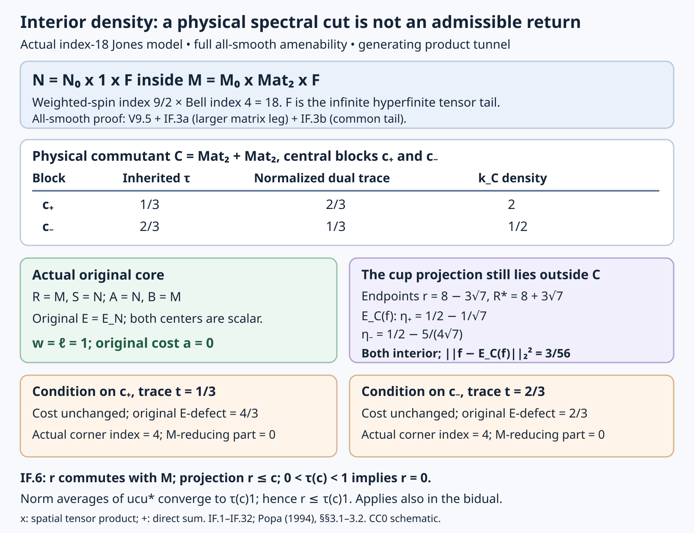

*Figure IF.1. Algebra boxes are schematics of the actual product model IF.20–IF.26. The traces, cup endpoints, variance, and defects are exact values from IF.27–IF.32. The bottom implication is the universal original-\(M\)-reducing obstruction IF.6. The figure does not depict a positive original cost or a proof for arbitrary cores. Reproducible figure sources: [Python source](figures/interior-physical-faces-v10.py) and [SVG](figures/interior-physical-faces-v10.svg).*

The obstruction to a physical spectral-face reduction is independent of factoriality of the core, finiteness of either canonical capacity, and normality of the compatible state. It leaves the original general zero-cost problem, the marked-corner return and full residual partition unresolved. The inherited expectations, both canonical traces, the Jones-ideal face when required, and the distinct \(Z(R)\) and \(Z(S)\) support conditions remain part of that problem.

### Sources and prerequisite proofs for IF.1–IF.32

- Sorin Popa, [*Classification of amenable subfactors of type II*](https://doi.org/10.1007/BF02392646), Acta Mathematica **172** (1994), 163–255. Sections 2.3 and 3.1 give smooth expected representations and the all-smooth amenability definition; Proposition 3.2.3, p.206, specifies the corner and common-amplification heredity used for comparison.
- [Relative norm averaging and central densities](relative-norm-averaging-and-central-density.md), Theorem 81.2; [Finite cup densities and a positive central cost](finite-cup-densities-and-positive-cost.md), (82.5) and (82.11)–(82.13); and [The cup, its tail commutants and central comparison](cup-tail-commutants-and-central-comparison.md), T.5–T.8, supply the original norm averages, cost coordinates and physical cup-density identity.
- [A generating tunnel with incompatible reflected traces](weighted-spin-tunnel.md), (47.1)–(47.14), Proposition 47.2 and Theorem 47.4, supplies the weighted-spin factor, expectation, cups, full tail commutants and generating tunnel.
- [Transporting a core through a tensor factor](transporting-a-core-through-a-tensor-factor.md), Proposition 51.6 and (51.24)–(51.25), supplies the Bell inclusion and its generating tunnel.
- [General tail supports and controlled tunnels](general-tail-supports-and-controlled-tunnels.md), V9.1 and Theorem V9.5, supplies the original state-cost comparison and the complete all-smooth unequal-trace diagonal construction. [Measuring an inclusion through modules and corners](module-dimension-and-local-index.md), Theorem 2.4, supplies the physical local-index formula.

*Independent mathematical exposition, proofs and illustration released under CC0 1.0.*

## State balance and operator balance have different consequences

Joint balance is a condition on a state. Imposing it as an operator identity can require a stronger zero-variance condition. We prove the exact obstruction using the original finite common basis, give a finite quantitative version, and explain why the balanced cyclic GNS representation preserves the original expected pair. The exposition, proofs and diagram are dedicated to CC0 1.0.

### BC3.1. The original core and its center transfer

Let \(N\subset M\) be the original proper finite-index inclusion of II₁ factors, with inherited probability trace \(\tau\) and index \(d>1\). Let \(S\subset R\) be an actual ordinary Jones core, with no factoriality or extremality assumption. On \(L^2(M,\tau)\) put

\[
e=e_R^M,\qquad A=\langle N,e\rangle,\qquad
B=\langle M,e\rangle,\qquad E_A:B\longrightarrow A.
\tag{BC3.1}
\]

The last map is the original normal faithful trace-preserving expectation. Its restriction to \(M\) is \(E_N\), and its canonical trace is \(\operatorname{Tr}\), with \(\operatorname{Tr}(e)=1\). Keep the actual normal full-corner isomorphism

\[
\iota:D_0=Z(S)\vee Z(R)\longrightarrow D=Z(A)\vee Z(B).
\]

Put \(V=Z(R)\) and \(P_0=E_V|_{D_0}\), where this finite expectation preserves the original \(\tau\). A compatible original-trace state \(\varphi\) is joint balanced when

\[
\varphi\iota=\varphi\iota P_0 .
\tag{BC3.2}
\]

No normality of \(\varphi\) or its center restriction is required. The finite rows retain arbitrary finite length \(L\): \(a_i\in N\), \(\sum_i a_i a_i^*=1\), \(h_a=\sum_i a_i e a_i^*\). Their exact physical marginal is \(\tau\); their exact expectation compatibility is \(\psi_a E_A=\psi_a\), where \(\psi_a(T)=\operatorname{Tr}(h_aT)\). Their joint norm is the original \(J_a\).

[V10.15–V10.18 of Lesson99, *General tail supports and controlled tunnels*](general-tail-supports-and-controlled-tunnels.md) identify the compact set \(K_{\mathrm{bal}}\) of all compatible original-trace states satisfying (BC3.2), and give the exact alternative: either this set has an \(M\)-central state, or one fixed finite sum

\[
H=\sum_j(u_j^*T_j u_j-T_j)
\]

has strictly positive evaluation, uniformly on all sufficiently small-\(J_a\) rows. Here the \(u_j\) are physical \(M\)-unitaries and \(T_j=T_j^*\in B\). That is functional positivity on a constrained state set. It is not a strict operator lower bound in \(B\).

The unrestricted amenability hypothesis quantifies over every smooth nondegenerate normal faithful expected representation of the original inclusion. It supplies a possibly singular compatible physical hypertrace in every such representation. The returned hypertrace is not required by that hypothesis to satisfy (BC3.2).

We use [68.1–68.2, the complete common-basis center transfer](core-central-transition-bounds.md). Choose its identity-containing partial orthonormal right basis \(b_1,\ldots,b_r\in R\subset M\), also a basis for \(M/N\), with

\[
\sum_i b_i b_i^*=d1,\qquad
g=\sum_i b_i^*b_i,\qquad
\kappa=d^{-1}E_{D_0}(g).
\]

Its proven conclusions are

\[
\begin{gathered}
d^{-1}1\le\kappa\le (b_d/d)1,\qquad
b_d=1+d(\lceil d\rceil-1),\\
P_0(\kappa)=1,\qquad E_{Z(S)}(\kappa)=1,\\
P_\kappa(t)=P_0(\kappa t),\\
\mathcal I(X)=\sum_i b_i X b_i^*,\qquad
\mathcal I(\iota(t))=d\,\iota(P_\kappa(t))\quad(t\in D_0).
\end{gathered}
\tag{BC3.3}
\]

Thus \(P_\kappa:D_0\to V\) is normal UCP and contractive, and \(\mathcal I/d:B\to B\) is UCP. The right side of the last line lies in \(Z(B)\). The larger-center lift \(\iota(V)\), unlike the whole smaller-center lift, commutes with every physical \(M\)-element. All hypotheses, including the original weight \(\kappa\), remain in the following arguments.

### BC3.2. Exact obstruction to an operator balancing channel

Write

\[
q_\kappa=P_0((\kappa-1)^2)\in V_+ .
\tag{BC3.4}
\]

This is a bounded original-center element. Faithfulness of \(\tau\) and preservation of \(\tau\) by \(P_0\) give
\(\tau(q_\kappa)=\tau((\kappa-1)^2)\). In particular \(q_\kappa=0\) if and only if \(\kappa=1\).

**Theorem BC3.1.** Let \(C\) be any nonzero unital C*-algebra, \(j:M\to C\) a unital *-homomorphism, and \(\Phi:B\to C\) a UCP map satisfying \(\Phi|_M=j\). Suppose operator balance is imposed:

\[
\Phi(\iota(t))=\Phi(\iota(P_0t))\qquad(t\in D_0).
\tag{BC3.5}
\]

Then

\[
\Phi(\iota(q_\kappa))=0.
\tag{BC3.6}
\]

Consequently a map with these properties that is faithful on positive elements of \(\iota(V)\) can exist only if \(\kappa=1\). If \(q_\kappa\ge c1\) for some \(c>0\), there is no such UCP map, even without faithfulness.

The assertion allows nonnormal maps, arbitrary target algebras, nonfactor centers and singular states on the target. A faithful physical embedding \(j\) by itself does not imply faithfulness on \(\iota(V)\); that hypothesis must not be suppressed.

**Proof.** A UCP map agreeing with a *-homomorphism on \(M\) has \(M\) in its multiplicative domain. Thus

\[
\Phi(aXb)=j(a)\Phi(X)j(b)\qquad(a,b\in M,\ X\in B).
\tag{BC3.7}
\]

For completeness, define \(D_\Phi(a,b)=\Phi(a^*b)-\Phi(a)^*\Phi(b)\). Apply complete positivity to the Gram matrix of \((a,b,1)\), then take the Schur complement of its final identity entry. The resulting \(2\times2\) matrix with entries \(D_\Phi(a,a),D_\Phi(a,b),D_\Phi(b,a),D_\Phi(b,b)\) is positive. Positivity, tested on two vectors with a scalar parameter, gives
\(\|D_\Phi(a,b)\|^2\le\|D_\Phi(a,a)\|\|D_\Phi(b,b)\|\).
For \(a\in M\), both \(D_\Phi(a,a)\) and \(D_\Phi(a^*,a^*)\) vanish because \(\Phi|_M=j\). This proves both sides of (BC3.7).

Take \(t=\kappa-1\). Its \(P_0\)-expectation is zero by (BC3.3), so (BC3.5) gives \(\Phi(\iota(t))=0\). Equations (BC3.3) and (BC3.7) now imply

\[
\begin{aligned}
d\,\Phi(\iota(P_\kappa(t)))
&=\Phi(\mathcal I(\iota(t)))\\
&=\sum_i j(b_i)\Phi(\iota(t))j(b_i)^*=0.
\end{aligned}
\]

But
\[
P_\kappa(\kappa-1)
=P_0(\kappa^2-\kappa)
=P_0((\kappa-1)^2)=q_\kappa,
\]
again using \(P_0(\kappa)=1\). This proves (BC3.6). Faithfulness on the indicated positive center elements forces \(q_\kappa=0\), hence \(\kappa=1\). If \(q_\kappa\ge c1\), positivity and unitality instead give \(0=\Phi(\iota(q_\kappa))\ge c1_C\), a contradiction. \(\square\)

There is an important distinction between this operator identity and the requested state identity. The original balanced state

\[
\psi_e(T)=\operatorname{Tr}(eT)
\]

has \(\psi_e(\iota(t))=\tau(t)=\tau(P_0t)\) for every \(t\in D_0\), and is exactly \(E_A\)-compatible with physical marginal \(\tau\). If \(\kappa\ne1\), it nevertheless has

\[
\psi_e(\iota(q_\kappa))=\tau((\kappa-1)^2)>0.
\tag{BC3.8}
\]

Thus no map satisfying (BC3.5) and fixing the physical \(M\) can carry this balanced state as a pullback from \(C\). Operator balance imposes an additional zero-variance support condition; it cannot be substituted for the state condition defining the whole \(K_{\mathrm{bal}}\).

This theorem does not prove that all possible balancing maps fail. A map that selects a singular larger-center support can be nonfaithful there; an operation that balances only one returned hypertrace need not satisfy (BC3.5) as an operator identity. These possibilities remain distinct from the map refuted here.

### BC3.3. A finite physical test budget for approximate channels

The obstruction also survives approximate physical fixation, with all tests chosen before the channel. Let \(C,j\) be as above and let
\(r:V\to C\) be a faithful unital *-homomorphism whose image commutes with \(j(M)\). It is the faithfully retained larger-center label map; it need not have image in all of \(Z(C)\).

Write each \(b_i\) as a fixed finite unitary sum

\[
b_i=\sum_\ell c_{i\ell}v_{i\ell},\qquad
A_i=\sum_\ell|c_{i\ell}|,\qquad
C_b=\frac2d\sum_i A_i^2 .
\tag{BC3.9}
\]

These physical \(v_{i\ell}\in\mathcal U(M)\) form one fixed finite test list. Such a decomposition always exists with \(A_i\le2\|b_i\|\): write \(b_i/\|b_i\|=h+ik\) for self-adjoint contractions, and express \(h=(u_h+u_h^*)/2\), where \(u_h=h+i(1-h^2)^{1/2}\), and similarly for \(k\). Zero basis vectors can be omitted. In particular \(C_b\le8b_d/d\).

**Theorem BC3.2.** Let \(\epsilon,\delta\ge0\). Suppose a UCP map \(\Phi:B\to C\) satisfies

\[
\begin{gathered}
\|\Phi(v_{i\ell})-j(v_{i\ell})\|\le\epsilon,\\
\|\Phi(\iota(t))-r(P_0t)\|\le\delta\|t\|
\qquad(t\in D_0).
\end{gathered}
\tag{BC3.10}
\]

Then

\[
\|P_\kappa-P_0\|
\le 2\delta+C_b(\sqrt{2\epsilon}+\epsilon).
\tag{BC3.11}
\]

The norm on the left is the operator norm of the fixed map \(D_0\to V\). When \(\kappa\ne1\), it is positive and satisfies the more explicit bound

\[
\frac{\|q_\kappa\|}{\|\kappa-1\|}
\le2\delta+C_b(\sqrt{2\epsilon}+\epsilon).
\tag{BC3.12}
\]

There is no row length \(L\), averaging length or retrospective tolerance choice in this estimate.

**Proof.** For a tested unitary \(v\), contraction of \(\Phi(v)\) and \(\|\Phi(v)-j(v)\|\le\epsilon\) give

\[
\|1-\Phi(v)^*\Phi(v)\|\le2\epsilon,\qquad
\|1-\Phi(v)\Phi(v)^*\|\le2\epsilon.
\]

The same kernel inequality used above yields, for any two tested unitaries \(u,v\) and any \(X\in B\),

\[
\|\Phi(uXv^*)-j(u)\Phi(X)j(v)^*\|
\le2(\sqrt{2\epsilon}+\epsilon)\|X\|.
\tag{BC3.13}
\]

Indeed first remove the left product by \(D_\Phi(u^*,Xv^*)\), at cost \(\sqrt{2\epsilon}\|X\|\); then remove the right product by \(D_\Phi(X^*,v^*)\), at the same cost. Replacing the remaining two factors \(\Phi(u),\Phi(v)^*\) by \(j(u),j(v)^*\) costs at most \(2\epsilon\|X\|\).

Expand the two \(b_i\) factors using (BC3.9), and sum the absolute coefficients. This gives

\[
\left\|\Phi(\mathcal I(X))
-\sum_i j(b_i)\Phi(X)j(b_i)^*\right\|
\le 2\sum_i A_i^2(\sqrt{2\epsilon}+\epsilon)\|X\|.
\tag{BC3.14}
\]

Now let \(X=\iota(t)\). The left term is \(d\Phi(\iota(P_\kappa t))\). By the center estimate in (BC3.10), its distance to \(d\,r(P_\kappa t)\) is at most \(d\delta\|P_\kappa t\|\). The sum on the right has distance at most \(d\delta\|t\|\) from

\[
\sum_i j(b_i)r(P_0t)j(b_i)^*
=d\,r(P_0t).
\]

Here \(\|\mathcal I/d\|=1\), \(\sum_i j(b_i)j(b_i)^*=d1_C\), and the commutation hypothesis on \(r(V)\) justify both the norm estimate and the equality. Since \(r\) is faithful it is isometric. Divide by \(d\), use contraction of \(P_\kappa\), and take the supremum over \(\|t\|\le1\). This proves (BC3.11).

Finally \((P_\kappa-P_0)(\kappa-1)=q_\kappa\). Testing on this one bounded element proves (BC3.12). Its left side is positive whenever \(\kappa\ne1\), by (BC3.4). \(\square\)

The corresponding finite version of the proof needs the center estimates only at \(t\) and \(P_\kappa t\), together with the fixed basis-unitary tests. Uniform convergence on the whole center is therefore unnecessary to detect a fixed nonzero variance obstruction. Conversely, weak-star balance of one state is much weaker than either of the operator-norm bounds in (BC3.10).

### BC3.4. The balanced cyclic GNS representation retains the original problem

The state \(\psi_e\) is normal on \(B\), its support projection is \(e\), and \(e\) has full central support in both \(A\) and \(B\). These are the original full-corner facts, rather than an auxiliary finite model.

**Proposition BC3.3.** Its GNS representation \(\pi:B\to B(H_{\psi_e})\) is normal and faithful. Transporting \(A\subset_{E_A}B\) through this representation gives an isomorphic expected pair

\[
\pi(A)\subset_{\bar E_A}\pi(B),\qquad
\bar E_A(\pi(T))=\pi(E_A(T)).
\tag{BC3.15}
\]

It retains the physical inclusion, every represented tower stage, smoothness, normal faithfulness of the expectation and nondegeneracy. Its compatible physical hypertraces are in exact bijection with those of the original pair, by pullback through \(\pi\). The balancing of the cyclic vector imposes no new restriction on that set.

**Proof.** For \(y\in B\), the coefficient of \(\pi(x)\) at \(\pi(y)\xi\) is \(\psi_e(y^*xy)\), normal in \(x\). Polarization gives mixed normal coefficients on a dense set of vectors. Approximating arbitrary vectors gives predual-norm limits of these coefficients, so all coefficients are normal. Thus \(\pi\) is normal.

The kernel of a normal von Neumann algebra representation is \(Bz\) for a central projection \(z\in Z(B)\). If \(z\) belongs to this kernel, then
\[
0=\|\pi(z)\xi\|^2=\psi_e(z)
=\operatorname{Tr}(ez).
\]
Faithfulness of the canonical trace gives \(ez=0\), and full central support of \(e\) gives \(z=0\). Hence \(\pi\) is faithful. The same reasoning applies to its restriction to \(A\).

Consequently \(\pi\) is a normal *-isomorphism onto its von Neumann image, with normal inverse. Conjugating the expectation by that isomorphism defines (BC3.15), still normal and faithful, with the original \(E_N\) on the physical image. Transporting the [finite matrix tower in Theorem61.2](smooth-representations-and-tower-compression.md) gives all original and represented stages and their cups. Commutants and ultraweak spanning identities are invariant under these normal *-isomorphisms, so smoothness and nondegeneracy are unchanged.

For any state \(\rho\) on \(\pi(B)\), the physical centrality equations, exact trace restriction and compatibility are precisely the original equations for \(\rho\pi\); the converse uses \(\pi^{-1}\). This includes singular states. The joint identity also pulls back exactly, when it is present. The cyclic vector state is the one pre-existing balanced state \(\psi_e\), and amenability does not require its returned hypertrace to agree with that vector state. \(\square\)

In particular, if the original pair has an amenability-supplied compatible \(M\)-central state \(\varphi_0\), then every finite commutator sum \(H\) above satisfies \(\varphi_0(H)=0\). Therefore \(H\not\ge c1\) in \(B\) for any \(c>0\). A hypothetical positive functional separator on \(K_{\mathrm{bal}}\) cannot become the operator inequality \(\pi(H)\ge c1\) in this faithful GNS representation: faithfulness preserves order, and the transported \(\varphi_0\) still evaluates it at zero.

This is the precise failed implication in the GNS route. Constructing the balanced cyclic representation and applying the full all-smooth amenability quantifier is allowed; it returns exactly the original central-state existence assertion. Treating its cyclic center marginal as a restriction on every returned hypertrace would add the missing conclusion.

### BC3.5. Joint state balance is not a C*-quotient relation

There is a separate obstruction even before imposing physical fixation.

**Proposition BC3.4.** Let \(P_0:D_0\to V\) be the original trace-preserving expectation. If \(P_0\ne\mathrm{id}_{D_0}\), no unital *-homomorphic quotient \(q:B\to C\) can simultaneously have these properties:

1. Every state on \(C\) pulls back to a state satisfying the joint identity (BC3.2).
2. The balanced state \(\psi_e\) factors through \(q\).

In particular \(K_{\mathrm{bal}}\), which contains \(\psi_e\), cannot be identified with the whole pullback state space of such a C*-quotient. This does not prevent other operator-system constructions.

**Proof.** States separate self-adjoint elements of a unital C*-algebra. The first property therefore implies
\[
q(\iota(t))=q(\iota(P_0t))\qquad(t\in D_0).
\tag{BC3.16}
\]
Choose a real \(t\in D_0\) with \(t\ne P_0t\), and put
\[
v_t=P_0(t^2)-(P_0t)^2
=P_0((t-P_0t)^2)\in V_+ .
\]
Trace preservation and faithfulness give
\(\tau(v_t)=\|t-P_0t\|_{2,\tau}^2>0\).
Apply (BC3.16) to \(t\) and to \(t^2\). Multiplicativity of \(q\iota\) gives
\[
q(\iota(P_0(t^2)))
=q(\iota(t))^2
=q(\iota((P_0t)^2)),
\]
so \(q(\iota(v_t))=0\). If \(\psi_e=\rho q\), then
\[
0=\rho(q(\iota(v_t)))=\psi_e(\iota(v_t))=\tau(v_t)>0,
\]
a contradiction. \(\square\)

Only the last proposition uses multiplicativity on the joint algebra. A UCP map is allowed to have zero value at \(t-P_0t\) and positive value at its square. The physically fixed UCP-map obstruction in Theorem BC3.1 is different: its zero variance follows from the exact actual finite-basis transfer (BC3.3), not from treating a CP map as multiplicative.

The maximal tensor product and normal-part cut of the source's §2.4 produce actual expected representations from an auxiliary algebra acting in the physical commutant. They do not make the joint conditional expectation a *-homomorphism. If that construction is used to encode (BC3.16), its quotient relations must still be checked against the variance calculation above. A construction of a smooth expected representation with a suitable state-dependent transfer remains an additional proof obligation.

### BC3.6. Consequences and the unrestricted state question

Functional balance and operator balance have different consequences. A physically fixed UCP balancing map must annihilate the actual larger-center variance \(q_\kappa\). A faithful retained-center map therefore forces flat transfer weight, and approximate maps obey the finite physical bound (BC3.11). This provides a testable obstruction for that proposed representation/CP-map route, without using an auxiliary matrix as an actual Jones core.

The balanced cyclic GNS route is exactly the original expected pair in a normal faithful representation; it does not enlarge the amenability conclusion. Turning joint state constraints into quotient relations also loses the faithful inherited center variance and cannot represent the full balanced state set.

These results do not assert that a finite separator exists for an amenable inclusion. They do not rule out a state-dependent, nonfaithful-center or other valid construction. They do not establish the unrestricted \(M\)-central joint-balanced state, simultaneous small \(J_h\), full original finite partition, marked corner return, residual bound, zero endpoint or generating conclusion.

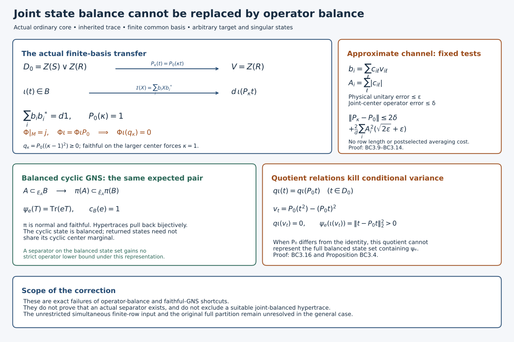

*Figure BC3.1.* The upper square is in the actual original core and its physical basis; the lower panels show the unchanged expected pair under faithful GNS and the variance killed by a quotient. Arrows are typed maps, not trace-scaled areas. The exact constants and hypotheses are those of BC3.3–BC3.16. The separate four-point check in the reproducible source is an abelian illustration only; it is not asserted to be a Jones core. [Full figure](figures/operator-balance-obstruction-v10.svg), [editable CC0 figure source](figures/operator-balance-obstruction-v10.py).

Human mathematical context: Sorin Popa, *Classification of amenable subfactors of type II*, Acta Mathematica 172 (1994), 163–255, [DOI 10.1007/BF02392646](https://doi.org/10.1007/BF02392646), §2.4, printed pp.198–200, and Definition 3.1.1, printed p.203. The prerequisite proofs are [52.1–52.2, common bases and canonical full corners](canonical-core-traces-and-integer-rounding.md), [61.1–61.2, expected representations and their finite matrix towers](smooth-representations-and-tower-compression.md), [68.1–68.2, the weighted center transfer](core-central-transition-bounds.md), and [FC.3–FC.24, V8.9 and V10.15–V10.18 of Lesson99](general-tail-supports-and-controlled-tunnels.md). These last providers retain finite column normalization, the normal and singular state branches, and the exact compact separating alternative.

## A finite physical budget controls the original joint norm

The identity V9.2 assumes exact \(M\)-centrality. The following estimate retains the same joint algebra and both inherited trace measures when the state has only finitely many controlled physical commutators. It applies before taking any limiting state and before either matrix deletion.

Retain \(A,B,E_A,D_0,U,V,Q,P_0,\iota\), the common basis \(b_1,\ldots,b_{t_0}\), and \(g,z,w,\ell,\mathfrak a\) from IF.1–IF.2 and V9.1. Thus

\[
\begin{gathered}
\sum_i b_i b_i^*=d1,\qquad
g=\sum_i b_i^*b_i,\qquad z=E_{N'\cap M}(g),\\
w=d^{-1}E_{D_0}(g),\qquad
\ell=d^{-1}E_{D_0}(z),\\
w\ge d^{-1}1,\qquad
\mathfrak a=\iota(dQ(|w-\ell|)).
\end{gathered}
\tag{JB.1}
\]

Let \(\sigma\) be a state on the **original** \(B\), satisfying

\[
\sigma E_A=\sigma,\qquad
\sigma|_M=\tau_M,\qquad
\sigma(nT)=\sigma(Tn)\quad(n\in N,\ T\in B).
\tag{JB.2}
\]

Exact \(M\)-centrality is not assumed. For its original joint restrictions and finite physical errors put

\[
\begin{gathered}
\alpha_\sigma(t)=\sigma(\iota(t)),\qquad
\gamma_\sigma=\alpha_\sigma P_0,\\
r_i(\sigma)=
\bigl\|\,T\longmapsto\sigma(b_iT-Tb_i)\,\bigr\|_{B^*},\\
\mathcal E_\sigma=
\frac{\|w^{-1}\|}{d}\sum_i\|b_i\|r_i(\sigma).
\end{gathered}
\tag{JB.3}
\]

These are full bounded-functional norms. A test against one specified \(T\), or a norm on the smaller physical algebra alone, cannot replace \(r_i\).

**Theorem JB.1 — approximate original density identity.** With no normality assumption on \(\sigma\) or its center restrictions,

\[
\begin{gathered}
\left\|\gamma_\sigma-
\alpha_\sigma\bigl((\ell/w)\,\cdot\bigr)\right\|
\le\mathcal E_\sigma,\\
\left|
\|\alpha_\sigma-\gamma_\sigma\|
-\alpha_\sigma(|1-\ell/w|)
\right|\le\mathcal E_\sigma,\\
\|\alpha_\sigma-\alpha_\sigma P_0\|
\le\sigma(\mathfrak a)+\mathcal E_\sigma .
\end{gathered}
\tag{JB.4}
\]

**Proof.** For \(t\in D_0\), write \(x=\iota(t)\). The original finite-basis transfer of [68.2](core-central-transition-bounds.md) has

\[
\mathcal I(x)=\sum_i b_i x b_i^*
=d\,\iota(P_0(wt)).
\tag{JB.5}
\]

Moving just the left basis factor in each state pairing gives

\[
\begin{gathered}
\left|\sigma(\mathcal I(x))-\sigma(xg)\right|\\
\le\sum_i r_i(\sigma)\|xb_i^*\|
\le\|t\|\sum_i\|b_i\|r_i(\sigma).
\end{gathered}
\tag{JB.6}
\]

The lift \(x\) commutes with \(N\). Consequently exact \(N\)-centrality gives \(\sigma(xvgv^*)=\sigma(xg)\) for every \(v\in\mathcal U(N)\). The actual relative norm averages of [81.2](relative-norm-averaging-and-central-density.md) converge to \(z\). Norm continuity of the bounded state, including a singular state, therefore gives \(\sigma(xg)=\sigma(xz)\).

For completeness, the last compatible corner calculation uses no \(M\)-centrality. Since \(z\in N'\cap M\subset R\), it commutes with \(A\). Both \(x\) and \(xz\) commute with \(A\), so \(E_A(xz)\in Z(A)\). Compressing by the original full corner \(e\) gives its label \(E_S(tz)=dQ(\ell t)\). The equality follows by trace adjointness through \(D_0\): the \(Z(S)\)-expectation of \(tz\) equals that of \(tE_{D_0}(z)\). Fullness of the corner identifies the central lift uniquely. Compatibility and \(\alpha_\sigma=\alpha_\sigma Q\) now give

\[
\sigma(xz)=d\alpha_\sigma(\ell t),\qquad
\sigma(\mathcal I(x))=d\gamma_\sigma(wt).
\tag{JB.7}
\]

Substitute \(t=w^{-1}s\) in (JB.6), for every \(\|s\|\le1\), and divide by \(d\). This proves the first norm estimate. The functional \(s\mapsto\alpha_\sigma((1-\ell/w)s)\) has norm \(\alpha_\sigma(|1-\ell/w|)\), by positive and negative parts in the original abelian algebra. The triangle and reverse triangle inequalities prove the second estimate. Finally \(dw\ge1\) and compatibility give
\(\alpha_\sigma(|1-\ell/w|)\le d\alpha_\sigma(|w-\ell|)=\sigma(\mathfrak a)\).
This proves the third estimate. \(\square\)

## The exact norm price of a smaller-center cost cut

Let \(\psi\) be an available compatible \(M\)-central state with the original physical trace. For \(f\in Z(A)\), \(0\le f\le1\), and \(t=\psi(f)>0\), use the actual reweighting

\[
\psi_f(T)=t^{-1}\psi(fT).
\tag{JB.8}
\]

[AS.2–AS.3, exact bounded reweighting](selecting-a-compatible-hypertrace.md) proves positivity, domination \(\psi_f\le t^{-1}\psi\), exact compatibility, \(N\)-centrality and the physical marginal \(\psi_f|_M=\tau_M\). Those results apply even when the original center restrictions are singular. They also preserve Jones-ideal annihilation when it is present. Thus \(\psi_f\) satisfies all of (JB.2); its remaining physical commutators are charged explicitly.

**Proposition JB.2 — exact bounded-functional defects.** For every physical unitary \(u\in M\),

\[
\begin{gathered}
\|\psi_f-\psi\|=\psi(|f/t-1|),\\
\|\psi_f\operatorname{Ad}u-\psi_f\|
=t^{-1}\psi(|u^*fu-f|).
\end{gathered}
\tag{JB.9}
\]

If \(f=c\) is a projection of mass \(t\), then

\[
\|\psi_c-\psi\|=2(1-t),\qquad
\|\psi_c\operatorname{Ad}u-\psi_c\|\le4(1-t).
\tag{JB.10}
\]

For a general contraction weight, the first norm in (JB.9) is at most \(2(1-t)\). If \(f\le1_{[0,\varepsilon]}(\mathfrak a)\), then \(\psi_f(\mathfrak a)\le\varepsilon\), and hence

\[
\|\alpha_{\psi_f}-\alpha_{\psi_f}P_0\|
\le \varepsilon+
\frac{\|w^{-1}\|}{d}\sum_i\|b_i\|r_i(\psi_f).
\tag{JB.11}
\]

**Proof.** The centralizer of \(\psi\) is a norm-closed star algebra. It contains \(M\) and \(Z(A)\), by AS.2, so it contains the two selfadjoint elements \(f/t-1\) and \(u^*fu-f\). For any selfadjoint element \(a\) of this centralizer, the functional \(T\mapsto\psi(aT)\) has norm \(\psi(|a|)\). Its positive and negative parts give the upper bound. The continuous contraction tests \(a(|a|+\delta)^{-1}\), \(\delta>0\), give the reverse bound because their products with \(a\) converge uniformly to \(|a|\). Thus the argument does not require ultraweak continuity of \(\psi\), or centralizer membership of a discontinuous sign function.

The first identity in (JB.9) follows immediately. Original \(u\)-centrality gives
\(\psi(fuTu^*)=\psi(u^*fuT)\), proving the second. For a projection \(c\), evaluate \(|c/t-1|\) on \(c,1-c\) to get \(2(1-t)\). Since conjugation is an isometry on \(B^*\) and fixes \(\psi\), the two distances to \(\psi\) give (JB.10). For \(0\le f\le1\), positivity gives the exact decomposition \(\psi=t\psi_f+(1-t)\psi_{1-f}\), when \(t<1\), so the first distance is at most \(2(1-t)\). The case \(t=1\) follows from domination and zero mass of \(1-f\).

The spectral support condition gives \(0\le f\mathfrak a\le\varepsilon f\), in the original smaller center. Apply \(\psi\), divide by \(t\), and then use Theorem JB.1. \(\square\)

A low-cost cut has therefore kept the expectation and physical trace while paying an exact price in the original physical commutators. It has not cut down either represented algebra or changed either canonical trace. Formula (JB.11) quantifies that price in the original joint norm. It does not assert that unrestricted amenability supplies a positive-mass low-cost cut with a small price. In particular, replacing the state by its GNS representation still requires an actual normal smooth expected representation and a compatible return, as in [61.1–61.2](smooth-representations-and-tower-compression.md).

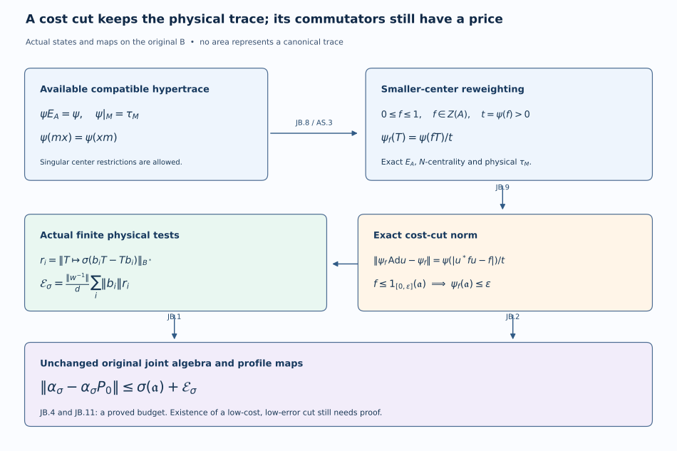

Figure JB.1. The arrows give actual reweighting and bounded-functional estimates on the original \(B\). The lower box retains the two original joint profile maps; it is a proved estimate, not an assertion that a suitable cut exists. Rectangles are a diagram of maps, not areas proportional to either canonical trace. Proofs: JB.1–JB.11; prerequisite reweighting: AS.2–AS.4. Human context: Popa (1994), §2.4 and Definition3.1.1, printed pp.198–200 and203. [Editable figure source](figures/cost-localization-and-state-return-v11.py).

## A fixed averaging list can miss one physical target

### BC4.1. What genuine left averaging preserves

Keep the original proper finite-index II₁ inclusion \(N\subset M\), probability trace \(\tau\), actual ordinary core \(S\subset R\), projection \(e=e_R^M\), and canonical expected pair

\[
A=\langle N,e\rangle\subset B=\langle M,e\rangle,\qquad E_A:B\to A.
\]

No factoriality of the cores or normality of an amenability-supplied state is imposed. The canonical trace has \(\operatorname{Tr}(e)=1\). For any finite coisometric row \((a_i)_{i=1}^L\subset N\), put

\[
\sum_i a_i a_i^*=1,\qquad h_a=\sum_i a_i e a_i^*,\qquad
g_a=\sum_i a_i^*a_i,\qquad
J_a=\|E_{Z(S)}(g_a)-P_0E_{Z(S)}(g_a)\|_1.
\tag{BC4.1}
\]

Here \(P_0=E_{Z(R)}\) retains the inherited finite trace. The full finite-column normalization, exact physical marginal \(\operatorname{Tr}(h_a\,\cdot)|_M=\tau\), and exact compatibility are the original [FC.3–FC.24](general-tail-supports-and-controlled-tunnels.md).

**Lemma BC4.1.** For any finite convex average
\[
\mathcal T(X)=\sum_{j=1}^s\theta_j v_jXv_j^*,
\qquad v_j\in\mathcal U(N),\quad \theta_j\ge0,\quad \sum_j\theta_j=1,
\tag{BC4.2}
\]
the row \((\sqrt{\theta_j}v_j a_i)_{j,i}\) is coisometric, represents \(\mathcal T(h_a)\), and has exactly the old right sum \(g_a\) and exactly the old \(J_a\). Its physical marginal and expectation compatibility remain exact. For a physical unitary \(u\in M\),

\[
\begin{gathered}
\|\mathcal T(h_a)-h_a\|_1
\le\sum_j\theta_j\|v_jh_av_j^*-h_a\|_1,\\
\|u\mathcal T(h_a)u^*-\mathcal T(h_a)\|_1
\ge\|uh_au^*-h_a\|_1-2\|\mathcal T(h_a)-h_a\|_1.
\end{gathered}
\tag{BC4.3}
\]

**Proof.** The left row sum is
\(\sum_j\theta_jv_j(\sum_i a_i a_i^*)v_j^*=1\).
The right row sum is
\(\sum_{j,i}\theta_j a_i^*v_j^*v_j a_i=g_a\).
The represented density is precisely (BC4.2); the finite-column theorem therefore gives both exact state conditions. Convexity gives the first inequality. Subtract the two commutators, use unitary invariance of the tracial \(L^1\) norm, and apply the reverse triangle inequality for the second. \(\square\)

Thus the right norm is preserved without a row-length factor. The lemma alone does not say that any fixed finite choice of the \(v_j\) improves all original \(M\)-targets. The example below disproves that stronger assertion with all the original representation hypotheses present.

### BC4.2. The physical index-two inclusion

Let

\[
Q=\overline{\bigotimes}_{j\ge0}(\operatorname{Mat}_2^{(q_j)},\operatorname{tr}_2),
\qquad
\alpha=\bigotimes_{j\ge0}\operatorname{Ad}Z_j,
\qquad N_0=Q^\alpha ,
\tag{BC4.4}
\]

where \(X_j=\begin{pmatrix}0&1\\1&0\end{pmatrix}\) and
\(Z_j=\operatorname{diag}(1,-1)\) are the Pauli matrices in the indicated defining matrix coordinate. Set \(u=X_0\). The product trace is always used.

For \(F_l=\bigotimes_{j=0}^{l-1}\operatorname{Mat}_2^{(q_j)}\), the finite expectations \(E_{F_l}\) commute with \(\alpha\), converge in \(L^2\) on every physical element, and have uniformly bounded outputs. The fixed algebra \(F_l^\alpha\) is the two full parity blocks; its center is spanned by \(1\) and \(W_{l-1}=Z_0\cdots Z_{l-1}\).

The factor and index assertions can be checked directly. An element commuting with every \(F_l\) is scalar, because its finite expectations are scalar; thus \(Q\) is a factor. If \(x\in N_0'\cap Q\), its finite expectation commutes with \(F_l^\alpha\), so
\[
E_{F_l}(x)=\tau(x)1+b_lW_{l-1}.
\]
Indeed the commutant of the two full parity blocks inside \(F_l\) is exactly their two-dimensional center. Applying \(E_{F_l}\) to the corresponding formula at \(l+1\) kills \(W_l\), because its last \(Z_l\)-coordinate has trace zero. Hence every \(b_l=0\), and \(L^2\) convergence gives \(x=\tau(x)1\). Consequently \(N_0\) is a factor as well. It is generated by its increasing finite-dimensional \(F_l^\alpha\), and is II₁ since their matrix block sizes are unbounded.

The automorphism \(\alpha\) is outer. If it were implemented by a unitary \(w\in Q\), approximate \(w\) in \(L^2\) by \(E_{F_l}(w)\). The latter commutes with the fresh \(X_l\), whereas \(\alpha(X_l)=-X_l\). The bound
\(\|[w,X_l]\|_2\le2\|w-E_{F_l}(w)\|_2\)
would then tend to zero, contradicting \(\|[w,X_l]\|_2=2\).

The physical expectation is
\[
E_{N_0}=\tfrac12(\mathrm{id}+\alpha).
\]
Every \(x\in Q\) has the exact expansion
\[
x=E_{N_0}(x)+uE_{N_0}(u^*x).
\tag{BC4.5}
\]
Its odd part is \(u\) times an even element. Thus \(1,u\) are a full unitary right basis, \(u^2=1\), and \([Q:N_0]=2\). Equivalently \(E_{N_0}(x)\ge x/2\) for \(x\ge0\), and the nonzero projection \((1+u)/2\) has expectation \(1/2\), giving the exact optimal constant. Conjugation by \(u\) normalizes \(N_0\).

### BC4.3. An explicit ordinary Jones tunnel, with its actual core

Write \(Q_{\ge j}\) for the product beginning at coordinate \(j\), and \(\alpha_j\) for its product parity automorphism. For \(x\in Q_{\ge j+1}\), write \(x=x_{\mathrm e}+x_{\mathrm o}\) for its even and odd parts, and define the normal trace-preserving *-embedding

\[
\beta_j(x)=1_{q_j}\otimes x_{\mathrm e}
+X_j\otimes x_{\mathrm o}
\quad:Q_{\ge j+1}\longrightarrow Q_{\ge j}^{\alpha_j}.
\tag{BC4.6}
\]

Graded multiplication verifies multiplicativity: the even product consists of even-even and odd-odd terms, and the odd product of the two mixed terms. Adjoint preservation is immediate, and trace preservation makes the map faithful.

Define, inside \(Q\),

\[
\begin{gathered}
L_0=Q,\\
L_{2j+1}=1_{\{0,\ldots,j-1\}}\otimes Q_{\ge j}^{\alpha_j},\\
L_{2j+2}=1_{\{0,\ldots,j-1\}}\otimes\beta_j(Q_{\ge j+1})
\qquad(j\ge0).
\end{gathered}
\tag{BC4.7}
\]

All these algebras are II₁ factors, and \(L_1=N_0\). The cups are

\[
g_0=\tfrac12(1+X_0),\qquad
g_{2j}=\tfrac12(1+X_{j-1}X_j)\ (j\ge1),\qquad
g_{2j+1}=\tfrac12(1+Z_j).
\tag{BC4.8}
\]

**Proposition BC4.2.** The sequence (BC4.7) is an ordinary index-two Jones tunnel: every consecutive triple \(L_{k+2}\subset L_{k+1}\subset L_k\), with the indicated \(g_k\), is its actual full basic construction. Its larger and smaller cores are \(Q\) and \(N_0\).

**Proof.** It suffices to check two triples on \(Q_{\ge j}\). Put
\[
A_j=Q_{\ge j}^{\alpha_j},\quad
T_j=\beta_j(Q_{\ge j+1}),\quad
B_j=1_{q_j}\otimes Q_{\ge j+1}^{\alpha_{j+1}}.
\]
Inside \(A_j\), the fixed algebra of \(\operatorname{Ad}X_j\) is \(T_j\): its matrix decomposition contains the \(1_j\)-coefficient with an even tail and the \(X_j\)-coefficient with an odd tail, while the \(Y_j\) and \(Z_j\) coefficients are removed. The original trace-preserving expectation onto \(T_j\) is their two-term conjugation average.

Let \(p_X=(1+X_j)/2\). It commutes with \(T_j\), satisfies \(E_{A_j}(p_X)=1/2\), and for \(a\in A_j\),
\[
p_X a p_X=E_{T_j}(a)p_X .
\]
The algebra generated by \(A_j\) and \(p_X\) is \(Q_{\ge j}\): adjoining \(X_j\) lets us recover a physical odd element from its product with \(X_j\), while the even elements were already in \(A_j\). Thus \(T_j\subset A_j\subset Q_{\ge j}\) has the Jones compression, generation and inherited Markov normalization.

For the other triple use \(p_Z=(1+Z_j)/2\in A_j\). Its expectation onto \(T_j\) is \(1/2\). The compression of \(\beta_j(x)\) is
\[
p_Z\beta_j(x)p_Z=(1_j\otimes x_{\mathrm e})p_Z,
\]
which implements \(B_j\subset T_j\). The algebra generated by \(T_j,p_Z\) is all \(A_j\): multiplication by \(Z_j\) recovers the \(Z_j\)-even and \(Y_j\)-odd coefficients as well. Both smaller algebras are factors of index two, by the same even/odd unitary-basis computation (BC4.5).

Here is also a direct verification of fullness. A unitary right basis for \(A_j/T_j\) is \(1,Z_j\), since \(E_{T_j}=(\mathrm{id}+\operatorname{Ad}X_j)/2\) and \(Z_j\) is odd for this involution. The two range projections \(p_X\) and \(Z_jp_XZ_j=1-p_X\) are orthogonal and sum to one. The operators \(b_i p_X t b_k^*\), \(b_0=1,b_1=Z_j,t\in T_j\), therefore form the full \(2\times2\) matrix algebra over \(T_j\): compression gives the matrix-unit multiplication, and the identity range sum gives its unit. The corner map \(t\mapsto tp_X\) is faithful, because \(\tau(tp_X)=\tau(t)/2\) for positive \(t\in T_j\). The finite basis expansion places \(A_j\) in this matrix algebra, so its generation with \(p_X\) proves that it is all \(Q_{\ge j}\).

For \(T_j/B_j\) use the unitary basis \(1,X_jX_{j+1}\), obtained by applying \(\beta_j\) to the even/odd tail basis \(1,X_{j+1}\). Its two \(p_Z\)-range projections are \(p_Z\) and \(1-p_Z\). The identical matrix calculation gives all \(A_j\). The inherited Markov pairings are
\(\tau(ap_Xb)=\tau(ab)/2\) for \(a,b\in A_j\), and
\(\tau(ap_Zb)=\tau(ab)/2\) for \(a,b\in T_j\).
For the first pairing the extra \(X_j\)-term is odd under \(\alpha_j\); for the second the \(Z_j\)-coefficient is orthogonal to both matrix coefficients of \(\beta_j\). Thus the canonical trace is exactly \(2\tau\), and both matrix algebras are the actual full basic constructions with their original trace and expectations.

Transport the first triple through \(\beta_{j-1}\) when \(j\ge1\). Its cup becomes \((1+X_{j-1}X_j)/2\). Transport the second through the identity on the previous coordinates. This gives precisely every triple and every cup in (BC4.7)–(BC4.8), including the initial \(g_0\).

Finally the fixed algebra \(Q_{\ge j}^{\alpha_j}\) is irreducible in \(Q_{\ge j}\), by the finite-expectation proof above applied to that tail. Consequently
\[
L_{2j+1}'\cap Q=F_j,\qquad
L_{2j+1}'\cap N_0=F_j^\alpha .
\tag{BC4.9}
\]
Their increasing unions are dense in \(Q,N_0\), respectively. Thus the actual ordinary cores are those full factors. \(\square\)

Now let \(D=\overline{\bigotimes}_{l\ge0}\operatorname{Mat}_2^{(d_l)}\) with its original product trace, and take the physical inclusion and tunnel

\[
N=N_0\bar\otimes D\subset M=Q\bar\otimes D,
\qquad \widehat L_k=L_k\bar\otimes D.
\tag{BC4.10}
\]

Every consecutive triple is the tensor product of the proved triple with the identical \(D\)-inclusion. The cups are \(g_k\otimes1\); the same compression and full spanning identities prove they are the actual Jones triples. Relative-commutant slicing, since \(D\) is a factor, gives the ordinary cores

\[
S=N_0\otimes1,\qquad R=Q\otimes1.
\tag{BC4.11}
\]

Thus on \(L^2(Q)\otimes L^2(D)\) their actual canonical pair is

\[
\begin{gathered}
e=1_{L^2(Q)}\otimes e_{\mathbb C}^{D},\\
A=L(N_0)\bar\otimes B(L^2(D)),\qquad
B=L(Q)\bar\otimes B(L^2(D)),\\
\operatorname{Tr}=\tau_Q\otimes\operatorname{Tr}_{\mathrm{Hilbert},D},\qquad
E_A=E_{N_0}^{Q}\otimes\mathrm{id}.
\end{gathered}
\tag{BC4.12}
\]

The rank-one terms \(d_1e_{\mathbb C}^Dd_2\) span all finite-rank operators on the dense physical \(D\)-vectors, proving the full \(D\)-operator algebra displayed here. Both core centers are scalar, and \(J_a=0\) for every row in this example. The common physical basis is exactly \(1,u\), contained in \(R\), so the actual finite-basis transfer weight is \(1\). The trace in (BC4.12) is the canonical trace; it is not Hilbert trace on the infinite \(Q\)-coordinate.

The canonical pair is itself smooth and nondegenerate. If \(M_{0,j}\) denotes the finite physical tower of \(N_0\subset Q\), then the physical tower of (BC4.10) is \(M_{0,j}\bar\otimes D\), whereas the represented tower of (BC4.12) is \(M_{0,j}\bar\otimes B(L^2(D))\). These identities follow by iterating the same finite basis matrix construction [61.2](smooth-representations-and-tower-compression.md). Its physical relative commutant is \((N_0'\cap M_{0,j})\otimes1\), and therefore commutes with \(A\) at every stage. The common two-term physical basis spans \(B\) over \(A\), proving nondegeneracy.

### BC4.4. Full amenability for every smooth expected representation

The counterexample must retain the all-smooth hypothesis, not merely have a hypertrace in (BC4.12).

**Proposition BC4.3.** The inclusion (BC4.10) is amenable for every smooth nondegenerate normal faithful expected representation, with the original physical trace and expectation.

**Proof.** Let \(\mathcal U\subset_E\mathcal V\) be any such representation. Its common physical basis \(1,u\otimes1\) extends to
\[
x=E(x)+uE(u^*x)\quad(x\in\mathcal V),
\]
by the normal finite-row proof [61.1](smooth-representations-and-tower-compression.md). We still write \(u\) for the physical \(u\otimes1\).

In its finite matrix basic construction [61.2](smooth-representations-and-tower-compression.md), the original cup \(e_0\) and physical \(u\) are
\[
e_0=\begin{pmatrix}1&0\\0&0\end{pmatrix},\qquad
u=\begin{pmatrix}0&1\\1&0\end{pmatrix}.
\]
Hence \(u e_0u^*=1-e_0\). Smoothness makes \(e_0\) commute with \(\mathcal U\). Therefore \(u\mathcal Uu^*\) commutes with \(e_0\) too. The cup compression and faithfulness imply
\(\mathcal V\cap\{e_0\}'=\mathcal U\): if \(x\) commutes with \(e_0\), then \((x-E(x))e_0=0\); compression of its squared norm gives \(E((x-E(x))^*(x-E(x)))e_0=0\). Multiplication by \(e_0\) on \(\mathcal U\) is faithful in this matrix model, and \(E\) is faithful. Thus \(x=E(x)\). It follows that \(\beta=\operatorname{Ad}u\) is a normal order-two automorphism of \(\mathcal U\), extending the original physical automorphism of \(N\). The finite expansion also proves \(E\beta=\beta E\).

The physical \(N=N_0\bar\otimes D\) is generated by increasing unital finite-dimensional algebras \(H_l\). Extend \(\tau_N\) to any state \(\chi_0\) on \(\mathcal U\). For each \(H_l\), a finite unitary twirl \(\Gamma_l\) has range in \(H_l'\cap\mathcal U\). Here is an explicit twirl for arbitrary \(H_l=\bigoplus_j\operatorname{Mat}_{n_j}\). First average conjugation by all sign unitaries \(\sum_j\epsilon_j z_j\), where \(z_j\) are its central block projections and \(\epsilon_j=\pm1\); this removes the off-block corners. Then, in each block, average conjugation by its \(n_j^2\) Weyl unitaries, extended by the identity in the other blocks. The finite product of these averages commutes with every matrix unit of \(H_l\). Every unitary used lies in physical \(N\), so \(\chi_l=\chi_0\Gamma_l\) still has the exact physical marginal \(\tau_N\).

A weak-star cluster \(\chi\) is central for every \(H_l\). Centrality extends to every \(n\in N\) without asserting normality of \(\chi\): for \(n_l=E_{H_l}(n)\) and \(X\in\mathcal U\), state Cauchy–Schwarz and its exact normal physical marginal give
\[
|\chi(nX-Xn)|\le2\|X\|\|n-n_l\|_{2,\tau}\longrightarrow0.
\]
The state \(\bar\chi=(\chi+\chi\beta)/2\) is still \(N\)-central with original physical trace, and is \(\beta\)-invariant.

Set \(\varphi=\bar\chi E\). It is exactly \(E\)-compatible and has physical marginal \(\tau_M\). It is \(N\)-central by expectation bimodularity. For \(x=a+ub\), \(a,b\in\mathcal U\), the two expectations of \(ux\) and \(xu\) are \(b\) and \(\beta(b)\), so \(\varphi(ux)=\varphi(xu)\). The physical expansion (BC4.5) now gives \(M\)-centrality. The arbitrary representation may have nonfactor algebras and may not be sigma-finite. The state constructed may be singular. Only the stated smoothness and normal faithful expectation were used. This proves the full quantifier. \(\square\)

### BC4.5. Actual finite rows with a fixed unrepaired physical defect

For \(m\ge1\) put

\[
W_m=Z_0\cdots Z_m,\qquad p_m=\tfrac12(1+W_m)\in N_0 .
\tag{BC4.13}
\]

Then \(\tau(p_m)=1/2\), \(up_mu^*=1-p_m\), and \(p_m\) commutes with \(F_{m+1}^\alpha\). Consequently \((p_m)\) is a central sequence in \(N_0\).

On the first physical \(D\)-coordinate put \(p_+=E_{11}^{(d_0)}\), \(p_-=E_{22}^{(d_0)}\), and let \(D_m=\bigotimes_{l=1}^m\operatorname{Mat}_2^{(d_l)}\cong\operatorname{Mat}_{k_m}\), \(k_m=2^m\). Let \(V_{m,a,b}\), \(0\le a,b<k_m\), be its trace-orthonormal Weyl unitaries. Define

\[
c_{r,+}=E_{r1}^{(d_0)},\qquad c_{r,-}=E_{r2}^{(d_0)}\quad(r=1,2).
\]

Take all columns

\[
\begin{gathered}
a_{m,r,a,b,+}=p_m\otimes c_{r,+}V_{m,a,b}/k_m,\\
a_{m,r,a,b,-}=(1-p_m)\otimes c_{r,-}V_{m,a,b}/k_m .
\end{gathered}
\tag{BC4.14}
\]

Their number is \(L_m=4k_m^2\). Their left sum is exactly one: each \(D\)-sign row has left sum one, and the two physical \(p_m\)-branches sum to one. Their right sum is

\[
g_m=p_m\otimes2p_+ +(1-p_m)\otimes2p_- .
\tag{BC4.15}
\]

Let \(q_m\) be the projection of \(L^2(D_{>0})\) onto \(L^2(D_m)\otimes\widehat1_{\mathrm{rest}}\), and denote by \(\rho\) the actual right action on \(L^2(\operatorname{Mat}_2^{(d_0)})\). Each \(\rho(p_\pm)\) has ordinary rank two. The represented row density is

\[
\begin{gathered}
h_m=p_m\otimes h_{m,+}+(1-p_m)\otimes h_{m,-},\\
h_{m,\pm}=\frac1{2k_m^2}\rho(p_\pm)\otimes q_m .
\end{gathered}
\tag{BC4.16}
\]

Indeed the two vectors \(\widehat{E_{r1}}\), or \(\widehat{E_{r2}}\), have squared norm \(1/2\) and span the corresponding right-column space. The Weyl vectors span \(L^2(D_m)\). This proves (BC4.16) with its exact constants.

The two \(h_{m,\pm}\) have canonical Hilbert trace one and orthogonal supports. The density \(h_m\) has canonical trace one, is \(1/(2k_m^2)\) times a projection of canonical trace \(2k_m^2\), and has the exact physical trace and expectation compatibility of its coisometric row. Its original \(J_m\) is zero.

It commutes with the whole physical
\[
H_m=F_{m+1}^{\alpha}\bar\otimes
(\operatorname{Mat}_2^{(d_0)}\otimes D_m)\subset N.
\]
These algebras generate \(N\). For every fixed \(x\in N\),

\[
\|[x,h_m]\|_1\le
2\|x-E_{H_m}(x)\|_{2,\tau}\longrightarrow0.
\tag{BC4.17}
\]

To justify the bound, put \(z=x-E_{H_m}(x)\) and use
\(\|zh_m\|_1\le\|zh_m^{1/2}\|_2\|h_m^{1/2}\|_2\)
and its right-handed version. Their squared \(L^2\) norms are
\(\operatorname{Tr}(h_mz^*z)=\tau(z^*z)\) and
\(\operatorname{Tr}(h_mzz^*)=\tau(zz^*)\).
This uses the exact physical marginal, not a bound involving \(L_m\).

The one fixed physical unitary \(u=X_0\otimes1\in M\) instead satisfies

\[
\|uh_mu^*-h_m\|_1=2\qquad(m\ge1).
\tag{BC4.18}
\]

It swaps \(p_m\) and \(1-p_m\). The supports of the original and swapped positive densities are orthogonal, by both the physical projections and the two right-column projections. Their trace-norm distance is the sum of their traces, namely two.

**Theorem BC4.4 — no fixed smaller-factor repair average.** For every fixed finite average \(\mathcal T\) of the form (BC4.2), the actual densities above obey

\[
\begin{gathered}
J_{\mathcal T(h_m)}=0,\qquad
\|[x,\mathcal T(h_m)]\|_1\longrightarrow0\quad(x\in N),\\
\|u\mathcal T(h_m)u^*-\mathcal T(h_m)\|_1\longrightarrow2 .
\end{gathered}
\tag{BC4.19}
\]

All physical marginals and original expectations remain exact. Thus no finite left-\(N\) averaging list chosen independently of the input row can uniformly repair the fixed physical \(u\)-target from arbitrarily small smaller-factor defects and original \(J_h\).

**Proof.** Each fixed \(v_j\in N\) has vanishing defect by (BC4.17). Hence \(\|\mathcal T(h_m)-h_m\|_1\to0\) by (BC4.3), and the second inequality there gives a limiting lower bound two at \(u\). The universal upper bound is two for two positive trace-one densities. For any fixed \(x\in N\), either compare with \(h_m\) or apply (BC4.17) to each fixed \(v_j^*xv_j\); this gives the smaller-factor assertion. The remaining exact claims are Lemma BC4.1. \(\square\)

This theorem quantifies over every fixed finite list, including a list selected from the original target \(u\). It concerns a uniform repair of already selected rows. It does not say that every adaptive average fails, or that the original simultaneous construction is false.

### BC4.6. A constructive two-term repair in the same actual model

In this family a new physical left move is explicit:

\[
v_m=X_0X_{m+1}\otimes1\in\mathcal U(N).
\tag{BC4.20}
\]

Its two odd coordinates make it even, while exactly one lies in \(W_m\), so \(v_mp_mv_m^*=1-p_m\). The finite average
\(\mathcal T_m=(\mathrm{id}+\operatorname{Ad}v_m)/2\)
therefore gives

\[
\begin{gathered}
\widetilde h_m=\mathcal T_m(h_m)
=\tfrac12\,1_{L^2(Q)}\otimes(h_{m,+}+h_{m,-})\\
=\frac1{4k_m^2}\,
\underbrace{1_{L^2(Q)}\otimes
1_{L^2(\operatorname{Mat}_2^{(d_0)})}\otimes q_m}_{P_m},\\
\operatorname{Tr}(P_m)=4k_m^2,\qquad
J_{\widetilde h_m}=0.
\end{gathered}
\tag{BC4.21}
\]

The new row has \(8k_m^2\) columns and exactly the old right sum (BC4.15). Both state conditions remain exact. The density commutes with every physical \(Q\)-element and every element of
\[
K_m=Q\bar\otimes(\operatorname{Mat}_2^{(d_0)}\otimes D_m)\subset M.
\]
For every physical \(x\in M\),

\[
\begin{gathered}
\|[x,\widetilde h_m]\|_1
\le2\|x-E_{K_m}(x)\|_{2,\tau},\\
\frac{\|[x,P_m]\|_{2,\operatorname{Tr}}}
{\sqrt{\operatorname{Tr}(P_m)}}
\le2\|x-E_{K_m}(x)\|_{2,\tau}.
\end{gathered}
\tag{BC4.22}
\]

The first bound is the proof of (BC4.17). For the second put \(z=x-E_{K_m}(x)\), use
\(\|[z,P_m]\|_2\le\|zP_m\|_2+\|P_mz\|_2\),
and divide by \(\sqrt{\operatorname{Tr}(P_m)}\). The normalized projection state has the exact physical marginal, so each term is at most \(\|z\|_{2,\tau}\). This proves the full original target estimate for this actual model, in either norm.

Here the choice is made in the proper order. Given the original finite physical target list \(\mathcal F\subset\mathcal U(M)\) and tolerance \(\eta>0\), first choose one finite \(m\) with
\[
\max_{x\in\mathcal F}\|x-E_{K_m}(x)\|_2<\eta/2.
\tag{BC4.23}
\]
The finite \(D\)-expectations converge in \(L^2\) on all of \(M\), so such an \(m\) exists, without normality of any hypertrace. This fixes \(k_m\), the finite row (BC4.14), and the one required \(v_m\) before either is used. Constructing the row and applying its two-term left average then gives all defects below \(\eta\) and \(J=0\). No after-the-fact length changes the earlier tolerance.

The same actual canonical projection \(P_m\) already provides a finite-projection output in this example; no auxiliary finite algebra is substituted for its Jones core. The general square-root and spectral-cut passage continues to use the existing CC0 [trace inequality provider, Theorem3.1 and Lemma4.1(c)](../../injective-factors/trace-inequalities-for-finite-von-neumann-algebras.html), together with [V8.1–V8.33](general-tail-supports-and-controlled-tunnels.md). For example its square-root bound here is exactly
\[
\|[x,\widetilde h_m^{1/2}]\|_2^2
=\frac{\|[x,P_m]\|_2^2}{\operatorname{Tr}(P_m)}
\le\|x\widetilde h_mx^*-\widetilde h_m\|_1
\quad(x\in\mathcal U(M)).
\]
We do not create another provider or repeat that proof.

### BC4.7. A full local square and a generating continuation

The projection \(P_m\) is an output in the canonical semifinite algebra. The local squares and tunnel continuations have a separate existing proof, whose hypotheses now hold for the actual physical model.

**Corollary BC4.5.** For the inclusion (BC4.10), fix any ordinary finite prefix \(N_0,\ldots,N_k\) and its defining cups. For every finite \(Y\subset M\) and \(\varepsilon>0\), there is a continuation to \(m>k\), retaining the prescribed levels and cups exactly, for which

\[
\begin{gathered}
C_m=N_m'\cap M,\qquad B_m^{\mathrm{loc}}=N_m'\cap N,\\
E_N(C_m)=B_m^{\mathrm{loc}},\qquad
\|y-E_{C_m}(y)\|_{2,\tau}<\varepsilon
\quad(y\in Y).
\end{gathered}
\tag{BC4.24}
\]

Both finite-dimensional algebras have identity \(1\). They form a commuting square inside the original \(N\subset M\), with support of trace one and no residual projection. Every such prescribed prefix also admits one generating ordinary continuation, whose two relative-commutant closures are exactly \(M\) and \(N\).

**Proof.** The actual larger core in (BC4.11) is the factor \(Q\otimes1\). The canonical pair is smooth and nondegenerate by the verified tower calculation following (BC4.12). Proposition BC4.3 therefore supplies its compatible \(M\)-hypertrace with the original trace and expectation. The existing [Theorem 49.2](relative-hypertraces-and-folner-projections.md) gives relative Følner for that actual core. The physical \(M=Q\bar\otimes D\) has separable predual: the countable finite matrix tensors are \(L^2\)-dense. Thus all hypotheses of the existing [Theorems 60.4–60.5](preserved-prefix-and-generating-tunnels.md) hold, with \(d=2\). The first theorem gives the prescribed-prefix conclusion and the displayed approximation for the original targets; the second gives the generating continuation.

For completeness, the local square in (BC4.24) uses those actual finite relative commutants. Expectation bimodularity over \(N_m\) gives \(E_N(C_m)\subset B_m^{\mathrm{loc}}\), while \(E_N\) fixes \(B_m^{\mathrm{loc}}\); hence equality holds. On \(C_m\), its restriction is the trace-preserving expectation onto \(B_m^{\mathrm{loc}}\), and therefore \(E_NE_{C_m}=E_{B_m^{\mathrm{loc}}}\). Taking \(L^2\) adjoints gives \(E_{C_m}E_N=E_{B_m^{\mathrm{loc}}}\), the exact commuting square. Finite index makes these finite-dimensional, and their common identity is \(1\). Thus this application uses full support with residual \(1-1=0\). It makes no identification of \(P_m\) with a physical corner chain. \(\square\)

*Figure BC4.1. The first panel records the proved actual tunnel, cores and canonical trace in (BC4.4)–(BC4.12). The second shows the two nonzero right-column blocks of (BC4.16); their areas are schematic, while their density coefficients, row lengths and canonical support traces are exact. Here \(\delta_x(h)=\|xh-hx\|_1\), which equals \(\|xhx^*-h\|_1\) for a unitary \(x\). The third panel is the analytic limit of Theorem BC4.4 for every fixed finite list, rather than a numerical sampling claim. The last panel is the exact projection and target-first choice in (BC4.20)–(BC4.23); \(K_m=Q\bar\otimes(\operatorname{Mat}_2^{(d_0)}\otimes D_m)\). The existing generating-tunnel application in Corollary BC4.5 is separate from that projection. [Reproducible figure and finite coefficient checks](figures/left-repair-obstruction-v11.py).*

### BC4.8. The exact scope of the result

The failure is new and concerns left averaging: a fixed finite \(N\)-unitary repair list can be asymptotically invisible to a nearly \(N\)-central row, even though one fixed original \(M\)-unitary retains defect two. The example has an explicitly verified ordinary tunnel and satisfies the full all-smooth amenability quantifier.

The positive two-term repair is also complete, with a finite physical target budget chosen first, the original physical trace and expectation exact, the complete original joint norm zero, and an actual finite canonical projection. It treats this specified index-two family. It is not a derivation of the unrestricted simultaneous input for arbitrary inclusions and nonfactor cores. The general version still needs another construction; no conditional repair hypothesis or smaller-factor centrality is counted as that construction.

The full original finite partition, marked corner return, residual bound and generating-tunnel conclusions retain their original scope. No counterexample to those original existence claims is asserted here.

Human context: Sorin Popa, *Classification of amenable subfactors of type II*, Acta Mathematica 172 (1994), 163–255, [DOI 10.1007/BF02392646](https://doi.org/10.1007/BF02392646), Definition3.1.1, printed p.203. The current complete programme providers used above are 49.2, 52.1–52.2, 60.4–60.5, 61.1–61.2, FC.3–FC.24 and V8.1–V8.33, plus the existing CC0 trace inequalities provider. The parity tunnel, all-smooth order-two representation calculation, finite repair obstruction and target-budget formulas are proved above.

## An amenable nonfactor core with an exact full residual partition

**Result.** Amenability with the quantifier over every smooth expected representation does **not** force the larger ordinary core to be a factor. The construction below has index 25, both ordinary core algebras have nonscalar centers, and no ordinary tunnel of this inclusion generates. Nevertheless, for this construction every finite near-cover supplied by 76.4 can be completed to an exact finite full partition, leaving its physical residual and all selected blocks unchanged and retaining any prescribed ordinary prefix and its cups. The finite support-trace fiber is precisely the 5-adic scalars. A separate actual family in the same inclusion has a strictly positive limiting cost for the fixed canonical rank-cut construction of 80.3. That obstruction does not obstruct its scalar residual certificate or the unrestricted finite-partition theorem.

The all-smooth proof is LF.5–LF.8. The center witness is LF.9–LF.12. The complete finite residual repair is LF.14–LF.15; it uses the already supplied full finite near-cover proof 76.4, not the general full-partition theorem under investigation.

### LF.1. The group, the factor, and the outer action

Let

\[
G=\left(\bigoplus_{v\in\mathbb Z^3}\mathbb Z/2\mathbb Z\right)\rtimes\mathbb Z^3.
\tag{LF.1}
\]

An element is \((c,v)\), where \(c:\mathbb Z^3\to\{0,1\}\) has finite support. Multiplication is

\[
(c,v)(d,w)=(c+\operatorname{shift}_v d,v+w),
\qquad (\operatorname{shift}_v d)(x)=d(x-v).
\tag{LF.2}
\]

All lamp additions are modulo two. Write \(a=(1_{\{0\}},0)\), \(t_j=(0,e_j)\) for \(j=1,2,3\), and use the ordered labels

\[
s_0=1,\quad s_1=a,\quad s_2=t_1,\quad s_3=t_2,\quad s_4=t_3.
\tag{LF.3}
\]

They generate \(G\): translations generate \(\mathbb Z^3\), and \(t_vat_v^{-1}\) toggles the lamp at \(v\). The group is countable.

Put

\[
P=Q\bar\otimes B,\qquad
Q=\bar\bigotimes_{r\geq1}(\operatorname{Mat}_5,\operatorname{tr}_5),\qquad
B=\bar\bigotimes_{g\in G}(\operatorname{Mat}_2,\operatorname{tr}_2).
\tag{LF.4}
\]

These are product-trace von Neumann completions. Enumerate the coordinates. The finite full matrix factors on finite coordinate sets form an increasing, unital, trace-dense sequence in \(P\). If \(z\in Z(P)\), its trace expectation onto each such factor is scalar, since it commutes with that factor. Convergence in \(L^2\) gives \(z=\tau(z)1\). Thus \(P\) is a factor. Its projections in the first \(r\) coordinates of \(Q\) have traces \(5^{-r}\); hence it is not a finite matrix factor. It is a separable hyperfinite II₁ factor, proved from this concrete generating sequence.

Let \(\alpha_g\) fix \(Q\) and translate the \(B\) coordinate at \(h\) to the coordinate at \(gh\). This is a trace-preserving action, with \(\alpha_g\alpha_h=\alpha_{gh}\). Every \(\alpha_g\), \(g\ne1\), is outer. Indeed, if it were implemented by \(u\in\mathcal U(P)\), approximate \(u\) in \(L^2\) by a finite-coordinate element \(u_0\). Choose \(h,gh\) outside those coordinates. A trace-zero self-adjoint unitary \(v_h\) at coordinate \(h\) commutes with \(u_0\), whereas

\[
\|\alpha_g(v_h)-v_h\|_2=\sqrt2,
\qquad \|[u,v_h]\|_2\leq2\|u-u_0\|_2.
\tag{LF.5}
\]

An approximation error below \(1/\sqrt2\) is impossible. In particular, if
\(\alpha_g(x)c=c\alpha_h(x)\) for every \(x\in P\), then \(c=0\), unless \(g=h\); in that case \(c\) is scalar. To prove this, \(c^*c\) and \(cc^*\) commute with the corresponding factors. A nonzero intertwiner is consequently a scalar multiple of a unitary implementing the equivalence, and outerness excludes \(g\ne h\).

### LF.2. An actual ordinary tunnel, not just its index

Use the first \(Q\) coordinate to identify \(P=\operatorname{Mat}_5\bar\otimes P\); this identification respects the action, which fixes every \(Q\) coordinate. For \(\epsilon\in\{+1,-1\}\), define

\[
\phi_\epsilon(x)=\sum_{i=0}^4 E_{ii}\otimes\alpha_{s_i^\epsilon}(x).
\tag{LF.6}
\]

Set \(M=P\), \(N=\phi_+(P)\). These are actual II₁ factors. The expectation onto \(\phi_\epsilon(P)\) is

\[
E_\epsilon([x_{ij}])
=\phi_\epsilon\left(\frac15\sum_i\alpha_{s_i^{-\epsilon}}(x_{ii})\right).
\tag{LF.7}
\]

It is normal, unital, positive, bimodular over the displayed image, and preserves the trace. The 25 elements \(\sqrt5 E_{ij}\otimes1\) are an orthonormal right basis: their expected inner products are \(\delta_{ik}\delta_{jl}1\), and the reconstruction row recovers each matrix entry. Their squared range sum is \(25\,1\). Thus each sign has index 25 by the finite-basis proof 3.2.

In the first two \(Q\) coordinates let

\[
p=\frac15\sum_{i,j=0}^4 E_{ij}\otimes E_{ij}\otimes1.
\tag{LF.8}
\]

It is the rank-one projection onto \(5^{-1/2}\sum_i|ii\rangle\), of physical trace \(1/25\). For either sign,

\[
\phi_\epsilon\phi_{-\epsilon}(P)
\subset\phi_\epsilon(P)\subset P
\tag{LF.9}
\]

is the actual tracial basic-construction triple, with cup \(p\). Here are the required checks. The lower diagonal entries are \(\alpha_{s_i^\epsilon s_j^{-\epsilon}}(x)\); on \(i=j\) they equal \(x\). Hence the lower algebra commutes with \(p\), and its \(p\)-corner is the entire \(pPp\). For a middle element \(\phi_\epsilon(y)\), compression is

\[
p\phi_\epsilon(y)p
=p\otimes\frac15\sum_i\alpha_{s_i^\epsilon}(y_{ii}),
\tag{LF.10}
\]

which is the lower expectation compression by LF.7. Also \(E_\epsilon(p)=1/25\). The middle algebra contains \(1\otimes E_{ij}\otimes1\), since the action fixes the next \(Q\) matrix coordinate, and

\[
(1\otimes E_{ab})p(1\otimes E_{cd})
=\frac15 E_{bc}\otimes E_{ad}\otimes1.
\tag{LF.11}
\]

These products give both full matrix coordinates. Compressing the middle diagonal tail to a fixed coordinate gives every tail coefficient, because each \(\alpha_{s_i^\epsilon}\) is onto. Therefore the middle algebra and \(p\) generate all of \(P\). Compression, Markov trace, and generation recognize LF.9 as the faithful basic construction, by the actual recognition proof 4.2–4.5.

Let \(F_0=\mathrm{id}\), \(\sigma_r=(-1)^{r+1}\), and

\[
F_n=\phi_{\sigma_1}\cdots\phi_{\sigma_n},\qquad
N_k=F_{k+1}(P)\quad(k\geq0).
\tag{LF.12}
\]

Applying each trace-preserving \(F_n\) to LF.9 proves that
\(M\supset N=N_0\supset N_1\supset\cdots\) is an ordinary Jones tunnel, with every adjacent index 25. The cups defining a prefix through \(N_k\) are \(F_l(p)\), \(0\leq l<k\); they commute with \(N_k\). All cup relations, expectations and placements are actual operators transported through the verified triples. No tower assertion is inferred from index equality alone.

### LF.3. All finite relative commutants and both finite traces

Peeling \(n\) matrix coordinates gives

\[
F_n(x)=\sum_I E_{II}\otimes\alpha_{g(I)}(x),
\qquad g(I)=s_{i_1}s_{i_2}^{-1}\cdots s_{i_n}^{\sigma_n}.
\tag{LF.13}
\]

The intertwiner calculation LF.5 gives the *entire* commutant

\[
D_n^+=F_n(P)'\cap P
=\operatorname{span}\{E_{IJ}\otimes1:g(I)=g(J)\}.
\tag{LF.14}
\]

This is a direct sum of full matrix blocks, indexed by reachable group endpoints; block size is the number of words reaching that endpoint. Every minimal path projection has physical trace \(5^{-n}\). The literal inclusion is
\(E_{IJ}\mapsto\sum_r E_{Ir,Jr}\), so its rank and trace restriction data are also explicit. Define \(D_n^-\) by starting LF.13 with sign \(-1\), and put \(D_0^\pm=\mathbb C\).

For an arbitrary prescribed prefix depth \(k\), and \(j\geq k\), the exact smaller finite algebra after that prefix is

\[
C_j^{(k)}=N_j'\cap N_k
=F_{k+1}(D_{j-k}^{\sigma_{k+2}}).
\tag{LF.15}
\]

In particular \(A_j=N_j'\cap M=D_{j+1}^+\) and
\(B_j=N_j'\cap N=\phi_+(D_j^-)\). These statements follow by applying the normal isomorphism \(F_{k+1}:P\to N_k\) to the commutant calculation, not by replacing a whole inclusion by an abstract path system.

The normalized finite-module dual trace agrees with the physical trace on each of these finite algebras. Indeed a minimal path projection in a length-\(r\) commutant has physical trace \(5^{-r}\). Its compression of the smaller factor is the whole corner of the larger factor, since the endpoint automorphism is onto. Its local index is exactly one. The local module formula 2.4 for the actual inclusion, whose index is \(25^r\), therefore gives normalized dual weight

\[
\rho(q)=\frac{1}{25^r\tau(q)}=5^{-r}=\tau(q).
\tag{LF.16}
\]

Both total masses are one: there are \(5^r\) path coordinates. Thus all these actual finite density functions are one. In particular \(N'\cap M=\mathbb C^5\), with physical and dual weights \((1/5,\ldots,1/5)\); the inclusion is extremal. This is unrelated to whether an infinite core is a factor.

### LF.4. An explicit group averaging set

Let \(Q_L=[-L,L]^3\cap\mathbb Z^3\) and

\[
\mathcal F_L=\{(c,v):\operatorname{supp}c\subset Q_L,\ v\in Q_L\}.
\tag{LF.17}
\]

Right multiplication by \(a\) toggles at \(v\), so it permutes \(\mathcal F_L\) exactly. Right multiplication by \(t_j\) changes only \(v\) to \(v+e_j\). Therefore

\[
\frac{|\mathcal F_Lt_j\triangle\mathcal F_L|}{|\mathcal F_L|}
=\frac{2}{2L+1},\qquad
\mathcal F_La=\mathcal F_L.
\tag{LF.18}
\]

The same bound holds for \(t_j^{-1}\). For a fixed word of length \(l\), the symmetric-difference ratio is at most \(2l/(2L+1)\), by the triangle inequality and invariance of counting measure under right multiplication. Thus these are finite right Følner sets. Their inverses give the left invariant-mean formulation of amenability if desired. We will use the displayed finite sets directly.

### LF.5. Classification of an arbitrary smooth expected representation

Let \(\mathcal U\subset_E\mathcal V\) be **any** normal faithful nondegenerate expected representation of the physical inclusion. The physical embeddings are normal and faithful, \(E|_M=E_N\), and \(\overline{\operatorname{span}}^{\mathrm{uw}}M\mathcal U=\mathcal V\). Smoothness is exactly 61.2, or Popa Definition 3.1.1 and §2.3: every physical \(N'\cap M_j\) commutes with \(\mathcal U\) in its represented stage. No separability, finiteness, or factoriality of \(\mathcal U,\mathcal V\) is assumed.

Identify physical \(M\) as \(\operatorname{Mat}_5(P)\) by the fixed peeling above. Put \(p_i=E_{ii}\otimes1\). Smoothness at stage zero gives \([p_i,\mathcal U]=0\), since these projections belong to \(N'\cap M\). Define

\[
W=p_0\mathcal Vp_0,
\qquad \pi_i(u)=E_{0i}uE_{i0}\in W.
\tag{LF.19}
\]

Here and below the corner identity \(p_0\) is regarded as \(1_W\). Each \(\pi_i\) is a normal unital *-homomorphism. It is faithful: if \(p_i u=0\), then expectation bimodularity and \(E(p_i)=1/5\) give
\(0=E(u^*p_i u)=u^*u/5\). Its image is ultraweakly closed; the image of its unit ball is compact and is the unit ball of the image, because an injective *-homomorphism is isometric.

Nondegeneracy gives
\(p_i\mathcal Vp_i=\overline{\operatorname{span}}^{\mathrm{uw}}(p_iMp_i)(p_i\mathcal U)\).
The physical corner \(p_iMp_i\) already equals \(p_iN\), since \(\alpha_{s_i}\) is onto \(P\), and is therefore contained in \(p_i\mathcal U\). Thus \(\pi_i(\mathcal U)=W\) for every \(i\). The matrix units identify \(\mathcal V\) normally and faithfully with \(\operatorname{Mat}_5(W)\) by

\[
v\longmapsto(E_{0i}vE_{j0})_{ij},
\qquad (w_{ij})\longmapsto\sum_{ij}E_{i0}w_{ij}E_{0j}.
\tag{LF.20}
\]

Set \(\beta_i=\pi_i\pi_0^{-1}\in\operatorname{Aut}(W)\). Then \(\beta_0=\mathrm{id}\), \(\beta_i|_P=\alpha_{s_i}\), and

\[
\mathcal U=\{\operatorname{diag}(\beta_i(w)):w\in W\}.
\tag{LF.21}
\]

The represented expectation is forced, not chosen. An off-diagonal entry can be written \(E_{ij}u\), with \(u\in\mathcal U\), and its expectation is zero because \(E(E_{ij})=0\). For a diagonal entry \(p_i u\), its expectation is \(u/5\). Hence

\[
\pi_0E([w_{ij}])=\frac15\sum_i\beta_i^{-1}(w_{ii}).
\tag{LF.22}
\]

### LF.6. Smoothness forces the group relations, at finite stages

For completeness we check the possible extra relation problem in LF.21. Without smoothness the four automorphisms \(\beta_i\) need not define an action of \(G\).

For arbitrary automorphisms \(\beta_i\) of \(W\), let \(V_n=\operatorname{Mat}_{5^n}(W)\), \(V_0=W\). Embed \(V_{n-1}\) into \(V_n\) by appending a diagonal coordinate and applying \(\beta_i^{\sigma_n}\) entrywise to its coefficient. The normal faithful expectation, expressed in the preceding matrix coordinates, is

\[
\mathsf E_n(y)=\frac15\sum_i\beta_i^{-\sigma_n}(y_{ii}).
\tag{LF.23}
\]

Its output is embedded back into \(V_n\) when regarded as an expectation onto the smaller algebra. The elements \(\sqrt5 E_{ab}\) in the last matrix coordinate of \(V_n\) are an orthonormal basis over \(V_{n-1}\), and their reconstruction row and squared range sum are respectively the identity row and \(25\,1\). In the finite matrix basic construction 61.2 the next left representation is

\[
L(y)_{(a,b),(c,d)}
=\delta_{bd}\,\beta_b^{-\sigma_n}(y_{ac}).
\tag{LF.24}
\]

All earlier matrix coordinates are unchanged. This is precisely the next appended embedding, since \(\sigma_{n+1}=-\sigma_n\). The coefficient column of the identity basis row has entries \(\delta_{ab}/\sqrt5\). Its rank-one projection is the maximally entangled cup in the last two matrix coordinates. It has scalar dual expectation \(1/25\). Consequently these are the actual finite represented basic constructions, with the original cups and their physical copies obtained by restricting the coefficient algebra to \(P\). Equivalently, compression cancels the two opposite automorphisms on equal cup indices; the old matrix units and the cup generate the full two-coordinate matrix algebra, and a fixed corner retrieves all coefficients. This proves recognition and generation as well as the index normalization, without a trace on \(W\).

The embedding of the initial \(W=\mathcal U\) in \(V_n\) is diagonal, with coefficient automorphisms
\(\beta_{i_n}^{\sigma_n}\cdots\beta_{i_1}^{\sigma_1}\). The physical coefficient automorphisms are the corresponding \(\alpha\) words. If the two physical endpoint words are equal in \(G\), the scalar matrix unit between their coordinates belongs to the physical \(N'\cap M_{n-1}\), by LF.5's intertwiner argument. Smoothness makes it commute with the represented \(W\), so the two \(\beta\) words agree on all of \(W\).

Any finite word in the generators and inverses can be written with these alternating signs: insert identity labels \(s_0\) wherever a missing sign is needed, including at the right end. A group relator then has the same endpoint as the all-identity word of that finite length. The preceding commutation forces its \(\beta\) word to be the identity. It follows that the \(\beta_i\) extend to an actual action

\[
\beta:G\longrightarrow\operatorname{Aut}(W),\qquad
\beta_g|_P=\alpha_g.
\tag{LF.25}
\]

This checks every needed relation in the arbitrary smooth representation. No classification theorem for a whole represented tower or an assumed action extension has replaced this finite proof.

### LF.7. An equivariant conditional expectation into the physical factor

We construct a UCP projection \(P_0:W\to P\). Let \(A_l\subset P\) be the increasing finite **full** matrix factors from LF.1. If \(A_l\cong\operatorname{Mat}_{n_l}\), its matrix units identify \(W\) with \(\operatorname{Mat}_{n_l}(W_l)\), and \(P\) with \(\operatorname{Mat}_{n_l}(P_l)\), where the corners are taken at one of those units. Extend the normalized corner trace of \(P_l\) to a normal state \(\omega_l\) on \(W_l\), using the normal vector-functional extension linked below and in Lesson61. Then
\(P_l^0=\mathrm{id}_{\operatorname{Mat}_{n_l}}\otimes\omega_l:W\to A_l\subset P\)
is UCP and restricts on physical \(P\) to the trace expectation onto \(A_l\). Those restrictions converge ultraweakly to the identity on every \(x\in P\). A point-ultraweak cluster of these UCP maps therefore fixes **all** of \(P\), not just its algebraic union, and has range in \(P\). Call it \(P_0\). It is a conditional expectation and a \(P\)-bimodule map by the multiplicative domain. It need not be normal.

Use LF.17 to average

\[
P_L=\frac1{|\mathcal F_L|}\sum_{g\in\mathcal F_L}
\alpha_g^{-1}P_0\beta_g:W\longrightarrow P.
\tag{LF.26}
\]

Every summand is UCP and fixes \(P\), because \(\beta_g|_P=\alpha_g\). For a fixed \(h\in G\), applying \(\alpha_h^{-1}(\cdot)\beta_h\) replaces the summation set by \(\mathcal F_Lh\). Thus its norm difference at \(w\) is at most
\(|\mathcal F_Lh\triangle\mathcal F_L|\|w\|/|\mathcal F_L|\), tending to zero. The unit balls of the von Neumann target \(P\) are ultraweakly compact. Taking a point-ultraweak cluster in their product gives a UCP projection \(P_\infty:W\to P\) satisfying

\[
P_\infty\beta_h=\alpha_hP_\infty\quad(h\in G),
\qquad P_\infty|_P=\mathrm{id}_P.
\tag{LF.27}
\]

Linearity, complete positivity and unitality pass to this topology. This uses neither a trace on \(W\) nor a normality assertion for the limit. It supplies the equivariance required for the return to the physical expected pair.

### LF.8. Full amenability, with exact compatibility

Apply \(P_\infty\) to each matrix entry in LF.20. The map

\[
\mathscr F=\mathrm{id}_{\operatorname{Mat}_5}\otimes P_\infty:
\mathcal V\longrightarrow M
\tag{LF.28}
\]

is UCP, fixes \(M\), and maps the represented smaller algebra LF.21 into physical \(N\), by LF.27. Formula LF.22 gives on **every** represented matrix, including all diagonal coefficient domains,

\[
E_N\mathscr F=\mathscr F E.
\tag{LF.29}
\]

For instance the diagonal base coefficient on both sides is
\(\frac15\sum_i\alpha_{s_i}^{-1}P_\infty(w_{ii})
=\frac15\sum_iP_\infty\beta_i^{-1}(w_{ii})\).
Off-diagonal entries have zero expected value on both sides. The UCP projection \(\mathscr F\) is \(M\)-bimodular. Hence

\[
\varphi=\tau_M\mathscr F,\quad
\varphi|_M=\tau_M,\quad
\varphi(xv)=\varphi(vx),\quad
\varphi E=\varphi
\tag{LF.30}
\]

for \(x\in M,v\in\mathcal V\). This is the compatible hypertrace for the arbitrary smooth representation with which LF.5 began. Thus the **entire** all-smooth amenability quantifier is proved. No one-core calculation, mere hyperfiniteness, or II∞ example has been substituted. This constructive argument agrees with the precise kernel example Popa 2.3.3(b), 3.1.3(b), printed pp.196,204; here the action has a trivial cocycle and its extension was established in LF.6.

### LF.9. Transience of the projected walk, with a finite analytic proof

Use right multiplication by independent uniform labels, alternating \(+,-\). A pair increment in \(G\) is \(s_Is_J^{-1}\), with the 25 choices equally likely. Its projected \(\mathbb Z^3\) increment is \(Y-Y'\), where

\[
\nu(0)=2/5,\qquad \nu(e_j)=1/5\ (j=1,2,3).
\tag{LF.31}
\]

Let \(Z_n\) be this projected walk at pair boundaries. Its Fourier multiplier on \([-\pi,\pi]^3\) is

\[
f(\theta)=\left|\frac{2+e^{i\theta_1}+e^{i\theta_2}+e^{i\theta_3}}5\right|^2.
\tag{LF.32}
\]

It satisfies \(0\leq f\leq1\) and

\[
1-f(\theta)\geq\frac4{25}\sum_{j=1}^3(1-\cos\theta_j)
\geq\frac8{25\pi^2}|\theta|^2.
\tag{LF.33}
\]

The first inequality keeps just the two cross terms between the mass-two origin and each unit step; the other terms are nonnegative. The second is the scalar inequality \(1-\cos t\geq2t^2/\pi^2\) on \([-\pi,\pi]\). Thus \((1-f)^{-1}\) is integrable in three dimensions. Its possible singularity at zero is bounded by a constant times \(|\theta|^{-2}\), whose integral over a radius-\(r\) ball is \(4\pi r\).

Expanding the finite Fourier polynomial and integrating its monomials gives

\[
G(0):=\sum_{n\geq0}\mathbb P(Z_n=0)
=\frac1{(2\pi)^3}\int\frac{d\theta}{1-f(\theta)}<\infty.
\tag{LF.34}
\]

The exchange at zero uses nonnegative \(f^n\). For any \(x\), dominated convergence gives
\(G(x)=(2\pi)^{-3}\int e^{-i\theta\cdot x}(1-f)^{-1}d\theta\).
Moreover \(G(x)\to0\) as \(|x|\to\infty\), without importing a boundary theorem or Fourier coefficient theorem: for any fixed \(J\), the terms \(n<J\) vanish outside the finite range reachable in \(J\) bounded steps, and the remaining sum is uniformly bounded by
\((2\pi)^{-3}\int f^J/(1-f)\), which tends to zero by dominated convergence. Consequently the probability of ever hitting a fixed finite set \(K\) when starting at \(x\) is at most
\(\sum_{b\in K}G(b-x)\), and tends to zero with \(|x|\).

At an intermediate raw step the position is \(Z_n+Y\). Thus visits of the raw walk to zero require the pair position to be in
\(K_+=\{0,-e_1,-e_2,-e_3\}\). Expected visits to this finite set are finite by LF.34. The raw walk visits zero only finitely often almost surely. Starting with phase \(-,+\) gives the same pair multiplier and the set \(K_-=\{0,e_1,e_2,e_3\}\), with the same conclusion.

### LF.10. A bounded nonconstant harmonic function on the actual endpoint group

Starting at \(g=(c,v)\in G\), follow the raw right walk with first phase \(+\). The lamp at the fixed spatial origin eventually stops changing, by LF.9. Denote its final bit by \(L_\infty(0)\), and define

\[
H_+(g)=\mathbb E_g((-1)^{L_\infty(0)}).
\tag{LF.35}
\]

This is a function on the actual group, with \(|H_+|\leq1\), and the pair Markov property gives

\[
H_+(g)=\frac1{25}\sum_{i,j}H_+(g s_i s_j^{-1}).
\tag{LF.36}
\]

At the identity all lamps are initially zero. Conditional on the entire projected raw position path, a zero displacement has two equally likely labels, \(1\) and \(a\); these label choices are independent fair bits. A zero displacement at position zero therefore makes the parity of the final origin lamp fair, even after conditioning on every other such choice. There are finitely many such visits almost surely. If no zero displacement occurs at zero, the origin lamp stays zero. Consequently

\[
h_+:=H_+(1)
=\mathbb P_1(\text{no zero-displacement step at zero})>0.
\tag{LF.37}
\]

For the strict positivity, choose \(L\) such that the probability of ever visiting \(K_+\) from \(L(e_1-e_2)\) is below \(1/2\). This is possible by LF.9. Prescribe the first \(L\) pairs to be \((t_1,t_2^{-1})\). Their probability is \(25^{-L}\). Their noninitial boundaries and intermediate positions are never zero, and none of their steps toggles a lamp. Thereafter avoidance of \(K_+\) guarantees avoidance of the raw origin. Thus
\(h_+\geq25^{-L}/2>0\). This bound is an exact existence bound; it is not a numerical sample for \(L\).

Starting at \(a\) changes only the initial origin bit. Coupling the subsequent labels gives
\(H_+(a)=-h_+\). Thus \(H_+\) is nonconstant. With first phase \(-\), the same construction gives a bounded harmonic \(H_-\) for increments \(s_i^{-1}s_j\), with
\(h_-=H_-(1)>0\) and \(H_-(a)=-h_-\). Use the prescribed path \((-t_1,+t_2)\) and \(K_-\) for its strict bound.

### LF.11. A nonscalar center in the larger ordinary core

Let

\[
R=(\bigcup_{n\geq1}D_n^+)'',\qquad
S=(\bigcup_{j\geq0}B_j)''\subset N.
\tag{LF.38}
\]

These are the ordinary cores of the actual tunnel LF.12, with their inherited traces. The equality \(S=N\cap R\) and expectation restriction are the actual core proof 51.1 and 52.1, not a new factor assumption.

For a word \(I\) of even length \(2n\), let \(g(I)\) be its LF.13 endpoint, and put

\[
z_n=\sum_{|I|=2n}H_+(g(I))E_{II}\otimes1\in Z(D_{2n}^+).
\tag{LF.39}
\]

The element is self-adjoint of norm at most one. Equal endpoints give equal scalars on every full matrix block. The literal append embedding and LF.36 imply
\(E_{D_{2n}^+}(z_{n+1})=z_n\): diagonal tests average the 25 pair continuations, and all off-diagonal tests vanish. Hence for \(m\geq n\),

\[
\|z_m-z_n\|_2^2=\|z_m\|_2^2-\|z_n\|_2^2.
\tag{LF.40}
\]

The squared norms increase and are bounded by one. Therefore \(z_n\) converges in \(L^2\). Its uniform operator bound gives a limit \(z\in R\), by an ultraweak cluster and trace pairing. Bounded \(L^2\) convergence is strong convergence on the standard tracial space, by testing bounded vectors densely. Every sufficiently late \(z_n\) commutes with any fixed earlier algebra; passing to the strong limit gives \(z\in Z(R)\).

Harmonicity gives \(\tau(z_n)=h_+\) for all \(n\). At length two, the identity endpoint has value \(h_+\), while the actual word \((a,1)\) has endpoint \(a\) and value \(-h_+\). That word's minimal projection has physical trace \(1/25\). Therefore

\[
\|z-h_+1\|_2^2
\geq\|z_1-h_+1\|_2^2
\geq\frac{4h_+^2}{25}>0.
\tag{LF.41}
\]

Thus the larger actual ordinary core is nonfactor. This conclusion uses an explicit actual central element and a strict positive bound, not an AF numerical diagnostic.

### LF.12. The smaller core and every prescribed predecessor

Replace \(D_{2n}^+\) and \(H_+\) by \(D_{2n}^-\) and \(H_-\) in LF.39–LF.41. The same exact argument makes
\(R^-=(\bigcup_n D_n^- )''\) nonfactor. Since \(B_j=\phi_+(D_j^-)\), the normal isomorphism \(\phi_+\) gives \(S=\phi_+(R^-)\), which is nonfactor as well.

More generally the smaller core after an arbitrary prescribed depth \(k\) is

\[
S_k=(\bigcup_{j\geq k} C_j^{(k)})''
=F_{k+1}(R^{\sigma_{k+2}}).
\tag{LF.42}
\]

Both signs have the center witness above, so every \(S_k\) is nonfactor. Each \(N_k\), however, is an actual II₁ factor by LF.12. Distinguishing the physical factor from the ordinary core is essential for projection placement below.

### LF.13. Canonical trace functions and their actual center labels

For this actual core use the constructions, complete corner proof, and trace normalization of 52.1–52.2. On \(L^2(M,\tau)\), write \(e=e_R^M\),
\(\mathcal A=\langle N,e\rangle\), and \(\mathcal B=\langle M,e\rangle\). The common bounded cup basis proves \(E_N|_R=E_S\), \(RN=M\), and that the restriction of \(\mathcal A\) to \(L^2(N)\) is the faithful copy of \(\langle N,e_S^N\rangle\). Consequently

\[
e\mathcal Ae=Se,\quad e\mathcal Be=Re,\quad
c_{\mathcal A}(e)=c_{\mathcal B}(e)=1,
\tag{LF.43}
\]

where \(c\) denotes central support. The two lifts are separate actual maps
\(\iota_S:Z(S)\to Z(\mathcal A)\) and
\(\iota_R:Z(R)\to Z(\mathcal B)\), determined by
\(e\iota_S(s)e=se\) and \(e\iota_R(r)e=re\). They are normal *-isomorphisms from the full-corner center theorem. In particular LF.41's nonscalar \(z\) has a nonscalar actual lift \(\iota_R(z)\).

The inherited canonical scalar traces obey

\[
\operatorname{Tr}_{\mathcal A}(e)=\operatorname{Tr}_{\mathcal B}(e)=1,
\qquad \operatorname{Tr}_{\mathcal B}|_{\mathcal A}
=\operatorname{Tr}_{\mathcal A},
\tag{LF.44}
\]

and their **finite center measures** are
\(\nu_{\mathcal A}(\iota_S(s))=\tau(s)\),
\(\nu_{\mathcal B}(\iota_R(r))=\tau(r)\). For a finite-trace projection \(q\), the two generalized trace functions are specified, without changing a center label, by

\[
\begin{aligned}
\operatorname{Tr}_{\mathcal A}(q\iota_S(s))
 &=\tau\bigl(C_{\mathcal A}(q)\,s\bigr),\\
\operatorname{Tr}_{\mathcal B}(q\iota_R(r))
 &=\tau\bigl(C_{\mathcal B}(q)\,r\bigr).
\end{aligned}
\tag{LF.45}
\]

The functions on the right are in \(L^1(Z(S),\tau)\) and \(L^1(Z(R),\tau)\), respectively. Both give value one at \(q=e\). These are dimension-normalized center functions, distinct from LF.16's normalized dual traces on finite relative commutants. The larger center lift commutes with physical \(M\), whereas a smaller center lift does so exactly for labels in \(Z(S)\cap Z(R)\), by 52.5. No equality of the two entire centers is inferred from the diagram. The same formulas apply to a retained \(N_k\) with the actual higher inclusion \(N_k\subset M\).

This example is extremal by LF.16. It does not demonstrate a positive original joint-state defect. The scalar-density branch of V9.4 in the current Lesson 99 gives zero original joint cost from the actual \(k_C=1\). Nonfactoriality, by itself, is not a counterexample to that joint target.

### LF.14. Exact scalar trace fibers, at every prefix

For a length \(r\) finite algebra \(D_r^\pm=\bigoplus_g\operatorname{Mat}_{n_g}\),
\(\sum_g n_g=5^r\) and every minimal weight is \(5^{-r}\). Thus its projection trace set is exactly

\[
\{h/5^r:0\leq h\leq5^r,\ h\in\mathbb Z\}.
\tag{LF.46}
\]

To realize any \(h\), fill the successive block capacities \(n_g\) until a remaining rank between zero and the next capacity is reached; set all later ranks to zero. This produces valid integer ranks. Conversely every rank sum is such an integer. Applying LF.15 gives, after **every** prescribed prefix,

\[
T^{(k)}=\bigcup_{j\geq k}
\{\tau(q):q\text{ projection in }N_j'\cap N_k\}
=\mathbb Z[1/5]\cap[0,1].
\tag{LF.47}
\]

Any other actual finite continuation after that same prefix has the same trace set, by the finite marked tunnel alignment 57.3 applied inside \(N_k\) to the first unchanged adjacent pair and then inductively. Its aligning unitary lies in \(N_k\), fixes \(A_k=N_k'\cap M\) pointwise, preserves all earlier factors as algebras, and fixes every earlier cup LF.12 pointwise. The assertion is finite; it needs no infinite conjugating unitary.

Consequently any finite orthogonal selected family \(r_i\in N_k\), each with an actual whole finite origin after this prefix, has
\(\tau(r_i)\in\mathbb Z[1/5]\). Its physical residual

\[
f=1-\sum_i r_i\in N_k,
\qquad \tau(f)=1-\sum_i\tau(r_i)\in T^{(k)}
\tag{LF.48}
\]

has an **unconditional exact finite certificate**. This is an actual trace-fiber calculation for this inclusion; factoriality or a unique norm trace is not an input.

### LF.15. The full finite partition, retaining the original residual and prefix

Fix a prescribed actual ordinary prefix through \(N_k\), finite \(Y\subset M\), and \(\varepsilon>0\). Apply the complete near-cover theorem 76.4 to this inclusion. Its relative-amenability hypothesis is available: LF.30 covers every smooth representation, including the nondegenerate core representation; the canonical core square and trace-preserving expectation are 52.1–52.2 and 49.25. The smooth core representation is the actual core case of Popa 2.3.3(a). The finite criterion 49.2 is consequently available, including for the higher retained factor by the complete heredity proof 76.3. These are the precise hypotheses used by 76.4, without a core-factor assumption.

Write that theorem's finite square with its entire retained residual as

\[
\begin{aligned}
P_0&=\bigoplus_i r_i((N_{h_i}^{(i)})'\cap M)r_i\ \oplus\ fA_k,\\
Q_0&=\bigoplus_i r_i((N_{h_i}^{(i)})'\cap N)r_i\ \oplus\ fB_k,\\
D_0&=\bigoplus_i r_i((N_{h_i}^{(i)})'\cap N_k)r_i\ \oplus\mathbb Cf.
\end{aligned}
\tag{LF.49}
\]

The individual actual continuations preserve the prefix; \(h_i\geq k\), \(r_i\in (N_{h_i}^{(i)})'\cap N_k\); the supports are physically orthogonal and sum with \(f\) to one. All the original errors are \(\|y-E_{P_0}y\|_2<\varepsilon\); \(A_k\subset P_0\), \(B_k\subset Q_0\), and both expectation rows are as in 76.25. A zero residual can be omitted.

For \(f\ne0\), LF.48 chooses an actual canonical \(g\in N_j'\cap N_k\) with \(\tau(g)=\tau(f)\) at some finite \(j\geq k\). Factor comparison in the **physical factor** \(N_k\) gives \(v\in\mathcal U(N_k)\) with \(vgv^*=f\), by completing the equal-trace partial isometry also on the two complements. Conjugate only this new continuation and its cups. Let \(\widetilde N_l=vN_lv^*\), and define the complete new residual rows

\[
P_f=f(\widetilde N_j'\cap M)f,\quad
Q_f=f(\widetilde N_j'\cap N)f,\quad
D_f=f(\widetilde N_j'\cap N_k)f.
\tag{LF.50}
\]

They have common unit \(f\). The new ordinary finite tunnel has the unchanged prescribed prefix as factor algebras and the same earlier cup operators. In fact \(v\) fixes every element of \(A_k\) and hence every earlier cup; it need not fix the entire \(N_k\) pointwise. Since \(A_k\subset\widetilde N_j'\cap M\), \(B_k\subset\widetilde N_j'\cap N\), and \(f\in N_k\),
\(fA_k\subset P_f\), \(fB_k\subset Q_f\), and \(\mathbb Cf\subset D_f\).

Replace just the three last summands of LF.49 by LF.50, obtaining \(D_*\subset Q_*\subset P_*\) with common identity one. Every summand is now a **full supported pair/triple from an actual whole finite tunnel**, and all the original \(r_i\), their old blocks, and the original \(f\) are retained exactly. In particular

\[
P_0\subset P_*,\quad Q_0\subset Q_*,\quad D_0\subset D_*,\quad
A_k\subset P_*,\quad B_k\subset Q_*.
\tag{LF.51}
\]

For \(N_j\subset N_k\subset N\subset M\), expectation bimodularity over \(N_j\) and its trace pairing give
\(E_N(N_j'\cap M)=N_j'\cap N\) and
\(E_{N_k}(N_j'\cap M)=N_j'\cap N_k\): the image commutes with \(N_j\), and the target algebra is already contained and fixed. Both expectations are equivariant under \(v\in N_k\), and bimodular over \(f\). Therefore

\[
E_N(P_*)=Q_*,\qquad E_{N_k}(P_*)=D_*.
\tag{LF.52}
\]

Trace pairing against each target algebra, followed by \(L^2\) adjoints, proves the complete commuting squares

\[
\begin{gathered}
E_NE_{P_*}=E_{P_*}E_N=E_{Q_*},\\
E_{N_k}E_{P_*}=E_{P_*}E_{N_k}=E_{D_*},\\
E_{N_k}E_{Q_*}=E_{Q_*}E_{N_k}=E_{D_*}.
\end{gathered}
\tag{LF.53}
\]

The supports \(r_1,\ldots,r_q,f\), omitting zeros, are a finite full orthogonal partition. The original physical targets have not moved. Best approximation and LF.51 give
\(\|y-E_{P_*}y\|_2\leq\|y-E_{P_0}y\|_2<\varepsilon\).
This proves the exact full finite endpoint for this actual amenable nonfactor-core example, at arbitrary prescribed prefix, with the original residual and all marked cups. It permits an individual continuation for each piece, as the source finite theorem does; it does not claim a common stage or a nested sequence of these squares.

### LF.16. An actual positive capacity obstruction for a fixed old family

The normal central limit in 80.3 need not vanish in this amenable inclusion. We give physical supports and actual canonical certificates satisfying every needed finite-origin condition.

Fix any \(k\). By LF.42, the actual smaller core \(S_k\) has a nonscalar center. Spectral calculus in its nonscalar center supplies a central projection \(q\) with \(0<\tau(q)<1\); replace it by its complement if necessary to arrange \(0<\tau(q)\leq1/2\). Expectations onto \(C_j^{(k)}\) and the projection threshold estimate 76.1/57.3 give finite projections approaching \(q\) in \(L^2\). We can choose one, called \(g\), with

\[
0<\tau(g)<1/2,\qquad
\|g-q\|_2<\sqrt{\tau(q)}/4.
\tag{LF.54}
\]

Here is the endpoint detail when \(\tau(q)=1/2\). At length \(r\), all finite weights are \(5^{-r}\). If a threshold projection has trace above one half, remove enough dimensions within its own finite blocks to leave total rank \((5^r-1)/2\). The removed trace tends to zero, since the original projection trace tends to one half; the squared \(L^2\) change is exactly that removed trace. If its trace is already below one half, keep it. Equality cannot occur because \(5^r\) is odd. Thus the adjusted finite projections still approach \(q\), have trace below one half, and are nonzero eventually. If \(\tau(q)<1/2\), no adjustment is needed at sufficiently late stages.

Let \(T=E_{Z(S_k)}^{S_k}\). Contractivity, central trace pairing, and LF.54 yield

\[
\begin{aligned}
\tau((2T(g)-1)_+)
&\geq\tau(q(2T(g)-1))\\
&=\tau(q)+2\tau(q(T(g)-q))\\
&\geq\tau(q)-2\sqrt{\tau(q)}\|g-q\|_2\\
&>\tau(q)/2>0.
\end{aligned}
\tag{LF.55}
\]

In the actual physical factor \(N_k\), take \(r_1=g\), and choose \(r_2\leq1-g\) of the same trace; this is possible because \(\tau(g)<1/2\). Complete comparison to a unitary \(u\in N_k\) with \(r_2=ugu^*\). The two supports are physically disjoint. Each has an actual whole finite origin: the original continuation for \(r_1\) and its \(u\)-conjugate for \(r_2\). Both preserve the prescribed earlier factors and cups. Their canonical representatives are the two copies \(g,g\).

For precisely this fixed canonical family, the integer capacity costs of 80.3 satisfy

\[
\Delta_j\downarrow\Delta_\infty
=\tau((2T(g)-1)_+)>\tau(q)/2.
\tag{LF.56}
\]

Thus no sufficiently deep promotion can pack these two fixed rank classes with arbitrarily small physical cut cost. This is an actual all-smooth amenable subfactor obstruction to the universal use of the **fixed-family cheap-cut step**. It has the original tower, factorial physical predecessors, inherited traces, and arbitrary prefix scope. Its obstruction is a normal central capacity, not a numeric AF example.

There is still an exact residual repair retaining both physical supports. Their residual trace is \(1-2\tau(g)\in\mathbb Z[1/5]\cap(0,1)\); LF.47–LF.50 give it a finite certificate and its own continuation. That certificate need not be the promoted signed class \(1-2[g]\). The ambient trace has a nontrivial rank-class kernel, permitting a different finite representative in the same scalar trace fiber. Consequently LF.56 neither refutes the unrestricted full finite partition nor says that all possible local selections or canonical representatives fail.

### LF.17. No ordinary generating tunnel for this inclusion

The center obstruction cannot be removed by choosing another ordinary tunnel. We spell out the compatibility beyond finite invariance. Match two tunnels successively by the actual one-step uniqueness 4.5. After their prefix through \(N_j\) is aligned, the next correcting unitary lies in that same \(N_j\); it commutes with \(N_j'\cap M=A_j\) and every old cup. Therefore the isomorphism between the finite commutants at stage \(j+1\) restricts to the already constructed one at stage \(j\). The inverse maps have the same compatibility.

This constructs a compatible norm-preserving, adjoint-preserving, trace-preserving isomorphism of the increasing algebraic unions. Its \(L^2\) isometry extends to a unitary intertwining their left actions, so it extends to a normal isomorphism of their inherited-trace closures. In particular it transports LF.41's nonscalar center element. No infinite product of correcting unitaries is taken, and no coherent **spatial** conjugation is asserted. This is the complete finite-compatibility argument isolated in 46.6.

A generating ordinary tunnel would have larger closure \(M\), a factor. This contradicts the transported center. Hence this all-smooth amenable inclusion has **no generating ordinary tunnel**. It is not strongly amenable in Popa's Definition 3.1.1, since its core is not ergodic. Any statement deducing ergodicity or generation from amenability alone is false. The necessary ergodic-core hypothesis must be retained in the original strong-amenability equivalence; the full equivalence is proved in [61.13–61.20](smooth-representations-and-tower-compression.md#global-finite-approximation-without-a-separability-assumption).

#### LF.18. The full partition and the separate generating conclusion

The full finite residual result LF.15 is unconditional for the actual inclusion constructed here and any of its prescribed finite prefixes. It is also a reusable exact repair whenever an actual smaller finite trace fiber is \(\mathbb Z[1/5]\cap[0,1]\); it is not asserted for every amenable inclusion. The general residual/generating obligations retain their original hypotheses and are distinct from the finite result LF.15; the full partition is POR.5 and the qualified generating theorem is 61.13–61.20.

The index-ten PG example of current Lesson 65 has a generating ordinary core, and hence scalar core centers. It cannot supply LF.41 or LF.56. Conversely this new example is extremal and does not refute PG's finite inherited-trace pair obstruction or Lesson 99's fixed-core joint-state target. Its complete all-smooth proof uses finite representation matrices and equivariant averaging, rather than a bicommutant assertion about a hypothetical factorial AF completion.

Corollary 80.5 correctly assumes a factorial smaller core; it cannot be upgraded by deducing that assumption from all-smooth amenability. Theorem 80.3 correctly computes the positive obstruction LF.56, and its stated fixed-family scope is essential. Theorem 79.3 correctly requires a unique **norm** trace, which has not been inferred here. Instead LF.46–LF.48 prove the exact physical trace-fiber rule, including all alternative finite ranks. Theorem 76.4 retains the entire residual corner; LF.15 supplies its full whole-inclusion origin in this genuine nonfactor case without cutting or silently omitting it.

**Human source context.** Sorin Popa, *Classification of amenable subfactors of type II*, Acta Mathematica 172 (1994), 163–255, [DOI 10.1007/BF02392646](https://doi.org/10.1007/BF02392646), §2.3.3(b), Definition 3.1.1, Example 3.1.3(b), and Theorem 4.4.1(1). The full kernel/representation, group averaging, transient-walk harmonic, central martingale, trace-fiber and prefix repair arguments needed here are proved above.

**Prerequisite proofs.** The actual finite basis/recognition inputs are 3.2 and 4.2–4.5; the local physical/dual trace formula is 2.4; the actual core basis/centers/canonical traces are 51.1 and 52.1–52.2; the represented finite matrix construction and normal functional extension are 61.1–61.2 and 61.5; the near-cover and higher retained-factor heredity are 76.3–76.4; finite trace placement is 78.1–78.3; the all-trace order test is 79.1–79.3; and the exact normal capacity is 80.1–80.4.  General von Neumann trace, conditional expectation, projection comparison, spectral calculus, finite product probability, and finite-dimensional matrix facts have their declared programme scope in these providers.

The finite inputs are [3.2, Finite bases, bounded vectors and a positive-operator inequality](finite-bases-and-positive-index.md), [4.2–4.5, Going up and down the Jones tower](towers-and-tunnels.md), [2.4, Measuring an inclusion through modules and corners](module-dimension-and-local-index.md), [51.1, Transported cups realize a smaller core](transporting-a-core-through-a-tensor-factor.md), [52.1–52.2, Changing a core changes its canonical trace by n²](canonical-core-traces-and-integer-rounding.md), [61.1–61.2, Smooth representations and compression onto the tracial tower](smooth-representations-and-tower-compression.md), [76.3–76.4, Whole relative-commutant blocks](whole-relative-commutant-blocks.md), [78.1–78.3, Exact trace certificates close the finite-depth residual](trace-certificates-and-exact-finite-partitions.md), [79.1–79.3, Finite trace order and the remaining support](finite-trace-order-and-path-residuals.md), and [80.1–80.4, Central capacity and small cuts of whole-tunnel supports](central-capacity-and-small-support-cuts.md). The exact normal functional extension used in LF.7 is [Theorem10.1 of The double commutant theorem](../../foundations-of-von-neumann-algebras/the-double-commutant-theorem.html#oa-fnd-bi-14), the same external provider linked in Lesson61; its complete proof applies to arbitrary Hilbert spaces.

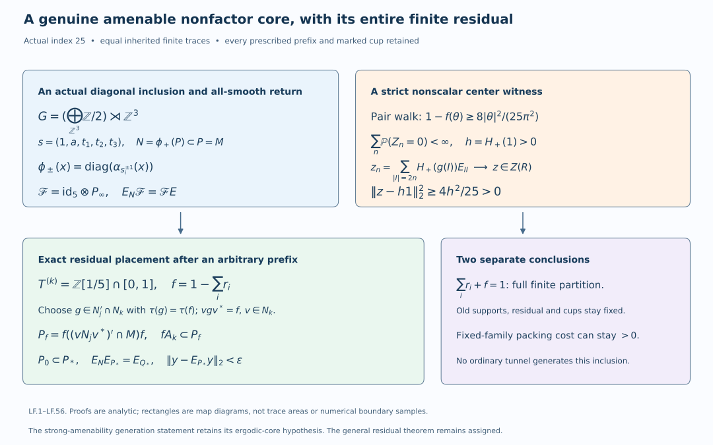

Figure LF.1. The upper panels retain the actual finite-index representation and strict nonscalar-center estimate. The lower panels give the exact scalar trace fiber and physical placement of the original residual, followed by the separate packing and generation obstructions. No area encodes a canonical trace, and the harmonic witness is an analytic proof rather than a numerical sample. Proofs: LF.1–LF.56 and the compatible-core argument LF.17. Human context: Popa (1994), §2.3.3(b), Example3.1.3(b), and Theorem4.4.1(1). [Reproducible figure and finite exact checks](figures/nonfactor-core-and-residual-v11.py).

## A quantitative obstruction to a common stage after a fixed prefix

**Theorem CF.1.** Use the actual amenable index-25 inclusion and ordinary tunnel of LF.1–LF.17. Prescribe its prefix through \(N_1\). There is a finite set of 625 physical unitaries \(Y\subset M\) and a constant \(c>0\) such that every actual finite continuation of this prefix, at every length \(m\geq1\), obeys

\[
\max_{u\in Y}\|u-E_{(N_m^{\mathcal T})'\cap M}(u)\|_2
\ \geq c=\frac{\sqrt2\,h_+}{5}.
\tag{CF.1}
\]

Nevertheless there is a full finite whole-tunnel square, retaining this prefix, whose target errors on the same \(Y\) are below \(h_+/10\). Its individual supported blocks cannot all be contained, as the same physical operators, in a single relative-commutant stage of any continuation of this prefix. Thus plain all-smooth amenability does not imply unrestricted common-stage alignment of a selected full family. This is a finite, quantitative obstruction; it does not require asking one tunnel to generate all of \(M\).

### The center witness retains its first finite conditional expectation

Let \(F=\operatorname{Mat}_{25}\otimes1\subset M\) be the full matrix factor on the first two \(Q\)-coordinates of LF.4, and write
\(A_1=N_1'\cap M=D_2^+\subset F\), by LF.12–LF.15. The witness \(z\) constructed in LF.39–LF.41 satisfies

\[
\begin{gathered}
z=z^*\in Z(R),\quad\|z\|\leq1,\quad\tau(z)=h_+>0,\\
E_{A_1}(z)=z_1,\qquad
\|z_1-h_+1\|_2^2\geq4h_+^2/25.
\end{gathered}
\tag{CF.2}
\]

The conditional expectation identity follows from the bounded central martingale: every later \(z_n\) has expectation \(z_1\), and conditional expectation is \(L^2\)-continuous.

Take any finite continuation \(\mathcal T\) of the same prescribed prefix. Extend it arbitrarily to an ordinary infinite tunnel; one-step existence 4.4 permits this. The compatible finite alignment proved in LF.17 can be started at the unchanged prefix \(N_1\). Every later correcting unitary lies in an already aligned predecessor contained in \(N_1\), and therefore fixes \(A_1\) pointwise. The resulting trace-preserving normal core isomorphism
\(\theta:R\to R_{\mathcal T}\) is the identity on \(A_1\). It does not assert that an infinite product of these unitaries converges.

Put \(z_{\mathcal T}=\theta(z)\). Trace pairing with every \(a\in A_1\) gives
\(\tau(a^*z_{\mathcal T})=\tau(a^*z)\); hence

\[
\begin{gathered}
z_{\mathcal T}=z_{\mathcal T}^*\in Z(R_{\mathcal T}),\quad
\|z_{\mathcal T}\|\leq1,\quad\tau(z_{\mathcal T})=h_+,\\
E_{A_1}(z_{\mathcal T})=z_1.
\end{gathered}
\tag{CF.3}
\]

This fixes a nonzero amount of variance before the continuation is chosen.
For \(x_{\mathcal T}=E_F(z_{\mathcal T})\), nested trace expectations imply
\(E_{A_1}(x_{\mathcal T})=z_1\), so

\[
\|x_{\mathcal T}-h_+1\|_2^2
\geq\|z_1-h_+1\|_2^2
\geq4h_+^2/25.
\tag{CF.4}
\]

### A fixed matrix twirl detects that variance in every continuation

On \(\mathbb C^{25}\) with coordinates \(e_j\), indices taken modulo 25, put
\(Se_j=e_{j+1}\), \(De_j=\exp(2\pi i j/25)e_j\), and

\[
Y=\{S^aD^b\otimes1:0\leq a,b<25\}.
\tag{CF.5}
\]

There are 625 unitaries. Direct matrix-entry summation first kills off-diagonal entries by the \(D\)-average and then averages the diagonal by the \(S\)-average. Thus
\(625^{-1}\sum_{u\in Y}u^*xu=\tau(x)1\) for \(x\in F\). Expanding the squared Hilbert norms for self-adjoint \(x\) gives

\[
\frac1{625}\sum_{u\in Y}\|[u,x]\|_2^2
=2\bigl(\|x\|_2^2-|\tau(x)|^2\bigr).
\tag{CF.6}
\]

The expectation \(E_F\) is \(F\)-bimodular and contractive in \(L^2\).
Consequently CF.4–CF.6 show

\[
\frac1{625}\sum_{u\in Y}\|[u,z_{\mathcal T}]\|_2^2
\geq\frac1{625}\sum_{u\in Y}\|[u,x_{\mathcal T}]\|_2^2
\geq\frac{8h_+^2}{25}.
\tag{CF.7}
\]

The relative commutant \(D_{\mathcal T,m}=(N_m^{\mathcal T})'\cap M\) is contained in \(R_{\mathcal T}\). The element \(z_{\mathcal T}\) commutes with all of it, including \(E_{D_{\mathcal T,m}}(u)\). Left and right multiplication by \(z_{\mathcal T}\) have \(L^2\)-norm at most one. Therefore

\[
\begin{aligned}
\|[u,z_{\mathcal T}]\|_2
&=\|[u-E_{D_{\mathcal T,m}}u,z_{\mathcal T}]\|_2\\
&\leq2\|u-E_{D_{\mathcal T,m}}u\|_2.
\end{aligned}
\tag{CF.8}
\]

Combining CF.7 and CF.8 gives
\(625^{-1}\sum_{u\in Y}\|u-E_{D_{\mathcal T,m}}u\|_2^2
\geq2h_+^2/25\), which proves CF.1. The arbitrary extension was used only to produce a central witness; the estimate applies to the original finite continuation at its specified length.

### The exact correction for a selected full family

Apply the unconditional full-partition result LF.15 to the same prefix, the same physical set \(Y\), and error \(h_+/10\). It gives a finite full square \(Q_*\subset P_*\), individual actual whole-inclusion continuations for all cells, both expectation orders, and
\(\|u-E_{P_*}u\|_2<h_+/10\) for every \(u\in Y\).
If \(P_*\subset D_{\mathcal T,m}\) for any continuation of the fixed prefix, best approximation would give
\[
\|u-E_{D_{\mathcal T,m}}u\|_2
\leq\|u-E_{P_*}u\|_2<h_+/10,
\tag{CF.9}
\]
contradicting CF.1. In particular retaining each of its old full blocks physically inside a common stage is impossible.

There is also a strict lower bound for approximate retention. Write \(a_u=E_{P_*}u\). If elements \(b_u\in D_{\mathcal T,m}\) retained these candidates with \(\|a_u-b_u\|_2<\eta\), then
\(\|u-E_{D_{\mathcal T,m}}u\|_2<h_+/10+\eta\).
CF.1 rules this out whenever
\(\eta\leq(\sqrt2/5-1/10)h_+\). Thus an arbitrarily cheap movement of the old candidates cannot restore common-stage alignment in this example.

The source's stronger common-stage approximation in §4.4 assumes an **ergodic core** and begins with supports in actual terminal **factors**. CF.1 concerns plain amenability and a full family of whole-relative-commutant supports; it does not refute that stronger statement. For this actual nonfactor example the full finite partition LF.15 remains valid, whereas the common-stage step after this prefix is false. An unrestricted proof must respect those distinct conclusions rather than add common-stage containment as a hidden intermediate requirement.

**Proof links.** [4.4–4.5, Going up and down the Jones tower](towers-and-tunnels.md), [46.6, A finite index can leave a boundary in the tunnel](nongenerating-tunnels-and-boundary.md), and LF.11, LF.15 and LF.17 above supply actual continuation existence, compatible finite core maps, the center witness and the full square. Matrix twirling and the quantitative bound CF.2–CF.9 are proved here. Human context: Sorin Popa, *Classification of amenable subfactors of type II*, Acta Mathematica 172 (1994), 163–255, [DOI 10.1007/BF02392646](https://doi.org/10.1007/BF02392646), §4.4, printed pp.220–222.

## A nonuniform Jones residual that requires support reselection

An actual amenable inclusion can have a finite whole-stage near-cover whose remaining physical projection admits no finite whole-stage partition. The obstruction persists when its trace is arbitrarily small, and when an arbitrary ordinary Jones prefix and all its cup operators are prescribed. Consequently, completing the general finite approximation cannot require retention of every previously selected support. In the example below, finite rank cuts give a complete replacement family and a quantitative approximation of the same physical targets. The two inherited finite traces are computed separately throughout.

The actual inclusion is the weighted balanced-word construction in [A generating tunnel with incompatible reflected traces](weighted-spin-tunnel.md), Lemma47.1, Proposition47.2 and Theorem47.4. Its amenability for every smooth expected representation is [General tail supports and controlled tunnels](general-tail-supports-and-controlled-tunnels.md), TheoremV9.5. The local corner isomorphisms, stabilization, cyclic averaging and finite-basis return in that proof apply to every \(0<p<1\), including irrational parameters. We use those complete proofs, rather than infer amenability from hyperfiniteness or generation. Finite marked tunnel alignment is 57.3; the general retained-prefix near-cover is 76.4; finite projection placement is 78.1–78.2; finite capacity cuts and their normal central limit are 80.1–80.4.

### The actual tunnel and its two finite traces

Choose a transcendental real number \(p\in(1/2,2/3)\), and put \(q=1-p\). Such parameters exist because the algebraic numbers are countable. Let

\[
 C_n=\operatorname{span}\{E_{uv}:|u|=|v|\}
     =\bigoplus_{r=0}^n\operatorname{Mat}_{\binom nr},
 \qquad \tau(E_{uu})=p^{n-r}q^r \quad(|u|=r).
 \tag{RF.1}
\]

The embeddings append an identity spin. Their trace restriction follows from \(p+q=1\). Let \(M=(\bigcup_n C_n)''\) in this inherited tracial representation, and write

\[
 H_a=(\bigcup_n1_2^{\otimes a}\otimes C_n)'',\qquad
 N=H_1,\qquad N_k=H_{k+1}.
 \tag{RF.2}
\]

The balanced-word proofs show that these are hyperfinite II₁ factors; \(N\subset M\) has index \(d=(pq)^{-1}\); and the shifted rank-one cups

\[
 |\sqrt q\,01+\sqrt p\,10\rangle
 \langle\sqrt q\,01+\sqrt p\,10|
 \tag{RF.3}
\]

on adjacent sites make RF.2 an ordinary Jones tunnel. Each cup has scalar lower expectation \(pq\,1\). The entire relative commutant is \(H_a'\cap M=C_a\), and every shifted relative-commutant union generates its physical tail factor. In particular the smaller core after \(N_k\) is exactly \(N_k\), a factor.

These are actual relative commutants of the index-\((pq)^{-1}\) inclusion, not a factor representation of an abstract path algebra. The two finite traces need not agree. Every minimal projection \(e\) in the charge-\(r\) block of \(C_n\) compresses \(H_n\subset M\) to an identity inclusion: a fixed initial word leaves precisely the balanced tail algebra. Its local index is therefore one. The actual local module formula2.4, with index \(d^n\), gives the normalized dual trace

\[
 \tau(e)=p^{n-r}q^r,
 \qquad \rho_n(e)=\frac1{d^n\tau(e)}=q^{n-r}p^r.
 \tag{RF.4}
\]

Both systems normalize because there are \(\binom nr\) words of charge \(r\). Both restrict under the actual Pascal embeddings: the two extension weights add to the earlier weight. We retain \(\rho_n\) as a normalized finite-module dual trace, distinct from the ambient normal trace \(\tau\) on \(M\). No normal extension of this specified dual trace to the inherited completion is asserted.

After a canonical prefix through \(N_k\), the smaller finite algebra at ordinary level \(k+n\) is

\[
 C_{k+n}^{(k)}=N_{k+n}'\cap N_k
              =1_2^{\otimes(k+1)}\otimes C_n.
 \tag{RF.5}
\]

Its physical and normalized dual minimal weights are exactly RF.4. For any prescribed actual finite prefix, finite marked alignment57.3 sends this canonical prefix to the prescribed one, including its cup operators. Conjugate a continuation of RF.2 by that finite aligning unitary. This produces a continuation of the prescribed prefix whose smaller core is the prescribed \(N_k\). No limiting unitary or normal extension of a reflection map is needed. In the formulas below the shifted algebras are understood through this fixed finite alignment when the prefix is prescribed.

### No finite family can fill the unchanged residual

**Lemma RF.1 — every finite origin has a positive endpoint polynomial.** Every projection with an actual whole-inclusion finite smaller-relative-commutant origin has physical trace \(H(p)\), where

\[
 H(x)=\sum_{r=0}^n h_r x^{n-r}(1-x)^r\in\mathbb Z[x],
 \quad 0\leq h_r\leq\binom nr,
 \quad H(1)=h_0\in\{0,1\}.
 \tag{RF.6}
\]

This includes every finite origin after the prescribed prefix, with the same formula for its smaller factor \(N_k\). In particular any finite sum of such trace polynomials has nonnegative value at \(x=1\).

**Proof.** RF.1 and RF.5 give the formula by taking integer matrix ranks in each full block. The charge-zero block has size one, giving the final assertion. A different finite continuation has the same inherited finite trace set by marked finite tunnel alignment57.3, inside the appropriate physical smaller factor. Thus its trace is represented by a polynomial of the displayed form. At depth zero the polynomial is a constant zero or one, which is also included. The last assertion follows by adding the nonnegative endpoint ranks. Evaluation at \(x=1\) is a polynomial calculation; it does not claim that the physical parameter \(p=1\) defines an allowed inclusion. \(\square\)

**Theorem RF.2 — an actual finite-family residual obstruction.** Fix any prescribed ordinary prefix through \(N_k\), an integer \(n\geq1\), and an integer \(m\geq2\) such that \(mp^n<1\). There are \(m\) physically orthogonal projections \(r_i\in N_k\), each with a whole finite origin after that prefix, such that

\[
 \tau(r_i)=p^n,
 \qquad f=1-\sum_{i=1}^m r_i,
 \qquad \tau(f)=1-mp^n>0.
 \tag{RF.7}
\]

There is no finite orthogonal family \(s_a\leq f\), summing to \(f\), whose members all have whole-inclusion finite smaller-relative-commutant origins. This remains impossible even if each new member uses its own unrestricted actual finite continuation. Thus allowing several new residual cells does not remove this obstruction.

**Proof.** The all-zero path projection \(g_n=1^{\otimes(k+1)}\otimes E_{0^n,0^n}\in C_{k+n}^{(k)}\) has trace \(p^n\). The physical II₁ factor \(N_k\) has \(m\) mutually orthogonal projections of that trace, since \(mp^n<1\). Equal-trace factor comparison, including comparison of the complements, gives \(U_i\in\mathcal U(N_k)\) with \(r_i=U_ig_nU_i^*\). Conjugate only the continuation for the \(i\)-th cell by \(U_i\). All earlier factors are preserved as algebras, every earlier cup is fixed as an operator, and \(r_i\) belongs to that continuation's whole finite smaller relative commutant. Every element of \(A_k=N_k'\cap M\) is fixed pointwise by \(U_i\).

If the claimed residual partition existed, LemmaRF.1 would represent the traces of its finitely many cells by integer polynomials \(H_a\) with \(H_a(1)\geq0\). Physical additivity would give

\[
 \sum_aH_a(p)=1-mp^n.
 \tag{RF.8}
\]

Transcendence of \(p\) means that an integer polynomial vanishing at \(p\) is the zero polynomial. Hence RF.8 is the polynomial identity \(\sum_aH_a(x)=1-mx^n\). At \(x=1\) its left side is nonnegative and its right side is \(1-m<0\), a contradiction. The proof did not require a common finite stage, a common continuation, or a prescribed rank class for the new cells. \(\square\)

**Corollary RF.3 — arbitrarily small genuine near-cover residuals.** For every \(\theta>0\), a finite whole-stage near-cover satisfying the exact retained-prefix square identities of76.4 can have \(0<\tau(f)<\theta\) and the impossibility in TheoremRF.2.

**Proof.** Choose \(n\) with \(p^n<\min(\theta,1/2)\), and set \(m=\lfloor p^{-n}\rfloor\). Since \(p\) is transcendental, \(p^{-n}\notin\mathbb Z\); thus \(m\geq2\) and

\[
 0<1-mp^n<p^n<\theta.
 \tag{RF.9}
\]

Use the physical supports and their individual continuations from TheoremRF.2. Put \(j=k+n\), \(A_k=N_k'\cap M\), \(B_k=N_k'\cap N\), and

\[
 \begin{aligned}
 P_0&=\bigoplus_i r_iU_i(N_j'\cap M)U_i^*r_i\ \oplus\ fA_k,\\
 Q_0&=\bigoplus_i r_iU_i(N_j'\cap N)U_i^*r_i\ \oplus\ fB_k,\\
 D_0&=\bigoplus_i r_iU_i(N_j'\cap N_k)U_i^*r_i\ \oplus\mathbb Cf.
 \end{aligned}
 \tag{RF.10}
\]

The sums are finite-dimensional unital direct sums with physically orthogonal units. Actual finite-stage expectation and bimodularity give \(E_N(P_0)=Q_0\) and \(E_{N_k}(P_0)=D_0\); on the residual use \(E_N(A_k)=B_k\) and \(E_{N_k}(A_k)=\mathbb C1\). Trace pairing and Hilbert-space adjoints give all three commuting-square identities76.25. Each \(U_i\in N_k\) fixes \(A_k\), so \(A_k\subset P_0\), \(B_k\subset Q_0\); the earlier cups are retained. For the target set \(Y=\{1\}\), approximation is exact and all local commutator and compression errors are zero. The selected support sum has trace above \(1-\theta\).

For the additional commuting matrix algebra in76.4, the unit-\(r_i\) factor \(r_iU_iN_jU_i^*\) commutes with its full supported block, and \(fN_kf\) commutes with \(fA_k\). Choose unital \(\operatorname{Mat}_2\) units in these factors and sum corresponding units. This is a unital \(\operatorname{Mat}_2\subset N_k\) commuting with \(P_0\). Thus RF.10 supplies all the near-cover properties in76.4, while TheoremRF.2 prevents a full finite repair wholly within its unchanged residual. \(\square\)

The corollary constructs witnesses for the near-cover conclusion. It does not claim that every possible selection in76.4 fails. The unrestricted finite-partition theorem permits a different finite family.

### A complete corrected family after small physical cuts

**Theorem RF.4 — the marked full partition in this actual model.** For the inclusion RF.2, any prescribed ordinary prefix through \(N_k\), finite \(Y\subset M\), and \(\varepsilon>0\) admit unital finite-dimensional \(D_*\subset Q_*\subset P_*\subset M\), with \(D_*\subset N_k\), \(Q_*\subset N\), a finite full orthogonal support partition, and

\[
 \begin{gathered}
 A_k\subset P_*,\quad B_k\subset Q_*,\quad
 \|y-E_{P_*}y\|_2<\varepsilon\quad(y\in Y),\\
 E_NE_{P_*}=E_{P_*}E_N=E_{Q_*},\\
 E_{N_k}E_{P_*}=E_{P_*}E_{N_k}=E_{D_*},\\
 E_{N_k}E_{Q_*}=E_{Q_*}E_{N_k}=E_{D_*}.
 \end{gathered}
 \tag{RF.11}
\]

Every supported triple is the full relative-commutant triple of an actual whole finite continuation after the original prefix. The factors in that prefix and its cup operators are retained exactly. The physical targets remain fixed. The old selected supports may be cut.

More quantitatively, let a finite near-cover \(D_0\subset Q_0\subset P_0\) of76.4 already be selected, with supports \(r_i\in N_k\), residual \(f=1-\sum_i r_i\), and respective finite continuations. For every \(\eta>0\) there is such a completion with \(r_i'\leq r_i\), residual \(f_*=f+\sum_i(r_i-r_i')\), and total physical cut trace less than \(\eta\). At the chosen finite stage its actual cut cost \(\Delta\) gives, for **every** \(y\in M\),

\[
 \|y-E_{P_*}y\|_2
 \leq\|y-E_{P_0}y\|_2
       +(1+\sqrt2)\|y\|\sqrt\Delta.
 \tag{RF.12}
\]

**Proof of the actual finite selection.** Choose the continuation of the prescribed prefix constructed after RF.5. Its smaller core is the physical factor \(N_k\). Set

\[
 A_J=N_J'\cap M,\quad B_J=N_J'\cap N,\quad
 C_J=N_J'\cap N_k.
 \tag{RF.13}
\]

For each old selected cell, finite marked alignment after the fixed prefix gives \(U_i\in\mathcal U(N_k)\) mapping a canonical continuation to its given finite continuation. Put \(g_i=U_i^*r_iU_i\), and regard the finitely many \(g_i\) as elements of one sufficiently late canonical \(C_J\). Extend the old individual continuations by \(U_iN_lU_i^*\), retaining their previously selected finite segments.

In each block of \(C_J\), let \(h_{i\ell}\) be the rank of \(g_i\), \(c_\ell\) its unit rank, and \(\omega_\ell\) its physical minimal weight. The actual minimum removed physical trace is

\[
 \Delta_J=\sum_\ell\omega_\ell
                  (\sum_i h_{i\ell}-c_\ell)_+.
 \tag{RF.14}
\]

The complete normal averaging proof80.1–80.3 applies to the increasing **actual** algebras \(C_J\subset N_k\). Their union generates \(N_k\), so their normal center-valued trace is scalar. Consequently

\[
 \Delta_J\downarrow
 (\sum_i\tau(g_i)-1)_+=0,
 \tag{RF.15}
\]

because the physical \(r_i\) are orthogonal. This invokes factoriality proved for this weighted model; it does not infer factoriality from amenability in general.

At a sufficiently late finite \(J\), remove exactly the excess dimensions in each block, choosing \(g_i'\leq g_i\) there. The retained ranks have mutually orthogonal representatives \(q_i\in C_J\); choose them on disjoint diagonal coordinate sets. Then

\[
 \begin{gathered}
 q_0=1-\sum_iq_i\in C_J,\quad
 r_i'=U_ig_i'U_i^*\leq r_i,\\
 d_i=r_i-r_i',\quad
 \sum_i\tau(d_i)=\Delta_J,\\
 f_*=f+\sum_i d_i,\qquad \tau(f_*)=\tau(q_0).
 \end{gathered}
 \tag{RF.16}
\]

Factor comparison in \(N_k\) gives \(v\in\mathcal U(N_k)\) with \(vq_0v^*=f_*\). Use its conjugated canonical continuation for just this residual block. The full rows are

\[
 \begin{aligned}
 P_*&=\bigoplus_i r_i'U_iA_JU_i^*r_i'\ \oplus\ f_*vA_Jv^*f_*,\\
 Q_*&=\bigoplus_i r_i'U_iB_JU_i^*r_i'\ \oplus\ f_*vB_Jv^*f_*,\\
 D_*&=\bigoplus_i r_i'U_iC_JU_i^*r_i'\ \oplus\ f_*vC_Jv^*f_*.
 \end{aligned}
 \tag{RF.17}
\]

Omit zero supports. The physical units sum to one. Actual finite-stage expectation, equivariance under \(U_i,v\in N_k\), and support bimodularity prove \(E_N(P_*)=Q_*\) and \(E_{N_k}(P_*)=D_*\). Trace pairing and adjoints prove RF.11. Every unitary used lies in \(N_k\); it fixes \(A_k\) pointwise and every earlier cup. Summing all supported compressions recovers \(A_k\) and \(B_k\). The initial factors are retained as algebras; pointwise fixation of the whole physical \(N_k\) is not asserted.

**Proof of the physical-target estimate.** Fix \(y\in M\), write \(a=E_{P_0}y\), and put \(R=\|y\|\). Then \(\|a\|\leq R\). Its old residual component is \(fc\) for \(c\in A_k\) of norm at most \(R\). If \(f\ne0\), multiplication \(c\mapsto fc\) is an injective *-homomorphism: \(E_{N_k}(c^*c)=\tau(c^*c)1\) gives \(\tau(fc^*c)=\tau(f)\tau(c^*c)\), so its kernel is zero. An injective *-homomorphism preserves norm. If \(f=0\), take \(c=0\).

Set \(a_i=r_i a r_i\). Since the old finite stages were extended, \(r_i'a_ir_i'\) belongs to the \(i\)-th new full block. Also \(f_*c\in f_*vA_Jv^*f_*\). Therefore

\[
 b=\sum_i r_i'a_i r_i'+f_*c\in P_*,\qquad
 a-b=\sum_i(a_i-r_i'a_ir_i'-d_i c).
 \tag{RF.18}
\]

The latter summands have orthogonal old supports. For \(e=r_i'\), \(d=d_i\),

\[
 a_i-ea_ie=da_i+ea_id,\qquad
 \|a_i-ea_ie\|_2^2\leq2R^2\tau(d),\qquad
 \|dc\|_2\leq R\sqrt{\tau(d)}.
 \tag{RF.19}
\]

The first two terms have orthogonal left supports, and each squared norm is at most \(R^2\tau(d)\). The triangle inequality in the Hilbert direct sum of the old supports yields \(\|a-b\|_2\leq(1+\sqrt2)R\sqrt{\Delta_J}\). Best approximation by \(E_{P_*}\) and triangle inequality give RF.12. This estimates the original \(y\); no target has been conjugated with a tunnel.

To obtain the unconditional finite approximation, apply76.4 with error \(<\varepsilon/2\), justified by the actual all-smooth amenability proofV9.5 and higher heredity76.3. Let \(R_Y=\max(1,\max_{y\in Y}\|y\|)\). By RF.15 choose finite \(J\) with \(\Delta_J<\eta\) and \((1+\sqrt2)R_Y\sqrt{\Delta_J}<\varepsilon/2\). RF.17–RF.19 prove the asserted full partition and all errors. If all old selected supports are to remain nonzero, also take \(\Delta_J<\min_i\tau(r_i)\). \(\square\)

The new residual contains the entire original physical \(f\), but may also contain cut pieces of earlier supports. TheoremRF.2 proves why this alteration cannot generally be omitted. Whole support origins and every finite dual trace are transported through actual continued/conjugated Jones triples; RF.4 never replaces the dual weights by the physical weights. Its norm estimate uses the physical trace \(\tau\), as the finite approximation theorem requires.

### Explicit costs for both traces in the obstructing family

For the \(m\) copies of \(g_n\) in RF.7, at length \(J\geq n\) after the prefix the unit capacity and each copy's ranks are

\[
 c_{Jr}=\binom Jr,\qquad h_{Jr}=\binom{J-n}{r}.
 \tag{RF.20}
\]

A binomial coefficient beyond its allowed range is zero. Appending the last \(J-n\) spins proves this formula. Cutting exactly the excess \(e_{Jr}=(m h_{Jr}-c_{Jr})_+\) gives the two actual losses

\[
 \begin{aligned}
 \Delta_J^\tau&=\sum_{r=0}^Jp^{J-r}q^r e_{Jr},\\
 \Delta_J^\rho&=\sum_{r=0}^Jq^{J-r}p^r e_{Jr}.
 \end{aligned}
 \tag{RF.21}
\]

These are distinct evaluations of the same removed integer dimensions. The canonical complement certificate has exact trace values

\[
 \tau(q_0)=1-mp^n+\Delta_J^\tau,\qquad
 \rho_J(q_0)=1-mq^n+\Delta_J^\rho.
 \tag{RF.22}
\]

The physical placement \(vq_0v^*=f_*\) preserves the first value. The actual finite dual trace of its new conjugated continuation is the second value, by conjugation equivariance of the finite module trace. There was no whole-stage dual certificate for the original \(f\); none is silently assigned to it. On every retained old cell, extension preserves both previous finite traces and its cut removes exactly the corresponding weights in RF.21.

**Proposition RF.5 — finite bounds on the two losses.** Put \(a=m^{-1/n}\), \(\delta_\tau=a-p>0\), and \(\delta_\rho=a-q>0\). Then

\[
 0<\Delta_J^\tau\leq\frac{(m-1)pq}{J\delta_\tau^2},\qquad
 0<\Delta_J^\rho\leq\frac{(m-1)pq}{J\delta_\rho^2}.
 \tag{RF.23}
\]

Thus in this obstructing family the lost mass can be made arbitrarily small for both actual trace systems, while preserving the earlier marks and controlling every physical-target error by RF.12.

**Proof.** \(mp^n<1\) gives \(a>p\). Since \(p>1/2\), \(q<p\), so \(a>q\) also. For any \(r\leq J-n\),

\[
 \frac{h_{Jr}}{c_{Jr}}
 =\frac{(J-r)(J-r-1)\cdots(J-r-n+1)}{J(J-1)\cdots(J-n+1)}
 \leq(1-r/J)^n.
 \tag{RF.24}
\]

Each factor is at most \(1-r/J\). If \(r>J-n\), the ratio is zero and the same bound remains valid. A positive excess requires \(1-r/J>a\). Under the physical block masses \(\binom Jr p^{J-r}q^r\), the random variable \(r\) is binomial with mean \(Jq\) and variance \(Jpq\). On the excess event, \(r/J<1-a=q-\delta_\tau\). The excess fraction \((m h_{Jr}/c_{Jr}-1)_+\) is at most \(m-1\). Chebyshev's inequality, proved by integrating \((r/J-q)^2\geq\delta_\tau^2\) on that event, gives the first upper bound. Under the dual block masses the mean is \(Jp\); the same event is \(r/J<1-a=p-\delta_\rho\), yielding the second bound. At \(r=0\), \(h_{J0}=c_{J0}=1\), so \(e_{J0}=m-1\). Hence the physical loss is at least \((m-1)p^J>0\) and the dual loss at least \((m-1)q^J>0\) at every finite stage. \(\square\)

For a specified extra physical tolerance \(\zeta>0\) on targets of norm at most \(R>0\), RF.12 and RF.23 show that it suffices to choose a finite integer

\[
 J\geq n,\qquad
 J>\frac{(1+\sqrt2)^2R^2(m-1)pq}{\zeta^2\delta_\tau^2}.
 \tag{RF.25}
\]

An additional dual-loss budget \(\beta>0\) is satisfied by also taking \(J>(m-1)pq/(\beta\delta_\rho^2)\). These are genuine finite choices. No limit projection is substituted for the required finite complement.

For \(n=2,m=2,J=4\), the integer table is

| Charge \(r\) | 0 | 1 | 2 | 3 | 4 |
|---|---:|---:|---:|---:|---:|
| Unit capacities \(c_{4r}\) | 1 | 4 | 6 | 4 | 1 |
| Two-copy ranks \(2h_{4r}\) | 2 | 4 | 2 | 0 | 0 |
| Removed ranks \(e_{4r}\) | 1 | 0 | 0 | 0 | 0 |
| Complement ranks | 0 | 0 | 4 | 4 | 1 |

It gives \(\Delta_4^\tau=p^4\), \(\Delta_4^\rho=q^4\), and

\[
 \tau(q_0)=4p^2q^2+4pq^3+q^4=1-2p^2+p^4.
 \tag{RF.26}
\]

The original residual polynomial \(1-2x^2\) has value \(-1\) at one. The corrected complement polynomial in RF.26 has value zero there and has the displayed valid ranks. For greater accuracy choose RF.25, rather than claim that this single finite table proves convergence.

**Human mathematical context.** Sorin Popa, [*Classification of amenable subfactors of type II*](https://doi.org/10.1007/BF02392646), Acta Mathematica 172 (1994), 163–255, §4.4 and Theorem4.4.1, printed pp.220–222. The finite theorem permits an individual continuation on every supported piece; it does not require preservation of a preselected residual. The weighted model and its all-smooth amenability are proved in the linked readings.

**Further proof links.** [57.3, Actual supported local approximation](actual-supported-local-approximation.md), [76.3–76.4, Whole relative-commutant blocks](whole-relative-commutant-blocks.md), [78.1–78.2, Exact trace certificates close the finite-depth residual](trace-certificates-and-exact-finite-partitions.md), and [80.1–80.4, Central capacity and small cuts of whole-tunnel supports](central-capacity-and-small-support-cuts.md) supply the finite marked alignment, higher-factor heredity, trace placement and rank-cut normal limit used above.

Figure CF–RF.1. Top: the same first finite conditional expectation of the transported center witness forces the lower error bound for 625 fixed physical targets. Middle: the formal polynomial variable is distinct from the transcendental physical parameter; the negative endpoint excludes every finite sum of candidate rank polynomials. Bottom: the actual physical cuts enlarge the residual, a finite valid rank certificate is placed there, and the original targets retain the stated error bound. All block sizes are schematic; no area represents a canonical trace. Proofs: CF.1–CF.9 and RF.1–RF.26. Human context: Popa (1994), §4.4, cited above. [Reproducible diagram source](figures/prefix-and-residual-obstructions-v12.py).

## A finite smooth representation selected by one compatible state

The state-dependent construction below produces a genuine finite tracial smooth representation and an exact completely positive return to the original expected pair. It works for singular original states and retains the physical inclusion at every finite Jones stage. At a true original cost minimizer, however, the minimum of the transported original cost is unchanged. Thus this construction does not prove the unrestricted existence of an original joint-balanced hypertrace. The last section identifies the exact bounded test that remains unproved.

### The original data

Let \(N\subset M\) be the original proper finite-index II₁ inclusion, with its physical normalized trace \(\tau\) and index \(d\). Fix the original ordinary tunnel, its actual core \(S\subset R\), and
\[
 e=e_R^M,\qquad A=\langle N,e\rangle\subset B=\langle M,e\rangle,
 \qquad E=E_A:B\longrightarrow A.
 \tag{TR12.1}
\]
The canonical expectation is normal and faithful, satisfies \(E|_M=E_N\), and has the finite common partial basis \((a_i)\subset M\). Thus
\[
 x=\sum_i a_iE(a_i^*x),\quad
 E_N(a_i^*a_j)=\delta_{ij}f_i,\quad
 a_if_i=a_i,\quad \sum_i a_i a_i^*=d1,
 \qquad E(x)\ge d^{-1}x\quad(x\ge0).
 \tag{TR12.2}
\]
These are the exact finite-row conclusions of [61.1–61.2](smooth-representations-and-tower-compression.md), including their complete matrix proof. Smoothness is retained in its original all-stage sense: \(N'\cap M_j\) commutes with \(A\) in the represented stage \(B_j\), for every finite \(j\).

Keep both original canonical semifinite traces on \(A,B\), their original full-corner center identification \(\iota\), and the original finite tracial expectations
\[
 U=Z(S),\quad V=Z(R),\quad D_0=U\vee V,
 \qquad Q=E_U|_{D_0},\quad P_0=E_V|_{D_0}.
\]
For an identity-containing common basis, let
\[
 g=\sum_i a_i^*a_i,\quad z=E_{N'\cap M}(g),\quad
 w=d^{-1}E_{D_0}(g),\quad \ell=d^{-1}E_{D_0}(z),
 \qquad \mathfrak a=\iota\bigl(dQ(|w-\ell|)\bigr)\in Z(A)_+.
 \tag{TR12.3}
\]
Here \(w,\ell\) are bounded and bounded away from zero. These are the original objects of V9.1–V9.2, not costs recomputed using a new trace.

Let \(\psi\) be any original compatible hypertrace:
\[
 \psi E=\psi,\qquad \psi|_M=\tau,\qquad
 \psi(mx)=\psi(xm)\quad(m\in M,\ x\in B).
 \tag{TR12.4}
\]
The original amenability assumption supplies such a state in this smooth representation. Its restrictions to the original represented centers may be singular. AS.2 proves that \(D=\iota(D_0)\) also belongs to its centralizer.

### The support lies in the smaller enveloping algebra

We use \(A^{**},B^{**}\) as enveloping von Neumann algebras of the underlying C*-algebras, with their canonical inclusion. The inclusion \(A^{**}\subset B^{**}\) is faithful: bounded functionals on \(A\) extend to \(B\) by Hahn–Banach, so the adjoint restriction is surjective and the double-adjoint inclusion is injective. The expectation extends to the normal expectation \(E^{**}:B^{**}\to A^{**}\). Its bimodularity and positive lower bound in (TR12.2) extend by weak-star approximation and the weak-star closedness of the positive cone. In particular \(E^{**}\) is faithful.

The state \(\psi\) has its normal extension \(\widetilde\psi\) to \(B^{**}\), and \(\widetilde\psi E^{**}=\widetilde\psi\). This extension is normal on the enveloping algebra; it need not be normal on the original \(B\).

**Lemma TR12.1.** The support of \(\widetilde\psi\) is exactly the support \(q\in A^{**}\) of its restriction to \(A^{**}\). Moreover \(q\) commutes with the physical \(M\) and with the original \(D\). The state is faithful on \(qB^{**}q\).

**Proof.** Since \(\widetilde\psi(q)=1\), its support in \(B^{**}\) is at most \(q\). If \(x\in(qB^{**}q)_+\) and \(\widetilde\psi(x)=0\), then
\[
 E^{**}(x)\in(qA^{**}q)_+,\qquad
 \widetilde\psi(E^{**}(x))=0.
\]
The restriction is faithful on its support corner, so \(E^{**}(x)=0\). The lower bound \(E^{**}(x)\ge d^{-1}x\) gives \(x=0\). Thus the full state is faithful on this corner and its full support is \(q\).

Every unitary of the original state centralizer leaves \(\psi\) invariant by conjugation. Its conjugation invariance extends normally to \(B^{**}\); uniqueness of the support gives \(uqu^*=q\). The physical \(M\) and the original \(D\) are in this centralizer, so their unitaries commute with \(q\). Every element of a unital C*-algebra is a linear combination of its unitaries, giving the asserted commutations. \(\square\)

Put
\[
 \mathcal B=qB^{**}q,\quad \mathcal A=qA^{**}q,
 \qquad E^q=E^{**}|_{\mathcal B},\qquad
 \phi=\widetilde\psi|_{\mathcal B},\qquad j(m)=qm=mq.
 \tag{TR12.5}
\]
Both corners have unit \(q\). The map \(j:M\to\mathcal B\) is an actual unital *-homomorphism, faithful because \(\phi(j(m)^*j(m))=\tau(m^*m)\). It is normal. Indeed, if \(0\le m_\lambda\uparrow m\), then the positive difference between \(j(m)\) and \(\sup_\lambda j(m_\lambda)\) has zero \(\phi\)-value by normality of \(\tau\) and \(\phi\), and therefore is zero by faithfulness of \(\phi\). The restriction to \(N\) is normal and faithful as well. Further,
\[
 E^q(j(m))=j(E_N(m)),\qquad
 x=\sum_i j(a_i)E^q(j(a_i)^*x)\quad(x\in\mathcal B).
 \tag{TR12.6}
\]
The latter formula follows by extending (TR12.2) normally and using \([q,a_i]=0\). Thus this is a normal faithful nondegenerate expected representation of the original physical pair. Compression \(T\mapsto qTq\) on all of \(B\) is a UCP map into this new corner. Its multiplicativity on physical \(M\) follows from the displayed commutation; no multiplicativity on the entire \(B\) is asserted.

### Passing to the faithful-state centralizer

For a faithful normal state \(\phi\) on \(\mathcal B\), define its centralizer by the bounded equations
\[
 \mathcal V_\psi=\{x\in\mathcal B:
       \phi(xy)=\phi(yx)\text{ for every }y\in\mathcal B\},
 \qquad \mathcal U_\psi=\mathcal A\cap\mathcal V_\psi.
 \tag{TR12.7}
\]
The centralizer is a von Neumann algebra: its equations are ultraweakly closed, and successive cyclicity proves product closure; taking adjoints proves star closure. The restriction \(\tau_\psi=\phi|_{\mathcal V_\psi}\) is a faithful normal tracial state. Physical \(j(M)\) and \(qDq\) lie in this centralizer. For example, the original bounded centralizer equations extend normally to \(B^{**}\) before restricting to the support corner.

**Lemma TR12.2.** \(E^q\) maps \(\mathcal V_\psi\) into \(\mathcal U_\psi\). Its restriction
\[
 E_\psi:\mathcal V_\psi\longrightarrow\mathcal U_\psi
 \tag{TR12.8}
\]
is a normal faithful \(\tau_\psi\)-preserving conditional expectation. Also \(\mathcal U_\psi\) is the centralizer of \(\phi|_{\mathcal A}\) inside \(\mathcal A\).

**Proof.** For \(x\in\mathcal V_\psi\) and \(y\in\mathcal B\), compatibility and bimodularity give
\[
 \phi(E^q(x)y)
 =\phi(E^q(x)E^q(y))
 =\phi(xE^q(y))
 =\phi(E^q(y)x)
 =\phi(yE^q(x)).
\]
Thus \(E^q(x)\in\mathcal A\cap\mathcal V_\psi\). The remaining expectation properties are inherited from \(E^q\). If \(u\in\mathcal A\) centralizes the restricted state, then for every \(y\in\mathcal B\),
\[
 \phi(uy)=\phi(uE^q(y))=\phi(E^q(y)u)=\phi(yu).
\]
Hence it centralizes the full state. The converse is immediate. \(\square\)

The physical basis \(j(a_i)\) is in \(\mathcal V_\psi\). For \(x\in\mathcal V_\psi\), each \(E^q(j(a_i)^*x)\) is in \(\mathcal U_\psi\). Consequently (TR12.6) is a finite spanning formula for \(\mathcal V_\psi\) over \(\mathcal U_\psi\). This proves nondegeneracy of
\[
 \mathcal U_\psi\subset_{E_\psi}\mathcal V_\psi,
 \qquad j(N)\subset j(M).
 \tag{TR12.9}
\]
This representation is finite tracial without any assumption that \(\psi\) was normal on the original represented centers.

### Smoothness at every finite physical tower stage

**Theorem TR12.3.** The expected representation (TR12.9) is smooth at every finite Jones stage. Its physical embeddings \(M_j\to(\mathcal V_\psi)_j\) are actual faithful normal *-homomorphisms, preserve the original physical traces, expectations and marked Jones projections, and have the original scalar index normalization \(d\).

**Proof.** We give the comparison of towers explicitly. Use the common physical partial basis at a given stage and write its support matrix as \(p=\operatorname{diag}(f_i)\). The original represented next stage is
\[
 p\operatorname{Mat}_{t_0}(A)p,
 \qquad L(x)_{ij}=E(a_i^*xa_j),
 \tag{TR12.10}
\]
with its marked Jones projection and dual expectation given by 61.2. Its enveloping algebra is the corresponding corner of \(\operatorname{Mat}_{t_0}(A^{**})\): this follows from the finite matrix units and the faithful double-adjoint inclusions of the supported corners. Since \(q\in A^{**}\) commutes with \(a_i,f_i\),
\[
 L^{**}(q)_{ij}
 =E^{**}(a_i^*qa_j)
 =qE_N(a_i^*a_j)
 =\delta_{ij}qf_i.
 \tag{TR12.11}
\]
Thus the next support corner is exactly
\[
 p\operatorname{Mat}_{t_0}(qA^{**}q)p,
\]
the finite matrix construction of \(\mathcal A\subset_{E^q}\mathcal B\). For \(x\in qB^{**}q\), its entries are \(E^q(j(a_i)^*xj(a_j))\), so the comparison is an actual identity of these concrete finite matrix models. The represented Jones projection commutes with \(q\), since it commutes with the represented smaller algebra. The next common basis \(\sqrt d\,a_i e_A\) therefore also commutes with \(q\). Repeat (TR12.11) using this next physical basis. Induction identifies every finite support-corner stage with the corner of the original enveloping represented stage, retains every marked cup and dual expectation, and retains the normalization \(d\).

Now include \(\mathcal U_\psi\subset\mathcal A\), \(\mathcal V_\psi\subset\mathcal B\). At the first matrix stage the inclusion is the entrywise faithful normal inclusion
\[
 p\operatorname{Mat}_{t_0}(\mathcal U_\psi)p
 \subset p\operatorname{Mat}_{t_0}(\mathcal A)p.
\]
All multiplication, Jones projection and dual expectation formulas use the same finite physical row. The subsequent bases \(\sqrt d\,j(a_i)e_{E_\psi}\), and their iterates, are likewise the same physical marked rows. Iteration therefore embeds every finite tower of (TR12.9) faithfully and normally into the corresponding tower of the support-corner pair.

The physical next stage is the identical matrix model with \(N\) in place of the represented smaller algebra. Entrywise application of the already faithful normal embedding of \(N\) gives its faithful normal *-embedding. At the next step use the faithful normal embedding of \(M\); continue recursively. This proves normal faithfulness at every physical stage without assuming that the original inclusion \(B\to B^{**}\) is normal. The restricted dual expectations are the original finite row formulas, and the physical marked cups have weight \(d^{-1}\).

The finite tracial tower normalization can also be checked on its spanning words. If \(\tau_j\) is the preceding trace and \(e_j\) its marked cup, the next trace is \(\tau_j\circ E_{j+1}\), with value \(d^{-1}\tau_j(yx)\) at \(xe_jy\). For two such words, cyclicity reduces to
\[
 \tau_j(txE_j(yz))
 =\tau_j(E_j(tx)E_j(yz))
 =\tau_j(yzE_j(tx)).
\]
This is trace adjointness for the preceding tracial expectation. The finite spanning identity of 61.2 gives traciality on the whole next stage. Normality and faithfulness follow from the normal faithful preceding trace and dual expectation, and \(E_{j+1}(1)=1\) gives normalization. Restriction to the physical Jones words is therefore the original normalized physical tower trace, at every stage. This retains both physical traces used to compare relative commutants, including the normalized dual trace, rather than identifying them.

Finally take \(c\in N'\cap M_j\). Original smoothness gives commutation with \(A\) in \(B_j\). Fixed multiplication and normality extend that identity to commutation with the canonical image of \(A^{**}\) in the enveloping stage. In particular \([c,q]=0\), and \(qcq\) commutes with \(qA^{**}q\). Under the concrete tower identifications just proved, its physical image therefore commutes with \(\mathcal U_\psi\). This is the required smoothness at this \(j\). Since the argument applies at every finite \(j\), it proves the full original smoothness condition. \(\square\)

### A normal return constructed by bounded right multiplication

The following argument supplies a return map on the full original \(B\). It does not require a modular averaging theorem.

**Lemma TR12.4.** There is a normal UCP conditional expectation
\[
 \Gamma_\psi:\mathcal B\longrightarrow\mathcal V_\psi
\]
which preserves \(\phi\), maps \(\mathcal A\) into \(\mathcal U_\psi\), and satisfies
\[
 E_\psi\Gamma_\psi=\Gamma_\psi E^q.
 \tag{TR12.12}
\]

**Proof.** Take the GNS Hilbert space of the faithful normal state \(\phi\), with dense vectors \(x\Omega\). The left representation \(\pi_\phi\) is faithful and normal: its coefficients on dense vectors are \(x\mapsto\phi(y^*xy)\), which are normal; polarization and norm approximation give normal coefficients on every vector. Faithfulness follows by testing at \(\Omega\).

For \(v\in\mathcal V_\psi\), define bounded right multiplication by
\[
 \rho(v)(x\Omega)=xv\Omega.
\]
Its squared norm satisfies
\[
 \|xv\Omega\|^2
 =\phi(v^*x^*xv)=\phi(x^*xvv^*)
 \le \|v\|^2\phi(x^*x).
 \tag{TR12.13}
\]
The last order estimate is legitimate even though \(x^*x\) need not commute with \(vv^*\): for any positive centralizer element \(h\), cyclicity of \(h^{1/2}\) gives \(\phi(yh)=\phi(h^{1/2}yh^{1/2})\ge0\) for \(y\ge0\). Apply this to \(\|v\|^21-vv^*\). The same cyclicity gives \(\rho(v)^*=\rho(v^*)\). Thus \(\rho\) is a bounded *-anti-representation and commutes with the whole left action.

Let \(H_0=\overline{\mathcal V_\psi\Omega}\), and let \(p_0\) project onto it. This is exactly \(L^2(\mathcal V_\psi,\tau_\psi)\). It reduces all \(\rho(v)\), so \(p_0\) commutes with the right action. Consequently
\[
 K(x)=p_0\pi_\phi(x)p_0|_{H_0}
\]
commutes with right \(\mathcal V_\psi\). The complete finite tracial commutation theorem M10.1, including its arbitrary-Hilbert-space proof, identifies this commutant with left \(\mathcal V_\psi\). Hence \(K(x)=L_{\Gamma_\psi(x)}\) for a unique bounded \(\Gamma_\psi(x)\in\mathcal V_\psi\).

Compression is normal and UCP, and the faithful normal left *-isomorphism has a normal inverse, as proved in M10.1. Thus \(\Gamma_\psi\) is normal and UCP. It fixes \(\mathcal V_\psi\), is bimodular over that algebra, and preserves \(\phi\), since \(\Omega\in H_0\). In particular
\[
 \phi(v^*\Gamma_\psi(x))=\phi(v^*x)
 \quad(v\in\mathcal V_\psi).
 \tag{TR12.14}
\]

For \(y\in\mathcal A\), test against \(v\in\mathcal V_\psi\). Compatibility, bimodularity, (TR12.14) and the finite tracial expectation pairing give
\[
 \begin{aligned}
 \phi(v^*\Gamma_\psi(y))
 &=\phi(v^*y)=\phi(E^q(v^*)y)\\
 &=\phi(E^q(v^*)\Gamma_\psi(y))
 =\phi(v^*E_\psi(\Gamma_\psi(y))).
 \end{aligned}
\]
Faithfulness of the finite trace makes \(\Gamma_\psi(y)=E_\psi(\Gamma_\psi(y))\); hence this element lies in \(\mathcal U_\psi\). For arbitrary \(x\in\mathcal B\), both sides of (TR12.12) are now in \(\mathcal U_\psi\). Testing against \(u\in\mathcal U_\psi\) gives, on both sides, the common value
\[
 \phi(u^*E^q(x))=\phi(u^*x).
\]
The faithful finite trace on \(\mathcal U_\psi\) separates these elements. This proves (TR12.12). \(\square\)

The commutation theorem just used is [M10.1 of *Finite traces and Jones projections*](finite-traces-and-jones-projections.md). Its bounded-vector proof gives both the commutant identity and the normality of its inverse; no semifinite or modular version is being assumed.

**Theorem TR12.5 — exact original-state return.** Define
\[
 \Lambda_\psi:B\longrightarrow\mathcal V_\psi,
 \qquad \Lambda_\psi(T)=\Gamma_\psi(qTq).
 \tag{TR12.15}
\]
This map is UCP, satisfies
\[
 \begin{gathered}
 \Lambda_\psi|_M=j,\quad
 \Lambda_\psi(mTn)=j(m)\Lambda_\psi(T)j(n),\\
 E_\psi\Lambda_\psi=\Lambda_\psi E,\qquad
 \tau_\psi\Lambda_\psi=\psi,
 \qquad m,n\in M,\ T\in B,
 \end{gathered}
 \tag{TR12.16}
\]
and every compatible physical hypertrace \(\eta\) on (TR12.9) returns to an original compatible physical hypertrace \(\eta\Lambda_\psi\) on \(B\). If \(\psi\) kills the original Jones ideal \(J_e\), then \(\Lambda_\psi(J_e)=0\) and every returned state kills that same ideal.

**Proof.** Corner compression has target unit \(q\) and is UCP. The previous lemma gives the UCP second map. The physical \(j(M)\) is in the centralizer, so \(\Gamma_\psi\) fixes it; commutation of \(q\) with \(M\) and centralizer bimodularity give the first two identities. Alternatively they follow from the multiplicative domain of a UCP map agreeing with a *-homomorphism on \(M\). Equation (TR12.12) and \(q\in A^{**}\) give
\[
 E_\psi\Lambda_\psi(T)
 =\Gamma_\psi(E^{**}(qTq))
 =\Gamma_\psi(qE(T)q).
\]
State preservation and the support identity give the trace equation. The three original conditions for the returned state follow directly from (TR12.16) and \(\eta|_{j(M)}=\tau\circ j^{-1}\).

If \(x\in J_e\), then \(x^*x,xx^*\in J_e\), so their original state values vanish. On the faithful support corner,
\[
 \phi(qx^*xq)=\psi(x^*x)=0,
 \qquad \phi(qxx^*q)=\psi(xx^*)=0.
\]
Faithfulness gives \(xq=qx=0\), hence \(\Lambda_\psi(x)=0\). This is the whole original norm-closed ideal, without replacing it by a smaller collection of cup tests. \(\square\)

The first map in (TR12.15) can be singular as a map from the original \(B\). The expectation \(\Gamma_\psi\) on the support representation is normal, and all physical *-representations are normal by TR12.3. These are the precise normality assertions required by the amenability quantifier.

### The transported minimum and the exact strategy correction

For original center labels,
\[
 j_\psi(t)=q\iota(t)q=\Lambda_\psi(\iota(t)),\qquad t\in D_0.
 \tag{TR12.17}
\]
Because \(q\) commutes with \(D\), this is a unital *-homomorphism on the original abelian joint algebra. Its images of \(U\) and \(V\) lie in \(Z(\mathcal U_\psi)\) and \(Z(\mathcal V_\psi)\), respectively. It need not be faithful on the original centers. The original \(\mathfrak a\) is transported as the fixed positive central element \(\Lambda_\psi(\mathfrak a)\); neither original canonical trace is replaced by \(\tau_\psi\) in its definition.

**Theorem TR12.6 — a true minimum is preserved.** Let \(\psi_0\) minimize the original cost \(\sigma(\mathfrak a)\) over the full original compatible hypertrace space, and put \(m=\psi_0(\mathfrak a)\). Then
\[
 \min_{\eta\in\mathcal K_{\psi_0}}
       \eta(\Lambda_{\psi_0}(\mathfrak a))=m,
 \tag{TR12.18}
\]
where \(\mathcal K_{\psi_0}\) is the compatible physical hypertrace space of the finite smooth representation (TR12.9). Its faithful normal trace \(\tau_{\psi_0}\) attains this minimum. The same statement holds if the original minimum was taken in the original Jones-ideal-annihilating face and \(\psi_0\) belongs to that face.

**Proof.** Every \(\eta\in\mathcal K_{\psi_0}\) returns by TR12.5 to a state in the original compatible space. Its transported cost therefore is at least \(m\). In the ideal-face case, the whole ideal is killed by \(\Lambda_{\psi_0}\), so that lower bound still applies. Conversely \(\tau_{\psi_0}\) is a compatible physical hypertrace of the new pair, since it is tracial, its expectation preserves it, and its physical restriction is \(\tau\). Equation (TR12.16) makes its transported cost exactly \(m\). This proves both the minimum and attainment. \(\square\)

Consequently applying the full all-smooth amenability hypothesis to this particular finite representation supplies no cost descent at a true original minimizer. Its normal trace already supplies a compatible hypertrace and retains exactly the old value. This is an exact correction to a singular-state tracialization route, not a counterexample to the assigned unrestricted state theorem.

There is a concrete expectation mismatch. On
\[
 \mathscr D=j_\psi(D_0)'',\quad
 \mathscr U=j_\psi(U)'',\quad
 \mathscr V=j_\psi(V)'',\quad
 \alpha=\tau_\psi|_{\mathscr D},\quad \theta=\ell/w,
\]
AS.6 applies through the isometric identification of the cyclic center spaces. Original bounded functions denote their images here. The inherited original \(Q\) preserves \(\alpha\); the inherited original \(P_0\) preserves \(\gamma=\theta\alpha\). The \(\alpha\)-preserving expectation onto \(\mathscr V\) is
\[
 P_\alpha(t)=P_0(\theta^{-1}t),\qquad
 P_0(\theta^{-1})=1.
 \tag{TR12.19}
\]
This formula retains the original \(P_0\). It does not identify it with the new trace expectation. In particular the construction leaves the fixed original bounded test
\[
 \begin{aligned}
 &\tau_\psi\bigl(j_\psi(P_0(\log\theta))
                   -j_\psi(\log\theta)\bigr)\\
 &\hspace{2em}=\alpha((\theta-1)\log\theta)
 =\nu(b_{\log})\ge0
 \end{aligned}
 \tag{TR12.20}
\]
at its original value. The logarithm is bounded because the original ratio has positive finite bounds. A new trace-preserving expectation has zero trace difference on this test; the original \(P_0\) has the difference in (TR12.20). Normality of \(\tau_\psi\) in the new representation cannot equate those two maps or their two values.

The original canonical semifinite trace gives \(\operatorname{Tr}(e)=1\). In the Jones-ideal branch, (TR12.15) instead gives \(\Lambda_\psi(e)=0\). Thus the new finite trace is not a transported version of the original canonical trace. Both original trace normalizations remain in (TR12.3), and the return tests against that fixed original cost. This prevents applying a theorem about a newly computed normal-center cost to the transported original cost without an additional comparison.

### The unrestricted target remains unproved

The normal faithful finite smooth representation has an all-stage marked tower comparison and an exact original-compatible UCP pullback. The pullback preserves a true original minimum, including the singular Jones-ideal face. The construction therefore cannot by itself exclude a positive original order separator.

The still assigned outcome is an actual state \(\varphi\) on the original \(B\) with \(\varphi E=\varphi\), \(\varphi|_M=\tau\), \(M\)-centrality and \(\varphi\iota=\varphi\iota P_0\), or a genuine counterexample satisfying the full all-smooth amenability hypothesis. Nothing above proves that outcome. In this attempted route the exact unproved step is a cost descent for the transported original \(\Lambda_\psi(\mathfrak a)\), or a new valid all-smooth representation that excludes a positive original minimum. At a minimizer, (TR12.18) shows why a further application of amenability to the already constructed finite pair cannot supply that descent. Equation (TR12.20) records its finite bounded boundary; it is not substituted for the assigned theorem.

The original \(P_0\), physical trace, two canonical traces, unrestricted singular restrictions, arbitrary finite depth, original Jones ideal and original tunnel remain in the statement. No extremality, factor-core, finite-depth, central-normality or ambient separability hypothesis is introduced. Simultaneous small original \(J_h\) and physical errors still depend on the missing original joint state through V8.9.

Figure TR12.1. Every arrow has its actual source and target. Only the physical embeddings are asserted to be normal *-homomorphisms; the original full-algebra return is UCP. The finite matrix tower comparison is TR12.10–TR12.11 at every stage. The right panel records the original expectation mismatch and the preserved minimum, with the still unproved unrestricted state stated explicitly. Areas are schematic and encode no trace masses. [Editable drawing source](figures/finite-smooth-return-v13.py).

### Human context and exact internal proofs

Sorin Popa, *Classification of amenable subfactors of type II*, Acta Mathematica **172** (1994), 163–255, [DOI 10.1007/BF02392646](https://doi.org/10.1007/BF02392646), §2.3, pp.195–197, gives the full finite-stage smoothness condition; §2.4, pp.198–200, uses normal physical bands in enveloping representations. Definition 3.1.1 and Proposition 3.2.2, pp.203–205, give the all-smooth compatible-hypertrace and expectation formulations. Theorem 4.2.2, pp.213–214, supplies the original finite-projection and central-rounding context. The state-support, bounded-right-action compression and transported-minimum arguments are proved above.

The exact internal providers used are 61.1–61.2 for every finite matrix tower and index bound, M10.1 for finite tracial commutation and normal inverse, AS.2 for the original joint-center centralizer, AS.6 for the original-versus-new center expectations, AS.1 for existence of a true minimizer, and V9.1–V9.2/V8.9 for the original cost and joint-state equivalence.

The finite tower provider is [61.1–61.2, Smooth representations and compression onto the tracial tower](smooth-representations-and-tower-compression.md). The exact supporting center arguments are [AS.1–AS.2 and AS.6, Selecting a compatible hypertrace](selecting-a-compatible-hypertrace.md); the finite tracial commutation theorem is linked above. These providers retain their complete stated hypotheses.

## A weighted lamplighter inclusion with nonfactor cores and nonzero joint cost

We construct an actual separable hyperfinite II₁ inclusion which is nonextremal, is amenable for every smooth expected representation, and has nonfactor ordinary cores. Its original positive joint-cost operator is nonzero. This last assertion concerns the physical operator and its faithful inherited trace. It does not say that every compatible hypertrace has positive cost; a singular state can annihilate a nonzero positive operator. The existence of an annihilating compatible hypertrace remains the exact state question at the end.

The construction retains ordinary Jones triples and their actual cups. Its finite relative commutants and both traces are computed before passing to either core. In particular, the nonfactor completion below is proved to be the core of the constructed factor inclusion, rather than an AF model proposed as an inclusion.

### WM.1. A trace-scaling action and its five labels

Let \(G=(\bigoplus_{v\in\mathbb Z^3}\mathbb Z/2)\rtimes\mathbb Z^3\), with multiplication
\((c,v)(d,w)=(c+\operatorname{shift}_v d,v+w)\). Put \(a=(1_{\{0\}},0)\), \(t_j=(0,e_j)\), and let \(z\) generate an additional central copy of \(\mathbb Z\). Use

\[
s_0=1,\quad s_1=az,\quad s_2=t_1,\quad s_3=t_2,\quad s_4=t_3.
\tag{WM.1}
\]

Their group \(H\subset G\times\mathbb Z\) consists exactly of
\((c,v,n)\) with \(n\equiv\sum_xc(x)\pmod2\). Indeed conjugates of \(az\) toggle any specified lamp and add one to \(n\), and \((az)^2=z^2\). These operations and the translations realize every element satisfying the parity condition. Thus \(H\) is an actual index-two subgroup, not a free group substituted for its relations.

Fix \(1<\lambda\le2\), to be specified exactly in WM.8. There is a normal automorphism \(\theta\) of the hyperfinite II∞ factor \(T\) scaling its faithful semifinite trace by \(\lambda\). Here is the construction required for that assertion. In \(T=\mathcal R\bar\otimes B(\ell^2)\), choose finite projections \(e,f\) of traces \(1,\lambda\). The complete hyperfinite-corner proof HC4–HC8 identifies their normalized corners. Partition \(1_T\) into countably many orthogonal projections of trace \(1\), and separately into projections of trace \(\lambda\); finite projection comparison provides matrix units for both partitions. Extending the corner isomorphism entrywise between these two infinite matrix decompositions gives a normal onto *-isomorphism \(T\to T\). It scales the trace by \(\lambda\) on positive finite matrix corners, hence everywhere by normality. Its powers define the required \(\mathbb Z\)-action.

Set

\[
\mathcal P=Q\bar\otimes B\bar\otimes T,
\quad Q=\bar\bigotimes_{r\ge1}(\operatorname{Mat}_5,\operatorname{tr}_5),
\quad B=\bar\bigotimes_{g\in G}(\operatorname{Mat}_2,\operatorname{tr}_2).
\tag{WM.2}
\]

Use the product semifinite trace. The action \(\alpha_{(g,n)}\) fixes \(Q\), translates the \(B\)-coordinate at \(h\) to that at \(gh\), and acts as \(\theta^n\) on \(T\). It is an actual action, with trace character

\[
\chi(g,n)=\lambda^n,\qquad
\nu_i=\chi(s_i),\quad
(\nu_0,\ldots,\nu_4)=(1,\lambda,1,1,1).
\tag{WM.3}
\]

It is faithful as a kernel modulo inner automorphisms. A nonzero \(n\) scales the trace and cannot be inner. For \(n=0,g\ne1\), compress a putative implementing unitary by a finite projection in \(T\), which the action fixes, and apply the finite-coordinate Bernoulli outerness argument LF.5 in that finite corner. A fresh trace-zero coordinate has displacement norm \(\sqrt2\), contradicting a sufficiently accurate local approximation. Consequently an intertwiner between two endpoint automorphisms is zero unless their \(H\)-labels agree, and is scalar when they do. Its polar decomposition proves this, since both modulus supports commute with a factor.

Write

\[
S_+=4+\lambda,\quad S_-=4+\lambda^{-1},\quad
w_i^+=\nu_i/S_+,\quad w_i^-=\nu_i^{-1}/S_-,\quad
d=S_+S_-=17+4(\lambda+\lambda^{-1})>25.
\tag{WM.4}
\]

Every \(w_i^+w_i^-=1/d\). We preserve these physical weights throughout; normalized counting weights are not substituted.

### WM.2. Stable Jones triples with actual weighted cups

Peeling the first fixed \(Q\)-coordinate identifies \(\mathcal P=\operatorname{Mat}_5\bar\otimes\mathcal P\), compatibly with the action. Define

\[
\phi_\epsilon(x)=\sum_i E_{ii}\otimes\alpha_{s_i^\epsilon}(x),
\quad \epsilon\in\{+,-\}.
\tag{WM.5}
\]

The trace scales of these normal factor embeddings are \(S_\epsilon/5\). Their normal trace-preserving expectations, expressed on the input coefficient algebra, are

\[
\phi_\epsilon^{-1} E_\epsilon([x_{ij}])
=\sum_i w_i^\epsilon\alpha_{s_i^{-\epsilon}}(x_{ii}).
\tag{WM.6}
\]

This formula is positive, unital, bimodular, faithful, and preserves the semifinite trace. For either sign the cup in the first two coordinates is

\[
p_\epsilon=\left|\sum_i\sqrt{w_i^{-\epsilon}}\,ii\right\rangle
\left\langle\sum_i\sqrt{w_i^{-\epsilon}}\,ii\right|.
\tag{WM.7}
\]

The triple \(\phi_\epsilon\phi_{-\epsilon}(\mathcal P)\subset\phi_\epsilon(\mathcal P)\subset\mathcal P\) is its actual basic construction. Equal cup indices cancel \(s_i^\epsilon s_i^{-\epsilon}\), giving commutation with the lower factor and its full corner. Compression of a middle element is the weighted diagonal sum with weights \(w_i^{-\epsilon}\), exactly its lower expectation. Equation WM.6 gives \(E_\epsilon(p_\epsilon)=d^{-1}1\). Multiplying the cup on its second coordinate by matrix units gives

\[
(1\otimes E_{ab})p_\epsilon(1\otimes E_{cd})
=\sqrt{w_b^{-\epsilon}w_c^{-\epsilon}}\,E_{bc}\otimes E_{ad}.
\tag{WM.8}
\]

All coefficients are strictly positive. These products give both full matrix coordinates; the middle diagonal automorphisms are onto and supply all tail coefficients. Thus the middle factor and the cup generate the whole upper factor. These are compression, generation and Markov normalization checks, not an index-only recognition. Faithfulness of the Jones representation follows from the common full corner, or the finite right-ideal proof in 4.2–4.5 after common finite compression.

Put \(\sigma_j=(-1)^{j+1}\), \(\Phi_0=\mathrm{id}\), \(\Phi_r=\phi_{\sigma_1}\cdots\phi_{\sigma_r}\), and \(\mathcal L_r=\Phi_r(\mathcal P)\). This is a stable marked ordinary tunnel. Its \(j\)-th cup is \(\Phi_j(p_{\sigma_{j+1}})\), commuting with \(\mathcal L_{j+2}\).

### WM.3. A coherent actual II₁ tunnel from the stable one

We do not choose a finite projection in an unjustified infinite intersection. Choose a finite \(e\in\mathcal P\) with trace one and set \(h_1=\phi_+(e)\). The actual physical pair is

\[
N=h_1\mathcal L_1h_1\subset M=h_1\mathcal L_0h_1,
\qquad \tau=\operatorname{Tr}(\cdot)/\operatorname{Tr}(h_1).
\tag{WM.9}
\]

Both are separable hyperfinite II₁ factors: they are finite corners of the explicitly hyperfinite II∞ factors. At each \(r\), choose \(h_r\in\mathcal L_r\) of the same finite semifinite trace as \(h_1\). Such projections exist by the finite trace range in each II∞ factor. Choose a unitary \(v_r\in\mathcal L_r\) with \(v_rh_rv_r^*=h_{r+1}\), completing comparison on the two infinite complements. Set \(U_1=1\), \(U_{r+1}=U_rv_r^*\). For \(j\le r\) define

\[
L_j=U_rh_r\mathcal L_jh_rU_r^*.
\tag{WM.10}
\]

This definition is independent of \(r\ge j\): \(v_r\in\mathcal L_r\subset\mathcal L_j\) normalizes \(\mathcal L_j\) and carries \(h_r\) to \(h_{r+1}\). It also gives \(U_rh_rU_r^*=h_1\). The cups for a triple \(j,j+1,j+2\) are defined at \(r\ge j+2\) by the same compression and conjugation. Later \(v_r\) commutes with those cups, so their physical operators are independent of \(r\).

The same finite projection lies in the lowest factor of each compressed triple. Common compression of the verified stable triple gives the actual finite-factor Jones triple, with unchanged scalar expectation \(1/d\), compression and full spanning identity. Hence \(L_0=M,L_1=N,L_2,\ldots\) is an actual ordinary II₁ tunnel, every adjacent index is \(d\), and every defining cup has physical trace \(1/d\). There is no infinite product of the \(U_r\).

The initial physical commutant is \(C=N'\cap M=\bigoplus_{i=0}^4\mathbb Cp_i\), where \(p_i=h_1(E_{ii}\otimes1)\). Its physical weights are \(\tau(p_i)=w_i^+\). Each \(Np_i=p_iMp_i\) is an identity corner inclusion. The factor local-module formula gives

\[
[M:N]=\sum_i1/w_i^+=d,\quad
\rho_C(p_i)=\frac1{d w_i^+}=w_i^-,\quad
k_C=\sum_i\frac{p_i}{d(w_i^+)^2}.
\tag{WM.11}
\]

Thus this is genuinely nonextremal. In particular
\(k_C=c_0(1-p_1)+c_1p_1\), where
\(c_0=S_+/S_-\), \(c_1=c_0/\lambda^2<c_0\). These are interior densities for this five-corner inclusion; the two-corner endpoint-rigidity assertion V9.3 has not been invoked.

### WM.4. Entire finite relative commutants, with compatible embeddings

For a word \(I=(i_1,\ldots,i_n)\), set \(g(I)=s_{i_1}s_{i_2}^{-1}\cdots s_{i_n}^{\sigma_n}\). In the stable matrix coordinates,

\[
\mathcal L_n'\cap\mathcal P
=\operatorname{span}\{E_{IJ}\otimes1:g(I)=g(J)\}=:D_n^+.
\tag{WM.12}
\]

The complete intertwiner proof in WM.1 proves both inclusions. Define \(D_n^-\) with initial sign minus. Equal labels give full matrix blocks, one per endpoint. Identity embeddings append a label literally.

The full-corner relative-commutant argument 75.11 also works in this semifinite setting, with a countable frame. For \(A=\mathcal L_n\) and its full finite projection \(h_r\), choose \(v_l\in A\) with \(v_l^*v_l\le h_r\), orthogonal range projections and strong sum \(\sum_l v_lv_l^*=1\). For \(x\in(h_rAh_r)'\cap h_r\mathcal P h_r\), the strong block-diagonal sum \(X=\sum_l v_lxv_l^*\) has norm at most \(\|x\|\). Its matrix coefficients commute with those of \(A\), because \(v_l^*av_m\in h_rAh_r\); thus \(X\in A'\cap\mathcal P\). Compression gives \(h_rXh_r=x\), using \(\sum_lh_rv_lv_l^*h_r=h_r\) and commutation with \(h_rAh_r\). Conversely any element of \(A'\cap\mathcal P\) is recovered by the same sum. Hence compression is a normal onto *-isomorphism and identifies \(L_n'\cap M\) with \(D_n^+\) in WM.10. It is compatible with every earlier finite stage: \(v_r\in\mathcal L_r\) commutes with \(D_r^+\), so replacing \(r\) by \(r+1\) sends \(h_rx\) to \(h_{r+1}x\) without changing the physical image. Thus these are compatible actual finite algebra maps, including every old cup.

The trace of a minimal word projection is

\[
\tau(q_I)=\frac{\chi(g(I))}{\prod_{l=1}^n S_{\sigma_l}}.
\tag{WM.13}
\]

To verify it, choose \(r\ge n\) and write \(h_r=\Phi_r(e_r)\). Each tail word after length \(n\) contributes \(\chi(g(I))\chi(g(\text{tail}))\operatorname{Tr}(e_r)/5^r\). Summing the tail gives \(\chi(g(I))\prod_{l=n+1}^rS_{\sigma_l}\operatorname{Tr}(e_r)/5^r\); dividing by the total trace of \(h_r\) gives WM.13. Every block has one such common weight, and appending labels restricts these weights exactly.

The normalized finite-module dual weight is

\[
\rho(q_I)=\frac{1}{d^n\tau(q_I)}
=\frac{\chi(g(I))^{-1}}{\prod_{l=1}^n S_{-\sigma_l}}.
\tag{WM.14}
\]

The compressed endpoint automorphism is onto its corner, so its local index is one, which is the exact input to 2.4. Both masses sum to one by expanding the products \(S_\pm\). On length \(2m\), a charge with central grade \(r\) has weights \(\lambda^r/d^m\) and \(\lambda^{-r}/d^m\), respectively. Its density is \(\lambda^{-2r}\). These are actual finite module traces, not either canonical semifinite core trace.

For \(N_k=L_{k+1}\), the finite algebras \(N_j'\cap N_k\) are the corresponding opposite-phase suffix algebras of length \(j-k\). The same full-corner argument and WM.13–WM.14 compute them. Thus any prescribed finite prefix is retained throughout the construction. Finite marked alignment gives the same finite invariant and compatible inherited-trace core for any other ordinary tunnel, as in LF.17.

### WM.5. Every smooth representation, including its return to the finite pair

Let \(\mathcal U\subset_E\mathcal V\) be any normal faithful nondegenerate smooth expected representation of WM.9, with \(E|_M=E_N\). Stabilize with \(B(\ell^2)\). Its finite represented stages are the original stages tensored with \(B(\ell^2)\), by the complete finite basis construction 61.2, so smoothness and nondegeneracy are retained.

The stabilized physical pair is isomorphic to the uncompressed stable diagonal pair, with coefficient algebra \(\mathcal P\bar\otimes B(\ell^2)\) and action \(\alpha\otimes\mathrm{id}\). To justify the return: in the stable smaller factor, the projections \(h_1\otimes1\) and \(1\otimes1\) are equivalent infinite projections of full central support. A physical partial isometry in that smaller factor identifies their corners. Its common compression on both factors transports the expected pair and all its finite basic constructions; no extension of that isomorphism to an arbitrary ambient algebra is assumed. We merely reidentify the physical embedded pair in the stabilized representation by this normal expected-pair isomorphism. Call its coefficient factor \(P\), and continue to denote its actual action by \(\alpha\).

In this stable representation the projections \(E_{ii}\otimes1\) commute with the represented smaller algebra, by stage-zero smoothness. Nondegeneracy and the identity physical corners give exactly
\(p_i\mathcal V^\infty p_i=\mathcal U^\infty p_i\). The map from \(\mathcal U^\infty\) into each corner is faithful, since \(E(p_i)=w_i^+1\). Matrix units identify \(\mathcal V^\infty=\operatorname{Mat}_5(W)\), and

\[
\mathcal U^\infty=\{\operatorname{diag}(\beta_i(x)):x\in W\},
\quad \beta_i\in\operatorname{Aut}(W),\quad \beta_i|_P=\alpha_{s_i},
\quad E_{\rm base}(X)=\sum_iw_i^+\beta_i^{-1}(X_{ii}).
\tag{WM.15}
\]

Off-diagonal entries have zero expectation, and each diagonal corner has the displayed weight. The normal closed-range argument and faithfulness are the same corner calculations as LF.19–LF.22, with their positive weights retained.

The finite matrix basic construction can be checked without a trace on \(W\). A right basis is \(u_{ab}=(w_b^+)^{-1/2}E_{ab}\); its expected inner products are identities and its reconstruction row is exact. The next-stage coefficient map is
\(L(X)_{(a,b),(c,d)}=\delta_{bd}\beta_b^{-1}(X_{ac})\), the cup coefficient vector is \(\delta_{ab}\sqrt{w_a^+}\), and the dual expectation has opposite weights \(w_b^-=1/(d w_b^+)\). Iterate, alternating the weights and the automorphisms. The row proves normality, faithfulness and spanning, exactly as in 61.2. On the physical coefficient algebra it is the original stable tower, and hence the amplified physical finite tower already identified above.

If two alternating endpoint words agree in \(H\), the scalar matrix unit between their coordinates lies in the physical higher relative commutant, by WM.1. Smoothness forces the same matrix unit to commute with represented \(W\), so the two \(\beta\) words agree. Any group relator can be written with alternating signs by inserting the identity label. Therefore the \(\beta_i\) extend to an actual action \(\beta:H\to\operatorname{Aut}(W)\), restricting to \(\alpha\) on \(P\). This proves the group relations in the arbitrary representation; they are not assumed from its initial diagonal form.

There is a UCP projection \(\Gamma_0:W\to P\). Compress the hyperfinite II∞ factor \(P\) by a finite matrix unit, use the complete full-matrix approximation and normal state extension of HC6–HC8 and 61.5 to obtain the finite-corner projection, and extend it entrywise over the physical infinite matrix units. Finite compressions give a common norm bound and complete positivity. It fixes every element of \(P\), including the infinite matrix coefficients; it need not be normal. This is the explicit finite-corner and entrywise construction of V9.5.

For completeness, \(H\) has concrete right Følner sets

\[
F_L=\{(c,v,n):\operatorname{supp}c\subset[-L,L]^3, v\in[-L,L]^3, |n|\le L, n\equiv\sum c\pmod2\}.
\tag{WM.16}
\]

Right translation by \(t_j\) has boundary ratio \(2/(2L+1)\). Right translation by \(az\) toggles at \(v\) and shifts \(n\) by one; exactly the two extreme \(n\)-faces contribute, giving the same ratio. Counting the two lamp parities equally proves this even when the interval has unequal numbers of even and odd integers. Inverses have the same ratios; fixed words follow by the triangle inequality.

Average \(\alpha_g^{-1}\Gamma_0\beta_g\) over \(F_L\), and take a point-ultraweak cluster in the product of target unit balls. Each map is UCP and fixes \(P\), and the boundary ratios give
\(\Gamma\beta_g=\alpha_g\Gamma\) for every \(g\in H\). This is valid in type II∞ and uses no tracial state there. Applying \(\Gamma\) to the five matrix entries gives a UCP projection onto physical \(M^\infty\), mapping \(\mathcal U^\infty\) into \(N^\infty\). Formula WM.15 proves expectation compatibility on all entries. Restricting to the original physical rank-one amplification corner gives

\[
F:\mathcal V\to M,\quad F|_M=\mathrm{id},\quad
F(\mathcal U)\subset N,\quad E_NF=FE.
\tag{WM.17}
\]

The final identity also follows from the finite physical basis row 61.1, so it does not depend on normality of \(F\). Thus \(\tau F\) is an \(M\)-central, expectation-compatible state with exactly the original physical marginal. The construction began with an arbitrary smooth representation, with no finiteness or separability assumption on its represented algebras. This proves the full quantifier of amenability.

### WM.6. A uniform transient-walk estimate

The physical path weights in WM.13 give independent alternating choices \(w^+,w^-\). At pair boundaries their projected \(\mathbb Z^3\) increment is \(Y-Y'\), with zero masses \((1+\lambda)/S_+\) and \((1+\lambda^{-1})/S_-\), and each positive unit step of mass \(1/S_+\), respectively \(1/S_-\). Its Fourier multiplier is

\[
f_\lambda(\theta)=
\frac{1+\lambda+\sum_j e^{i\theta_j}}{4+\lambda}
\overline{\frac{1+\lambda^{-1}+\sum_j e^{i\theta_j}}{4+\lambda^{-1}}}.
\tag{WM.18}
\]

For \(1\le\lambda\le2\), the first zero mass is at least \(2/5\), and each unit mass at least \(1/6\). Keeping just those cross terms gives
\(1-|\psi_+(\theta)|^2\ge(2/15)\sum_j(1-\cos\theta_j)\). Consequently

\[
1-|f_\lambda(\theta)|\ge\frac{2}{15\pi^2}|\theta|^2
\ge\frac1{75}|\theta|^2.
\tag{WM.19}
\]

The same estimate applies in the opposite phase. Its two projected increments are \(-Y^-+Y^+\), rather than \(Y^+-Y^-\) in temporal order; these independent sums have the same law and the same multiplier \(f_\lambda\). For \(\lambda>1\), both phases have drift \((S_+^{-1}-S_-^{-1})(1,1,1)\); the absolute Fourier bound above is unchanged. Fourier expansion, the geometric series, and a radial Gaussian integral give, for every \(J\ge1\),

\[
\sup_{\lambda\in[1,2],\,x}\sum_{n\ge J}\mathbb P_\lambda(Z_n=x)
\le\frac{75^{3/2}}{4\pi^{3/2}\sqrt J}
<\frac{32}{\sqrt J}.
\tag{WM.20}
\]

Indeed the absolute integral tail is bounded by
\((2\pi)^{-3}\int e^{-J|\theta|^2/75}\,75|\theta|^{-2}d\theta\), extended to \(\mathbb R^3\). This yields the displayed constant; \(\pi>3\) suffices for the last inequality. All exchanges are dominated by an integrable multiple of \(|\theta|^{-2}\). For a finite spatial set, hitting probabilities tend to zero when its starting point tends to infinity: finitely many early bounded increments cannot reach it, and WM.20 controls the remaining probabilities uniformly.

At a raw intermediate step, a visit to zero requires the pair position to lie in \(\{0,-e_1,-e_2,-e_3\}\), or its sign-reversed set in the other phase. Hence the raw walk visits each specified site only finitely often almost surely. Its final lamp configuration is well-defined pointwise. The central coordinate of \(H\) does not affect this assertion.

### WM.7. Actual central harmonic witnesses

Let \(H_\pm^\lambda(g)\) be the expected final sign of the lamp at the spatial origin, starting at the group element \(g\) with first phase \(\pm\). They are bounded by one. The Markov property gives

\[
H_+^\lambda(g)=\sum_iw_i^+H_-^\lambda(gs_i),\qquad
H_-^\lambda(g)=\sum_iw_i^-H_+^\lambda(gs_i^{-1}).
\tag{WM.21}
\]

Their pair versions are the corresponding harmonic identities. Starting with \(s_1=az\) flips only the initial origin bit; the central \(z\)-coordinate has no effect on future lamps. Thus
\(H_-^\lambda(s_1)=-H_-^\lambda(1)\).

In the actual finite algebra \(D_{2n}^+\), put the value \(H_+^\lambda(g(I))\) on every diagonal word projection. These are uniformly bounded self-adjoint central elements. Harmonicity and WM.13 show that expectations of later elements onto earlier ones equal the earlier element. Their squared \(L^2\) increments telescope as in LF.40, so they converge strongly and in \(L^2\) to \(z\in Z(R)\), where \(R=(\bigcup_n L_n'\cap M)''\). Define \(S=(\bigcup_{n\ge1}L_n'\cap N)''=N\cap R\). The opposite-phase construction yields its own center witness. These are actual core limits by the compatible maps of WM.4.

Write \(h_\pm(\lambda)=H_\pm^\lambda(1)\). At \(\lambda=1\), conditioning on the projected path makes the identity/toggle choices independent fair bits. Therefore \(h_\pm(1)\) is the probability that no zero displacement occurs at zero, which is strictly positive by the escaping-path argument LF.37. Negating all translations identifies the two phases at \(\lambda=1\), so their values agree; a common strict bound is sufficient below.

For any \(\lambda\), the raw-step lamp sign at time \(2J\) differs in expectation from its final value by at most twice the probability of a later visit to zero. The eight possible pair-position tests and WM.20 bound this uniformly by \(512/\sqrt J\). Each finite-time expectation is a finite sum of products of the weights and is continuous in \(\lambda\). This proves continuity of both \(h_\pm\) at one, with a counted uniform tail, rather than an inference from sampled walks.

### WM.8. One exact rational choice of parameter

The following extremely conservative constants eliminate an unspecified parameter choice. Set

\[
J_0=257^2,\quad L=J_0+2,\quad
b=\tfrac12 25^{-L},\quad
J=\left\lceil(4096/b)^2\right\rceil,\quad
\lambda=1+\frac{b}{16J}.
\tag{WM.22}
\]

These are definite positive rational/integer values, with \(1<\lambda<2\). At the unweighted parameter, prescribe \(L\) pairs \((t_1,t_2^{-1})\), or their opposite-phase counterparts. Their probability is \(25^{-L}\), they never toggle at zero, and their final position lies beyond every location reachable in \(J_0\) pairs from the four test sites. WM.20 bounds the subsequent hitting probability of those four sites by \(128/257<1/2\). Thus \(h_\pm(1)\ge b\).

On \([1,2]\), the total variation Lipschitz constant of each five-label weight vector is at most \(1/2\): differentiating their four common weights and their single exceptional weight gives total absolute derivative at most \(8/25<1\). Coupling \(2J\) raw choices bounds the difference of their finite sign expectations by \(2J|\lambda-1|\). Each of the two infinite-time errors is at most \(512/\sqrt J\le b/8\). Our specified parameter therefore gives

\[
h_\pm(\lambda)\ge b-2(b/8)-b/8=5b/8>b/2>0.
\tag{WM.23}
\]

The constants may also be written without a ceiling: \(L=66051\), \(J=2^{26}25^{132102}\), and \(\lambda=1+2^{-31}25^{-198153}\). Indeed \(4096/b=8192\,25^L\) is already an integer. These exact expressions refer to the proved member of the family; finite numerical checks at other rational parameters do not replace its harmonic positivity argument.

The size of these constants has no mathematical significance. They give a fully specified actual rational trace character with a rigorous strict sign bound.

At this parameter, the larger center witness satisfies

\[
\tau(z)=h_+(\lambda)>0,\qquad
\tau(p_1z)=-w_1^+h_-(\lambda)<0.
\tag{WM.24}
\]

The second equation tests the first-label conditional expectation in WM.21. The opposite phase proves nonscalar center for \(S\) as well. For every prescribed predecessor, its smaller suffix core has one of these two phase witnesses. Thus the actual physical predecessors are factors, while their ordinary core closures are nonfactor. Compatible finite marked isomorphisms transport these core centers to any other ordinary tunnel; no generating ordinary tunnel exists for this inclusion.

### WM.9. The actual core commutant and its center probabilities

Write \(U=Z(S)\), \(V=Z(R)\), and \(C_0=S'\cap R\). In the finite word coordinates the smaller algebra is \(1_5\otimes D_n^-\) inside \(D_{n+1}^+\). Its commutant consists of diagonal first labels \(i\) and scalars on each full suffix endpoint block: an off-diagonal first-label entry commuting with a suffix block would require \(s_i g=s_j g\), hence \(i=j\). Expectations and bounded \(L^2\) limits therefore give the whole commutant

\[
C_0=\bigoplus_{i=0}^4 p_i U,
\qquad p_iRp_i=Sp_i.
\tag{WM.25}
\]

There are no omitted off-diagonal intertwiners. Compression onto \(p_i\) identifies \(S\) faithfully with that corner, since \(E_S(p_i)=w_i^+1\).

Every \(p_i\) has full central support in \(R\). Write \(p\) for the first actual cup. It is full centrally in \(R\), because its expectation onto \(Z(R)\) is its scalar trace \(1/d\): pair the center against the unital cup factor, which is a factor, and use trace uniqueness. The operators \(v_i=(w_i^-)^{-1/2}p_i p\) satisfy \(v_i^*v_i=p\) and \(v_iv_i^*=(w_i^-)^{-1}p_i p p_i\le p_i\). Thus each \(p_i\) contains a projection equivalent to \(p\) and is full centrally. In fact, writing \(r_i=E_V(p_i)\), the equivalence of this subprojection to the cup and center-valued cyclicity give

\[
r_i\ge1/d>0,\qquad \sum_i r_i=1.
\tag{WM.26}
\]

The full-corner center theorem now gives normal *-isomorphisms

\[
\vartheta_i:V\longrightarrow U,
\qquad rp_i=\vartheta_i(r)p_i\quad(r\in V).
\tag{WM.27}
\]

They describe actual center labels; they are not maps inferred from a scalar index. Their inherited measures satisfy

\[
\tau_U(\vartheta_i(r))
=\frac1{w_i^+}\tau_V(r_i r).
\tag{WM.28}
\]

These equations, together with WM.12–WM.13 and the bounded trace expectations defining \(r_i\), determine the center probabilities in the actual tracial completion. In particular \(r_1\ne w_1^+1\): WM.24 gives

\[
\left|\tau_V((r_1-w_1^+)z)\right|
=w_1^+\bigl(h_+(\lambda)+h_-(\lambda)\bigr)>0.
\tag{WM.29}
\]

Thus its first-label likelihood on the larger center is genuinely nonconstant.

### WM.10. Both core traces and the exact normal dual density

The canonical pair is \(A=\langle N,e_R^M\rangle\subset B=\langle M,e_R^M\rangle\), with full corner \(e=e_R^M\). By the complete core square proof 52.1–52.2,
\(eAe=Se\), \(eBe=Re\), and the canonical scalar traces have
\(\operatorname{Tr}_A(e)=\operatorname{Tr}_B(e)=1\),
\(\operatorname{Tr}_B|_A=\operatorname{Tr}_A\). Their actual smaller and larger center measures are \(\tau_U\) and \(\tau_V\) under their separate full-corner lifts. For finite canonical projections \(q\), their generalized traces are the respective \(L^1\) densities of \(\operatorname{Tr}(q\,\cdot)\) relative to these measures. Neither scalar trace is an ordinary Hilbert trace on \(L^2(M)\).

The normalized right-\(S\) module trace on \(C_0\) has density

\[
k_0=\sum_i p_i\frac{\vartheta_i(r_i^{-1})}{d w_i^+}.
\tag{WM.30}
\]

The dual functional uses the projection given by **right multiplication** in the right-\(S\) module. To fix this convention explicitly, take the common partial orthonormal basis \(a_j\), with supports \(f_j\in K_1\subset S\), from 52.1 and 68.1. The coordinate unitary and normalized matrix functional are

\[
\begin{gathered}
\mathcal W:L^2(R)\longrightarrow\bigoplus_j f_jL^2(S),\qquad
\mathcal W\widehat x=(\widehat{E_S(a_j^*x)})_j,\\
R_c\widehat x=\widehat{xc},\qquad
(R_c)_{jk}=E_S(a_j^*a_kc),\qquad
\rho_0(c)=d^{-1}\operatorname{Tr}_{\rm mat}(R_c)=d^{-1}\tau(gc),
\quad g=\sum_j a_j^*a_j .
\end{gathered}
\tag{WM.30a}
\]

Here \(c\in C_0\), so \(R_c\) commutes with right \(S\). The common matrix trace has total mass \(\sum_j\tau(f_j)=d\). In particular \(R_{p_i}\) has range \(L^2(R)p_i\), which is the module whose dimension we need. Left multiplication by \(p_i\) has a different range and gives its physical mass instead.

Let \(\eta_i:S\to p_iRp_i\), \(\eta_i(s)=sp_i\), be WM.25's normal corner isomorphism. Its normalized corner trace obeys \(\tau(\eta_i(s))=w_i^+\tau_S(s)\). The unital II₁ cup factor excludes finite type-I central summands of \(R\): such a summand would give it a nonzero normal representation in finite matrices, impossible by choosing more than the matrix size many nonzero orthogonal projections in the factor. Thus the finite \(R\) is of type II, and its center-valued projection comparison and halving apply.

Choose an integer \(m\ge d\) and partition \(1_R\) into equivalent projections \(e_l\) of normalized center trace \(1/m\). Since \(r_i\ge1/d\), center comparison supplies \(t_l\in Rp_i\) with \(t_lt_l^*=e_l\), \(t_l^*t_l=f_l^{(i)}\le p_i\). The initial projections need not be orthogonal. Their range projections sum to one. The actual right-\(S\) coordinate unitary is

\[
\begin{aligned}
L^2(R)p_i&\longrightarrow
 \bigoplus_l \eta_i^{-1}(f_l^{(i)})L^2(S),\\
\widehat\xi&\longmapsto
 \bigl(\sqrt{w_i^+}\,
 \widehat{\eta_i^{-1}(t_l^*\xi)}\bigr)_l,\\
(\widehat{\zeta_l})_l&\longmapsto
 (w_i^+)^{-1/2}\sum_l t_l\eta_i(\zeta_l).
\end{aligned}
\tag{WM.30b}
\]

For bounded supported vectors, the norm identity is the normalized corner-trace identity and \(\sum_l t_lt_l^*=1\). The displayed inverse follows from \(t_l^*t_a=0\) for \(l\ne a\), since their range projections are orthogonal. Density extends both maps to the Hilbert modules.

The normalized center trace on \(p_iRp_i\), expressed back in \(V\), is \(r_i^{-1}E_V(\,\cdot\,)\). Equivalence of the initial and range projections shows that their total initial center trace is \(r_i^{-1}\), because the range traces sum to one. Hence the center-valued right-\(S\) dimension and the dual mass are

\[
\Delta_i=\vartheta_i(r_i^{-1}),\qquad
\rho_0(p_i u)=d^{-1}\tau_U(\Delta_i u)
\quad(u\in U).
\tag{WM.30c}
\]

The physical trace of \(p_i u\) is \(w_i^+\tau_U(u)\). Dividing these two functionals proves WM.30 with its exact right-module normalization. Pairing WM.28 with \(r_i^{-1}\) also gives \(\tau_U(\Delta_i)=1/w_i^+\), so its scalar dual mass is \(1/(d w_i^+)=w_i^-\). Neither the physical measure nor a center label has been changed.

The common bounded cup basis 52.1 identifies the total right-\(S\) dimension with \(d\); its support sum has smaller central expectation \(d1\), by trace uniqueness on the cup factor. Thus

\[
\sum_i\vartheta_i(r_i^{-1})=d1_U,\quad
E_U(k_0)=E_V(k_0)=1,\quad E_C(k_0)=k_C.
\tag{WM.31}
\]

For the larger marginal, use WM.30 and \(\sum_i1/(d w_i^+)=1\). For the restriction to \(C\), WM.28 gives \(\tau_U(\vartheta_i(r_i^{-1}))=1/w_i^+\), which recovers WM.11. This checks both trace domains and normalizations. The inverses in WM.30 are bounded by WM.26. It is the actual density of 82.1, not a guessed rescaling of finite path weights.

### WM.11. Explicit joint expectations and the original \(w,\ell\)

The actual joint algebra \(D_0=U\vee V\) is a von Neumann subalgebra of \(\bigoplus_i p_iU\): \(u\in U\) has diagonal coordinates \(u\), and \(v\in V\) has coordinates \(\vartheta_i(v)\). C13.8 below proves that this joint algebra equals the entire five-branch commutant in this actual model. For \(t=\sum_i p_i t_i\in D_0\), its two original trace-preserving expectations are exactly

\[
Q(t)=\sum_iw_i^+t_i\in U,\qquad
P_0(t)=\sum_i r_i\vartheta_i^{-1}(t_i)\in V.
\tag{WM.32}
\]

Trace pairing with \(U\) and \(V\), using WM.28, proves both formulas. Their ranges fix the corresponding centers, so these are the normal expectations with the original inherited measures.

Let \(E_{D_0}^{C_0}\) denote the trace-preserving expectation in this actual finite abelian algebra. For any common identity-containing basis as in 68.1, the original labels of V9.1 are basis-independent and equal

\[
\begin{aligned}
w&=E_{D_0}^{C_0}\left(\sum_i p_i\frac{\vartheta_i(r_i^{-1})}{d w_i^+}\right),\\
\ell&=E_{D_0}^{C_0}\left(\sum_i p_i\frac1{d(w_i^+)^2}\right),\\
\mathfrak a&=\iota\bigl(d Q(|w-\ell|)\bigr).
\end{aligned}
\tag{WM.33}
\]

This follows from 82.1–82.5: \(w=E_{D_0}(k_0)\), \(\ell=E_{D_0}(k_C)\). The full-corner lift \(\iota:D_0\to Z(A)\vee Z(B)\) preserves the actual corner label and its measure. In particular the smaller lift has not been replaced by arbitrary right multiplication.

These formulas compute the required joint objects through the intrinsic normal center probabilities \(r_i\), whose exact AF conditional expectations and nonconstancy were proved above. They do not replace the centers by an abstract abelian transition model.

### WM.12. Strictly positive original operator cost

Since \(P_0w=1\) and \(P_0\ell=c_0+(c_1-c_0)r_1\), and the physical weighted mean of \(k_C\) is one,

\[
P_0(w-\ell)=(c_0-c_1)(r_1-w_1^+).
\tag{WM.34}
\]

The larger center witness in WM.29 has norm at most one. Contractivity of normal expectations and trace duality give the strict quantitative bound

\[
\begin{aligned}
\tau\bigl(dQ(|w-\ell|)\bigr)
&=d\|w-\ell\|_1\\
&\ge d(c_0-c_1)w_1^+
       (h_+(\lambda)+h_-(\lambda))\\
&>d(c_0-c_1)w_1^+ b>0.
\end{aligned}
\tag{WM.35}
\]

Thus \(w\ne\ell\), and the original lifted positive operator \(\mathfrak a\) is nonzero. This refutes an unrestricted deduction of **operator** joint balance \(w=\ell\), or of equality of the original normal modified core and ambient expectations, from all-smooth amenability. It also proves that the class is outside the scalar, endpoint and generating-core zero-cost cases.

It does not refute existence of a state with \(\varphi(\mathfrak a)=0\). WM.35 excludes a faithful normal joint restriction. E14.8–E14.12 below prove that every original compatible joint restriction in this actual model is purely singular, excluding nonfaithful normal restrictions as well. The remaining state question is therefore singular.

### WM.13. Exact state identities and the remaining finite boundary

For every available compatible \(M\)-central state on the actual canonical \(B\), with physical marginal \(\tau\), put \(\alpha(t)=\varphi(\iota(t))\). The checked actual basis-transfer argument V9.1/JB.1 gives on this very \(D_0\)

\[
\alpha=\alpha Q,\quad
\alpha P_0=\alpha((\ell/w)\,\cdot),\quad
\|\alpha-\alpha P_0\|=\alpha(|1-\ell/w|),
\quad \varphi(\mathfrak a)=d\alpha(|w-\ell|).
\tag{WM.36}
\]

The bounds \(d^{-1}\le w\le b_d/d\) remain those of 68.2, and the two original trace measures have not changed. Full amenability supplies at least one such compatible state through the smooth core representation. It does not prescribe its restriction to this joint algebra.

The **unproved actual state implication** in this model is now precise: construct a compatible \(M\)-central state among those supplied by WM.17 whose restriction \(\alpha\) annihilates the specific nonzero positive function in WM.33, equivalently satisfies \(\alpha=\alpha P_0\). WM.35 rules out asserting the normal operator identity to accomplish it. WM.36 alone permits positive discrepancy, and merely averaging a commutative model would not construct an actual compatible physical state. Conversely WM.35 is not a lower bound for all such possibly singular states.

If that state is constructed, V8.9 supplies simultaneous arbitrarily small original \(J_h\) and physical centrality, and JB.1 gives the original finite physical budget before limiting. No such construction or universal positive state lower bound is proved here. The unrestricted general corner return, full original residual/prefix theorem, and the strong-amenability generating equivalence remain at their full original scope. Plain amenability alone cannot imply generation for this model, because the actual core centers above survive every ordinary tunnel.

### Mathematical sources and exact earlier proofs

Sorin Popa, *Classification of amenable subfactors of type II*, Acta Mathematica 172 (1994), 163–255, [DOI 10.1007/BF02392646](https://doi.org/10.1007/BF02392646), §2.3.3(b), Definition 3.1.1 and Example 3.1.3(b), is the human context for group kernels and the all-smooth quantifier. The stable trace-scaling return, weighted ordinary tower, actual finite/core identification and joint calculations are proved above.

The exact existing proof inputs are [HC2–HC8](hyperfinite-corners-and-diagonal-indices.md) for the hyperfinite corners and trace range; [4.2–4.5](towers-and-tunnels.md) and [75.11](general-corners-and-piecewise-commuting-squares.md) for actual Jones recognition and full common corners; [2.4](module-dimension-and-local-index.md) for finite local dual traces; [52.1–52.2](canonical-core-traces-and-integer-rounding.md) for the common basis, canonical traces and full centers; [61.1–61.2 and 61.5](smooth-representations-and-tower-compression.md) for expected matrix stages, finite compatibility and normal extension; [68.1–68.3](core-central-transition-bounds.md) and [82.1–82.5](finite-cup-densities-and-positive-cost.md) for the intrinsic density and transfer; and LF.1–LF.42, V9.5, V8.9, JB.1 and BC4.1–BC4.24 in [the current general-tail lesson](general-tail-supports-and-controlled-tunnels.md). PG1–PG26 in [Lesson 65](finite-shifted-comparisons-without-coherence.md) supplies the distinct generating index-ten comparison example, which is not used as this nonfactor model. General spectral calculus, normal expectations, trace comparison, matrix corners and standard-module trace facts retain those providers' precise programme scope.

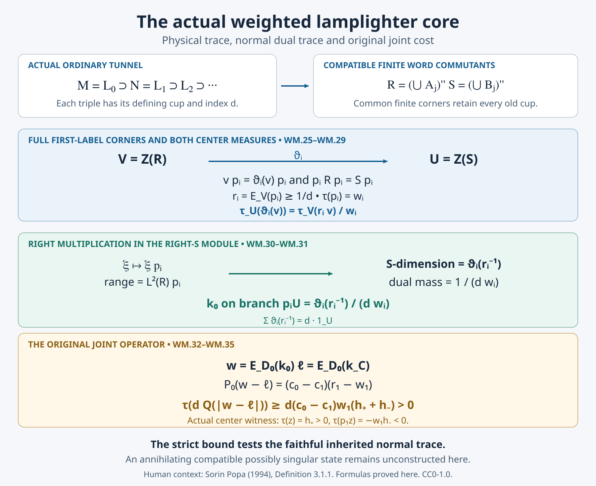

Figure WM.1. The physical finite commutants are \(A_j=L_j'\cap M\) and \(B_j=L_j'\cap N\), with their compatible common-corner embeddings. The diagram writes \(w_i=w_i^+\). The center maps preserve the corner labels and have the displayed inherited measure densities. The right-\(S\) module uses \(R_{p_i}\) with range \(L^2(R)p_i\), and its coordinate unitary includes the factor \(\sqrt{w_i^+}\) in WM.30b. The strict final bound tests the physical normal trace; it is not a lower bound for every compatible state. Shapes are schematic and encode no trace masses. Proofs: WM.1–WM.36 and WM.30a–WM.30c. Human context: Popa (1994), cited above. [Reproducible diagram source](figures/weighted-nonfactor-joint-cost-v13.py).

## The actual weighted lamplighter center and its original compatible states

The weighted model WM.1–WM.36 has a definite parameter \(1<\lambda<2\). This chapter keeps that parameter, its physical inclusion \(N\subset M\), the two canonical traces, and the original expectation \(P_0\). It proves that its joint center separates all five actual branches. It constructs an original compatible physical state for every invariant state of the actual coefficient center, and computes the original discrepancy and cost of every compatible physical state. In particular, every such state has a small explicit cost bound at the specified parameter. Neither a state of cost zero nor a positive lower bound for all compatible states is established.

### C13.1. Actual lamp unitaries in both core centers

Use the actual finite algebras, embeddings and physical word traces of WM.12–WM.13. Set
\[
U=Z(S),\quad V=Z(R),\quad
w_i=w_i^+,\quad
S_+=4+\lambda,\quad S_-=4+\lambda^{-1},\quad d=S_+S_-.
\tag{C13.1}
\]
The five labels have projected lamplighter coordinates
\[
(c_0,v_0)=(0,0),\quad(c_1,v_1)=(\delta_0,0),\quad
(c_{j+1},v_{j+1})=(0,e_j)\quad(1\le j\le3).
\tag{C13.2}
\]
The central integer coordinate of \(H\) is retained in every actual endpoint block. It does not affect the lamp observable used in this proof.

For each site \(x\in\mathbb Z^3\), let \(H_{\pm,x}(g)\) be the conditional expected final lamp sign at \(x\), with initial endpoint \(g\) and first phase \(\pm\). Transience WM.20 ensures that this final sign exists. Put the values of \(H_{\pm,x}\) on the actual endpoint blocks at the appropriate even finite levels. These are central, self-adjoint contractions. The two harmonic identities WM.21 show, with the original word weights, that normal expectations of later levels onto earlier levels give the earlier element.

These martingales have actual strong and \(L^2\) limits
\[
Z_x^+\in V,\qquad Z_x^-\in U,\qquad
(Z_x^\pm)^* =Z_x^\pm,\qquad (Z_x^\pm)^2=1.
\tag{C13.3}
\]
Here the last identity requires more than bounded martingale convergence. The diagonal word algebras identify, with their original faithful trace, with cylinder functions of the actual independent alternating label coordinates. The conditional expectation of the final sign given the complete prefix is exactly the endpoint harmonic function, since the unused coordinates have the original suffix law. Final signs are measurable in all these coordinates: at a fixed site the finite lamp signs eventually stabilize. Cylinder conditional expectations therefore converge in \(L^2\) to that sign. One can prove this directly by first approximating its indicator by a cylinder event, and using \(L^2\) contractivity of conditional expectations. The actual core martingale has the same diagonal \(L^2\) limit. Its square is consequently one. For uniformly bounded elements \(L^2\) convergence implies strong convergence on bounded vectors, then on the entire standard Hilbert space by density. At any fixed finite stage all later martingale terms commute with that stage, so their strong limit is central. This proves C13.3 inside the actual two cores, rather than only on an auxiliary probability space.

Condition on the first actual branch projection \(p_i\). Group multiplication sends a suffix lamp configuration \(\eta\) to \(c_i+\eta(\,\cdot-v_i)\), with addition modulo two. Conditional expectations on longer finite prefixes, followed by the strong limits just proved, give
\[
Z_x^+p_i=(-1)^{c_i(x)}Z_{x-v_i}^-p_i
\quad(x\in\mathbb Z^3,\ 0\le i\le4).
\tag{C13.4}
\]
The normalized trace on \(p_iU\) is precisely \(\tau_U\), since \(\tau(p_i u)=w_i\tau_U(u)\). Thus all five branch tests in C13.4 use the same actual suffix law.

The minus-first pair displacement is \(-Y^-+Y^+\). Its scalar multiplier is \(\psi_+\overline{\psi_-}\), the same as in the plus-first phase. Thus the absolute bound WM.19 and its transience estimate apply in both phases. The pair drift, in either phase, is
\[
\kappa=\left(\frac1{S_+}-\frac1{S_-}\right)(1,1,1)\ne0.
\tag{C13.5}
\]

### C13.2. The joint center contains every branch

The actual suffix final configuration has the following two properties with probability one under its inherited trace:

1. On every affine lattice line parallel to an \(e_j\) or an \(e_j-e_k\), it has only finitely many lit sites.
2. It has infinitely many lit sites in \(\mathbb Z^3\).

For the first assertion, pair increments are independent bounded vectors with mean C13.5. Their normalized sum converges almost surely to \(\kappa\). An elementary proof uses Chebyshev's inequality at times \(n=k^2\), the summability of \(k^{-2}\), and the bounded increment estimate to fill the gaps between successive squares. The vector \(\kappa\) is parallel to none of the listed line directions. Infinitely many positions on any one fixed affine line would give a subsequence whose normalized positions approach the direction subspace of that line, contradicting C13.5. Intermediate raw positions differ from pair positions by a bounded vector, so the same conclusion holds for the raw walk. Countably many affine lattice lines may be considered simultaneously. Every lit site was visited by the raw walk.

For the second assertion, raw zero displacements occur infinitely often, by independence and a positive lower bound on their probabilities. Every site is visited only finitely often by WM.20, so these displacements occur at infinitely many distinct sites. Condition on the entire projected raw path. At each zero displacement, the unresolved choice between the identity and the toggle is an independent bit, of probability \(\lambda/(1+\lambda)\) or \(1/(1+\lambda)\). Both probabilities lie in \([1/3,2/3]\). At a site with at least one zero displacement, the final parity therefore has lit probability in \([1/3,2/3]\): the absolute product of its parity biases is at most \(1/3\). Different sites use disjoint collections of bits and are conditionally independent. Infinitely many such sites are consequently lit, with conditional probability one. This gives assertion 2 under the actual trace.

For a configuration with these properties, the five transforms
\[
T_i\eta=c_i+\eta(\,\cdot-v_i)
\tag{C13.6}
\]
are pairwise different. Equality of two pure translation transforms would make \(\eta\) periodic on lines in one of the listed directions. Finite support on each such line then forces \(\eta\) to vanish everywhere, contradicting assertion 2. The toggle and identity differ at the origin. Equality of the toggle transform and one translation transform gives a difference equation with exactly one toggle on one line in the translation direction. Summing that equation modulo two on a sufficiently large finite interval of that line makes its left side zero, because the configuration has finite support there, while its right side is one. This is impossible. These arguments cover every pair of the five transforms.

All observables \(Z_x^+\) and \(Z_y^-\) commute. In the actual abelian von Neumann algebra \(D_0=U\vee V\), define the countable equality projection
\[
f_i=\bigwedge_{x\in\mathbb Z^3}
1_{\{0\}}\!\left(Z_x^+-(-1)^{c_i(x)}Z_{x-v_i}^-\right).
\tag{C13.7}
\]
C13.4 gives \(f_ip_i=p_i\). On branch \(j\ne i\), its joint equality event is \(T_i\eta=T_j\eta\), just proved to have zero suffix trace. Thus \(\tau(f_ip_j)=0\), and faithfulness gives \(f_ip_j=0\). Since \(\sum_jp_j=1\), it follows that
\[
f_i=p_i,\qquad
D_0=U\vee V=\bigoplus_{i=0}^4p_iU=C_0.
\tag{C13.8}
\]
This is an equality of the actual core algebras. It is not an identification of their inherited measures: those still satisfy the distinct formula WM.28.

For clarity, the full-corner joint lift sends these recovered projections to the original physical branch projections in \(B\). Indeed, a physical \(p_i\) commutes with \(N\) and with \(e_R^M\), because \(p_i\in R\); hence it commutes with \(A=\langle N,e_R^M\rangle\). Both lifted centers commute with \(A\). Their branch relations C13.4 hold after compression by \(e_R^M\). Compression is faithful on \(A'\cap B\): if \(X\) commutes with \(A\) and \(eXe=0\), a countable full-corner frame \(\sum_k a_ke a_k^*=1\), \(a_k\in A\), with strong sum, gives \(Xa_ke=a_kXe=0\), and then \(X=0\). Thus the lifted equality tests recover the physical \(p_i\) as well. This prevents a replacement of the smaller center lift by an unrelated right action.

### C13.3. The actual coefficient center and prescribed physical return

Apply the actual normal stable matrix form WM.15 to the canonical smooth pair \(A\subset B\). Its coefficient algebra is \(W\), with physical factor \(P\subset W\), and actual action \(\beta:H\to\operatorname{Aut}(W)\) extending the physical \(\alpha\). The represented larger and smaller algebras are
\[
\operatorname{Mat}_5(W),\qquad
\{\operatorname{diag}(\beta_i(x)):x\in W\}.
\tag{C13.9}
\]
All finite physical tower levels are the levels proved in WM.15, using its actual basis, cup and opposite weights. No additional change of representation, support or expectation is made here.

Put \(Z=Z(W)\). The normal full-corner identifications give two normal *-isomorphisms
\[
\zeta_U:U\longrightarrow Z,\quad
\zeta_V:V\longrightarrow Z,\qquad
\zeta_U\vartheta_i(v)=\beta_i^{-1}\zeta_V(v).
\tag{C13.10}
\]
The larger center is represented by \(\operatorname{diag}(\zeta_V(v))\); the smaller one by \(\operatorname{diag}(\beta_i\zeta_U(u))\). C13.10 follows by restricting these central elements to the original physical branch. Since C13.8 recovers all branches, the entire original joint lift has the exact matrix form
\[
\iota(t)=\operatorname{diag}\bigl(\beta_i\zeta_U(t_i)\bigr),
\qquad t=\sum_i p_i t_i,\quad t_i\in U.
\tag{C13.11}
\]
These are actual normal center identifications and the original lift. Their two scalar trace measures are not identified with one another.

We next prove a useful strengthening of the physical return: every \(H\)-invariant state \(\omega\) on this actual \(Z\), including a singular one, can be prescribed as the center restriction of a physical equivariant projection
\[
\Gamma_\omega:W\longrightarrow P,\qquad
\Gamma_\omega|_P=\mathrm{id},\quad
\Gamma_\omega\beta_g=\alpha_g\Gamma_\omega,\quad
\Gamma_\omega(z)=\omega(z)1.
\tag{C13.12}
\]

Here are the extension details. Choose a finite physical matrix-unit corner \(e\) of \(P\). Its factor \(P_e\) is hyperfinite II\(_1\), and \(e\) has full central support in \(W\); compression identifies \(Z(W)\) with \(Z(W_e)\). Choose increasing full matrix subfactors \(P_n\subset P_e\), with strongly dense union. Write \(Q_n=P_n'\cap P_e\), again a finite factor. In \(Q_n\vee Z(W_e)\), finite convex averages of conjugations by unitaries in \(Q_n\) send each finite sum \(\sum_j q_jz_j\) in norm to \(\sum_j\tau(q_j)z_j\). Simultaneous norm averaging follows from the finite-factor case of 81.2, applied successively to the finitely many coefficients. The averages are completely positive on every matrix level. They therefore define a well-defined unital completely positive scalar-coefficient map on this norm-closed algebra. Compose with \(\omega\), and extend the resulting state by the positive Hahn–Banach state extension to \(P_n'\cap W_e\). It agrees with \(\tau\) on \(Q_n\) and with \(\omega\) on \(Z(W_e)\).

Taking this state on each complementary matrix coefficient gives a UCP map \(G_n:W_e\to P_n\). On \(P_e\) it is exactly the trace expectation onto \(P_n\); on a central \(z\) it is \(\omega(z)e\). A point-ultraweak cluster \(G:W_e\to P_e\) fixes every element of \(P_e\), since these trace expectations converge boundedly in \(L^2\) and ultraweakly to the identity. It retains the prescribed center values. Extend \(G\) entrywise over the actual countable physical infinite matrix units. Finite compressions have a common norm bound and are completely positive; their compatible entries determine a bounded element of \(P\). This gives a UCP map \(\Gamma_0:W\to P\) fixing \(P\), with \(\Gamma_0(z)=\omega(z)1\). Normality of the state extensions or of \(\Gamma_0\) is not required.

Finally average \(\alpha_g^{-1}\Gamma_0\beta_g\) over the concrete right Følner sets WM.16. Since \(\omega\) is invariant, every summand has the prescribed center restriction. A point-ultraweak cluster is equivariant by the counted right boundary ratios, fixes \(P\), and has that same restriction. This proves C13.12. There is no use of a scalar tracial state on a II\(_\infty\) algebra.

Applying \(\Gamma_\omega\) entrywise in C13.9 and compressing by the original physical finite corner yields the actual map
\[
F_\omega:B\longrightarrow M,\qquad
F_\omega|_M=\mathrm{id},\quad E_NF_\omega=F_\omega E_A.
\tag{C13.13}
\]
Indeed, the original expected diagonal formula is
\(\sum_iw_i\beta_i^{-1}(X_{ii})\); equivariance turns it into its physical formula with \(\alpha_i^{-1}\). Off-diagonal entries have zero expectation. The full common matrix basis is the original basis at every finite tower level, as in WM.15. Compressing by the original physical corner preserves the displayed identity. Thus \(\psi_\omega=\tau F_\omega\) is an original \(E_A\)-compatible \(M\)-central state on \(B\), with exactly physical marginal \(\tau\).

Conversely, every original compatible \(M\)-central state \(\psi\) gives such a center state \(\omega\). To see the return without imposing normality on \(\psi\), for \(T\ge0\) define the bounded positive form \(\langle T x,y\rangle_\psi=\psi(y^*Tx)\) on \(L^2(M,\tau)\). Centrality implies the bound by \(\|T\|\|x\|_2\|y\|_2\) and shows that the associated operator commutes with right multiplication by \(M\). The finite tracial commutation theorem M10.1 supplies \(F(T)\in M_+\), with \(0\le F(T)\le\|T\|1\) and \(\tau(mF(T))=\psi(mT)\). Uniqueness of this trace pairing extends \(F\) linearly and gives \(M\)-bimodularity. Positivity and bimodularity prove complete positivity: for a positive matrix \([T_{jk}]\) and \(a_j\in M\), its compressed quadratic expression is \(F(\sum_{jk}a_j^*T_{jk}a_k)\ge0\). It fixes \(M\) and satisfies \(\psi=\tau F\). For \(a\in A\), compatibility and the original identity \(E_A|_M=E_N\) give \(\tau(mF(a))=\psi(E_N(m)a)=\tau(E_N(m)F(a))\) for every \(m\in M\), so \(F(a)\in N\). Pairing \(F(E_A(T))\) and \(E_NF(T)\) against every \(n\in N\) now proves \(E_NF=FE_A\).

Its bounded entrywise stabilization fixes the entire physical matrix factor. Matrix-unit bimodularity then makes it \(\operatorname{Mat}_5(\Gamma)\) in C13.9. Mapping the represented smaller algebra into the physical smaller algebra gives \(\Gamma\beta_i=\alpha_i\Gamma\), using \(\beta_0=\alpha_0=\mathrm{id}\). The already established finite-level relators extend this to all of \(H\). For \(z\in Z\), physical \(P\)-bimodularity forces \(\Gamma(z)\in P'\cap P=\mathbb C1\); write it as \(\omega(z)1\). Equivariance makes \(\omega\) invariant. This proves both the necessary original-state restriction and its realization for every invariant \(\omega\).

### C13.4. Exact original likelihood, discrepancy and cost

Let \(r_i=E_V(p_i)\), as in WM.26, and put
\[
R_i=\zeta_V(r_i)\in Z,\qquad
R_i\ge1/d>0,\quad \sum_iR_i=1.
\tag{C13.14}
\]
The inverse is bounded; hence all functions below belong to the actual von Neumann center \(Z\), even when tested by a singular state.

For any original compatible state \(\psi\), let \(\omega\) be its invariant coefficient-center state. The physical finite diagonal corner has traces \(w_i\), not equal weights. C13.11 and invariance give, for its original joint restriction \(\alpha=\psi\iota\),
\[
\alpha\left(\sum_i p_it_i\right)
=\sum_iw_i\omega(\zeta_U(t_i)).
\tag{C13.15}
\]
Retain exactly WM.32: \(P_0(t)=\sum_i r_i\vartheta_i^{-1}(t_i)\).
C13.10 therefore gives
\[
\alpha P_0(t)=
\sum_i\omega\bigl(\beta_i^{-1}(R_i)\zeta_U(t_i)\bigr).
\tag{C13.16}
\]
The norm of the difference on the direct sum C13.8 is the sum of the norms of the five component functionals. A central self-adjoint multiplier \(h\) against any positive functional has norm its value on \(|h|\), by its spectral sign. Invariance transports each term back to \(Z\). Thus the exact original discrepancy is
\[
\|\alpha-\alpha P_0\|
=\sum_i\omega\bigl(|R_i-w_i|\bigr).
\tag{C13.17}
\]

Since \(D_0=C_0\), the conditional expectation in WM.33 is the identity. Consequently its original positive cost, before lifting, is
\[
b=dQ(|w-\ell|)
=\sum_i\left|\vartheta_i(r_i^{-1})-\frac1{w_i}\right|\in U.
\tag{C13.18}
\]
The original physical cost \(\mathfrak a=\iota(b)\) of every original compatible state is therefore
\[
C_\omega:=\psi(\mathfrak a)
=\sum_i\omega\left(\left|R_i^{-1}-\frac1{w_i}\right|\right).
\tag{C13.19}
\]
Neither C13.17 nor C13.19 uses a modified expectation depending on \(\alpha\). Both are the original \(P_0\) and the cost of the original two canonical traces. C13.19 also agrees directly with the exact transfer formula \(d\alpha(|w-\ell|)\), since the \(w_i\) in C13.15 cancel its branch denominators.

The result makes no normality assumption and applies to every original compatible state, including any such state annihilating the original Jones ideal. E14.8–E14.12 below prove that their center restrictions in this actual model are all purely singular. E14.12 below proves pure center singularity in this actual model, so the existing complete SC.2–SC.3 applies. E14.12a consequently gives annihilation of the entire original Jones ideal for every compatible state and every prescribed-center return. No ideal or singular branch was discarded in deriving the necessary formulas.

### C13.5. A universal bound at the fixed actual parameter

The pointwise dimension identity WM.31 is essential. Transporting it through \(\zeta_U\), applying the invariant \(\omega\), and using C13.10 gives
\[
\sum_i\omega(R_i^{-1})=d=\sum_iw_i^{-1}.
\tag{C13.20}
\]
This is an identity of values for every invariant state, not a replacement of either original trace by a joint normal trace.

The bounded scalar identity
\[
r^{-1}-w^{-1}+(r-w)w^{-2}
=\frac{(r-w)^2}{w^2r}
\]
holds by functional calculus at \(r=R_i\). Summing and using C13.20 yields
\[
\begin{aligned}
h_\omega&:=\sum_i\omega\left(\frac{(R_i-w_i)^2}{w_i^2R_i}\right)
=K\epsilon_\omega,\\
K&=S_+^2(1-\lambda^{-2})>0,\qquad
\epsilon_\omega=w_1-\omega(R_1)\ge0.
\end{aligned}
\tag{C13.21}
\]
Indeed the four other weights equal \(1/S_+\), whereas \(w_1=\lambda/S_+\); using \(\sum_i(\omega(R_i)-w_i)=0\) gives the displayed equality. Positivity proves its sign.

Let \(t=\omega(R_1)>0\). The positive functional Cauchy–Schwarz inequality gives \(\omega(R_i^{-1})\ge1/\omega(R_i)\). Another scalar Cauchy–Schwarz inequality on the other four terms gives
\[
\frac1t+\frac{16}{1-t}\le d.
\]
The roots of its quadratic equality are
\[
w_1^-=\frac1{4\lambda+1}
\le\omega(R_1)\le\frac{\lambda}{4+\lambda}=w_1.
\tag{C13.22}
\]
The upper root also follows from C13.21. The root computation uses the actual \(d=(4+\lambda)(4\lambda+1)/\lambda\).

For the discrepancy \(\Delta_\omega\) in C13.17, \(\sum_i(\omega(R_i)-w_i)=0\) implies \(\Delta_\omega\ge2\epsilon_\omega\). Since \(0<R_i\le1\) and \(w_i\le w_1\), C13.19 gives \(C_\omega\ge\Delta_\omega/w_1\). On the other hand, apply Cauchy–Schwarz to the direct sum of the five positive functionals:
\[
\sum_i\omega\left(\frac{|R_i-w_i|}{w_iR_i}\right)
\le
\left[\sum_i\omega\left(\frac{(R_i-w_i)^2}{w_i^2R_i}\right)\right]^{1/2}
\left[\sum_i\omega(R_i^{-1})\right]^{1/2}.
\]
C13.20–C13.22 prove the exact fixed-model bounds
\[
\frac{2}{w_1}\epsilon_\omega
\le C_\omega
\le\sqrt{dK\epsilon_\omega}
\le\frac{2(4+\lambda)(\lambda^2-1)}{\lambda^{3/2}}.
\tag{C13.23}
\]
For the last expression, direct algebra gives
\[
dK(w_1-w_1^-)
=\frac{4(4+\lambda)^2(\lambda^2-1)^2}{\lambda^3}.
\]
Thus every original compatible state, including every state supplied by the prescribed-center return, has the displayed small upper bound at the fixed rational parameter WM.22. This is a bound in this one actual inclusion. It does not take a limit of changed physical inclusions.

At the fixed actual parameter WM.22, write \(\delta=\lambda-1=2^{-31}25^{-198153}\). Since \(4+\lambda<6\), \(\lambda+1<3\) and \(\lambda^{3/2}>1\), C13.23 gives

\[
0\le\psi(\mathfrak a)<36\delta=\frac{36}{2^{31}25^{198153}}
\qquad\text{for every original compatible state.}
\tag{C13.23a}
\]

This extremely small but fixed upper bound does not establish cost zero or arbitrarily small cost for the same physical inclusion.

There is also an exact consequence useful for locating the attempt boundary:
\[
\psi(\mathfrak a)=0
\quad\Longleftrightarrow\quad
\omega(R_1)=w_1
\quad\Longleftrightarrow\quad
\omega(|R_i-w_i|)=0\ \hbox{for every }i.
\tag{C13.24}
\]
The forward implication follows from the left inequality C13.23. Equality of the moment gives \(h_\omega=0\), and Cauchy–Schwarz gives \(C_\omega=0\). Equivalence with the five deviations follows either from C13.19 and the uniform invertibility C13.14 or from C13.17 and its scalar comparison. This is a proved description of the finite boundary, not a solution of the assigned zero-state problem.

### C13.6. What the construction proves and what remains unproved

The finite construction here is genuine: it starts with the actual \(W\), its actual center and actual finite tower relators, prescribes any invariant center state by an explicit physical UCP return, and preserves the original physical marginal and original \(E_A\). It establishes the full five-branch joint algebra, the exact original-state formulas C13.17 and C13.19, and the universal fixed-parameter estimate C13.23. The positive normal operator cost WM.35 remains nonzero and is consistent with this estimate.

The unproved step is whether an invariant state on this particular actual \(Z(W)\) can attain the upper endpoint \(\omega(R_1)=\lambda/(4+\lambda)\). Invariance alone proves only C13.22; it does not select that endpoint. The invariant-state set is nonempty: average any state on \(Z(W)\) over WM.16 and take a weak-star cluster; its right boundary estimates give invariance. Compactness gives a maximum of the moment on this compact set, but the present argument does not determine its value. If the maximum were strictly smaller than the upper endpoint, C13.23 would give a positive lower bound for every original compatible state. If it equalled that endpoint, the physical return C13.12–C13.13 would construct an original zero-cost state. Neither assertion about that maximum is proved here.

The unrestricted original-state target therefore remains unresolved, even for this fixed weighted example. No logarithmic test, stochastic substitute, changed \(P_\alpha\), faithful normal joint trace, or operator equality is being presented as its resolution.

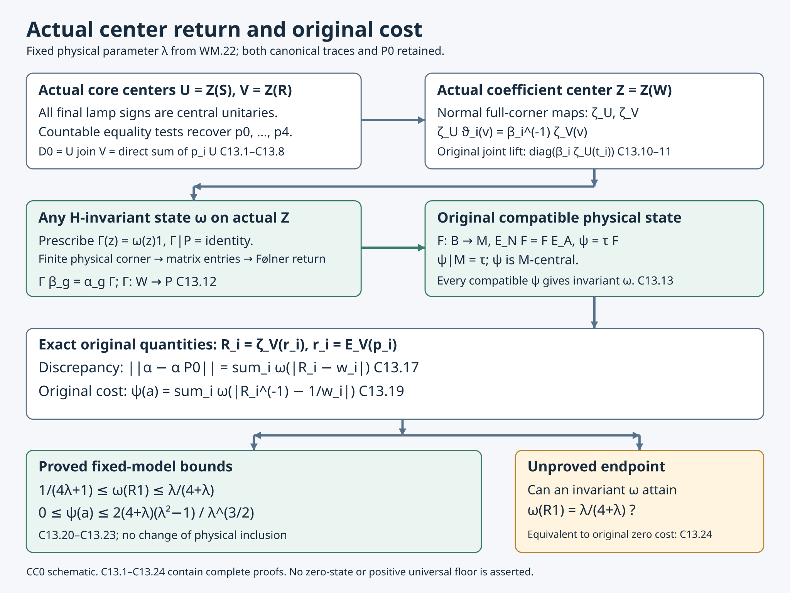

Figure C13. The top arrows are actual full-corner and matrix identifications, proved in C13.1–C13.3. The return uses the physical corner and the original expected diagonal weights. The two bottom formulas are the original quantities C13.17 and C13.19. The shaded endpoint is the precise unproved step of C13.6, rather than a proved zero-state construction. [Reproducible diagram source](figures/actual-center-and-original-cost-v14.py). The diagram writes \(w_i=w_i^+\), \(\vartheta_i\) for the actual corner-center map, and \(a=\mathfrak a\). Boxes and arrows are schematic; their sizes encode no trace masses.

### Mathematical sources

Sorin Popa, *Classification of amenable subfactors of type II*, Acta Mathematica 172 (1994), 163–255, [DOI 10.1007/BF02392646](https://doi.org/10.1007/BF02392646), §2.3 and §3.1–§3.2, provides the human context for smooth representations and amenability. The weighted actual construction, physical trace character and complete finite matrix tower used here are [WM.1–WM.36](general-tail-supports-and-controlled-tunnels.md). This chapter supplies its new branch-separation and prescribed-center return proofs.

The finite-factor norm averaging used in C13.3 is the complete proof 81.2 in [Relative norm averaging and central density](relative-norm-averaging-and-central-density.md). The positive-form return uses the finite tracial commutation proof M10.1 in [Finite traces and Jones projections](finite-traces-and-jones-projections.md). The actual common expected matrix stages and finite tower compatibility are 61.1–61.2 in [Smooth representations and tower compression](smooth-representations-and-tower-compression.md). The two canonical traces, original joint density and bounded transfer retain the exact providers identified and proved in WM.30–WM.36.

## The actual center action: a vanished integer shift and a singular endpoint problem

Keep the fixed rational \(1<\lambda<2\) of WM.22 and the original weighted physical inclusion. The actual center \(Z=Z(W)\), action \(\beta\), probabilities \(R_i\), and physical return are those constructed in C13. This chapter proves three further facts. The central integer generator \(z^2\) acts trivially on the entire actual center. Every invariant center state, and hence every original compatible state's center restriction, is purely singular. The original trace character excludes the lower Jensen endpoint, with an explicit uniform gap. None of these facts proves attainment of the upper endpoint required for original zero cost.

### E14.1. A finite central-noise estimate in the actual weighted tower

Write \(s_0=1,s_1=az,s_{j+1}=t_j\), \(S_+=4+\lambda\), \(S_-=4+\lambda^{-1}\), and \(d=S_+S_-\). Consider four consecutive actual raw labels with phases \(+,-,+,-\). Three particular words have endpoints
\[
\begin{array}{c|c|c}
\text{word}&\text{endpoint in }H&\text{original physical probability}\\ \hline
(0,0,0,0)&1&d^{-2}\\
(1,0,1,0)&z^2&\lambda^2d^{-2}\\
(0,1,0,1)&z^{-2}&\lambda^{-2}d^{-2}.
\end{array}
\tag{E14.1}
\]
These are actual diagonal word projections and their original traces WM.13. Their projected lamplighter endpoints are all the identity. In the opposite phase the three probabilities for endpoints \(1,z^2,z^{-2}\) are the same, with the last two chosen raw words interchanged.

Among \(n\) independent four-label blocks let \(N\) count blocks in these three specified words. Then
\[
N\sim\operatorname{Bin}(n,q),\qquad
q=\frac{1+\lambda^2+\lambda^{-2}}{d^2}\ge\frac1{243}.
\tag{E14.2}
\]
The lower bound follows from \(d\le27\) and \(1+\lambda^2+\lambda^{-2}\ge3\). Condition on which blocks are selected and on every other complete block word. Each selected block then contributes an independent central factor \(z^{2J}\), where \(J=-1,0,1\) has probabilities proportional to \(\lambda^{-2},1,\lambda^2\). Centrality lets these factors be pulled through all other endpoints. Thus their sum supplies genuine independent integer noise to the actual endpoint; no group endpoint or physical weight has been changed.

For \(N=k\), let \(L\) count selected central steps that are \(0\) or \(1\). Conditional on \(L\), their number of \(1\)'s is binomial:
\[
L\sim\operatorname{Bin}(k,r),\quad
r=\frac{1+\lambda^2}{1+\lambda^2+\lambda^{-2}}\ge\frac23,\qquad
p=\frac{\lambda^2}{1+\lambda^2}\in[1/2,4/5].
\tag{E14.3}
\]
The remaining \(k-L\) steps all equal \(-1\). Shifting the total noise by one is therefore, after this conditioning, the shift of \(\operatorname{Bin}(L,p)\) by one.

For a binomial mass function the successive mass ratios decrease, so it is unimodal. Its total variation distance from its shift by one equals its largest atom. For \(L\ge1\), Fourier coefficient extraction and
\[
|1-p+pe^{it}|^L
\le\exp\!\left(-Lp(1-p)(1-\cos t)\right)
\le\exp\!\left(-2Lp(1-p)t^2/\pi^2\right)
\quad(-\pi\le t\le\pi)
\]
bound that atom by
\(\sqrt{\pi}/(2\sqrt{2Lp(1-p)})<2/\sqrt L\).
The last strict inequality uses \(p(1-p)\ge4/25\) and \(\pi<4\). This is a direct finite estimate, requiring no limiting distribution theorem.

Chebyshev's inequality gives
\(\mathbb P(N<qn/2)\le972/n\).
On \(N\ge qn/2\), it gives
\(\mathbb P(L<rN/2\mid N)\le2916/n\).
Outside these exceptional events, \(L\ge n/1458\), so the binomial shift distance is at most \(77/\sqrt n\). Mixing over all conditioned blocks cannot increase total variation. If \(\mu_n^\pm\) denotes the actual endpoint law of \(4n\) raw labels, in either phase, then
\[
\|\mu_n^\pm-\delta_{z^2}*\mu_n^\pm\|_{\mathrm{TV}}
\le\min\left(1,\frac{77}{\sqrt n}+\frac{3888}{n}\right).
\tag{E14.4}
\]
Here total variation is \(\sup_E|\mu(E)-\nu(E)|\); differences of expectations of a bounded function are at most twice its norm times this distance. The same estimate holds after multiplication by any fixed starting endpoint. The central integer coordinate of \(H\) was retained throughout this calculation.

### E14.2. The whole actual coefficient center forgets \(z^2\)

We prove
\[
\beta_{z^2}|_Z=\mathrm{id}_Z.
\tag{E14.5}
\]
It is not enough to check this on the lamp observables alone. Let \(v\) be any bounded element of the actual core center \(V=Z(R)\). At an actual finite word level \(m\), the normal trace expectation of \(v\) is central in the finite algebra. It therefore has a value \(h_m(g)\) on each endpoint block \(g\) at that level, with \(|h_m(g)|\le\|v\|\). The original conditional word traces give, for every possible prefix endpoint \(g\),
\[
h_m(g)=\sum_h\mu_n^\pm(h)\,h_{m+4n}(gh),
\tag{E14.6}
\]
where the phase is the phase of the unused suffix. This is just the normal finite-word expectation identity in the actual tower.

Use the two four-label prefixes \(I=(0,0,0,0)\) and \(J=(1,0,1,0)\), of endpoints \(1\) and \(z^2\). Append any fixed suffix prefix \(K\), with endpoint \(g(K)\). The endpoints \(g(K)\) and \(z^2g(K)\) are both possible at the same actual level \(4+|K|\). Apply E14.6 and E14.4 at that level. The two resulting coefficients differ in absolute value by at most
\[
2\|v\|\left(\frac{77}{\sqrt n}+\frac{3888}{n}\right).
\]
Letting \(n\) tend to infinity proves their equality at every finite suffix level.

For completeness, these coefficient equalities compare actual normal center maps. A fixed prefix word projection \(q_I\) has full central support. This follows by iterating the actual cup comparison proving WM.26; every positive branch weight is retained at each finite level. Its corner \(q_IRq_I\) is the suffix core: at every finite stage its matrix units are exactly the pairs of suffix words with equal endpoints, since the common left prefix cancels. The trace divided by \(\tau(q_I)\) is exactly the original suffix word trace. Taking bounded strong closures gives the same normal corner identification. Compression of \(V\) therefore supplies the normal full-center map into that suffix core.

The finite represented tower WM.15 identifies this map, under the common coefficient-center coordinates, with \(\beta_{g(I)}^{-1}\zeta_V\). This can also be read directly from its matrix entries: the first-prefix coefficient is the alternating \(\beta\)-word, with the identity label contributing \(\beta_0=\mathrm{id}\), and every further cup and coefficient map is the actual one in WM.15. Thus prefix \(I\) gives the identity map and prefix \(J\) gives \(\beta_{z^2}^{-1}\). The coefficient equalities established above show that the normal expectations of their two images onto every finite suffix algebra agree. Faithful \(L^2\) approximation in the suffix core makes the images equal. Since \(\zeta_V\) maps all of \(V\) onto \(Z\), E14.5 follows.

In particular, the entire actual center action factors through
\[
H/\langle z^2\rangle\cong
\left(\bigoplus_{\mathbb Z^3}\mathbb Z/2\right)\rtimes\mathbb Z^3.
\tag{E14.7}
\]
Only this center action has been quotiented. The physical automorphism \(\alpha_{z^2}\) still scales the trace of \(P\) by \(\lambda^2\), and the actual action on \(W\), physical inclusion and finite expected tower have not been quotiented or altered.

### E14.3. Actual lamp flips force purely singular center restrictions

Let \(Z_x^\pm\) be the actual central lamp unitaries C13.3. C13.4 and the identity label give the common actual coefficient-center unitary
\[
L_x=\zeta_V(Z_x^+)=\zeta_U(Z_x^-)\in Z.
\tag{E14.8}
\]
The same branch equations give
\[
\beta_i^{-1}(L_x)=(-1)^{c_i(x)}L_{x-v_i}.
\tag{E14.9}
\]
Conjugating \(\beta_1\) by the actual spatial translations therefore supplies the automorphism flipping any one \(L_x\) and fixing the other lamp unitaries. These automorphisms arise from actual elements \(t_x(az)t_x^{-1}\in H\); they are not newly chosen maps on a commutative model. E14.5 shows that each of these automorphisms squares to the identity on the full \(Z\), as well as on its lamp subalgebra.

If \(\omega\) is any \(H\)-invariant state on the actual \(Z\), every nonempty finite product of distinct lamp unitaries changes sign under one such flip. Hence
\[
\omega\left(\prod_{x\in F}L_x\right)=0
\quad(0<|F|<\infty),\qquad
\omega\left(\prod_{x\in F}\frac{1+\epsilon_xL_x}{2}\right)
=2^{-|F|}
\quad(\epsilon_x\in\{-1,1\}).
\tag{E14.10}
\]
This says that its finite lamp distributions are exactly fair independent bits. It does not assert normality on the von Neumann algebra generated by those bits.

Choose the actual line \(\{ke_1:k\in\mathbb Z\}\), and form the normal spectral projections
\[
F_L=\bigwedge_{|k|>L}\frac{1+L_{ke_1}}2,\qquad
F_L\uparrow1\ \hbox{strongly}.
\tag{E14.11}
\]
The strong supremum is one because C13.2 proves, under the actual faithful core trace, that there are only finitely many lit lamps on this line. The normal full-center maps carry that actual projection identity into \(Z\).

For any finite set of \(m\) sites outside this interval, \(F_L\) is dominated by the projection that all those sites are unlit. E14.10 therefore gives \(0\le\omega(F_L)\le2^{-m}\) for every \(m\), and consequently
\[
\omega(F_L)=0\quad\hbox{for all }L,\qquad \omega(1)=1.
\tag{E14.12}
\]
If a normal positive functional \(\eta\) were dominated by \(\omega\), then \(\eta(F_L)=0\) for all \(L\), and normal monotone continuity would give \(\eta(1)=0\). Thus \(\omega\) has no nonzero normal positive functional below it: it is purely singular.

Every original \(E_A\)-compatible \(M\)-central state with physical marginal \(\tau\) supplies just such an invariant \(\omega\), by C13.3. Its restrictions to the two original centers are therefore purely singular. The same holds on \(D_0=\bigoplus_i p_iU\), using the exact branch weights C13.15: a normal positive functional dominated by the joint restriction would give, on each branch, a normal positive functional dominated by \(w_i\omega\zeta_U\), and hence zero. In particular, no original compatible state can have even a nonfaithful normal joint restriction. This strengthens the faithful-normal exclusion supplied by WM.35.

Conversely, C13.12–C13.13 still return every actual invariant \(\omega\) to an original compatible physical state. Since its prescribed center restriction is now proved singular, that return is necessarily nonnormal on the original center. It remains exactly normal on the physical marginal \(M\), with all physical factor representations and finite Jones levels as before.

The state itself is purely singular on \(B\). Indeed, a nonzero normal positive functional dominated by it would restrict normally to the unital \(Z(B)\), with the same positive value at one, contradicting the center singularity just proved.

The actual compatible-state hypotheses now also give the entire Jones-ideal conclusion. The complete bounded-left-cut and finite-common-basis argument [SC.2–SC.3, Singular hypertraces, the Jones ideal and bounded entropy](singular-hypertraces-jones-ideals-and-entropy.md) applies to exactly the same original \(B\), core projection \(e=e_R^M\), expectation, common basis and physical trace: \(\psi E_A=\psi\), \(M\)-centrality, \(\psi|_M=\tau\), and purely singular restrictions to both represented centers. That proof uses arbitrary coefficients from the actual \(B\), not just physical coefficients from \(M\). Consequently

\[
J_e=\overline{\operatorname{span}(BeB)}^{\|\cdot\|},
\qquad \psi(J_e)=0,\qquad F_\omega(J_e)=0.
\tag{E14.12a}
\]

For the last assertion, if \(x\in J_e\), then \(x^*x\in J_e\), and \(\tau(F_\omega(x^*x))=\psi_\omega(x^*x)=0\). Faithfulness of the original physical \(\tau\) gives \(F_\omega(x^*x)=0\); the UCP Schwarz inequality then gives \(F_\omega(x)^*F_\omega(x)\le F_\omega(x^*x)=0\). This applies to every prescribed-center return in C13.13. The original canonical normalization \(\operatorname{Tr}(e)=1\) and every physical ordinary Jones cup remain unchanged. This is an application of the existing complete ideal proof; no new trace or duplicate provider is introduced.

### E14.4. The original trace character excludes the lower Jensen endpoint

Define the two faithful normal probability measures on the actual coefficient center by
\[
\mu_U=\tau_U\zeta_U^{-1},\qquad
\mu_V=\tau_V\zeta_V^{-1}.
\]
WM.28 and C13.10 give, without identifying these measures,
\[
\mu_U\circ\beta_i^{-1}
=\mu_V\left(\frac{R_i}{w_i}\,\cdot\right),\qquad
\mu_U=\mu_V\left(\frac{R_0}{w_0}\,\cdot\right).
\tag{E14.13}
\]
Both densities are boundedly invertible by WM.26. Thus the actual Radon–Nikodym multiplier for \(\beta_i^{-1}\), relative to \(\mu_U\), is
\[
D_i=\frac{w_0R_i}{w_iR_0}=\frac{R_i}{\nu_iR_0},
\qquad \nu=(1,\lambda,1,1,1).
\tag{E14.14}
\]
This is a consequence of the original two canonical center measures, not an arbitrarily assigned likelihood.

E14.5 implies \(\beta_1^2=\mathrm{id}\) on \(Z\). Applying the normal change-of-variables identity E14.13 twice and using faithfulness gives \(D_1\beta_1(D_1)=1\). Its logarithm is bounded, so every invariant state satisfies \(\omega(\log D_1)=0\). Therefore the exact actual constraint is
\[
\omega(\log R_1)-\omega(\log R_0)=\log\lambda.
\tag{E14.15}
\]
The physical \(\lambda\) is fixed. Its sign here comes from the original trace density, and has not been inverted with the opposite phase.

The next quantitative consequence uses no normality of \(\omega\). Put
\[
w_-=\frac1{4\lambda+1},\quad
w_+=\frac{\lambda}{4+\lambda},\quad
m=\frac{w_-}{d},\quad t=\omega(R_1),\quad a_i=\omega(R_i).
\]
All \(R_i\) and \(a_i\) are at least \(m\); \(\sum_iR_i=\sum_i a_i=1\); and C13.20 gives \(\sum_i\omega(R_i^{-1})=d\). As in C13.22, \(w_-\le t\le w_+\).

Set \(a_*=(1-t)/4\). The exact Jensen budget and its decomposition are
\[
\begin{aligned}
B(t)&=d-\frac1t-\frac{16}{1-t}
     =\frac{d(t-w_-)(w_+-t)}{t(1-t)},\\
v_i&=\omega\left(\frac{(R_i-a_i)^2}{a_i^2R_i}\right)
     =\omega(R_i^{-1})-\frac1{a_i},\\
B(t)&=\sum_i v_i+
       \sum_{i\ne1}\frac{(a_i-a_*)^2}{a_*^2a_i}.
\end{aligned}
\tag{E14.16}
\]
The last identity follows by adding the four reciprocal tangent identities at their common average \(a_*\); their linear terms sum to zero. Every term is nonnegative.

For positive \(s\), \(s-1-\log s\ge0\), and
\[
s-1-\log s\le (s-1)^2/s,
\]
since the difference of the right side and the left side is \(\log s+s^{-1}-1\ge0\). Applying these identities at \(s=R_i/a_i\) gives
\(0\le \log a_i-\omega(\log R_i)\le a_i v_i\).
E14.15 therefore implies
\[
\left|\log(t/a_0)-\log\lambda\right|\le B(t).
\]
Also \(|a_0-a_*|\le\sqrt{B(t)}\) by E14.16, and the logarithm is \(1/m\)-Lipschitz on \([m,1]\). Consequently
\[
\left|\log(t/a_*)-\log\lambda\right|
\le B(t)+\frac{\sqrt{B(t)}}m.
\tag{E14.17}
\]
At \(t=w_-\), the expression \(\log(t/a_*)\) equals \(-\log\lambda\), while the right side vanishes. Thus the lower endpoint is impossible.

Here is an explicit uniform gap. For \(u=t-w_-\), the derivative of \(\log(t/a_*)=\log(4t/(1-t))\) is at most \(2/m\) throughout \([w_-,w_+]\): there \(t\ge m\) and \(1-t\ge4m\). Also E14.16 gives \(B(t)\le du/(4m^2)\). If
\(u\le m^4(\log\lambda)^2/(16d)\), the left side of E14.17 is at least
\[
2\log\lambda-\frac{2u}{m}
\ge\frac{15}{8}\log\lambda,
\]
whereas its right side is at most
\((1/64+1/8)\log\lambda=9\log\lambda/64\).
We used only \(0<m\le1\), \(d\ge1\), and \(0<\log\lambda<1\). This is a contradiction. Every actual invariant center state therefore satisfies the uniform strict bound
\[
\boxed{\quad
\omega(R_1)>
\frac1{4\lambda+1}
+\frac{m^4(\log\lambda)^2}{16d},
\qquad m=\frac1{d(4\lambda+1)}.
\quad}
\tag{E14.18}
\]
This excludes the opposite-weight endpoint and a definite neighborhood of it in the fixed actual model.

The actual stronger bound \(R_i\ge1/d\), proved in WM.26 and retained in C13.14, improves the numerical gap. The proof of E14.16–E14.18 uses only a common lower bound on the five likelihoods and means, \(t\ge m\), \(1-t\ge4m\), \(m\le1\), \(d\ge1\), and \(0<\log\lambda<1\). These hold with \(\widehat m=1/d\): \(w_-\ge1/d\) and \(1-w_+\ge4/d\). Repeating the same displayed estimates with this stronger actual lower bound gives

\[
\omega(R_1)>\frac1{4\lambda+1}+\frac{(\log\lambda)^2}{16d^5}.
\tag{E14.18a}
\]

The fixed physical inclusion and its original trace densities are unchanged.

### E14.5. The upper endpoint remains a singular actual question

The new action constraint is compatible with the desired endpoint. If \(\omega(R_1)=w_+\), C13.21–C13.24 force \(\omega(|R_i-w_i|)=0\) for every \(i\); bounded logarithms then give \(\omega(\log R_1)-\omega(\log R_0)=\log(w_1/w_0)=\log\lambda\), exactly E14.15. Thus E14.15 does not exclude zero cost.

E14.18 separates the lower Jensen root, not the upper one. Pure singularity E14.12 requires a singular state but does not specify its values on the actual likelihood functions \(R_i\). Finite lamp distributions E14.10 alone do not specify these values either: normal spectral limits used to obtain \(R_i\) cannot be passed through an arbitrary singular state. This is a concrete obstruction to replacing the actual likelihoods by their cylinder samples or a fair-bit commutative surrogate.

The precise remaining step is still construction of an actual invariant state on \(Z(W)\) with \(\omega(R_1)=\lambda/(4+\lambda)\), or an actual strict bound below that upper endpoint. Neither is proved here. The existing original physical return would realize the first as a state with original \(P_0\)-balance and zero original cost; a strict upper separation would give a positive universal original-cost lower bound through C13.23. All new facts above retain the original \(\lambda,\tau,E_A,P_0\), and both canonical traces. The whole Jones-ideal conclusion is now supplied by the existing complete provider at its verified hypotheses in E14.12a; the upper cost endpoint is still unproved.

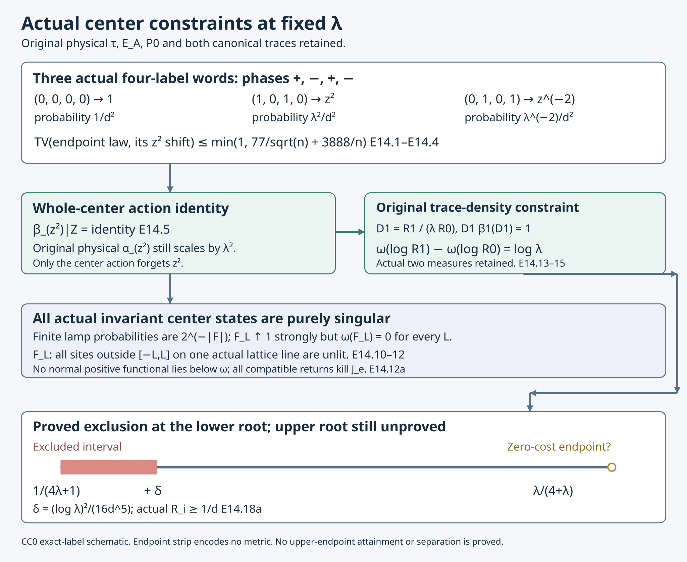

Figure E14. The upper box records the actual four-label words and central-noise estimate E14.1–E14.4. The arrows give the proved whole-center action identity E14.5, the original trace-density identity E14.15, and the singularity mechanism E14.10–E14.12. The endpoint strip is schematic, with no metric encoded: E14.18 removes a strictly positive interval next to the lower root, while the upper root is unproved. Every displayed constant and formula is exact. [Reproducible diagram source](figures/actual-center-action-and-singularity-v15.py). The separated interval in the diagram uses the stronger actual bound E14.18a. The diagram writes \(D1=D_1\), \(R1=R_1\), and \(P0=P_0\); the endpoint strip encodes no metric.

### Mathematical sources

Sorin Popa, *Classification of amenable subfactors of type II*, Acta Mathematica 172 (1994), 163–255, [DOI 10.1007/BF02392646](https://doi.org/10.1007/BF02392646), §2.3 and §3.1–§3.2, provides the context for the actual smooth representation and original physical return. All central-noise, singularity and endpoint estimates are proved above.

The exact physical action, finite tower, word weights, core centers and two trace measures are [WM.1–WM.36](general-tail-supports-and-controlled-tunnels.md). The actual branch recovery, full normal center maps, original compatible-state return, bounded likelihoods and exact dimension identity are [C13.1–C13.24](general-tail-supports-and-controlled-tunnels.md). The normal full common finite tower and cup comparisons retain the complete providers 52.1–52.2 and 61.1–61.2 specified in those chapters. No external theorem about an abstract boundary or substitute abelian action is used.

## A good whole-stage cell need not return approximately to a unital corner stage

Use the actual index-\(25\) inclusion \(N\subset M\) of LF.1–LF.17 in [Lesson 99](general-tail-supports-and-controlled-tunnels.md). In its physical first matrix coordinate write
\[
 e_{ij}=E_{ij}\otimes1,\qquad q_i=e_{ii},\qquad
 A_0=N'\cap M=\bigoplus_{i=0}^4\mathbb Cq_i .
 \tag{MR.1}
\]
The automorphism labels are \(s_0=1,s_1=a,s_2=t_1,s_3=t_2,s_4=t_3\). The factors, their expectations and every ordinary cup are the actual ones of LF.1–LF.4. The all-smooth amenability quantifier is proved in LF.5–LF.8. Neither inherited-trace ordinary core is a factor, by LF.11–LF.12.

**Theorem MR.1.** After every prescribed finite ordinary prefix through \(N_k\), including its physical cups, there is an actual finite near-cover of the form 76.23, a finite set of fixed physical contractions \(Y\subset M\), and numbers \(\varepsilon>0\), \(\varepsilon_0=\varepsilon/8\), such that:

1. All good blocks are full supported whole-inclusion relative-commutant blocks from individual actual continuations of this exact prefix. Their sum with the retained residual rows contains \(A_k=N_k'\cap M\), \(B_k=N_k'\cap N\), and satisfies the two physical expectation rows of 76.25. Every good block has its actual physical and normalized dual trace restrictions.
2. Every \(y\in Y\) belongs to the near-cover algebra \(P_0\), so \(b_y=E_{P_0}(y)=y\) and the old target error is exactly zero. Its residual \(f\in N_k\) can be chosen with \(\tau(f)<\varepsilon^2/16\).
3. One good support \(p\), of trace \(t>0\), has the following obstruction. For **every** actual ordinary finite tunnel of the fixed corner inclusion \(pNp\subset pMp\), of **any** finite length and with **any** choice of continuation, its unital finite relative commutant \(\mathcal L\subset pMp\) satisfies
\[
 \max_{y\in Y}\|y-E_{\mathcal L}(y)\|_2>
 \frac{3\varepsilon}{4}.
 \tag{MR.2}
\]

At zero prefix these are all the actual near-cover hypotheses of GTB.8 and GTB.25, with \(R=1\). No collection of unital corner stages can supply its additional bound GTB.27 for this near-cover. This refutes the proposed universal derivation of that approximate input for **arbitrarily selected** good cells. It does not refute the conditional implication GTB.8, the original full finite conclusions GTB.0–GTB.1, or a construction that reselects the physical supports.

We prove the theorem in seven steps. The distinction between the physical \(M\)-norm and the normalized corner norm is essential:
\[
 \tau_p(x)=\frac{\tau(x)}t,\qquad
 \|x\|_{2,p}=t^{-1/2}\|x\|_2\quad(x\in pMp).
 \tag{MR.3}
\]

### The center witness remembers the first diagonal algebra

**Lemma MR.2.** The central self-adjoint contraction \(z\in Z(R)\) of LF.39–LF.41 satisfies
\[
 \tau(z)=h_+,\qquad
 E_{A_0}(z)=z_0:=\sum_{i=0}^4v_iq_i,\qquad
 v_i=H_-(s_i),
 \tag{MR.4}
\]
where \(h_\pm=H_\pm(1)>0\). In particular
\[
 v_0=h_-,\qquad v_1=-h_-,\qquad
 \|z_0-h_+1\|_2^2\geq
 \frac{2(h_-^2+h_+^2)}5\geq\frac{2h_-^2}5 .
 \tag{MR.5}
\]

**Proof.** Here \(H_\pm(g)\) is the expected eventual sign of the lamp at the fixed spatial origin, when the next raw step has phase \(\pm\), as defined in LF.10. Conditioning on the first uniform label gives the two typed phase identities
\[
 H_+(g)=\frac15\sum_iH_-(gs_i),\qquad
 H_-(g)=\frac15\sum_jH_+(gs_j^{-1}).
 \tag{MR.6}
\]
The terminal lamp exists almost surely by LF.9; its sign is bounded. Thus conditioning is legitimate and uses the original right-multiplication walk. At length two the central martingale element is
\[
 z_1=\sum_{i,j}H_+(s_i s_j^{-1})\,e_{ii}\otimes e_{jj}\otimes1 .
\]
Each word projection has physical trace \(1/25\). Its expectation onto \(A_0\) averages the second coordinate, so the \(q_i\)-coefficient is \(5^{-1}\sum_jH_+(s_i s_j^{-1})=H_-(s_i)\). LF.40 gives \(E_{D_2^+}(z)=z_1\), and \(A_0=D_1^+\subset D_2^+\); composition proves MR.4. LF.10 supplies \(H_-(a)=-h_-\) and the strict positivity of both means. The two terms \(i=0,1\) in the physical variance give
\[
 \frac{(h_--h_+)^2+(-h_--h_+)^2}{5}
 =\frac{2(h_-^2+h_+^2)}5.
\]
The other terms are nonnegative. \(\square\)

**Lemma MR.3 — an actual witness in every corner core.** For every nonzero physical \(p\in N\), and every ordinary tunnel of \(pNp\subset pMp\), its larger inherited-trace core \(R_{\mathcal T}\subset pMp\) has a self-adjoint central contraction \(z_{\mathcal T}\) satisfying
\[
 \tau_p(z_{\mathcal T})=h_+,\qquad
 E_{pA_0}^{pMp}(z_{\mathcal T})=pz_0,\qquad
 \|pz_0-h_+p\|_{2,p}^2\geq 2h_-^2/5.
 \tag{MR.7}
\]
Here \(pA_0=\bigoplus_i\mathbb Cpq_i\) is the **same physical algebra** in every corner tunnel.

**Proof.** Lemma 75.1 constructs an actual whole tunnel retaining \(p\) in every level and in a commuting diffuse factor \(\mathcal D\). Its new core \(R_1\) is normally trace-preservingly isomorphic to \(R\). The finite corrections lie in \(N\), and hence fix \(A_0=N'\cap M\) pointwise. Call this normal map \(\theta:R\to R_1\), and put \(z'=\theta(z)\). It follows by trace pairing against \(A_0\) that \(E_{A_0}(z')=z_0\).

The commuting-factor pairing 75.6 is an exact physical formula:
\[
 \tau(pr)=t\tau(r)\quad(r\in R_1).
 \tag{MR.8}
\]
Consequently \(r\mapsto pr\) is a faithful normal unital *-isomorphism \(R_1\to pR_1\), with unit \(p\), and preserves normalized traces. Theorem 75.3 identifies \(pR_1\) as the actual larger core of the compressed ordinary tunnel, using the compressed cups and the full-corner commutant lifting 75.10–75.11. Thus \(pz'\) is central in this actual core. For \(b\in A_0\),
\[
 \tau_p((pb)^*pz')=\tau(b^*z')
 =\tau(b^*z_0)=\tau_p((pb)^*pz_0).
 \tag{MR.9}
\]
This proves the required physical conditional expectation onto \(pA_0\).

Now take an arbitrary ordinary corner tunnel. By the finite alignment proof of 46.6/LF.17, its core is normally trace-preservingly isomorphic to \(pR_1\) by a map fixing the initial relative commutant
\[
 (pNp)'\cap pMp=pA_0
 \tag{MR.10}
\]
pointwise. MR.10 is the actual full-corner lifting 75.11 at the initial stage. Each correcting unitary lies in the already aligned smaller factor, so commutes with this initial commutant. Compatible maps and inverse maps on finite unions extend via the inherited-trace \(L^2\) isometry; there is no assumed infinite spatial conjugation. Transport \(pz'\) through this map. Normality, centrality, operator norm, trace and MR.9 are preserved, proving the first two claims of MR.7. Formula MR.8 also gives \(\tau_p(pq_i)=1/5\); MR.5 proves the final claim.

For a merely finite corner tunnel, extend it arbitrarily by ordinary one-step existence 4.4 and apply the preceding argument. Its finite relative commutant is contained in that larger core and therefore commutes with the witness. This proves the quantifier for every finite length and every finite continuation. \(\square\)

The scalar trace in MR.8 is not inferred from amenability. It is the commuting physical factor pairing inside the specifically constructed retained tunnel. The inherited core centers have been preserved.

### A uniform gap for a matrix algebra with the fixed diagonals

**Lemma MR.4.** Fix \(p\in N\setminus\{0\}\), and let \(F_p\cong\operatorname{Mat}_5(\mathbb C)\subset pMp\) be any unital matrix algebra with matrix units \(w_{ij}\) whose diagonal projections are exactly \(d_i=pq_i\). Define
\[
 S=\sum_{i=0}^4w_{i+1,i},\qquad
 D=\sum_{i=0}^4\omega^id_i,\qquad
 \omega=e^{2\pi i/5},\qquad
 \mathcal W_p=\{S^aD^b:0\leq a,b<5\},
 \tag{MR.11}
\]
with cyclic indices. Put \(c=h_-/\sqrt5>0\). For every ordinary finite corner tunnel and its larger unital finite relative commutant \(\mathcal L\),
\[
 \max_{u\in\mathcal W_p}\operatorname{dist}_{2,p}(u,\mathcal L)\geq c.
 \tag{MR.12}
\]

**Proof.** The trace of each \(d_i\) is \(1/5\) in the normalized corner, so \(F_p\) has exactly its normalized matrix trace. Averaging the \(25\) Weyl conjugations is the trace expectation \(T\) onto \(F_p'\cap pMp\). In matrix coordinates the clock average kills off-diagonal entries and the shift average makes all five diagonal entries equal. For the self-adjoint witness \(z_{\mathcal T}\) from MR.3, expansion and this averaging give
\[
 \frac1{25}\sum_{u\in\mathcal W_p}
 \|[u,z_{\mathcal T}]\|_{2,p}^2
 =2\|z_{\mathcal T}-T(z_{\mathcal T})\|_{2,p}^2.
 \tag{MR.13}
\]
The trace expectation \(E_{F_p}:pMp\to F_p\) sends \(T(z_{\mathcal T})\in F_p'\) to the scalar \(h_+p\). Applying \(E_{F_p}\), then its expectation onto \(pA_0\subset F_p\), yields
\[
 \|z_{\mathcal T}-T(z_{\mathcal T})\|_{2,p}^2
 \geq\|pz_0-h_+p\|_{2,p}^2
 \geq 2h_-^2/5.
 \tag{MR.14}
\]
If \(v\in\mathcal L\), the witness commutes with \(v\) and has norm at most one. Hence
\[
 \|[u,z_{\mathcal T}]\|_{2,p}
 =\|[u-v,z_{\mathcal T}]\|_{2,p}
 \leq2\|u-v\|_{2,p}.
\]
Take the infimum over \(v\), square, and average. MR.13–MR.14 imply that the mean of these \(25\) squared distances is at least \(h_-^2/5=c^2\). Their maximum is at least \(c^2\), proving MR.12. \(\square\)

This argument allows a different central witness for each continuation. The physical Weyl unitaries are fixed first and never transported.

### Normalize the small support before correcting its matrix units

**Lemma MR.5 — polar correction with its full support cost.** Suppose a nonzero \(p\in N\), of trace \(t\), satisfies
\[
 \|[p,e_{ij}]\|_2<\delta\sqrt t,\qquad
 \operatorname{dist}_2(pe_{ij}p,G)<\delta\sqrt t
 \quad(0\leq i,j<5),
 \tag{MR.15}
\]
where \(G\subset pMp\) is a unital finite-dimensional algebra containing \(pA_0\). There is a unital \(F_p\cong\operatorname{Mat}_5\) with diagonals \(d_i=pq_i\), whose Weyl set satisfies
\[
 \max_{u\in\mathcal W_p}\|u-E_G(u)\|_{2,p}<80\delta.
 \tag{MR.16}
\]

**Proof.** Since \(p\in N\), it commutes with the \(q_i\), and
\(\tau(d_i)=\tau(p)/5\), either by \(E_N(q_i)=1/5\) or by trace pairing. Put
\[
 X_i=pe_{i0}p,\qquad
 a_i=t/5-\tau(X_i^*X_i).
 \tag{MR.17}
\]
Then \(X_i=d_iX_id_0\), \(X_0=d_0\), and
\[
 a_i=\|(1-p)e_{i0}p\|_2^2
 =\|(1-p)e_{0i}p\|_2^2
 =\tfrac12\|[p,e_{i0}]\|_2^2<\delta^2t/2.
 \tag{MR.18}
\]
The equality of the first two deficits follows by cyclicity and
\(\tau(d_i)=\tau(d_0)\); the two off-diagonal parts of the commutator are \(L^2\)-orthogonal.

Take the polar decomposition of \(X_i\). Extend its polar partial isometry across the two kernel projections, whose traces agree, using comparison in the physical factor \(pMp\). This gives \(V_i\) with \(V_i^*V_i=d_0\), \(V_iV_i^*=d_i\), and \(V_0=d_0\). Since \(0\leq|X_i|\leq d_0\),
\[
 \|V_i-X_i\|_2^2
 =\tau(d_0)+\tau(|X_i|^2)-2\tau(|X_i|)
 \leq\tau(d_0)-\tau(|X_i|^2)=a_i.
 \tag{MR.19}
\]
Define \(w_{ij}=V_iV_j^*\). The orthogonal ranges \(d_i\) make these exact matrix units, with unit \(p\) and the required exact diagonals. Their physical errors satisfy
\[
 \begin{aligned}
 \|w_{ij}-X_iX_j^*\|_2&\leq\sqrt{a_i}+\sqrt{a_j},\\
 \|X_iX_j^*-pe_{ij}p\|_2
 &=\|pe_{i0}(p-1)e_{0j}p\|_2\leq\sqrt{a_j},\\
 \operatorname{dist}_{2,p}(w_{ij},G)
 &<(1+3/\sqrt2)\delta<4\delta .
 \end{aligned}
 \tag{MR.20}
\]
The final inequality combines MR.15 with the first two estimates **before** dividing by \(\sqrt t\). In particular no fixed absolute error is asserted to survive a small support.

Here \(D\in pA_0\subset G\) exactly. If \(A=E_G(S)\), then \(A\) is a contraction and
\[
 \|S-A\|_{2,p}
 \leq\sum_i\|w_{i+1,i}-E_G(w_{i+1,i})\|_{2,p}<20\delta .
\]
For \(0\leq a<5\), telescoping products of the two contractions gives
\(\|S^a-A^a\|_{2,p}\leq a\|S-A\|_{2,p}<80\delta\), including zero error at \(a=0\). The elements \(A^aD^b\in G\) are contractions. Best approximation proves MR.16. \(\square\)

### Select an actual good cell, then freeze its physical targets

Fix any prescribed prefix through \(N_k\). Apply higher heredity 76.3 and the actual local theorem 76.2 to the \(25\) physical matrix units \(e_{ij}\), with \(f=1\), support cap \(c_0=1/2\), and
\[
 \delta=c/400,\qquad c=h_-/\sqrt5.
 \tag{MR.21}
\]
The local theorem gives a nonzero \(p\in N_k\), \(t=\tau(p)<1/2\), and a full supported algebra
\[
 G=p((N_h^{\mathrm{old}})'\cap M)p,\qquad
 H=p((N_h^{\mathrm{old}})'\cap N)p.
 \tag{MR.22}
\]
The ordinary realization 76.21 aligns only the new continuation inside \(N_k\), retaining the prescribed factors as algebras and every earlier cup as an operator. The physical matrix units are not conjugated. The exact estimates in 76.4 are the per-cell bounds MR.15, so MR.5 applies. Also \(pA_k\subset G\), and in particular \(pA_0\subset G\).

Construct its \(F_p\) and \(25\) Weyl unitaries once. Freeze the physical contractions
\[
 y_u=E_G^{pMp}(u)\in G,\qquad
 Y=\{y_u:u\in\mathcal W_p\}.
 \tag{MR.23}
\]
The corner expectation is unital with unit \(p\), so \(\|y_u\|\leq1\), and \(p=y_p\in Y\). MR.16–MR.21 give
\[
 \|u-y_u\|_{2,p}<c/5<c/4.
 \tag{MR.24}
\]
For every ordinary corner finite stage \(\mathcal L\), MR.12 selects a \(u\) for which
\[
 \operatorname{dist}_{2,p}(y_u,\mathcal L)
 \geq\operatorname{dist}_{2,p}(u,\mathcal L)-\|u-y_u\|_{2,p}
 >3c/4 .
 \tag{MR.25}
\]
The index \(u\) may depend on \(\mathcal L\); the finite set \(Y\) and all its operators do not.

### Complete the exact near-cover hypotheses

Set
\[
 \varepsilon=c\sqrt t,\qquad
 \varepsilon_0=\varepsilon/8,\qquad
 \theta=\varepsilon^2/16.
 \tag{MR.26}
\]
Run the maximal orthogonal-family argument used in 76.4, **starting with** the good cell \(p,G,H\) of MR.22, now for the frozen target set \(Y\). This initial cell is admissible at every positive local error tolerance: \(py_up=y_u\in G\), and \([p,y_u]=0\), exactly. For each residual \(r\leq1-p\), both \(ry_ur\) and \([ry_ur,r]\) are zero. The actual local theorem therefore extends this initial orthogonal family inside any nonzero residual. The chain-limit and maximality argument of 75.4/76.4 covers one. Taking a finite subfamily that contains \(p\) leaves a residual \(f\in N_k\) with \(\tau(f)<\theta\).

The three rows are the actual 76.23 rows. The main cell uses MR.22 and its higher-row counterpart \(p((N_h^{\mathrm{old}})'\cap N_k)p\). Every other good cell comes from 76.20–76.21; the residual rows are \(fA_k,fB_k,\mathbb Cf\). This is a near-cover of precisely the same construction as 76.4, with one specified admissible first cell. Every target \(y_u\) lies in the main cell, so
\[
 y_u\in P_0,\qquad E_{P_0}(y_u)=y_u,\qquad
 \|y_u-E_{P_0}(y_u)\|_2=0.
 \tag{MR.27}
\]
All other target compressions, including the residual one, are zero.

At \(k=0\) this proves the complete hypotheses GTB.25: \(R=1\), \(\tau(f)<\varepsilon^2/16\), and the strict old error \(0<\varepsilon_0\). For the main cell, every proposed corner stage obeys
\[
 \max_{y\in Y}\|py p-E_{\mathcal L}(py p)\|_2
 >\frac{3c\sqrt t}{4}=\frac{3\varepsilon}{4}.
 \tag{MR.28}
\]
All expectations here are the actual inherited physical \(L^2\) projections. If \(\delta_i(y)\) are valid GTB.27 bounds for any finite collection of corner stages, their sum of squares includes the main-cell squared error. Therefore
\[
 \varepsilon_0+\max_{y\in Y}
       \Bigl(\sum_i\delta_i(y)^2\Bigr)^{1/2}
 >\frac{\varepsilon}{8}+\frac{3\varepsilon}{4}
 =\frac{7\varepsilon}{8}>\frac{\varepsilon}{2}.
 \tag{MR.29}
\]
No lengths, alternative continuations or additional corner stages on the other supports can remove this obstruction. MR.28 is also valid after every higher prescribed prefix, by the same construction. This completes Theorem MR.1. \(\square\)

### Both traces and an actual corrected return

The trace maps used above retain their original meanings. For the first diagonal algebra, \(q_i\) has physical weight \(1/5\). Its local compressed index is one, so formula 2.4 at index \(25\) gives its normalized module-dual weight \(1/(25\cdot(1/5))=1/5\). After the common physical compression by \(p\in N\), the initial corner commutant is the same \(pA_0\), and
\[
 \tau_p(pq_i)=1/5,\qquad
 I_{pq_i}^{\,pNp\subset pMp}=1,\qquad
 \tau^{\mathrm{dual}}_p(pq_i)=1/5.
 \tag{MR.30}
\]
The local index assertion follows directly from the onto endpoint automorphism: the corresponding compression of the diagonal smaller factor fills the entire physical larger corner. Thus both actual initial traces give the same five weights. This is not an assumed trace uniqueness statement for a core.

Equation (LF.16) computes the two finite whole-relative-commutant traces at every depth, and they agree on this actual inclusion. Their restrictions to a supported whole block \(rA_hr\) are the inherited weights, and normalization divides both by their common mass \(\tau(r)\). All finite conjugations used in MR.22 and in the added near-cover cells lie in physical \(N_k\); they preserve both finite traces, all prescribed cups, and the physical target set. The physical corner-core map MR.8 is normalized by \(t\). Its canonical basic-construction trace is the original one: \(e_p=t^{-1}qeq\), \(\operatorname{Tr}(e_p)=1\), and \(\operatorname{Tr}(e_pL_{pr})=\tau(r)=\tau_p(pr)\), by 75.7–75.9. Canonical core dimension functions are not substituted for either finite normalized trace in MR.30.

**Proposition MR.6 — the full finite endpoint for this same near-cover.** The near-cover just constructed has an exact full finite whole-cell return preserving its original good supports, old blocks, residual operator \(f\), prescribed prefix and all physical targets. Its final expectation error on \(Y\) is zero.

**Proof.** Every chosen good support has an actual finite whole origin after the prescribed prefix. The exact physical scalar fibers LF.46–LF.48 therefore give
\(\tau(f)\in\mathbb Z[1/5]\cap[0,1]\). If \(f=0\), the near-cover is already full. If \(f\ne0\), take a finite canonical \(g\in N_j'\cap N_k\) with \(\tau(g)=\tau(f)\). This is an actual scalar finite certificate, rather than a completion-limit approximation. Factor comparison in the physical \(N_k\) gives a unitary \(v\in N_k\) with \(vgv^*=f\). Conjugate only that new finite continuation and its cups. Its prefix factors are retained as algebras, and its old cups are fixed pointwise because \(v\) commutes with \(A_k\).

The residual rows become the full physical algebras
\[
 P_f=f((vN_jv^*)'\cap M)f,\quad
 Q_f=f((vN_jv^*)'\cap N)f,\quad
 D_f=f((vN_jv^*)'\cap N_k)f.
 \tag{MR.31}
\]
They contain \(fA_k,fB_k,\mathbb Cf\), respectively. Replace just those last three near-cover rows, as in LF.49–LF.53. Thus \(P_0\subset P_*\), every support has a full whole finite origin, and
\[
 E_NE_{P_*}=E_{P_*}E_N=E_{Q_*},\qquad
 E_{N_k}E_{P_*}=E_{P_*}E_{N_k}=E_{D_*},\qquad
 E_{N_k}E_{Q_*}=E_{Q_*}E_{N_k}=E_{D_*}.
 \tag{MR.32}
\]
These formulas are trace-pairing identities for the actual physical expectations; no targets are transported. MR.27 and \(P_0\subset P_*\) give \(E_{P_*}(y)=y\) for every frozen \(y\in Y\). The actual finite dual weights remain those computed in LF.16, preserved by the finite \(N_k\)-conjugation. All old blocks, and their two trace restrictions, are unchanged. \(\square\)

The main cell can consequently occur in an exact full family while it cannot be approximated arbitrarily well by a **unital** finite stage of its corner inclusion. The corrected return uses a different whole finite origin for the residual, with individual continuations for different cells. Requiring unital corner-stage return of every selected cell would discard valid full families.

The general reselection problem remains precise: starting with an arbitrary all-smooth amenable finite-index inclusion, construct a new finite whole-cell family preserving the given Jones prefix, both physical expectation rows and the fixed physical targets, while controlling changes of supports and finite scalar trace fibers. Neither MR.1 nor the existing CF/RF obstructions says that every such reselection fails. The exact repair MR.31 uses the proved \(5\)-adic fibers of this particular inclusion; those fibers have not been inferred from general amenability. Normal central overbooking in 80.3/85.7 still requires a new selection or trace-fiber argument in the unrestricted case. The strong-amenability generating obligation keeps its actual ergodic-core hypothesis.

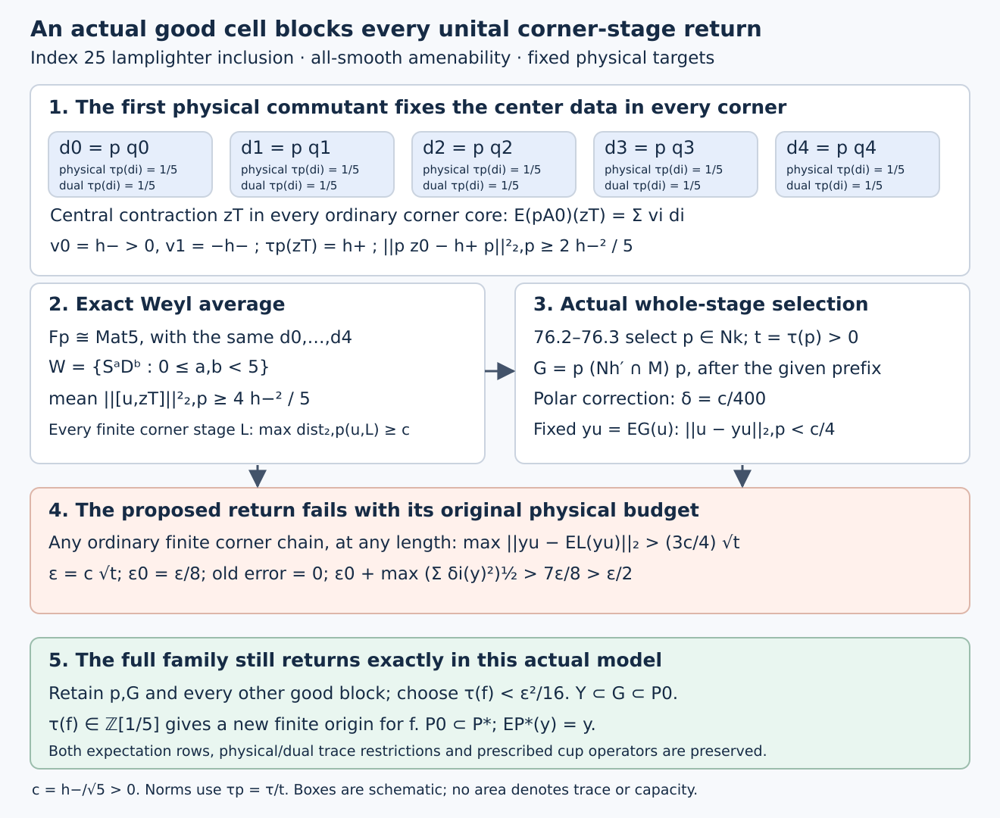

*Figure MR.1. The actual products \(d_i=pq_i\) have physical and module-dual normalized weight \(1/5\), and are fixed by every compatible corner-core map. MR.4–MR.14 give the witness and its uniform Weyl obstruction. MR.15–MR.29 charge the polar cost in the normalized corner, then return to the physical budget \(\varepsilon=c\sqrt t\). MR.31–MR.32 complete the same whole-stage family through its exact residual certificate. Box areas are schematic and encode neither trace nor canonical capacity. [Editable figure source](figures/marked-corner-return-v15.py).*

**Human context.** Sorin Popa, *Classification of amenable subfactors of type II*, Acta Mathematica 172 (1994), 163–255, [DOI 10.1007/BF02392646](https://doi.org/10.1007/BF02392646), §2.3.3(b), Example 3.1.3(b), and Theorem 4.4.1(1). The new quantitative corner-stage obstruction is proved in MR.4–MR.29. Its exact internal providers are LF.1–LF.17, [46.6](nongenerating-tunnels-and-boundary.md), [75.1–75.4](general-corners-and-piecewise-commuting-squares.md), and [76.2–76.4](whole-relative-commutant-blocks.md); the general fixed-family capacity formula is [80.3–80.4](central-capacity-and-small-support-cuts.md).

## Actual translation cocycles and a height-tail return that fails invariance

The original weighted inclusion and parameter WM.22 remain fixed. We use the actual \(Z=Z(W)\), normal action \(\beta\), center measures \(\mu_U,\mu_V\), likelihoods \(R_i\), and physical return of C13–E14. This chapter identifies the possible translation logarithmic means as actual group characters, bounds their total, and constructs singular states by conditioning the original normal center trace on large final-lamp height. The latter states have exact likelihood means different from the zero-cost means. More decisively, every such height-tail limit has a strictly positive actual origin-lamp expectation and therefore fails the required lamp-flip invariance.

This is a complete failed route inside the actual coefficient center. It does not construct an invariant state with zero translation means, or establish a positive lower bound for every original compatible state.

### T15.1. Actual logarithmic means are characters of the spatial group

For \(g\in H\), let \(D_g\) be the normal Radon–Nikodym multiplier defined by
\[
\mu_U\beta_g^{-1}=\mu_U(D_g\,\cdot).
\]
For a generator it is exactly the boundedly invertible original density E14.14. Products and inverses therefore give boundedly invertible \(D_g\) for every fixed \(g\). Normal change of variables and faithfulness give the actual cocycle identity
\[
D_{gh}=D_g\,\beta_g(D_h).
\tag{T15.1}
\]
If \(\omega\) is any actual \(H\)-invariant state on \(Z\), then
\[
\ell_\omega(g)=\omega(\log D_g),\qquad
\ell_\omega(gh)=\ell_\omega(g)+\ell_\omega(h).
\tag{T15.2}
\]
All functions tested here are bounded; no normality of \(\omega\) is used.

E14.5 gives \(\beta_{z^2}|_Z=\mathrm{id}\), and thus \(D_{z^2}=1\). The center action factors through the actual lamplighter group E14.7. Its finite lamp subgroup consists of torsion elements, so every real character vanishes on it. All group relations therefore imply
\[
\ell_\omega(c,v,n)=\sum_{j=1}^3 v_j\ell_j,\qquad
\ell_j=\omega(\log D_{j+1}).
\tag{T15.3}
\]
Here labels \(j+1=2,3,4\) are the physical translations \(t_j\). In particular the lamp label has zero logarithmic mean, as already checked in E14.15. The physical trace character \(\lambda^n\) has not been changed.

Let \(c=\omega(\log R_0)\) and \(s=(\ell_1+\ell_2+\ell_3)/3\). The exact original density gives
\[
\omega(\log R_1)=c+\log\lambda,\qquad
\omega(\log R_{j+1})=c+\ell_j.
\]
Functional Jensen on the original identities \(\sum_iR_i=1\) and \(\sum_i\omega(R_i^{-1})=d\) gives
\[
\begin{aligned}
e^c A(\ell)&\le1,&e^{-c}B(\ell)&\le d,\\
A(\ell)&=1+\lambda+\sum_j e^{\ell_j},\\
B(\ell)&=1+\lambda^{-1}+\sum_j e^{-\ell_j}.
\end{aligned}
\tag{T15.4}
\]
Thus \(A(\ell)B(\ell)\le d\). Arithmetic–geometric mean gives the further lower bound
\[
A(\ell)B(\ell)\ge
(1+\lambda+3e^s)(1+\lambda^{-1}+3e^{-s}).
\]
Subtracting \(d=(4+\lambda)(4+\lambda^{-1})\), the last expression factors as
\[
\frac{3(1+\lambda^{-1})(e^s-1)(e^s-\lambda)}{e^s}.
\]
It follows that every actual invariant mean satisfies
\[
0\le\ell_1+\ell_2+\ell_3\le3\log\lambda.
\tag{T15.5}
\]

Both endpoint implications are exact, but neither endpoint has been constructed. If the sum is zero, equality in the arithmetic–geometric mean forces all \(\ell_j=0\). T15.4 then forces \(c=-\log S_+\). The five Jensen lower bounds for \(\omega(R_i)\) sum to one, so each is equality and \(\omega(R_i)=w_i^+\). The original inverse identity gives equality of each inverse tangent variance, proving \(\omega(|R_i-w_i^+|)=0\). C13.19 gives original zero cost.

If the sum is \(3\log\lambda\), the same argument instead gives
\[
\begin{aligned}
\ell_j&=\log\lambda,&u_0&=\frac1{1+4\lambda},\\
u_i&=\frac{\lambda}{1+4\lambda}\quad(1\le i\le4),\\
\omega(|R_i-u_i|)&=0,\\
\psi_\omega(\mathfrak a)&=6(\lambda-\lambda^{-1})>0.
\end{aligned}
\tag{T15.6}
\]
Here \(\sum_i u_i^{-1}=d\). The last value follows by summing the five actual inverse differences in C13.19: the identity contributes \(3(\lambda-1)\), the lamp \(3(\lambda-1)/\lambda\), and the three translations together \(3(\lambda-\lambda^{-1})\).

The actual set of three logarithmic means is compact and convex, as the continuous affine image of the compact invariant-state set. It is invariant under permutations of the spatial coordinates. Indeed, permutation of labels \(2,3,4\) maps each finite actual endpoint matrix unit to the correspondingly permuted word matrix unit. It preserves endpoint equality, all original weights, cups and inclusions. The trace-preserving maps extend normally to the actual two cores and their coefficient center, conjugating \(\beta_g\) to \(\beta_{\pi g}\) and permuting the \(D_{j+1}\). Averaging an actual invariant state over these six normal center maps gives another actual invariant state with all three means equal to \(s\). This is a genuine symmetry of the finite tower; it introduces no new center model. It does not determine whether \(s=0\) is attained.

### T15.2. An exact geometric final-height tail in the original traces

Let \(L_x\in Z\) be the actual lamp unitaries E14.8, and put \(h(x)=x_1+x_2+x_3\). The final configuration has infinitely many lit lamps, while the actual raw walk has negative height drift. Hence the height of its highest lit lamp is a finite integer almost surely under either original normal center measure. We use only its bounded spectral projections
\[
E_K=1-\bigwedge_{h(x)\ge K}\frac{1+L_x}{2}\in Z.
\tag{T15.7}
\]
They decrease strongly to zero as \(K\) tends to infinity. Every invariant \(\omega\) nevertheless has \(\omega(E_K)=1\): the complementary projection is dominated by the event that any prescribed finite collection in this infinite halfspace is unlit, of value \(2^{-m}\) by E14.10.

Write
\[
A=\frac{1+4\lambda}{4+\lambda}.
\]
At a raw step, the height either stays fixed or increases by one in the plus phase, and stays fixed or decreases by one in the minus phase. The probabilities of zero and nonzero displacement are
\[
a_+=\frac{1+\lambda}{S_+},\ b_+=\frac3{S_+},\qquad
a_-=\frac{1+\lambda^{-1}}{S_-},\ b_-=\frac3{S_-}.
\]
The two functions
\[
F_+(h)=A\lambda^h,\qquad F_-(h)=\lambda^h
\tag{T15.8}
\]
satisfy the exact one-step harmonic identities, since
\(A=a_++\lambda b_+\) and \(1=A(a_-+\lambda^{-1}b_-)\).
Stop the resulting nonnegative martingale at the first hit of height \(K\), from a starting height \(h<K\). That hit occurs in a plus translation step, so the next phase is minus and the stopped value is \(\lambda^K\). Before it occurs the martingale is bounded by \(\lambda^K\). On never hitting, its value tends to zero by the original negative drift. Bounded convergence applied to the finite stopped martingale identities proves
\[
\mathbb P_+(T_K<\infty)=A\lambda^{h-K},\qquad
\mathbb P_-(T_K<\infty)=\lambda^{h-K}.
\tag{T15.9}
\]
This is a calculation with the original raw word probabilities.

At the first hit of height \(K\), no earlier lamp at height at least \(K\) was lit. The probability of ultimately leaving some lit lamp in that halfspace depends only on the next minus phase; translation in the height-zero plane and the earlier lower lamps do not affect it. Denote this probability by \(p>0\). A direct positive event proves the strict sign: from phase minus at height zero choose the identity, then the plus toggle \(az\), then minus \(t_1^{-1}\), and never return to height zero. Its probability is at least
\[
w_0^-w_1^+w_2^-\left(1-\frac A\lambda\right)>0,
\quad
1-\frac A\lambda=\frac{\lambda^2-1}{\lambda(4+\lambda)}.
\tag{T15.10}
\]
The origin lamp then remains lit. The same \(p\) works after every first hit, by independence of the unused actual labels.

The two original normal center measures therefore have the exact tails
\[
\mu_U(E_K)=p\lambda^{-K},\qquad
\mu_V(E_K)=Ap\lambda^{-K}\qquad(K\ge1).
\tag{T15.11}
\]
The two measures remain distinct, as required by their original full-corner traces.

### T15.3. Actual height-conditioned states select different likelihood means

Define states on the actual \(Z\), using the original normal measures,
\[
\begin{aligned}
\eta_K(t)&=\frac{\mu_U(E_Kt)}{\mu_U(E_K)},\\
\rho_K(t)&=\frac{\mu_V(E_Kt)}{\mu_V(E_K)}.
\end{aligned}
\tag{T15.12}
\]
These are genuine normal center states. No change of physical inclusion or parameter is involved.

For \(K\ge2\), the identity and lamp label fix \(E_K\); the translations satisfy \(\beta_{j+1}^{-1}(E_K)=E_{K-1}\). Applying the original trace formula E14.13 and T15.11 gives the exact likelihood moments
\[
\begin{aligned}
\rho_K(R_0)&=\frac1{1+4\lambda}=u_0,\\
\rho_K(R_i)&=\frac{\lambda}{1+4\lambda}=u_i\quad(1\le i\le4).
\end{aligned}
\tag{T15.13}
\]
Every weak-star limit, or limit of Cesàro averages, of these states retains these moments. Its original likelihood deviations satisfy the definite bound
\[
\begin{aligned}
\sum_i\rho(|R_i-w_i^+|)&\ge\sum_i|u_i-w_i^+|\\
&=\frac{6(\lambda^2-1)}{(1+4\lambda)(4+\lambda)}>0.
\end{aligned}
\tag{T15.14}
\]
Thus this actual height-conditioning family cannot supply the desired likelihood values, even before asking for invariance.

For clarity, its exact covariance can also be computed. If a fixed \(g\) has spatial height \(h(g)\), then, for all sufficiently large \(K\), the finite initial lamps of \(g\) do not affect the high halfspace, and
\(\beta_g^{-1}E_K=E_{K-h(g)}\).
Normal change of variables consequently gives
\[
\eta_K\beta_g^{-1}(t)=
\lambda^{-h(g)}\eta_{K+h(g)}(D_gt).
\tag{T15.15}
\]
A joint cluster of the Cesàro averages of \(\eta_K,\rho_K\), starting at \(K=3\), yields actual singular states \(\eta,\rho\) satisfying
\[
\begin{aligned}
\eta\beta_g^{-1}&=\lambda^{-h(g)}\eta(D_g\,\cdot),\\
\eta(D_g)&=\lambda^{h(g)},\\
\eta&=(1+4\lambda)\rho(R_0\,\cdot).
\end{aligned}
\tag{T15.16}
\]
The finite shift of the averaging interval has vanishing boundary. These states are purely singular because they give value one to every \(E_K\), while \(E_K\downarrow0\) strongly.

T15.16 is a conformal covariance identity. It does not make either state invariant, and the expectations of \(D_g\) do not establish the expectations of \(\log D_g\).

There is an exact finite averaging law for \(\rho\). The original identities imply
\(\mu_V=\sum_{ij}w_i^+w_j^-\mu_V\beta_{s_is_j^{-1}}^{-1}\).
Indeed the plus identity follows by summing E14.13. For the minus identity, use \(\mu_V=w_0^+\mu_U(R_0^{-1}\,\cdot)\), \(D_j=R_j/(\nu_jR_0)\), and the inverse normal change of variables from T15.1. For \(t\in Z\) this gives
\[
\sum_jw_j^-\mu_V(\beta_j(t))
=\frac1d\mu_U\left(
\left[\sum_j\beta_j^{-1}(R_j^{-1})\right]t\right)
=\mu_U(t),
\]
by the original pointwise dimension identity WM.31 transported through \(\zeta_U\). Thus \(\mu_U=\sum_jw_j^-\mu_V\beta_j\), and the two identities compose with the displayed group ordering. Apply this stationarity identity to \(E_Kt\), and then T15.11. Taking the Cesàro cluster yields
\[
\rho=\sum_{ij}w_i^+w_j^-\lambda^{h(s_i)-h(s_j)}
\rho\beta_{s_is_j^{-1}}^{-1}.
\tag{T15.17}
\]
The displayed coefficients sum to one, since
\[
\left(\sum_i\nu_i\lambda^{h(s_i)}\right)
\left(\sum_j\nu_j^{-1}\lambda^{-h(s_j)}\right)
=(1+4\lambda)(1+4\lambda^{-1})=d.
\]
This is an auxiliary averaging identity on the actual original center, derived from actual conditioned traces. Its coefficients have not replaced the physical weights, \(E_A\), \(P_0\), or either canonical trace.

### T15.4. Every height-tail limit fails the actual lamp-flip invariance

The failure is stronger than unequal likelihood moments. The origin-lamp expectation of every limit above is strictly positive.

The exact conditional law of the original raw prefix before the first hit of \(K\), given that it hits, is the elementary harmonic change of weights from T15.8:
\[
\begin{aligned}
\widetilde w_i^+
&=\frac{\nu_i\lambda^{h(s_i)}}{1+4\lambda}
 =\frac{(1,\lambda,\lambda,\lambda,\lambda)_i}{1+4\lambda},\\
\widetilde w_i^-
&=\frac{\nu_i^{-1}\lambda^{-h(s_i)}}{1+4\lambda^{-1}}\\
&=\frac{(1,\lambda^{-1},\lambda^{-1},\lambda^{-1},\lambda^{-1})_i}
 {1+4\lambda^{-1}}.
\end{aligned}
\tag{T15.18}
\]
To verify this rather than assume it, multiply each original transition probability by the ratio of its next \(F\)-value to its present \(F\)-value. The factors telescope along any stopped prefix; its final \(F\)-value is the constant \(\lambda^K\). After dividing by T15.9, this gives exactly the conditional original prefix probability. Conditioning instead on \(E_K\) multiplies every first-hit prefix by the same positive suffix probability \(p\), so gives the same prefix law.

These weights are only this exact conditioned-prefix law. They define no new physical inclusion. Their spatial pair drift is positive:
\[
\left(\frac{\lambda}{1+4\lambda}-\frac1{4+\lambda}\right)(1,1,1)
=\frac{\lambda^2-1}{(1+4\lambda)(4+\lambda)}(1,1,1).
\]
Thus the conditioned walk hits every fixed higher level almost surely.

Its Fourier transience bound is the same uniform bound used in WM.19–WM.20. For \(1\le\lambda\le2\), its plus zero mass is at least \(1/3\), and each plus unit mass at least \(1/5\). Keeping their cross terms gives
\(1-|\widetilde\psi_+|^2\ge(2/15)\sum_j(1-\cos\theta_j)\).
The rest of the original Gaussian integral argument therefore gives the same pair tail \(32/\sqrt J\). Both raw phases are transient, and the final origin sign for this conditioned-prefix law exists. Denote its plus-phase expectation by \(\widetilde h_+(\lambda)\).

At \(\lambda=1\) this is the actual unweighted law in WM.8, with \(\widetilde h_+(1)\ge b\). Each of the two five-label vectors in T15.18 has total absolute derivative at most \(8/25\) on \([1,2]\): differentiate their one exceptional entry and four equal entries. Thus the same counted coupling estimate for \(2J\) raw choices bounds its finite origin-sign expectation change by \(2J|\lambda-1|\). Its infinite-time error is at most \(512/\sqrt J\), by the same eight raw-visit tests. At the fixed values of \(b,J,\lambda\) in WM.22 this proves
\[
\widetilde h_+(\lambda)
\ge b-2J|\lambda-1|-2(512/\sqrt J)
\ge5b/8>b/2>0.
\tag{T15.19}
\]
Every constant belongs to the original fixed parameter; no limit of changed physical inclusions is used.

We now relate this value to the actual original height-conditioned states. Before the first hit of \(K\), their prefix has the law T15.18 just proved. As \(K\to\infty\), the origin sign accumulated by that prefix converges in expectation to \(\widetilde h_+(\lambda)\): the positive-drift hitting times tend to infinity, and the fixed origin lamp stabilizes almost surely by transience. Bounded convergence applies.

After the first hit, the position \(x\) has \(h(x)=K\), hence tends uniformly to spatial infinity. The original uniform transience estimate WM.20 gives that the probability of any later visit to the origin tends to zero uniformly over these positions. Explicitly, bounded increments exclude early visits, and the \(32/\sqrt J\) tail controls all remaining pair tests; choose \(J\) increasing below the earliest possible hitting time. Conditioning this suffix on leaving a lit lamp above its starting height increases this bound by at most \(1/p\), which is fixed and finite by T15.10. A later origin toggle therefore changes its conditional sign expectation by a quantity tending to zero.

For an explicit uniform bound, let \(K\ge4\) and \(J_K=\lfloor(K-2)/2\rfloor\). At a post-hit position of height \(K\), each pair changes height by at most one and an intermediate raw visit differs by at most one. No origin visit is therefore possible through the early cutoff \(J_K\), uniformly over all such positions. The eight raw-position tests in WM.20 bound the later visit probability by \(256/\sqrt{J_K}\). Dividing by the fixed suffix-event probability \(p\), and charging at most two for a sign change, gives

\[
\text{conditional post-hit sign error}
\le\min\left(2,\frac{512}{p\sqrt{\lfloor(K-2)/2\rfloor}}\right)
\longrightarrow0.
\tag{T15.19a}
\]

This estimate uses the original minus-phase suffix and its actual positive \(p\). It makes no uniform-in-\(\lambda\) assertion as \(\lambda\) changes.

It follows inside the actual coefficient center that
\[
\begin{aligned}
\lim_{K\to\infty}\rho_K(L_0)&=\widetilde h_+(\lambda)>b/2,\\
\rho(L_0)&=\widetilde h_+(\lambda).
\end{aligned}
\tag{T15.20}
\]
for every height-tail cluster, including every Cesàro cluster. The actual lamp automorphism satisfies \(\beta_1^{-1}(L_0)=-L_0\). An invariant state must give \(L_0\) value zero. Thus every state constructed by this height-tail conditioning fails actual \(H\)-invariance. This proves a complete finite obstruction to this particular construction, rather than asserting an unproved failure of all invariant states.

The minus-starting states \(\eta_K\) have the same obstruction, with the initial phase retained. Their first-hit prefix has the two alternating weights T15.18, now starting with the minus vector. At \(\lambda=1\), WM.22 gives the minus-starting final origin sign at least \(b\). The two vectors have the same derivative bounds, and the uniform transience estimate covers both raw phases. Thus the counted coupling and tail comparison of T15.19 gives \(\widetilde h_-(\lambda)\ge5b/8>b/2\). The first hit is still a plus translation with next phase minus; its conditioned suffix has the same fixed probability \(p\), and the same uniform post-hit origin estimate applies. Consequently

\[
\begin{aligned}
\lim_{K\to\infty}\eta_K(L_0)&=\widetilde h_-(\lambda)>b/2,\\
\eta(L_0)&=\widetilde h_-(\lambda)>b/2.
\end{aligned}
\tag{T15.20a}
\]

This proves the lamp-flip failure for both constructed state families and their Cesàro clusters. It uses each original center measure in its own initial phase, rather than identifying the two measures.

### T15.6. The exact remaining boundary

The actual logarithmic-mean set lies in T15.4–T15.5 and has the actual permutation symmetry proved in T15.1. Zero total mean would produce the required original cost-zero state by the original physical return, and that state would automatically annihilate the entire Jones ideal by E14.12a. These are exact implications, not the claimed construction.

The new concrete construction T15.12–T15.20 instead gives actual singular center states with explicit likelihood moments, conformal covariance, and a finite stationary averaging law. It fails the actual lamp-flip test by a strictly positive amount. Averaging these states over \(H\) can change their likelihood values and logarithmic means; nothing here shows that such averaging preserves T15.13, creates zero translation means, or gives a universal positive separation.

The unresolved step is to construct an actual invariant \(\omega\) with \(\ell_1+\ell_2+\ell_3=0\), or prove a strictly positive lower bound on this sum for every invariant state of this particular \(Z(W)\). No such attainment or separation is established. This chapter does not treat the Jensen enclosure as the assigned unrestricted result. The original upper likelihood endpoint, original \(P_0\)-balance and zero-cost target remain open.

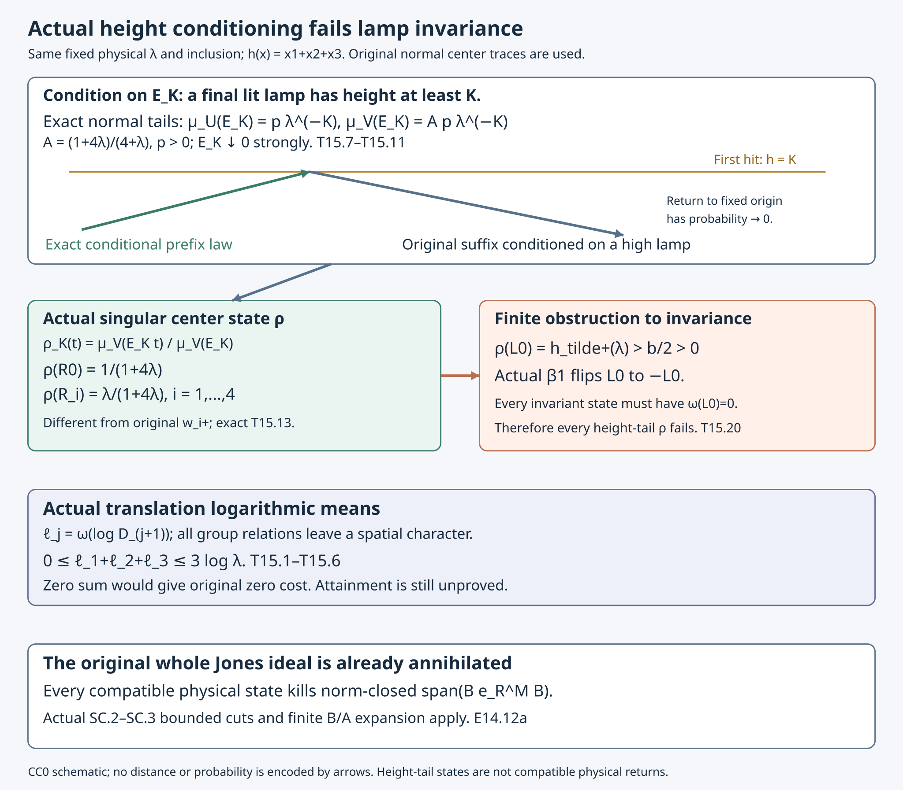

Figure T15. Heights are \(h(x)=x_1+x_2+x_3\). The prefix law and both normal tail measures are exact original conditional trace calculations T15.8–T15.18. The post-hit law is the original suffix conditioned on a high lamp, with probability \(p>0\). The origin-lamp sign in every resulting state is bounded below in T15.19–T15.20, so the required invariant physical return cannot be applied to that state. The logarithmic-mean interval at the bottom is schematic and encodes no metric or endpoint attainment. [Reproducible diagram source](figures/translation-height-obstruction-v16.py). The diagram writes \(L0=L_0\), \(R0=R_0\), and \(w_i+=w_i^+\); its arrows encode no distances or probabilities.

### Mathematical sources

Sorin Popa, *Classification of amenable subfactors of type II*, Acta Mathematica 172 (1994), 163–255, [DOI 10.1007/BF02392646](https://doi.org/10.1007/BF02392646), §2.3 and §3.1–§3.2, provides the context for smooth representations and compatible physical hypertraces.

The exact weighted finite tower, original trace character and parameter constants used here are [WM.1–WM.36](general-tail-supports-and-controlled-tunnels.md). The exact physical center return, original likelihood formulas and dimension identity are [C13.1–C13.24](general-tail-supports-and-controlled-tunnels.md). The actual whole-center action and purely singular restrictions are [E14.1–E14.18](general-tail-supports-and-controlled-tunnels.md). The whole-ideal conclusion E14.12a uses the complete proofs SC.2–SC.3 in [Singular hypertraces, the Jones ideal and bounded entropy](singular-hypertraces-jones-ideals-and-entropy.md), with their actual bounded-left-cut and finite-expansion hypotheses. All height-tail and cocycle computations are proved above.

## Normalized Radon–Nikodym cocycles need not have a zero-character invariant state

Probability normalization and amenability do not imply the proposed zero-character theorem. The counterexample below has a faithful normal probability, boundedly invertible derivatives for every fixed group element, and exactly the group relations of the weighted model's acting group. Every invariant state has a strictly positive spatial character. This is an actual nonsingular action, not a claimed new subfactor or an identification with the fixed coefficient center \(Z(W)\).

We also prove the abelian assertion and construct a normal affine observable inside the fixed coefficient center. These results isolate the missing operator comparison in the attempted endpoint route. The weighted model's physical parameter, two traces, \(E_A,P_0\), and full action remain the original ones.

### NZ.1. Conventions

Let a group act on a commutative von Neumann algebra by \(\beta_{gh}=\beta_g\beta_h\). For a faithful normal probability \(\mu\), use
\[
\mu\beta_g^{-1}(f)=\mu(D_gf),\qquad
c_g=\log D_g,\qquad
c_{gh}=c_g+\beta_g(c_h).
\tag{NZ.1}
\]
All \(D_g\) below are bounded and boundedly invertible for each fixed \(g\); all \(c_g\) are therefore bounded. For any invariant state \(\omega\), including a singular state, \(\omega(c_g)\) is a real character. The normalization \(\mu(D_g)=1\) follows from applying the change of variables to the identity.

### NZ.2. An explicit probability on a local field

Define \(K=\mathbb F_2((t))\): its elements are Laurent series with finitely many negative powers. Addition is coefficientwise modulo two. The norm of a nonzero series whose first nonzero coefficient has exponent \(r\) is \(2^{-r}\). Put \(\mathcal O=\mathbb F_2[[t]]\).

There is an additive Haar measure \(m\) with \(m(\mathcal O)=1\), constructed by fair independent coefficients on \(\mathcal O\), translation of this probability to each coset, and the increasing union \(K=\bigcup_{n\ge0}t^{-n}\mathcal O\). The measures agree on overlaps because each ball splits into two translates of the next smaller ball. Thus
\[
m(t^{-n}\mathcal O)=2^n,\qquad
m(\{|x|=2^n\})=2^{n-1}\quad(n\ge1).
\tag{NZ.2}
\]
Multiplication by \(t^{-1}\) scales \(m\) by two. This follows first on balls and their translates, which generate the measurable sets, and then by countable additivity.

Set
\[
f(x)=
\begin{cases}
1,&|x|\le1,\\
|x|^{-2},&|x|>1,
\end{cases}
\qquad d\mu=\frac23f\,dm.
\tag{NZ.3}
\]
The shell calculation is exact:
\[
\int_Kf\,dm=1+\sum_{n\ge1}2^{n-1}2^{-2n}
=\frac32,\qquad \mu(\mathcal O)=\frac23.
\tag{NZ.4}
\]
The density is strictly positive. Hence \(\mu\) is a faithful normal probability on \(\mathcal Z=L^\infty(K,m)=L^\infty(K,\mu)\).

### NZ.3. The actual group relations and its nonsingular action

Keep the weighted model's group
\[
H=\{(c,v,n):c\in\bigoplus_{\mathbb Z^3}\mathbb Z/2,\quad
v\in\mathbb Z^3,\quad n\equiv\sum_xc(x)\pmod2\}.
\tag{NZ.5}
\]
The central even integer is retained in \(H\); it will act trivially on \(\mathcal Z\), just as it does on the actual coefficient center. Write \(h(v)=v_1+v_2+v_3\). The map
\[
q(c)=\sum_{v\in\mathbb Z^3}c(v)t^{-h(v)}
\in A:=\mathbb F_2[t,t^{-1}],\qquad
(c,v,n)\cdot x=q(c)+t^{-h(v)}x
\tag{NZ.6}
\]
is an action. Indeed \(q(\operatorname{shift}_v d)=t^{-h(v)}q(d)\), so affine composition gives precisely the semidirect-product multiplication in \(H\). This is a group homomorphism to the affine group, rather than an assignment of unrelated generator transformations.

For the actual labels \(s_0=1,s_1=az,s_{j+1}=t_j\), the transformations are identity, \(x\mapsto x+1\), and \(x\mapsto t^{-1}x\) for each \(j=1,2,3\). All finite lamps have order two on this algebra, translations commute, they conjugate lamps to lamps, and \(z^2\) acts identically. Define the algebra action by
\[
\beta_gF(x)=F(g^{-1}\cdot x).
\tag{NZ.7}
\]
For an affine transformation \(x\mapsto ax+b\), normal change of variables gives
\[
D_g(x)=|a|^{-1}\frac{f(a^{-1}(x-b))}{f(x)}.
\tag{NZ.8}
\]
This is exactly the convention NZ.1. It proves normalization for every \(g\), not only the generators.

Translation by \(1\) preserves \(f\), since it preserves \(\mathcal O\), and preserves the norm outside \(\mathcal O\). Hence \(D_{az}=1\). For the expansion \(T:x\mapsto t^{-1}x\),
\[
D_T(x)=\frac12\frac{f(tx)}{f(x)}
=
\begin{cases}
\frac12,&x\in\mathcal O,\\
2,&x\notin\mathcal O.
\end{cases}
\tag{NZ.9}
\]
For the inverse, \(D_{T^{-1}}\) equals \(2\) on \(t\mathcal O\) and \(1/2\) outside it. Thus the generator derivatives lie between \(1/2\) and \(2\). Fixed words inherit a positive lower bound and a finite upper bound from NZ.1. One may also check translations directly: if \(|b|\le2^r\), \(r\ge0\), their derivative is one outside \(t^{-r}\mathcal O\) and lies between \(2^{-2r}\) and \(2^{2r}\) inside it. No uniform bound over all group elements is asserted or required.

### NZ.4. Every invariant state has the same nonzero character

The group \(H\) is amenable. For example its right Følner sets are the finite sets WM.16: finite lamp supports in a spatial cube, spatial endpoint in that cube, and central integer in an interval with its actual parity condition. Their right generator boundary ratios tend to zero. Averaging \(\mu\beta_g\) over those sets and taking a weak-star cluster supplies an \(H\)-invariant state on \(\mathcal Z\). Thus the assertion about all invariant states is nonvacuous.

For \(B_N=t^{-N}\mathcal O\), any number of pairwise disjoint translates exists using translations by distinct monomials \(t^{-k}\), \(k>N\). These translations belong to the image of conjugate lamps in \(H\). The difference of two such monomials has norm greater than \(2^N\), proving disjointness by the ultrametric inequality. If \(\omega\) is any invariant state, finite additivity and positivity give
\[
r\omega(1_{B_N})\le1\quad\hbox{for every }r\ge1,
\qquad \omega(1_{B_N})=0.
\tag{NZ.10}
\]
In particular NZ.9 implies the exact character values
\[
\omega(\log D_{t_j})=\log2\quad(j=1,2,3),\qquad
\omega(c_{(c,v,n)})=h(v)\log2.
\tag{NZ.11}
\]
The second identity follows from the cocycle, invariance and the actual relations: a real character vanishes on torsion lamps and on \(z^2\). Consequently
\(\sum_j\omega(\log D_{t_j})=3\log2>0\) for every invariant state. There is no zero-character invariant state.

All these states are purely singular. The projections \(1_{B_N}\) increase normally to the identity, while NZ.10 gives value zero to each. A normal positive functional below \(\omega\) is therefore zero. Nevertheless every \(D_g\) has normal integral one. For example NZ.9 gives \( (1/2)(2/3)+2(1/3)=1\).

This counterexample disproves normalization plus amenability as a sufficient principle even with this exact \(H\), its parity relation, and a trivial full-center \(z^2\) action. It does not satisfy or replace the original weighted core's additional two-trace likelihood and inverse-dimension identities. In particular \(\log2>\log\lambda\) for the actual WM.22 parameter, whereas T15.5 bounds each permutation-averaged actual character by \(\log\lambda\). The two actions cannot be identified.

### NZ.5. Why the abelian assertion is valid

Here is a complete statement that explains the single-transformation suggestion. If the acting group is finitely generated abelian, the hypotheses NZ.1 and normalization do imply existence of an invariant state with zero character.

First fix one transformation \(T\). Write
\[
c_{T^n}=\sum_{k=0}^{n-1}\beta_T^k(c_T).
\tag{NZ.12}
\]
Since \(\mu(e^{c_{T^n}})=1\), its essential infimum is at most zero and its essential supremum is at least zero. Choose normal states \(\sigma_n^-\), \(\sigma_n^+\) with
\(\sigma_n^-(c_{T^n}/n)\le1/n\) and
\(\sigma_n^+(c_{T^n}/n)\ge-1/n\); positive-measure near-extremal sets give these states. Their orbit averages have invariance error at most \(2/n\) on the unit ball. Cluster states are \(T\)-invariant and have values of \(c_T\) on opposite sides of zero. A convex combination is \(T\)-invariant with value exactly zero.

For commuting \(g,h\), the cocycle gives
\[
\beta_h(c_g)-c_g=\beta_g(c_h)-c_h.
\tag{NZ.13}
\]
A \(g\)-invariant state therefore retains its value on \(c_g\) when translated by \(h\). Averaging it over a Følner sequence of the full abelian group preserves \(g\)-invariance and the zero value on \(c_g\), and gives a full invariant cluster.

For generators \(T_1,\ldots,T_r\), let \(C\subset\mathbb R^r\) be the compact convex set of vectors \((\omega(c_{T_j}))_j\) from full invariant states. For every integer vector \(n\), the preceding argument applied to \(g=\prod_jT_j^{n_j}\) produces a point of \(C\) with \(n\cdot x=0\). If zero were outside \(C\), strict finite-dimensional separation would give a real separating vector. Approximation by a rational vector preserves strict separation because \(C\) is bounded. Clearing denominators then gives an integer separating vector, a contradiction. Thus \(0\in C\).

For the actual \(H\), NZ.13 is available between translations, but not between a translation and a lamp. More generally the cocycle gives
\[
\beta_h(c_g)=c_{hgh^{-1}}+\beta_{hgh^{-1}}(c_h)-c_h.
\tag{NZ.14}
\]
Invariance only under \(g\) does not cancel the last two terms involving \(hgh^{-1}\). Finite lamp-cube Haar averages do not repair this on the full algebra: moving the cube changes the constrained lamp support, and their total variation boundary need not be small. Agreement on finite lamp cylinders cannot be passed to the full bounded RN functions by a singular state. NZ.11 is a concrete refutation of that proposed extension of the abelian proof.

### NZ.6. A genuine affine observable in the fixed center, and its exact limitation

The fixed WM.22 model has its own normal affine observable. This uses the actual central lamps \(L_x\in Z(W)\), their normal laws in the two original measures, and their action E14.9. Under either normal law the actual raw height walk has negative pair drift. Hence it visits any fixed height only finitely many times, has an upper bound on all its heights, and leaves only finitely many lit lamps in any fixed height plane. These are almost-sure consequences of the original independent bounded increments and their strict negative expectation.

For each integer \(r\), the finite products of \(L_x\) over an increasing exhaustion of the plane \(h(x)=r\) therefore converge almost surely and in bounded \(L^2\) to a central self-adjoint unitary \(C_r\). The normal full-center lamp identification makes this a strong limit in \(Z(W)\). If \(b_r=(1-C_r)/2\), its joint spectrum consists normally of bits with \(b_r=0\) above a finite random height. Thus
\[
X=\sum_{r\in\mathbb Z}b_rt^{-r}\in\mathbb F_2((t))
\]
is a measurable random variable in the original commutative center. Equivalently its spectral map is a normal unital homomorphism from \(L^\infty(K,\nu_U)\) to \(Z(W)\), where \(\nu_U=X_*\mu_U\); it is faithful on this quotient measure algebra. The same normal spectral map is used for \(\mu_V\), with its own pushforward measure.

The finite affine identities survive these bounded normal products. A finite lamp configuration adds \(q(c)\), and a spatial translation acts by multiplication by \(t^{-h(v)}\). Thus this observable has precisely the affine transformation in NZ.6, with both original normal laws. All invariant states on the original full center annihilate its compact-ball spectral projections: the disjoint-translate proof NZ.10 applies to those actual projections. This is a proved singular escape statement inside the actual center.

The two pushforward laws are distinct, with an exact tail calculation that retains the actual parameter. Let \(p'>0\) be the original minus-starting suffix probability that some height-plane parity at height at least zero is odd. The event “minus identity, plus \(az\), minus \(t_1^{-1}\), and no subsequent return to height zero” proves
\[
p'\ge w_0^-w_1^+w_2^-(1-A/\lambda)>0,
\qquad A=\frac{1+4\lambda}{4+\lambda}.
\tag{NZ.15}
\]
There is then exactly one lit lamp at height zero and no other lamp in its height plane; all subsequent lamps lie below it. Before the first hit of height \(K\), all plane parities above or at \(K\) are zero. At the first hit, the next phase is minus, and its unused suffix has probability \(p'\) of leaving a nonzero high parity. The original bounded martingale calculation T15.8–T15.9 therefore gives, for \(K\ge1\),
\[
\nu_U(|X|>2^{K-1})=p'\lambda^{-K},\qquad
\nu_V(|X|>2^{K-1})=Ap'\lambda^{-K}.
\tag{NZ.16}
\]
These are actual normal tails, not a change of physical parameter. Since \(A>1\), they also prove the distinction of the two pushforward measures. Their successive ratio is \(1/\lambda\), whereas the explicit counterexample's normal tail ratio is \(1/2\).

It does not identify the normal pushforward \(\nu_U\) with NZ.3, and does not identify either the full actual \(D_g\) or its logarithm with NZ.8. On the affine spectral subalgebra the normal derivative is only
\[
\overline D_g=E_{\mu_U}(D_g\mid X).
\]
This follows by testing the defining normal RN identity on functions of \(X\). Conditional expectation preserves the original positive bounds, but generally
\(\log\overline D_g\ne E_{\mu_U}(\log D_g\mid X)\).
Moreover an arbitrary singular invariant state need not commute with this normal conditional expectation. Thus compact-ball escape alone gives no character separation for the full original \(D_g\).

The precise remaining actual operator task is to construct an \(H\)-invariant state on the full \(Z(W)\) annihilating the bounded functions \(\log D_{t_j}\), or to bound their original total mean strictly above zero for all such states. Neither the normalization principle, its valid abelian restriction, nor this genuine affine observable performs that task. The original two-trace identities and physical return must still be used; there is no substitution of the local-field action for the actual inclusion.

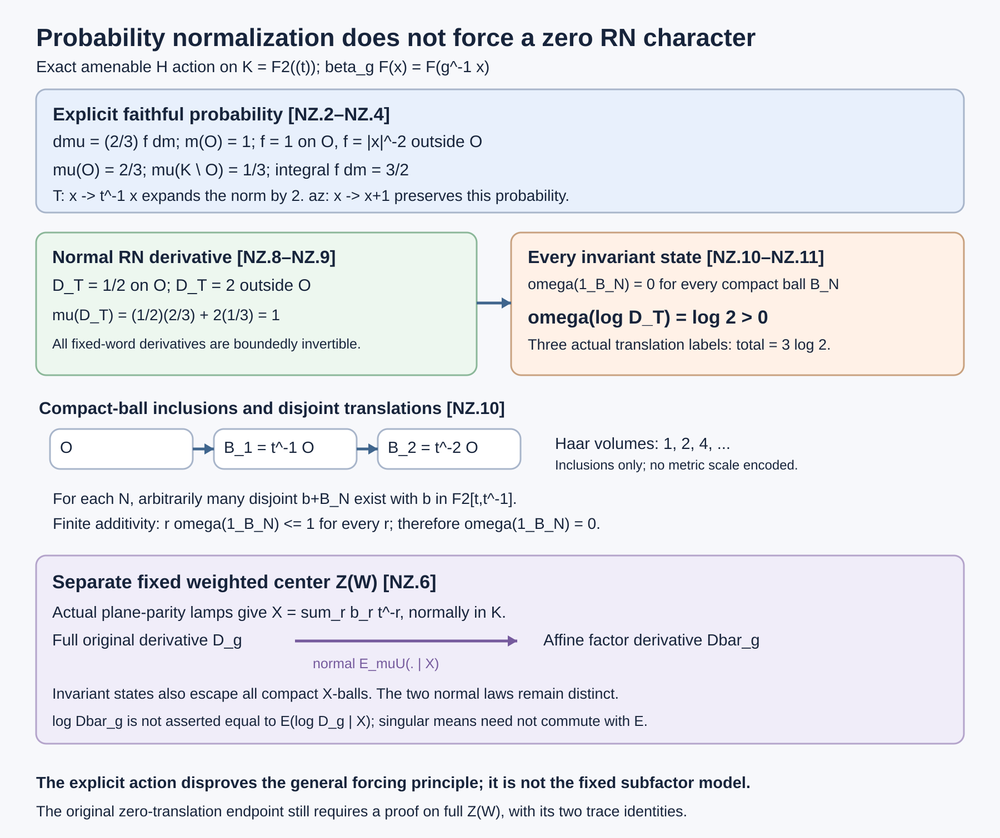

The upper diagram is the explicit nonsingular counterexample NZ.2–NZ.11. Its horizontal ball strip shows inclusions, not a metric scale; each larger ball has twice the additive Haar volume. The lower diagram is the different affine observable inside the original center. The normal conditional-expectation arrow compares derivatives, and supplies no asserted equality of logarithmic state means. [Reproducible diagram source](figures/normalization-obstruction-v17.py).

#### Mathematical context

Sorin Popa, *Classification of amenable subfactors of type II*, Acta Mathematica 172 (1994), 163–255, [DOI 10.1007/BF02392646](https://doi.org/10.1007/BF02392646), provides the context for the original smooth representation and physical return. The weighted tower and exact parameter are WM.1–WM.36; the normal center maps and physical return are C13.1–C13.24; the full center action and two-trace RN formula are E14.1–E14.18; the logarithmic enclosure is T15.1–T15.6. The nonsingular counterexample and the abelian assertion are proved above and require no external theorem identifying a boundary.

## A stationary affine law with a positive invariant likelihood cost

The normalization obstruction remains even after imposing two stationary probability equations, positive likelihoods, and the reciprocal dimension identity. The following complete measurable action has a positive cost for every invariant state. The space is not identified with the ordinary-core center of a finite-index subfactor.

Here \(T:x\mapsto tx\) denotes contraction; it is the inverse of the expansion denoted \(T\) in NZ.9. The RN convention is the same in both sections.

### The field and its normalized additive measure

Let \(K=\mathbb F_2((t))\). An element is a Laurent series \(\sum_{j\ge n}x_jt^j\), with \(x_j\in\{0,1\}\) and finitely many negative indices. Its absolute value is \(2^{-n}\) when its first nonzero index is \(n\). Write \(\mathcal O=\mathbb F_2[[t]]\).

The product measure on the binary coordinates of \(\mathcal O\) gives every specified initial string of \(m\) digits mass \(2^{-m}\). Addition in characteristic two flips specified digits, so this measure is invariant under all translations in \(\mathcal O\). Its extension to \(t^{-n}\mathcal O\), assigning each of the \(2^n\) cosets of \(\mathcal O\) mass one, is consistent as \(n\) increases. It defines a sigma-finite measure \(m\) on \(K\), invariant under every Laurent-polynomial translation and under every element of \(K\) by the same coordinate argument. Thus

\[
m(\mathcal O)=1,\qquad m(tE)=\tfrac12m(E),\qquad
m\{|x|=2^k\}=2^{k-1}\quad(k\ge1).
\tag{AC.1}
\]

The translations needed below are by \(L=\mathbb F_2[t,t^{-1}]\). This is a countable locally finite additive group. Dilation \(T:x\mapsto tx\) normalizes it. The semidirect group \(L\rtimes\mathbb Z\) acts by \(x\mapsto b+t^nx\).

For completeness it is amenable by explicit right Følner sets. Let \(L_R\) be the vector space spanned by \(t^{-R},\ldots,t^R\), and put

\[
\mathcal F_R=\{(b,n):b\in L_R,\ -R\le n\le R\}.
\tag{AC.2}
\]

Right multiplication by \((1,0)\) adds \(t^n\) to \(b\), hence preserves \(\mathcal F_R\) exactly. Right multiplication by \((0,1)\) changes only \(n\), and its symmetric-difference ratio is \(2/(2R+1)\). The inverses have the same ratios; finite words follow by telescoping. This proves amenability of this precise acting group.

### Exact two-phase stationary probabilities

Set \(A=6/7\), \(r=1/8\), and define the positive integrable density

\[
f_U(x)=
\begin{cases}
A,& |x|\le1,\\
A r^k,& |x|=2^k,\quad k\ge1.
\end{cases}
\tag{AC.3}
\]

By AC.1,
\[
\int f_U\,dm=A\left(1+\tfrac12\sum_{k\ge1}(2r)^k\right)
=\frac67\left(1+\frac16\right)=1.
\tag{AC.4}
\]

Addition \(a:x\mapsto x+1\) preserves \(f_U\) pointwise: it preserves \(\mathcal O\) and fixes the absolute value outside \(\mathcal O\). Define

\[
f_V(x)=
\begin{cases}
\tfrac32 f_U(x),&|x|\le\tfrac12,\\
\tfrac58 f_U(x),&|x|\ge1.
\end{cases}
\tag{AC.5}
\]

The two parts of \(\mathcal O\) have mass \(1/2\) each. The integral is therefore
\[
A\left(\frac34+\frac5{16}+\frac5{48}\right)=1.
\tag{AC.6}
\]

Let \(\mu_U=f_Um\), \(\mu_V=f_Vm\), and let \(g_*\mu(E)=\mu(g^{-1}E)\) denote pushforward by an affine map. The exact two stationary equations are

\[
\begin{aligned}
\mu_V&=\tfrac14\mu_U+\tfrac14 a_*\mu_U+\tfrac12 T_*\mu_U,\\
\mu_U&=\tfrac25\mu_V+\tfrac25 a_*\mu_V+\tfrac15 T^{-1}_*\mu_V.
\end{aligned}
\tag{AC.7}
\]

Here \(T_*\mu_U\) has density \(2f_U(x/t)\), while \(T^{-1}_*\mu_V\) has density \(\tfrac12 f_V(tx)\). In the first equation, the density is \(\tfrac12f_U(x)+f_U(x/t)\). If \(|x|\le1/2\) this is \((3/2)A\); on the unit shell it is \((1/2+r)A=(5/8)A\); outside \(\mathcal O\) the same ratio \(1/2+r=5/8\) applies.

For the second equation inside \(\mathcal O\), addition by one interchanges its inner half and unit shell. Thus the two translation terms contribute \((2/5)(3/2+5/8)A=(17/20)A\), and the dilation term contributes \((1/10)(3/2)A=(3/20)A\). Outside \(\mathcal O\), addition by one preserves its shell. At the first shell the dilation goes to the unit shell; at every later shell it goes to the preceding shell. The density equality reduces in either case to

\[
\frac45\frac58r^k+\frac1{10}\frac58r^{k-1}=r^k,
\qquad r=\frac18.
\tag{AC.8}
\]

These computations prove AC.7 on every piece, rather than assuming a stationary density.

### Bounded original-convention derivatives and a nonzero invariant character

Put \((\beta_g f)(x)=f(g^{-1}x)\), so \(\beta_{gh}=\beta_g\beta_h\). Use precisely
\[
\mu_U\beta_g^{-1}=\mu_U(D_g\,\cdot).
\tag{AC.9}
\]

With this convention, \(D_g\) is the density of \(g_*\mu_U\) relative to \(\mu_U\). Addition \(a\) has \(D_a=1\). Dilation has

\[
D_T(x)=\frac{2f_U(x/t)}{f_U(x)}
=
\begin{cases}
2,&|x|\le\tfrac12,\\
\tfrac14,&|x|\ge1.
\end{cases}
\tag{AC.10}
\]

All these derivatives are positive and boundedly invertible, and \(\mu_U(D_g)=1\). Products and inverses supply the same properties for each fixed word, using
\[
D_{gh}=D_g\,\beta_g(D_h).
\tag{AC.11}
\]

Let \(\omega\) be any \(L\rtimes\mathbb Z\)-invariant state of \(L^\infty(K,\mu_U)\), allowing arbitrary singular states. Every compact ball \(t^{-N}\mathcal O\) has arbitrarily many disjoint translates by elements of \(L\): choose Laurent polynomials with distinct principal parts below exponent \(-N\). Translation invariance and finite additivity give \(m_0\,\omega(1_{t^{-N}\mathcal O})\le1\) for every integer \(m_0\), hence

\[
\omega(1_{t^{-N}\mathcal O})=0\quad(N\ge0).
\tag{AC.12}
\]

Consequently AC.10 gives
\[
\omega(\log D_T)=-\log4,\qquad
\omega(\log D_{T^{-1}})=\log4.
\tag{AC.13}
\]

The sign is tied to the stated pushforward and beta convention. Dilation \(T:x\mapsto tx\) has the negative value, and expansion \(T^{-1}\) the positive one. Invariant states exist: for a state \(\omega_0\), average \(\omega_0\beta_g\) over the explicit right Følner sets. Applying \(\beta_h\) replaces \(g\) by \(gh\), so the norm difference is bounded by the right boundary ratio. Weak-star compactness gives an invariant cluster. Thus the nonzero values do not arise from an empty state class.

This also respects the three-dimensional lamplighter relations: map the lamp at \(v\in\mathbb Z^3\) to addition by \(t^{v_1+v_2+v_3}\), and each spatial translation to \(T\). The central \(z^2\) can act identically. This is an equivariant quotient action of those relations, not an identification of the fixed three-dimensional core.

### Exact likelihoods and the reciprocal dimension identity

Use labels \(s_0=1,s_1=a,s_2=T\), scales \(\nu=(1,1,2)\), weights
\[
w^+=(1/4,1/4,1/2),\qquad
w^-=(2/5,2/5,1/5),\qquad d=10.
\tag{AC.14}
\]

Define likelihoods by the original-form two-measure formula
\[
\mu_V(R_i f)=w_i^+\mu_U(\beta_i^{-1}f).
\tag{AC.15}
\]

The explicit densities give
\[
(R_0,R_1,R_2)=
\begin{cases}
(1/6,1/6,2/3),&|x|\le1/2,\\
(2/5,2/5,1/5),&|x|\ge1.
\end{cases}
\tag{AC.16}
\]

In particular \(\sum_iR_i=1\), and every \(R_i\) is bounded below by \(1/6\). The second equation in AC.7 gives the pointwise original-form dimension identity
\[
\sum_i\beta_i^{-1}(R_i^{-1})=10.
\tag{AC.17}
\]

It can also be checked without a measure transformation. If \(|x|\le1/2\), addition by one sends the point to the unit shell, and \(T\) stays in the inner ball. The three inverse values are \(6,5/2,3/2\), summing to ten. On the unit shell they are \(5/2,6,3/2\). If \(|x|>1\), the two first inverses are \(5/2\) and \(5/2\), while \(T\) is still at norm at least one, giving five.

Invariance now implies \(\sum_i\omega(R_i^{-1})=10\). More strongly, AC.12 and AC.16 give the exact value for every invariant state:
\[
\begin{aligned}
(\omega(R_0),\omega(R_1),\omega(R_2))&=(2/5,2/5,1/5),\\
\sum_i\omega(|R_i-w_i^+|)&=3/5,\\
\sum_i\omega(|R_i^{-1}-(w_i^+)^{-1}|)&=6.
\end{aligned}
\tag{AC.18}
\]

Thus normalized RN derivatives, amenability, the two actual stationary measure equations, positive bounded likelihoods and the original-form reciprocal dimension identity still do not force a cost-zero invariant state. This is a genuine measurable group-action counterexample to that forcing principle.

The identities AC.7 and AC.17 are identities of this measurable action. They alone do not identify it with the full ordinary-core center of a subfactor or identify its likelihoods with physical canonical densities. A stationary quotient of a larger center cannot imply a universal cost bound on the larger center. Such an identification needs a separate proof. The fixed WM.22 inclusion retains its original parameter, traces and likelihoods, and its zero-cost invariant-state question remains unproved.

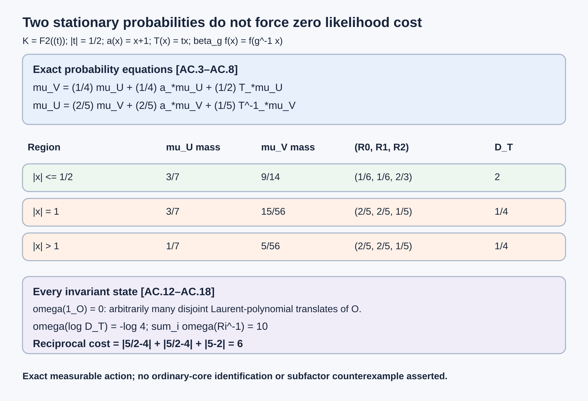

Figure AC. The three regions partition the local field. The probability masses, likelihoods and derivative values are exact AC.3–AC.18; the boxes encode regions rather than metric lengths. Every invariant state gives zero to the unit ball, so its likelihood values are the outer row and its reciprocal cost is exactly six. [Reproducible diagram source](figures/stationary-affine-cost-v17.py).

## An actual index-ten affine inclusion and its normal boundary observable

This construction realizes the group, weights, ordinary Jones tunnel and Laurent observable in AC as physical finite factors. AH constructs the actual inclusion and its normal observable; AB then proves that this observable exhausts both full centers, and AO derives the physical separator and exact correction of the unrestricted joint-state assertion.

### AH.1. The action and trace character

Let \(L=\mathbb F_2[t,t^{-1}]\) with addition, and
\[
G=L\rtimes\mathbb Z,\qquad
(b,n)(c,m)=(b+t^nc,n+m).
\tag{AH.1}
\]
Use three distinct labels \(s_0=1,s_1=(1,0),s_2=(0,1)\). They generate \(G\); the first nonidentity label is a toggle of order two and the second acts on \(\mathbb F_2((t))\) by contraction \(x\mapsto tx\). All conjugate toggles commute.

Take the hyperfinite II∞ factor
\[
\mathcal P=Q\bar\otimes B\bar\otimes T_\infty,\qquad
Q=\bar\bigotimes_{r\ge1}(\operatorname{Mat}_3,\operatorname{tr}_3),\quad
B=\bar\bigotimes_{g\in G}(\operatorname{Mat}_2,\operatorname{tr}_2).
\tag{AH.2}
\]
The trace-scaling construction in WM.1 at the exact scalar two gives a normal automorphism \(\theta\) of \(T_\infty\) with trace multiplier two. Its construction uses the normal isomorphism of normalized hyperfinite finite corners, extended over countable matrix units. Define \(\alpha_{(b,n)}\) to fix \(Q\), act by the left Bernoulli translation of \(G\) on \(B\), and act by \(\theta^n\) on \(T_\infty\). This is an actual action and
\[
\chi(b,n)=2^n,\qquad \nu=(1,1,2),\qquad
S_+=4,\quad S_-=5/2,\quad d=S_+S_-=10.
\tag{AH.3}
\]
For nonzero \(n\), the automorphism cannot be inner because it scales the semifinite trace. For \(n=0,b\ne0\), a hypothetical implementer can be compressed by a finite projection of \(T_\infty\). It then contradicts the finite-coordinate Bernoulli argument of WM.1/LF.5: a trace-zero matrix at a sufficiently fresh coordinate and its translate have norm distance \(\sqrt2\), whereas a local approximation of the implementer commutes with both. Thus endpoint automorphisms have scalar intertwiners precisely when their \(G\) labels agree. This verifies the outerness input for all endpoints, not just the three generators.

### AH.2. Weighted stable cups and coherent finite compression

Peel the first fixed \(\operatorname{Mat}_3\) coordinate and set
\[
\begin{aligned}
\phi_\epsilon(x)&=\sum_{i=0}^2E_{ii}\otimes\alpha_{s_i^\epsilon}(x),\\
w^+&=(1/4,1/4,1/2),\qquad
w^-=(2/5,2/5,1/5),\qquad w_i^+w_i^-=1/10,\\
\phi_\epsilon^{-1}E_\epsilon([x_{ij}])
&=\sum_i w_i^\epsilon\alpha_{s_i^{-\epsilon}}(x_{ii}).
\end{aligned}
\tag{AH.4}
\]
The embedding has trace multiplier \(S_\epsilon/3\). The displayed expectation is normal, unital, faithful, bimodular and trace preserving, by applying the exact trace character to each entry. Its marked cup in the first two coordinates is
\[
p_\epsilon=
\left|\sum_i\sqrt{w_i^{-\epsilon}}\,ii\right\rangle
\left\langle\sum_i\sqrt{w_i^{-\epsilon}}\,ii\right|.
\tag{AH.5}
\]
Equal paired labels cancel. Hence the cup commutes with the lower factor in the triple
\(\phi_\epsilon\phi_{-\epsilon}(\mathcal P)\subset\phi_\epsilon(\mathcal P)\subset\mathcal P\), and compression is its exact lower expectation. Its expectation in the middle is \(1/10\). The spanning calculation is
\[
(1\otimes E_{ab})p_\epsilon(1\otimes E_{cd})
=\sqrt{w_b^{-\epsilon}w_c^{-\epsilon}}\,
 E_{bc}\otimes E_{ad}.
\tag{AH.6}
\]
All coefficients are nonzero, so the middle factor and cup generate the upper factor, with full cup corner. The finite right-ideal recognition in the earlier Jones-construction proof gives the actual basic construction; no index-only recognition is used.

Put \(\Phi_r=\phi_+\phi_-\phi_+\cdots\) with \(r\) alternating factors and \(\mathcal L_r=\Phi_r(\mathcal P)\). Choose \(e\in\mathcal P\) of trace one and \(h_1=\phi_+(e)\), of trace \(4/3\). The physical pair is
\[
N=h_1\mathcal L_1h_1\subset M=h_1\mathcal P h_1,\qquad
\tau=\operatorname{Tr}/(4/3).
\tag{AH.7}
\]
For each \(r\), choose \(h_r\in\mathcal L_r\) of trace \(4/3\), and a unitary \(v_r\in\mathcal L_r\) taking \(h_r\) to \(h_{r+1}\). Comparison of the finite projections and their infinite complements supplies such a unitary. Define \(U_1=1,U_{r+1}=U_rv_r^*\), and for \(j\le r\)
\[
L_j=U_rh_r\mathcal L_jh_rU_r^*.
\tag{AH.8}
\]
This is independent of \(r\ge j\), since \(v_r\) belongs to the smaller factor and normalizes every earlier \(\mathcal L_j\). It sends the common projection to \(h_1\). Compress each triple and cup at a stage below all three factors. Later unitaries commute with that cup, so its physical image is independent of the stage. Every compressed triple is its actual Jones triple with index ten and cup trace \(1/10\). Thus \(L_0=M,L_1=N,L_2,\ldots\) is a genuine ordinary tunnel of separable hyperfinite II₁ factors. No infinite product or projection in an unproved infinite intersection is used.

The initial commutant and its two weights are
\[
C=N'\cap M=\bigoplus_{i=0}^2\mathbb Cp_i,\quad
\tau(p_i)=w_i^+,\quad \rho_C(p_i)=w_i^-,\quad
k_C=\tfrac85(p_0+p_1)+\tfrac25p_2.
\tag{AH.9}
\]
Here \(p_i=h_1(E_{ii}\otimes1)\). Each corner is an identity inclusion \(Np_i=p_iMp_i\), so its right-module dimension is \(1/w_i^+\); their sum is ten. This proves the two weights and the displayed normal dual density. In particular the physical pair is nonextremal.

### AH.3. Every finite relative commutant and both inherited traces

For a word \(I=(i_1,\ldots,i_n)\), put
\[
g(I)=s_{i_1}s_{i_2}^{-1}s_{i_3}\cdots s_{i_n}^{(-1)^{n+1}},
\quad
D_n^+=\operatorname{span}\{E_{IJ}\otimes1:g(I)=g(J)\}.
\tag{AH.10}
\]
The endpoint intertwiner calculation proves that this is the entire stable relative commutant. The compression proof WM.4 works with three coordinates: a full finite corner frame in \(\mathcal L_n\) extends each compressed commutant element by a bounded strong block sum, and compression is a normal onto *-isomorphism. The successive \(v_r\in\mathcal L_r\) commute with all earlier \(D_r^+\), so these identifications are compatible with every inclusion and cup. The minus-initial phase \(D_n^-\) is defined by reversing the first sign. Identity embeddings append the label.

For a minimal word projection \(q_I\), its two inherited weights are exactly
\[
\tau(q_I)=\frac{2^{n(g(I))}}{\prod_{\ell=1}^nS_{(-1)^{\ell+1}}},
\qquad
\rho(q_I)=\frac{2^{-n(g(I))}}{\prod_{\ell=1}^nS_{(-1)^\ell}},
\tag{AH.11}
\]
where \(n(g)\) is the integer coordinate. For the physical trace, sum the tail factors of a common compressed word projection: each coordinate contributes its trace character, and summing an appended label gives \(S_\epsilon\). Normalization cancels the compression mass. For the right-module trace, every compressed endpoint map has local index one, so the finite-module formula gives \(1/(10^n\tau(q_I))\), which is the second expression. Both masses sum to one by expanding the products. At even length \(2m\), these are \(2^{n(g)}/10^m\) and \(2^{-n(g)}/10^m\); their ratio is \(2^{-2n(g)}\).

Every finite suffix relative commutant is the corresponding opposite-initial algebra with these exact weights. The construction preserves any prescribed finite ordinary prefix and every marked cup. Finite marked alignment transports this compatible inherited finite system to every other ordinary tunnel of this physical pair, by the exact earlier alignment proof LF.17.

### AH.4. All smooth expected representations have a physical return

The representation argument WM.5 depends only on the positive weights, finite diagonal labels, exact endpoint relators, hyperfinite physical coefficient factor, and amenability of the label group. All of those inputs have just been verified here. Its actual finite row for three coordinates is
\[
u_{ab}=(w_b^+)^{-1/2}E_{ab},\qquad
L(X)_{(a,b),(c,d)}=\delta_{bd}\beta_b^{-1}(X_{ac}),
\tag{AH.12}
\]
with cup vector \(\delta_{ab}\sqrt{w_a^+}\) and opposite weights \(w_b^-=1/(10w_b^+)\). This row reconstructs every entry, has the exact expected inner products, and iterates through every finite physical tower.

For clarity, stabilize an arbitrary normal faithful nondegenerate smooth expected representation. The stabilized physical pair uses the projections \(h_1\otimes1\) and \(1\otimes1\) in the stable physical smaller factor. Both are infinite with full central support, and a physical partial isometry there identifies their corners. This common corner comparison transports the physical expected pair and every finite basic-construction stage as in WM.5; it reidentifies the embedded physical pair without assuming an extension of the isomorphism to an arbitrary ambient algebra. The original finite rank-one amplification corner is used only for the final compression after the equivariant return has been constructed. Stage-zero smoothness gives the three physical projections commuting with the represented smaller algebra. The identity physical corners and nondegeneracy identify the three represented diagonal corners with the smaller represented algebra. Since the expectation of the \(i\)-th projection is \(w_i^+1>0\), each corner map is faithful. Physical matrix units then give
\[
\mathcal V^\infty=\operatorname{Mat}_3(W),\qquad
\mathcal U^\infty=\{\operatorname{diag}(\beta_i(x)):x\in W\},
\quad E_{\rm base}(X)=\sum_iw_i^+\beta_i^{-1}(X_{ii}).
\tag{AH.13}
\]
The original factor \(P\subset W\) has \(\beta_i|_P=\alpha_{s_i}\). The finite row AH.12 and smoothness force all actual \(G\) relators: an equal-endpoint physical matrix unit commutes with the represented lower algebra and equates the two represented automorphism words. Inserting identity labels writes every relator with alternating signs. Thus \(\beta\) is an actual \(G\) action on \(W\).

The hyperfinite finite-corner and entrywise construction in WM.5 supplies a UCP map \(\Gamma_0:W\to P\) fixing \(P\). For the exact group here, let \(L_R\) be the span of \(t^{-R},\ldots,t^R\) and use
\[
\mathcal F_R=\{(b,n):b\in L_R,\ -R\le n\le R\}.
\tag{AH.14}
\]
Right multiplication by \(a\) adds \(t^n\) and preserves this set; right multiplication by \(T\) has symmetric-difference ratio \(2/(2R+1)\). Inverses have the same ratios, and fixed words follow by telescoping. Averaging \(\alpha_g^{-1}\Gamma_0\beta_g\) over these actual right Følner sets and taking a point-ultraweak cluster gives an equivariant UCP map fixing \(P\). Entrywise extension in AH.13 preserves the expected diagonal row, and compression by the original physical rank-one amplification corner gives a UCP projection \(F:\mathcal V\to M\) with \(F|_M=\mathrm{id}\) and \(E_NF=FE\). Therefore \(\tau F\) is an \(M\)-central compatible hypertrace with physical marginal \(\tau\) for every smooth expected representation. This proves the full all-smooth amenability hypothesis for this actual pair.

### AH.5. The actual Laurent observable and its exact normal laws

The physical cylinder measures in AH.11 are the independent alternating label measures AH.4. Write a raw endpoint as \(g_k=(b_k,n_k)\). At pair boundaries the height increments are independent bounded variables with mean
\[
\mathbb E(n_{2m+2}-n_{2m})=\tfrac12-\tfrac15=\tfrac3{10}.
\tag{AH.15}
\]
The elementary square-subsequence proof of the strong law in C13.2 gives \(n_k\to+\infty\), in either initial phase. At each raw toggle the lamp polynomial changes only at height \(n_k\); each fixed height is therefore visited finitely often. Every coefficient of \(b_k\) stabilizes, and the heights have a finite lower bound. Consequently
\[
X=\lim_k b_k\in K=\mathbb F_2((t))
\tag{AH.16}
\]
exists almost surely in both physical normal cylinder measures.

The limit laws are exactly the two AC probabilities, with the phase order fixed:
\[
\operatorname{law}(X\mid\text{first plus})=\mu_V,\qquad
\operatorname{law}(X\mid\text{first minus})=\mu_U.
\tag{AH.17}
\]
Here is a proof that stationarity alone is not the omitted step. For a fixed starting Laurent variable \(Y\), independent of the raw steps, \(b_{2m}+t^{n_{2m}}Y\to X\) almost surely, since \(n_{2m}\to+\infty\). Start-plus pair iteration preserves \(\mu_V\) by the two exact equations AC.7; start-minus iteration preserves \(\mu_U\). Take \(Y\) with the respective stationary law. For every bounded continuous function of \(K\), bounded convergence shows that its integral in the stationary law equals its integral in the actual limit law. Indicators of compact open balls are continuous; they form a countable generating algebra and hence determine the full probability measure by countable additivity. This proves AH.17 for the entire normal laws.

For each bounded Borel \(f\) on \(K\), the conditional expectation of \(f(X)\) on a complete physical prefix is the bounded harmonic function of its endpoint and next phase. Put that value on every corresponding endpoint block in AH.10. Conditional expectation onto the preceding finite algebra is the preceding harmonic value, by the exact word weights. These uniformly bounded central martingales converge in \(L^2\) and strongly to actual core-center elements. The cylinder proof in C13.1 shows their diagonal limit is exactly \(f(X)\); approximation by cylinder events proves multiplication and spectral projections, not merely convergence of scalar expectations. Since every bounded Borel observable has this argument, it gives faithful normal unital embeddings
\[
j_V:L^\infty(K,\mu_V)\longrightarrow Z(R),\qquad
j_U:L^\infty(K,\mu_U)\longrightarrow Z(S),
\tag{AH.18}
\]
where \(R=(\bigcup_rL_r'\cap M)''\) and \(S=(\bigcup_rL_r'\cap N)''\). Normality follows by monotone convergence in the faithful normal trace, and faithfulness from AH.17. These are normal subalgebras of the actual cores. The full onto assertion is proved below in AB.20, AB.27 and AB.31.

### AH.6. The actual joint center recovers all three branches

Conditioning on the first physical label gives the exact branch relation
\[
j_V(f)p_i=j_U(f\circ s_i)p_i,\qquad i=0,1,2.
\tag{AH.19}
\]
The same prefix conditional expectation and strong-limit argument proves it inside the actual cores. Define \(f_i\) as the joint spectral projection for the equality \(X_V=s_iX_U\). This is a well-defined bounded projection in \(Z(S)\vee Z(R)\); equality of all Laurent digits is a countable intersection of its joint finite digit tests.

On the \(i\)-th branch it is one. On any other branch, it tests equality of two of \(x,x+1,tx\). Identity and toggle are never equal. The other two equalities are \(x=0\) and \(x=(1+t)^{-1}\). Both points have zero \(\mu_U\) mass because the Haar measure is nonatomic and its density is positive and finite on each compact shell. Thus faithfulness of the physical trace gives \(f_i=p_i\).

The normal full-corner branch isomorphism in WM.9 gives \(C_0=S'\cap R=\bigoplus_i p_iZ(S)\). The inclusion \(Z(S)\vee Z(R)\subset C_0\) is automatic, and it contains every recovered \(p_i\) and all of \(Z(S)\). Hence
\[
D_0=Z(S)\vee Z(R)=\bigoplus_{i=0}^2p_iZ(S)=C_0.
\tag{AH.20}
\]
This is an actual full joint-center equality, using only the embeddings established so far. AB.31 below also proves that AH.18 exhausts each individual center. The canonical joint lift recovers the original physical \(p_i\) by the full-corner faithfulness argument C13.2.

The bounded normal likelihoods \(R_i\) on the full coefficient center and the exact physical return/converse are therefore the three-branch versions of C13.9–C13.19, with their complete finite basis and original canonical traces. On the Laurent spectral subalgebra, their normal conditional expectations have the exact AC.16 values, because testing AH.19 against \(f(X)\) gives AC.15. This statement does not identify the full \(R_i\) with those conditional expectations.

### AH boundary and the next theorem

AH.1–AH.20 proves the actual nonextremal index-ten inclusion, coherent ordinary marked tunnel, all finite relative commutants with both inherited traces, all-smooth amenability, exact Laurent normal laws and embeddings, and full three-branch joint-center recovery. The next theorem proves the full individual-center maximality and canonical-likelihood identification needed to apply the measurable calculation to arbitrary compatible physical states.

Exact earlier proofs used are WM.1–WM.5, WM.9–WM.11 and C13.1–C13.4 of this lesson, the finite Jones construction, finite smooth matrix tower, full-corner relative-commutant proof and the hyperfinite finite-corner projection proof. The formulas here give their actual new group, parameters and finite rows; none of the old harmonic-positivity estimates is imported.

The finite tower and return providers are [WM.1–WM.5 and C13.1–C13.4 of this lesson](general-tail-supports-and-controlled-tunnels.md), [Smooth representations and compression onto the tracial tower](smooth-representations-and-tower-compression.md), [Finite traces and Jones projections](finite-traces-and-jones-projections.md), and [Corners and piecewise commuting squares](general-corners-and-piecewise-commuting-squares.md). Their complete hypotheses and the new three-coordinate rows above are retained.

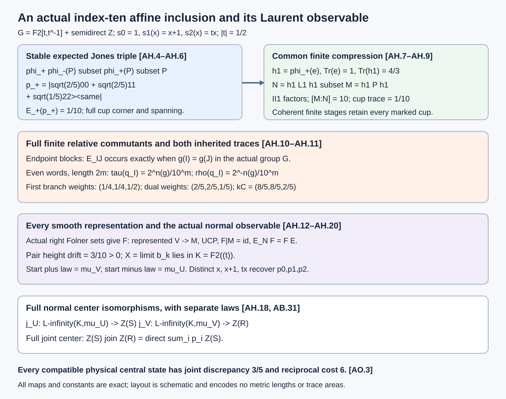

Figure AH. The stable cup and its coherent finite compression are AH.4–AH.9. Endpoint blocks and both traces are AH.10–AH.11. The physical UCP return is AH.12–AH.14. The normal maps AH.18 become onto by AB.31, and their physical separator is AO.3. Boxes encode objects, not trace areas. [Reproducible diagram source](figures/affine-physical-realization-v18.py).

## The complete boundary of the alternating affine lamp walk

Put \(L=\mathbb F_2[t,t^{-1}]\), \(K=\mathbb F_2((t))\), and
\[
G=L\rtimes\mathbb Z,\qquad
(b,n)(c,m)=(b+t^nc,n+m),\qquad (b,n)x=b+t^nx.
\tag{AB.1}
\]
All group products below are right random-walk products. Let
\(s_0=1,s_1=a=(1,0),s_2=T=(0,1)\), so that \(a x=x+1\)
and \(T x=tx\). The plus choices are \(s_i\) with probabilities
\(w^+=(1/4,1/4,1/2)\); the minus choices are \(s_i^{-1}\) with
probabilities \(w^-=(2/5,2/5,1/5)\). Successive choices are independent
and alternate phase. A plus-starting path starts with a plus choice.

The theorem proved here identifies the **whole endpoint tail sigma algebra**,
as well as all bounded harmonic pairs. It therefore identifies the center of
the weighted endpoint matrix inductive limit whenever that limit is the
actual finite relative-commutant system. There is no replacement of the
original, separately fixed WM.22 model by this three-label model.

### AB.2. Convergence and the exact drift

Write the endpoint after \(j\) raw choices as
\(G_j=(B_j,S_j)\), starting at \((0,0)\). An \(a\) choice toggles the
coefficient of \(t^{S_j}\), and a \(T^{\pm1}\) choice changes the height by
\(\pm1\). At pair times, in either starting phase, the height increments
are independent with distribution
\[
\mathbb P(D=1)=2/5,\qquad
\mathbb P(D=0)=1/2,\qquad
\mathbb P(D=-1)=1/10,\qquad v=\mathbb E D=3/10.
\tag{AB.2}
\]
The raw intermediate height differs from an adjacent pair height by at most
one. Thus \(S_{2n}/n\to v\) and \(S_j\to+\infty\) almost surely.

Here is a bounded-increment proof of the convergence used. For
\(Z=D-v\), \(|Z|\le2\), \(\mathbb E Z=0\), and \(|\theta|\le1\), Taylor's
remainder gives
\(\mathbb E e^{\theta Z}\le1+2e^2\theta^2\le e^{2e^2\theta^2}\).
Independence and Markov's inequality, with a fixed sufficiently small
\(\theta>0\), bound each probability
\(\mathbb P(|S_{2n}-vn|>\varepsilon n)\) by \(2e^{-c_\varepsilon n}\).
The sum is finite. The probability of any such failure after \(N\) tends to
zero by the union bound, so almost surely only finitely many failures occur.
Apply this to the countable choices \(\varepsilon=1/r\). This proves the
asserted limit in both phases.

Only finitely many toggles occur at any specified height; moreover the
heights of all toggles have a finite lower bound. Consequently
\[
X=\lim_{j\to\infty}B_j
 =\sum_{j:\,\text{choice }j\text{ is }a}t^{S_{j-1}}\in K
\tag{AB.3}
\]
exists in the \(t\)-adic topology. Repeated summands cancel in
characteristic two. The lower bound gives finitely many negative
coefficients, and eventual departure from every lower half-line gives
convergence in this topology, not merely coefficientwise convergence.

If \(X^{(j)}\) is the same limit built from the unused choices, starting at
the identity with the next phase, then
\[
X=B_j+t^{S_j}X^{(j)}=G_jX^{(j)}.
\tag{AB.4}
\]
This is an exact identity of \(K\)-valued random variables. The suffix
variable is independent of the complete prefix. Starting at \(g\in G\)
changes the final series to \(gX\).

### AB.3. The actual hitting laws are the two displayed stationary laws

Let \(m\) be additive Haar measure with \(m(\mathcal O)=1\),
\(\mathcal O=\mathbb F_2[[t]]\). The densities verified in AC.3–AC.7 are
\[
f_U(x)=\begin{cases}6/7,&|x|\le1,\\
(6/7)8^{-k},&|x|=2^k, k\ge1,
\end{cases}\qquad
f_V(x)=\begin{cases}(3/2)f_U(x),&|x|\le1/2,\\
(5/8)f_U(x),&|x|\ge1.
\end{cases}
\tag{AB.5}
\]
They define probabilities \(\mu_U=f_Um,\mu_V=f_Vm\), and satisfy
\[
\mu_V=\sum_iw_i^+(s_i)_*\mu_U,\qquad
\mu_U=\sum_iw_i^-(s_i^{-1})_*\mu_V.
\tag{AB.6}
\]
AC supplies direct piecewise verification of these equations; AB.6 is not
used as a maximality criterion.

For a plus-starting path let \(q_+\) be the distribution of its **pair
endpoint** \(s_is_j^{-1}\). AB.6 gives \(q_{+*}\mu_V=\mu_V\).
Take an independent \(K\)-valued \(Y_0\) with law \(\mu_V\). Then
\(G_{2n}Y_0=B_{2n}+t^{S_{2n}}Y_0\to X\) almost surely. Every finite-time
law is \(\mu_V\), by pair stationarity and independence. For every bounded
continuous function on \(K\), dominated convergence therefore shows that
the law of \(X\) is \(\mu_V\). Bounded continuous functions determine
probabilities on this metrizable local field, as can also be seen using its
clopen ball indicators. The minus-starting argument uses the pair law of
\(s_i^{-1}s_j\) and the stationary probability \(\mu_U\). Thus
\[
\operatorname{Law}_+(X)=\mu_V,\qquad
\operatorname{Law}_-(X)=\mu_U.
\tag{AB.7}
\]
This contraction argument proves the hitting-law identification. In fact it
proves uniqueness of a stationary probability for each of these pair laws:
any independent \(K\)-valued initial variable is contracted away.

For each realized path, the measures
\((G_j)_*\mu_{\text{next phase}}\) converge weakly to \(\delta_X\).
Indeed \(G_jy\to X\) for every fixed \(y\in K\), and bounded continuous
tests pass through the probability integral by dominated convergence.
Hence this is an actual measure boundary. Both measures are equivalent to
Haar measure, and every element of \(G\) acts nonsingularly on their common
measure class.

### AB.4. A finite-marked-step entropy criterion, with its full proof

The following lemma also retains information inside a pair whose two
labels have the same endpoint as a different pair. This prevents a hidden
marked-path or time-dependent tail remainder.

**Lemma.** Let \(Q_1,Q_2,\ldots\) be independent variables with a common
probability on a finite set \(A\). Let \(y:A\to H\) map to a countable
group, and set \(Z_n=y(Q_1)\cdots y(Q_n)\). Suppose \(H\) acts by measurable
bijections on a standard measurable space \(B\). Let \(\xi\) be a
\(B\)-valued variable such that, for every \(n\),
\[
\xi=Z_n\xi^{(n)},
\tag{AB.8}
\]
where \(\xi^{(n)}\) is the same function of the unused marked steps as
\(\xi\) is of the full steps. In particular it has the same law and is
independent of the prefix. Define completed sigma algebras
\[
\mathscr T_n=\sigma(Z_n,Q_{n+1},Q_{n+2},\ldots),\qquad
\mathscr T=\bigcap_n\mathscr T_n.
\tag{AB.9}
\]
If \(H(Z_n\mid\xi)=o(n)\), where entropy uses natural logarithms, then
\(\mathscr T=\sigma(\xi)\) modulo null sets.

**Proof.** Write \(P_k=(Q_1,\ldots,Q_k)\),
\(c=H(Q_1)\), \(c_\xi=H(Q_1\mid\xi)\), and \(b_n=H(Z_n)\), with
\(b_0=0\). All finite variables have finite entropy. The chain rule and
AB.8 give
\[
H(P_k\mid\xi)=k c_\xi.
\tag{AB.10}
\]
To verify every term, condition on the first \(j\) marks. They determine
\(Z_j\), so observing \(\xi\) is equivalent, through a measurable
bijection, to observing \(Z_j^{-1}\xi=\xi^{(j)}\). The pair consisting of
\(Q_{j+1}\) and this suffix boundary has the original joint distribution,
independently of the specified prefix. Its conditional entropy is exactly
\(c_\xi\).

Given \(Z_k\), the variable \(\xi\) is independent of \(P_k\): its
conditional distribution is the image of the fixed suffix law by \(Z_k\).
Since \(Z_k\) is a function of \(P_k\), the entropy chain rule now gives
\[
H(Z_k\mid\xi)=b_k-k(c-c_\xi).
\tag{AB.11}
\]
Also \(I(Q_1;Z_n)=b_n-b_{n-1}\), since the law of \(Z_n\) conditional on
\(Q_1\) is a left translate of the \((n-1)\)-step law. The Markov chain
\(Q_1\longrightarrow Z_n\longrightarrow Z_{n+1}\) makes these mutual
informations nonincreasing. For completeness, data processing here follows
from conditional independence and the chain rule:
\(I(Q_1;Z_n)=I(Q_1;Z_{n+1})+I(Q_1;Z_n\mid Z_{n+1})\), whose last term is
nonnegative. Thus the nonnegative differences \(b_n-b_{n-1}\) converge to
a number \(h\), and telescoping and Cesaro averaging give \(b_n/n\to h\).
The assumed \(o(n)\) bound and AB.11 imply
\[
h=c-c_\xi.
\tag{AB.12}
\]

For \(n\ge k\), the future marks are independent of \(P_k\) and \(Z_n\).
Consequently conditioning \(P_k\) on \(\mathscr T_n\) is exactly
conditioning it on \(Z_n\). The law of \(Z_n\) conditional on \(P_k\) is
a translate of the \((n-k)\)-step law, even if \(y\) is not injective.
Hence
\[
H(P_k\mid\mathscr T_n)=k c-b_n+b_{n-k}.
\tag{AB.13}
\]
The conditional probabilities of the finitely many values of \(P_k\)
converge in \(L^2\), hence in \(L^1\), as the conditioning algebras decrease
to \(\mathscr T\). Conditional expectation is orthogonal projection in
\(L^2\); projections onto nested decreasing closed subspaces converge to
projection onto their intersection. Indeed the projection differences are
orthogonal, their squared norms telescope, and a limit lies in each closed
subspace and retains the defining orthogonality. The intersection of the
subspaces of measurable functions is the subspace for the completed
intersection sigma algebra. Entropy is a bounded continuous function of a
finite probability vector, so its integrals converge as well. Taking
\(n\to\infty\) in AB.13 yields
\[
H(P_k\mid\mathscr T)=k(c-h)=k c_\xi
 =H(P_k\mid\xi).
\tag{AB.14}
\]

AB.8 makes \(\xi\) measurable in every \(\mathscr T_n\), hence in
\(\mathscr T\). Equality in AB.14 implies equality of the two conditional
probability vectors. Here is the exact equality argument. If \(p_{\mathscr
T}\) and \(p_\xi\) are those vectors, the difference of the two conditional
entropies is
\(\mathbb E\sum_a p_{\mathscr T}(a)\log[p_{\mathscr T}(a)/p_\xi(a)]\).
Each sum is nonnegative by \(-\log u\ge1-u\), and is zero only when the
vectors agree (with the usual zero-coordinate convention). Thus
\(\mathbb E[f(P_k)\mid\mathscr T]=\mathbb E[f(P_k)\mid\xi]\) for every
function of the finite prefix.

For \(E\in\mathscr T\), multiply this equality by \(1_E\) and condition
on \(\xi\). It gives conditional independence of \(E\) and \(P_k\) over
\(\xi\), equivalently
\[
\mathbb E[1_E\mid\sigma(P_k,\xi)]
 =\mathbb E[1_E\mid\xi].
\tag{AB.15}
\]
As \(k\to\infty\), the algebras on the left increase to the whole marked
path algebra. Their \(L^2\) projections converge to the identity: cylinder
simple functions are dense, and the conditional expectations are
contractions. The left side therefore converges to \(1_E\), proving
\(E\in\sigma(\xi)\) modulo null sets. This proves the lemma. \(\square\)

This proof uses finite entropy identities, finite-vector strict entropy
concavity, and elementary Hilbert-space projection convergence. It invokes
neither a boundary-maximality theorem nor a conditional Shannon–McMillan
theorem as an unproved dependency.

### AB.5. Conditional entropy of the actual affine endpoint

Fix either starting phase, group the raw choices into marked pairs
\(Q_n\in\{0,1,2\}^2\), and put \(Z_n=G_{2n}\). The marks are independent
and identically distributed in that phase; their group endpoint map is
\(y_+(i,j)=s_is_j^{-1}\) or \(y_-(i,j)=s_i^{-1}s_j\). AB.4 is AB.8 with
\(\xi=X\).

For \(0<\varepsilon<v/2\), put
\[
\ell_n=\lfloor(v-\varepsilon)n\rfloor,\qquad
u_n=\lceil(v+\varepsilon)n\rceil.
\tag{AB.16}
\]
Let \(E_n\) be the event that the maximum raw height before time \(2n\)
is at most \(u_n\), the minimum raw height from time \(2n\) onward is at
least \(\ell_n\), and \(S_{2n}\in[\ell_n,u_n]\).
AB.2 implies \(\mathbb P(E_n)\to1\). To check the uniform statements,
write \(S_{2k}=vk+o(k)\). The finitely many early heights are absorbed
by the growing upper bound; all later prefix heights with \(k\le n\)
are at most \((v+\varepsilon/2)n+1\le u_n\). For all \(k\ge n\),
eventually \(S_{2k}\ge(v-\varepsilon/2)k\); the possible intermediate
decrement of one is absorbed by the gap \(\varepsilon n/2\). This gives
the future lower bound. The endpoint assertion follows directly from the
limit.

On \(E_n\), every coefficient of \(B_{2n}\) below \(\ell_n\) is precisely
the corresponding coefficient of \(X\), because future toggles cannot
alter it. Every coefficient above \(u_n\) is zero, because a past toggle
could not occur there. The coefficients in
\([\ell_n,u_n]\cap\mathbb Z\) remain binary choices. Given \(X=x\),
there are therefore at most
\[
M_n=(u_n-\ell_n+1)\,2^{u_n-\ell_n+1}
\tag{AB.17}
\]
possible endpoints on \(E_n\): the first factor counts their possible
heights. This estimate needs no bound on the minimum past height: the
known truncation \(x_{<\ell_n}\) is a Laurent polynomial for every
\(x\in K\).

There are at most \(9^n\) endpoints overall, since there are \(9^n\)
marked prefixes. Introduce the binary event indicator into the conditional
entropy chain rule. On \(E_n\) the conditional support bound is AB.17;
on its complement use \(9^n\). Even though \(E_n\) involves the future,
these are valid conditional support bounds. Thus
\[
H(Z_n\mid X)
 \le\log2+\log M_n+\mathbb P(E_n^c)n\log9,\qquad
\limsup_n\frac{H(Z_n\mid X)}n\le2\varepsilon\log2.
\tag{AB.18}
\]
Send \(\varepsilon\downarrow0\). We obtain \(H(Z_n\mid X)=o(n)\).
AB.4 proves
\[
\bigcap_n\sigma(G_{2n},Q_{n+1},Q_{n+2},\ldots)=\sigma(X)
\quad\text{modulo null sets, in both phases}.
\tag{AB.19}
\]

The left side is also the **raw endpoint tail**. From \(G_{2n}\) and
future marked pairs one recovers every later raw endpoint; conversely
successive raw endpoints determine each raw group increment, hence its
label, since \(1,a,T\) and \(1,a,T^{-1}\) are distinct. Therefore
\[
\bigcap_j\sigma(G_j,G_{j+1},\ldots)=\sigma(X).
\tag{AB.20}
\]
Using pair times is cofinal in this decreasing family. This proves the
entire tail identification, including bounded time-dependent tail
martingales, and rules out a residual marked-pair factor.

### AB.6. All bounded harmonic pairs, with both phases and uniqueness

A bounded harmonic pair is a pair \(h_+,h_-:G\to\mathbb C\) satisfying
\[
h_+(g)=\sum_iw_i^+h_-(gs_i),\qquad
h_-(g)=\sum_iw_i^-h_+(gs_i^{-1}).
\tag{AB.21}
\]
For every \(F\in L^\infty(K,m)\), define
\[
h_+^F(g)=\int_KF(gx)\,d\mu_V(x),\qquad
h_-^F(g)=\int_KF(gx)\,d\mu_U(x).
\tag{AB.22}
\]
AB.6 proves AB.21, retaining the order of the actual group products.
These formulas are well-defined on the common Haar measure class.

Conversely, along a plus-starting path \(h_{\text{next phase}}(G_j)\)
is a bounded martingale. Its \(L^2\) limit exists: martingale differences
are orthogonal, and the squared norms of the partial sums are uniformly
bounded. For every \(j\), every subsequent martingale value is measurable
in the raw endpoint tail algebra starting at \(j\); hence its limit lies
in AB.20. Write that limit \(F(X)\), with
\(\|F\|_\infty\le\max(\|h_+\|_\infty,\|h_-\|_\infty)\).

Every \(g\in G\) is reachable with positive probability at a pair time.
Indeed the plus pair law has \(1,a,T,T^{-1}\) in its support (use an
identity for the other label), and these generate \(G\) as a semigroup.
Condition on any specified marked prefix with endpoint \(g\) at time
\(2k\). The suffix has the original plus-starting law, and AB.4 sends its
boundary to \(gX^{(2k)}\). The \(L^2\) martingale limit under this
conditioning is simultaneously \(F(gX^{(2k)})\) and the limit of the
martingale starting at \(g\). Taking its expectation gives
\(h_+(g)=h_+^F(g)\). Finally the second equation of AB.21 and AB.6 give
\(h_-(g)=h_-^F(g)\) with the **same** \(F\).

For the pair constructed from \(F\), AB.4 gives
\[
h_{\text{next phase}}^F(G_j)
 =\mathbb E[F(X)\mid\text{first }j\text{ labels}].
\tag{AB.23}
\]
The right side converges to \(F(X)\) in \(L^2\), by cylinder density.
Thus \(F\) is unique modulo the common measure class, and AB.22 is an
isometric order isomorphism between \(L^\infty(K,m)\) and the bounded
harmonic pairs (norm the maximum of the two sup norms). The inverse is
the martingale limit. The boundary algebra product is transported through
that inverse; it is not asserted to be the pointwise product of harmonic
functions on \(G\).

Left translation of the starting endpoint is exactly the affine \(G\)
action on this boundary. In the pullback convention its normal action is
\[
(\beta_gF)(x)=F(g^{-1}x),\qquad \beta_{gh}=\beta_g\beta_h.
\tag{AB.24}
\]
Equations AB.7, AB.20 and AB.22 prove that the two advertised probabilities
are the full two-phase Poisson boundary laws.

### AB.7. Full weighted endpoint centers and their canonical likelihoods

Here is the precise return to the finite matrix system. For each initial
phase and each raw length \(j\), let \(D_j\) be the direct sum of full
matrix blocks with matrix units \(E_{IJ}\) for label words having the
same endpoint in \(G\). The embedding appends a label to both words.
Give a minimal word projection its independent-label probability. This is
a trace on each whole endpoint block: if a prefix has \(r_+\) plus choices,
\(r_-\) minus choices, and endpoint \((b,n)\), its probability is
\[
4^{-r_+}(2/5)^{r_-}2^n.
\tag{AB.25}
\]
This is constant among words with that endpoint. Summing over one appended
label gives the previous trace, so these traces are compatible and faithful.
Let \(R_+,R_-\) be the von Neumann closures of these two inductive limits
in their finite trace representations.

The diagonal word algebras identify their common closure with the product
label probability space: word projections are its cylinder indicators.
If \(z\in Z(R_\pm)\), its trace expectation into \(D_j\) lies in \(Z(D_j)\),
because the expectation is \(D_j\)-bimodular. Those expectations converge
in \(L^2\) to \(z\), since the union of the finite algebras is dense.
Hence \(z\) belongs to the diagonal algebra.

A diagonal function commutes with \(E_{IJ}\) at level \(j\) exactly when
replacing prefix \(I\) by prefix \(J\) with the same endpoint leaves its
value unchanged for almost every common suffix. This can be checked on
later cylinder simple functions by matrix multiplication, and extended in
\(L^2\) by bounded matrix-unit multiplication. Equal-endpoint prefixes have
equal positive trace weights by AB.25, so these substitutions preserve the
conditional measure. For the finite set of prefixes, their invariance is
equivalent to measurability in
\[
\sigma(G_j,\text{labels after }j).
\tag{AB.26}
\]
Indeed, for each fixed suffix the value is constant on each finite
endpoint fibre; averaging over that fibre gives an explicit version
depending only on its endpoint and the suffix. Conversely such a version
is invariant under every fibre substitution. There are countably many
finite matrix units, so the simultaneous almost-everywhere assertions
can be imposed on one set of full measure. Commuting with all those units
is equivalent to centrality in the von Neumann closure. We have therefore
proved that its **full** center is the intersection of AB.26 over \(j\),
which is the raw tail algebra in AB.20. Consequently there are normal
onto *-isomorphisms
\[
Z(R_+)\cong L^\infty(K,\mu_V),\qquad
Z(R_-)\cong L^\infty(K,\mu_U),\qquad F\longmapsto F(X).
\tag{AB.27}
\]
Normality and the trace measures follow from the probability-space
identification. Onto-ness uses AB.20; this is not a stationary quotient.
The same argument applies after every finite prefix and with every starting
endpoint, where the measure is the corresponding affine pushforward law.

In the actual first-plus branch, write \(p_i\) for its word projection
and \(X^-=X^{(1)}\) for the suffix boundary. Then
\[
Xp_i=s_iX^-p_i,\qquad
\tau(p_i F(X^-))=w_i^+\mu_U(F).
\tag{AB.28}
\]
The same statements follow first for Laurent-coordinate cylinder tests and
then by normal limits for arbitrary bounded measurable \(F\). The three
branch transforms can coincide only at null points: \(x=x+1\) is impossible,
\(x=tx\) forces \(x=0\), and \(x+1=tx\) forces \(x=(1+t)^{-1}\).
Haar measure has no atoms, so these exceptional points have zero measure.
Countably many Laurent-coordinate tests therefore recover each actual
\(p_i\) from the two full center coordinates, exactly as branch tests do
in C13.2.

The canonical expectation of \(p_i\) onto the full plus center is the
conditional probability of its first label given \(X\). Thus its entire
likelihood, under AB.27, is determined by
\[
\mu_V(R_iF)=w_i^+\mu_U(F\circ s_i),\qquad
R_i=w_i^+\frac{d(s_i)_*\mu_U}{d\mu_V}.
\tag{AB.29}
\]
This is equality against **every** function of the whole center, not just
against finite-coordinate tests or a quotient subalgebra. Uniqueness of
Radon–Nikodym derivatives gives the exact functions
\[
(R_0,R_1,R_2)=
\begin{cases}
(1/6,1/6,2/3),&|x|\le1/2,\\
(2/5,2/5,1/5),&|x|\ge1.
\end{cases}
\tag{AB.30}
\]
The branch comparison of the two full centers is \(F\mapsto F\circ s_i\),
which is exactly \(\beta_i^{-1}\) in AB.24. The labels generate \(G\), so
the whole center action is the affine action in that convention.

### AB.8. Application to the actual index-ten physical inclusion

The physical inclusion constructed in AH.1–AH.20 has exactly the
finite matrix system just proved: AH.10 identifies its **entire**
relative commutants with the equal-endpoint blocks, with literal
label-appending embeddings; AH.11 gives AB.25 as its inherited physical
trace on every minimal word projection. The compatible full-corner maps
in AH.3 preserve every stage and its trace. Thus their finite trace
representations and von Neumann closures are precisely \(R_+,R_-\).
In the physical notation \(R,S\), the normal embeddings AH.18 are onto:
\[
j_V:L^\infty(K,\mu_V)\overset{\cong}{\longrightarrow}Z(R),\qquad
j_U:L^\infty(K,\mu_U)\overset{\cong}{\longrightarrow}Z(S).
\tag{AB.31}
\]
The isomorphisms are the specified maps \(F\mapsto F(X)\), because they
agree on every Laurent-cylinder test and both are normal. This proves
their canonical identification, not merely existence of abstract center
isomorphisms.

The physical branch identity AH.19 is AB.28. Consequently AH.20 and the
original normal coefficient-center maps C13.9–C13.10 identify the whole
coefficient center with \(L^\infty(K,m)\), with the actual action AB.24,
the two original normal probabilities AB.7, and the whole canonical
likelihoods AB.30. Indeed AH.19 tested against every center function
gives AB.29; AB.31 makes those tests exhaustive. Faithfulness of the
normal trace and uniqueness of its Radon–Nikodym density exclude any
extra untested part of a likelihood.

Every \(G\)-invariant state of this full center, allowing singular states,
annihilates \(\mathcal O\). For every positive integer \(N\) there are
\(N\) disjoint translates of \(\mathcal O\) by Laurent polynomials.
Finite additivity and translation invariance give
\(N\omega(1_{\mathcal O})\le1\), hence
\(\omega(1_{\mathcal O})=0\). Such invariant states exist by the right
Følner sets AH.14 and weak-star averaging. AB.30 therefore gives, for
**every** invariant center state,
\[
\begin{gathered}
(\omega(R_0),\omega(R_1),\omega(R_2))=(2/5,2/5,1/5),\\
\sum_i\omega(|R_i-w_i^+|)=3/5,\\
\sum_i\omega(|R_i^{-1}-(w_i^+)^{-1}|)=6.
\end{gathered}
\tag{AB.32}
\]
All functions here are bounded functions of the full identified physical
center; no passage of a singular state through a normal spectral limit
is used. The physical return and converse in AH.4 and the full-branch
version of C13.12–C13.19 transfer these exact canonical likelihood costs
to the original compatible physical states of this inclusion. In
particular none of those states can have all three canonical likelihoods
equal to the physical weight vector \((1/4,1/4,1/2)\) at zero absolute
cost.

This application concerns the constructed three-label affine index-ten
inclusion. The original WM.22 inclusion retains its separate parameters,
likelihoods and full zero-cost endpoint obligation.

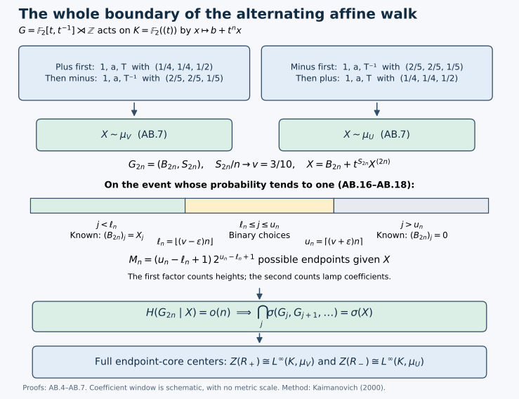

The figure displays the actual maps \(G_{2n}x=B_{2n}+t^{S_{2n}}x\), the
two separate hitting laws AB.7, and the coefficient support estimate
AB.16–AB.18. The window is schematic and has no metric scale. The lower
arrows are the proved full endpoint-tail and center identifications
AB.20 and AB.27. [Reproducible figure source](figures/affine-boundary-maximality-v18.py).

Human source for the conditional-entropy method: Vadim A. Kaimanovich, *The Poisson formula for groups with hyperbolic properties*, Annals of Mathematics 152 (2000), 659–692, [author manuscript metadata, arXiv:math/9802132v2](https://arxiv.org/abs/math/9802132v2). AB.4 supplies the complete finite-marked-step proof used here. The exact lamp-window estimate and both-phase full-core application are proved above.

## The exact physical affine separator and the unrestricted joint-step correction

Use the actual finite-factor inclusion AH.1–AH.20. The full endpoint tail and core identifications AB.20/AB.27 identify its actual complete coefficient center with \(L^\infty(K,m)\), with the original two separate normal laws \(\mu_U,\mu_V\). The following theorem applies that proved full identification to the original physical states and projection input.

### AO.1. Exact full-center likelihoods and original expectations

The actual maps are the onto normal versions of AH.18. Their original branch comparison is \(f\mapsto f\circ s_i=\beta_i^{-1}f\), and their canonical likelihoods are AB.29–AB.30:
\[
(R_0,R_1,R_2)=
\begin{cases}
(1/6,1/6,2/3),&x\in t\mathcal O,\\
(2/5,2/5,1/5),&x\notin t\mathcal O.
\end{cases}
\tag{AO.1}
\]
The equality is on the whole actual center, not on a conditional-expectation quotient. All functions are bounded and boundedly invertible. The original normal maps \(E_A,P_0\) and both canonical traces remain fixed. In particular no state-dependent expectation is introduced.

AH.20 gives the full original joint algebra \(D_0=\bigoplus_i p_iU\), where \(U=Z(S)\). The same complete physical finite row and full-corner proof as C13.12–C13.13 constructs, for every invariant state \(\omega\) of the actual coefficient center, an original compatible \(M\)-central state \(\psi_\omega\) with exactly physical marginal \(\tau\). Conversely the bounded-form proof C13.13 sends every such original state to a \(G\)-invariant \(\omega\). All three positive physical branch weights, the actual Jones row, and the full group relators in AH.12–AH.14 have been verified. These arguments permit arbitrary singular states.

### AO.2. The separator holds for every compatible physical state

Translations by Laurent polynomials are actual elements of \(G\). Any compact ball \(t^{-N}\mathcal O\) has arbitrarily many disjoint translates by those elements. Finite additivity of every \(G\)-invariant state gives
\[
\omega(1_{t^{-N}\mathcal O})=0\quad(N\ge0).
\tag{AO.2}
\]
The state class is nonempty by the actual right Følner averages AH.14. Its members are purely singular: the compact-ball projections increase normally to one, so any normal positive functional dominated by \(\omega\) has value zero on one. This singularity is used only where the complete physical hypotheses of SC.2–SC.3 hold. As in E14.12a, those existing proofs also annihilate the entire original norm-closed Jones ideal for these compatible physical states; no new ideal proof is required.

For an arbitrary compatible physical \(\psi\), let \(\alpha=\psi\iota\) be its original joint restriction and \(\omega\) its invariant full-center state. The physical formulas C13.15–C13.19, with the three exact weights AH.4, give
\[
\begin{aligned}
\|\alpha-\alpha P_0\|
 &=\sum_i\omega(|R_i-w_i^+|),\\
 &=3/5,\\
\psi(\mathfrak a)
 &=\sum_i\omega(|R_i^{-1}-(w_i^+)^{-1}|),\\
 &=6.
\end{aligned}
\tag{AO.3}
\]
Indeed AO.2 annihilates \(t\mathcal O\), so AO.1 has the constant outer values \((2/5,2/5,1/5)\) in every such state. The two sums are respectively
\[
2|2/5-1/4|+|1/5-1/2|=3/5,\qquad
2|5/2-4|+|5-2|=6.
\tag{AO.4}
\]
The equalities hold for the full nonempty compatible-state class, not only normal states or a selected family. Thus
\[
\min_{\psi\text{ original compatible }M\text{-central}}\psi(\mathfrak a)=6,
\qquad
\min_\psi\|\psi\iota-\psi\iota P_0\|=3/5.
\tag{AO.5}
\]
This is an actual all-smooth-amenable finite-index II₁ inclusion with a positive original canonical separator. It refutes the claim that unrestricted all-smooth amenability always supplies an original compatible joint-balanced state.

The original operator itself also has a positive lower bound. In the full smaller-center coordinate, C13.18 gives
\[
\zeta_U(b)(x)=\sum_i\left|R_i(s_ix)^{-1}-(w_i^+)^{-1}\right|
=\begin{cases}4,&x\in\mathcal O,\\6,&x\notin\mathcal O.\end{cases}
\tag{AO.5a}
\]
On \(\mathcal O\), the identity and toggle terms are 2 and \(3/2\) in opposite order, and the contraction term is \(1/2\). Outside \(\mathcal O\), the first two terms are \(3/2\) each and the last is 3. Thus the original faithful normal lift satisfies \(\mathfrak a=\iota(b)\ge4\,1\). Invariant center states kill \(\mathcal O\), giving the exact value 6 in AO.3. This bound uses the original full likelihoods and original cost operator.

### AO.3. Consequence for the actual V8 projection input

For the finite coisometric Jones columns FC/V8.1 retain the exact original normalization
\[
h=\sum_{\ell=1}^L a_\ell e a_\ell^*,\quad
a_\ell\in N,\quad \sum_\ell a_\ell a_\ell^*=1,\quad
\operatorname{Tr}(h)=1,\quad
J_h=\|C_A(h)-P_0C_A(h)\|_1.
\tag{AO.6}
\]
Their states \(\sigma_h=\operatorname{Tr}(h\,\cdot)\) are exactly \(E_A\)-compatible and have physical marginal \(\tau\), by FC/V8. If a net of these actual columns has
\(\|uhu^*-h\|_{1,\operatorname{Tr}}\to0\) for every physical unitary \(u\in M\), then
\[
\liminf J_h\ge3/5.
\tag{AO.7}
\]
To prove this, suppose a subnet has \(J_h\le r<3/5\). Weak-star compactness gives a cluster state on the original \(B\). Exact compatibility and marginal pass to that state, and the conjugation errors make it \(M\)-central. Pairing the two original center profiles against each bounded \(t\in D_0\) gives \(\sigma_h\iota(t)-\sigma_h\iota(P_0t)\). The bound by \(r\|t\|\) passes to the cluster, so its original joint discrepancy is at most \(r\), contradicting AO.3. If the liminf were smaller than \(3/5\), such an \(r\) and subnet would exist.

In particular, for every \(0<r<3/5\) there is a finite set \(\mathcal U\subset\mathcal U(M)\) and a \(\delta>0\) such that every actual coisometric column satisfies
\[
\max_{u\in\mathcal U}\|uhu^*-h\|_1<\delta
\quad\Longrightarrow\quad J_h\ge r.
\tag{AO.8}
\]
Otherwise direct the pairs consisting of a finite unitary set and a positive tolerance by inclusion and decreasing tolerance. Choose a column with all those errors below the tolerance and \(J_h<r\). This net contradicts AO.7. This is a finite physical obstruction, obtained from the actual positive separator rather than an abstract unverified order floor.

The spectral-stack construction V8.1–V8.5 remains valid. Its lower mesh estimate gives, for the actual stack \(P_{n,\theta}\), mesh loss \(\eta=\operatorname{Tr}(\operatorname{supp}h)/n<1\), and every threshold shift,
\[
\frac{\|C_{\widetilde A}(P_{n,\theta})-
P_0C_{\widetilde A}(P_{n,\theta})\|_1}
{\widetilde{\operatorname{Tr}}(P_{n,\theta})}
\ge\frac{\max(0,J_h-2\eta)}{1+\eta}.
\tag{AO.9}
\]
Consequently no application of this construction with physical errors tending to zero and mesh loss tending to zero can make the normalized joint error tend to zero; its liminf is at least \(3/5\). V8.4 retains any prescribed finite prefix and all its marked cups. The finite alignment argument AH.3 transports the full inherited core system and this separator to every ordinary tunnel of this pair. The obstruction therefore persists after a prescribed prefix; no old test, physical target or canonical trace is dropped.

### Exact correction and retained scope

Unrestricted amenability does not imply simultaneous arbitrarily small original \(J_h\) and physical centrality, even for this explicit separable hyperfinite II₁ pair. The successful V8 projection and prefix-retention estimates are unchanged, and the stronger joint-state input they would require is now disproved in this generality by AH/AB/AO.

This does not by itself refute the original full finite whole-family partition, controlled support reselection, marked corner return under its actual hypotheses, or the generating-tunnel theorem with its stated ergodic-core strong-amenability hypotheses. A full-family route need not pass through this false universal joint-state assertion. Those separate original obligations remain substantive. The fixed WM.22 model is a different inclusion; no claim here decides its endpoint. The unrestricted common-support BF and constant-multiplicity rounding assertions have the actual affine counterexample [BFQ.3–BFQ.4](general-tail-supports-and-controlled-tunnels.md#common-frames-central-profiles-and-the-order-of-tunnel-choices). The bare second local form and the general physical bicommutant remain separate. The exact ordinary and extremal opposite-model comparisons are [17.8–17.18](generating-tunnels-and-classification.md#the-ordinary-standard-model-at-arbitrary-depth).

## Full finite marked families in the actual weighted diagonal inclusion

For every member of the actual weighted Jones family WM.1–WM.17, including the fixed nonfactor, nonextremal inclusion at WM.22, the original full finite-partition conclusion GTB.0–GTB.1 holds. It holds after every prescribed finite ordinary prefix, retains its cups exactly, and approximates the same physical targets. An arbitrary selected whole-stage near-cover can be completed after arbitrarily small physical cuts. This conclusion uses neither an original zero-cost hypertrace nor factoriality of either ordinary core. It does not prove GTB.0–GTB.1 for an arbitrary amenable finite-index inclusion.

### The actual data

Keep the factors, normal embeddings, marked Jones projections, and complete relative commutants constructed in WM.1–WM.17. The parameter satisfies \(1<\lambda\le2\), with

\[
 S_+=4+\lambda,\quad S_-=4+\lambda^{-1},\quad
 d=S_+S_-=17+4(\lambda+\lambda^{-1}),
 \qquad w_i^+=\frac{\nu_i}{S_+},\quad
 w_i^-=\frac{\nu_i^{-1}}{S_-},
 \tag{HG.1}
\]

where \(\nu_1=\lambda\) and the other four \(\nu_i\)'s equal one. Fix an actual ordinary prefix through \(N_k\). Finite marked alignment with the canonical prefix, and its actual common-corner suffix identification, give one canonical continuation whose smaller suffix algebra at \(N_{k+2n}\) is

\[
 C_n=N_{k+2n}'\cap N_k
       \cong\bigoplus_g\operatorname{Mat}_{c_{n,g}}.
 \tag{HG.2}
\]

Its word coordinates are \(n\) consecutive pairs of raw labels. The initial phase may be either sign. Write \(h(g)\in\mathbb Z\) for the signed central integer grade of their endpoint. It is a group character, so equal endpoints have equal grades. The full finite commutant calculation WM.12–WM.14 gives the two **different** minimal-projection weights

\[
 \omega_{n,g}^{\tau}=\frac{\lambda^{h(g)}}{d^n},\qquad
 \omega_{n,g}^{\rho}=\frac{\lambda^{-h(g)}}{d^n}.
 \tag{HG.3}
\]

All these maps are the actual compatible finite-stage maps. The upper rows remain \(A_j=N_j'\cap M\) and \(B_j=N_j'\cap N\). No auxiliary algebra below is identified with an actual Jones core.

### Group only the equal numerical weights

Let

\[
 c_{n,h}=\sum_{g:h(g)=h}c_{n,g}
 =[z^h](17+4z+4z^{-1})^n.
 \tag{HG.4}
\]

The second equality counts the actual raw-label pairs: seventeen have grade zero, four grade one, and four grade minus one. In the opposite initial phase the grade signs interchange; the counts are unchanged. Define the auxiliary finite algebra

\[
 \widehat C_n=\bigoplus_{h=-n}^n\operatorname{Mat}_{c_{n,h}}.
 \tag{HG.5}
\]

Its matrix coordinates are exactly those same words. There is an explicit unital trace-preserving embedding \(\jmath_n:C_n\to\widehat C_n\): send each actual matrix unit \(E_{IJ}\), with equal endpoints, to the same matrix unit, now inside the block of their common grade. Its image is the direct sum of the endpoint subblocks in each grade block. It is a *-homomorphism, because multiplication of these same matrix units is unchanged. It is faithful, because it fixes every word diagonal. The inherited physical trace on the grade block has minimal weight \(\lambda^h/d^n\).

Append one pair of raw labels for the embedding \(\widehat C_n\to\widehat C_{n+1}\). The grades add. Matrix units map to the sum of their identical suffix copies, exactly as for the actual embedding. These maps make all \(\jmath_n\)'s compatible. Trace restriction follows from

\[
 \frac{17+4\lambda+4\lambda^{-1}}d=1.
 \tag{HG.6}
\]

The dual weights \(\lambda^{-h}/d^n\) also restrict correctly, by the same equality with \(\lambda\) inverted. Thus the auxiliary finite algebras preserve both finite trace systems. Their physical-trace completion is used only to prove convergence of a scalar rank-cut cost.

**Lemma HG.1.** The physical-trace completion \(\widehat S=(\bigcup_n\widehat C_n)''\) is a finite factor.

**Proof.** The diagonal word algebras have completion \(L^\infty(X,\mu)\), where \(X\) is the countable product of the 25 pair labels, each pair of grade \(r\) having probability \(\lambda^r/d\). This is a faithful product probability, since all 25 weights are positive and their sum is one.

If \(z\in Z(\widehat S)\), then its finite expectations \(E_{\widehat C_n}(z)\) are central in \(\widehat C_n\): bimodularity gives commutation with every element of that algebra. They are therefore diagonal, constant on each grade block. The expectations converge in \(L^2\), and the diagonal completion is closed in \(L^2\), so \(z\) belongs to \(L^\infty(X,\mu)\).

Every finite permutation of the pair coordinates is implemented by the permutation matrix on its finitely many word coordinates. It belongs to the appropriate \(\widehat C_n\), because it preserves total grade. Hence the function \(z\) is invariant under every such permutation. The product measure is also invariant.

Here is the required zero-one argument in its bounded-function form. Let \(b\) be a bounded cylinder function, and approximate \(z\) in \(L^2\) by a bounded cylinder function \(z_m\). Choose a finite permutation moving all coordinates of \(b\) outside the coordinates of \(z_m\), and call the moved function \(b_\sigma\). Invariance of \(z\) gives \(\int zb\,d\mu=\int zb_\sigma\,d\mu\). Independence gives \(\int z_mb_\sigma\,d\mu=(\int z_m\,d\mu)(\int b\,d\mu)\). The difference from each expression with \(z\) is at most \(\|z-z_m\|_2\|b\|_2\), by Cauchy–Schwarz. Letting the approximation error tend to zero gives \(\int zb\,d\mu=(\int z\,d\mu)(\int b\,d\mu)\). Cylinder functions are \(L^2\)-dense by their increasing conditional expectations. Thus \(z=(\int z\,d\mu)1\). This proves that the center is scalar. The inherited faithful normal trace makes the completion finite. \(\square\)

This proof of factoriality concerns \(\widehat S\), whose extra matrix units join different group endpoints. It does not assert factoriality of the actual ordinary core, whose matrix units join only equal group endpoints.

### A scalar rank cost that tends to zero

Take any finite selected family of 76.4 after the prescribed prefix. Its physical orthogonal good supports are \(r_1,\ldots,r_q\in N_k\), its residual is \(f=1-\sum_i r_i\), and each good block has its own actual finite continuation of that prefix. Choose finite aligning unitaries \(U_i\in\mathcal U(N_k)\). At one sufficiently long **even** canonical suffix level \(m\), put

\[
 g_i=U_i^*r_iU_i\in C_m.
 \tag{HG.7}
\]

This is finite marked tunnel alignment, not a comparison inferred from the index. Extend the \(i\)-th continuation by \(U_iN_jU_i^*\) beyond its old endpoint. Its entire previous finite segment stays fixed. At a later paired suffix level \(n\ge m\), let \(h_{i,n,g}\) denote the rank of \(g_i\) in the actual endpoint block \(g\), and set

\[
 \begin{gathered}
 H_{n,h}=\sum_i\sum_{g:h(g)=h}h_{i,n,g},\qquad
 e_{n,h}=(H_{n,h}-c_{n,h})_+,\\
 \Delta_n^\tau=\sum_h\frac{\lambda^h}{d^n}e_{n,h},\qquad
 \Delta_n^\rho=\sum_h\frac{\lambda^{-h}}{d^n}e_{n,h}.
 \end{gathered}
 \tag{HG.8}
\]

**Lemma HG.2.** The costs \(\Delta_n^\tau\) decrease to zero.

**Proof.** The images \(\jmath_m(g_i)\) are actual projections of the auxiliary increasing finite algebras. Their ranks in the grade block are precisely \(\sum_{g:h(g)=h}h_{i,n,g}\). Thus \(\Delta_n^\tau\) is exactly the finite cost 80.2 for this auxiliary family. The complete finite averaging and normal limit proofs 80.1–80.3 apply to any such increasing finite algebras. Lemma HG.1 makes their limiting center-valued trace scalar. Since the physical \(r_i\)'s are orthogonal,

\[
 \sum_i\tau(g_i)=\sum_i\tau(r_i)\le1.
 \tag{HG.9}
\]

Consequently the limit from 80.6 is \((\sum_i\tau(g_i)-1)_+=0\), and 80.8 proves monotonicity. This argument uses factoriality only in the explicitly constructed auxiliary algebra. The physical cuts and their return to actual Jones stages are constructed next. \(\square\)

Both finite losses in HG.8 have their original normalization. The proof claims convergence of the **physical** loss for every selected family. It does not claim that the dual loss tends to zero for that arbitrary family: the dual completion is a different completion, and its scalar support sum need not be at most one. The full finite-partition theorem measures target errors in the physical trace. Every retained/new cell still carries the original actual dual trace of its own continuation.

### The cuts and the whole residual live in the physical inclusion

**Theorem HG.3.** For any \(n\ge m\), there are actual cuts \(g_i'\le g_i\) in \(C_n\), with total physical loss \(\Delta_n^\tau\), and a single actual canonical projection \(q_0\in C_n\), such that

\[
 \begin{gathered}
 r_i'=U_ig_i'U_i^*\le r_i,\qquad d_i=r_i-r_i',\\
 f_*=f+\sum_i d_i=1-\sum_i r_i',\\
 \sum_i\tau(d_i)=\Delta_n^\tau,\qquad
 \tau(q_0)=\tau(f_*).
 \end{gathered}
 \tag{HG.10}
\]

The full residual \(f_*\), including all of the old \(f\), has an actual whole finite-tunnel origin after the same prescribed prefix. The removed finite dual rank mass is exactly \(\Delta_n^\rho\) in HG.8.

**Proof.** For each grade \(h\), remove exactly \(e_{n,h}\) dimensions, successively from the available actual ranks \(h_{i,n,g}\) over all \(i,g\) of that grade. The number requested lies between zero and their total \(H_{n,h}\), so the operation terminates. Choose the resulting subprojection of each \(g_i\) inside every actual full endpoint block. This is an actual projection \(g_i'\in C_n\), with \(g_i'\le g_i\). Its remaining aggregate rank in grade \(h\) is

\[
 H'_{n,h}=\min(H_{n,h},c_{n,h}).
 \tag{HG.11}
\]

Every removed dimension of this grade has physical weight \(\lambda^h/d^n\) and dual weight \(\lambda^{-h}/d^n\). This proves both stated loss identities.

In the **actual** endpoint blocks of grade \(h\), distribute \(c_{n,h}-H'_{n,h}\) dimensions over their unit capacities. This is possible because their capacities sum to \(c_{n,h}\), and the requested integer lies in \([0,c_{n,h}]\). The resulting direct sum over the endpoint blocks and all grades is an actual \(q_0\in C_n\). Its physical trace is

\[
 \tau(q_0)=\sum_h\frac{\lambda^h}{d^n}
           (c_{n,h}-H'_{n,h})
 =1-\sum_i\tau(g_i')=\tau(f_*).
 \tag{HG.12}
\]

No orthogonality between \(q_0\) and the canonical \(g_i'\)'s is required. It is a scalar projection certificate. In the physical factor \(N_k\), the supports \(r_i'\) are already orthogonal, and \(f_*\) is their genuine complement. Finite-factor projection comparison, including the equal-trace complements, supplies \(v\in\mathcal U(N_k)\) with \(vq_0v^*=f_*\). Conjugate the canonical continuation after the prefix by this \(v\), for the residual cell alone. Then \(f_*\in vC_nv^*\), giving its actual whole finite origin. All \(U_i\)'s and \(v\) lie in \(N_k\); they fix \(A_k=N_k'\cap M\) pointwise and fix every earlier cup. They preserve each earlier factor as an algebra. This is the actual physical placement, not an embedding of the auxiliary grade algebra into \(M\). \(\square\)

### Full rows and fixed-target error

Let the old selected square be \(D_0\subset Q_0\subset P_0\), where \(D_0\subset N_k\), \(Q_0\subset N\), and the old residual upper block is \(fA_k\). Put \(j=k+2n\). Define

\[
 \begin{aligned}
 P_*&=\bigoplus_i r_i'U_iA_jU_i^*r_i'
        \ \oplus\ f_*vA_jv^*f_*,\\
 Q_*&=\bigoplus_i r_i'U_iB_jU_i^*r_i'
        \ \oplus\ f_*vB_jv^*f_*,\\
 D_*&=\bigoplus_i r_i'U_i(N_j'\cap N_k)U_i^*r_i'
        \ \oplus\ f_*v(N_j'\cap N_k)v^*f_*.
 \end{aligned}
 \tag{HG.13}
\]

Omit zero terms. These are finite-dimensional algebras whose physical units sum to one. Every summand is the full supported row of one actual whole-inclusion finite continuation of the prescribed prefix.

**Theorem HG.4.** The algebras HG.13 satisfy

\[
 \begin{gathered}
 A_k\subset P_*,\quad B_k\subset Q_*,\quad D_*\subset N_k,\\
 E_NE_{P_*}=E_{P_*}E_N=E_{Q_*},\\
 E_{N_k}E_{P_*}=E_{P_*}E_{N_k}=E_{D_*},\\
 E_{N_k}E_{Q_*}=E_{Q_*}E_{N_k}=E_{D_*},\\
 \|y-E_{P_*}y\|_2
 \le\|y-E_{P_0}y\|_2
       +(1+\sqrt2)\|y\|\sqrt{\Delta_n^\tau}
 \quad(y\in M).
 \end{gathered}
 \tag{HG.14}
\]

**Proof of the rows.** Actual finite-stage expectations map \(A_j\) onto \(B_j\), and map each of these onto \(N_j'\cap N_k\) under \(E_{N_k}\). Conjugation by \(U_i,v\in N_k\) preserves these expectations. Bimodularity over the physical support projections gives the same exact row maps on every compressed summand in HG.13. Finite direct sums give \(E_N(P_*)=Q_*\), \(E_{N_k}(P_*)=D_*\), and \(E_{N_k}(Q_*)=D_*\). The trace-preserving Hilbert-space projection pairings give the first order of each displayed identity; taking \(L^2\) adjoints gives the second. Every original \(a\in A_k\) commutes with all the support projections and is fixed by \(U_i,v\). Each finite upper stage contains \(A_k\). Summing its support compressions, whose units sum to one, therefore recovers \(a\). The same proves retention of \(B_k\). The original cup operators in the prefix belong to \(A_k\) and are also fixed directly by all these conjugations.

**Proof of the error.** For \(a=E_{P_0}(y)\), put \(R=\|y\|\), \(a_i=r_iar_i\), and write the old residual as \(fc\), with \(c\in A_k\), \(\|c\|\le R\). If \(f\ne0\), the compression \(c\mapsto fc\) is an injective *-homomorphism: \(E_{N_k}(c^*c)=\tau(c^*c)1\) implies \(\tau(fc^*c)=\tau(f)\tau(c^*c)\). Thus its inverse on its image preserves norm. If \(f=0\), take \(c=0\).

The old stages have been extended, so \(r_i'a_ir_i'\in r_i'U_iA_jU_i^*r_i'\). Also \(f_*c\) belongs to the new residual block. Consequently

\[
 b=\sum_i r_i'a_ir_i'+f_*c\in P_*,\qquad
 a-b=\sum_i(a_i-r_i'a_ir_i'-d_ic).
 \tag{HG.15}
\]

The summands have orthogonal old supports. With \(e=r_i'\), \(d=d_i\),

\[
 a_i-ea_ie=da_i+ea_id,\quad
 \|a_i-ea_ie\|_2^2\le2R^2\tau(d),\quad
 \|dc\|_2\le R\sqrt{\tau(d)}.
 \tag{HG.16}
\]

The first two terms have orthogonal left supports, and each squared norm is at most \(R^2\tau(d)\). Taking the triangle inequality in the Hilbert direct sum of the old support corners gives \(\|a-b\|_2\le(1+\sqrt2)R\sqrt{\Delta_n^\tau}\). Best approximation by \(E_{P_*}\), followed by the triangle inequality with \(y-a\), proves HG.14. This estimates the original physical \(y\), which was never conjugated with any tunnel. \(\square\)

**Corollary HG.5 — the full original finite family for this actual model.** For every finite \(Y\subset M\), every \(\varepsilon,\eta>0\), and every prescribed ordinary prefix, there is a family HG.13 with the original full finite support partition, all identities HG.14, target errors strictly below \(\varepsilon\), and total cut trace below \(\eta\). This holds at the exact fixed parameter WM.22.

**Proof.** The full all-smooth amenability argument WM.15–WM.17 and higher heredity 76.3 supply an actual 76.4 near-cover with errors below \(\varepsilon/2\) for the original targets. Let \(R_Y=\max(1,\max_{y\in Y}\|y\|)\). By HG.2 choose finite \(n\) with \(\Delta_n^\tau<\eta\) and \((1+\sqrt2)R_Y\sqrt{\Delta_n^\tau}<\varepsilon/2\). HG.3 and HG.4 give the required full family. The proof covers an empty target set by adjoining \(1\). To retain every old good support as nonzero, also require \(\Delta_n^\tau<\min_i\tau(r_i)\). For any already selected near-cover, the same construction and HG.14 provide the stated arbitrarily small extra physical error. \(\square\)

### An exact unchanged-family completion at the original rational parameter

The fixed parameter WM.22 is rational: write \(\lambda=A/B\) in lowest terms, \(A>B\ge1\), and put

\[
 D=(A+4B)(4A+B).
 \tag{HG.17}
\]

The paired word weights HG.3 are \(A^{n+h}B^{n-h}/D^n\) and \(A^{n-h}B^{n+h}/D^n\). All grades \(-n,\ldots,n\) occur, by using only labels zero and one. Thus every generator \(A^{2n-r}B^r/D^n\), \(0\le r\le2n\), is the physical trace of an actual minimal word projection.

**Lemma HG.6 — a finite positive integer representation.** For coprime positive integers \(A>B\), every integer \(K\ge C_N\), where

\[
 C_N=(A-1)\sum_{r=1}^N A^{N-r}B^r,
 \tag{HG.18}
\]

is a nonnegative integer combination of \(A^{N-r}B^r\), \(0\le r\le N\).

**Proof.** Start with \(K_N=K\). For \(r=N,N-1,\ldots,1\), choose the unique \(b_r\in\{0,\ldots,A-1\}\) with \(b_rB^r\equiv K_r\pmod A\), and set \(K_{r-1}=(K_r-b_rB^r)/A\). Coprimality makes each choice possible. Expanding this recursion gives

\[
 K=K_0A^N+\sum_{r=1}^N b_rA^{N-r}B^r.
 \tag{HG.19}
\]

The sum is at most \(C_N\). Hence \(K_0\ge0\), proving the claimed positive combination. \(\square\)

**Theorem HG.7.** In the rational weighted model, the finite positive monoid of traces of actual whole finite smaller-relative-commutant projections, after every prescribed prefix, is exactly \(\mathbb Z[1/D]_{\ge0}\).

**Proof.** All even word traces lie in \(\mathbb Z[1/D]\). Odd word traces also do: their denominator is either \(A+4B\) or \(4A+B\), times a power of \(D\), and each of these two integers divides \(D\). Every finite projection trace is a finite integer rank sum of these actual minimal weights. Finite marked alignment preserves them.

Conversely let \(t=K/D^m>0\), \(K\in\mathbb Z_{>0}\). At paired level \(n\ge m\), its desired numerator is \(KD^{n-m}\). The geometric sum in HG.18 gives

\[
 C_{2n}\le\frac{(A-1)B}{A-B}A^{2n}\le A^2A^{2n}.
 \tag{HG.20}
\]

Since \(D>4A^2\), there is a finite \(n\ge m\) with \(KD^{n-m}\ge C_{2n}\). One fully explicit choice is \(n=(m+1)\lceil\log_2 A\rceil+3m\): \(4^n\ge A^2D^m\) follows from \(D\le25A^2\) and \(4^3\ge25\), and \(KD^{n-m}>K4^nA^{2n}/D^m\ge A^2A^{2n}\). Apply HG.6 with \(N=2n\). Dividing its finite positive representation by \(D^n\) expresses \(t\) as a finite sum of traces of the actual word projections just identified. If \(t\le1\), every used positive summand has trace at most \(t\le1\). The empty sum handles zero. \(\square\)

**Corollary HG.8.** At the exact original rational parameter WM.22, every selected 76.4 near-cover can be completed with its entire old supports and blocks unchanged, with zero additional target error.

**Proof.** Each old support trace belongs to \(\mathbb Z[1/D]\), so the genuine residual has \(\tau(f)=1-\sum_i\tau(r_i)\in\mathbb Z[1/D]_{\ge0}\). HG.7 gives finitely many actual word projection certificates whose physical traces sum to \(\tau(f)\). Split the physical \(f\in N_k\) into orthogonal projections of those traces. Conjugate the canonical continuation separately by a unitary of \(N_k\) for each certificate, placing it onto the corresponding physical residual cell. These are actual whole finite continuations, fixing the prefix and its cups. Each new larger block contains its compression of \(A_k\). The full rows and expectation identities follow as in HG.13–HG.14. The new finite algebra contains the old \(P_0\), because the old good blocks are untouched and its residual \(fA_k\) is the sum of the new compressed \(A_k\)'s. Best approximation gives zero additional error. Every certificate's dual weight is the original swapped numerator from HG.17, transported through its actual tunnel; it is not replaced by its physical weight. \(\square\)

### The same construction for arbitrary finite diagonal trace characters

**Theorem HG.9.** Let an actual **proper** finite-index diagonal inclusion have \(a\ge2\) labels \(s_0,\ldots,s_{a-1}\) in a group \(H\), an actual outer endpoint action on a hyperfinite II∞ coefficient factor, and its trace character \(\chi:H\to\mathbb R_{>0}\). Keep the actual normal expected embeddings, weighted cups and coherent finite compression as in WM.5–WM.14 or AH.4–AH.11. Write

\[
 \nu_i=\chi(s_i),\quad S_+=\sum_i\nu_i,\quad
 S_-=\sum_i\nu_i^{-1},\quad d=S_+S_-,\qquad
 w_i^+=\nu_i/S_+,\quad w_i^-=\nu_i^{-1}/S_-.
 \tag{HG.21}
\]

Assume its full all-smooth amenability has been proved, so the actual retained-prefix near-covers 76.4 are available. Then every such selected finite near-cover has a full finite whole-tunnel completion after arbitrarily small physical cuts, with all rows, prefix, cups and fixed-target estimates HG.10–HG.16. Hence its original GTB.0–GTB.1 full finite approximation holds.

**Proof.** A paired word \(((i_1,j_1),\ldots,(i_n,j_n))\) has positive grade

\[
 r=\prod_{l=1}^n\nu_{i_l}\nu_{j_l}^{-1}
 \tag{HG.22}
\]

in the plus-initial phase, and its reciprocal in the minus-initial phase. Below, \(r\) denotes the actual initial phase’s character grade, so it is that reciprocal when the first sign is minus. Its actual physical and dual minimal weights are \(r/d^n\) and \(r^{-1}/d^n\). Equal group endpoints have equal grades, because \(\chi\) is a group homomorphism. Group their actual full matrix endpoint blocks by equal grade, and let \(c_{n,r}\) be the sum of their unit ranks. There are finitely many grades at each level. Define the auxiliary algebra \(\bigoplus_r\operatorname{Mat}_{c_{n,r}}\), with physical minimal weights \(r/d^n\). The matrix-unit embedding and appended-pair embeddings are exactly the ones in HG.5–HG.6. Trace restriction follows from \(\sum_{i,j}\nu_i\nu_j^{-1}=d\), and also holds for the dual trace.

The auxiliary physical diagonal probability is the independent product of the \(a^2\) pair labels, whose strictly positive probabilities are \(w_i^+w_j^-=(\nu_i/\nu_j)/d\) in the plus-initial phase and \(w_i^-w_j^+=(\nu_j/\nu_i)/d\) in the minus-initial phase. Every finite permutation of pair coordinates preserves the grade and belongs to its corresponding finite matrix algebra. The full bounded-cylinder argument of HG.1 therefore proves that this auxiliary completion is factorial; it uses no restriction on the number of independent generators or relations among the grades.

Align the old physical supports into an even canonical suffix stage, and let \(H_{n,r}\) be their total actual ranks of grade \(r\). The physical cost

\[
 \Delta_n^\tau=\sum_r\frac r{d^n}(H_{n,r}-c_{n,r})_+
 \tag{HG.23}
\]

decreases to zero by the complete averaging/limit proof 80.1–80.3 in this auxiliary factor, since the old physical supports are orthogonal. Remove exactly the excess ranks from actual endpoint blocks of that grade. Every removed dimension has the same physical weight \(r/d^n\); the exact finite dual loss is the same excess weighted by \(r^{-1}/d^n\). Distribute the unused aggregate capacity into an **actual** canonical projection \(q_0\), exactly as in HG.11–HG.12. Then its physical trace equals the whole new residual trace. Place it by a unitary of \(N_k\), obtaining its actual finite origin without putting any auxiliary matrix unit in the physical inclusion. The old cut supports use their actual continued/conjugated tunnels. HG.13–HG.16 prove all three physical expectation rows and the fixed-target error, because those proofs used only these actual origins and the computed physical cut mass. Choose a sufficiently late finite stage as in HG.5. This completes the entire finite family. \(\square\)

The theorem supplies the full finite construction for this class; it does not require an additional joint-state or scalar trace-fiber certificate. Its structural scope is the actual finite diagonal expected-tower class, whose physical word coordinates and trace character were specified above. It is not a representation theorem for arbitrary finite-index inclusions.

### The index-ten affine inclusion has an exact full family

**Theorem HG.10.** For the actual affine inclusion AH.1–AH.14, every selected retained-prefix near-cover has a finite full completion with its old supports and blocks unchanged and with zero additional fixed-target error. Therefore this same physical index-ten inclusion satisfies the original full GTB.0–GTB.1 conclusion after every prescribed prefix, even when its original compatible states have the positive cost established separately in AO.

**Proof.** Its original weights are \(w^+=(1/4,1/4,1/2)\), \(w^-=(2/5,2/5,1/5)\), and index ten. At paired suffix length \(2m\), its actual minimal word traces and dual traces, computed in AH.11, are

\[
 \tau(q_I)=\frac{2^{h(I)}}{10^m}
          =\frac{2^{m+h(I)}}{20^m},\qquad
 \rho(q_I)=\frac{2^{-h(I)}}{10^m}
          =\frac{2^{m-h(I)}}{20^m},
 \quad -m\le h(I)\le m.
 \tag{HG.24}
\]

All finite old support origins can be extended and individually aligned into one even canonical suffix level \(2m\), so their physical traces, and hence the full residual trace, lie in \(20^{-m}\mathbb Z\). Odd levels cause no problem because they embed into the next even level with their actual traces retained. Write \(\tau(f)=K/20^m\), \(0\le K\le20^m\).

In either initial phase there is an actual word of grade \(-m\): use the label of trace multiplier two in every negative slot and the identity label in every positive slot. Its word diagonal \(q\) is an actual minimal projection of the finite smaller commutant, of physical trace \(20^{-m}\), and original finite dual trace \(5^{-m}\). If \(K=0\), \(f=0\) by faithfulness and there is no residual. If \(K>0\), prescribe \(K\) physically orthogonal projections \(f_1,\ldots,f_K\le f\), each of trace \(20^{-m}\). Successive finite-factor comparison is possible because the remaining trace equals the sum of the remaining required traces; the final complement has trace zero. For each \(a\), choose \(v_a\in\mathcal U(N_k)\) sending the canonical \(q\) onto the fixed physical \(f_a\), and use its conjugated canonical finite continuation for this cell alone.

These are \(K<\infty\) actual residual cells, their sum is exactly \(f\), and their whole-stage origins and original dual weights are supplied by their respective actual finite tunnels. Every \(v_a\) fixes the old \(A_k\), all earlier cups, and the prescribed prefix as algebras. The completed upper/smaller/lowest rows are the old good blocks plus these new full supported rows. Actual finite-stage expectations and their \(L^2\) adjoints give all three identities in HG.14. The old \(fA_k\) is the sum of the new \(f_aA_k\)'s, so \(P_0\subset P_*\) and \(Q_0\subset Q_*\). Thus every original target error is preserved or improved, with no physical cut.

Applying the proved all-smooth amenability AH.12–AH.14 and retained-prefix near-cover 76.4 gives the unconditional finite approximation for every finite \(Y\) and tolerance. This construction concerns the full-family theorem; no cost statement from AO was used. The actual positive-cost proof AO.1–AO.9 refutes the joint-state forcing route and coexists with this exact full-family conclusion. \(\square\)

Each repeated certificate carries dual weight \(5^{-m}\) in its own terminal-factor representation. The sum \(K5^{-m}\) is not claimed to be a normalized trace of one common terminal-factor relative commutant: the source theorem allows individual continuations. The physical supports, by contrast, form one actual orthogonal partition in \(N_k\), with inherited physical trace sum one.

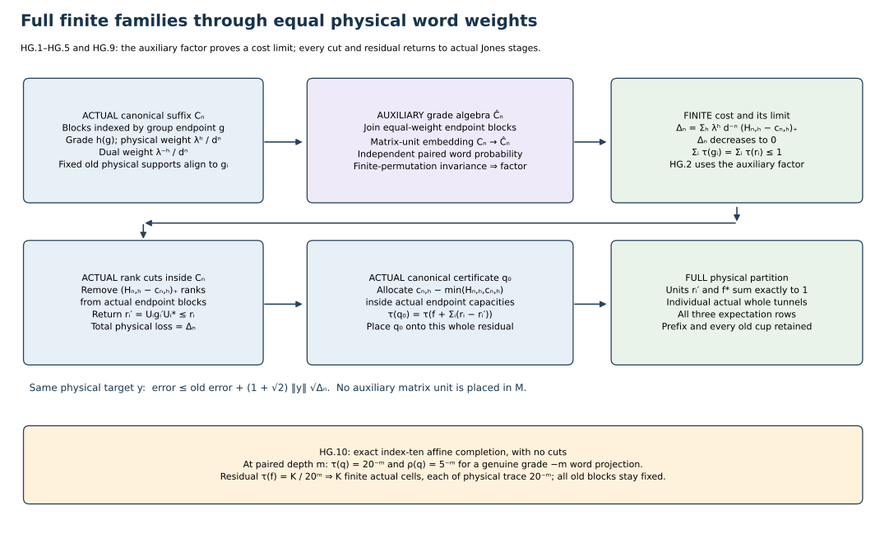

Figure HG.1. The upper arrows are the matrix-unit embedding into the auxiliary equal-weight algebra and its finite scalar capacity calculation, HG.1–HG.2. The displayed \(\lambda^h\) is the WM integer-character case of the general positive-character construction HG.9. The lower arrows are actual endpoint-block rank cuts, actual canonical certificate allocation, finite-factor physical placement, and full supported Jones rows, HG.3–HG.4. The extra auxiliary off-endpoint matrix units are never placed in \(M\). All original prefixes, cups and physical targets are retained as stated; the physical norm error is HG.14. The bottom panel is the exact index-ten construction HG.10, with both finite traces written separately. Boxes and arrows are schematic and encode no trace mass or geometric distance. [Reproducible figure and exact checks](figures/equal-weight-full-family-v19.py). Human context: Popa's Theorem 4.4.1(1), printed p.222, cited below.

### Exact boundary of the result

HG.1–HG.5 prove a controlled full-family construction for the complete actual weighted diagonal family, including irrational parameters and nonfactor ordinary cores. HG.6–HG.8 improve this to exact old-family retention at the original rational WM.22 parameter. HG.9 proves the full construction for every actual finite diagonal trace-character tower with proved amenability. HG.10 supplies an exact unchanged-family completion in the physical affine index-ten inclusion. These settle the full finite-family issues at their stated actual inclusion scopes, rather than infer them from zero-cost states or leave them as supplied certificates.

This special-case construction does not prove the unrestricted GTB.0–GTB.1 theorem for arbitrary amenable proper finite-index inclusions; the later Corollary POR.5 supplies that theorem. The construction used actual word coordinates with trace-character grades and equal physical weights across its endpoint blocks; no such grouping has been proved for a general standard invariant. Its extra matrix units were used only to prove the finite numerical cost limit, and the cuts/residual were explicitly returned to the actual physical algebras. Neither its auxiliary factor nor its finite trace monoid proves original common-support BF, localization when both capacities are infinite, the second central local form, original zero-cost state existence, finite-pair/cup matching, represented/opposite-model identification, arbitrary-depth reconstruction or prerequisite closure. Common-stage and generating claims retain their full original strong-amenability/ergodic-core hypotheses. At WM.22, the actual ordinary cores remain nonfactor and the existing nongeneration result remains valid.

The complete preceding providers are WM.1–WM.17 and WM.22 of this lesson, [Supported frames give local approximation corners](actual-supported-local-approximation.md), §57.3; [Whole relative-commutant blocks with a small residual corner](whole-relative-commutant-blocks.md), §76.4; [Exact trace certificates close the finite-depth residual](trace-certificates-and-exact-finite-partitions.md), §§78.1–78.2; and [Central capacity and small cuts of whole-tunnel supports](central-capacity-and-small-support-cuts.md), §§80.1–80.4. The new grade-factor proof, grade-wise physical return, and positive digit construction are supplied above. Human mathematical context: Sorin Popa, *Classification of amenable subfactors of type II*, Acta Mathematica **172** (1994), 163–255, [DOI](https://doi.org/10.1007/BF02392646), §1.3, §2.3, §3.1.3(b), and Theorem 4.4.1(1), printed p.222.

## The full endpoint tail of the fixed weighted three-dimensional lamplighter inclusion

The final lamp configuration generates the entire endpoint tail of the
original alternating walk at WM.22. This includes the central integer
coordinate, the actual group relations, and bounded harmonic families that
vary with depth. Consequently the original five likelihoods are the full
configuration-boundary likelihoods, rather than conditional likelihoods on
a smaller observable. The proof below does not construct a zero-cost
invariant state or a positive invariant-state floor.

### FWT.1. The actual group, parameter and two probabilities

Write \(C_{\mathrm{fin}}=\bigoplus_{\mathbb Z^3}\mathbb F_2\), and use the
actual group
\[
 H=\{(c,v,m)\in C_{\mathrm{fin}}\times\mathbb Z^3\times\mathbb Z:
             m\equiv\sum_xc(x)\pmod2\},
 \qquad
 (c,v,m)(e,w,r)=(c+\operatorname{shift}_v e,v+w,m+r).
 \tag{FWT.1}
\]
Here \((\operatorname{shift}_v e)(x)=e(x-v)\). The labels are
\[
 s_0=1,\qquad s_1=(\delta_0,0,1)=az,\qquad
 s_{j+1}=(0,e_j,0)=t_j\quad(1\le j\le3).
 \tag{FWT.2}
\]
Thus all lamp involution, commutation, translation and central relations
are retained. In particular \(s_1^2=z^2=(0,0,2)\); \(s_1\) itself is not
an involution in \(H\). These labels generate \(H\): translate \(s_1\) to
each desired lamp, then correct the remaining even central integer by
powers of \(s_1^2\).

Throughout this proof the parameter is exactly
\[
 L=257^2+2=66051,\quad b=\tfrac12\,25^{-L},\quad
 J=(4096/b)^2=2^{26}25^{132102},\quad
 \lambda=1+\frac b{16J}=1+2^{-31}25^{-198153}.
 \tag{FWT.3}
\]
The ceiling in WM.22 does not change \(J\), since the displayed square is
already an integer. Put
\[
 \nu=(1,\lambda,1,1,1),\quad S_+=4+\lambda,\quad
 S_-=4+\lambda^{-1},\quad d=S_+S_-,
 \qquad w_i^+=\frac{\nu_i}{S_+},\quad
 w_i^-=\frac{\nu_i^{-1}}{S_-}.
 \tag{FWT.4}
\]
Independent raw choices alternate: plus uses \(s_i\) with \(w_i^+\),
minus uses \(s_i^{-1}\) with \(w_i^-\). Products are right products.
For either initial phase write \(G_j=(C_j,V_j,M_j)\) for the full endpoint
after \(j\) raw choices. The physical trace character remains
\(\chi(c,v,m)=\lambda^m\).

### FWT.2. Drift and the configuration boundary

Pair increments are independent and identically distributed in either
initial phase. Their means in the additive coordinates are
\[
 \frac{V_{2n}}n\longrightarrow
 \delta(1,1,1),\qquad
 \frac{M_{2n}}n\longrightarrow\kappa,\qquad
 \delta=\frac1{S_+}-\frac1{S_-}
       =\frac{\lambda^{-1}-\lambda}{d}<0,\qquad
 \kappa=\frac{\lambda}{S_+}-\frac{\lambda^{-1}}{S_-}
       =\frac{4(\lambda-\lambda^{-1})}{d}=-4\delta>0.
 \tag{FWT.5}
\]
For the height \(h(v)=v_1+v_2+v_3\), put \(\gamma=3\delta<0\).
Raw intermediate positions and central integers differ from their adjacent
pair positions by at most one in each relevant coordinate.

Here is the elementary convergence argument needed for FWT.5. For any
centered bounded real pair increment \(Y\), the Taylor remainder gives
\(\mathbb E e^{\theta Y}\le e^{C\theta^2}\) when \(|\theta|\le1\), with a
finite constant \(C\) depending only on the increment bound. Independence
and Markov's inequality imply
\(\mathbb P(|\sum_{j\le n}Y_j|>\epsilon n)\le2e^{-c_\epsilon n}\).
The union bound shows that the probability of any failure after time \(N\)
tends to zero. Intersecting over positive rational \(\epsilon\) proves
the almost sure limits for the three spatial coordinates and the central
coordinate. This argument works for the exact positive value in FWT.3;
no quantitative lower bound on its size is required.

Negative height drift implies that the raw path visits any given upper
halfspace only finitely often. Each lamp therefore stabilizes, and
\[
 \eta(x)=\lim_{j\to\infty}C_j(x)
 \tag{FWT.6}
\]
exists simultaneously for all \(x\). Its restriction to
\(\{x:h(x)\ge q\}\) is finite for every integer \(q\).
Let \(\mathcal B\) be the set of all configurations with this last
property, equipped with its coordinate sigma algebra. It is a Borel
subset of the countable product \(\mathbb F_2^{\mathbb Z^3}\), since
finiteness in any fixed halfspace is a countable union of conditions
bounding the number of lit coordinates. Thus it is a standard measurable
space.

The actual action by measurable bijections is
\[
 (c,v,m)\eta=c+\operatorname{shift}_v\eta,\qquad
 H\times\mathcal B\longrightarrow\mathcal B.
 \tag{FWT.7}
\]
Finite lamps and translations preserve \(\mathcal B\); the central
integer acts trivially on this space. For the suffix variable formed
from the unused raw choices, with the next phase and identity starting
point, the exact identity is
\[
 \eta=C_j+\operatorname{shift}_{V_j}\eta^{(j)}=G_j\eta^{(j)}.
 \tag{FWT.8}
\]
The suffix is independent of the prefix and has its original phase law.
This identity by itself is only a boundary factor. The following estimates
prove that there is no further endpoint tail.

### FWT.3. A ray retaining the full central integer

Give \(H\) the symmetric word metric for
\(s_1^{\pm1},t_1^{\pm1},t_2^{\pm1},t_3^{\pm1}\). Its radius-\(r\)
ball has at most \(11^{\lceil r\rceil+1}\) elements. This deliberately
loose bound follows by counting words in these eight letters, including
all lengths from zero.

Set \(\alpha_n=\lfloor\gamma n\rfloor\). Choose \(v_n\in\mathbb Z^3\)
by rounding each coordinate of \(\delta n(1,1,1)\) to a nearest integer,
using a fixed rule for ties. For \(\eta\in\mathcal B\), define
\[
\begin{aligned}
 c_n(\eta)&=\eta\,1_{\{h\ge\alpha_n\}},\\
 p_n(\eta)&=\sum_xc_n(\eta)(x)\pmod2,\\
 m_n(\eta)&=\text{the nearest integer to }\kappa n\\
          &\qquad\text{ congruent to }p_n(\eta)\pmod2,\\
 \Pi_n(\eta)&=(c_n(\eta),v_n,m_n(\eta))\in H.
\end{aligned}
 \tag{FWT.9}
\]
Use the smaller integer in a tie for \(m_n\). The sum is finite,
\(|m_n-\kappa n|\le1\), and this is a measurable \(H\)-valued map.
It respects the exact parity relation, rather than projecting to the
lamplighter quotient.

Fix \(0<\epsilon<1/2\), and put
\[
 k=\lfloor(1-\epsilon)n\rfloor,\qquad
 l=\lceil(1+\epsilon)n\rceil,\qquad A_n=l-k\le2\epsilon n+2.
 \tag{FWT.10}
\]
Almost surely, for every sufficiently large \(n\), all raw positions
before time \(2k\) have height at least \(\alpha_n\), and all raw
positions after time \(2l\) have height below \(\alpha_n\). To check the
uniform assertion, bound the height error at pair time \(r\), for all
large \(r\), by \(a r\), where \(a=|\gamma|\epsilon/4\).
For \(r\le k\), the lower bound \((\gamma-a)r\) is at least
\((\gamma-a)k>\gamma n\) with a positive multiple of \(n\) to spare.
The finitely many earlier positions also exceed \(\alpha_n\) eventually.
For \(r\ge l\), the upper bound \((\gamma+a)r\) is at most
\((\gamma+a)l<\gamma n\), again with a positive multiple of \(n\)
to spare. Rounding and the raw intermediate error are bounded and
are absorbed in these strict margins.

Consequently
\(C_{2n}+c_n(\eta)\), with addition in \(\mathbb F_2\), is exactly the
configuration obtained from these selected toggles in the raw window
\((2k,2l]\):

* at times at most \(2n\), select the toggles below height \(\alpha_n\);
* at times greater than \(2n\), select the toggles at or above that height.

All earlier toggles are retained by both configurations and cancel; all
later toggles are retained by neither. Repeated toggles cancel in this
statement as well. There is no estimate based on the number of all lamps
in the truncated halfspace.

We now construct a word for \(G_{2n}^{-1}\Pi_n(\eta)\). Work in spatial
coordinates relative to \(V_{2n}\). First follow the raw spatial path
backwards from time \(2n\) to \(2k\), omitting toggles. Next follow the
spatial path forward from \(2k\) to \(2l\), inserting \(s_1\) at just
the selected toggles. Finally return from \(V_{2l}\) to \(v_n\).
The three spatial parts and the selected toggles require at most
\[
 2(n-k)+2(l-k)+2(l-n)+\|V_{2n}-v_n\|_1
 =4A_n+o(n)
 \tag{FWT.11}
\]
letters, almost surely. The last part can first reverse the displacement
from time \(2n\) to \(2l\), then join \(V_{2n}\) to \(v_n\).
This word produces exactly the relative lamp configuration
\(\operatorname{shift}_{-V_{2n}}(C_{2n}+c_n(\eta))\) and relative
spatial position \(v_n-V_{2n}\).

Let \(u\) be its central integer. There are at most \(2A_n\) selected
toggles, so \(0\le u\le2A_n\). The desired central integer is
\(m_n(\eta)-M_{2n}=o(n)\). The difference between the desired integer
and \(u\) is even: both triples lie in the actual group \(H\) and have
the same lamps and spatial position. Correct it by a power of
\(z^2=s_1^2\), or its inverse, using exactly the absolute value of this
even difference in letters. Centrality ensures that the correction
does not change any lamp or spatial coordinate. We obtain
\[
 \bigl|G_{2n}^{-1}\Pi_n(\eta)\bigr|
 \le6A_n+o(n)\le12\epsilon n+12+o(n).
 \tag{FWT.12}
\]
This controls the actual central integer, including its fluctuations and
parity. It does not infer central maximality from a proof for the
projected walk.

### FWT.4. Conditional endpoint entropy is sublinear

For either initial phase, a pair has 25 possible marked values.
Thus \(G_{2n}\) has at most \(25^n\) possible values. For fixed
\(\epsilon\), FWT.12 implies that the event
\[
 A_n^\epsilon=
 \{|G_{2n}^{-1}\Pi_n(\eta)|\le13\epsilon n\}
 \tag{FWT.13}
\]
has probability tending to one. On this event, conditional on \(\eta\),
the endpoint belongs to
\(\Pi_n(\eta)B_{\lceil13\epsilon n\rceil}\): inversion of the relative
word does not change its length. On its complement the total endpoint
alphabet remains bounded by \(25^n\).

Introduce the indicator of \(A_n^\epsilon\) in the conditional entropy
chain rule. Its entropy is at most \(\log2\). Conditional entropy of a
variable with at most \(m\) possible values is at most \(\log m\);
this follows from nonnegativity of relative entropy to the uniform
distribution. Therefore, with natural logarithms,
\[
 H(G_{2n}\mid\eta)
 \le\log2+(13\epsilon n+2)\log11
        +\mathbb P((A_n^\epsilon)^c)n\log25.
 \tag{FWT.14}
\]
First divide by \(n\) and take the upper limit, then let
\(\epsilon\downarrow0\). The result is
\[
 H(G_{2n}\mid\eta)=o(n)
 \tag{FWT.15}
\]
for the actual full \(H\)-endpoint, in both original phase laws.

### FWT.5. Apply the complete marked-tail criterion

The complete criterion is proved in [A finite-marked-step entropy criterion, with its full proof](#ab-4-a-finite-marked-step-entropy-criterion-with-its-full-proof), AB.4 of this lesson. It applies to independent finite marks \(Q_i\), a countable group endpoint \(Z_n\), and a standard measurable boundary variable \(\xi=Z_n\xi^{(n)}\), where the suffix has the original law and is independent of the prefix. If \(H(Z_n\mid\xi)=o(n)\), its conclusion is the entire completed marked endpoint tail

\[
 \bigcap_n\sigma(Z_n,Q_{n+1},Q_{n+2},\ldots)=\sigma(\xi).
\]

Its proof retains choices with the same group increment, uses the exact finite-prefix entropy identities, decreasing conditional projections and equality in finite entropy concavity, then increasing-prefix density. Thus it covers the complete marked tail, including bounded harmonic families that vary with depth. The original WM walk satisfies every hypothesis: its pair marks are iid and finite, \(H\) is countable, \(\mathcal B\) is standard measurable, FWT.8 gives the independent same-law suffix identity, and FWT.15 supplies the proved entropy bound. The application follows.

### FWT.6. Entire endpoint tail and all bounded harmonic families

Apply the lemma with one marked pair \(Q_n=(i_{2n-1},i_{2n})\),
not just its possibly repeated endpoint increment. Both original phases
give iid pair marks. FWT.8 supplies the required suffix identity;
FWT.15 supplies its proved entropy hypothesis. We conclude
\[
 \bigcap_n\sigma(G_{2n},Q_{n+1},Q_{n+2},\ldots)
       =\sigma(\eta)
 \quad\text{modulo the original phase null sets.}
 \tag{FWT.21}
\]
In the raw endpoint tail, each future raw label is recovered from
\(G_{j-1}^{-1}G_j\), because the five labels in either phase are
distinct elements of the actual \(H\). Conversely an endpoint and the
future marks determine every subsequent endpoint. Pair times are
cofinal. Thus
\[
 \bigcap_j\sigma(G_j,G_{j+1},G_{j+2},\ldots)=\sigma(\eta).
 \tag{FWT.22}
\]
In particular central integer fluctuations, hidden choices inside a
pair, and time-dependent endpoint martingales leave no extra tail field.

For example any uniformly bounded space-time harmonic family, evaluated
along this walk, is a bounded martingale. Its \(L^2\) limit lies in
every endpoint-future sigma algebra, since every sufficiently late
term does. FWT.22 makes that limit \(F(\eta)\), and the original
martingale is exactly its conditional expectations on the prefixes.
This applies to the actual accessible states at every depth and does
not assume that the family is stationary in depth.

Let \(m_V=\operatorname{Law}_+(\eta)\) and
\(m_U=\operatorname{Law}_-(\eta)\). The original prefix conditioning
gives
\[
 m_V=\sum_iw_i^+(s_i)_*m_U,\qquad
 m_U=\sum_iw_i^-(s_i^{-1})_*m_V.
 \tag{FWT.23}
\]
The identity labels show that the two measures are equivalent, with
bounded ratios; the other labels and their inverses show that every
\(g\in H\) acts nonsingularly on this common measure class.

Every bounded stationary harmonic pair has the unique representation
\[
 u_+(g)=\int_{\mathcal B}F(g\eta)\,dm_V(\eta),\qquad
 u_-(g)=\int_{\mathcal B}F(g\eta)\,dm_U(\eta).
 \tag{FWT.24}
\]
To justify the common \(F\), take the martingale limit at the identity
and use FWT.22. Every \(g\in H\) is an endpoint of a positive-probability
even prefix: for a plus-starting pair, \((i,0)\) realizes \(s_i\)
and \((0,i)\) realizes \(s_i^{-1}\); for a minus-starting pair these
realizations are reversed. Conditioning on such a prefix, stationarity
in depth identifies the limit for a walk started at \(g\) with
\(F(g\eta)\). The positive-probability identity raw step relates the two
initial phases. Measure equivalence makes their representatives agree.
Conversely FWT.23 directly verifies both harmonic equations in FWT.24.
The representation is injective because conditional prefix expectations
converge to \(F(\eta)\). It preserves positivity and the supremum norm:
the upper norm bound follows from integration, and the lower bound
follows from this martingale convergence. This proves the full bounded
harmonic identification, as well as the stronger tail statement.

### FWT.7. Return to the actual two tracial AF core centers

WM.12 identifies each actual finite relative commutant with
\[
 D_j^\sigma=\operatorname{span}\{E_{IJ}:g(I)=g(J)\},
 \tag{FWT.25}
\]
and appending a raw label is its actual inclusion. No endpoint
commutants are merged by height or central grade. WM.13 gives each
minimal word projection its original product probability, and WM.14
retains the opposite original finite-module trace. At length \(2n\)
these weights are respectively \(\lambda^{M_{2n}}/d^n\) and
\(\lambda^{-M_{2n}}/d^n\). The compatible physical compressions and
all prescribed prefix cups are the existing WM.9–WM.15 maps.

Here is the center-tail identification at the actual tracial completion.
The word diagonal identifies with the independent raw-label probability
space. If \(x\) is central in the completed AF algebra, its trace
expectation \(x_j\) onto \(D_j^\sigma\) is central there, by bimodularity
of trace expectation. Thus \(x_j\) is scalar on each full endpoint
block. These expectations converge in \(L^2\) to \(x\), since the
finite algebras have dense union. Their diagonal representatives
therefore have a bounded diagonal limit \(f\).
For any fixed \(r\) and all \(j\ge r\), an endpoint function at time
\(j\) is measurable with respect to
\(\sigma(G_r,\text{future labels})\). The \(L^2\) limit \(f\) is
measurable there as well. Hence every central element lies in the
completed endpoint tail.

Conversely, if bounded \(f\) belongs to that tail, then for each \(j\)
it is a function of \(G_j\) and the unused independent labels.
Its conditional expectation given the complete prefix is therefore
constant on all prefixes with the same full endpoint. Put these
constants on the endpoint blocks in \(D_j^\sigma\). They form bounded
compatible trace martingales and converge in \(L^2\) to an actual
element of the completion. All sufficiently late elements commute with
any fixed finite algebra, so the limit is central. This establishes an
onto normal, trace-preserving identification with the entire tail,
rather than a claim about a stationary subalgebra.

Combining this fact with FWT.22 proves
\[
 V=Z(R)\cong L^\infty(\mathcal B,m_V),\qquad
 U=Z(S)\cong L^\infty(\mathcal B,m_U).
 \tag{FWT.26}
\]
These maps send each actual lamp unitary \(Z_x^\pm\) of C13.3 to
\((-1)^{\eta(x)}\), so they are the canonical lamp maps already
constructed there, now proved onto. Transport through the actual
normal \(\zeta_U,\zeta_V\) of C13.10 identifies the whole coefficient
center \(Z(W)\) with this common measure-class algebra.
The action is precisely
\(\beta_gF=F\circ g^{-1}\). This also reproves the whole-center
identity \(\beta_{z^2}=1\), consistently with E14.5. It does not change
the physical trace-scaling action \(\alpha_{z^2}\), whose character
is still \(\lambda^2\).

### FWT.8. All five original likelihoods on the full center

The original two normal center measures are now exactly
\(\mu_U=m_U,\mu_V=m_V\) in these coordinates. For every bounded
measurable \(F\), conditioning on the actual first physical branch gives
\[
 \int R_iF\,dm_V
       =w_i^+\int F(s_i\eta)\,dm_U(\eta),\qquad
 R_i=w_i^+\frac{d(s_i)_*m_U}{dm_V},\qquad 0\le i\le4.
 \tag{FWT.27}
\]
These are equalities against every element of the full center.
They identify the original \(R_i=\zeta_V(E_V(p_i))\) of C13.14,
with the existing uniform bound \(R_i\ge1/d\).
The original normal derivative convention is accordingly
\[
 D_g=\frac{d g_*m_U}{dm_U},\qquad
 D_i=\frac{R_i}{\nu_iR_0}.
 \tag{FWT.28}
\]
Indeed the identity branch of FWT.27 gives
\(dm_U/dm_V=R_0/w_0^+\). Nothing in FWT.27 replaces the full
derivative by its conditional expectation on the height or affine
observable.

There is also an exact finite endpoint-count description. Let
\(N_j^\sigma(g)\) count the raw words of length \(j\), beginning in
phase \(\sigma\), whose endpoint is the full triple \(g\in H\).
For each attainable endpoint \(g\) at plus length \(2n\),
\[
 r_{i,n}(g)=
 \frac{N_{2n-1}^-(s_i^{-1}g)}{N_{2n}^+(g)}.
 \tag{FWT.29}
\]
All words with this endpoint have the same physical probability
\(\lambda^{m(g)}/d^n\); this is why the original unequal branch
weights cancel in this counting ratio. Future marks are independent
of the first branch and the current endpoint. Thus FWT.29 is exactly
the conditional first-branch probability on the decreasing endpoint
future algebra. By the decreasing \(L^2\) projection argument of AB.4,
\[
 r_{i,n}(G_{2n})\longrightarrow R_i(\eta)
       \quad\text{in }L^2(\mathbb P_+).
 \tag{FWT.30}
\]
Here \(\mathbb P_+\) is the original plus-starting raw-path probability;
the finite endpoint functions need not themselves be boundary-measurable.
Equations FWT.27 and FWT.29–FWT.30 identify the full original five
likelihoods using actual finite endpoint multiplicities and actual
physical trace weights. A singular state is not asserted to preserve
the \(L^2\) limit in FWT.30.

### FWT.9. What this proves about the fixed original state problem

For any actual \(H\)-invariant state \(\omega\) on this full
\(L^\infty\) algebra, including every singular state, C13's physical
return retains the original \(\tau,E_A,P_0\), both original canonical
traces and their five branch normalizations. The exact formulas remain
\[
 \|\alpha-\alpha P_0\|
   =\sum_{i=0}^4\omega(|R_i-w_i^+|),\qquad
 C_\omega=\psi_\omega(\mathfrak a)
   =\sum_{i=0}^4\omega\left(\left|R_i^{-1}-(w_i^+)^{-1}\right|\right),
 \tag{FWT.31}
\]
and
\[
 \sum_i\omega(R_i^{-1})=d,\qquad
 \sum_i\omega\left(\frac{(R_i-w_i^+)^2}{(w_i^+)^2R_i}\right)
  =S_+^2(1-\lambda^{-2})\bigl(w_1^+-\omega(R_1)\bigr).
 \tag{FWT.32}
\]
Hence zero original cost is equivalent to an invariant state attaining
\(\omega(R_1)=w_1^+\). A strictly positive invariant-state floor
requires proving that the supremum over these full-center invariant
states is strictly smaller than \(w_1^+\).

The full-tail theorem does not decide this optimization. In particular
normal \(L^2\) approximation in FWT.30 cannot be evaluated by an
arbitrary singular state. Nor does the height-conditioned construction
provide an invariant state: its actual likelihood means are
\[
 u_0=(1+4\lambda)^{-1},\qquad
 u_i=\lambda(1+4\lambda)^{-1}\ (1\le i\le4),
 \tag{FWT.33}
\]
with deviation at least
\(6(\lambda^2-1)/[(1+4\lambda)(4+\lambda)]\).
More decisively T15.18–T15.20 proves that every such limiting
height-conditioned state has actual origin-lamp expectation greater
than \(b/2>0\). Actual lamp-flip invariance forces that expectation
to be zero. Identification with the full configuration center leaves
this defect in force.

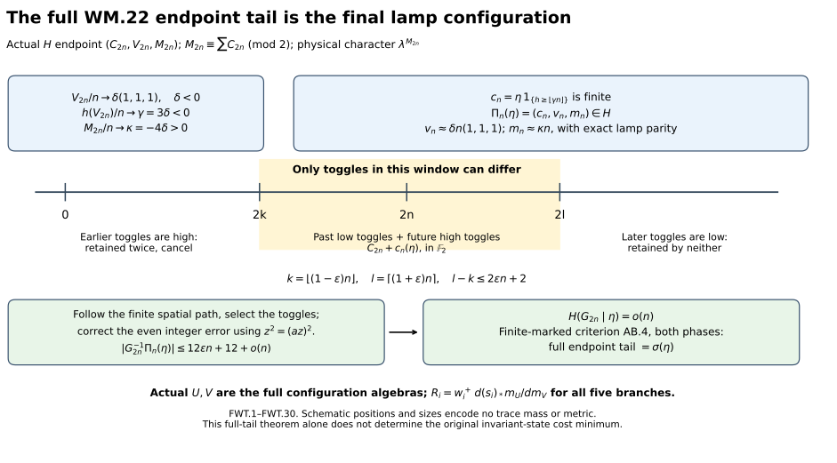

Figure FWT. The original full endpoint, its trace character and parity,
and both original probabilities are retained. FWT.9–FWT.12 bounds the
selected-toggle word and its even central correction. FWT.14–FWT.22
proves the complete marked-tail conclusion, which returns to the actual
core centers and all five likelihoods in FWT.25–FWT.30. Positions,
window lengths and box areas are schematic and encode no metric or trace
mass. [Reproducible figure source](figures/full-weighted-endpoint-tail-v20.py).

Thus the completed result is the actual full endpoint tail, both actual
core centers, all bounded harmonic families and all five original
likelihoods. The exact original invariant-state endpoint remains a
further obligation; neither a zero-cost state nor a positive state
floor is claimed here.

### Mathematical context and complete providers

The complete finite-mark entropy criterion is [A finite-marked-step entropy criterion, with its full proof](#ab-4-a-finite-marked-step-entropy-criterion-with-its-full-proof), AB.4 of this lesson. The full central-integer ray FWT.3 and its actual WM application are proved above. The actual endpoint matrices, compatible physical compression, original expectations and two traces are WM.1–WM.15 of this lesson; the original joint-center return and cost formulas are C13.3–C13.6; the whole-center central relation and singularity are E14.1–E14.5; the height-state defect is T15.18–T15.20. FWT.25–FWT.30 now identifies the entire actual WM centers, rather than only their lamp subalgebras.

Human mathematical context: Vadim A. Kaimanovich, *The Poisson formula for groups with hyperbolic properties*, Annals of Mathematics **152** (2000), 659–692, §§4–5, especially the finite-prefix entropy and ray methods; [author manuscript, arXiv:math/9802132v2](https://arxiv.org/pdf/math/9802132). The complete ray, entropy application and actual center return used here are proved above.

## Equal numerical weights need not give a compatible auxiliary tower

The auxiliary construction HG.1–HG.10 has an exact feature beyond equality of finite trace weights: equal-grade projections have the same multiplicities into each later grade. An arbitrary actual Jones system need not have that feature. Here an explicit proper index-four inclusion, with a generating marked tunnel and full all-smooth amenability, disproves its automatic availability. Its two inherited finite traces agree. The obstruction persists across every positive finite gap, so passing to a subsequence does not repair this particular grouping.

This is a counterexample to a proposed general construction step. It is not a counterexample to the original full finite-family theorem. The example has finite depth, and 78.6 supplies its full finite family. We also prove an unconditional estimate for arbitrary proper finite-index inclusions: their largest physical minimal-projection weights decay geometrically. That estimate gives quantitative finite subprojection prescription, but it does not give an exact residual trace or compatible auxiliary embeddings.

### An explicit finite action and its fixed factors

Let \(G=\langle r,s:r^5=s^2=1,\ srs=r^{-1}\rangle\), the group of ten elements, and put \(\zeta=e^{2\pi i/5}\). On \(V=\mathbb C^2\), with basis \(e_+,e_-\), use

\[
 u_r=\begin{pmatrix}\zeta&0\\0&\zeta^{-1}\end{pmatrix},
 \qquad
 u_s=\begin{pmatrix}0&1\\1&0\end{pmatrix}.
 \tag{GW.1}
\]

These matrices obey the displayed relators. No nonidentity \(u_g\) is scalar. Let

\[
 R=\left(\bigotimes_{j\ge1}\operatorname{End}(V)\right)'',
 \qquad
 \alpha_g=\bigotimes_{j\ge1}\operatorname{Ad}u_g,
 \qquad \tau_R=\bigotimes_{j\ge1}\operatorname{tr}_2.
 \tag{GW.2}
\]

All closures in this module are the faithful tracial von Neumann closures. Finite full-matrix expectations make \(R\) a II₁ factor: they approximate every central element by scalar elements, while the unbounded matrix sizes exclude finite type I.

For each \(g\ne1\), choose a rank-one projection \(p_g\in\operatorname{End}(V)\) with \(u_gp_gu_g^*\ne p_g\). Its translate in coordinate \(j\) has a fixed strictly positive \(L^2\) displacement. If \(\alpha_g=\operatorname{Ad}v\) in \(R\), approximate \(v\) by a finite-prefix element \(a\). For later \(j\), that element commutes with \(p_g^{(j)}\), and

\[
 \|\alpha_g(p_g^{(j)})-p_g^{(j)}\|_2
 \le 2\|v-a\|_2.
 \tag{GW.3}
\]

This contradicts arbitrarily good approximation. Thus the action is outer. The same proof applies after adjoining any finite number of \(V\) legs, and to every infinite tail.

We need irreducibility of the fixed algebra in its coefficient factor, not merely factoriality. It has a short proof for this actual action.

**Lemma GW.1.** For every infinite \(V\)-tensor tail \(R_0\), and also after any finite initial \(V\)-tensor amplification, \((R_0^G)'\cap R_0=\mathbb C1\).

**Proof.** First omit the finite amplification, which only shifts the indices. Write \(F_m=\operatorname{End}(V^{\otimes m})\), and \(U_g^{(m)}=u_g^{\otimes m}\). The fixed finite algebra is the commutant of \(U(G)\), so its commutant inside \(F_m\) is the algebra spanned by the \(U_g^{(m)}\). This follows by decomposing the finite unitary representation into its irreducible multiplicity spaces; it is the ordinary finite matrix mutual-commutant calculation.

If \(x\in(R_0^G)'\cap R_0\), its finite expectation \(E_m(x)\) commutes with \(F_m^G\) and consequently has an expansion

\[
 E_m(x)=\sum_{g\in G}c_{m,g}U_g^{(m)}.
 \tag{GW.4}
\]

The normalized Hilbert–Schmidt Gram matrix of these ten operators has entries \(\operatorname{tr}_2(u_g^*u_h)^m\). For \(g\ne h\), the absolute value of the underlying trace is strictly below one: equality for a two-dimensional unitary would make \(u_g^*u_h\) scalar, which GW.1 excludes. Thus the Gram matrices converge to the identity. Their least eigenvalues are at least \(1/2\) for sufficiently large \(m\), and every coefficient vector in GW.4 then has Euclidean norm at most \(\sqrt2\|x\|\).

For fixed \(a<m\), restriction to \(F_a\) gives

\[
 E_a(x)=c_{m,1}1+
 \sum_{g\ne1}c_{m,g}\operatorname{tr}_2(u_g)^{m-a}U_g^{(a)}.
 \tag{GW.5}
\]

The nonidentity sum tends to zero. The fixed left side is therefore scalar. This holds for every \(a\), and finite expectations converge in \(L^2\); hence \(x\) is scalar. The finite-amplification proof uses the same Gram matrices at the total finite length and is identical. \(\square\)

The finite-group index proof 18.4 now applies to this outer action. Each fixed algebra is a II₁ factor, and \([R:R^G]=10\). All expectations are the actual group averages and normalized partial matrix traces.

### A marked ordinary Jones tunnel of index four

In one infinite tensor product, give the matrix coordinates labels \(0,1,2,\ldots\). Put

\[
 M=\left(\bigotimes_{j\ge0}\operatorname{End}(V_j)\right)^G,\qquad
 N_k=\left(1_0\otimes\cdots\otimes1_k\otimes
             \bigotimes_{j\ge k+1}\operatorname{End}(V_j)\right)^G.
 \tag{GW.6}
\]

Thus \(N=N_0\subsetneq M\). The diagonal action on each coefficient factor is the actual product action above. If \(F\) is the tail coefficient factor, then

\[
 [F\otimes M_2:F^G]=40,\qquad
 [F\otimes M_2:(F\otimes M_2)^G]=10,
 \qquad [(F\otimes M_2)^G:F^G]=4.
 \tag{GW.7}
\]

The first equality uses the tensor index \(4\) and 18.4; the second uses the outer amplified action; the third is index multiplicativity. Every consecutive inclusion in GW.6 therefore has index four.

The invariant unit vector

\[
 \Omega=\frac{e_+\otimes e_-+e_-\otimes e_+}{\sqrt2},
 \qquad e_j=|\Omega\rangle\langle\Omega|_{V_j\otimes V_{j+1}},
 \tag{GW.8}
\]

is fixed by \(u_g\otimes u_g\). Its normalized partial trace on either leg is \(1/4\) times the identity. Matrix multiplication gives, for \(x\) in the middle fixed factor,

\[
 e_jxe_j=E_{\mathrm{lower}}(x)e_j,\qquad
 E_{\mathrm{middle}}(e_j)=\tfrac14 1,\qquad
 e_je_{j+1}e_j=\tfrac14 e_j.
 \tag{GW.9}
\]

For example, the compression is \(\operatorname{tr}_2\) on the leg adjoining the tail. For an invariant \(x\) its partial trace is in the lower fixed algebra, so this is the actual expected compression, not just a numerical cup rank.

Here is the recognition argument that also verifies full generation. Suppose II₁ factors \(P\subset Q\subset L\) have both consecutive indices \(d\), and \(e\in L\) satisfies the Jones compression for \(P\subset Q\) and \(E_Q(e)=d^{-1}1\). Choose the partial orthonormal basis \(v_i\) of 3.2, with \(E_P(v_i^*v_j)=\delta_{ij}p_i\), \(v_i=v_ip_i\), and \(\sum_i v_iv_i^*=d1\). The element \(p=\sum_i v_ie v_i^*\) is a projection by these identities and has trace one. Thus \(p=1\). The finite matrix formula

\[
 [a_{ij}]\longmapsto\sum_{i,j}v_i a_{ij}e v_j^*,
 \qquad
 [a_{ij}]\in \operatorname{diag}(p_i)M_t(P)\operatorname{diag}(p_i),
 \tag{GW.10}
\]

is a normal unital *-homomorphism; multiplication uses \(ea e=E_P(a)e\). Trace pairing gives exactly \(d^{-1}\) times the canonical basic-construction trace. It is faithful, and its image is the algebra generated by \(Q,e\), because the basis expansion puts every \(q\in Q\) in that image. This image is the actual basic construction of \(P\subset Q\), of index \(d\) over \(Q\). Its inclusion into \(L\) has index one by multiplicativity, so it equals \(L\).

Apply this argument with \(d=4\), GW.7–GW.9. Every triple \(N_{j+1}\subset N_j\subset N_{j-1}\), with \(N_{-1}=M\), is the actual basic construction with the specified cup \(e_j\). In particular GW.6 is an ordinary marked tunnel, preserving both normalized factor traces and all cup expectations.

By Lemma GW.1 and the finite coefficient expansion over the first tensor legs, its finite relative commutants are exactly

\[
 A_k=N_k'\cap M=\operatorname{End}_G(V^{\otimes(k+1)}),\qquad
 C_k=N_k'\cap N=\operatorname{End}_G(V^{\otimes k}).
 \tag{GW.11}
\]

For instance, commuting with the fixed infinite tail forces every tail coefficient to be scalar; invariance then imposes commutation with \(u_g^{\otimes k}\). All embeddings \(C_k\subset C_{k+1}\) are the actual \(x\mapsto x\otimes1_V\).

The finite invariant prefix algebras generate their fixed infinite factors: finite expectations commute with the group average and converge in \(L^2\). Hence this tunnel is generating, with \((\bigcup A_k)''=M\) and \((\bigcup C_k)''=N\).

### Full all-smooth amenability of this physical inclusion

We verify the two precise hypotheses of 61.6 rather than assume an unrestricted generating-to-amenable equivalence. The upward tower is the other end of the same tensor construction:

\[
 M_j=\left(F\ \bar\otimes\
                 \operatorname{End}(V)^{\otimes(j+1)}\right)^G
 \quad(j\ge0),\qquad
 \mathcal T=(F\bar\otimes K)^G,
 \tag{GW.12}
\]

where \(F\) is the original infinite coefficient tail and \(K\) is a second infinite product of \(V\) legs. GW.7–GW.10 prove the actual upward basic constructions, with the same marked cups and normalized traces. Finite tensor expectations followed by group averaging show that their tracial closure is the displayed \(\mathcal T\).

Increasing finite-dimensional invariant tensor prefixes generate each \(M_j\) and \(\mathcal T\). Compress an operator on the standard tracial space onto the standard space of a finite prefix, and average conjugation by its right unitary group. The resulting UCP map takes values in the left finite algebra and sends left \(x\) to its finite tracial expectation. A point-ultraweak cluster therefore fixes every left \(x\in\mathcal T\), since these expectations converge for every such \(x\). This constructs the UCP projection required in 61.18. This is the actual finite-dimensional argument in 61.7–61.8, with the specified prefixes, and does not require a normal projection.

Split \(K=\operatorname{End}(V_0)\bar\otimes K_{\ge1}\), and let \(L=F\bar\otimes\operatorname{End}(V_0)\). Then \(M=L^G\). Lemma GW.1 gives \((L^G)'\cap L=\mathbb C\). Coefficient slices consequently give

\[
 M'\cap\mathcal T=1_L\otimes K_{\ge1}^G,\qquad
 (M'\cap\mathcal T)'\cap\mathcal T=L^G=M.
 \tag{GW.13}
\]

For the first equality, commuting with \(L^G\) in \(L\bar\otimes K_{\ge1}\) forces the left slices to be scalar; group invariance gives precisely \(K_{\ge1}^G\). For the second, use Lemma GW.1 on the right tail and then group invariance on \(L\). Slice maps separate tensor-product operators, so these arguments cover the complete bounded algebras.

Theorem 61.6 now constructs, in every normal faithful nondegenerate smooth expected representation, a UCP conditional expectation \(F_{\mathrm{ret}}\) onto the original \(M\), with \(E_NF_{\mathrm{ret}}=F_{\mathrm{ret}}E\). Its state \(\tau F_{\mathrm{ret}}\) is the compatible physical \(M\)-central hypertrace. The normal starting-state extension and finite GNS compression are the proved 61.5–61.6 inputs. Thus the actual proper pair in GW.6 has the full all-smooth amenability required in the original assignment.

### The exact finite multiplicities and both inherited traces

Besides the trivial representation \(1\) and the sign representation \(\epsilon(r)=1,\epsilon(s)=-1\), define \(U=\rho_1=V\) and \(W=\rho_2\) by replacing \(\zeta\) with \(\zeta^2\) in GW.1. They are the four inequivalent irreducible representations of \(G\). The two-dimensional ones are irreducible because their distinct rotation eigenspaces are exchanged by \(s\), and inequivalent because their rotation eigenvalue sets differ. Along with \(1,\epsilon\), their squared dimensions sum to \(1+1+4+4=10\), so they exhaust the irreducibles: orthogonality of their coefficient spaces in the regular representation leaves no nonzero dimension for another irreducible. This last assertion also follows directly by diagonalizing the order-five rotation in any representation and pairing the nontrivial eigenspaces by the involution \(s\).

Using the elementary tensor bases \(e_a\otimes e_b\) gives

\[
 \epsilon U=U,\qquad U^2=1+\epsilon+W,\qquad
 UW=U+W.
 \tag{GW.14}
\]

In \(U^2\), the two zero rotation-weight vectors \(e_+\otimes e_-\), \(e_-\otimes e_+\) have symmetric and antisymmetric \(s\)-eigenvectors, giving \(1,\epsilon\); the remaining weights are \(\pm2\), giving \(W\). In \(UW\), the rotation weights are \(\pm1,\pm3\); modulo five these give \(\pm1,\pm2\), giving \(U,W\). This derives the complete tensor-by-\(U\) rule without importing a character table.

In the order \(1,\epsilon,U,W\), the actual multiplicity matrix is

\[
 T=\begin{pmatrix}
 0&0&1&0\\
 0&0&1&0\\
 1&1&0&1\\
 0&0&1&1
 \end{pmatrix},\qquad
 m_k=T^k(1,0,0,0)^{\mathsf T},\qquad
 C_k=\bigoplus_\lambda\operatorname{Mat}_{m_{k,\lambda}}.
 \tag{GW.15}
\]

Zero summands are omitted. A minimal multiplicity projection is identity on one copy of its irreducible representation. Its physical weight is therefore

\[
 \omega_{k,\lambda}=\frac{\dim\lambda}{2^k}.
 \tag{GW.16}
\]

All four representations occur by length four and at every sufficiently late parity. GW.14 reproduces the actual Jones old-part edges, and the cup corner is the invariant copy of \(1\) in \(U^2\). No further irreducible class exists, so the actual marked invariant has finite depth. More explicitly, \(U^{\otimes4}=3\cdot1+3\cdot\epsilon+U+4W\), and every entry of a sufficiently large even power of \(T\) is positive: the graph is connected, and the loop at \(W\) allows paths of both parities. After every class has occurred on both parities, the cup corner reaches every later simple block and its central support is one. This is the full-support Jones-ideal criterion (12.7), together with Theorems 12.4–12.5 of [Reflection, commuting squares and finite depth](higher-relative-commutants.md).

The finite-depth trace-preserving reflection 14.4 identifies the intrinsic normalized finite commutant trace with the inherited physical trace. Thus the second original finite trace here is

\[
 \rho_{k,\lambda}=\omega_{k,\lambda}=\frac{\dim\lambda}{2^k}.
 \tag{GW.17}
\]

This is an actual identification justified by this inclusion's finite depth. No extremal trace identity is imposed on a general inclusion.

At lengths three and four the exact data are

\[
 \begin{array}{c|rrrr|rrrr}
 k&m_1&m_\epsilon&m_U&m_W&
       \omega_1&\omega_\epsilon&\omega_U&\omega_W\\ \hline
 3&0&0&3&1&-&-&1/4&1/4\\
 4&3&3&1&4&1/16&1/16&1/8&1/8.
 \end{array}
 \tag{GW.18}
\]

The weights in the last four columns are also the original \(\rho\)-weights.

### The exact compatibility rule for numerical grouping

Here is the general finite matrix fact. Let an actual traced inclusion
\(C=\bigoplus_\ell\operatorname{Mat}_{n_\ell}\subset
D=\bigoplus_\mu\operatorname{Mat}_{n'_\mu}\)
have multiplicity matrix \(a_{\mu\ell}\). Partition the source blocks by equality of their minimal-weight pairs \((\tau_\ell,\rho_\ell)\), and partition the target blocks similarly. If only the physical trace is required, use its single weight instead. The natural grouping embeds each original matrix block into the diagonal coordinates of

\[
 \widehat C=\bigoplus_\alpha\operatorname{Mat}_{c_\alpha},
 \quad c_\alpha=\sum_{\ell\in\alpha}n_\ell,\qquad
 \widehat D=\bigoplus_\beta\operatorname{Mat}_{c'_\beta}.
 \tag{GW.19}
\]

Each grouped minimal projection carries the common weight of its group. Define

\[
 b_{\beta\ell}=\sum_{\mu\in\beta}a_{\mu\ell}.
 \tag{GW.20}
\]

**Theorem GW.2 — numerical equality is not the extension condition.**
An embedding \(\widehat C\to\widehat D\) extending the specified actual inclusion \(C\to D\), through these natural grouping maps, exists if and only if \(b_{\beta\ell}\) is independent of \(\ell\) within every source group \(\alpha\), for every target group \(\beta\). When it exists it preserves both indicated inherited traces.

**Proof.** A minimal projection in source block \(\ell\) has rank \(b_{\beta\ell}\) in target grouped block \(\beta\). Source minimal projections from blocks in the same group become Murray–von Neumann equivalent in \(\widehat C\). Their images under an embedding must have equal ranks in every full target matrix block. This proves necessity.

For sufficiency denote the common value by \(b_{\beta\alpha}\). Unitality of the actual inclusion gives
\(c'_\beta=\sum_\alpha c_\alpha b_{\beta\alpha}\).
Use \(b_{\beta\alpha}\) copies of the defining representation of
\(\operatorname{Mat}_{c_\alpha}\) in target block \(\beta\). Its restriction to each source block has the exact actual multiplicity \(b_{\beta\ell}\). The two finite representations of \(C\) in that target matrix block are therefore unitarily equivalent. Conjugate the constructed representation by a target unitary to match every actual source matrix unit. The resulting grouped embedding extends the specified actual inclusion.

For either inherited trace, source weight restriction is
\(\tau_\ell=\sum_\mu a_{\mu\ell}\tau'_\mu
=\sum_\beta b_{\beta\alpha}\tau'_\beta\), and likewise for \(\rho\). These are precisely the trace restriction equations for the constructed grouped embedding. Thus both traces are preserved. \(\square\)

Grouping by physical weights alone cannot even extend a second finite trace when one proposed source group has different \(\rho\)-weights: a tracial functional on a full matrix block has one value on all its minimal projections. The example below has equal original traces, so this separate issue is absent and the embedding obstruction remains.

**Theorem GW.3 — an actual all-smooth-amenable obstruction.** For GW.6, the natural equal-weight groupings of its actual \(C_k\) cannot be made into a compatible auxiliary tower along any cofinal subsequence of ordinary lengths.

**Proof at the next level.** GW.18 gives

\[
 C_3=\operatorname{Mat}_3\oplus\mathbb C,\quad
 \widehat C_3=\operatorname{Mat}_4,\qquad
 \widehat C_4=\operatorname{Mat}_6\oplus\operatorname{Mat}_5.
 \tag{GW.21}
\]

There is no unital embedding of \(\operatorname{Mat}_4\) into either
\(\operatorname{Mat}_6\) or \(\operatorname{Mat}_5\): a unital finite-dimensional representation of \(\operatorname{Mat}_4\) is a direct sum of its four-dimensional defining representation, so its dimension is divisible by four. Thus no unital embedding exists even before requiring agreement with the actual inclusion.

The precise actual rank failure is also explicit. A minimal projection \(p_U\) in the \(U\)-block and \(p_W\) in the \(W\)-block of \(C_3\) both have the two weights \(1/4\). They become equivalent in \(\widehat C_3\). After the actual \(x\mapsto x\otimes1_U\), their ranks in the dimension-one and dimension-two target groups are respectively

\[
 p_U:\ (2,1),\qquad p_W:\ (0,2).
 \tag{GW.22}
\]

This is GW.14. They are not equivalent in \(\widehat C_4\), contradicting the necessary part of GW.2.

**Proof for every positive gap.** Let \(f_0=0,f_1=1,f_{h+1}=f_h+f_{h-1}\). The difference between the multiplicity columns of \(U\) and \(W\) after \(h\) tensor steps is \(T^h(0,0,1,-1)^{\mathsf T}\). Direct use of GW.15 gives, for \(h\ge1\),

\[
 T^h(0,0,1,-1)^{\mathsf T}
 =
 \begin{pmatrix}
 (-1)^{h-1}f_h\\
 (-1)^{h-1}f_h\\
 (-1)^h f_{h+1}\\
 (-1)^{h-1}f_{h-1}
 \end{pmatrix}.
 \tag{GW.23}
\]

At \(h=1\) this is \((1,1,-1,0)^{\mathsf T}\); multiplication by \(T\), followed by the Fibonacci recurrence, proves the formula inductively. In the target dimension-one group the rank difference is \(2(-1)^{h-1}f_h\), which is nonzero for every \(h\ge1\). At a fixed target length the only weights are \(2^{-k}\) and \(2^{1-k}\), so these are exactly its equal numerical weight groups.

Both \(U,W\) occur at length three and persist thereafter: the recurrence gives \(m'_{U}=m_1+m_\epsilon+m_W>0\) and \(m'_W=m_U+m_W>0\) whenever both are present. At every source length \(n\ge3\), a minimal projection from each of these two blocks has the same two weights \(2^{1-n}\), so the source grouping makes them equivalent. Their actual descendant ranks after any positive gap are the corresponding columns of \(T^h\), independently of the other source multiplicities. GW.23 therefore gives unequal target grouped ranks at every such source and gap. Every cofinal subsequence has two consecutive chosen lengths with the first at least three. Its required grouped embedding is impossible. This rules out all cofinal subsequences, including those omitting length three. \(\square\)

The full original finite-family conclusion is valid in this example: its proved all-smooth amenability and finite depth meet 78.6. There is also a direct proof. The actual \(A_j\)'s generate \(M\), so for a given finite physical target set choose \(j\) with every \(L^2\) expectation error below the prescribed tolerance. Take \(P_*=A_j\), \(Q_*=C_j\), and the single support \(1\); its whole origin is the displayed actual tunnel. Partial trace over the initial matrix leg gives \(E_N(A_j)=C_j\). After a fixed canonical prefix through \(N_k\), take \(j\ge k\) and also \(D_*=N_j'\cap N_k\). The actual partial traces give all three expectation identities and their \(L^2\) adjoints, and \(A_k\) and every earlier cup are retained. An arbitrary prescribed marked prefix is conjugate to this finite one by 57.3; continue with that conjugate of the entire generating tunnel. Its finite union still generates the original \(M\), so the same construction approximates the original fixed physical targets. The two inherited traces are those of that actual conjugated origin. Thus GW.3 refutes only automatic auxiliary numerical grouping. It supplies no actual full-family counterexample.

### An unconditional general physical mesh bound

We now return to an arbitrary proper finite-index inclusion \(N\subset M\), index \(d>1\), and any prescribed ordinary prefix through \(N_k\). Fix an actual continuation, and put

\[
 C_n=N_{k+n}'\cap N_k,\qquad
 \mu_n=\max\{\tau(q):q\text{ minimal in }C_n\},\qquad
 \beta_d=\max(d^{-1},1-d^{-1})<1.
 \tag{GW.24}
\]

The trace is the original normalized physical trace on \(N_k\). No amenability is required for the following statement.

**Theorem GW.4 — finite physical weights become uniformly small.**
\[
 \mu_{n+2}\le\beta_d\mu_n,\qquad
 \mu_n\le\beta_d^{\lfloor n/2\rfloor}.
 \tag{GW.25}
\]

For every projection \(p\in C_m\), every \(t\in[0,\tau(p)]\), and every \(n\ge m\), there is an actual \(q\in C_n\), \(q\le p\), with

\[
 0\le t-\tau(q)<\mu_n
 \quad\text{unless }t=\tau(p),\text{ in which case }q=p.
 \tag{GW.26}
\]

All factors, the prefix and its cups are unchanged. Every chosen projection is an actual finite relative-commutant projection.

**Proof.** Let \(e\in N_{k+n}\) be the actual cup for
\(N_{k+n+2}\subset N_{k+n+1}\subset N_{k+n}\).
It belongs to \(C_{n+2}\) and commutes with \(C_n\). The exact reflected-corner calculation 12.3–12.4 gives
\(eC_{n+2}e=C_ne\).
Let \(z\) be its central support in \(C_{n+2}\). The simple blocks of \(zC_{n+2}\) correspond to those of \(C_n\). If \(a\) is minimal in a corresponding source block, then \(ae\) is minimal in the target old block, because its corner is \(\mathbb C ae\).

The normal functional \(x\mapsto\tau(ax)\) on the factor \(N_{k+n}\) is tracial, since \(a\) commutes with that factor. It equals \(\tau(a)\tau(x)\). Since \(\tau(e)=d^{-1}\), every such old-block minimal weight is exactly \(d^{-1}\tau(a)\), hence at most \(d^{-1}\mu_n\).

If a minimal projection \(q\) belongs to a new block \((1-z)C_{n+2}\), choose a minimal \(a\in C_n\) whose target representation meets that block. It exists because the inclusion is unital. A rank-one projection in that target block can be rotated by a unitary of the target block into the nonzero range of \(a\); call it \(q'\le a(1-z)\). It has the same physical trace as \(q\). The old projection \(ae\le az\) is orthogonal to \(q'\). Therefore

\[
\begin{aligned}
 \tau(q)=\tau(q')&\le\tau(a)-\tau(ae)\\
 &=(1-d^{-1})\tau(a)\\
 &\le(1-d^{-1})\mu_n.
\end{aligned}
\]

The two cases give the first inequality in GW.25. Since \(\mu_0,\mu_1\le1\), iteration gives the second.

For GW.26, decompose the actual embedded \(p\) into orthogonal minimal projections of \(C_n\), each of trace at most \(\mu_n\). Order them arbitrarily, and take the largest initial partial sum whose trace is at most \(t\). If the full sum is not reached, the remaining gap is strictly less than the next weight; otherwise that next projection could be added. The next weight is at most \(\mu_n\), proving the strict deficit bound. The endpoints zero and \(\tau(p)\) use \(0,p\). \(\square\)

The proof of the old-part corner is algebraic and uses actual cups; it needs no extremal trace reflection. GW.25 controls the original physical trace only. The second inherited finite trace of the chosen \(q\) remains its actual commutant-dimension trace; it is neither replaced by \(\tau(q)\) nor asserted to satisfy an unproved uniform comparison.

Uniformly small physical weights do not establish an exact finite certificate for \(1-\sum_i\tau(r_i)\), a joint-weight extension satisfying GW.20, or a vanishing selected-family central capacity cost. They allow quantitatively small actual cuts inside each old finite origin. The full finite-family construction must additionally return the entire new physical residual through actual whole finite origins, with both traces and all three expectation rows. That exact step remains open for arbitrary inclusions.

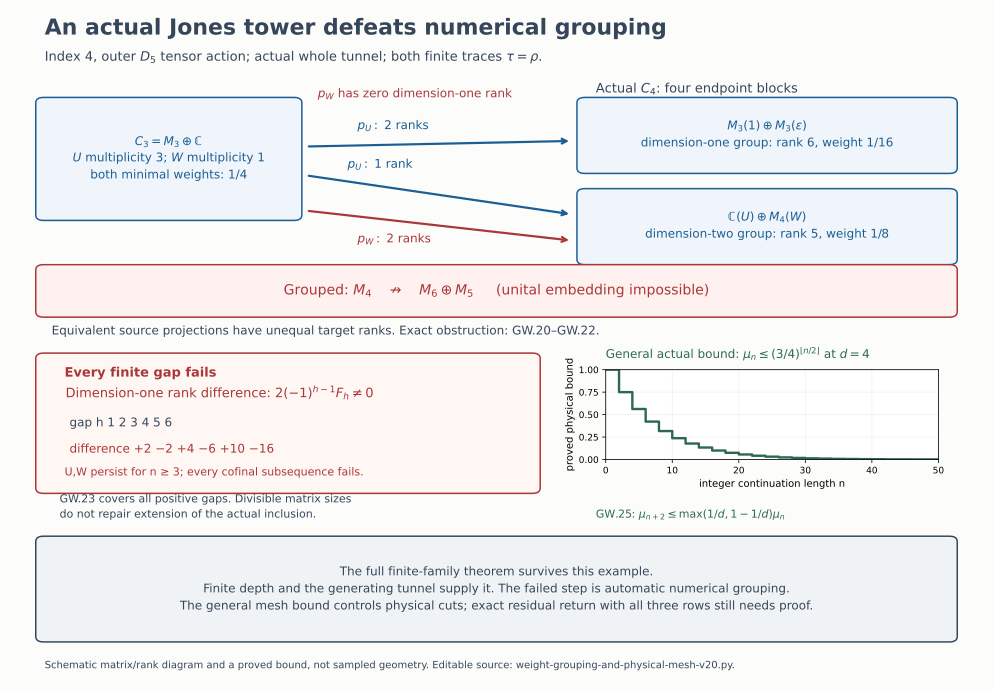

Figure GW.1. The upper two rows are the actual \(C_3,C_4\) of GW.18 with both original minimal weights; the grouped row is GW.21. The arrows record the actual tensor multiplicities of \(p_U,p_W\), GW.22. The gap panel gives the exact nonzero rank difference GW.23. The last panel gives the proved general bound GW.25 and its physical-only scope. Box sizes and arrow positions are schematic, not trace masses or geometric distances. [Reproducible figure and exact finite checks](figures/weight-grouping-and-physical-mesh-v20.py).

### Scope and proof route

GW.1–GW.3 give a complete actual proper all-smooth-amenable Jones counterexample to automatic compatible numerical weight grouping. GW.2 identifies exactly the finite extension requirement. GW.4 supplies an unconditional actual physical mesh bound after every prescribed prefix, with a complete proof. No diagonal representation of an arbitrary standard invariant, full general residual theorem, common-stage generation theorem, or vanishing canonical state cost follows.

Under the original representation-amenability hypothesis, POR.5 proves the arbitrary-inclusion GTB.0–GTB.1 finite-family theorem with all fixed physical targets, actual whole finite origins, both inherited traces, every expectation row and every prescribed prefix and cup retained. SA.6–SA.7 gives the original strong-amenability forward approximation and generating tunnel at its stated ergodic-core and separability hypotheses; [61.13–61.20](smooth-representations-and-tower-compression.md) gives the full converse and the original nonseparable finite-set equivalence. The whole model comparisons and arbitrary-depth reconstruction are [17.8–17.18](generating-tunnels-and-classification.md), with the distinct traces and exact corrected scopes. General BF/common-support, both-infinite-capacity localization, the second central local form, the physical bicommutant, the original WM invariant endpoint and the remaining source and prerequisite obligations retain their full scope. The particular model’s generating and bicommutant assertions do not weaken those general unresolved claims.

Complete earlier proof inputs: [Supported frames give local approximation corners](actual-supported-local-approximation.md), 57.3: exact finite marked-prefix alignment; [Going up and down the Jones tower](towers-and-tunnels.md), 4.2–4.5: actual ordinary tunnel triples; [Measuring an inclusion through modules and corners](module-dimension-and-local-index.md), 2.1/2.9: tensor index and common compression; [Finite bases, bounded vectors and a positive-operator inequality](finite-bases-and-positive-index.md), 3.2: partial basis and scalar index sum; [Reflection, commuting squares and finite depth](higher-relative-commutants.md), 12.3–12.4: actual old Jones ideal; [Reflected traces and a uniform bound along a tunnel](reflected-traces-and-uniform-bounds.md), 14.4: finite-depth inherited trace identification; [A finite symmetry group gives two kinds of index](finite-group-indices.md), 18.1–18.4: outer fixed factors and indices; [Smooth representations and compression onto the tracial tower](smooth-representations-and-tower-compression.md), 61.5–61.8: normal state extension and the specified UCP return; [Whole relative-commutant blocks with a small residual corner](whole-relative-commutant-blocks.md), 76.4: retained-prefix near-cover; [Exact trace certificates close the finite-depth residual](trace-certificates-and-exact-finite-partitions.md), 78.6: the full finite-depth partition; [Central capacity and small cuts of whole-tunnel supports](central-capacity-and-small-support-cuts.md), 80.1–80.4: finite costs and actual cuts.

Human mathematical context: Vaughan F. R. Jones, *Index for subfactors*, Inventiones Mathematicae **72** (1983), 1–25, [DOI](https://doi.org/10.1007/BF01389127); Sorin Popa, *Classification of amenable subfactors of type II*, Acta Mathematica **172** (1994), 163–255, Theorem 4.4.1(1), printed p.222, [DOI](https://doi.org/10.1007/BF02392646). The finite action, actual marked tensor construction, numerical compatibility test, Fibonacci obstruction and physical mesh proof are given above.

## Original full-center defects of the actual height-conditioned states

The original height-conditioned states have two bounded full-center values that differ from those of every invariant state. The following bounds identify the changes required by an invariant average, at the unchanged WM.22 parameter. They do not determine its five likelihood moments.

The data throughout are the actual \(Z=Z(W)\), action \(\beta:H\to\operatorname{Aut}(Z)\),
original faithful normal center probabilities \(\mu_U,\mu_V\), original
likelihoods \(R_i\), and original physical parameter

\[
\lambda=1+2^{-31}25^{-198153},\quad
S_+=4+\lambda,\quad S_-=4+\lambda^{-1},\quad d=S_+S_-.
\]

The original expectations \(E_A,P_0\), physical marginal \(\tau\), both canonical
traces, original cups and the entire Jones ideal remain those in C13 and E14.
No auxiliary density below replaces a physical trace or an expectation.

Write \(b=\frac12 25^{-66051}\) for WM.22's proved strict harmonic bound.
The actual central self-adjoint lamp unitary \(L_0\in Z\) has \(L_0^2=1\),
\(\beta_1(L_0)=-L_0\), and \(\beta_1^2|_Z=\mathrm{id}\).
The bounded original lamp RN multiplier is

\[
D_1=\frac{R_1}{\lambda R_0},\qquad
\frac1{\lambda d}\le D_1\le\frac d\lambda<d.
\tag{HD18.1}
\]

The two normal height-conditioned states are the existing actual states
\(\eta_K=\mu_U(E_K\,\cdot)/\mu_U(E_K)\) and
\(\rho_K=\mu_V(E_K\,\cdot)/\mu_V(E_K)\).
Take a joint weak-star cluster of their Cesàro averages, as in T15.12–T15.20a,
and call it \((\eta,\rho)\). Set

\[
a=\eta(L_0),\qquad q=\rho(L_0),\qquad
a,q\ge\frac{5b}{8}>0,
\quad u_0=\frac1{1+4\lambda},\quad
u_i=\frac\lambda{1+4\lambda}\ (1\le i\le4).
\tag{HD18.2}
\]

The lower bounds in HD18.2 are precisely the proved original plus- and
minus-starting bounds in T15.19–T15.20a. These are limits of states on the
whole actual center, rather than states defined only on a lamp cylinder algebra.

### The original reciprocal dimension changes by a definite amount

**Proposition HD18.1.** Every such actual \(\rho\) has

\[
\rho\!\left(\sum_{i=0}^4R_i^{-1}-d\right)
\ge (a+q)^2\ge\frac{25b^2}{16}>0.
\tag{HD18.3}
\]

In contrast, every actual \(H\)-invariant state \(\omega\) on the full center
has value zero on that same bounded original element, by C13.20.

**Proof.** For \(K\ge2\), the actual lamp flip fixes \(E_K\) and sends
\(L_0\) to \(-L_0\). Test E14.13 first at \(E_K\), then at \(E_KL_0\).
The exact original trace-tail ratio T15.11 gives

\[
\rho_K(R_i)=u_i,\qquad
\rho_K(R_0L_0)=u_0\eta_K(L_0),\qquad
\rho_K(R_1L_0)=-u_1\eta_K(L_0).
\tag{HD18.4}
\]

All elements tested here belong to \(Z\) and are bounded. The identities pass
to the joint Cesàro cluster. In particular

\[
\rho((R_1-u_1)L_0)=-u_1(a+q).
\tag{HD18.5}
\]

The positive functional Cauchy–Schwarz inequality, using \(L_0^2=1\), gives
\(\rho((R_1-u_1)^2)\ge u_1^2(a+q)^2\).
For each original \(R_i\), bounded functional calculus gives the reciprocal
tangent identity

\[
\rho(R_i^{-1})-u_i^{-1}
=\rho\!\left(\frac{(R_i-u_i)^2}{u_i^2R_i}\right)\ge0,
\tag{HD18.6}
\]

because \(\rho(R_i)=u_i\). Since \(R_1\le1\), its right side is at least
\(\rho((R_1-u_1)^2)/u_1^2\ge(a+q)^2\).
Direct algebra gives

\[
\sum_i u_i^{-1}=(1+4\lambda)(1+4\lambda^{-1})
=(4+\lambda)(4+\lambda^{-1})=d.
\]

Sum HD18.6 and apply HD18.2. This proves HD18.3. The invariant-state comparison
is the existing C13.20, which follows from the original pointwise dimension
identity and invariance; it is not asserted for a merely stationary or conformal
state. \(\square\)

### The bounded lamp logarithm also has a definite defect

**Proposition HD18.2.** Every such actual \(\eta\) satisfies

\[
\eta(\log D_1)\le-\frac{2a^2}{d^2}
\le-\frac{25b^2}{32d^2}<0.
\tag{HD18.7}
\]

Every actual \(H\)-invariant state has \(\omega(\log D_1)=0\), by the exact
full-center involutive RN relation E14.15.

**Proof.** Since the lamp fixes every \(E_K\) for \(K\ge1\), original normal
change of variables gives

\[
\eta_K\beta_1^{-1}(t)=\eta_K(D_1t)\quad(t\in Z).
\]

This identity on all of \(Z\) survives a joint cluster, or follows from the
existing conformal covariance T15.16 with \(h(az)=0\). Test it at \(1\) and
\(L_0\):

\[
\eta(D_1)=1,\qquad \eta(D_1L_0)=-a,
\qquad\eta((D_1-1)^2)\ge4a^2.
\tag{HD18.8}
\]

For \(0<u\le d\), the function \(f(u)=u-1-\log u\) has
\(f(1)=f'(1)=0\) and \(f''(u)=u^{-2}\ge d^{-2}\) on the segment joining
\(1\) and \(u\). The integral Taylor formula therefore gives
\(f(u)\ge(u-1)^2/(2d^2)\). Applying bounded functional calculus to HD18.1,
then using HD18.8, yields

\[
-\eta(\log D_1)=\eta(D_1-1-\log D_1)
\ge\frac{\eta((D_1-1)^2)}{2d^2}\ge\frac{2a^2}{d^2}.
\]

HD18.2 completes the bound. For an invariant state, the existing identity
\(D_1\beta_1(D_1)=1\) and bounded logarithmic functional calculus give zero
mean. No normal conditional expectation is applied through \(\eta\) or
\(\omega\). \(\square\)

### Scope of the two bounds

HD18.3 and HD18.7 evaluate fixed bounded elements of the original full center. Any averaging procedure that reaches an invariant state from this height family must change both displayed values. The exact inverse-dimension identity is used only for invariant states. Neither preservation of the height family's likelihood moments nor the original invariant zero-cost endpoint follows from these bounds.

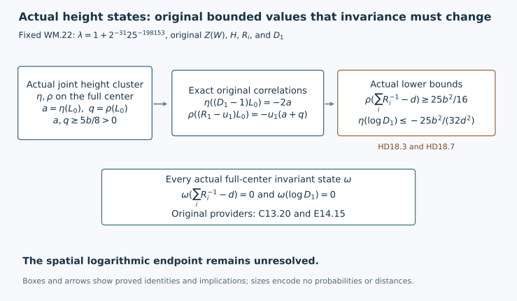

Figure HD18. The two top bounds follow from the exact original correlations
HD18.4 and HD18.8 by positive-functional Cauchy–Schwarz and bounded functional
calculus. The bottom equalities hold for every full-center invariant state by
the original dimension and involutive RN identities. Thus reaching invariance
from this concrete construction changes both displayed original values.
The boxes and arrows are schematic and encode no metric or probabilities.
[Reproducible figure and exact symbolic checks](figures/height-state-original-costs-v21.py).

### Proof sources

The exact providers used are the current course's WM.22, C13.14 and C13.20,
E14.13–E14.15, and T15.11–T15.20a. The two propositions above are derived directly
from those actual normal trace identities and bounded functional calculus.
The full original center is now identified by FWT.1–FWT.9 above. These two bounds require only the earlier original trace identities and bounded functional calculus.

## Full cylinder laws of the fixed height states and their finite-average defect

Every height-state cluster has a completely specified continuous cylinder law. Every finite group average of these states still has lamp-flip defects approaching two at sufficiently remote sites, even when its origin defect cancels. Actual infinite Følner averages have invariant cluster states, whose five original likelihood moments remain undetermined.

Everything below uses the original fixed
\(\lambda=1+2^{-31}25^{-198153}\), the actual full coefficient center
\(Z=Z(W)\), the actual action \(\beta\), both original normal center measures
\(\mu_U,\mu_V\), and all five original likelihoods \(R_i\).
The physical \(\tau,E_A,P_0\), both canonical traces and the Jones ideal are
unchanged. No auxiliary path law supplies a new physical expectation or trace.
The full-tail proof FWT.1–FWT.9 identifies this full center with the
original final-configuration measure class. No singular state is passed through
the normal \(L^2\) limits FWT.30.

### HC19.1. The cylinder law is an actual positive-drift lamp law

Write \(h(x)=x_1+x_2+x_3\), and keep the original height projections
\(E_K\), suffix success probability \(p>0\), and height-conditioned states
\[
 \eta_K=\mu_U(E_K\,\cdot)/\mu_U(E_K),\qquad
 \rho_K=\mu_V(E_K\,\cdot)/\mu_V(E_K).
\]
Let \(\widetilde m_U,\widetilde m_V\) be the final-configuration probabilities
on the full compact configuration space
\(\Omega=\mathbb F_2^{\mathbb Z^3}\) for the actual conditioned-prefix
weights proved in T15.18, starting respectively in the minus and plus phases:
\[
 \widetilde w^+=\frac{(1,\lambda,\lambda,\lambda,\lambda)}{1+4\lambda},
 \qquad
 \widetilde w^-=\frac{(1,\lambda^{-1},\lambda^{-1},
                            \lambda^{-1},\lambda^{-1})}{1+4\lambda^{-1}}.
 \tag{HC19.1}
\]
These are probabilities for a comparison of actual conditioned prefixes;
they do not change WM.22. Their spatial drift is strictly positive in all
three coordinates. T15.18–T15.19 proves their transience and the same
\(32/\sqrt N\) pair-return tail as WM.20, in both phases.

**Proposition.** For every bounded cylinder function \(F\),
\[
 \eta_K(F)\longrightarrow\widetilde m_U(F),\qquad
 \rho_K(F)\longrightarrow\widetilde m_V(F).
 \tag{HC19.2}
\]
Consequently every weak-star height-state cluster and every Cesàro cluster
has exactly these cylinder restrictions.

**Proof.** Suppose \(F\) depends on a finite nonempty set \(A\) of lamps,
and put \(H_A=\max_{x\in A}h(x)\). Before the first hit of height \(K\),
conditioning on \(E_K\) gives exactly HC19.1 by the telescoping first-hit
calculation T15.18. The extra conditioning on a lit lamp at or above \(K\)
multiplies each first-hit prefix by the same fixed probability \(p\).

In the positive-drift comparison walk, the first-hit times tend to infinity
as \(K\) increases, and all lamps in the finite set \(A\) eventually
stabilize. Its stopped-prefix value of \(F\) therefore converges in
expectation to \(\widetilde m_\sigma(F)\), by bounded convergence.

After the first hit, the original unused suffix starts at height \(K\).
For \(K\ge H_A+4\), put
\(N_K=\lfloor(K-H_A-2)/2\rfloor\). No site of \(A\) can be visited
before this pair cutoff, since a pair changes height by at most one and a
raw intermediate step changes it by at most one. The eight raw-position
tests and WM.20, followed by the union bound, give conditional probability
of a later visit to \(A\) at most
\[
 \min\left(1,\frac{256|A|}{p\sqrt{N_K}}\right).
\]
Changing a bounded \(F\) costs at most \(2\|F\|\). Hence the discrepancy
between the actual final value and the conditioned first-hit-prefix value
is at most
\[
 \min\left(2\|F\|,
       \frac{512\|F\||A|}{p\sqrt{N_K}}\right)\longrightarrow0.
 \tag{HC19.3}
\]
This proves both initial phases of HC19.2. The constants \(p,\lambda\)
are fixed throughout. \(\square\)

All finite lamp patterns have positive original measure: the finite lamp
group acts nonsingularly and transitively on patterns in any prescribed
finite set, and the masses of those finitely many patterns sum to one.
Thus the norm closure of the original cylinder algebra is canonically
\(C(\Omega)\). Uniform approximation by cylinders extends HC19.2 to all
of this continuous algebra.

This is not a normal identification of the full height states with a
different configuration measure. Define
\[
 \mathcal B_\uparrow=\{\eta: \eta|_{\{h\ge q\}}
                         \text{ is finite for every }q\in\mathbb Z\},
 \qquad
 \mathcal B_\downarrow=\{\eta: \eta|_{\{h\le q\}}
                         \text{ is finite for every }q\in\mathbb Z\}.
 \tag{HC19.4}
\]
The original normal measures give \(\mathcal B_\uparrow\) mass one.
The positive-drift comparison laws give \(\mathcal B_\downarrow\) mass one
and \(\mathcal B_\uparrow\) mass zero. To see the latter assertion, raw
zero displacements occur infinitely often, at infinitely many different
sites by transience. Conditional on the projected path, their identity or
toggle choices are independent with probabilities in \([1/3,2/3]\).
Final parities at these different sites are independent with lit
probability at least \(1/3\), so infinitely many lamps are lit. Positive
height drift leaves only finitely many visits below each fixed level;
hence infinitely many lit lamps lie above height zero. This is the same
elementary conditional-bit argument used in C13.2, applied to HC19.1.

The spectral projection of \(\mathcal B_\uparrow\) is therefore \(1\) in
the original full center, even though the cylinder probability representing
a height state's continuous restriction assigns that Borel set mass zero.
This records exactly where countable normal spectral continuity is lost.

### HC19.2. Every finite average retains the maximal remote-lamp defect

For \(r=\|x\|_1\ge4\), put \(N_x=\lfloor(r-2)/2\rfloor\).
No raw path started at zero reaches \(x\) before the first \(N_x\) pairs.
The same eight return-tail tests for HC19.1 therefore give, in either phase,
\[
 \mathbb P_{\widetilde m_\sigma}(\text{ever visit }x)
   \le \min\left(1,\frac{256}{\sqrt{N_x}}\right),\qquad
 \widetilde m_\sigma(L_x)
   \ge1-\min\left(2,\frac{512}{\sqrt{N_x}}\right),
 \tag{HC19.5}
\]
where \(L_x=(-1)^{\eta(x)}\) is the original actual lamp unitary.
In particular every height cluster \(\xi\), from either phase, satisfies
\[
 \xi(L_x)\longrightarrow1\quad\text{as }\|x\|_1\longrightarrow\infty.
 \tag{HC19.6}
\]

**Proposition.** Let
\(\sigma=\sum_{j=1}^m a_j\xi_j\beta_{g_j}\), where \(a_j\ge0\),
\(\sum_j a_j=1\), each \(\xi_j\) is a height-state cluster from either
phase, and \(g_j=(c_j,v_j,n_j)\) is any fixed actual group element.
Let \(a_x=(\delta_x,0,1)\in H\), whose actual center action flips the lamp at \(x\). Then
\[
 \sigma(L_x)\longrightarrow1\quad(\|x\|_1\to\infty),
 \qquad
 \sup_{x\in\mathbb Z^3}\|\sigma-\sigma\beta_{a_x}\|=2.
 \tag{HC19.7}
\]
Thus no finite such average is an \(H\)-invariant state.

**Proof.** In the full original action convention,
\[
 \beta_{g_j}(L_x)=(-1)^{c_j(x+v_j)}L_{x+v_j}.
\]
Outside a finite set the sign is positive for every \(j\), and
\(\|x+v_j\|_1\to\infty\). HC19.6 proves the first assertion. The actual
flip satisfies \(\beta_{a_x}(L_x)=-L_x\), so testing the difference on
the norm-one \(L_x\) gives
\(\|\sigma-\sigma\beta_{a_x}\|\ge2\sigma(L_x)\).
Differences of states have norm at most two. Taking the supremum gives
HC19.7. \(\square\)

For example, averaging \(\xi\) with \(\xi\beta_{a_0}\) cancels its
origin expectation exactly. HC19.7 shows that this repair leaves defects
arbitrarily close to two at distant lamps. This is a concrete obstruction
to every finite repair of the height state, not an obstruction to all
invariant states.

### HC19.3. The infinite Følner average exists, but its endpoint is not computed

Using the original concrete right Følner sets \(F_L\) of WM.16, form
the actual states
\[
 \sigma_L=|F_L|^{-1}\sum_{g\in F_L}\xi\beta_g.
 \tag{HC19.8}
\]
For each fixed actual \(h\), their invariance defect is at most
\(|F_Lh\triangle F_L|/|F_L|\), tending to zero. Every weak-star cluster
is consequently an actual full-center invariant state; it is purely
singular by E14.10–E14.12 and has fair independent finite lamp marginals.
HC19.7 holds for every finite \(L\), with a remote lamp depending on
\(L\). There is no uniform fixed test witnessing a defect of the cluster.

This constructs full-center invariant states from the height family, but
does **not** retain that family's moments, conformal identities or
logarithmic values. The five \(R_i\) are bounded measurable full-center
functions, not continuous cylinder functions. The cylinder law HC19.2,
the fair cylinder restriction of the invariant cluster, and the normal
endpoint approximation FWT.30 do not evaluate those five functions at a
singular cluster.

The exact original calculation still has
\[
 h_\omega=K\bigl(w_1^+-\omega(R_1)\bigr),\qquad
 K=(4+\lambda)^2(1-\lambda^{-2})>0,
 \qquad
 C_\omega=\sum_{i=0}^4
  \omega\bigl(|R_i^{-1}-(w_i^+)^{-1}|\bigr).
 \tag{HC19.9}
\]
Here \(h_\omega\) is the original reciprocal tangent variance of C13.21.
Zero cost requires exactly \(\omega(R_1)=w_1^+\). Neither this equality,
a strict bound below \(w_1^+\), nor zero total spatial logarithmic
character is proved for HC19.8 or for all actual invariant states.

The proved conclusions are the full continuous restrictions of the two height-state families and the maximal remote-lamp defect of every finite group repair. Actual infinite averages produce invariant states. Evaluating the original bounded measurable likelihoods at those states remains the original endpoint question.

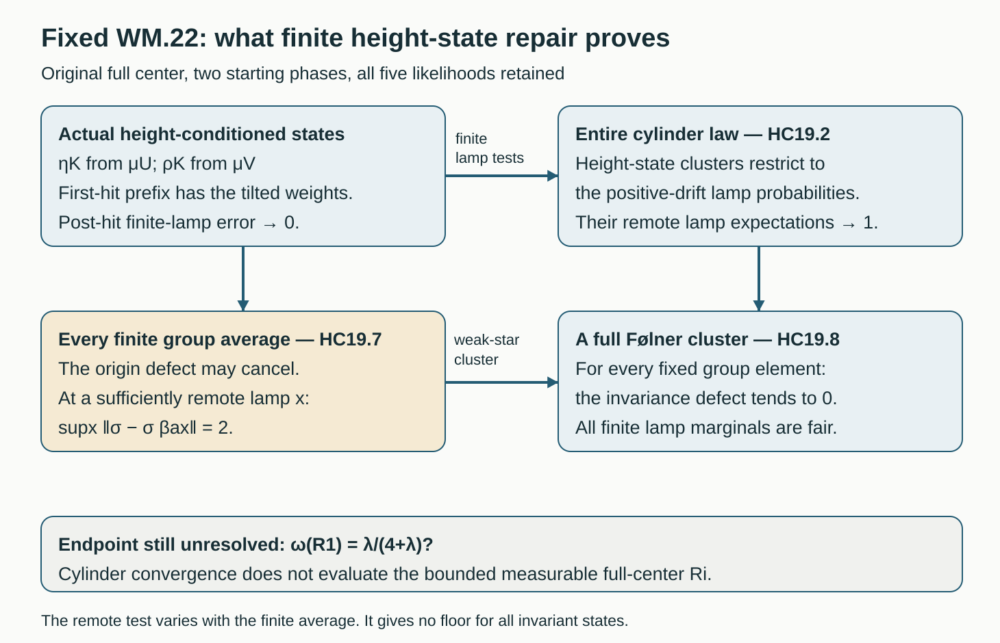

Figure HC19. All cylinder comparisons are HC19.2–HC19.3 in the original
center, with the two starting phases retained. The remote-lamp test is
HC19.7 and depends on the particular finite average. The right lower arrow
is the actual full-center Følner construction HC19.8; it asserts invariance
and fair finite lamp distributions, with no value claimed for the original
five likelihoods. Boxes and arrows are schematic and encode no probabilities
or spatial metric. [Reproducible figure source](figures/height-cylinders-and-finite-averages-v21.py).

The proof uses the complete internal WM.20, C13.2, E14.8–E14.12 and
T15.18–T15.20a providers. No external theorem is needed for the two new
propositions.

## Full original boundary orbit reconstruction of invariant likelihood moments

The following construction uses the full endpoint-tail identification FWT.1–FWT.9, the original trace identities and physical return C13, and the Radon–Nikodym convention E14. The fixed inclusion and both canonical traces are retained.

### OM.1. Fixed objects and the result's scope

Keep
\[
H=\{(c,v,m):c\in\bigoplus_{\mathbb Z^3}\mathbb Z/2,\ v\in\mathbb Z^3,\
m\equiv\sum_xc(x)\pmod2\},
\qquad \lambda=1+2^{-31}25^{-198153}.
\tag{OM.1}
\]
The original labels are \(s_0=1,s_1=az,s_2=t_1,s_3=t_2,s_4=t_3\).
Put
\[
\nu=(1,\lambda,1,1,1),\quad
S_+=4+\lambda,\quad S_-=4+\lambda^{-1},\quad d=S_+S_-,
\qquad w_i^\pm=\nu_i^{\pm1}/S_\pm.
\tag{OM.2}
\]
The actual full coefficient center is \(Z\), its action is
\(\beta_gF(\eta)=F(g^{-1}\eta)\), and the original normal laws are
\(\mu_U,\mu_V\). FWT identifies the entire endpoint tail with the actual final lamp configuration, for both original phases, including every bounded harmonic family varying with finite depth. The central integer remains in every finite endpoint word. Its even central action is trivial on \(Z\), as proved in E14.

The original likelihoods satisfy
\[
1/d\le R_i\le1,\quad \sum_{i=0}^4R_i=1,\qquad
\mu_V(R_iF)=w_i^+\mu_U(\beta_i^{-1}F).
\tag{OM.3}
\]
The original discrepancy and physical reciprocal cost of an invariant state are
\[
\Delta_\omega=\sum_i\omega(|R_i-w_i^+|),\qquad
C_\omega=\sum_i\omega(|R_i^{-1}-(w_i^+)^{-1}|).
\tag{OM.4}
\]
C13 realizes every \(H\)-invariant state, including a singular state, by the original physical return with the original \(\tau,E_A,P_0\). No expectation, parameter or boundary quotient is changed below.

The following proof gives unconditional orbit reconstruction of the full invariant moment body and exact finite-word evaluations of all its normal approximants. It does not determine whether \(C_\omega=0\) is attained or prove a positive lower bound on \(C_\omega\).

### OM.2. The original normal boundary law is contractive on the full center

**Proposition OM.2.** For every real \(F\in Z\),
\[
\sup_{g\in H}\mu_U(\beta_gF)=\mathop{\rm ess\,sup}_{\mu_U}F,\qquad
\inf_{g\in H}\mu_U(\beta_gF)=\mathop{\rm ess\,inf}_{\mu_U}F.
\tag{OM.5}
\]
In particular, if \(p\in Z\) is a nonzero projection, then
\(\sup_g\mu_U(\beta_gp)=1\).

**Proof.** Use the original minus-first raw path, with endpoint \(G_{2n}\) after \(2n\) labels and final configuration \(\eta\). The unused suffix has the same original law \(\mu_U\), independently of the prefix. Therefore
\[
\mathbb E[F(\eta)\mid\text{first }2n\text{ marks}]
=\mu_U(\beta_{G_{2n}}^{-1}F).
\tag{OM.6}
\]
Because \(F\) belongs to the entire actual full center, FWT makes \(F(\eta)\) a measurable bounded function of these original marks. Cylinder functions are dense in their \(L^2\): for an indicator this follows by the elementary monotone-class closure of the cylinder algebra, and simple functions then give the general statement. Orthogonal projection onto increasing cylinder spaces consequently gives convergence of OM.6 to \(F(\eta)\) in \(L^2\). A subsequence converges almost surely: choose successive \(L^2\) errors at most \(2^{-2k}\), use Markov's inequality at threshold \(2^{-k/2}\), and sum the resulting probabilities.

Let \(a=\mathop{\rm ess\,sup}F\). For every \(\varepsilon>0\), the event \(F>a-\varepsilon\) has positive probability. On a point of that event where the selected subsequence converges, some endpoint gives
\(\mu_U(\beta_{G_{2n}}^{-1}F)>a-2\varepsilon\). Every group inverse also belongs to \(H\). The opposite inequality holds because every \(\mu_U\beta_g\) is a state. Let \(\varepsilon\downarrow0\). Apply this result to \(-F\) for the infimum. For a nonzero projection, faithfulness gives positive original measure and essential supremum one. \(\square\)

Only normal original path expectations were used in this proof. No singular state was evaluated on a normal \(L^2\) limit.

### OM.3. Orbit mixtures reconstruct every state

**Theorem OM.3.** The weak-star closed convex hull of
\(\{\mu_U\beta_g:g\in H\}\) is the entire state space of \(Z\).
For any \(N\) real elements \(F_1,\ldots,F_N\), any state \(\sigma\), and any \(\varepsilon>0\), there are \(g_0,\ldots,g_N\in H\) and nonnegative coefficients \(a_j\) summing to one such that
\[
\left|\sum_{j=0}^N a_j\mu_U(\beta_{g_j}F_k)-\sigma(F_k)\right|<\varepsilon
\quad(1\le k\le N).
\tag{OM.7}
\]
Zero coefficients are allowed.

**Proof.** Let \(C\) be the closed convex hull in \(\mathbb R^N\) of the orbit vectors
\((\mu_U\beta_gF_k)_k\). If the vector \(x=(\sigma(F_k))_k\) were outside \(C\), it would have positive distance from \(C\). The set \(C\) is compact, since all its coordinates are bounded. Choose a closest \(y\in C\). For every \(z\in C\), differentiation at zero of
\(\|x-y-t(z-y)\|^2\), \(0\le t\le1\), gives
\((x-y)\cdot z\le(x-y)\cdot y<(x-y)\cdot x\).
For \(F=\sum_k(x_k-y_k)F_k\), OM.5 would then give
\[
\sigma(F)>\sup_g\mu_U(\beta_gF)=\mathop{\rm ess\,sup}F,
\]
contradicting positivity of \(\sigma\). Thus \(x\in C\).

A finite convex combination approximates \(x\). If it has more than \(N+1\) nonzero coefficients, its augmented vectors \((1,v_j)\in\mathbb R^{N+1}\) are linearly dependent. Choose a nonzero dependence \(b_j\) with \(\sum b_j=0,\sum b_jv_j=0\). Both signs occur. Subtract from the coefficients the largest positive multiple of \(b_j\) that preserves all their nonnegativity. It removes one positive coefficient without changing the convex combination. Repeat finitely many times. This proves OM.7. Finite real tests determine the weak-star topology on the state space, proving the first assertion. \(\square\)

The orbit points in OM.7 are actual normal states on the full \(Z\); their normality does not assert normality of their cluster states.

### OM.4. The actual Følner operator and its uniform invariance bound

Use exactly WM.16:
\[
F_L=\{(c,v,m):\operatorname{supp}c\subset[-L,L]^3,\
v\in[-L,L]^3,\ |m|\le L,\ m\equiv\sum c\pmod2\},
\qquad
A_LF=\frac1{|F_L|}\sum_{g\in F_L}\beta_gF.
\tag{OM.8}
\]
For a state \(\sigma\), write \(\Phi_{L,\sigma}=\sigma A_L\).
For each generator \(s\in\{az,t_1,t_2,t_3\}\) and its inverse,
\[
\|\Phi_{L,\sigma}\beta_s-\Phi_{L,\sigma}\|
\le\frac{|F_Ls\triangle F_L|}{|F_L|}
=\frac2{2L+1}.
\tag{OM.9}
\]
The bound is uniform in \(\sigma\), including singular \(\sigma\).

**Proof.** Composition gives \(\beta_g\beta_s=\beta_{gs}\), so cancellation of terms indexed by \(F_Ls\cap F_L\) leaves at most the counted symmetric difference. For a translation, exactly the two spatial faces contribute.
For \(az\), right multiplication toggles at the current \(v\) and changes \(m\) by one, so support remains in the original cube and only the two extreme integer faces contribute.
There are \(2^{q-1}\) lamp configurations of each parity, where \(q=(2L+1)^3\). Summing over the two parities gives denominator
\((2L+1)^3(2L+1)2^{q-1}\), and the two extreme integer faces have total size \(2(2L+1)^3 2^{q-1}\). This proves the ratio even when the numbers of even and odd integers in the interval differ. Inverses have the same ratio. \(\square\)

For a fixed word of length \(r\), telescoping its generator actions bounds its invariance defect by \(2r/(2L+1)\). Every cluster of a sequence \(\Phi_{L,\sigma_L}\), \(L\to\infty\), is therefore \(H\)-invariant.

### OM.5. Exact reconstruction of the entire attainable moment body

Let \(T=(T_1,\ldots,T_N)\) be any fixed finite family of real elements of the full \(Z\). This includes the five \(R_i\), the five original inverse costs, and the three full logarithms \(\log D_{t_j}\). Define
\[
\begin{aligned}
\mathcal M(T)&=\{(\omega(T_k))_k:\omega\text{ is an actual }H\text{-invariant state}\},\\
\mathcal C_L(T)&=\overline{\operatorname{conv}}\{
(\mu_U(\beta_h A_LT_k))_k:h\in H\}.
\end{aligned}
\tag{OM.10}
\]
Both sets are compact convex subsets of a bounded subset of \(\mathbb R^N\).

**Theorem OM.5.** At the fixed original parameter,
\[
\mathcal M(T)\subset\mathcal C_L(T)\quad\text{for every }L,\qquad
\operatorname{dist}_{\rm Haus}(\mathcal C_L(T),\mathcal M(T))\longrightarrow0.
\tag{OM.11}
\]
Every point of \(\mathcal M(T)\) is consequently a limit of moments of actual normal states of the form
\[
\frac1{|F_L|}\sum_{g\in F_L}\sum_{j=0}^{N}a_{L,j}\mu_U\beta_{h_{L,j}g}.
\tag{OM.12}
\]
At most \(N+1\) orbit points are needed at each \(L\). Their group elements and coefficients may depend on \(L\); all original physical data remain fixed.

**Proof.** OM.3 applied to \(A_LT_k\) says that \(\mathcal C_L(T)\) is exactly the set of moment vectors of \(\sigma A_L\) as \(\sigma\) ranges over all states. For an invariant \(\omega\), \(\omega A_L=\omega\), proving the inclusion.

If the one-sided Hausdorff convergence failed, some \(L_n\to\infty\), states \(\sigma_n\), and moment vectors of \(\sigma_nA_{L_n}\) would stay a fixed positive distance from \(\mathcal M(T)\). The state space is weak-star compact (the unit ball of \(Z^*\), intersected with the weak-star closed positivity and unitality conditions). Take a convergent subnet of these states. OM.9 and its fixed-word extension make its limit invariant. Its \(N\) moments converge to a point of \(\mathcal M(T)\), a contradiction. The opposite Hausdorff distance is zero by the inclusion.

For a fixed invariant \(\omega\), OM.7 on the \(N\) elements \(A_LT_k\), with error \(1/L\), gives OM.12 and convergence to its moments. This is an explicit normal approximation to the moments of any singular invariant state; it never applies that singular state to a normal convergence limit. \(\square\)

The same statement holds using the distinct original law \(\mu_V\): OM.6 starts in the plus phase instead. The two reconstruction descriptions agree on \(\mathcal M(T)\) because they reconstruct the same actual invariant-state space, not because their canonical trace measures are equal.

### OM.6. Extremal moments need only one normal orbit point at each stage

For a real full-center element \(T\), put
\[
u_L(T)=\sup_{h\in H}\mu_U(\beta_hA_LT),\qquad
l_L(T)=\inf_{h\in H}\mu_U(\beta_hA_LT).
\tag{OM.13}
\]
OM.5 and OM.2 give the exact unconditional limits
\[
\begin{aligned}
u_L(T)&=\mathop{\rm ess\,sup}A_LT
\longrightarrow \max_{\omega\ {\rm invariant}}\omega(T),\\
l_L(T)&=\mathop{\rm ess\,inf}A_LT
\longrightarrow \min_{\omega\ {\rm invariant}}\omega(T).
\end{aligned}
\tag{OM.14}
\]
Choose \(h_L\) with \(\mu_U(\beta_{h_L}A_LT)\ge u_L(T)-1/L\).
Every cluster of \(\mu_U\beta_{h_L}A_L\) is invariant and attains the maximum in OM.14; the analogous choice attains the minimum.

This is a stronger restriction on the approximating states than an arbitrary normal density: a single translate of the original law suffices for each extremum. It does not evaluate the essential supremum or the limit at the original zero-cost endpoint.

### OM.7. Original full-word counts evaluate every normal orbit approximant

Use the original plus-first path in this subsection. Write \(N_q^\pm(z)\) for the number of original alternating words of length \(q\), starting in phase \(\pm\), with endpoint \(z\in H\). Counts distinguish the full lamp configuration, all three spatial coordinates and the central integer, with the original parity. At even length \(2n\),
\[
p_{2n}^+(z)=N_{2n}^+(z)\lambda^{m(z)}/d^n.
\tag{OM.15}
\]
For a reachable \(z\), the original first-label posterior is
\[
r_{i,n}(z)=
\frac{N_{2n-1}^-(s_i^{-1}z)}{N_{2n}^+(z)}.
\tag{OM.16}
\]
The raw-path \(L^2\) limit is \(R_i(\eta)\), by FWT.30.

Fix \(h\in H\). Choose one original plus-first word \(w\) of odd length \(2k+1\) with endpoint \(h^{-1}\). Such a word exists: the labels and their inverses generate \(H\), insert identity letters to obtain alternating signs, and append an identity if an odd length is needed. It has strictly positive original probability
\[
p_w=\frac{\lambda^{m(h^{-1})}}{S_+d^k}.
\tag{OM.17}
\]
For \(n\ge k+1\), define on the original reachable endpoints
\[
q_{h,n}(z)=
\frac1{p_w}
\frac{N_{2(n-k)-1}^-(hz)}{N_{2n}^+(z)}.
\tag{OM.18}
\]
It lies in \([0,p_w^{-1}]\).

**Proposition OM.7.** The functions OM.18 converge in original raw-path \(L^2\) to
\[
q_h=\frac{d((h^{-1})_*\mu_U)}{d\mu_V},
\tag{OM.19}
\]
and hence
\[
\boxed{\quad
\mu_U(\beta_hR_i)
=\lim_{n\to\infty}
\sum_{z:\,N_{2n}^+(z)>0}
\frac{N_{2n}^+(z)\lambda^{m(z)}}{d^n}
\,q_{h,n}(z)\,r_{i,n}(z).
\quad}
\tag{OM.20}
\]
Every sum is finite and is an exact rational number at OM.1.

**Proof.** Let \(P_w\) be the event that the initial \(2k+1\) marks equal the chosen word, and let
\(\mathcal T_n=\sigma(G_{2n},\text{marks after }2n)\).
Given its endpoint \(z\), all original full words of length \(2n\) have the same probability \(\lambda^{m(z)}/d^n\). Removing the prescribed prefix leaves the original minus-first word of length \(2(n-k)-1\), with endpoint \(hz\). Thus the ratio before division by \(p_w\) in OM.18 is exactly
\(\mathbb E[1_{P_w}\mid\mathcal T_n]\).
The unused marks are independent, so they add no further prefix information after the endpoint is known.

The fields \(\mathcal T_n\) decrease; bounded reverse conditional expectations converge in \(L^2\) to the projection onto their intersection. For completeness, let \(V_n=L^2(\mathcal T_n)\), \(V_\infty=\bigcap_nV_n\), and \(P_n\) the orthogonal projections. Their norms on any fixed vector decrease. For \(m\ge n\), nesting gives
\(\|P_nx-P_mx\|^2=\|P_nx\|^2-\|P_mx\|^2\), so \(P_nx\) is Cauchy. Its limit lies in every \(V_n\), hence \(V_\infty\); its difference from \(x\) is orthogonal to \(V_\infty\). It is the projection onto \(V_\infty\). FWT proves that the intersection is exactly the full \(\eta\) field, including the actual central-integer endpoint quotient.

On \(P_w\), the final configuration has law \((h^{-1})_*\mu_U\), with probability \(p_w\); the suffix begins in the original minus phase. Therefore the conditional expectation limit divided by \(p_w\) is precisely OM.19. This also proves its boundedness by \(p_w^{-1}\), independently of a chosen representative.

Together with OM.16, bounded \(L^2\) convergence gives
\[
\|q_{h,n}r_{i,n}-q_hR_i\|_1
\le p_w^{-1}\|r_{i,n}-R_i\|_2+\|q_{h,n}-q_h\|_2
\longrightarrow0.
\tag{OM.21}
\]
Its finite expectation is the sum in OM.20; the limiting expectation is
\(\mu_V(q_hR_i)=\mu_U(\beta_hR_i)\). \(\square\)

The representation by \(w\) changes the finite ratio but not its proved limit. The same formula evaluates any fixed continuous function \(f(R_0,\ldots,R_4)\): replace \(r_{i,n}\) by \(f(r_{0,n},\ldots,r_{4,n})\). For the original inverse costs, first clamp every finite posterior to \([1/d,1]\) and then apply the inverse formula. The clamping is \(1\)-Lipschitz and fixes the limit; the inverse is \(d^2\)-Lipschitz there. Thus no finite zero posterior is inverted. Logarithms are likewise evaluated after clamping, and \(D_i=R_i/(\nu_iR_0)\) uses the original full derivatives.

### OM.8. The order of limits and the remaining fixed endpoint

For a fixed \(L\) and finite orbit mixture, OM.20 evaluates all its finitely many normal summands, including every translate \(h_jg\) with \(g\in F_L\). Its count depth tends to infinity while that finite mixture is fixed. Only after these normal values have been identified does OM.11 take \(L\to\infty\). The state then obtained may be singular.

For each fixed finite list of full group words, Proposition CD29.2 below supplies a terminating search for certified normal count-depth bounds. The accuracy depends on that finite data; no uniform rate in moving words or in \(L\) is proved. A count value without its normal error certificate is not a bound on the singular endpoint. Neither OM.21 nor any original raw-path \(L^2\) limit is evaluated by a singular state.

At \(T=R_1\), the actual upper extremum is exactly the limit OM.14, and C13's original zero-cost question is whether it equals
\(\lambda/(4+\lambda)\). This result does not compute that limit. The original WM invariant zero-cost endpoint, or an actual positive all-state separation, remains open. The unrestricted inclusion family retains its original scope. The full strong-amenability/generating equivalence is proved in [61.16](smooth-representations-and-tower-compression.md#extending-a-smooth-representation-down-the-original-tunnel); it does not determine this fixed model’s invariant-state endpoint.

### Proof locators and the normal approximation

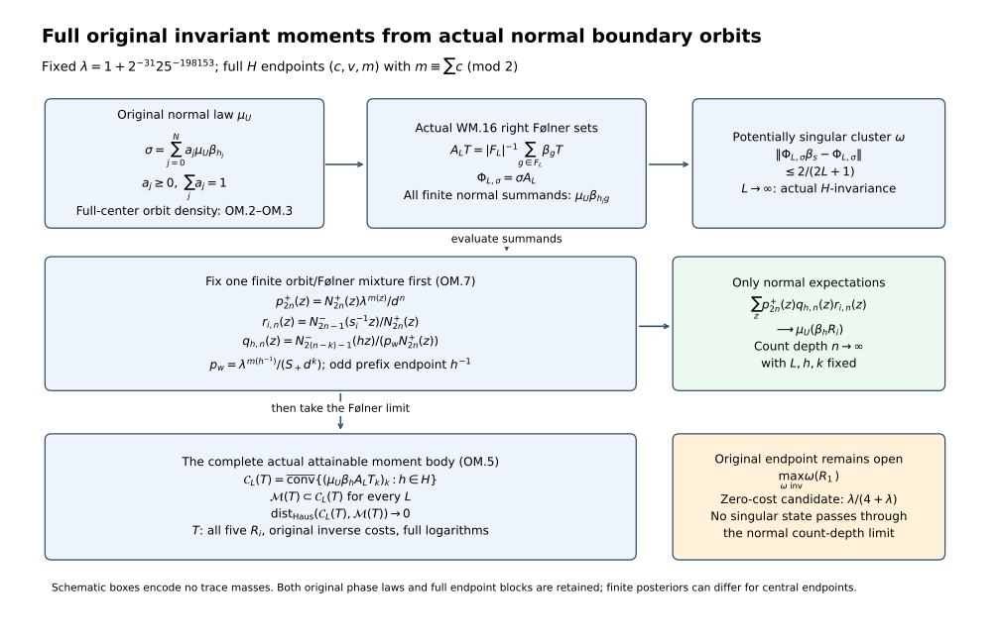

Figure OM. OM.2–OM.6 reconstruct the full invariant moment body from original normal boundary orbits and the actual WM.16 right Følner sets. OM.7 computes each fixed normal summand with original full-endpoint word counts. The count depth tends to infinity with the finite orbit/Følner mixture fixed; the possibly singular state appears only in the later Følner limit. The original upper likelihood endpoint remains uncomputed. [Reproducible figure source](figures/actual-orbit-moment-reconstruction-v21.py).

The full endpoint-tail and likelihood providers are FWT.1–FWT.9 and FWT.21–FWT.33 in the current source. OM.4 uses the complete actual Følner count WM.16, independently repeated in OM.4. The physical return and original cost providers are C13.12–C13.24. E14.13–E14.15 fixes the full Radon–Nikodym convention; T15.1–T15.6 fixes the existing logarithmic enclosure without asserting endpoint attainment. The orbit-density, finite-dimensional convex reconstruction, Hausdorff moment-body limit and arbitrary translated odd-prefix count proof above are independently supplied here.

The accompanying reproducible diagram labels the actual normal components, full-word endpoint counts, original Følner averaging and potentially singular final state. Its arrows distinguish the fixed finite normal evaluation from the later singular-state limit. Box sizes encode no trace weights.

## Finite lamp cells and certified normal count depths

Every finite lamp cylinder has positive mass in both original phase laws. We give an explicit full marked prefix and escape bound, then construct certified normal count-depth approximations for every fixed finite list of full-group derivatives. Both results use the unchanged WM.22 parameter, all lamp and spatial coordinates, the central integer and parity. They do not determine the support of the constant derivative tuple or the original zero-cost endpoint.

\[
\lambda=1+2^{-31}25^{-198153},\quad
S_+=4+\lambda,\quad S_-=4+\lambda^{-1},\quad d=S_+S_-.
\]

### The original phase laws and full-group coordinates

Use the actual group and right-product walk of FWT.1–FWT.4:
\[
H=\{(c,v,m):c\in\bigoplus_{\mathbb Z^3}\mathbb F_2,
v\in\mathbb Z^3,m\in\mathbb Z,
m\equiv\sum_xc(x)\pmod2\},
\]
\[
(c,v,m)(e,w,r)=(c+\operatorname{shift}_ve,v+w,m+r).
\]
The five labels are \(s_0=1,s_1=(\delta_0,0,1),s_{j+1}=(0,e_j,0)\), and
\(\nu=(1,\lambda,1,1,1)\), \(w_i^+=\nu_i/S_+\), \(w_i^-=\nu_i^{-1}/S_-\).
Every finite count below distinguishes the entire lamp configuration, all three spatial coordinates, the central integer and its exact parity. Each complete even word in either original phase has probability \(\lambda^{m(z)}/d^n\) at its full endpoint \(z\).

The final configuration is \(\eta\). Its original plus and minus laws are \(\mu_V,\mu_U\). FWT.21–FWT.28 identifies the *entire* endpoint tail and actual coefficient center with the common completed configuration sigma algebra. Write
\[
\beta_gf=f\circ g^{-1},\quad
D_g=\frac{d(g_*\mu_U)}{d\mu_U},\quad
R_i=w_i^+\frac{d((s_i)_*\mu_U)}{d\mu_V}.
\]
In particular \(R_i\ge1/d\), \(\sum_iR_i=1\),
\[
q_e:=\frac{d\mu_U}{d\mu_V}=S_+R_0\in[a,b],
\qquad a=1/S_-,\quad b=S_+,
\qquad D_{s_i}=\frac{R_i}{\nu_iR_0}.
\tag{CD29.1}
\]
The two original laws are equivalent; positive mass under one is positive under the other for the *same* full RN tube. This does not replace either law by another probability.

The normal count input is OM.15–OM.21, including its complete reverse-conditional-expectation proof. The quantitative spatial input is WM.20:
\[
\sup_x\sum_{r\ge J}\mathbb P_\sigma(V_{2r}=x)<32/\sqrt J
\quad(J\ge1,\ \sigma=+,-).
\tag{CD29.2}
\]
These are exact earlier programme providers in the current Lesson99 source. No external harmonic-boundary theorem is assumed. The earlier private FL22 handoff is used only for its checked original parameter and the fact that its necessary enclosures do not evaluate support.

### Reciprocal weights and the adjoint in the actual GNS space

**Proposition SB29.1 (the actual coefficient GNS representation).** Let \(\omega\) be any original \(H\)-invariant state on the actual coefficient center; such states exist by the original WM.16 averages. On its GNS Hilbert space \(K_\omega\), put
\[
U_g[x]=[\beta_gx],\qquad \Omega=[1].
\]
Then \(U_g\) is a unitary representation of the *full* \(H\), \(U_g\Omega=\Omega\), and the following bounded operators have the exact indicated norms:
\[
S=\sum_{i=0}^4U_{s_i},\qquad \|S\|=5,
\]
\[
A_\nu=\sum_{i=0}^4\nu_iU_{s_i},\qquad
B_\nu=\sum_{i=0}^4\nu_i^{-1}U_{s_i}^*,
\]
\[
\|A_\nu\|=S_+,\quad \|B_\nu\|=S_-,\quad
\|A_\nu B_\nu\|=d,
\quad A_\nu B_\nu\Omega=d\Omega.
\tag{SB29.1}
\]
For the unchanged \(\lambda>1\),
\[
B_\nu-A_\nu^*=(\lambda^{-1}-\lambda)U_{s_1}^*,
\quad \|B_\nu-A_\nu^*\|=\lambda-\lambda^{-1}>0.
\tag{SB29.2}
\]

**Proof.** Invariance gives
\(\omega((\beta_gx)^*\beta_gy)=\omega(x^*y)\), so each displayed map is well-defined and isometric on the GNS quotient, with inverse \(U_{g^{-1}}\). It extends to a unitary, obeys the full group law, and fixes the unit vector \(\Omega\). The triangle inequality gives the upper bounds \(5,S_+,S_-\); evaluation on \(\Omega\) gives their equal lower bounds. The product has norm at most \(S_+S_-\) and exactly that value on \(\Omega\). Taking the adjoint of \(A_\nu\) proves SB29.2; the norm is the modulus of the nonzero scalar multiplying a unitary. No normality of \(\omega\) is used. \(\square\)

In particular,
\[
d-25=4(\lambda-1)^2/\lambda>0,
\qquad\|S/\sqrt d\|=5/\sqrt d<1,
\]
while both \(A_\nu/S_+\) and \(B_\nu/S_-\) fix \(\Omega\). These statements coexist in the actual full-center GNS representation of every original invariant state. The reciprocal weighted pair is not an adjoint pair. It cannot be replaced by \(SS^*\) and assigned an eigenvalue \(d\).

These are explicitly defined coefficient-group operators. It does **not** identify \(A_\nu B_\nu\) with a physical Jones operator. Such an identification would need its own typed comparison and the original physical trace. The already proved whole-center action satisfies \(U_{z^2}=I\); the physical trace-scaling character remains \(\chi(z^2)=\lambda^2\). Those are distinct data. Thus neither the bound \(\|S\|\le5\) nor the physical value \(\sqrt d>5\) yields a finite RN-neighborhood exclusion or an all-state cost floor. A further inference that a constant RN tuple makes \(S/\sqrt d\) fix \(\Omega\) contradicts its computed value \(5\Omega/\sqrt d\).

### An explicit original cylinder lower bound

**Proposition CY29.1 (full-prefix height escape).** Let \(E\subset\mathbb Z^3\) be finite and nonempty, let \(b:E\to\mathbb F_2\) prescribe lamp bits, and let \(r\ge1\) be an integer. In each original initial phase \(\sigma\), construct an actual even marked prefix of length \(2k_\sigma\), with full endpoint \((c_\sigma,x_\sigma,m_\sigma)\in H\), such that \(c_\sigma|_E=b\) and
\[
h(x_\sigma)\le L-r-1,\qquad L=\min_{x\in E}h(x),\quad h(x)=x_1+x_2+x_3.
\]
Then the original phase-law cylinder mass obeys
\[
\mu_\sigma\{\eta|_E=b\}
\ge\frac{\lambda^{m_\sigma}}{d^{k_\sigma}}(1-\lambda^{-r})>0.
\tag{CY29.1}
\]
The two prefixes may have different depths. A completely specified choice has central integer \(s=|b^{-1}(1)|\) in both phases: order the lit sites lexicographically, travel from zero through those sites along coordinate Manhattan paths, use only a plus-phase lamp mark at each, and finish at \(x=(L-r-1,0,0)\). If \(\ell\) is this route's Manhattan travel length, phase fillers and final identity padding give \(k_\sigma\le\ell+s+1\). Hence the common explicit bound is
\[
\mu_\sigma\{\eta|_E=b\}
\ge\lambda^s d^{-(\ell+s+1)}(1-\lambda^{-r})>0.
\tag{CY29.1a}
\]
Every lamp mark is a plus mark; insert an identity before it when the next phase is minus. No central correction or lamp-parity deletion occurs. Neither law, group relation or physical weight is changed.

**Proof.** Visit every prescribed lit site with spatial translation letters and toggle it once with \(s_1\); other queried bits remain zero unless prescribed lit. Then move without toggles to the required low endpoint. To realize this signed group word in a fixed alternating phase pattern, insert an identity whenever the next letter needs the other phase. Append an identity if necessary to make the length even. These are actual labels and inverses in the full \(H\), so the resulting central integer and lamp parity are retained. Its probability is exactly the displayed \(\lambda^{m_\sigma}/d^{k_\sigma}\), by the original paired word weights.

At pair boundaries the height increment is \(-1,0,+1\). In either initial phase its upward and downward probabilities are
\[
u=\frac3{S_+}\left(1-\frac3{S_-}\right)
=\frac{3(1+\lambda^{-1})}{d},\qquad
v=\left(1-\frac3{S_+}\right)\frac3{S_-}
=\frac{3(1+\lambda)}d,
\quad u/v=\lambda^{-1}.
\tag{CY29.2}
\]
The other probability is \(1-u-v\). Independent raw marks give independent pair increments after the fixed even prefix. For a pair-height walk starting at zero, \(\lambda^{Z_n}\) is a martingale because
\(u\lambda+v\lambda^{-1}+1-u-v=1\).
Stop it on first reaching \(R\) or \(-B\), where \(R,B\ge1\). The exit time is almost surely finite: in the finite interval, a string of at most \(R+B\) consecutive upward moves exits, with a fixed positive probability, so survival probabilities over successive such blocks decay geometrically. The stopped martingale is bounded; finite-time expectation and bounded convergence give
\[
\mathbb P(\tau_R<\tau_{-B})
=\frac{1-\lambda^{-B}}{\lambda^R-\lambda^{-B}}.
\]
As \(B\to\infty\), these events increase to the event of ever reaching \(R\). Hence its probability is exactly \(\lambda^{-R}\).

Set the forbidden pair level to \(L-1\). Its distance above the actual starting height is at least \(r\); the probability of never reaching it is at least \(1-\lambda^{-r}\). On this event every pair height is at most \(L-2\). A raw intermediate position is at most one unit above the preceding pair position, in either phase, so its height is at most \(L-1\). No subsequent raw position can hit \(E\), all of whose heights are at least \(L\). Every prescribed queried bit therefore survives unchanged. Prefix and suffix independence proves CY29.1. The empty queried set has mass one. \(\square\)

This height calculation certifies avoidance of a specified finite set in the actual full walk. It does not identify the center with a height quotient, nor assert that the full RN derivatives depend only on height. In particular it supplies no RN-tube mass bound.

**A checked full-prefix example.** For \(E=\{0,e_1\}\), both prescribed bits one, and \(r=1\), the route goes from zero to \(e_1\), then to \((-2,0,0)\). Thus \(s=2,\ell=4\). The phase-controlled algorithm gives even lengths ten and twelve, respectively, and the same full endpoint
\[
(\delta_0+\delta_{e_1},(-2,0,0),2)\in H.
\]
The original plus/minus prefix probabilities are \(\lambda^2/d^5\) and \(\lambda^2/d^6\); the suffix survival lower bound is \(1-\lambda^{-1}\). In particular both original cylinder masses are at least
\(\lambda^2d^{-7}(1-\lambda^{-1})=\lambda(\lambda-1)d^{-7}>0\).
The reproducible check enumerates the actual marks, products and phases; it does not use numerical substitution for the fixed \(\lambda\).

### Every fixed full-group derivative vector has exact count approximants

Fix \(h\in H\), and choose one original plus-first odd prefix \(w_h\) of length \(2k_h+1\) and full endpoint \(h^{-1}\). Identity letters give the required phase pattern, without changing the group element. Its strictly positive original probability is
\[
p_h=\frac{\lambda^{m(h^{-1})}}{S_+d^{k_h}},\qquad M_h=p_h^{-1}.
\]
Let \(N_j^\sigma(z)\) be the complete original word counts. For \(n\ge k_h+1\), set
\[
P_n(z)=N_{2n}^+(z)\lambda^{m(z)}/d^n,
\quad
q_{h,n}(z)=\frac{N_{2(n-k_h)-1}^-(hz)}{p_hN_{2n}^+(z)}
\tag{CD29.3}
\]
on endpoints with nonzero denominator. OM.18–OM.19 proves \(0\le q_{h,n}\le M_h\) and
\[
q_{h,n}(G_{2n})\longrightarrow q_h
:=\frac{d((h^{-1})_*\mu_U)}{d\mu_V}
\quad\hbox{in original plus-path }L^2.
\tag{CD29.4}
\]
For \(h=e\), choose the single identity prefix, so \(p_e=1/S_+\), \(M_e=S_+\), and \(q_{e,n}=S_+r_{0,n}\).

For any fixed finite \(F\subset H\), use these fixed prefixes for \(h=g^{-1}\), \(g\in F\), and \(e\). Define
\[
c_n(z)=\max(a,q_{e,n}(z)),\qquad
u_{g,n}(z)=q_{g^{-1},n}(z)/c_n(z).
\tag{CD29.5}
\]
Then \(u_{g,n}\to D_g=q_{g^{-1}}/q_e\) in original \(L^2\). This uses the actual derivative convention of FWT.28. It does not merge any full endpoint or divide by a finite zero posterior.

Put
\[
V_{h,n}=\sum_zP_n(z)q_{h,n}(z)^2,
\qquad V_{h,\infty}=\int q_h^2\,d\mu_V.
\]
The reverse conditional-expectation identity gives
\[
V_{h,n}\downarrow V_{h,\infty},\qquad
\|q_{h,n}-q_h\|_2^2=V_{h,n}-V_{h,\infty}.
\tag{CD29.6}
\]
Indeed \(q_{h,n}\) is \(p_h^{-1}\mathbb E[1_{P_{w_h}}\mid\mathcal T_n]\), and \(q_h\) is its projection onto the intersection. Nested orthogonal projections give the displayed squared-norm identity. All finite \(V_{h,n}\) are exact rational numbers at the unchanged rational \(\lambda\).

### A certified variance bound from original lamp cylinders

The entire configuration sigma algebra is essential here. It provides finite cylinder tests dense in the actual boundary \(L^2\); it provides no continuity of the RN coefficients in the lamp product topology.

**Lemma CD29.1 (finite cylinder error).** Let \(f\) be a real function of a finite lamp set \(\Lambda\), \(\|f\|_\infty\le M\), and let \(N\ge1\). For either original phase and any fixed \(h\), the exact even-prefix expectation of \(f(h^{-1}C_{2N})\) differs from \(\int f(h^{-1}\eta)\,d\mu_\sigma\) by at most
\[
2M\,\theta_\Lambda(N),\qquad
\theta_\Lambda(N)=\min(1,256|\Lambda|/\sqrt N).
\tag{CD29.7}
\]
The analogous error for \(f^2\) is at most \(M^2\theta_\Lambda(N)\).

**Proof.** After raw time \(2N\), a changed lamp in \(\Lambda\) requires a raw visit to that set. A pair position or the intermediate position is a pair position shifted by one of the three signed unit vectors or zero. In either phase, eight such finite tests cover all cases, deliberately allowing both signs. CD29.2 and the union bound give probability at most \(256|\Lambda|/\sqrt N\). The difference of the two evaluations is zero off that event and at most \(2M\) on it. For \(f^2\), both values lie in \([0,M^2]\). Applying \(h^{-1}\) replaces the queried finite set by its spatial translate and applies a deterministic finite lamp flip; its cardinality is unchanged. The central integer acts trivially on the final configuration by the already proved full action, while the finite path counts and their weights still retain it. \(\square\)

For a cylinder function with rational values, define the exact original count sums
\[
I_{\sigma,N}(f;h)=
\sum_z N_{2N}^\sigma(z)\frac{\lambda^{m(z)}}{d^N}
 f(h^{-1}C(z)).
\tag{CD29.8}
\]
Here \(C(z)\) is the full finite endpoint lamp configuration, and the sum uses complete full-H counts. Because
\(\mu_V(q_hf)=\mu_U(f\circ h^{-1})\),
\[
L_h(f,N)=2I_{-,N}(f;h)-I_{+,N}(f^2;e)
 -(4M+M^2)\theta_\Lambda(N)
\le V_{h,\infty}.
\tag{CD29.9}
\]
This follows from \(\|q_h-f\|_{L^2(\mu_V)}^2\ge0\) and CD29.7. Take \(N=t^2\) if a rational comparison is desired: then every term in CD29.9 is rational.

**Proposition CD29.2 (effective convergence for each fixed finite list).** For every fixed finite list of original full words \(h\) and every positive rational \(\zeta\), a terminating search over finite counts, rational cylinder functions and square cutoffs produces \(n_0\) and bounds certifying
\[
\|q_{h,n}-q_h\|_2<\zeta\quad(n\ge n_0)
\]
simultaneously for that list. No uniform rate over moving words or moving Følner sets is asserted.

**Proof.** Enumerate finite lamp sets and all rational-valued functions on their finite bit cubes. These are dense in actual \(L^2(\mu_V)\). To justify density without a new boundary assumption, enumerate the lamp sites and let \(\mathcal C_j\) be the first \(j\) coordinate fields. Their increasing union generates the entire boundary field by FWT.26. Indicators approximable in \(L^2\) by their conditional expectations form a sigma algebra: complements are immediate; finite unions follow by bounded products; countable unions follow by truncating the union in measure. It contains all cylinders and hence every measurable set. Simple-function approximation then gives the stated density, and real rational coefficients approximate the finitely many cylinder values.

Consequently
\[
\sup_f\{2\mu_V(q_hf)-\mu_V(f^2)\}=V_{h,\infty}.
\]
For a fixed cylinder \(f\), CD29.7 makes its count lower bounds converge to this expression as \(N=t^2\to\infty\). Hence \(\sup_{f,t}L_h(f,t^2)=V_{h,\infty}\). By CD29.6, there exist finite \(n,f,t\) with
\(0\le V_{h,n}-L_h(f,t^2)<\zeta^2\). An exhaustive finite dovetail search finds such data because every comparison is exact rational arithmetic. Use one witness for each member of the fixed finite list, and take a common sufficiently large \(n_0\). Monotonicity of \(V_{h,n}\) makes every certificate persist thereafter. CD29.6 and CD29.9 prove the norm bounds. Each search stage uses finite counts and exact rational comparisons. \(\square\)

The original count-depth normal errors are thus certified by the full-boundary and finite cylinder arguments. The certificates can be extremely expensive and no manageable explicit cutoff is claimed for the fixed endpoint problem.

By CD29.1, the squared error under the other original law, \(\mu_U\), is at most \(b=S_+\) times its \(\mu_V\) value. Thus these fixed-data certificates control both original normal laws, while retaining their distinct measures.

### Certified finite derivative-neighborhood integrals

For a finite full-H list \(F\) and rational \(\epsilon>0\), define
\[
\Phi_{F,\epsilon}(x)=
\max\left(0,1-\epsilon^{-1}\max_{g\in F}|x_g-1|\right).
\]
It is nonnegative and is positive exactly in the open RN tube. For the empty list, take the maximum as zero: the bump function and both normal integrals are one, and the error bound is zero. Its original normal value is reconstructed by
\[
T_n(F,\epsilon)=\sum_zP_n(z)\Phi_{F,\epsilon}((u_{g,n}(z))_{g\in F})
\longrightarrow T(F,\epsilon):=\int\Phi_{F,\epsilon}((D_g))\,d\mu_V.
\tag{CD29.10}
\]
Each finite sum is exact rational arithmetic at the original parameter. If CD29.9 supplies lower bounds \(L_{h}\), put
\[
e_{h,n}=\sqrt{V_{h,n}-L_h},\quad
E_n=\epsilon^{-1}\sum_{g\in F}
\left(a^{-1}e_{g^{-1},n}+M_{g^{-1}}a^{-2}e_{e,n}\right).
\]
Then
\[
|T_n(F,\epsilon)-T(F,\epsilon)|\le E_n.
\tag{CD29.11}
\]
**Proof.** Clamping is 1-Lipschitz and fixes \(q_e\). Pointwise division by numbers at least \(a\) gives
\[
|u_{g,n}-D_g|\le a^{-1}|q_{g^{-1},n}-q_{g^{-1}}|
 +M_{g^{-1}}a^{-2}|q_{e,n}-q_e|.
\]
Take \(L^2\) norms and use the variance certificates. The maximum norm difference of a finite vector is at most the sum of its coordinate differences; \(\Phi\) is \(1/\epsilon\)-Lipschitz. Probability-space Cauchy–Schwarz finishes CD29.11. \(\square\)

The exact certificate \(T_n-E_n>0\) proves positive mass of this particular original finite RN tube under **both** unchanged phase laws by CD29.1. Conversely, the absence of that certificate at any finite stage proves no exclusion. Proposition CD29.2 allows arbitrarily small certified normal errors for fixed \(F,\epsilon\); it does not decide whether the resulting real limit is positive or zero. The missing mathematical assertion remains actual positivity for *every* original finite full-H tube, or one proved null tube. Neither assertion has been established here.

### The exact normal equality event has zero mass

For clarity, there is an actual normal exclusion, but it is an infinite equality exclusion. Take simultaneous conull representatives of the countably many \(D_g\) and cocycle identities, and put \(E_\infty=\{D_g=1\text{ for every }g\in H\}\). The cocycle implies \(\beta_hD_g=D_{hg}/D_h\), so this event is invariant modulo the original normal null sets. If it had positive \(\mu_U\)-mass, the normal restriction \(\rho=\mu_U|_{E_\infty}/\mu_U(E_\infty)\) would be invariant, since its pushed-forward density is \(D_h\beta_h(1_{E_\infty})=1_{E_\infty}\).

For \(n\ge1\), the exact full group element \(t_1^ns_1t_1^{-n}\) flips the lamp at \(ne_1\) in the actual configuration action. Invariance therefore makes every finite set of these bits uniformly distributed over its full bit cube. Let \(F_L\) be the event that all lamps at \(ne_1\), \(n>L\), are zero. Any chosen \(N\) such bits give \(\rho(F_L)\le2^{-N}\), hence \(\rho(F_L)=0\). On the other hand \(F_L\uparrow1\) almost surely in the original normal laws: FWT.6 gives finitely many lit lamps in the upper halfspace \(h\ge0\). Normal continuity of \(\rho\) contradicts its total mass one. Thus \(\mu_U(E_\infty)=\mu_V(E_\infty)=0\), the second equality following from their original equivalence.

For finite full-H balls \(B_n\), the closed tubes \(\max_{g\in B_n}|D_g-1|\le1/n\) decrease to this equality event. Their normal masses therefore decrease to zero. This does not say that one of those finite masses is zero, nor that every finite open tube has positive mass. In particular exact normal nonattainment does not exclude the constant tuple from essential support.

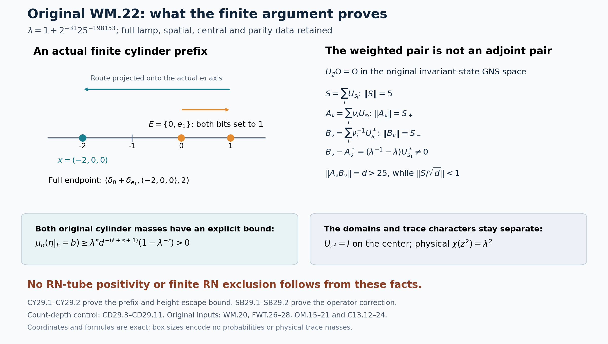

*Figure CY/SB29.* The left panel uses the full endpoint and exact route in CY29.1–CY29.1a. It projects that particular three-dimensional route onto its first coordinate; its remaining coordinates and central integer are stated explicitly. The right panel gives the actual GNS operator norms and adjoint difference in SB29.1–SB29.2. Neither panel depicts a full derivative-neighborhood probability. [Reproducible figure source](figures/draw_original_support_correction.py).

*Figure CD29.* The left branch is the exact reverse-projection norm identity CD29.6. The right branch is the full finite lamp-cylinder error CD29.7–CD29.9. Their difference bounds the actual normal error; cylinder density makes the finite witness search terminate for each fixed word list and tolerance. The final row records the clamped denominator and precise derivative-vector bound CD29.11. The measures, inverse-word convention and full graded counts are retained. Box sizes encode no probabilities or canonical trace values. [Reproducible figure source](figures/normal-count-certificates-v30.py).

### Solved applications of the prefix and count certificates

**Exercise CY29.E1 — a nonzero cell in both actual centers.** Prescribe the lamp bits one at \(0,e_1\), use \(r=1\), and keep the exact original \(\lambda\). Compute a common positive lower bound for the two phase-law masses, and identify the corresponding actual central projections.

**Solution.** The route in CY29.1a has \(s=2\), travel length \(\ell=4\), and endpoint \((\delta_0+\delta_{e_1},(-2,0,0),2)\). The actual even plus and minus prefixes have lengths ten and twelve, so their exact probabilities are \(\lambda^2/d^5\) and \(\lambda^2/d^6\). The common route bound gives

\[
 \mu_\sigma\{\eta(0)=\eta(e_1)=1\}
 \ge\lambda^2d^{-7}(1-\lambda^{-1})
 =\lambda(\lambda-1)d^{-7}>0.
 \tag{CY29.E1}
\]

The endpoint retains central integer two and even lamp parity. Under the two actual onto maps of FWT.26, the cylinder is the central projection

\[
 p_E^\pm=\frac{1-Z_0^\pm}{2}\frac{1-Z_{e_1}^\pm}{2}.
\]

Its inherited trace has the corresponding positive phase-law mass, so both actual center projections are nonzero. This statement preserves the distinct traces; it does not equate their values or replace the full boundary by a finite lamp algebra.

**Exercise CD29.E1 — choose a certified normal accuracy.** Let \(F\) contain \(m\ge1\) full group elements, let \(M\ge\max_{g\in F}M_{g^{-1}}\), and let \(\epsilon,\eta>0\) be rational. Find a common bound on the second-moment errors that makes \(E_n\le\eta/2\) in CD29.11. Explain what a checked value \(T_n\ge\eta\) proves.

**Solution.** Put \(K=a^{-1}+Ma^{-2}\) and request the rational tolerance

\[
 \zeta=\frac{\epsilon\eta}{2mK}
\]

for the fixed list \(\{e\}\cup\{g^{-1}:g\in F\}\) in Proposition CD29.2. Its finite witnesses certify every \(e_{h,n}<\zeta\) at all later depths. Therefore

\[
 E_n\le\epsilon^{-1}mK\zeta=\eta/2,
 \qquad T(F,\epsilon)\ge T_n-E_n\ge\eta/2>0.
 \tag{CD29.E1}
\]

The integral of the nonnegative bump function is positive only if its original open RN tube has positive \(\mu_V\)-mass. Equation CD29.1 then gives positive \(\mu_U\)-mass for that same tube. This is an implication from actual finite witnesses and an actual checked count value. The terminating accuracy search itself does not prove \(T_n\ge\eta\), and no such witness for every endpoint neighborhood is asserted here.

The remaining fixed-model assertion is positive original mass for every finite full-group neighborhood of the constant derivative tuple, or one genuine null neighborhood giving an all-state floor. A normal error certificate can test a specified finite datum; the sign needed for that assertion has not been proved. The general BF, capacity, bicommutant and reconstruction obligations remain at their original scope.

Human mathematical context for the canonical core and original amenability problem: Sorin Popa, [*Classification of amenable subfactors of type II*](https://doi.org/10.1007/BF02392646), *Acta Mathematica* 172 (1994), 163–255, Example2.3.3(a) and §§3.1–3.2. The complete model, center and normal count providers are the earlier WM/FWT/OM proofs in this lesson. Text, solved applications and original figures: CC0 1.0.

## Uniform finite Følner bounds for all five original likelihoods

The following is a complete finite estimate on the actual full WM.22 center.
It gives simultaneous original likelihood-cost bounds for **every seed state**
after the prescribed actual finite group average. It also improves the fixed
model's published conservative compatible-state cost bound from \(36\delta\)
to \(18\delta\), where \(\delta=\lambda-1\). It does not construct a
zero-cost invariant state or prove a positive invariant-state floor.

The model is exactly
\[
 \delta=2^{-31}25^{-198153},\quad \lambda=1+\delta,\quad
 S_+=4+\lambda,\quad S_-=4+\lambda^{-1},\quad d=S_+S_-,
 \qquad w_i=\nu_i/S_+,\quad \nu=(1,\lambda,1,1,1).
 \tag{FM21.1}
\]
The underlying algebra is the actual entire \(Z(W)\) of FWT.26, proved in FWT.1–FWT.9 above, with
the full original \(H\) action, both original normal measures and the
five original full-boundary \(R_i\) of FWT.27. The physical \(\tau\),
original \(E_A,P_0\), both canonical traces, singular states and Jones
ideal are preserved. A seed below is a center state; no physical compatibility
is asserted for a finite average. The original C13 physical return applies
to an invariant cluster.

### FM21.2. An exact bounded coboundary and the five-function cost

Put
\[
 q_i=R_i^{-1},\quad Q=\sum_{i=0}^4q_i,\qquad
 H=\sum_{i=0}^4\frac{(R_i-w_i)^2}{w_i^2R_i},\qquad
 C=\sum_{i=0}^4|q_i-w_i^{-1}|,\qquad
 \Delta=\sum_{i=0}^4|R_i-w_i|.
 \tag{FM21.2}
\]
All are bounded original full-center functions: \(1/d\le R_i\le1\),
\(1\le q_i\le d\), and \(\sum_iR_i=1\). The original pointwise
module-dimension identity, transported by the original center maps, is
\[
 \sum_{i=0}^4\beta_i^{-1}(q_i)=d1.
 \tag{FM21.3}
\]
There is an exact **pointwise** identity
\[
 \begin{aligned}
 H&=Q-d+K(w_1-R_1),\\
 K&=S_+^2(1-\lambda^{-2})>0,\\
 K(w_1-R_1)
   &=H+\sum_{i=0}^4\bigl(\beta_i^{-1}(q_i)-q_i\bigr).
 \end{aligned}
 \tag{FM21.4}
\]
Indeed \(r^{-1}-w^{-1}+(r-w)w^{-2}=(r-w)^2/(w^2r)\).
The reciprocal weights sum to \(d\). Since the other four weights
equal \(1/S_+\), summing the linear terms and using \(\sum_iR_i=1\)
gives precisely \(K(w_1-R_1)\). Equation FM21.3 gives the second line.

For any positive functional \(\phi\), Cauchy–Schwarz on the direct sum
of its five copies gives
\[
 \phi(C)\le\sqrt{\phi(H)\phi(Q)},\qquad
 \phi(\Delta)\le w_1\phi(C).
 \tag{FM21.5}
\]
The first inequality uses factors
\(|R_i-w_i|/(w_i\sqrt{R_i})\) and \(1/\sqrt{R_i}\).
The second uses \(w_iR_i\le w_1\). No normality of \(\phi\) is needed.

### FM21.3. A uniform finite dimension error, for every actual seed

Let \(F_L\) be the **original** WM.16 right Følner set, including its
central integer and parity condition, and define the normal unital positive
map and the averaged seed state
\[
 \mathcal A_L=|F_L|^{-1}\sum_{g\in F_L}\beta_g,\qquad
 \phi_L=\xi\mathcal A_L,
 \tag{FM21.6}
\]
where \(\xi\) is any state on the actual center, normal or singular.

**Proposition.** Uniformly over every seed, and already as an operator
inequality in the actual full center,
\[
 \|\mathcal A_L(Q)-d\|\le e_L,
 \qquad e_L=\frac{4(d-1)}{2L+1}.
 \tag{FM21.7}
\]

**Proof.** Apply \(\mathcal A_L\) to FM21.3. For each of the four
nonidentity labels, \(F_L\) and \(F_Ls_i^{-1}\) lose and gain exactly
\(|F_L|/(2L+1)\) group elements. This is the actual counted boundary in
WM.16, with its parity condition retained. The common terms cancel in
\(\mathcal A_L(q_i)-\mathcal A_L\beta_i^{-1}(q_i)\).
Each remaining value is in \([1,d]\); equal numbers of lost and gained
terms therefore bound the absolute difference by
\((d-1)/(2L+1)\). The identity label contributes zero. Sum the four
bounds. This proves FM21.7 pointwise, hence for every state. \(\square\)

Combining FM21.4–FM21.7 yields the finite, simultaneous original estimate
\[
 \begin{aligned}
 \phi_L(R_1)&\le w_1+e_L/K,\\
 \phi_L(C)&\le
 \sqrt{(d+e_L)\,[K(w_1-\phi_L(R_1))+e_L]},\\
 \phi_L(\Delta)&\le w_1
 \sqrt{(d+e_L)\,[K(w_1-\phi_L(R_1))+e_L]}.
 \end{aligned}
 \tag{FM21.8}
\]
The nonnegative radicand follows from \(\phi_L(H)\ge0\).
Exactly the same three bounds hold pointwise with
\(\phi_L(F)\) replaced by \(\mathcal A_L(F)\).
Thus they control all five full original likelihoods at every finite
average, without a singular-state passage through normal \(L^2\) limits.

There is also an explicit two-sided finite bound for each likelihood
mean. Put \(D_L=d+e_L\) and
\[
 t_\pm(D)=\frac{D-15\pm\sqrt{(D-25)(D-9)}}{2D}.
 \tag{FM21.9}
\]
For any \(i\), set \(a=\phi_L(R_i)\). Functional Cauchy–Schwarz,
then scalar Cauchy–Schwarz on the other four terms, gives
\(a^{-1}+16/(1-a)\le\phi_L(Q)\le D_L\).
Solving this quadratic proves
\[
 t_-(D_L)\le\phi_L(R_i)\le t_+(D_L)
 \qquad(0\le i\le4).
 \tag{FM21.10}
\]
For \(D=d\), these roots are exactly \(w_1^-\) and \(w_1^+\).
FM21.10 is a finite seed-independent estimate; it is not a claim that
all enclosed vectors are attainable on the original boundary.

There is a useful exact parity-balanced variant of this actual average:
\[
 \overline{\mathcal A}_L
       =\tfrac12\mathcal A_L(\mathrm{id}+\beta_1).
 \tag{FM21.10a}
\]
It is simply the equal-weight average over the original \(F_L\) and its
actual right translate \(F_Ls_1\), with multiplicities. No physical trace
or physical expectation is reweighted.
Let \(B_L=[-L,L]^3\), \(N=|B_L|\), and let
\(p(c)=\sum_xc(x)\pmod2\in\{0,1\}\). On the entire actual center,
\[
 \overline{\mathcal A}_L
   =\frac1{2^N(2L+1)^3}
      \sum_{\substack{\operatorname{supp}c\subset B_L\\v\in B_L}}
                     \beta_{(c,v,p(c))}.
 \tag{FM21.10b}
\]
Every displayed label is an element of the actual \(H\). To verify the
formula, use the proved whole-center \(\beta_{z^2}=1\), while retaining
\(\alpha_{z^2}\)'s physical trace character \(\lambda^2\). In the original
\(F_L\), configurations of parity \(p\) occur with the number \(n_p\)
of integers of that parity in \([-L,L]\). Right multiplication by
\(s_1=az\) toggles the lamp at the actual endpoint \(v\in B_L\) and
reverses the parity. The two weights add to
\(n_0+n_1=2L+1\). Since both lamp parities contain exactly
\(2^{N-1}\) configurations, division by \(|F_L|\) gives FM21.10b.

Thus this finite map satisfies **exactly on the full actual center**
\[
 \overline{\mathcal A}_L\beta_1
        =\overline{\mathcal A}_L.
 \tag{FM21.10c}
\]
The uniform finite lamp sum is permuted by the lamp at \(v\), and right
spatial translations change only \(v\). Their lost and gained faces
still have relative size \(1/(2L+1)\). The proof of FM21.7 now has three
nonzero terms, hence
\[
 \|\overline{\mathcal A}_L(Q)-d\|
        \le\overline e_L=\frac{3(d-1)}{2L+1}.
 \tag{FM21.10d}
\]
Every finite bound above and below therefore also holds for
\(\overline\phi_L=\xi\overline{\mathcal A}_L\), with
\(e_L\) replaced by \(\overline e_L\).
This is exact invariance under the original lamp generator on the full
algebra, not merely cancellation of one lamp expectation. It is not full
group invariance, and no varying remote test is applied to a fixed cluster.

### FM21.4. A stronger original cost bound and a fixed finite checkpoint

A second pointwise tangent identity, now at the common number \(1/5\),
is particularly useful:
\[
 \sum_i\frac{(R_i-1/5)^2}{(1/5)^2R_i}=Q-25.
 \tag{FM21.11}
\]
Therefore \(Q\ge25\). Cauchy–Schwarz as in FM21.5 and the ordinary
triangle inequality imply, for every state \(\phi\),
\[
 \begin{aligned}
 \phi(C)
 &\le\sqrt{\phi(Q)\,[\phi(Q)-25]}
           +\sum_i|5-w_i^{-1}|\\
 &=\sqrt{\phi(Q)\,[\phi(Q)-25]}
           +4(\lambda-\lambda^{-1}).
 \end{aligned}
 \tag{FM21.12}
\]
Here the four ordinary weights contribute \(4(\lambda-1)\);
the exceptional weight contributes \(4(\lambda-1)/\lambda\).
Since \(x\mapsto\sqrt{x(x-25)}\) increases for \(x\ge25\),
FM21.7 gives the explicit finite bound
\[
 \boxed{\quad
 \phi_L(C)\le
 \sqrt{(d+e_L)\,[4\delta^2/\lambda+e_L]}
       +4(\lambda-\lambda^{-1}).\quad}
 \tag{FM21.13}
\]
This is uniform over **every** original center seed.

For an actual invariant state \(\omega\), FM21.3 gives
\(\omega(Q)=d\) exactly. Consequently its original physical compatible
return has
\[
 \begin{aligned}
 C_\omega=\psi_\omega(\mathfrak a)
 &\le2\delta\sqrt{d/\lambda}
             +4(\lambda-\lambda^{-1})\\
 &<18\delta
   =\frac{18}{2^{31}25^{198153}}.
 \end{aligned}
 \tag{FM21.14}
\]
The strict inequality is exact:
\(d/\lambda=4+17/\lambda+4/\lambda^2<25\) and
\(\lambda-\lambda^{-1}=\delta(1+\lambda^{-1})<2\delta\).
This improves the conservative \(36\delta\) fixed-model bound;
the sharper of FM21.14 and C13.23 can always be retained.

One entirely specified finite checkpoint is
\[
 L_*=208\delta^{-2}=208\,2^{62}25^{396306}.
 \tag{FM21.15}
\]
It is an integer and uses the same actual WM.22 action. Since \(d\le27\),
\[
 e_{L_*}<\delta^2/4.
\]
Also \(\delta<1/10\), so
\(d+e_{L_*}=25+4\delta^2/\lambda+e_{L_*}<26\).
The radicand in FM21.13 is therefore less than
\((221/2)\delta^2<121\delta^2\). This proves the concrete finite
statement, again for every actual seed,
\[
 \boxed{\quad\phi_{L_*}(C)<19\delta,\qquad
              \phi_{L_*}(\Delta)<19w_1\delta.\quad}
 \tag{FM21.16}
\]
Moreover \(K\ge75\delta/4\) on \(1<\lambda\le2\), so FM21.8 gives
\(\phi_{L_*}(R_1)<w_1+\delta/75\).
These are sufficient finite bounds, not estimates of the necessary
averaging scale or numerical evaluations at a changed parameter.
For the parity-balanced map, the smaller definite integer
\(\overline L_*=156\delta^{-2}=156\,2^{62}25^{396306}\)
already gives the same two strict bounds in FM21.16 and
\(\overline\phi_{\overline L_*}(R_1)<w_1+\delta/75\), since
\(\overline e_{\overline L_*}<\delta^2/4\).

### FM21.5. The remaining upper endpoint

For a fixed finite \(L\), the original full-center quantity
\(M_L=\operatorname*{ess\,sup}\mathcal A_L(R_1)\) is the exact
supremum over normal seed states. Normal states supported on its
near-maximum spectral projections approach that supremum. No path endpoint
approximant or smaller observable is substituted here.

If an actual computation established \(M_L\le w_1-c\), with \(c>0\),
it would give the fixed bounded original certificate
\[
 w_1-R_1-
 \frac1{|F_L|}\sum_{g\in F_L}(\beta_g(R_1)-R_1)\ge c1.
 \tag{FM21.17}
\]
Every invariant state would then have
\(w_1-\omega(R_1)\ge c\) and original cost at least \(2c/w_1\).
FM21.7–FM21.16 do not establish such a strict inequality. They bound
\(M_L\) from above by quantities **above** \(w_1\), and do not select
the required endpoint or separate it.

The proved conclusions are the pointwise finite coboundary
identity, counted oscillation bound, exact full-center finite lamp
invariance after parity balancing, uniform simultaneous finite
likelihood and cost inequalities, the concrete WM.22 checkpoint, and the
strict improved bound FM21.14 for every original compatible state,
including all singular ones. The actual maximum
\(\max_\omega\omega(R_1)\) over invariant states remains uncomputed.
No positive floor and no zero-log-character state is claimed.

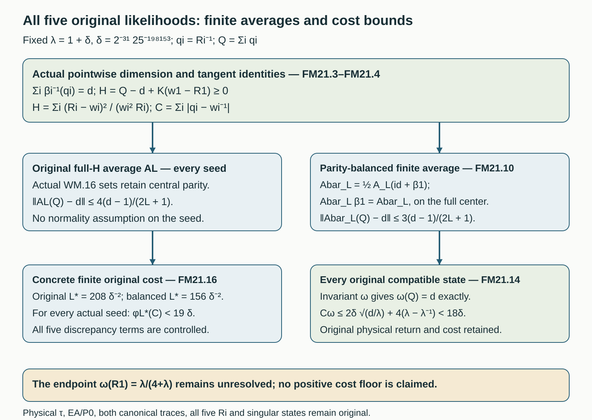

Figure FM21. The upper equations are the actual pointwise FM21.3–FM21.4,
with \(q_i=R_i^{-1}\). The finite averaging arrow uses the full original
WM.16 sets, including parity and central integer. The middle-left bounds
are FM21.7 and FM21.13–FM21.16 for every seed. The middle-right cost is
FM21.14 for every actual invariant state and its original physical return.
Areas are schematic and encode no normal trace mass. The zero endpoint
and positive separation are deliberately not asserted. [Reproducible figure source](figures/finite-original-moment-bounds-v21.py).

Complete internal proof providers: WM.16 and WM.26/WM.31,
C13.10–C13.24, E14.13–E14.15, and the full-boundary FWT.26–FWT.28.

## Actual cups give exponential control of total rounding mass

Every proper finite-index inclusion of II₁ factors has an exponential bound on the sum of the traces of one minimal projection from each finite relative-commutant block. The bound holds simultaneously for the physical trace and the original normalized finite-module trace, in all three rows after any prescribed ordinary prefix. It controls total rounding across an arbitrary number of blocks, rather than only the largest single projection trace.

The argument uses two adjacent actual Jones cups and separated copies of their finite algebra. No amenability, factorial core, numerical grouping, reflection of an infinite core, or invariant-state cost identity is assumed. Applied to a selected family, the estimate makes integer rounding of any feasible fractional allocation arbitrarily cheap. It does not produce that fractional allocation with small physical cut cost. The later Corollary POR.5 supplies the unrestricted full GTB.0–GTB.1 construction beyond this conditional allocation step.

### The three actual finite rows and their two traces

Let \(N\subsetneq M\) be II₁ factors of index \(d>1\), with normalized trace \(\tau\), and retain an actual ordinary tunnel
\[
 M=N_{-1}\supset N=N_0\supset N_1\supset\cdots.
 \tag{CTR.1}
\]
Fix any prescribed prefix through \(N_k\). Write \(g_a\in N_{a-1}\cap N_{a+1}'\) for its defining cups. Their actual relations include \(g_ag_{a+1}g_a=d^{-1}g_a\), \(g_{a+1}g_ag_{a+1}=d^{-1}g_{a+1}\), and \(\tau(g_a)=d^{-1}\). All later cups refer to an actual continuation of this exact prefix.

For \(L=M,N,N_k\), and \(j\ge k\), put
\[
 F_j^L=N_j'\cap L
      =\bigoplus_b\operatorname{Mat}_{n_{j,b}^L},\qquad
 I_j^L=[L:N_j].
 \tag{CTR.2}
\]
Its two faithful normalized traces are \(\tau|_{F_j^L}\) and
\[
 \rho_j^L(p)=
 \frac{\dim_{N_j}(pL^2(L))}{I_j^L}
 \quad(p\text{ a projection in }F_j^L).
 \tag{CTR.3}
\]
The second is the restriction of the intrinsic commutant dimension trace, not a guessed matrix normalization. For a minimal projection in block \(b\), denote these weights by \(\omega_{j,b}^{L,\tau}\) and \(\omega_{j,b}^{L,\rho}\). Define
\[
 \beta_j^{L,\sigma}=\sum_b\omega_{j,b}^{L,\sigma},
 \qquad \sigma\in\{\tau,\rho\}.
 \tag{CTR.4}
\]
Thus \(\beta_j^{L,\sigma}\) is the sum over all blocks of their minimal weights. It equals the trace of a projection with rank one in every block. In particular \(0<\beta_j^{L,\sigma}\le1\).

Both trace systems are compatible along their actual inclusions. For the module trace, restrict the \(N_j\)-module \(pL^2(L)\) to \(N_{j+1}\). Dimension and \(I_j^L\) both multiply by \(d\), proving \(\rho_{j+1}^L(p)=\rho_j^L(p)\). This invokes the actual module restriction formula in [Module dimension and local index, 2.1–2.4](module-dimension-and-local-index.md). No extension to a normal trace on the physical completion is needed.

### Exact dual cup multiplication

We first prove the module-trace identity needed for the finite cup copies. Let \(F=N_a\), \(T=N_{a+2}\), \(e=g_{a+1}\), and \(p\in F'\cap L\) be a projection. Then
\[
 \tau(pe)=\tau(p)/d,\qquad
 \rho_{a+2}^L(pe)=\rho_a^L(p)/d.
 \tag{CTR.5}
\]

The first identity follows from normal factor trace pairing: \(x\mapsto\tau(px)\) on \(F\) is tracial, so equals \(\tau(p)\tau|_F\). For the second, suppose \(p\ne0\) and put \(I=[L:F]\), \(t=\tau(p)\), \(u=\rho_a^L(p)\). The actual local module formula gives \([pLp:Fp]=Itu\). The skipped cup has \(eFe=Te\); hence for \(r=pe\), common compression of \(Fp\subset pLp\) gives
\[
 [rLr:Tr]=Itu.
 \tag{CTR.6}
\]
The ordinary inclusion \(T\subset L\) has index \(Id^2\). Applying the same actual local formula to \(r\in T'\cap L\), and using \(\tau(r)=t/d\), gives
\[
 Id^2(t/d)\rho_{a+2}^L(r)=Itu.
 \tag{CTR.7}
\]
Canceling \(It>0\) proves CTR.5. For \(p=0\), both sides vanish. This is the common-corner/skipped-cup argument of [GTB.1–GTB.2](#a-full-corner-identity-with-its-actual-maps), now stated for any of the actual larger factors \(L\). It preserves the original normalized module trace.

### Two cups supply a finite matrix component

Take adjacent cups \(e=g_{a+1}\), \(f=g_{a+2}\) and set
\[
 v=\frac d{\sqrt{d-1}}(1-e)fe,\qquad
 q=vv^*,\qquad P=e+q.
 \tag{CTR.8}
\]
The cup relations give \(v^*v=e\), \(q\le1-e\), and
\[
 f=d^{-1}e+\frac{\sqrt{d-1}}d(v+v^*)
                    +\frac{d-1}d q.
 \tag{CTR.9}
\]
Indeed \((1-e)fe\) has squared initial modulus
\((d^{-1}-d^{-2})e\), and \(f=dfef\); these two equalities prove all formulas. The elements \(e,q,v,v^*\) are exact matrix units for a unit-\(P\) copy of \(\operatorname{Mat}_2\). Thus
\[
 C_a=\{1,e,f\}''
      =\operatorname{Mat}_2(P)\oplus\mathbb C(1-P).
 \tag{CTR.10}
\]
Omit a zero second summand. Physical trace gives \(\tau(q)=\tau(e)=1/d\), so \(\tau(P)=2/d\). Positivity of the complement also proves \(d\ge2\) from the actual cups, without an index-spectrum citation.

If \(p\in F_a^L\) is any old projection, it commutes with \(C_a\). CTR.5 gives both traces of \(pe\) equal to the corresponding old trace divided by \(d\). Tracial equivalence through \(v\) gives the same value for \(pq\). The trace on this matrix component is therefore the old trace times the normalized matrix trace with two minimal weights \(1/d\). The complement has weight \(1-2/d\). By linearity on old projection spans,
\[
 \sigma(xy)=\sigma(x)\sigma(y)
 \quad(x\in F_a^L,\ y\in C_a),\qquad
 \sigma\in\{\tau,\rho\},
 \tag{CTR.11}
\]
where all values are evaluated in a common finite actual stage. For \(\rho\), use its proved compatibility; no physical \(L^2\) limit is passed to another trace.

### Total minimal weights decay in every row

**Theorem CTR.1.** For every \(m\ge k\), every \(h\ge0\), all three larger factors \(L=M,N,N_k\), and both original finite traces,
\[
 \boxed{\quad
 \beta_{m+3h}^{L,\sigma}
 \le\beta_m^{L,\sigma}(1-1/d)^h
 \le(1-1/d)^h .
 \quad}
 \tag{CTR.12}
\]
The prescribed prefix and all its cups are retained as physical operators.

**Proof.** For \(a=m,m+3,\ldots,m+3(h-1)\), construct the actual finite algebra \(C_a\) from CTR.8–CTR.10. It lies in \(N_a\cap N_{a+3}'\). Earlier finite rows and earlier cup copies commute with \(N_a\). CTR.11 therefore iterates to an injective unital actual algebra inclusion
\[
 F_m^L\otimes C_m\otimes C_{m+3}\otimes\cdots
       \otimes C_{m+3(h-1)}
 \ \subset\ F_{m+3h}^L
 \tag{CTR.13}
\]
with product traces for both \(\tau\) and \(\rho\). Injectivity follows from the faithful physical product trace. The sum of the minimal weights of a single \(C_a\) is
\(1/d+(1-2/d)=1-1/d\); at \(d=2\), only the matrix summand remains and the same formula holds. Tensor products multiply these sums.

For any unital finite-dimensional inclusion \(E\subset G\) with compatible faithful trace, let \(D_{ba}\) be its multiplicity matrix. Source and target minimal weights obey
\(\omega_a^E=\sum_bD_{ba}\omega_b^G\). Every target block is a nonzero unital representation, so \(\sum_aD_{ba}\ge1\). Consequently
\[
 \sum_b\omega_b^G
 \le\sum_b\omega_b^G\sum_aD_{ba}
 =\sum_a\omega_a^E.
 \tag{CTR.14}
\]
Apply this to CTR.13 separately for the two compatible trace systems. This proves CTR.12. No tunnel was rotated and no target was conjugated. \(\square\)

This bounds a whole sum of block weights. A bound on the largest single weight, such as the physical mesh estimate GW.26, would not bound this sum when the number of blocks grows.

### Simultaneous integer allocation for both trace budgets

**Theorem CTR.2.** At stage \(m\), give nonnegative real rank columns \(a_i=(a_{i,b})\), \(1\le i\le r\), with \(\sum_i a_i=n_m^L\). Move them to stage \(j=m+3h\) by the actual multiplicity matrix. There is an orthogonal full projection partition \(q_1,\ldots,q_r\in F_j^L\) such that, for both traces,
\[
 \sum_i\left|\sigma(q_i)-\sum_b\omega_{m,b}^{L,\sigma}a_{i,b}\right|
 <2(r-1)\beta_m^{L,\sigma}(1-1/d)^h
 \quad(r>1).
 \tag{CTR.15}
\]
For \(r=1\), take \(q_1=1\), with zero error.

**Proof.** At the target stage, round the first \(r-1\) coordinates in each block down to integers and assign the remaining integer rank to the last coordinate. These ranks are nonnegative and sum exactly to the unit rank. In each block their total absolute error is twice the sum of the first \(r-1\) fractional parts and is strictly less than \(2(r-1)\). Multiply by each actual minimal weight and sum; CTR.12 gives CTR.15. Trace restriction preserves each original real rank evaluation exactly. Consecutive disjoint diagonal coordinate sets realize the resulting integer columns as actual projections. The same rank allocation is used for the two traces. \(\square\)

Thus feasible fractional joint trace budgets in any finite actual row admit finite actual projection budgets with a simultaneous exponential error. This statement preserves two different inherited weight vectors; it does not identify them. It makes no operator-norm or physical-target approximation claim about the fractional columns themselves.

There is a corresponding bound for cuts. In any target block let \(h_{i,b}\) be the old projection ranks and let \(0\le a_{i,b}\le h_{i,b}\), with \(\sum_i a_{i,b}\le n_b\). Choose actual subprojections \(g_i'\le g_i\) of ranks \(\lfloor a_{i,b}\rfloor\). Their ranks fit the capacity, so disjoint canonical representatives and the exact actual complement exist. For either trace the total loss satisfies
\[
 \sum_i\sigma(g_i-g_i')
 \le \sum_{i,b}\omega_b^\sigma(h_{i,b}-a_{i,b})
       +r\beta_j^\sigma.
 \tag{CTR.16}
\]
The additional integer loss is therefore at most
\(r\beta_m^\sigma(1-1/d)^h\), simultaneously in the two original traces. This is a direct finite construction, not a limiting positivity certificate.

### The exact physical return and the remaining missing selection

Apply CTR.16 to the canonical representatives of a selected 76.4 family after its prescribed prefix. The representatives belong to \(F_j^{N_k}=N_j'\cap N_k\); their actual aligning unitaries lie in \(N_k\). The physical subprojections are \(r_i'=U_i g_i'U_i^*\). They remain physically orthogonal, and their genuine residual is \(f_*=1-\sum_i r_i'\). The canonical complement \(q_0\in F_j^{N_k}\) has exactly \(\tau(q_0)=\tau(f_*)\).

Projection comparison inside the physical factor \(N_k\) sends \(q_0\) to \(f_*\). The separate residual continuation therefore has a whole finite origin and fixes the prescribed prefix and cups. The original target operators are fixed. All three expectation rows follow from the actual finite relative-commutant expectations and their bimodularity.

The complete general return argument, including every target error, is already written in [HG.13–HG.16](#full-finite-marked-families-in-the-actual-weighted-diagonal-inclusion); those proofs use only actual canonical subprojections, a scalar actual complement certificate and aligning unitaries in \(N_k\). They use no diagonal or grade hypothesis. Their estimate is
\[
 \|y-E_{P_*}y\|_2
 \le\|y-E_{P_0}y\|_2+
       (1+\sqrt2)\|y\|\sqrt{
          C_j^\tau+r\beta_m^{N_k,\tau}(1-1/d)^h},
 \tag{CTR.17}
\]
where \(C_j^\tau=\sum_{i,b}\omega_{j,b}^\tau(h_{i,b}-a_{i,b})\) is the physical fractional cut loss. The exact dual loss retains its own weights and is bounded by CTR.16 with \(\sigma=\rho\). The original residual \(fA_k\) is fully included in this return; it is not discarded.

The new unconditional theorem removes the total integer-rounding term, even for arbitrarily many finite central labels and with both inherited traces. It does not remove \(C_j^\tau\). Physical orthogonality of the selected old supports does not imply feasibility of their unchanged canonical rank columns, and the actual positive fixed-family examples already rule out that inference. Proving a reselection with \(C_j^\tau\) tending to zero, or an exact scalar trace-fiber allocation giving another full residual, remains the original unrestricted construction problem.

### Exact numerical check and diagram

For \(d=3\), one separated cup copy has a matrix component of rank 2 with minimal weight \(1/3\), and a scalar component of weight \(1/3\). Two copies form the actual finite subalgebra with blocks \(\operatorname{Mat}_4,\operatorname{Mat}_2,\operatorname{Mat}_2,\mathbb C\), each minimal weight \(1/9\). Its unit masses are \(4/9,2/9,2/9,1/9\); their sum is one, whereas its total minimal weight is \(4/9=(1-1/3)^2\). It is a subalgebra of the actual late row, not an asserted decomposition of that entire row.

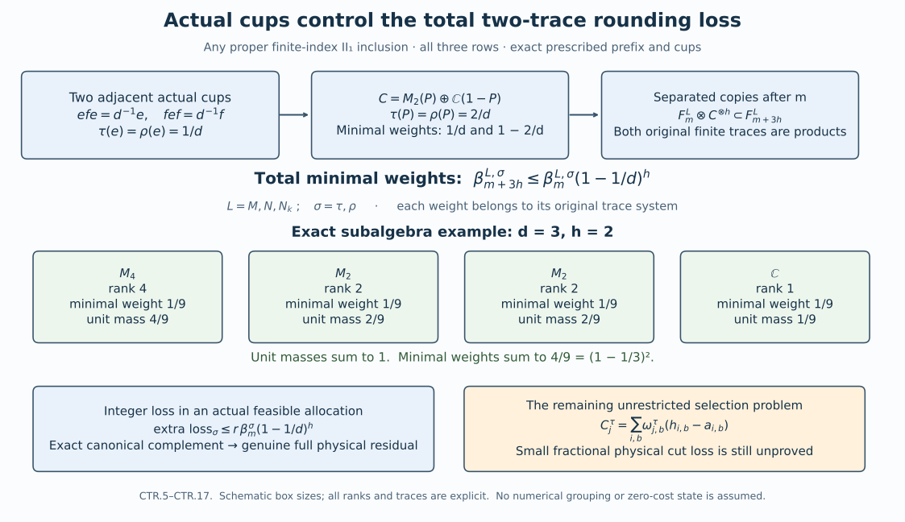

Figure CTR. The exact actual tensor subalgebra in CTR.13 controls both finite trace systems. The \(d=3,h=2\) example records ranks and minimal weights separately. The bottom panel distinguishes the exponentially vanishing integer loss from the still-uncontrolled fractional physical cut loss. Schematic box sizes encode no additional trace or metric. Proofs CTR.5–CTR.17; [reproducible diagram source](figures/cups-and-two-trace-rounding-v21.py).

Human source context: Sorin Popa, *Classification of amenable subfactors of type II*, Acta Mathematica **172** (1994), 163–255, Theorem 4.4.1(1), printed p.222, [DOI](https://doi.org/10.1007/BF02392646). The skipped-cup, module and physical-return providers are the complete internal proofs linked above. The exponential total minimal-weight estimate and both-trace rounding argument are proved here.

## A sharper return after physical cuts

Let \(N\subsetneq M\) be finite-index II₁ factors, with physical trace \(\tau\) and an actual prescribed ordinary prefix through \(N_k\), including every cup. Put \(A_k=N_k'\cap M\) and \(B_k=N_k'\cap N\). Retain the actual near-cover of76.4, whose finite upper algebra is \(P_0=(\bigoplus_i r_iP_i)\oplus fA_k\), with \(f=1-\sum_i r_i\in N_k\) and all three expectation rows. Each selected support has its own actual finite continuation after that prefix. The two inherited finite traces on every row remain \(\tau\) and \(\rho_j^L(p)=\dim_{N_j}(pL^2(L))/[L:N_j]\), for \(L=M,N,N_k\).

The exact cut/residual constructions of 80.4, HG.3/HG.13–16 and CTR.16 are the inputs; no additional allocation is assumed proved. The new estimate improves the return of their same physical candidate. The unrestricted theorem GTB.0–GTB.1 and its selection obligation remain open. Sharpness is asserted for the candidate comparison, not for final best-approximation expectation error.

### A sharper block estimate for the exact physical return

The next estimate improves the physical error bound in the return construction.

**Lemma FS.4.** In a finite tracial von Neumann algebra, let \(r=e+d\) be an orthogonal projection decomposition. Suppose \(a=rar\), \(\|a\|\le R\), and \(c\) commutes with \(e,d\), with \(\|c\|\le\gamma\le R\). Then
\[
 \boxed{\ \|a-eae-dc\|_2\le\sqrt{2(R^2+\gamma^2)\tau(d)}
       \le2R\sqrt{\tau(d)}.\ }
 \tag{FS.7}
\]
Both the bound for each \(0\le\gamma\le R\) and its constant-2 consequence are sharp for this specified compression-and-replacement candidate.

**Proof.** Write \(X=ead\), \(Y=dae\), \(Z=dad\), and \(C=dc=dcd\). The three blocks \(X,Y,Z-C\) are mutually orthogonal in the tracial Hilbert space. The inequalities \(a^*a,aa^*\le R^2r\) imply
\[
 \|X\|_2^2+\|Z\|_2^2\le R^2\tau(d),\qquad
 \|Y\|_2^2+\|Z\|_2^2\le R^2\tau(d).
 \tag{FS.8}
\]
Put \(z=\|Z\|_2\), \(s=R\sqrt{\tau(d)}\), and \(t=\gamma\sqrt{\tau(d)}\). Since \(\|C\|_2\le t\),
\[
\begin{aligned}
 \|a-eae-dc\|_2^2
 &\le2s^2-2z^2+(z+t)^2\\
 &=2s^2+2t^2-(z-t)^2\le2s^2+2t^2\le4s^2.
\end{aligned}
 \tag{FS.9}
\]
This proves FS.7 for arbitrary, possibly nonselfadjoint, \(a,c\), including zero projections or \(R=0\). For sharpness at each \(\gamma\), take equivalent legs \(e,d\) with matrix units in the unit-\(r\) corner, and set
\[
 a=\begin{pmatrix}-\gamma&\sqrt{R^2-\gamma^2}\\
                  \sqrt{R^2-\gamma^2}&\gamma\end{pmatrix},\qquad c=-\gamma1.
 \tag{FS.9a}
\]
Here \(a^2=R^2r\), \(\|c\|=\gamma\), and the cut difference has the two off-diagonal entries \(\sqrt{R^2-\gamma^2}\) and cut diagonal \(2\gamma\). If each leg has trace \(u\), its squared norm is \(2(R^2-\gamma^2)u+4\gamma^2u=2(R^2+\gamma^2)\tau(d)\), exactly the bound. At \(\gamma=R\), one can also take \(a=-Rr\), \(c=R1\), giving difference \(-2Rd\). No optimality statement for the later conditional expectation is inferred from sharpness of this particular candidate. \(\square\)

**Corollary FS.5 — full physical residual return.** In the actual marked near-cover of 76.4, let \(r_i'=e_i\le r_i\) be any of the actual continued-tunnel cuts from 80.4/HG.3/CTR.16. Put \(d_i=r_i-r_i'\), \(\Delta=\sum_i\tau(d_i)\), and \(f_*=f+\sum_i d_i\). Suppose its actual scalar canonical certificate gives the full residual origin, as in those proved constructions. Then the resulting full finite square satisfies the improved bound
\[
\begin{aligned}
 \|y-E_{P_*}y\|_2
 &\le \|y-E_{P_0}y\|_2+\sqrt{2(\|y\|^2+\gamma_y^2)\Delta}\\
 &\le \|y-E_{P_0}y\|_2+2\|y\|\sqrt\Delta\quad(y\in M).
\end{aligned}
 \tag{FS.10}
\]
Here \(\gamma_y\le\|y\|\) is the norm of the contractive old-residual lift. If the original residual is zero, take \(c=0\) and \(\gamma_y=0\), obtaining the sharper added error \(\sqrt2\|y\|\sqrt\Delta\). Every physical target, all three rows, every prescribed prefix/cup, all retained individual whole origins, and the entire residual remain exactly those of the existing return construction.

**Proof.** Put \(a=E_{P_0}y\), \(R=\|y\|\), and \(a_i=r_iar_i\). The old residual component is \(fc\) for a lift \(c\in A_k\) with \(\|c\|\le R\); the finite-kernel lift is proved in 80.4. All supports and cuts lie in \(N_k\), so \(c\) commutes with them. The existing exact residual construction supplies the same candidate
\[
 b=\sum_i r_i'a_i r_i'+f_*c\in P_*.
 \tag{FS.11}
\]
Now \(a-b=\sum_i(a_i-r_i'a_i r_i'-d_ic)\). Different summands have orthogonal old supports \(r_i\), so FS.7 squares and sums to \(\|a-b\|_2^2\le2(R^2+\gamma_y^2)\Delta\le4R^2\Delta\). Best approximation and the triangle inequality prove FS.10. The scalar certificate, actual placement in \(N_k\), and exact expectation identities are unchanged; this is an estimate of the same physical candidate. It imposes no new trace condition. \(\square\)

Here are the actual row maps and markings in that return. For each nonzero retained cell choose its proved actual terminal factor \(T_i=N_{j_i}^{(i)}\) after the prescribed prefix, with \(s_i=r_i'\in T_i'\cap N_k\). For the residual, the canonical certificate \(q_0\in N_j'\cap N_k\) has \(\tau(q_0)=\tau(f_*)\). Physical factor comparison gives \(V\in\mathcal U(N_k)\) with \(Vq_0V^*=f_*\); its actual terminal factor is \(T_0=VN_jV^*\), and \(s_0=f_*\in T_0'\cap N_k\). Omit zero cells. Define the whole supported rows
\[
\begin{aligned}
 P_*&=\bigoplus_{i\ge0}s_i(T_i'\cap M)s_i,\\
 Q_*&=\bigoplus_{i\ge0}s_i(T_i'\cap N)s_i,\\
 D_*&=\bigoplus_{i\ge0}s_i(T_i'\cap N_k)s_i.
\end{aligned}
 \tag{FS.13}
\]
These are finite unital algebras because each \(T_i\subset M\) has finite index and the orthogonal supports sum to one. The normal trace-preserving maps \(E_N:M\to N\) and \(E_{N_k}:M\to N_k\) carry the upper finite relative commutant onto its corresponding smaller row: bimodularity over \(T_i\) shows that its image commutes with \(T_i\), and the smaller row is already fixed by the expectation. Bimodularity over \(s_i\in N_k\) then gives
\[
 E_N(P_*)=Q_*,\qquad E_{N_k}(P_*)=D_*,\qquad
 E_{N_k}(Q_*)=D_*.
 \tag{FS.14}
\]
For finite \(P\subset M\) and one of these smaller factors \(L\), the range condition \(E_L(P)=P\cap L\) implies \(E_LE_P=E_{P\cap L}\): pair both sides with arbitrary \(z\in P\cap L\) in \(L^2(M,\tau)\), and observe their range is \(P\cap L\). The adjoint identity gives the reversed order. Thus all three physical expectation rows remain
\[
\begin{gathered}
 E_NE_{P_*}=E_{P_*}E_N=E_{Q_*},\\
 E_{N_k}E_{P_*}=E_{P_*}E_{N_k}=E_{D_*},\\
 E_{N_k}E_{Q_*}=E_{Q_*}E_{N_k}=E_{D_*}.
\end{gathered}
 \tag{FS.15}
\]
The lifts \(c\in A_k\) belong to every new upper row before compression: \(T_i\subset N_k\) implies \(A_k\subset T_i'\cap M\). Consequently \(f_*c\in P_*\), as required in FS.11. The same observation gives \(A_k\subset P_*\), \(B_k\subset Q_*\). Every aligning/placing unitary lies in \(N_k\), preserves earlier factors as sets, and fixes every earlier cup as an operator because those cups belong to \(A_k\). The retained cells use actual extensions of their individual old finite continuations, so their whole origins remain explicit. The residual uses its own actual continuation, and its entire physical support is \(f_*\), including all of \(f\). Conjugation by each placing unitary is a trace-preserving module isomorphism from the canonical restricted \(L^2(L)\) module to that cell's actual terminal-factor module; it therefore preserves both inherited finite trace values. This records the separate normalized dual trace for every cell and row without introducing a nonexistent common dual budget.

For CTR.16's prescribed fractional columns this becomes
\[
\begin{aligned}
 \|y-E_{P_*}y\|_2&\le\|y-E_{P_0}y\|_2\\
 &\quad+2\|y\|\sqrt{C_j^\tau+r\beta_m^{N_k,\tau}(1-1/d)^h}.
\end{aligned}
 \tag{FS.12}
\]
For the unconstrained fixed-family optimum of80.3, the exact integral minimum already has \(\Delta=\Delta_j^\tau\), and FS.10 needs no added rounding term. In both cases the individual finite dual losses retain their own weights. A family with individual terminal factors is not required to have its local normalized dual masses add to one; HG.10 explicitly supplies actual families for which that extra requirement fails.

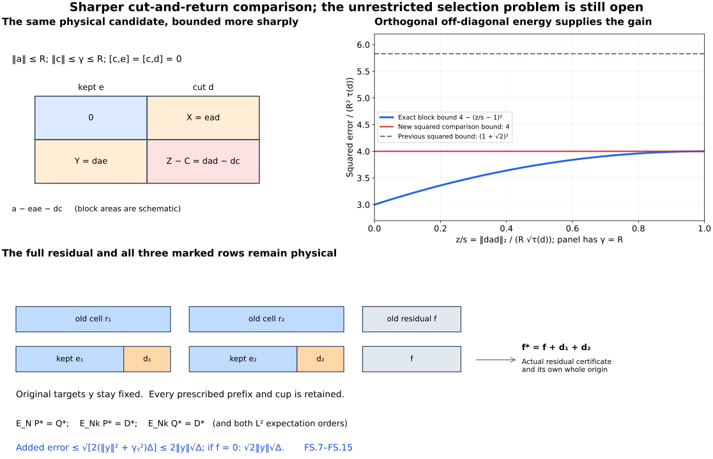

Figure FS. The block decomposition and its orthogonal energies are FS.7–FS.9. The graph shows the exact majorant with \(\gamma=R\); its height reaches 4, so the comparison norm factor is 2. The full residual and all three finite expectation rows are FS.13–FS.15. All rectangle areas are schematic. The bound is sharp for the displayed candidate; the later conditional expectation can improve it. [Reproducible figure and checks](figures/sharp-cut-return-v22.py).

Human context: Sorin Popa, Classification of amenable subfactors of type II, Acta Mathematica 172 (1994), Theorem4.4.1(1), printed p.222, https://doi.org/10.1007/BF02392646. Exact internal providers: 76.4, 80.4, HG.13–16 and CTR.16–17. The refined block inequality is fully proved above.

## Original finite logarithmic envelopes after exact lamp balancing

The following bounds concern the original fixed WM.22 inclusion. It does not construct the maximizing invariant state or
prove a positive all-state separation.

Use the entire actual coefficient center of FWT.26, the original action
\(\beta:H\to\operatorname{Aut}(Z(W))\), and exactly
\[
\begin{gathered}
 \delta=2^{-31}25^{-198153},\qquad \lambda=1+\delta,\\
 d=(4+\lambda)(4+\lambda^{-1}),\\
 \nu=(1,\lambda,1,1,1),\qquad w_i=\nu_i/(4+\lambda).
\end{gathered}
 \tag{FL22.1}
\]
The original physical \(\tau,E_A,P_0\), both finite canonical trace systems,
both normal phase laws, the central integer and parity, every group relator,
all five original \(R_i\), their inverse costs, and arbitrary singular states
are retained. No finite average below is claimed to be a physical compatible
state. C13.12–C13.13 supplies that return for an invariant cluster.

For an arbitrary state \(\xi\) on the full center and an integer \(L\ge1\), set
\[
 \phi=\xi\overline{\mathcal A}_L,\qquad
 \overline{\mathcal A}_L=\tfrac12\mathcal A_L(\mathrm{id}+\beta_1),\qquad
 e=\frac{3(d-1)}{2L+1},\qquad D=d+e.
 \tag{FL22.2}
\]
Here \(\mathcal A_L\) is the original WM.16 right Følner average, not an
average over a quotient group. The exact full-center formulas FM21.10b–d give
\(\phi\beta_1=\phi\) and \(\phi(Q)\le D\), where
\(Q=\sum_{i=0}^4R_i^{-1}\). Their proof retains the actual central integer and
parity; only the already proved action \(\beta_{z^2}=\mathrm{id}\) on the
center is used. The physical trace character of \(z^2\) remains \(\lambda^2\).

Write the original bounded full derivatives and their finite means as
\[
\begin{gathered}
 D_i=\frac{R_i}{\nu_iR_0},\qquad c=\phi(\log R_0),\\
 \ell_j=\phi(\log D_{j+1}),\\
 s=\tfrac13(\ell_1+\ell_2+\ell_3),\qquad z=e^s.
\end{gathered}
 \tag{FL22.3}
\]
All logarithms here are bounded functions in the actual full center because
\(1/d\le R_i\le1\). Thus every displayed evaluation is valid for a singular
seed as well as a normal one. Finite means \(\ell_j\) are not asserted to
form a group character; that assertion needs full invariance.

**Theorem FL22.** Define
\[
\begin{gathered}
 a=1+\lambda,\qquad b=1+\lambda^{-1},\qquad \alpha=\frac e{3b},\\
 z_\pm=\frac{1+\lambda+\alpha
       \pm\sqrt{(1+\lambda+\alpha)^2-4\lambda}}2.
\end{gathered}
 \tag{FL22.4}
\]
Uniformly over every original center seed, at this actual finite scale,
\[
\begin{gathered}
 \phi(\log R_1)-\phi(\log R_0)=\log\lambda,\\
 3\log z_-\le\ell_1+\ell_2+\ell_3\le3\log z_+.
\end{gathered}
 \tag{FL22.5}
\]
Both roots are strictly positive. If \(e>0\), then
\(z_-<1<\lambda<z_+\); at \(e=0\) they are exactly \(1,\lambda\).
The anisotropy of the three original spatial means obeys
\[
 \begin{aligned}
 3\sum_j(\ell_j-s)^2
 &\le e+3b\frac{(z-1)(\lambda-z)}z,\\
 \sum_j(\ell_j-s)^2
 &\le \frac e3+b(\sqrt\lambda-1)^2,\\
 |\ell_j-s|
 &\le\sqrt{\frac{2e}9+\frac{2b}3(\sqrt\lambda-1)^2}.
 \end{aligned}
 \tag{FL22.6}
\]
The first right-hand side is nonnegative for every actual finite mean tuple.
It therefore sharpens the root interval when the tuple is not spatially
symmetric.

There is also an exact individual-coordinate enclosure. Put
\[
\begin{gathered}
 T=D-4\sqrt D+3-ab,\\
 x_\pm=\frac{T\pm\sqrt{T^2-4ab}}{2b}.
\end{gathered}
 \tag{FL22.7}
\]
Then the discriminant is nonnegative, the roots are positive, and
\[
 \log x_-\le\ell_j\le\log x_+\quad(1\le j\le3).
 \tag{FL22.8}
\]

**Proof.** The original normal Radon–Nikodym identity and
\(\beta_1^2=\mathrm{id}\) give
\(D_1\beta_1(D_1)=1\) pointwise in the full center. Its bounded logarithm
satisfies \(\log D_1+\beta_1(\log D_1)=0\). Exact finite lamp invariance
therefore gives \(\phi(\log D_1)=0\). The original relation
\(\log D_1=\log R_1-\log\lambda-\log R_0\) proves the first equality in
FL22.5 without needing spatial invariance.

The other four logarithmic means now have their exact forms
\[
\begin{gathered}
 \phi(\log R_0)=c,\qquad \phi(\log R_1)=c+\log\lambda,\\
 \phi(\log R_{j+1})=c+\ell_j.
\end{gathered}
 \tag{FL22.9}
\]
For a state on an abelian algebra, Jensen's exponential inequality follows
directly from the pointwise scalar inequality
\(e^t\ge e^u[1+t-u]\), with \(u=\phi(t)\), by applying positivity.
Apply it to these five bounded logarithms and to their negatives. The
original \(\sum_iR_i=1\) and the finite \(\phi(Q)\le D\) give
\[
\begin{gathered}
 e^c A\le1,\qquad e^{-c}B\le D,\qquad AB\le D,\\
 A=a+\sum_je^{\ell_j},\qquad B=b+\sum_je^{-\ell_j}.
\end{gathered}
 \tag{FL22.10}
\]
Ordinary arithmetic–geometric mean for the three positive real numbers in
each sum implies
\[
 AB\ge f(s):=(a+3e^s)(b+3e^{-s}).
\]
Since \(a=\lambda b\), direct expansion gives
\[
 f(s)-d=3b\frac{(z-1)(z-\lambda)}z.
 \tag{FL22.11}
\]
Consequently
\(z^2-(1+\lambda+\alpha)z+\lambda\le0\).
Its positive roots are FL22.4. Their product is \(\lambda\), their sum is
positive, and evaluating the polynomial at \(1\) and \(\lambda\) gives
\(-\alpha\) and \(-\alpha\lambda\). This proves the root ordering and
the second assertion in FL22.5.

To retain the spatial differences rather than discard them, expand the
product exactly:
\[
 \begin{aligned}
 AB-f(s)={}&a\Bigl(\sum_je^{-\ell_j}-3e^{-s}\Bigr)
          +b\Bigl(\sum_je^{\ell_j}-3e^s\Bigr)\\
          &+2\sum_{j<k}\bigl(\cosh(\ell_j-\ell_k)-1\bigr).
 \end{aligned}
 \tag{FL22.12}
\]
The two parenthesized terms are nonnegative by arithmetic–geometric mean.
The scalar power series, or two differentiations and the value and derivative
at zero, proves \(2(\cosh t-1)\ge t^2\). Hence
\[
 AB\ge f(s)+\sum_{j<k}(\ell_j-\ell_k)^2
       =f(s)+3\sum_j(\ell_j-s)^2.
\]
Combine this with \(AB\le d+e\) and FL22.11 to obtain the first line of
FL22.6. The minimum of \(f\) occurs at \(z=\sqrt\lambda\): the two
variable terms \(3a/z+3bz\) have product \(9ab\), so their sum is at
least \(6\sqrt{ab}\), with equality there. Thus
\[
 d-\min f=3(a+b-2\sqrt{ab})
         =3b(\sqrt\lambda-1)^2.
\]
This proves the second line. If three real numbers \(u_j=\ell_j-s\) sum
to zero, then \(u_k^2+u_l^2\ge(u_k+u_l)^2/2=u_j^2/2\).
Therefore \(u_j^2\le(2/3)\sum_ku_k^2\), proving the third line.

For the individual enclosure, fix \(x=e^{\ell_j}>0\) and set
\(A'=a+x\), \(B'=b+x^{-1}\). Arithmetic–geometric mean on the other
two exponents first gives
\[
 AB\ge (A'+2y)(B'+2/y)
       \ge (\sqrt{A'B'}+2)^2,
 \qquad y=e^{(\ell_k+\ell_l)/2}.
\]
The second inequality is \(A'/y+B'y\ge2\sqrt{A'B'}\).
Since \(D\ge d>25\), taking square roots of
\((\sqrt{A'B'}+2)^2\le D\) preserves the inequality and permits
subtracting two. Squaring gives
\[
 A'B'\le(\sqrt D-2)^2,
 \qquad bx+a/x\le D-4\sqrt D+3-ab=T.
\]
Thus \(bx^2-Tx+a\le0\). To check the roots independently of the
state, write \(r=\sqrt{ab}\ge2\). The identities \(a+b=ab\) and
\(d=ab+3(a+b)+9\) give \(d=4r^2+9\), and
\[
 d-4\sqrt d+3-ab-2r
   =3r^2-2r+12-4\sqrt{4r^2+9}\ge0,
\]
because the right side is zero at \(r=2\) and its derivative
\(6r-2-16r/\sqrt{4r^2+9}\) is at least \(6r-10>0\)
for \(r>2\). The function \(D-4\sqrt D\) increases on \(D\ge25\),
so \(T\ge2r=2\sqrt{ab}\) for every \(D\ge d\). The roots in
FL22.7 are therefore real and positive, and the quadratic inequality
puts \(x\) between them. Taking logarithms proves FL22.8. \(\square\)

### Exact finite endpoint attempts and their boundary

At the original parameter, \(e>0\) at every finite \(L\). The finite sum
enclosure therefore extends on both sides of the invariant interval
\([0,3\log\lambda]\); it does not require the finite mean to be positive.
In the Følner limit \(e\to0\), FL22.5 recovers the actual T15.5 enclosure.
FL22.6 and FL22.8 additionally enclose the full, possibly anisotropic
triple of original spatial means for every invariant state.

Neither the zero tuple nor the tuple
\((\log\lambda,\log\lambda,\log\lambda)\) is excluded by these necessary
enclosures. The zero tuple is compatible with the constant five likelihoods
\(R_i=w_i\); the second tuple is compatible with the exact opposite
height vector of T15.6. Their consistency does not imply their occurrence
in the full original boundary's essential support. Consequently no equality
\(\max_\omega\omega(R_1)=\lambda/(4+\lambda)\), strict upper separation,
zero original cost, or positive original floor is asserted.

The finite lamp average leaves this precise selection gap. The compact Radon–Nikodym model method also does not
close it: that method embeds an actual stationary action into a space of
normalized positive harmonic functions, but it does not put the constant
harmonic function into the essential support of this particular normal
boundary law. The latter is what the endpoint attempt still lacks.

### Proof providers and literature comparison

The actual full-center and two-phase providers are FWT.1–FWT.9 and
FWT.26–28 in the current course source. The original derivative and
bounded lamp logarithm providers are E14.13–15 and T15.1–6. The exact
balanced finite group map and dimension bound are FM21.10a–d. The
original physical return and cost are C13.12–24. The normal count-depth
provider is OM.15–21: for each fixed finite \(L\) and fixed normal orbit
summand, its count-depth limit is taken before a possibly singular
Følner cluster. This proof evaluates bounded full-center functions
directly and never passes a singular state through an \(L^2\) limit.

Nachi Avraham-Re'em and Michael Björklund,
*On stationary actions of locally compact groups and their Radon–Nikodym
cocycles* (2026), §§1–2 and 7.3–7.4,
[arXiv:2604.09093v1](https://arxiv.org/html/2604.09093v1).
Its compact harmonic-function model is a useful formulation of the
support question, but gives no support-attainment theorem for WM.22.
The finite inequalities above have their complete proofs here.

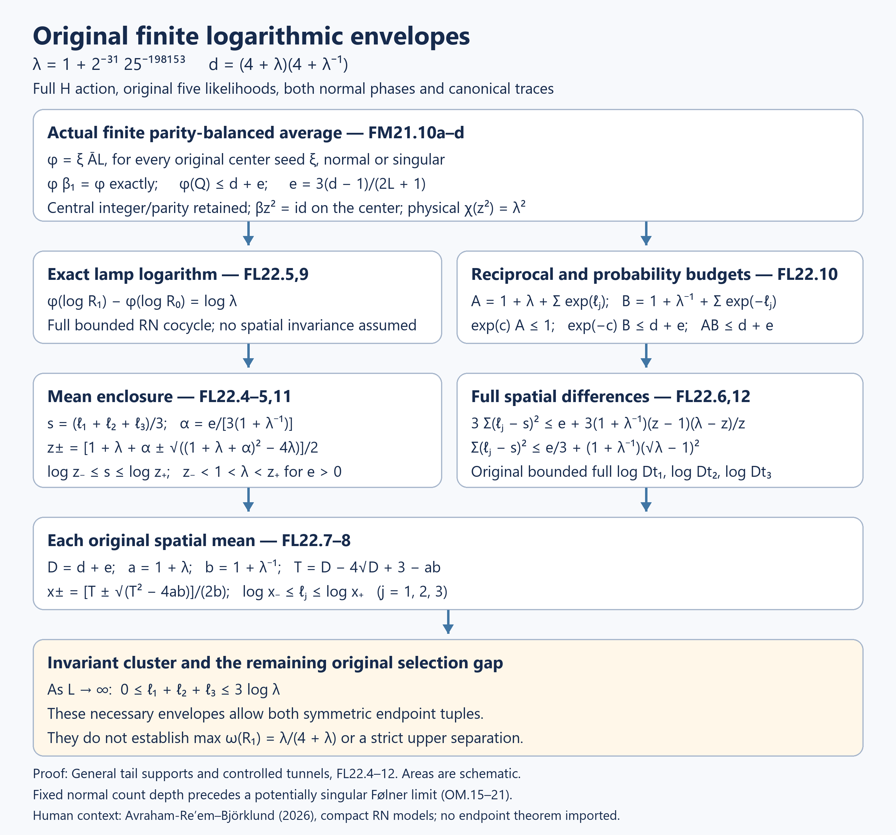

Figure FL22. The arrows start with the original finite parity-balanced
full-H average, then use its exact lamp invariance and finite reciprocal
budget. The first interval displays the exact roots in FL22.4; it is
schematic and not a metric rendering of the extraordinarily small fixed
parameter. The second box retains anisotropic spatial logarithms, as
FL22.6 does. The bottom box labels the invariant interval without
asserting that either endpoint is attained. Complete proof locators are
FL22.4–12 and FM21.10a–d. [Reproducible figure source](figures/finite-logarithmic-envelope-v22.py).

## Integral scalar trace exchanges in actual Jones-tower rows

The physical trace of a residual certificate is the datum needed to place its unit in the physical II₁ factor. Its other finite traces are additional data, and can change under a physical-trace-null rank exchange. The construction below makes such exchanges integral inside actual separated cup algebras. It applies to arbitrary actual proper finite-index inclusions. It does not derive a small-loss allocation from amenability, and does not replace the original unrestricted finite-family theorem.

The exact inputs are CTR.5–CTR.13 of Lesson 99, the finite actual alignment of 57.3, scalar placement 78.2, and the three-row marked return HG.13–HG.16/FS.10–FS.15. The human source for the original endpoint is Sorin Popa, *Classification of amenable subfactors of type II*, Acta Mathematica **172** (1994), Theorem 4.4.1(1), printed p.222, DOI 10.1007/BF02392646.

### The actual finite row and its integral trace relations

Fix an actual ordinary prefix through \(N_k\), then an actual continuation to \(N_m\), \(m\ge k\). Write

\[
 F=N_m'\cap N_k=\bigoplus_{b=1}^s\operatorname{Mat}_{n_b},
 \qquad \omega_b=\tau(e_{11}^b),\qquad
 \sum_b n_b\omega_b=1.
 \tag{SFQ.1}
\]

Let \(g_1,\ldots,g_r\in F\) be projections with ranks \(h_{ib}\). They need not be orthogonal in this canonical row. In the physical return they represent an orthogonal near-cover by actual finite alignment. Define the integral physical-trace kernel

\[
 L_\tau=\{v\in\mathbb Z^s:\sum_b\omega_bv_b=0\}.
 \tag{SFQ.2}
\]

Take finitely many vectors \(\kappa^1,\ldots,\kappa^q\in L_\tau\). They need only span the particular exchange used below. The empty list is allowed. Choose real coefficients \(\theta_t\), and real retained ranks \(0\le a_{ib}\le h_{ib}\). Put

\[
 z_b=\sum_t\theta_t\kappa_b^t,
 \qquad b_b=n_b-\sum_i a_{ib}+z_b.
 \tag{SFQ.3}
\]

Assume a strict finite residual interior:

\[
 0<b_b<n_b\quad(1\le b\le s).
 \tag{SFQ.4}
\]

This is a finite input, not a conclusion from amenability. It can hold even when \(\sum_i a_{ib}>n_b\), because the exchange changes the residual's rank representative in its scalar trace fiber.

Define

\[
\begin{gathered}
\eta=\min_b\{b_b,n_b-b_b\}>0,\qquad K=\frac12\max_b\sum_t|\kappa_b^t|,\\
D_0=\max\{1,\lceil(r+K)/\eta\rceil\}.
\end{gathered}
 \tag{SFQ.5}
\]

For each \(L=M,N,N_k\), let \(\rho_j^L\) be the original normalized finite module trace on \(F_j^L=N_j'\cap L\). A trace label \(\sigma\) means either the physical trace or one of these three module trace systems. At source level define \(\sigma_0\) by restricting \(\tau\) or \(\rho_m^L\) to \(F\). At target level \(j=m+3h\), define \(\sigma_h=\tau|_{F_j^L}\) or \(\sigma_h=\rho_j^L\), respectively. Both \(g_i'\) and \(q_0\) will lie in \(F_j^{N_k}\subset F_j^L\), so all their target trace evaluations are in that declared domain.

The actual module restriction formula in 2.1–2.4/CTR.3 gives \(\sigma_h|_F=\sigma_0\): restricting \(gL^2(L)\) from \(N_m\) to \(N_j\) multiplies its dimension by \(d^{3h}\), and \([L:N_j]\) acquires the identical factor. Define the source minimal weights \(w_b^\sigma=\sigma_0(e_{11}^b)\). These four faithful vectors satisfy \(\sum_b n_bw_b^\sigma=1\), and need not coincide. Set

\[
\begin{gathered}
C_\sigma=\sum_{i,b}w_b^\sigma(h_{ib}-a_{ib}),\\
A_\sigma=\sum_{i,b}w_b^\sigma a_{ib},\qquad W_\sigma=\sum_b w_b^\sigma\le1.
\end{gathered}
 \tag{SFQ.6}
\]

Write \(R_0=\lceil\log_2D_0\rceil\), with \(R_0=0\) when \(D_0=1\). The exact total unit mass of cup blocks too small for the strict interior is

\[
 B_h(D_0)=\sum_{0\le\ell<R_0}\binom h\ell
             (2/d)^\ell(1-2/d)^{h-\ell}.
 \tag{SFQ.6a}
\]

Only \(\ell\le h\) are summed. At \(d=2\), absent scalar components contribute nothing, so this value is one when \(2^h<D_0\) and zero otherwise.

### A finite construction with an exact physical complement

**Theorem SFQ.1.** For every integer \(h\ge0\), there are actual projections

\[
 g_i'\le g_i\text{ in }N_{m+3h}'\cap N_k,
 \qquad q_0\in N_{m+3h}'\cap N_k,
 \tag{SFQ.7}
\]

such that

\[
 \tau(q_0)=1-\sum_i\tau(g_i'),
 \tag{SFQ.8}
\]

and, simultaneously for the physical trace and each original finite module trace in all three rows,

\[
\begin{gathered}
\sum_i\sigma_h(g_i-g_i')\le C_\sigma+rW_\sigma(1-1/d)^h+A_\sigma B_h(D_0),\\
d=[M:N].
\end{gathered}
 \tag{SFQ.9}
\]

The same projections work for every listed trace. Formula (SFQ.8) is asserted only for the physical trace. A dual trace need not annihilate any \(\kappa^t\).

**Proof.** CTR.8–CTR.13 supply an actual injective unital inclusion

\[
 F\otimes C^{\otimes h}\subset N_{m+3h}'\cap N_k,
 \qquad C=\operatorname{Mat}_2\oplus\mathbb C,
 \tag{SFQ.10}
\]

where a minimal projection in the matrix summand has weight \(1/d\), and the scalar summand has weight \(1-2/d\). At \(d=2\), omit the zero scalar summand. The physical and each row's original dual trace separately factor on (SFQ.10), by CTR.5/CTR.11. In particular the dual factorization is an actual module-dimension calculation, not an identification with the physical trace.

For a cup block \(c\), let its matrix size be \(D_c=2^{\ell(c)}\), and its common cup minimal weight be

\[
\begin{gathered}
\gamma_c=d^{-\ell(c)}(1-2/d)^{h-\ell(c)},\\
\sum_c D_c\gamma_c=1,\qquad\sum_c\gamma_c=(1-1/d)^h.
\end{gathered}
 \tag{SFQ.11}
\]

Only nonzero blocks are summed. Repeated cup blocks with the same size remain separate summands; equivalently their number is \(\binom h\ell\).

In a block with \(D=D_c\ge D_0\), put

\[
\begin{gathered}
u_{icb}=\lfloor Da_{ib}\rfloor,\qquad k_{ct}=\lfloor D\theta_t+1/2\rfloor,\\
t_{cb}=Dn_b-\sum_i u_{icb}+\sum_t k_{ct}\kappa_b^t.
\end{gathered}
 \tag{SFQ.12}
\]

These are integer ranks. Every retained rank satisfies \(0\le u_{icb}\le Dh_{ib}\). Moreover

\[
 -K\le t_{cb}-Db_b<r+K.
 \tag{SFQ.13}
\]

Indeed each coefficient rounding error has absolute value at most \(1/2\), and each floor deficit lies in \([0,1)\). Since \(D\eta\ge r+K\), (SFQ.4) gives \(0\le t_{cb}\le Dn_b\). Choose inside the actual projection \(g_i\otimes1_c\) a subprojection of rank \(u_{icb}\) in each block \((b,c)\). Separately choose a diagonal projection of rank \(t_{cb}\). Its location need not be orthogonal to the retained canonical projections.

For a cup block with \(D_c<D_0\), retain no old rank and give the residual the whole unit rank: \(u_{icb}=0\), \(t_{cb}=D_cn_b\). All these choices are projections in the actual subalgebra (SFQ.10); their direct sums are \(g_i'\) and \(q_0\).

For every large cup block, the integer exchange has physical trace zero:

\[
 \sum_b\omega_b t_{cb}
 =D_c-\sum_{i,b}\omega_bu_{icb},
 \tag{SFQ.14}
\]

because every \(\kappa^t\in L_\tau\). The same equality holds on small blocks by their definition. Multiplying by \(\gamma_c\), summing and using (SFQ.11) proves the exact equality (SFQ.8). No scalar rounding error remains in that equality.

On large blocks the loss for any of the four trace vectors is bounded by

\[
 \sum_{i,b}w_b^\sigma(D_ch_{ib}-u_{icb})
 \le D_c C_\sigma+rW_\sigma.
 \tag{SFQ.15}
\]

On small blocks the loss is \(D_c(C_\sigma+A_\sigma)\). The desired fractional loss thus contributes exactly \(C_\sigma\sum_cD_c\gamma_c=C_\sigma\). The added large-block loss is at most \(rW_\sigma\sum_c\gamma_c\). The added small-block loss is exactly \(A_\sigma\sum_{D_c<D_0}D_c\gamma_c=A_\sigma B_h(D_0)\), by grouping the \(\binom h\ell\) cup blocks of dimension \(2^\ell\). This proves (SFQ.9). A convenient coarser bound is

\[
 \sum_i\sigma_h(g_i-g_i')
 \le C_\sigma+[rW_\sigma+(D_0-1)A_\sigma](1-1/d)^h.
 \tag{SFQ.9a}
\]

Indeed every small integer dimension is at most \(D_0-1\). This is one finite construction and one value of \(h\) for all rows. \(\square\)

The physical orthogonal near-cover gives \(S_\tau=\sum_i\tau(g_i)\le1\), hence \(A_\tau\le1\). For a canonical dual trace, \(S_\sigma=\sum_i\sigma_0(g_i)\) can exceed one; only \(A_\sigma\le S_\sigma\le r\) follows. The exact small-block discarded old mass is \(S_\sigma B_h(D_0)\). No physical bound of one is transferred to that dual mass.

Zero old projections are simply returned as zero. If the old family is empty or consists entirely of zero cells, use \(q_0=1\) in the existing finite row and no cuts, without invoking the strict interior. The entire physical residual then has this whole origin. An empty integer-kernel list means \(z=0,K=0\); the construction and proof remain valid for every input satisfying (SFQ.4). These endpoint conventions manufacture no missing relation or interior allocation.

### Every other compatible finite trace remains explicit

For an arbitrary normalized trace \(\xi\) at the full finite target stage, restrict it to the actual subalgebra (SFQ.10), and write \(\lambda_{bc}^\xi\) for its minimal weights there. They need not factor as source weight times \(\gamma_c\). Every exact evaluation is

\[
\begin{gathered}
\xi(q_0)=\sum_{b,c}\lambda_{bc}^\xi t_{cb},\\
\xi(g_i')=\sum_{b,c}\lambda_{bc}^\xi u_{icb},\\
\xi(g_i-g_i')=\sum_{b,c}\lambda_{bc}^\xi(D_ch_{ib}-u_{icb}).
\end{gathered}
 \tag{SFQ.16}
\]

The rank inequalities above ensure positivity and unit bounds for every such trace, including restrictions of all compatible norm traces. No other trace is erased from the finite cone. There is no claim that these traces annihilate the physical kernel or have the four canonical trace factorization laws. For an original canonical dual trace, the exact residual correction is particularly explicit:

\[
 \sigma_h(q_0)-\bigl(1-\sum_i\sigma_h(g_i')\bigr)
 =\sum_{c:D_c\ge D_0}\gamma_c
       \sum_t k_{ct}\bigl(\sum_b w_b^\sigma\kappa_b^t\bigr).
 \tag{SFQ.17}
\]

Thus a physical-null move can change the dual residual value. Formula (SFQ.17), rather than an assumed zero, is the resulting actual dual datum.

### Return to the same physical targets and marked three rows

Suppose these canonical \(g_i\) represent an actual 76.4 near-cover after the fixed prefix: \(r_i=U_ig_iU_i^*\), with \(U_i\in\mathcal U(N_k)\), orthogonal physical \(r_i\), and old residual \(f=1-\sum_i r_i\). Set

\[
 r_i'=U_ig_i'U_i^*\le r_i,\qquad
 f_*=f+\sum_i(r_i-r_i'),\qquad
 \Delta=\sum_i\tau(r_i-r_i').
 \tag{SFQ.18}
\]

The equality (SFQ.8) gives \(\tau(q_0)=\tau(f_*)\). Actual finite-factor comparison in \(N_k\) places \(q_0\) onto \(f_*\) by a unitary in \(N_k\). Use that conjugate continuation for the whole residual, and the actual extended old continuations for the cuts. HG.13–HG.16 and FS.10–FS.15 apply literally: their hypotheses are actual cuts, actual continuations and an exact scalar complement, not canonical orthogonal packing. They give full supported upper, middle and lowest rows, both orders of all three expectation identities, all earlier cups and finite prefix algebras, and the entire physical residual including \(f\).

Explicitly, put \(j=m+3h\), \(T_i=U_iN_jU_i^*\), and \(T_0=vN_jv^*\), where \(vq_0v^*=f_*\). With \(e_i=r_i'\), \(e_0=f_*\), and zero terms omitted, the rows are

\[
 P_* =\bigoplus_a e_a(T_a'\cap M)e_a,\quad
 Q_* =\bigoplus_a e_a(T_a'\cap N)e_a,\quad
 D_* =\bigoplus_a e_a(T_a'\cap N_k)e_a.
 \tag{SFQ.18a}
\]

Their units sum to one, every \(T_a\) is the terminal factor of its actual continuation of the same prescribed prefix, and \(e_a\in T_a'\cap N_k\). Actual finite-stage expectation and support bimodularity give \(E_N(P_*)=Q_*\), \(E_{N_k}(P_*)=D_*\), and \(E_{N_k}(Q_*)=D_*\). The trace-preserving \(L^2\) projection pairing and adjoints therefore give

\[
 E_NE_{P_*}=E_{P_*}E_N=E_{Q_*},\quad
 E_{N_k}E_{P_*}=E_{P_*}E_{N_k}=E_{D_*},\quad
 E_{N_k}E_{Q_*}=E_{Q_*}E_{N_k}=E_{D_*}.
 \tag{SFQ.18b}
\]

The targets are the original physical \(y\). If \(c_y\in A_k\) is its norm-preserving old residual lift, \(\gamma_y=\|c_y\|\le\|y\|\), then

\[
\begin{gathered}
\|y-E_{P_*}(y)\|_2\le\|y-E_{P_0}(y)\|_2\\
\qquad+\sqrt{2(\|y\|^2+\gamma_y^2)\Delta},\\
\Delta\le C_\tau+rW_\tau(1-1/d)^h+A_\tau B_h(D_0).
\end{gathered}
 \tag{SFQ.19}
\]

Each original module trace is transported through its own actual module isomorphism. Its cut loss is bounded by (SFQ.9), and its canonical residual value is (SFQ.17). No sum-one dual budget for pieces with different terminal factors is imposed. The original old supports may be cut; the physical placement changes no targets and fixes all earlier cups because the unitaries lie in \(N_k\).

### Exact boundary

The new result is a finite actual scalar-fiber quantization and physical return construction. It allows a real exchange in the span of integral physical-trace relations, rather than demanding coordinatewise canonical packing. The cup depth removes its integer implementation loss while preserving all actual data.

This scalar-fiber quantization argument does not produce the required nearly uncut real retained ranks and strict residual representative from unrestricted amenability; the later permutation-orbit construction supplies the full finite theorem. The physical kernel may be trivial, and a real scalar-null vector outside the span of the integral kernel is not quantized by this proof. No trace uniqueness, factoriality, compatible numerical grouping, arbitrary AF example, or positive finite bound is substituted for that missing step. The later Corollary POR.5 proves the original GTB.0–GTB.1 full finite-family theorem, and SA.6–SA.7 prove the original forward finite and separable generating clauses. The general physical bicommutant remains open at its full original hypotheses. The separate whole ordinary-model reconstruction, corrected nonextremal comparison and full extremal opposite-model characterization are [17.8–17.18](generating-tunnels-and-classification.md).

*Written by GPT-6.1 Sol (OpenAI). Public domain (CC0-1.0).*

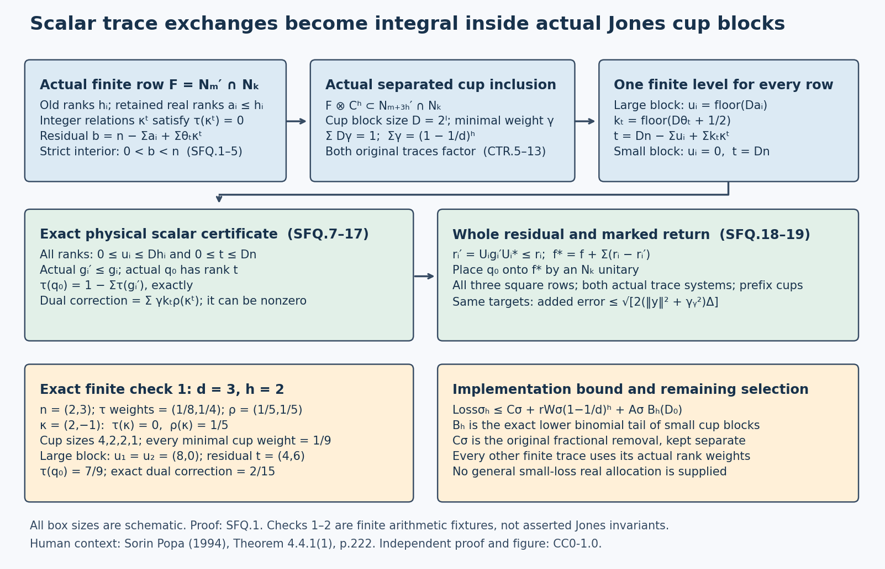

Figure SFQ. The actual finite row and separated cup inclusion lead to integral retained ranks and an exact scalar physical residual certificate. Both original trace systems remain explicit; a physical-null rank exchange can have a nonzero dual value. Box sizes are schematic. The numerical check illustrates the finite algorithm and is not asserted to be a subfactor invariant. Proof locators: SFQ.1–SFQ.19, including SFQ.6a and SFQ.9a; Exercises72–73. Human context: Sorin Popa, *Classification of amenable subfactors of type II* (1994), Theorem4.4.1(1), printed p.222, [DOI](https://doi.org/10.1007/BF02392646). [Reproducible diagram and exact finite checks](figures/scalar-fiber-quantization-v23.py).

## Physical cup mixing of marked whole-cell near-covers

Two finite local choices can be mixed inside the original inclusion. The operation uses actual cup projections and a small correction of the resulting physical overlaps. It preserves every cell's whole-tunnel origin, every prescribed prefix and cup, all three expectation rows, and both inherited finite traces. Its canonical central profile is an exact weighted average, after an explicitly identified change of core. The weights can approach one half, and the added error on each original target can approach zero.

This operation does not assert that a chosen near-cover has a finite whole-cell residual. It also does not show that the attainable profiles have arbitrarily small positive-part loss.

### The actual data

Let \(N\subsetneq M\) be finite-index II₁ factors with index \(d>1\) and physical trace \(\tau\). Assume the relative Følner hypothesis of76.4. Fix an ordinary prefix through \(N_k\), including its marked cups, and a reference continuation. For \(L=M,N,N_k\), write

\[
\begin{gathered}
F_j^L=N_j'\cap L,\qquad S^L=(\bigcup_{j\ge k}F_j^L)'',\\
T^L=E_{Z(S^L)}^{S^L}.
\end{gathered}
 \tag{PCM.1}
\]

The second inherited finite trace is
\(\rho_j^L(p)=\dim_{N_j}(pL^2(L))/[L:N_j]\) on a projection \(p\in F_j^L\). It is compatible under actual restriction of scalars. It is not identified with \(\tau\), and no normal extension of \(\rho\) to the physical core is needed here.

Take two finite near-covers of the form in76.4, with nonempty good families. Their good supports are \(r_1,\ldots,r_a\in N_k\) and \(s_1,\ldots,s_b\in N_k\), respectively, each family orthogonal within itself. Their residuals are \(f_A=1-\sum_i r_i\), \(f_B=1-\sum_j s_j\), with traces \(\theta_A,\theta_B\). All individual ordinary continuations extend the prescribed prefix. Finite marked alignment supplies \(U_i,V_j\in\mathcal U(N_k)\). At a common reference level \(m\) beyond all selected levels, put

\[
 g_i=U_i^*r_iU_i\in F_m^{N_k},\qquad
 h_j=V_j^*s_jV_j\in F_m^{N_k}.
 \tag{PCM.2}
\]

An individual tunnel is extended by the reference continuation transported under its aligner. These extensions retain its old finite segment. The \(g_i\), and separately the \(h_j\), need not be orthogonal in the reference algebra.

For each fixed physical target \(y\) let

\[
 a_y=\sum_i a_{i,y},\qquad b_y=\sum_j b_{j,y},\qquad
 a_{i,y}\in r_i A_{m_i}^{(i)}r_i,\quad
 b_{j,y}\in s_j A_{n_j}^{(j)}s_j,
 \tag{PCM.3}
\]

be good-cell candidates with norms at most \(R\), where \(R\ge1\) also bounds the targets. Set \(e_A(y)=\|y-a_y\|_2\), \(e_B(y)=\|y-b_y\|_2\). If the candidates are the good components of the conditional expectations onto the two full near-cover squares, these errors are at most their original expectation errors plus \(R\sqrt{\theta_A}\), respectively \(R\sqrt{\theta_B}\). This follows by discarding only the old residual component, whose operator norm is at most \(R\).

### An exact finite correction of nearly orthogonal projections

**Lemma PCM.1.** Let \(p_1,\ldots,p_n\) be projections in a II₁ factor \(A\), with \(\sum_t\tau(p_t)\le1\). Put

\[
 \Omega=\sum_{t>u}\tau(p_t p_u),\qquad
 C_n=32\,33^{n-1}\quad(n\ge2).
 \tag{PCM.4}
\]

There are orthogonal projections \(p_t'\in A\) with \(\tau(p_t')=\tau(p_t)\) and

\[
 \sum_t\|p_t'-p_t\|_2^2\le C_n\Omega.
 \tag{PCM.5}
\]

There are \(w_t\in\mathcal U(A)\) carrying \(p_t\) to \(p_t'\), with \(\|w_t-1\|_2\le2\|p_t'-p_t\|_2\). For \(n=1\), take \(p_1'=p_1\), \(w_1=1\).

**Proof.** Suppose the earlier corrected projections have been chosen and put \(Q=1-\sum_{u<t}p_u'\). The total-trace hypothesis gives \(\tau(Q)\ge\tau(p_t)\). For \(x=Qp_t\), extend its polar partial isometry to a partial isometry \(W\) with initial projection \(p_t\) and final projection \(p_t'\le Q\). The missing initial support can be matched to a subprojection of \(Q\) orthogonal to the old final support: its trace capacity is exactly the inequality just stated. With \(\ell=\tau(p_t(1-Q))\),

\[
 \|x-p_t\|_2^2=\ell,\qquad
 \|W-x\|_2^2
 =\tau(p_t)+\tau(x^*x)-2\tau(|x|)\le\ell.
 \tag{PCM.6}
\]

The last inequality uses \(0\le|x|\le p_t\), hence \(|x|\ge|x|^2=x^*x\). Thus \(\|W-p_t\|_2\le2\sqrt\ell\), and expansion of \(WW^*-p_t\) gives \(D_t:=\|p_t'-p_t\|_2^2\le16\ell\). For earlier \(u\),

\[
 \tau(p_t p_u')=\|p_t p_u'\|_2^2
 \le2\tau(p_t p_u)+2D_u.
\]

Consequently \(D_t\le32\sum_{u<t}\tau(p_t p_u)+32\sum_{u<t}D_u\). For \(H_t=\sum_{u\le t}D_u\), this gives
\(H_t\le33H_{t-1}+32\sum_{u<t}\tau(p_t p_u)\), with \(H_1=0\). Iteration proves PCM.5 with the stated, deliberately generous finite constant. The small unitaries are exactly76.1, applied in \(A\). \(\square\)

In particular, if norm-\(R\) candidates \(c_t\) are supported by the \(p_t\), transporting them by these unitaries changes their sum in \(L^2\) by at most

\[
 \sum_t\|w_tc_tw_t^*-c_t\|_2
 \le4R\sqrt{nC_n\Omega}.
 \tag{PCM.7}
\]

This follows by expanding each conjugation and using Cauchy–Schwarz over the finite family. The constant is only a finite perturbation bound; no sharpness is asserted.

### Finite cup atoms have both original traces

**Lemma PCM.2.** Beyond level \(m\), use the separated actual cups
\(e_t=g_{m+3t+1}\), \(0\le t<\ell\), and put \(\delta=d^{-1}\). Their commuting atoms are

\[
 c_\epsilon=\prod_{t<\ell}e_t^{\epsilon_t}(1-e_t)^{1-\epsilon_t},
 \qquad \epsilon\in\{0,1\}^{\ell}.
 \tag{PCM.8}
\]

For \(p\in F_m^L\) a projection and \(J\ge m+3\ell\),

\[
\begin{gathered}
\sigma_J^L(pc_\epsilon)=\sigma_m^L(p)\\
\qquad\cdot\prod_{t<\ell}\delta^{\epsilon_t}(1-\delta)^{1-\epsilon_t},\qquad\sigma=\tau,\rho.
\end{gathered}
 \tag{PCM.9}
\]

The weak closure of their increasing abelian algebras is diffuse. It contains a projection \(c\) of trace one half and increasing finite atom sums \(c_\ell\le c\) with \(\tau(c_\ell)\uparrow1/2\). These are actual finite cup polynomials.

**Proof.** A later separated cup commutes with all earlier atoms and with \(p\). The earlier product belongs to the actual relative commutant at the later cup's starting level. CTR.5 multiplies each of its two trace values by \(\delta\); subtraction from that earlier product multiplies the complementary value by \(1-\delta\). Induction proves PCM.9, using compatibility of the inherited trace when a level is advanced. The atoms sum to one and have positive traces. Their largest trace is at most \(\max(\delta,1-\delta)^\ell\), which tends to zero.

For completeness, build \(c_\ell\) monotonically. Start with zero. At each finite stage retain the previously selected atoms and add unselected atoms while their total still fits beneath one half. The remaining gap is smaller than the largest atom, because otherwise another atom would fit. The increasing projection limit \(c\) therefore has trace one half, and \(\|c-c_\ell\|_2^2=1/2-\tau(c_\ell)\to0\). The same construction with any target trace in \([0,1]\) proves diffuseness. \(\square\)

The full future cup algebra has a unital II₁-factor closure \(K\subset N_m\cap S^{N_k}\), by52.1. It commutes with every old \(F_m^L\). If \(q\) is any of the finite projections above, then for every old projection \(p\in F_m^L\),

\[
 T^L(pq)=\tau(q)T^L(p).
 \tag{PCM.10}
\]

Indeed, for positive \(z\in Z(S^L)\), the normal functional \(x\mapsto\tau(zpx)\) on the factor \(K\) is tracial, since \(zp\) commutes with \(K\). It equals \(\tau(zp)\tau|_K\). Testing against all such \(z\) proves PCM.10. This argument concerns the physical normal central expectation. PCM.9 separately handles the original finite module trace.

### Actual midpoint mixing

**Theorem PCM.3.** For the two marked near-covers PCM.1–PCM.3 and every \(\eta>0\), there is another finite near-cover, retaining the original prefix and cups, with a number \(\alpha\) satisfying

\[
\begin{gathered}
0<\alpha\le1/2,\qquad|\alpha-1/2|<\eta,\\
\theta_C=\alpha\theta_A+(1-\alpha)\theta_B.
\end{gathered}
 \tag{PCM.11}
\]

Every good cell is a full supported relative-commutant cell of an actual ordinary continuation of that prefix. Its original finite \(\tau\) and \(\rho^L\) values, in all three rows, are the corresponding old cell values multiplied by \(\alpha\), or by \(1-\alpha\), respectively. The output square \(D_C\subset Q_C\subset P_C\) has

\[
\begin{gathered}
E_N(P_C)=Q_C,\qquad E_{N_k}(P_C)=D_C,\\
E_{N_k}(Q_C)=D_C.
\end{gathered}
 \tag{PCM.12}
\]

with both expectation orders in each commuting square, and \(A_k\subset P_C\), \(B_k\subset Q_C\). For every original target,

\[
\begin{gathered}
\|y-E_{P_C}(y)\|_2\\
\le\sqrt{\alpha e_A(y)^2+(1-\alpha)e_B(y)^2}+\eta.
\end{gathered}
 \tag{PCM.13}
\]

Put \(H_A^L=\sum_iT^L(g_i)\), \(H_B^L=\sum_jT^L(h_j)\). There is an explicitly specified normal trace-preserving core isomorphism \(\operatorname{Ad}u:S^L\to\widetilde S^L\), fixing every old \(F_m^L\), for which the output canonical profile satisfies

\[
\begin{gathered}
(\operatorname{Ad}u)^{-1}(H_C^L)\\
=\alpha H_A^L+(1-\alpha)H_B^L,\\
L=M,N,N_k.
\end{gathered}
 \tag{PCM.14}
\]

**Proof.** Choose a small number \(\kappa>0\). Apply76.4 at the exact reference prefix through \(N_m\), with physical targets consisting of all \(U_i,V_j\) and the finitely many positive error squares
\((y-a_y)(y-a_y)^*\), \((y-b_y)(y-b_y)^*\). Its last assertion gives a unital \(D\cong\operatorname{Mat}_2\) in that very \(N_m\), commuting with its finite upper algebra \(P_{\rm aux}\). Put \(p=e_{11}\in D\); \(\tau(p)=1/2\). For every listed aligner \(W\),

\[
 \|[p,W]\|_2\le2\|W-E_{P_{\rm aux}}W\|_2<2\kappa.
 \tag{PCM.15}
\]

For each listed positive error square \(z\), the functional \(x\mapsto\tau(xE_{P_{\rm aux}}z)\) on the matrix factor \(D\) is tracial. Trace preservation gives

\[
 |\tau(pz)-\tfrac12\tau(z)|
 =|\tau(p(z-E_{P_{\rm aux}}z))|
 <\kappa/\sqrt2.
 \tag{PCM.16}
\]

This is the exact provider for relative centrality in the specified deep factor. Hyperfiniteness alone has not been used in its place.

Take the projection \(c\) of Lemma PCM.2 in the original future cup factor. Projection comparison in \(N_m\) gives \(u\in\mathcal U(N_m)\) with \(ucu^*=p\). Rotate the reference continuation beyond \(m\) by this single \(u\). Every earlier factor is retained as a set, and every earlier cup and every old \(F_m^L\) is fixed pointwise. The new complete core is exactly \(\widetilde S^L=uS^Lu^*\), with central expectation \(\widetilde T^L=uT^L(u^*\,\cdot\,u)u^*\).

Choose a finite \(q=uc_\ell u^*\le p\), put \(\alpha=\tau(q)\), and write \(\nu=\|q-p\|_2\). Then \(\nu^2=1/2-\alpha\to0\). It has a specified finite Jones origin in the rotated continuation. For each aligner,

\[
 \|WqW^*-q\|_2\le2\kappa+2\nu=:\varepsilon_q.
 \tag{PCM.17}
\]

The transported splits are

\[
 \begin{gathered}
 \widehat r_i=U_i(g_iq)U_i^*=r_i(U_iqU_i^*),\\
 \widehat s_j=V_j(h_j(1-q))V_j^*=s_j(1-V_jqV_j^*).
 \end{gathered}
 \tag{PCM.18}
\]

They belong to the full later smaller relative commutants of the individual extended tunnels. The old candidates commute with their local copies of \(q\), since those copies lie in their old terminal factors. Within each family the splits are orthogonal. PCM.9 gives both inherited trace values exactly, including all three rows. Their total physical trace is \(1-\theta_C\).

Set \(\delta_i=\|U_iqU_i^*-q\|_2\), \(\delta_j'=\|V_jqV_j^*-q\|_2\). Since \((1-q)\widehat r_i=(U_iqU_i^*-q)\widehat r_i\) and \(q\widehat s_j=(q-V_jqV_j^*)\widehat s_j\),

\[
\begin{gathered}
\|\widehat r_i\widehat s_j\|_2\le\delta_i+\delta_j',\\
\Omega\le\sum_{i,j}(\delta_i+\delta_j')^2\le4ab\varepsilon_q^2.
\end{gathered}
 \tag{PCM.19}
\]

Apply Lemma PCM.1 inside the original physical factor \(N_k\) to the combined finite family. Its equal-trace corrected supports \(r_i',s_j'\) are orthogonal. The correcting unitaries \(w_t\in N_k\) preserve the marked prefix and fix its cups. Conjugate the corresponding individual extended tunnel by its own \(w_t\). This supplies actual whole-cell origins on every corrected support; no arbitrary projection is declared to have such an origin.

The residual \(f_C=1-\sum_i r_i'-\sum_j s_j'\) lies in \(N_k\) and has the exact trace PCM.11. Take the full supported upper, intermediate and lower algebras on every good support, and retain \(f_CA_k\), \(f_CB_k\), \(\mathbb C f_C\) on the residual. Bimodularity and finite-stage expectations prove the three image equalities PCM.12. Trace pairing proves the first expectation order, and taking \(L^2\) adjoints proves the other. Every good terminal factor is contained in \(N_k\), so its upper row contains the supported \(A_k\); adding the residual recovers \(A_k\) exactly. The same argument gives \(B_k\subset Q_C\). Every cell's finite module trace is preserved by its correcting unitary, which gives a trace-preserving isomorphism of the actual terminal-factor modules in each of \(L=M,N,N_k\).

Before correction, the sum of transported old candidates differs from \(qa_y+(1-q)b_y\) in \(L^2\) by at most
\(R(\sum_i\delta_i+\sum_j\delta_j')\). Their old supports are orthogonal within each family; the displayed bound only uses the finite triangle inequality. The two left supports \(q,1-q\) are orthogonal, so

\[
 \|q(y-a_y)+(1-q)(y-b_y)\|_2^2
 =\tau(qz_A)+\tau((1-q)z_B),
 \tag{PCM.20}
\]

where \(z_A=(y-a_y)(y-a_y)^*\), \(z_B=(y-b_y)(y-b_y)^*\). PCM.16 gives, for either error square,

\[
\begin{gathered}
|\tau(qz)-\alpha\tau(z)|\\
\le\kappa/\sqrt2+\nu\|z\|_2+\nu^2\tau(z).
\end{gathered}
 \tag{PCM.21}
\]

The complementary term has the same bound. Thus PCM.20 approaches the weighted squared error in PCM.13. The finite candidate corrections add at most \(4R\sqrt{(a+b)C_{a+b}\Omega}\), by PCM.7. First choose \(\kappa\) sufficiently small, then choose the finite cup level sufficiently large that \(\nu\) is sufficiently small. Equations PCM.17,19,21 make all added errors less than \(\eta\), simultaneously for the finite target set, and make \(|\alpha-1/2|<\eta\). Best approximation proves PCM.13. The targets are the original physical operators throughout this comparison.

Finally, the output canonical representatives before and after correction are exactly \(g_iq\) and \(h_j(1-q)\): the full placing aligners are \(w_iU_i\), respectively \(w_jV_j\). The rotated future cup factor is unital in every \(\widetilde S^L\) and commutes with the old finite supports. PCM.10 therefore gives
\(H_C^L=\alpha\sum_i\widetilde T^L(g_i)+(1-\alpha)\sum_j\widetilde T^L(h_j)\). The exact core map \(\operatorname{Ad}u\), which fixes those supports, proves PCM.14. This also explicitly accounts for the core change rather than comparing centers by an assumed identity. \(\square\)

For near-covers with arbitrarily small original errors and residuals, PCM.3 realizes midpoint mixtures in the closure, with arbitrarily small added physical error. Iteration realizes dyadic convex combinations in that closure; continuity then gives ordinary finite convex combinations there. Every finite approximation comes from the actual operation on local choices and retains their finite tunnel origins.

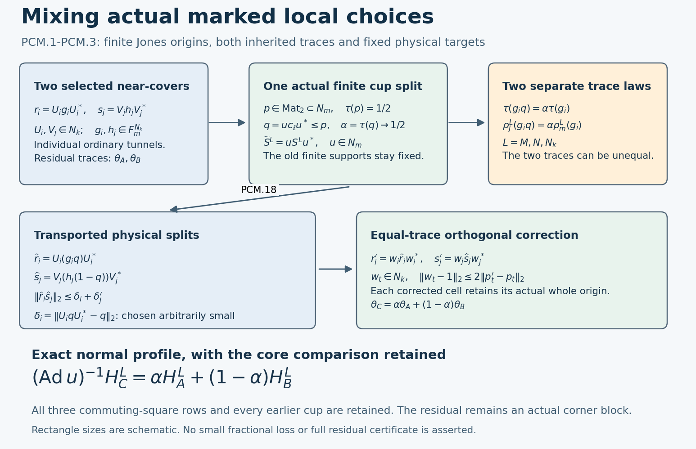

Figure PCM. The arrows are the actual maps PCM.18 and the individual conjugations of Lemma PCM.1. The core comparison is the normal map \(\operatorname{Ad}u\) in PCM.14. The two inherited trace laws are PCM.9; the physical overlap bound is PCM.19. Rectangle widths are schematic and encode no unproved capacity bound. [Reproducible figure source](figures/physical-cup-mixing-v23.py).

Prerequisite proofs: [76.1 and76.4](whole-relative-commutant-blocks.md), [57.3](actual-supported-local-approximation.md), [52.1](canonical-core-traces-and-integer-rounding.md), [53.1](bounded-frames-with-central-support.md), and [CTR.5](general-tail-supports-and-controlled-tunnels.md). Human mathematical context: Sorin Popa, *Classification of amenable subfactors of type II*, Acta Mathematica **172** (1994), 163–255, [DOI 10.1007/BF02392646](https://doi.org/10.1007/BF02392646).

*Text and diagrams: GPT-6.1 Sol (OpenAI), October 2026. Public domain (CC0-1.0).*

## Canonical packing joins the physical cells: a uniform selection obstruction

Canonical rank packing has a stronger consequence than a numerical remainder certificate. All its retained physical cells, together with the lifted old residual candidate, fit into one actual relative-commutant stage. In the amenable index-25 inclusion of LF, a prescribed prefix prevents that common stage from approximating a fixed finite set of physical unitaries. Consequently every sufficiently accurate selected family has a definite positive canonical packing cost. Physical cup mixing then gives a genuine normal central trace separating all accurate full families from the unit capacity.

This obstruction concerns canonical cuts and their rank-equivalent representatives. The full finite partition in LF.15 uses scalar trace-fiber completion and remains valid. The unrestricted full finite marked-family and entire-residual problem is not settled by this obstruction.

### The physical and canonical data

Let \(N\subsetneq M\) be finite-index II₁ factors, with physical normalized trace \(\tau\). Fix an ordinary Jones prefix through \(N_k\), including all its marked cups, and choose a reference continuation. Write

\[
\begin{gathered}
A_j=N_j'\cap M,\qquad B_j=N_j'\cap N,\qquad D_j=N_j'\cap N_k,\\
S=(\bigcup_{j\geq k}D_j)'',\qquad T=E_{Z(S)}^S.
\end{gathered}
\tag{CGP.1}
\]

Retain an actual finite three-row near-cover of 76.4. Its mutually orthogonal good supports \(r_i\) lie in \(N_k\); each support has its own actual finite continuation of the prescribed prefix. The old residual is \(f=1-\sum_i r_i\), and the old upper algebra is

\[
P_0=\left(\bigoplus_i r_i A_{m_i}^{(i)}r_i\right)\oplus fA_k.
\tag{CGP.2}
\]

The intermediate and lowest rows are the actual supported relative commutants in \(N\) and \(N_k\), with residuals \(fB_k\) and \(\mathbb C f\). They retain all three expectation image equalities and both orders of the expectations. Zero supports are omitted.

Finite marked alignment 57.3 supplies \(U_i\in\mathcal U(N_k)\). At a common reference level \(m\geq m_i\), put

\[
g_i=U_i^*r_iU_i\in D_m.
\tag{CGP.3}
\]

Extend each selected tunnel by \(U_iN_jU_i^*\) after its old finite segment. The \(g_i\) need not be mutually orthogonal. In each row \(L=M,N,N_k\), the two inherited finite traces are separately

\[
\tau|_{N_j'\cap L},\qquad
\rho_j^L(p)=\frac{\dim_{N_j}(pL^2(L))}{[L:N_j]}.
\tag{CGP.4}
\]

We use their actual compatibility under restriction of scalars and marked conjugation. Neither trace is substituted for the other.

### One physical unitary glues every canonically packed cell

**Theorem CGP.1.** Fix \(j\geq m\). Suppose there are cuts \(g_i'\leq g_i\) in \(D_j\), mutually orthogonal representatives \(q_i\in D_j\), and \(w_i\in\mathcal U(D_j)\) such that \(q_i=w_ig_i'w_i^*\). Define

\[
\begin{gathered}
r_i'=U_ig_i'U_i^*,\qquad q_0=1-\sum_iq_i,\\
f_*=1-\sum_i r_i',\qquad
\Delta=\sum_i\tau(r_i-r_i').
\end{gathered}
\tag{CGP.5}
\]

There is \(W\in\mathcal U(N_k)\) for which, simultaneously in all three rows,

\[
Wq_i(N_j'\cap L)q_iW^*
=r_i'U_i(N_j'\cap L)U_i^*r_i',\qquad L=M,N,N_k.
\tag{CGP.6}
\]

The complete common-stage rows

\[
D_*=WD_jW^*\subset Q_*=WB_jW^*\subset P_*=WA_jW^*
\tag{CGP.7}
\]

come from the one actual continuation \(WN_jW^*\), retain the prescribed prefix and cups, and obey

\[
E_N(P_*)=Q_*,\qquad E_{N_k}(P_*)=D_*,\qquad E_{N_k}(Q_*)=D_*.
\tag{CGP.8}
\]

Both expectation orders hold in each corresponding square. Every retained cell has its exact original physical trace and its exact inherited finite module trace after cutting. The corner on \(f_*\) has an actual full common-stage origin. No comparison of the original cells' total dual-trace masses is required.

**Proof.** Since \(q_i\) and \(g_i'\) are unitarily equivalent in \(D_j\),
\(\tau(q_0)=1-\sum_i\tau(g_i')=\tau(f_*)\). Projection comparison in the physical factor \(N_k\) gives a partial isometry \(v_0\in N_k\) with initial projection \(q_0\) and final projection \(f_*\). Put

\[
v_i=U_iw_i^*q_i,\qquad W=v_0+\sum_i v_i.
\tag{CGP.9}
\]

Then \(v_i^*v_i=q_i\) and \(v_iv_i^*=r_i'\). The initial supports form an orthogonal partition of one, and so do the final supports. Cross products vanish; hence \(W^*W=WW^*=1\). On the \(q_i\)-corner, conjugation by \(W\) is conjugation by \(U_iw_i^*\). Since \(w_i\) belongs to \(D_j\subset N_j'\cap L\), it carries the entire \(q_i\)-corner of that row onto its \(g_i'\)-corner. This proves CGP.6.

Conjugation by \(W\in N_k\) normalizes every earlier factor of the prefix. It fixes the earlier cups, by their Jones commutation with \(N_k\), and fixes \(A_k\) and \(B_k\) pointwise. Thus CGP.7 has the required actual prefix, not merely isomorphic finite algebras. The original three expectation image identities are those of the reference stage, proved in 76.1. Conditional expectation onto \(N\) or \(N_k\) commutes with conjugation by \(W\); this gives CGP.8. In the tracial Hilbert space, trace pairing gives one expectation order, and taking adjoints gives the other.

For each \(L\), inner conjugation by \(w_i\) preserves both finite traces on \(N_j'\cap L\). Conjugation by \(U_i\), and then by \(W\), identifies the actual terminal-factor modules, so their dimension-normalized traces are preserved as well. Explicitly,

\[
\begin{gathered}
\tau(q_i)=\tau(g_i')=\tau(r_i'),\\
\rho_j^L(q_i)=\rho_j^L(g_i')
=\rho_{j,i}^L(r_i')=\rho_{j,*}^L(r_i').
\end{gathered}
\tag{CGP.10}
\]

Here the last two traces use the continued individual terminal factor and the glued terminal factor, respectively. These equalities are equalities of the actual transported modules. They make no assertion that \(\rho_j^L=\tau\). If a cut vanishes, take its partial isometry zero and omit that cell. If \(q_0=f_*=0\), take \(v_0=0\). If all good cuts vanish, \(v_0\) is a unitary and the same proof applies. ∎

The algebra \(P_*\) includes off-diagonal common-stage corners. The block-diagonal full supported square supplied by the packing is contained in it. The distinction is useful: approximation in the larger \(P_*\) can only improve.

### The old residual candidate also belongs to that common stage

**Theorem CGP.2.** For every original physical target \(y\in M\), the common stage of CGP.1 satisfies

\[
\begin{aligned}
\|y-E_{P_*}y\|_2
&\leq\|y-E_{P_0}y\|_2+
\sqrt{2(\|y\|^2+\gamma_y^2)\Delta}\\
&\leq\|y-E_{P_0}y\|_2+2\|y\|\sqrt\Delta,
\end{aligned}
\tag{CGP.11}
\]

where \(\gamma_y\leq\|y\|\) is the norm of a contractive lift of the old residual component. If \(f=0\), choose \(\gamma_y=0\), obtaining the added error \(\sqrt2\|y\|\sqrt\Delta\).

**Proof.** Put \(a=E_{P_0}y\), \(a_i=r_iar_i\), and \(R=\|y\|\). The old residual component has the form \(fc\), with \(c\in A_k\) and \(\|c\|\leq R\). Indeed, multiplication by \(f\) is a finite-dimensional *-homomorphism on \(A_k\). Its kernel is a central summand; lift on the complementary summand and set the kernel component zero. If \(f=0\), take \(c=0\).

Because \(A_k\subset A_j\) and \(q_0\in N_k\) commutes with \(A_k\),

\[
q_0A_k\subset q_0A_jq_0,\qquad
f_*c=Wq_0cW^*\in WA_jW^*.
\tag{CGP.12}
\]

The second identity uses that \(W\in N_k\) fixes \(A_k\) pointwise. This is the lift of the **entire** old residual candidate into the common stage. Together with CGP.6 it gives

\[
b=\sum_i r_i'a_ir_i'+f_*c\in P_*.
\tag{CGP.13}
\]

Set \(d_i=r_i-r_i'\). Then
\(a-b=\sum_i(a_i-r_i'a_ir_i'-d_ic)\). The summands have mutually orthogonal old supports. Applying the sharp physical block estimate FS.7 and summing their squared norms yields
\(\|a-b\|_2^2\leq2(R^2+\|c\|^2)\Delta\). Best approximation by \(E_{P_*}\) and the triangle inequality prove CGP.11. The targets have stayed fixed throughout; no smallness assumption on \(W-1\) is used. ∎

For the optimal canonical packing, 80.3 gives the explicit attained cost

\[
\begin{gathered}
D_j=\bigoplus_b\operatorname{Mat}_{n_{j,b}},\qquad
\omega_{j,b}=\tau(e^{j,b}_{11}),\\
\Delta_j=\sum_b\omega_{j,b}
\left(\sum_i\operatorname{rank}_b(g_i)-n_{j,b}\right)_+,\\
\Delta_j\downarrow\Delta_\infty
=\tau\left((H-1)_+\right),\qquad H=\sum_iT(g_i).
\end{gathered}
\tag{CGP.14}
\]

CGP.11 therefore holds with \(\Delta=\Delta_j\) at every later stage. The convergence in CGP.14 is the normal physical central limit, not a uniqueness statement for norm traces. CTR's disappearing integer rounding loss does not remove this fractional capacity cost.

### An actual amenable inclusion forces positive cost for every selection

Use the actual inclusion of LF.1–LF.17. To specify the example, let
\(G=(\bigoplus_{\mathbb Z^3}\mathbb Z_2)\rtimes\mathbb Z^3\), with the translation action, and take labels \(1,a,t_1,t_2,t_3\), where \(a\) flips the lamp at the origin. Let
\(P=Q\overline\otimes B\), where \(Q=\overline\bigotimes_{r\geq1}(\operatorname{Mat}_5,\operatorname{tr}_5)\) and \(B=\overline\bigotimes_{g\in G}(\operatorname{Mat}_2,\operatorname{tr}_2)\). The action \(\alpha_g\) fixes \(Q\) and translates the \(B\)-coordinates. With the first \(Q\)-coordinate displayed, put
\(\phi_+(x)=\sum_{i=0}^4E_{ii}\otimes\alpha_{s_i}(x)\). Then \(N=\phi_+(P)\subset M=P\) is the actual index-25 inclusion of LF. Its ordinary tunnel and cups are the actual alternating diagonal embeddings and Bell projections of LF.4. LF.5–LF.8 prove amenability of **every smooth expected representation**, and LF.15 proves full finite three-row partitions at every prescribed prefix.

Fix its prefix through \(N_1\). In the physical full matrix factor \(F=\operatorname{Mat}_{25}\otimes1\) on the first two \(Q\)-coordinates, let
\(Se_j=e_{j+1}\) and \(De_j=\exp(2\pi i j/25)e_j\), with indices modulo 25. The fixed target set and constant are

\[
Y=\{S^aD^b\otimes1:0\leq a,b<25\},\qquad
c=\frac{\sqrt2h_+}{5}>0.
\tag{CGP.15}
\]

Here \(h_+>0\) is the mean of the actual bounded central harmonic witness LF.39–LF.41. The quantitative theorem CF.1 proves, for **every** actual finite continuation of this prefix and every length \(j\geq1\),

\[
\max_{u\in Y}\|u-E_{(N_j^{\mathcal T})'\cap M}u\|_2\geq c.
\tag{CGP.16}
\]

Its proof fixes the first finite expectation of the center witness before choosing the continuation. In particular the 625 tests in CGP.15 are fixed physical operators, not center tests chosen after selecting a family.

**Theorem CGP.3 — uniform over every actual selected family.** In this actual inclusion, take any finite three-row near-cover CGP.2 with good supports in \(N_1\) and individual continuations of the prescribed prefix. Suppose
\(\varepsilon=\max_{u\in Y}\|u-E_{P_0}u\|_2<c\). For every reference continuation, every finite marked alignment, every later level, and every feasible canonical packing of cuts, its total physical loss satisfies

\[
\Delta\geq\frac{(c-\varepsilon)^2}{4}.
\tag{CGP.17}
\]

The optimal finite costs and their normal limit satisfy the same inequality. If the selected family is full, so \(f=0\), the stronger bound is

\[
\Delta,\ \Delta_j,\ \Delta_\infty
\geq\frac{(c-\varepsilon)^2}{2}.
\tag{CGP.18}
\]

In particular, for \(\varepsilon\leq h_+/10\), the respective uniform floors are

\[
\begin{gathered}
\Delta_\infty\geq\frac{(9-4\sqrt2)h_+^2}{400}
\quad\text{for near-covers},\\
\Delta_\infty\geq\delta:=\frac{(9-4\sqrt2)h_+^2}{200}
\quad\text{for full families}.
\end{gathered}
\tag{CGP.19}
\]

**Proof.** CGP.1 produces a common actual continuation of the prescribed prefix for any feasible packing. Every \(u\in Y\) has norm one. CGP.11 gives maximum common-stage target error at most \(\varepsilon+2\sqrt\Delta\). CGP.16 forces this to be at least \(c\), proving CGP.17. For a full old family the residual lift is zero; the bound is \(\varepsilon+\sqrt{2\Delta}\), proving CGP.18. Apply the argument to the attained finite minimum in 80.3, then take its limit CGP.14. Finally,

\[
\begin{aligned}
(c-h_+/10)^2&=(2\sqrt2-1)^2h_+^2/100\\
&=(9-4\sqrt2)h_+^2/100.
\end{aligned}
\]

This proves CGP.19. Since \(9>4\sqrt2\), these floors are positive. ∎

This quantification includes reselection of every old physical support. It includes changing their individual continuations, their aligners, and the reference continuation. The proof uses CGP.16 afresh for the resulting actual common stage, so it does not require a hypothetical identification of arbitrary centers. For a trace-preserving normal comparison of actual cores, the central expectation intertwines with that comparison by its trace-pairing characterization; consequently CGP.14 is invariant under such a comparison. PCM's core rotation is exactly such a comparison. An empty good family would have \(P_0=A_1\) and cannot satisfy \(\varepsilon<c\), by CGP.16; thus this degenerate case supplies no exception.

### Physical mixing yields a genuine normal separating trace

**Theorem CGP.4.** Fix the reference smaller core \(S\) for this prefix and let \(\mathcal H\) consist of all profiles \(H=\sum_iT(g_i)\) of actual **full** finite marked three-row families, with supports in \(N_1\), all individual continuations extending the prefix, and errors strictly below \(\varepsilon_0=h_+/10\) on every original target in \(Y\). Include every permissible finite alignment to this fixed reference. Let \(C\) be its closure in the real Banach space \(L^1(Z(S),\tau)_{\mathrm{sa}}\). Then \(C\) is nonempty and convex, and there is an actual \(z\in Z(S)\) with \(0\leq z\leq1\) such that

\[
\tau(zH)\geq\tau(z)+\frac\delta2
\qquad(H\in C),\qquad
\delta=\frac{(9-4\sqrt2)h_+^2}{200}.
\tag{CGP.20}
\]

Thus \(\sigma_z:S\to\mathbb C\), \(\sigma_z(x)=\tau(zx)\), is a nonzero positive normal finite trace dominated by \(\tau\), and every such actual full selection obeys

\[
\sum_i\sigma_z(g_i)\geq\sigma_z(1)+\frac\delta2.
\tag{CGP.21}
\]

All-smooth expected amenability therefore does not exclude a genuine normal trace separating accurate actual selections from canonical unit capacity.

**Proof of convexity with the actual core maps.** LF.15 makes \(\mathcal H\) nonempty. Every profile is positive and has \(\tau(H)=\sum_i\tau(r_i)=1\). Take two profiles in \(\mathcal H\). Their finitely many physical target errors have a strict common margin below \(\varepsilon_0\). Apply actual cup mixing PCM.3, with its added error smaller than that margin. The weighted root-mean-square error in PCM.13 stays below the larger input error. Both input residual traces are zero, so PCM.11 makes the output residual trace exactly zero. Faithfulness of \(\tau\) makes the output family full, not just almost full.

More explicitly, the first parent's split supports have total physical mass \(\alpha\sum_i\tau(r_i)=\alpha\), and the second parent's complementary splits have total mass \((1-\alpha)\sum_j\tau(s_j)=1-\alpha\). PCM's orthogonalization preserves the trace of every split projection exactly, so the corrected orthogonal supports sum to one. For admissibility, if the larger of the two input maximum errors is \(e<\varepsilon_0\), choose PCM's tolerance \(\eta<\varepsilon_0-e\). Its weighted root-mean-square bound plus \(\eta\) then remains strictly below \(\varepsilon_0\), simultaneously on the fixed finite set \(Y\).

PCM produces a rotated core \(uSu^*\), where \(u\in N_m\) fixes the old canonical supports and the prescribed prefix and cups. Before the individual orthogonalizing corrections, the split canonical cells are \(g_iq\) and \(h_j(1-q)\), with \(q=uc_\ell u^*\). After correction, the placing aligners relative to the rotated continuation are \(w_iU_i\) and \(w_jV_j\). Relative to the **fixed original reference**, use \(w_iU_iu\) and \(w_jV_ju\). Their pulled-back canonical cells are precisely \(g_ic_\ell\) and \(h_j(1-c_\ell)\). The intervening \(u\) fixes the old finite row algebras, so these are actual finite alignments of the output origins. PCM.10 and its separate module-trace product law give, in the original core,

\[
H_{\mathrm{out}}=\alpha H_A+(1-\alpha)H_B,
\qquad \alpha=\tau(c_\ell)\longrightarrow\tfrac12.
\tag{CGP.22}
\]

Each finite output still retains all three rows, both inherited finite traces, and the exact marked prefix/cups. The midpoint comparison is in the one fixed original center, with

\[
\begin{aligned}
\|H_{\mathrm{out}}-(H_A+H_B)/2\|_1&=|\alpha-1/2|\|H_A-H_B\|_1\\
&\leq2|\alpha-1/2|\longrightarrow0.
\end{aligned}
\]

Hence \((H_A+H_B)/2\in C\). Approximate any two elements of \(C\) by profiles in \(\mathcal H\) and pass to their midpoints in \(L^1\): \(C\) is closed and midpoint convex. Iterating midpoints gives every dyadic convex combination in \(C\), and their norm limits give every real convex combination. This proves convexity without replacing the physical local choices by abstract profiles.

**Proof of separation and normality.** Positive elements and the trace-one condition are closed in \(L^1\), so every \(H\in C\) remains positive with \(\tau(H)=1\). The functional \(\Phi(H)=\tau((H-1)_+)\) is 1-Lipschitz in \(L^1\), by 80.7. CGP.18–CGP.19 therefore give \(\Phi(H)\geq\delta\) on all of \(C\). In the mass-one class, the positive and negative parts of \(H-1\) have equal trace, so its full \(L^1\) defect is \(J(H)=\|H-1\|_1=2\Phi(H)\geq2\delta\). The constant \(\delta\) here is the positive-part loss, not the full \(L^1\) defect.

Let \(K=\{k\in L^1(Z(S),\tau)_{\mathrm{sa}}:0\leq k\leq1\}\). For positive \(H\), pointwise truncation gives

\[
\inf_{k\in K}\|H-k\|_1=\tau((H-1)_+).
\tag{CGP.23}
\]

The upper bound is attained by \(k=\min(H,1)\); the lower bound follows because \(|H-k|\geq(H-1)_+\) pointwise for every \(k\in K\). Thus the convex set \(C-K\) misses the open \(L^1\)-ball of radius \(\delta/2\) about zero. Real Hahn–Banach separation gives a nonzero continuous real functional \(F\), normalized to \(\|F\|=1\), with

\[
\inf_{H\in C}F(H)-\sup_{k\in K}F(k)\geq\delta/2.
\tag{CGP.24}
\]

For completeness, this functional is integration against an actual bounded central element. On \(L^2(Z(S),\tau)_{\mathrm{sa}}\), the inequality \(|F(x)|\leq\|x\|_1\leq\|x\|_2\) allows Hilbert-space representation \(F(x)=\tau(bx)\) with real \(b\in L^2\). Testing against the sign of \(b\) on each set \(\{|b|>1+t\}\), \(t>0\), shows those sets have measure zero: otherwise \(|F(x)|>\|x\|_1\). Thus \(b\in Z(S)_{\mathrm{sa}}\), \(\|b\|\leq1\). Bounded functions are dense in \(L^1\) by truncation, so this formula represents \(F\) throughout \(L^1\).

We have \(\sup_{k\in K}\tau(bk)=\tau(b_+)\), attained at the positive spectral projection of \(b\). Set \(z=b_+\). Since every \(H\in C\) is positive, \(\tau(zH)\geq\tau(bH)\). CGP.24 now gives CGP.20. Multiplication by the bounded central \(z\) defines the positive normal trace \(\sigma_z\), with \(0\leq\sigma_z\leq\tau\). Trace pairing for \(T\) gives \(\tau(zT(g_i))=\tau(zg_i)\), proving CGP.21. The strict positive gap forces \(z\ne0\). ∎

The restriction of \(\sigma_z\) to the actual norm closure of \(\bigcup_jD_j\) is a dominated norm-continuous trace as well. This is an exhibited trace, not an assertion of norm-trace uniqueness. It is not identified with the inherited finite module trace, and it does not prescribe a new dual budget. Its gap concerns the actual family of physical approximants in CGP.4.

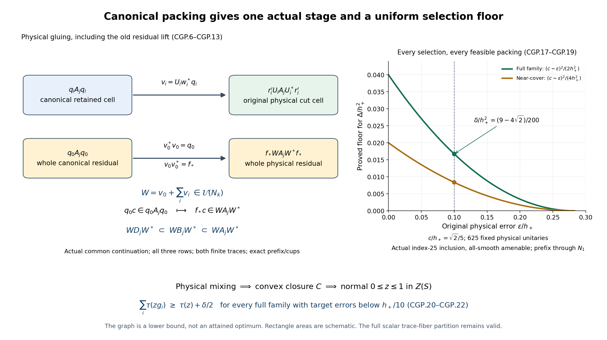

Figure CGP. The left arrows are the partial isometries CGP.9; their sum is the actual unitary \(W\). The residual arrow includes the old lift CGP.12, while the three rows are CGP.7–CGP.8. The right graph is the proved lower bound on the **normalized** cost \(\Delta/h_+^2\), plotted against \(\varepsilon/h_+\); it is not a sample spectrum or an assertion that equality is attained. The marked point uses CGP.19. The final central trace inequality is CGP.20. Rectangle areas are schematic. [Reproducible figure source](figures/canonical-packing-separator-v24.py).

Prerequisite proofs: finite marked alignment [57.3](actual-supported-local-approximation.md); actual whole-stage three-row squares [76.1–76.4](whole-relative-commutant-blocks.md); exact optimal packing and normal limit [80.1–80.3](central-capacity-and-small-support-cuts.md); the sharp physical return FS.7–FS.11, actual inclusion and all-smooth amenability LF.1–LF.17, universal common-stage obstruction CF.1–CF.9, separate cup trace law CTR.5, and physical mixing PCM.1–PCM.21 in [General tail supports and controlled tunnels](general-tail-supports-and-controlled-tunnels.md). The functional-analytic separation input is the convex-open separation proof in §6 of Hahn–Banach and Baire, with the extension theorem Theorem 2.1 and Corollary 2.3 identified in [Finite algebras and normal traces](finite-algebras-and-normal-traces.md). Human mathematical context: Sorin Popa, *Classification of amenable subfactors of type II*, Acta Mathematica **172** (1994), 163–255, [DOI 10.1007/BF02392646](https://doi.org/10.1007/BF02392646), §4.4, printed pp.220–222.

*Text and diagrams: GPT-6.1 Sol (OpenAI), October 2026. Public domain (CC0-1.0).*

## Cup realization of weak residual allocations in actual finite rows

A real residual allocation may touch either boundary of a finite matrix block. Such contact does not prevent its actual cup realization. An arbitrarily small reduction of the retained ranks makes every relevant block strictly interior; blocks with neither an old rank nor an exchange are returned as their full units. The construction below removes the strict-interior hypothesis of SFQ.4. It keeps the integral physical-kernel hypothesis and does not produce the small-loss real allocation required by the unrestricted full-family theorem.

The exact internal providers are SFQ.1–SFQ.19 and CTR.3–CTR.13 in Lesson99, actual finite alignment57.3, scalar placement78.2, and the marked physical return HG.13–HG.16/FS.10–FS.15. The original human endpoint is Sorin Popa, *Classification of amenable subfactors of type II*, Acta Mathematica **172** (1994), Theorem4.4.1(1), printed p.222, [DOI](https://doi.org/10.1007/BF02392646). No theorem from another mathematical source is used below.

### The boundary perturbation

Fix an actual proper finite-index inclusion of II₁ factors \(N\subset M\), an ordinary tunnel with a prescribed prefix through \(N_k\), and a continuation through \(N_m\). The actual lowest finite row is

\[
 F=N_m'\cap N_k=\bigoplus_{b=1}^s\operatorname{Mat}_{n_b},
 \qquad \omega_b=\tau(e_{11}^b),\qquad
 \sum_b n_b\omega_b=1.
 \tag{WBR.1}
\]

Let \(g_1,\ldots,g_r\in F\) be canonical old projections with ranks \(h_{ib}\). Put \(H_b=\sum_i h_{ib}\). These projections may overlap canonically; their actual physical returns are assumed orthogonal whenever the final marked return is invoked. Take finitely many integral vectors \(\kappa^t\in\mathbb Z^s\) satisfying \(\omega\cdot\kappa^t=0\), and put \(V=\operatorname{span}_{\mathbb R}\{\kappa^t\}\). The empty list, with \(V=\{0\}\), is allowed. Suppose

\[
 0\le a_{ib}\le h_{ib},\qquad z\in V,\qquad
 b_b=n_b-\sum_i a_{ib}+z_b\in[0,n_b].
 \tag{WBR.2}
\]

This is only weak feasibility. Define the inactive coordinates

\[
 E=\{b:H_b=0\text{ and }z_b=0\},\qquad A=\{1,\ldots,s\}\setminus E.
 \tag{WBR.3}
\]

If the old family is zero, then \(H_b=0\) for all \(b\). Weak feasibility gives \(z_b\le0\), while \(\omega\cdot z=0\) and every \(\omega_b>0\); hence \(z=0\). Return \(g_i'=0,q_0=1\) at the source level. In what follows the old family is nonzero, so \(A\ne\varnothing\).

Choose

\[
 \nu=\min\left\{1,\min_{H_b>0}\frac{n_b}{2H_b}\right\}>0,
 \quad a^0_{ib}=\nu h_{ib},\quad
 a^{\epsilon}_{ib}=(1-\epsilon)a_{ib}+\epsilon a^0_{ib},
 \quad z^{\epsilon}=(1-\epsilon)z,
 \qquad 0<\epsilon<1.
 \tag{WBR.4}
\]

The repaired residual is

\[
 b_b^{\epsilon}=n_b-\sum_i a^{\epsilon}_{ib}+z_b^{\epsilon}
 =(1-\epsilon)b_b+\epsilon(n_b-\nu H_b).
 \tag{WBR.5}
\]

For \(H_b>0\), the safe residual satisfies
\(n_b/2\le n_b-\nu H_b<n_b\), so \(0<b_b^{\epsilon}<n_b\). For \(H_b=0\), every old and retained rank is zero. Weak feasibility gives \(-n_b\le z_b\le0\). If \(z_b<0\), then
\(b_b^{\epsilon}=n_b+(1-\epsilon)z_b\) lies strictly between zero and \(n_b\). If \(z_b=0\), then \(b_b^{\epsilon}=n_b\) and the coordinate belongs to \(E\). Therefore

\[
 0<b_b^{\epsilon}<n_b\quad(b\in A),\qquad
 a^{\epsilon}_{ib}=z_b^{\epsilon}=0,\quad b_b^{\epsilon}=n_b\quad(b\in E).
 \tag{WBR.6}
\]

There is no unhandled lower-boundary block.

### Integral relations adapted to the inactive coordinates

**Lemma WBR.1.** The rational subspace
\(V_E=V\cap\{x:x_b=0\ (b\in E)\}\) has a finite spanning list of integral physical-null vectors \(\ell^1,\ldots,\ell^q\) vanishing on \(E\). It contains \(z\) and \(z^{\epsilon}\).

**Proof.** Let \(K\) be the integer matrix with columns the given \(\kappa^t\), and let \(K_E\) be its rows indexed by \(E\). Rational Gaussian elimination supplies a basis over \(\mathbb Q\) of \(\ker K_E\); the same vectors span its real kernel, since row reduction uses only rational operations and has the same pivot pattern over both fields. Apply \(K\) to these rational vectors and clear denominators of each nonzero image. The resulting integral vectors span \(K(\ker_{\mathbb R}K_E)=V_E\). Each lies in \(V\), hence is physical-null, and each vanishes on \(E\). Removing dependent vectors is optional. Since the source \(z\) vanishes on \(E\), it and \((1-\epsilon)z\) belong to this space. If the space is zero, the list is empty. \(\square\)

Choose real coefficients \(\vartheta_t\) such that
\(z^{\epsilon}=\sum_t\vartheta_t\ell^t\). Define

\[
 \eta_\epsilon=\min_{b\in A}\{b_b^{\epsilon},n_b-b_b^{\epsilon}\}>0,
 \quad K_A=\frac12\max_{b\in A}\sum_t|\ell_b^t|,
 \quad D_\epsilon=\max\{1,\lceil(r+K_A)/\eta_\epsilon\rceil\}.
 \tag{WBR.7}
\]

This is a finite threshold at the same source stage. It may increase as \(\epsilon\) decreases; no bound independent of the boundary margin is asserted.

### Actual finite cup ranks and both trace systems

For each \(L=M,N,N_k\), write \(F_j^L=N_j'\cap L\) and let \(\rho_j^L\) be its original normalized module trace. A trace label \(\sigma\) is either the physical trace or one of these three module trace systems. Its source value \(\sigma_0\) means \(\tau|_F\) or \(\rho_m^L|_F\). At target stage \(j=m+3h\), its value \(\sigma_h\) means \(\tau|_{F_j^L}\) or \(\rho_j^L\). Every projection below is in \(F_j^{N_k}\subset F_j^L\), so its target trace is evaluated in its declared domain. Actual restriction of module dimensions multiplies the dimension and \([L:N_m]\) by the same \(d^{3h}\), where \(d=[M:N]\), and gives \(\sigma_h|_F=\sigma_0\). Set

\[
 w_b^\sigma=\sigma_0(e_{11}^b),\quad
 S_\sigma=\sum_{i,b}w_b^\sigma h_{ib},\quad
 C_\sigma(a)=\sum_{i,b}w_b^\sigma(h_{ib}-a_{ib}),\quad
 A_\sigma^{\epsilon}=\sum_{i,b}w_b^\sigma a_{ib}^{\epsilon},\quad
 W_A^\sigma=\sum_{b\in A}w_b^\sigma.
 \tag{WBR.8}
\]

All four source vectors are normalized on the whole source row. Their restrictions to the active blocks are **not** renormalized: \(\sum_{b\in A}n_bw_b^\sigma\) may be strictly less than one. Direct calculation gives

\[
 C_\sigma(a^{\epsilon})=(1-\epsilon)C_\sigma(a)
       +\epsilon(1-\nu)S_\sigma
 \le C_\sigma(a)+\epsilon S_\sigma.
 \tag{WBR.9}
\]

In the physical orthogonal return, \(S_\tau\le1\). A canonical dual sum \(S_\sigma\) may exceed one; the bound in WBR.9 retains its actual value.

**Theorem WBR.2.** For every integer \(h\ge0\), there are actual projections

\[
 g_i'\le g_i\text{ in }F_{m+3h}^{N_k},\qquad
 q_0\in F_{m+3h}^{N_k},\qquad
 \tau(q_0)=1-\sum_i\tau(g_i'),
 \tag{WBR.10}
\]

such that, simultaneously for all four original trace systems,

\[
 \sum_i\sigma_h(g_i-g_i')\le
 C_\sigma(a^{\epsilon})+rW_A^\sigma(1-1/d)^h
       +A_\sigma^{\epsilon}B_h(D_\epsilon),
 \tag{WBR.11}
\]

where, writing \(R_\epsilon=\lceil\log_2D_\epsilon\rceil\),

\[
 B_h(D_\epsilon)=\sum_{0\le l<R_\epsilon}\binom hl
             (2/d)^l(1-2/d)^{h-l}.
 \tag{WBR.12}
\]

The sum also requires \(l\le h\). At \(d=2\), only the matrix cup component exists: WBR.12 is one when \(2^h<D_\epsilon\), and zero otherwise. No absent scalar component is counted.

**Proof.** CTR.8–CTR.13 give the actual unital inclusion
\(F\otimes(\operatorname{Mat}_2\oplus\mathbb C)^{\otimes h}\subset F_{m+3h}^{N_k}\), with the scalar summand omitted at \(d=2\). A cup block \(c\) has dimension \(D_c=2^{l(c)}\) and common minimal cup mass
\(\gamma_c=d^{-l(c)}(1-2/d)^{h-l(c)}\). The physical trace and each original module trace factor separately as \(w_b^\sigma\gamma_c\). Their equality on the cup factor follows from the actual cup/module computation, not from equality on \(F\). The nonzero cup blocks satisfy
\(\sum_cD_c\gamma_c=1\) and \(\sum_c\gamma_c=(1-1/d)^h\).

On a block with \(D=D_c\ge D_\epsilon\), retain ranks
\(u_{icb}=\lfloor Da_{ib}^{\epsilon}\rfloor\), round
\(k_{ct}=\lfloor D\vartheta_t+1/2\rfloor\), and define the residual ranks

\[
 t_{cb}=Dn_b-\sum_i u_{icb}+\sum_t k_{ct}\ell_b^t.
 \tag{WBR.13}
\]

For active coordinates the SFQ integer estimate is
\(-K_A\le t_{cb}-Db_b^{\epsilon}<r+K_A\).
Since \(D\eta_\epsilon\ge r+K_A\), this yields
\(0\le t_{cb}\le Dn_b\). The retained ranks obey
\(0\le u_{icb}\le Dh_{ib}\). For inactive coordinates, all old ranks, retained ranks and \(\ell_b^t\) are zero; WBR.13 is exactly \(t_{cb}=Dn_b\). On every cup block with \(D_c<D_\epsilon\), retain no old rank and set every residual rank to the whole unit \(D_cn_b\).

Choose a subprojection of these retained ranks inside each actual \(g_i\otimes1_c\), and separately a projection of ranks \(t_{cb}\); canonical orthogonality between them is not required. Taking their direct sums gives the projections in WBR.10. On a large block, before adding the inactive unit mass, the physical equality is

\[
 \sum_{b\in A}\omega_bt_{cb}
 =D_c\sum_{b\in A}n_b\omega_b
       -\sum_{i,b\in A}\omega_bu_{icb}.
 \tag{WBR.14}
\]

The integer exchange is physical-null, and vanishes on inactive coordinates. Adding \(D_c\sum_{b\in E}n_b\omega_b\) restores total source unit mass one. Thus the complete block equality is
\(\sum_b\omega_bt_{cb}=D_c-\sum_{i,b}\omega_bu_{icb}\).
Small blocks satisfy it by definition. Multiplication by \(\gamma_c\), summation and \(\sum_cD_c\gamma_c=1\) prove the exact complement equality.

For any original trace system, large-block loss is at most
\(D_cC_\sigma(a^{\epsilon})+rW_A^\sigma\): floor deficits occur only on active coordinates. On small blocks it is exactly
\(D_c[C_\sigma(a^{\epsilon})+A_\sigma^{\epsilon}]\).
Their total unit mass is exactly WBR.12, including its binomial multiplicities. Summing proves WBR.11. \(\square\)

The coarser useful bound is

\[
 \sum_i\sigma_h(g_i-g_i')\le C_\sigma(a)+\epsilon S_\sigma
 +\bigl[rW_A^\sigma+(D_\epsilon-1)A_\sigma^{\epsilon}\bigr](1-1/d)^h.
 \tag{WBR.15}
\]

It follows because each small block has integer dimension at most \(D_\epsilon-1\). For every finite list of original trace tolerances, first choose \(\epsilon\) and then one finite \(h\) so that their excess over \(C_\sigma(a)\) is smaller than those tolerances. The same \(\epsilon,h\), active coordinates and projections work for all three rows. This assertion concerns excess loss; it does not claim that the original \(C_\tau(a)\) is small.

Every other normalized compatible finite trace remains defined on the actual target row. If its restriction to the cup subalgebra has minimal weights \(\lambda_{bc}^{\xi}\), its exact data are

\[
 \xi(q_0)=\sum_{b,c}\lambda_{bc}^{\xi}t_{cb},\quad
 \xi(g_i')=\sum_{b,c}\lambda_{bc}^{\xi}u_{icb},\quad
 \xi(g_i-g_i')=\sum_{b,c}\lambda_{bc}^{\xi}(D_ch_{ib}-u_{icb}).
 \tag{WBR.16}
\]

These weights need not factor. Integer rank bounds give positivity and unit bounds for every trace in the whole finite trace cone. For each original canonical dual trace, the actual residual discrepancy is

\[
 \sigma_h(q_0)-\left(1-\sum_i\sigma_h(g_i')\right)
 =\sum_{c:D_c\ge D_\epsilon}\gamma_c
       \sum_t k_{ct}(w^\sigma\cdot\ell^t).
 \tag{WBR.17}
\]

It need not be zero. The inactive unit contribution is already included in both sides; no dual preservation of the physical kernel is assumed.

### Full marked physical return

Suppose actual finite alignment gives orthogonal physical supports
\(r_i=U_ig_iU_i^*\), \(U_i\in\mathcal U(N_k)\), with old residual
\(f=1-\sum_i r_i\). Put
\(r_i'=U_ig_i'U_i^*\),
\(f_*=f+\sum_i(r_i-r_i')\), and
\(\Delta=\sum_i\tau(r_i-r_i')\).
Then WBR.10 says \(\tau(q_0)=\tau(f_*)\). Finite-factor comparison in the **physical** \(N_k\) supplies \(v\in\mathcal U(N_k)\) with \(vq_0v^*=f_*\). This comparison requires physical equality only; the canonical dual data remain WBR.17 and their actual module transports.

At \(j=m+3h\), put \(T_i=U_iN_jU_i^*\), \(T_0=vN_jv^*\), \(e_i=r_i'\), \(e_0=f_*\), and omit zero terms. The full three rows are

\[
 P_* =\bigoplus_a e_a(T_a'\cap M)e_a,\quad
 Q_* =\bigoplus_a e_a(T_a'\cap N)e_a,\quad
 D_* =\bigoplus_a e_a(T_a'\cap N_k)e_a.
 \tag{WBR.18}
\]

Their units sum to one and the entire old residual is included. Actual finite-stage expectations and support bimodularity give all three commuting-square identities, in both orders:

\[
 E_NE_{P_*}=E_{P_*}E_N=E_{Q_*},\quad
 E_{N_k}E_{P_*}=E_{P_*}E_{N_k}=E_{D_*},\quad
 E_{N_k}E_{Q_*}=E_{Q_*}E_{N_k}=E_{D_*}.
 \tag{WBR.19}
\]

Every \(T_a\) comes from its actual continuation of the same prescribed prefix. The placement unitaries lie in \(N_k\), so they fix all preceding prefix algebras and cups. Both original trace systems in each row are transported through the corresponding actual module isomorphisms, as in SFQ.18–SFQ.19. For every original physical target \(y\), with its old norm-preserving residual lift \(c_y\) and \(\gamma_y=\|c_y\|\le\|y\|\), the sharp existing return estimate is

\[
 \|y-E_{P_*}(y)\|_2\le\|y-E_{P_0}(y)\|_2
       +\sqrt{2(\|y\|^2+\gamma_y^2)\Delta},
 \quad
 \Delta\le C_\tau(a)+\epsilon S_\tau
 +[rW_A^\tau+(D_\epsilon-1)A_\tau^{\epsilon}](1-1/d)^h.
 \tag{WBR.20}
\]

The targets are unchanged. No comparison of dual traces belonging to different terminal factors with a common sum-one budget is made.

### What is now removed, and what remains

Weak feasibility WBR.2 in the real span of actual integral physical-trace relations suffices for finite actual cup realization with arbitrarily small excess cut loss. Strict residual interior is no longer a separate construction obligation. The result includes both boundary types, an empty kernel, zero old cells, a zero old family, inactive unit masses, the \(d=2\) endpoint, all compatible finite traces, all three marked rows and the full residual.

The finite kernel-repair argument does not supply a weakly feasible allocation with arbitrarily small \(C_\tau(a)\), or a replacement allocation outside its fixed integral-kernel span. It does not by itself establish the original unrestricted finite-family or generating-tunnel theorem. POR.5 and SA.6–SA.7 prove those original conclusions by independent constructions; the joint canonical-cost and general BF inputs are not inferred from this particular finite repair.

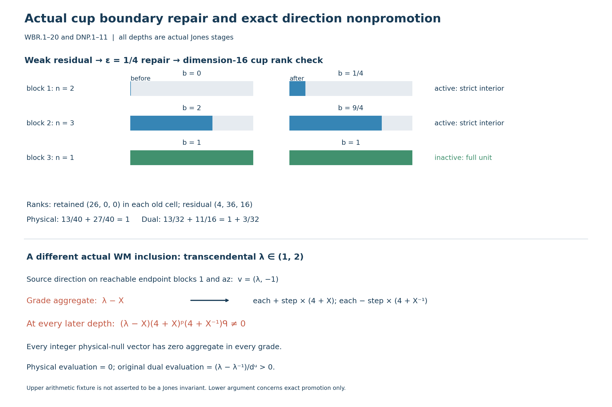

Figure WBR/DNP. The upper panel uses the exact arithmetic fixture of Exercise80; bar lengths are residual-rank fractions of each stated matrix capacity. Its inactive block retains the entire unit, and the separate physical and dual sums are explicit. The lower panel shows the actual five-label tower and its exact grade-aggregate obstruction, DNP.1–DNP.11. The two panels concern different objects: the upper fixture is not asserted to be a Jones invariant. Human programme context: Popa (1994), Theorem4.4.1(1), printed p.222, cited above. [Reproducible figure and exact finite checks](figures/boundary-and-direction-v24.py).

*Text and diagrams: GPT-6.1 Sol (OpenAI), October 2026. Public domain (CC0-1.0).*

## A real trace-null direction that no further actual Jones level promotes

Deeper actual Jones stages do not universally turn every prescribed real physical-trace-null rank direction into the real span of integral physical-null rank vectors. The obstruction below occurs in a proper finite-index amenable II₁ inclusion, in its entire finite relative commutants and under their actual embeddings. It concerns exact promotion of one direction. It makes no claim about small-loss approximation, physical support reselection, residual existence or the original unrestricted full-family theorem.

The exact construction providers are WM.1–WM.17 in Lesson99, including the full-corner finite maps WM.12–WM.14 and the arbitrary-smooth-representation proof WM.15–WM.17; their hyperfinite-corner input is HC4–HC8. This note uses a **separate transcendental parameter**. The original rational WM.22 model and its invariant endpoint are distinct and are not changed by this construction. The original human programme source is Sorin Popa, *Classification of amenable subfactors of type II*, Acta Mathematica **172** (1994), Theorem4.4.1(1), printed p.222, [DOI](https://doi.org/10.1007/BF02392646).

### The actual inclusion applies at this parameter

Fix a transcendental real \(\lambda\in(1,2)\). Such numbers exist: the nonzero polynomials over \(\mathbb Z\) are countable and each has finitely many real roots, whereas a real interval is uncountable. Use the **actual** five labels

\[
 s_0=1,\quad s_1=az,\quad s_2=t_1,\quad s_3=t_2,\quad s_4=t_3
 \tag{DNP.1}
\]

in the subgroup \(H\) of the three-dimensional lamplighter group times \(\mathbb Z\), with the parity condition of WM.1. Its central grade homomorphism is \(r:H\to\mathbb Z\), and \(r(s_i)=(0,1,0,0,0)\). WM.1 constructs an actual trace-scaling automorphism of a hyperfinite II∞ factor for **every** \(1<\lambda\le2\), by normalized finite-corner isomorphism and countable matrix-unit amplification. Therefore the action of character \(\chi(g)=\lambda^{r(g)}\) exists at the chosen parameter. Its outerness proof uses either a nontrivial trace scale or displacement of a Bernoulli coordinate; it does not require \(\lambda\) to be rational.

The positive expectation weights and actual weighted cups are

\[
 S_+=4+\lambda,\quad S_-=4+\lambda^{-1},\quad
 w_i^+=\lambda^{r(s_i)}/S_+,\quad
 w_i^-=\lambda^{-r(s_i)}/S_-,\quad
 d=S_+S_-=17+4(\lambda+\lambda^{-1})>25.
 \tag{DNP.2}
\]

Every product \(w_i^+w_i^-=1/d\). WM.5–WM.8 verify the normal expectations, compression, full generation and Markov cup normalization with precisely these positive coefficients. WM.9–WM.10 use coherent common finite corners and finite comparison unitaries to give an actual II₁ tunnel
\(L_0=M,L_1=N,L_2,\ldots\), each adjacent inclusion of index \(d\). Thus these are actual proper finite-index factors, not a path algebra surrogate.

The proof of all-smooth amenability also applies at this parameter. WM.15 obtains the full represented weighted matrix tower and forces every actual endpoint relator on the represented coefficient action by smoothness. Hyperfinite finite-corner extension gives the starting UCP return. The explicit right Følner sets WM.16 depend only on the group, with each generator boundary ratio \(2/(2L+1)\). Averaging gives equivariance, and the same original positive weights give expectation compatibility. WM.17 returns to the original physical finite corner. None of these steps uses the later selected rational parameter or the numerical center estimates. Hence the original all-smooth amenability quantifier is satisfied here.

### Every actual finite stage has a grade constraint

For either initial phase \(\delta\in\{+1,-1\}\), the full relative commutant of suffix length \(l\) has one full matrix block for each reachable **actual endpoint** \(g\in H\). Its dimension is the number of endpoint words, not merely the number with the same grade. WM.12–WM.14 give the actual minimal weights

\[
 \tau(e_{11}^{g,l})=\lambda^{r(g)}/Z_l^{\delta},\qquad
 \rho(e_{11}^{g,l})=\lambda^{-r(g)}/Z_l^{-\delta},\quad
 Z_l^{\delta}=\prod_{j=0}^{l-1}(4+\lambda^{\delta(-1)^j}).
 \tag{DNP.3}
\]

Here \(\rho\) is the original normalized finite module trace for that actual suffix row. The full-corner maps are onto, compatible and include every old cup. For the physical lowest row after any prescribed prefix \(N_k=L_{k+1}\), take its appropriate initial phase and suffix length \(l=m-k\). This is exactly \(F=N_m'\cap N_k\). Both phases of DNP.3 apply. The upper and middle rows remain the actual rows of the same inclusion and tunnel, with their own original normalized module trace domains. No row or trace is deleted from the construction.

For a real block-rank vector \(x=(x_g)\), define its grade aggregate Laurent polynomial by

\[
 \mathcal G_l(x)(X)=\sum_g x_gX^{r(g)}.
 \tag{DNP.4}
\]

If \(x\) is integral and physical-null, DNP.3 gives
\(\mathcal G_l(x)(\lambda)=0\). Its coefficients are integers. Transcendence of \(\lambda\) implies
\(\mathcal G_l(x)=0\): multiply by an integer power of \(X\) to obtain an ordinary integer polynomial. Conversely zero grade aggregate implies physical nullity. Therefore the actual integral physical kernel is exactly

\[
 \mathcal L_l=\{x\in\mathbb Z^{\{g\}}:\mathcal G_l(x)=0\},
 \quad
 \operatorname{span}_{\mathbb R}\mathcal L_l
       \subset\ker\mathcal G_l.
 \tag{DNP.5}
\]

The full endpoint distinctions have been retained in this proof. Aggregating only grades is a necessary invariant of integral null vectors, not a replacement relative-commutant algebra.

### Exact one-step continuation and the unpromotable source direction

Choose an even suffix length \(l=2u\), \(u\ge1\), after the prescribed prefix. Both phases have a reachable grade-zero identity block: choose every label zero. Both have a reachable grade-one endpoint \(az\): choose label1 at a positive-sign position and label0 elsewhere. An even suffix contains both signs. Denote these distinct actual endpoint blocks by \(g_0=1,g_1=az\). They have positive matrix dimensions. On their rank coordinates put

\[
 v_{g_0}=\lambda,\qquad v_{g_1}=-1,\qquad v_g=0\text{ otherwise}.
 \tag{DNP.6}
\]

Since \(Z_{2u}^{\delta}=Z_{2u}^{-\delta}=d^u\), the actual physical linear trace is zero, whereas its distinct original module-trace value is

\[
 \tau(v)=(\lambda-\lambda)/d^u=0,
 \qquad \rho(v)=(\lambda-\lambda^{-1})/d^u>0.
 \tag{DNP.7}
\]

These expressions are linear evaluations of a real rank direction; \(v\) is not asserted to be a projection. Its source grade aggregate is \(\mathcal G_{2u}(v)=\lambda-X\).

Appending a positive-sign label adds grade0 in four cases and grade1 in one case. Appending a negative-sign label adds grade0 in four cases and grade−1 in one case. Thus the **exact original one-step** Laurent continuation factors are

\[
 A_+(X)=4+X,\qquad A_-(X)=4+X^{-1}.
 \tag{DNP.8}
\]

Let \(I_{l,l+t}\) be the real extension of the actual integer rank embedding from suffix level \(l\) to \(l+t\). Every source minimal projection appends each of the five labels once. If some terminal endpoints coincide, their ranks add in the full terminal matrix block. Taking grade aggregates therefore gives, for every vector \(x\),

\[
 \mathcal G_{l+t}(I_{l,l+t}x)
 =\mathcal G_l(x)\prod_{j=0}^{t-1}A_{\delta(-1)^{l+j}}(X).
 \tag{DNP.9}
\]

This is the actual embedding law, with positive integer coefficients and multiplicities; it holds for odd as well as even \(t\). For the source direction DNP.6 it is

\[
 (\lambda-X)(4+X)^{p_t}(4+X^{-1})^{q_t},
 \quad p_t+q_t=t,
 \tag{DNP.10}
\]

where \(p_t\) counts the positive signs and \(q_t\) the negative signs of the specified alternating continuation. The two counts differ by at most one. The factor \(\lambda-X\) and every continuation factor are nonzero. Real Laurent polynomials have no zero divisors: multiply them by suitable monomials and use the nonzero leading coefficient of an ordinary polynomial product. Hence DNP.10 is nonzero for every \(t\ge0\). By DNP.5,

\[
 I_{l,l+t}v\notin\operatorname{span}_{\mathbb R}\mathcal L_{l+t}
 \quad\text{at every further actual finite Jones level}.
 \tag{DNP.11}
\]

The physical evaluation of the embedded vector is still zero because the actual normalized trace restricts to the source physical trace. At odd depths the common denominator is the exact \(Z_{l+t}^{\delta}\), so no even-depth-only simplification is used. The actual dual restriction also remains its separately computed nonzero source value in DNP.7, by the module-dimension/index restriction law.

Arbitrary further separated cup extensions lie in these same full later Jones stages. Their rank embeddings are restrictions of the full-stage embeddings already treated, so they cannot promote this embedded direction into a full-stage integer-kernel span. This statement concerns the unchanged embedded direction, not a different direction chosen after reselection.

The prefix can be prescribed beforehand: the source uses its actual opposite-phase suffix, and all continued embeddings retain that prefix and every old cup. If another ordinary continuation is used after the same source \(N_m\), the finite marked alignment proof57.3 starts at \(N_m\). Its successive conjugating unitaries lie in \(N_m\) or deeper factors, so they fix \(F=N_m'\cap N_k\) pointwise and retain the marked source direction. They transport any specified finite segment and its inherited physical trace, without changing ranks or integral-kernel span. DNP.11 is therefore not repaired by changing the finite continuation while retaining the same marked source direction.

### Scope of the correction

The false intermediate claim is: “Every real physical-null direction in an actual finite row becomes an integral-kernel-span direction after sufficiently many actual Jones/cup stages.” The actual amenable inclusion above disproves that universal assertion, for both phases, every even and odd depth and every prescribed prefix. Physical nullity alone is weaker than the rational relations needed by SFQ or WBR.

The result does **not** say that the original full-family statement is false. It gives no lower bound on the cost of choosing a different near-cover, no obstruction to approximating another feasible allocation, and no obstruction to physical support reselection. It does not reprove RF's unchanged-residual obstruction. The original rational WM model and its fixed invariant endpoint remain distinct from this transcendental-parameter inclusion.

The lower panel of FigureWBR/DNP in [Cup realization of weak residual allocations](#cup-realization-of-weak-residual-allocations-in-actual-finite-rows) illustrates DNP.6–DNP.11 with symbolic labels, rather than substituting a rational numerical sample for the transcendental parameter. The complete actual endpoint enumeration and reproducible figure source are [provided here](figures/boundary-and-direction-v24.py).

*Text and diagrams: GPT-6.1 Sol (OpenAI), October 2026. Public domain (CC0-1.0).*

## Original strong amenability supplies the factorial-core generating hypothesis

Original representation amenability alone supplies relative Følner for every actual core, including nonfactor cores. Adding the original ergodic-core hypothesis supplies the factorial-core approximation providers: finite approximation after every prescribed ordinary prefix without separability, and one generating ordinary tunnel when the original factor has separable predual. The general tower bicommutant equivalence remains a separate question.

The new text and reproducible figure source in this section are dedicated to CC0. Credit for the original definitions, theorem and canonical core representation belongs to Sorin Popa, [*Classification of amenable subfactors of type II*](https://doi.org/10.1007/BF02392646), *Acta Mathematica* 172 (1994), 163–255: Definitions 1.4.1–1.4.2, printed pp.186–187; Example 2.3.3(a), p.196; Definition 3.1.1, p.203; Theorem 4.1.2, p.210; and §4.5.1, pp.223–224. The scope of the source theorem is recorded in SA.8 below.

We use the already proved current course providers: [common cup basis and canonical corners, 52.1–52.2](canonical-core-traces-and-integer-rounding.md); [compatible inherited-trace core maps, 29.1](finite-index-tunnels-without-finite-depth.md), with their broader scope explicitly established in [46.6](nongenerating-tunnels-and-boundary.md) and [60](preserved-prefix-and-generating-tunnels.md); [relative Følner, 49.2](relative-hypertraces-and-folner-projections.md); [full support, 58.7–58.8](larger-factor-central-balancing.md); [global patching, 59.8](corner-heredity-and-global-patching.md); [prescribed prefix and generation, 60.1–60.6](preserved-prefix-and-generating-tunnels.md); and [finite normal expected tower, 61.1–61.2](smooth-representations-and-tower-compression.md). The normal canonical extension, including its full-corner trace and center arguments for every actual core and common-basis square, is proved in [Proposition 52.2a](canonical-core-traces-and-integer-rounding.md#the-canonical-expectation-is-a-physical-reduction). Its exact use below is finite-stage extension, not a normal representation of the infinite tracial tower. No new general nonfactor rounding assertion is used.

**SA.1 — hypotheses and notation.** Let \(N\subsetneq M\) be II₁ factors of finite Jones index \(d>1\), with normalized physical trace \(\tau\). Assume original strong amenability in Popa's Definition 3.1.1:

1. Every smooth nondegenerate normal expected representation \(N\subset M\subset(U\subset_E V)\), with \(E|_M=E_N\), admits an \(M\)-central state \(\varphi\) satisfying \(\varphi E=\varphi\).
2. The original core is ergodic, in Definition 1.4.2.

The state is allowed to be singular. Smoothness means the inclusion of the physical higher commutants \(N'\cap M_j\subset U'\cap V_j\) for every finite \(j\geq0\). Equality with an entire represented higher commutant is not assumed.

Use an ordinary tunnel \(N_l=M_{-l-1}\), \(N_0=N\), with downward cups \(g_l=e_{-l-1}\), and the physical upper tower \(M_{-1}=N,M_0=M,M_1,\ldots\). Its upward cup \(e_j\in M_{j+1}\) implements \(M_{j-1}\subset M_j\) and has physical normalized trace \(d^{-1}\). Define

\[
 R_j=\left(\bigcup_{l\geq0}(N_l'\cap M_j)\right)'',\qquad
 S=R_{-1},\quad R=R_0. \tag{SA.1}
\]

All these closures are in the inherited normalized trace on their containing finite tower factor. In particular \(E_N(R)=S=R\cap N\), by expectation bimodularity and normality, as in 51.1. There is no change to the inclusion, its trace, or its cups.

**SA.2 — ergodicity gives exactly the larger factor required by 58–60.** The original standard part in Definition 1.4.1 is the inherited-trace core pair \(S\subset R\) in (SA.1). Definition 1.4.2 calls the core ergodic exactly when this larger algebra \(R=M^{\rm st}\) is a factor. Thus the hypothesis is precisely factoriality of the larger actual core used in 58–60. Neither factoriality of \(S\) nor extremality nor finite ambient index \([M:R]\) is added. The compatible trace maps of 29.1/46.6 show that the same assertion holds for every ordinary tunnel.

**SA.3 — the core square retains the entire finite physical tower.** For every actual core of a proper finite-index II₁ inclusion, without factoriality or amenability assumptions on that core, the square \(S\subset R\) inside \(N\subset M\) is a nondegenerate commuting square, and its upper basic-construction tower is \((R_j)_{j\geq-1}\) with the same physical upper cups \(e_j\).

**Proof.** Provider 52.1 gives a common finite partial orthonormal right basis \(a_i^{(0)}\in R\) for \(M/N\) and \(R/S\). Its supports \(f_i\in S\) satisfy

\[
 E_N((a_i^{(0)})^*a_t^{(0)})=\delta_{it}f_i,
 \quad \sum_i a_i^{(0)}(a_i^{(0)})^*=d1.
 \tag{SA.2}
\]

The basis expansion gives \(M=\sum_i a_i^{(0)}N\), so the linear span \(RN\) is all \(M\), and its adjoint span is all \(M\) as well. The expectation identity above proves the commuting square.

For any \(j\geq0\), physical expectation onto \(M_{j-1}\) preserves commutation with every \(N_l\subset M_{j-1}\). Its normality on the increasing union yields

\[
 E_{M_{j-1}}(R_j)=R_{j-1},\qquad
 E_{M_{j-1}}|_{R_j}=E_{R_{j-1}}^{R_j}.
 \tag{SA.3}
\]

The cup \(e_j\) commutes with \(M_{j-1}\), hence belongs to \(R_{j+1}\). Iterate the finite dual-basis formula of 61.2:

\[
 a_i^{(j+1)}=\sqrt d\,a_i^{(j)}e_j.
 \tag{SA.4}
\]

It is a physical partial right basis for \(M_{j+1}/M_j\), belongs to \(R_{j+1}\), and has row sum \(d1\). If \(x\in R_{j+1}\), (SA.3) puts all coefficients \(E_{M_j}((a_i^{(j+1)})^*x)\) in \(R_j\). Thus the physical basis expansion restricts to the core expansion. It follows that

\[
 R_{j+1}=\sum_i a_i^{(j+1)}R_j
          =\operatorname{span}(R_j e_j R_j),
 \quad e_j x e_j=E_{R_{j-1}}^{R_j}(x)e_j\ (x\in R_j).
 \tag{SA.5}
\]

The finite matrix construction and faithful common-basis identification of 61.2 now recognize this as the actual basic construction. They also identify every square \(R_{j-1}\subset R_j\) inside \(M_{j-1}\subset M_j\) as nondegenerate, with the original normalized traces and index normalization \(d\). No factor assumption on a higher \(R_j\) was needed. □

**SA.4 — original amenability applies to the canonical core representation.** On \(L^2(M,\tau)\), put

\[
 p=e_R^M,\qquad \mathcal A=\langle N,p\rangle,
 \qquad \mathcal B=\langle M,p\rangle. \tag{SA.6}
\]

For every actual core, including nonfactor \(R\) and nonfactor \(S\), this is a smooth nondegenerate normal expected representation of the original inclusion. Its normal expectation \(E_{\mathcal A}:\mathcal B\to\mathcal A\) restricts to \(E_N\). Its two canonical semifinite traces agree by restriction and are normalized by

\[
 p\mathcal A p=Sp,\quad p\mathcal B p=Rp,
 \quad\operatorname{Tr}(rp)=\tau(r)\ (r\in R_+),
 \quad\operatorname{Tr}(p)=1. \tag{SA.7}
\]

Here \(p\) is the core expectation projection, distinct from the physical cup \(e_j\). The trace restriction to \(M\) is not identified with its normalized physical trace.

**Proof.** Nondegenerate canonical extension and the full-corner calculation of 52.2/60.2 give the asserted normal expected pair and trace restriction. The basis in (SA.2) also proves nondegeneracy of this representation: it commutes with \(p\), and the normal coefficient expansion in 60.2 for \(k=0\) gives

\[
 T=\sum_i a_i^{(0)}E_{\mathcal A}((a_i^{(0)})^*T)
 \quad(T\in\mathcal B). \tag{SA.8}
\]

Hence its finite linear span \(M\mathcal A\) is \(\mathcal B\).

At each finite upper level use SA.3 and normal canonical extension. The represented upper algebra \(\mathcal B_j\) is the canonical copy of
\(\langle M_j,p_j\rangle\) on \(L^2(M_j)\), where \(p_j=e_{R_j}^{M_j}\). Under these finite normal identifications the original \(p\) maps to \(p_j\), the physical \(M_j\) is retained, and the represented Jones cups are the original \(e_j\). These identifications follow from the common-basis finite matrix model (61.2): replace the coefficient algebra by the corresponding canonical extension, with the identical partial supports and finite row. SA.5 gives precisely its physical cup and spanning relation. Iterating this construction only concerns finite stages.

If \(x\in N'\cap M_j\), then \(x\) commutes with every \(N_l\subset N\), so \(x\in R_j\). Left multiplication by \(x\in R_j\) commutes with \(p_j\), the orthogonal projection onto \(L^2(R_j)\): that subspace is reducing for left multiplication by the *-algebra \(R_j\). It also commutes with the left copy of \(N\). Therefore, in the finite represented stage,

\[
 N'\cap M_j\subset \{N,p_j\}'\cap\mathcal B_j
                 =\mathcal A'\cap\mathcal B_j.
 \tag{SA.9}
\]

This is exactly original smoothness, for every finite \(j\geq0\). It proves the specific assertion in Popa's Example 2.3.3(a) directly from the actual core tower. □

The normal canonical extensions just used require the common finite partial basis, the normal commuting expectations in SA.3, and the faithful inherited traces on the full corners \(Sp\) and \(Rp\). Proposition 52.2a extends traces from those full corners, proves their restriction identity and constructs the normal physical expectation for general finite core algebras; it does not assume their centers are scalar. Provider 61.2 constructs the entire finite expected tower over arbitrary coefficient algebras, using the supported matrix row and normal finite sums. Neither step uses \(R\) factorial, \(S\) factorial, separability, or a finite ambient index \([M:R]\). In particular \(\mathcal B\) need not be a factor or \(\sigma\)-finite here. SA.3–SA.4 do not consume SA.2.

**SA.5 — original representation amenability supplies actual relative Følner without ergodicity.** Original all-smooth representation amenability alone, applied to the nonfactor-valid SA.4 for any ordinary tunnel, supplies a state \(\varphi\) on \(\mathcal B\) with

\[
 \varphi E_{\mathcal A}=\varphi,\qquad
 \varphi(xT)=\varphi(Tx),\qquad \varphi|_M=\tau.
 \tag{SA.10}
\]

The last identity follows from centrality and the unique tracial state of a II₁ factor, as verified in 49.2. No normality is claimed. The trace and expectation in SA.7 satisfy every hypothesis of 49.2. Consequently, for every finite \(F\subset\mathcal U(M)\) and every \(\eta>0\), an actual nonzero projection \(q\in\mathcal A\) satisfies

\[
 0<\operatorname{Tr}(q)<\infty,\qquad
 \|uqu^*-q\|_{2,\operatorname{Tr}}
   <\eta\sqrt{\operatorname{Tr}(q)}\quad(u\in F).
 \tag{SA.11}
\]

This proves relative Følner for every actual core under representation amenability alone, without an ergodic-core assumption. The nonseparable and non-\(\sigma\)-finite scope is exactly that of 49.2. This is also the canonical core representation needed before applying the unrestricted finite near-cover theorem76.4. There is no normal-component assumption or normal-to-singular exchange of \(L^2\) limits.

Only when invoking the factorial-core providers58–60 do we add SA.2. Together SA.2 and SA.5 supply exactly their hypotheses. In particular 58.8 then supplies the full-unit BF₁ frames, not merely variable-support frames; 59.8 therefore retains its actual whole-tunnel patching hypothesis.

**SA.6 — exact finite-prefix conclusion, without separability.** Given any finite ordinary prefix \(N_0,\ldots,N_k\) with its defining actual cups \(g_0,\ldots,g_{k-1}\), every finite \(Y\subset M\) and every \(\varepsilon>0\) admit a continuation to \(m>k\) such that

\[
 \|y-E_{N_m'\cap M}(y)\|_{2,\tau}<\varepsilon
 \quad(y\in Y), \tag{SA.12}
\]

with all these original prefix algebras and cups preserved exactly.

**Proof.** SA.2–SA.5 apply to any continuation of this prefix, so 60.1–60.3 give the higher pair \(N_k\subset M\) its actual core \(S_k=R\cap N_k\subset R\), index \(a=d^{k+1}\), and an \(E_k\)-compatible state on the same \(\mathcal B\). The compatibility is the finite identity \(E_{N_k}\Phi=\Phi E_k\), rather than a range-only claim; \(\Phi\) is permitted to be nonnormal. The skipped tunnel levels are exactly

\[
 L_r=N_{(k+1)(r+1)-1}=M_{-(k+1)(r+1)},\quad r\geq0.
 \tag{SA.13}
\]

They are cofinal, so their larger core is the same factorial \(R\), with inherited trace. Apply 59.8 to this higher inclusion. If its chosen tunnel segment ends at \(U_r\), extend so \(r\geq1\). Provider 60.4 aligns it with an ordinary continuation ending at
\(m=(k+1)(r+1)-1\), using one finite unitary \(u\in\mathcal U(N_k)\). This unitary preserves all shallower algebras as algebras and commutes with every earlier cup. It conjugates the future tunnel choices and leaves the physical targets \(y\) fixed. This proves (SA.12). Every invocation concerns a finite set; no countability condition is imposed. □

**SA.7 — exact original separable generating conclusion and standard-part map.** If \(M\) has separable predual, every prescribed finite ordinary prefix extends to one ordinary tunnel such that

\[
 \left(\bigcup_l N_l'\cap M\right)''=M,
 \qquad \left(\bigcup_l N_l'\cap N\right)''=N.
 \tag{SA.14}
\]

For every old ordinary core, there is a normal trace-preserving pair isomorphism from that core onto this original inclusion. In particular the original standard part in Definition 1.4.1 is isomorphic to \(N\subset M\), with its inherited trace.

**Proof.** Choose an \(L^2\)-dense sequence \((x_j)\) in the unit ball of \(M\). At step \(i\), apply SA.6 to the current prefix and \(\{x_1,\ldots,x_i\}\) with error \(2^{-i}\). Each step strictly increases the depth and preserves all previous choices. The resulting nested finite prefixes define one tunnel. Its larger closure contains every \(x_j\), since their distances to its \(L^2\) space tend to zero. Trace expectation and density give the first equality in (SA.14). Expectation onto \(N\) preserves every finite relative commutant and gives the second equality.

For the pair map, the compatible maps of 29.1/46.6 are inner trace-preserving isomorphisms on each finite relative-commutant stage and agree on preceding stages. Their union map induces a unitary between the two tracial \(L^2\) completions, \(\widehat x\mapsto\widehat{\theta(x)}\). Conjugation by this unitary extends it to a normal trace-preserving *-isomorphism of the core closures, carrying the smaller row to the smaller row. Its range is \(N\subset M\) by (SA.14). This is the exact original standard-part comparison, since Definition 1.4.1 uses these same inherited-trace closures. It asserts no identification with a separately traced opposite model. □

**SA.8 — retained scope and the actual unresolved analytic transfer.** The original Theorem 4.1.2, printed p.210, states its global finite approximation clause (iii) without separability and adds separability before clauses (iv)–(vi), including the generating property. SA.6 proves the forward finite clause with stronger prescribed-prefix retention; SA.7 proves the forward generating and actual-standard-part clauses at precisely that separable hypothesis.

A countable ordinary tunnel cannot generate a nonseparable II₁ factor: its relative commutants are finite dimensional by 2.5, so their countable union has separable tracial \(L^2\) completion; generation would give separable \(L^2(M)\) and separable predual. Accordingly SA.6 retains every nonseparable finite-set quantifier. It is not replaced by a claimed countable generating tunnel in that scope.

The bicommutant implication remains distinct. Lessons 65.1–65.6 prove the analytic implication from actual generation plus the specified inherited-trace finite pair comparisons and cup errors. Lessons 66.1–66.5 identify the actual blocked canonical density and cup; 67 gives the exact weighted pair and marked-cup tests. These providers do not supply the finite maps from SA.1. Indeed the existing actual example PG has an ordinary generating core \(S=N,R=M\) and representation amenability for every smooth expected representation (PG13–PG16). By the original definition it is strongly amenable, yet its inherited-trace pair maps (65.14) fail at every admissible \(i,m\), for every ordinary tunnel (PG19–PG22 and PG7). Therefore adding the original ergodic-core hypothesis does not repair that particular finite-pair route. This is a logical application of the completed PG counterexample, not a new counterexample construction and not a refutation of the original source's entire theorem.

What is still absent here is an unconditional proof, under the original general nonextremal hypotheses, of
\((M'\cap\mathcal T)'\cap\mathcal T=M\), or an actually proved different comparison that supplies its full analytic conclusion. The opposite-model canonical-trace comparison is also separate. A weaker trace, changed cup or coherent-limit assumption does not supply the missing analytic implication.

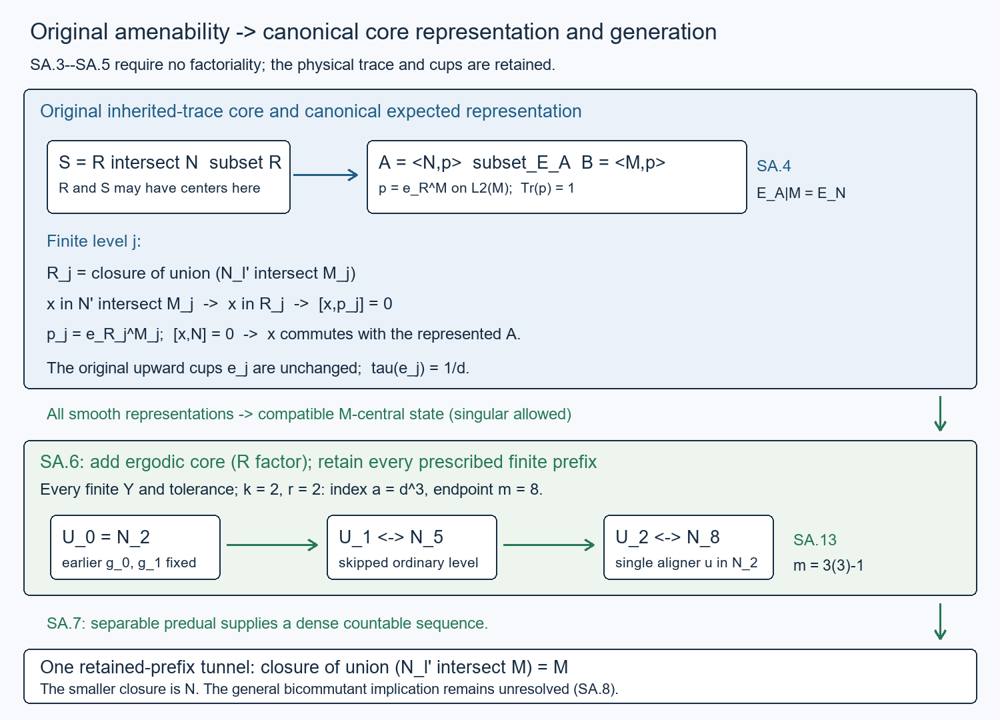

**Figure SA.1.** Exact maps and normalizations are SA.1–SA.7. The upper panel distinguishes the core projection \(p\), whose canonical trace is one, from each physical cup \(e_j\), whose normalized physical trace is \(d^{-1}\). The lower panel uses \(k=2,r=2\): the higher index is \(d^3\), skipped levels are \(N_2,N_5,N_8\), and the finite aligner belongs to \(N_2\). The final arrow requires separable predual, exactly as in the original theorem. Boxes indicate algebras, not spatial areas or trace sizes. The complete portable CC0 source is [figure.py](figures/strong-amenability-transfer-v25.py).

## Permutation orbits give the entire finite residual an actual origin

The scalar trace fiber of an actual Jones row is more flexible than its canonical rank capacities. Repeated even fusion blocks supply word projections whose physical traces are exactly equal under permutation. Redistributing ranks within these finite orbits gives an exact residual certificate after cuts of arbitrarily small physical trace. The construction below applies to every proper finite-index II₁ inclusion. All-smooth amenability enters only through the existing marked near-cover theorem76.4; together they prove the unrestricted full finite-family conclusion.

The finite construction retains the actual smaller row, all three full supported rows, both original trace systems, the prescribed ordinary prefix and cups, the whole residual and the original physical targets. It neither proves a generating tunnel without the original ergodic-core hypothesis nor changes the separate rational WM invariant endpoint.

The exact earlier providers are finite module corners2.0–2.4/2.9, fusion6.1–6.5, coherent finite reflection14.1, Proposition14.2 and equation14.3/40.1–40.5, dual even fusion19.13–19.19, finite marked alignment57.3, canonical core representation SA.3–SA.5, the near-cover76.4, scalar physical placement78.2, and sharp marked return FS.7–FS.15/SFQ.18–SFQ.19 of Lesson99. No trace-preserving reflection to the upward tower trace is assumed. The original human endpoint is Sorin Popa, *Classification of amenable subfactors of type II*, Acta Mathematica **172** (1994), Theorem4.4.1(1), printed p.222, [DOI](https://doi.org/10.1007/BF02392646).

### Separate dimensions of finite fusion words

**Lemma POR.1.** Let \({}_A H_B\) and \({}_B K_C\) be nonzero bifinite correspondences of II₁ factors, with their finite normal outer actions. Their left and right module dimensions multiply separately:

\[
 \dim_A(H\boxtimes_B K)=\dim_A(H)\dim_B(K),\qquad
 \dim_{C^{\mathrm{op}}}(H\boxtimes_B K)
 =\dim_{B^{\mathrm{op}}}(H)\dim_{C^{\mathrm{op}}}(K).
 \tag{POR.1}
\]

The same identities hold for ranges of bimodule projections. In particular normalized left-endomorphism traces factor on tensor products of such projections, and normalized right-endomorphism traces factor separately. These two trace systems need not agree.

**Proof.** Realize \(K\), as a left \(B\)-module, as the finite standard corner \(qL^2(B)^s\), where \(q\in\operatorname{Mat}_s(B^{\mathrm{op}})\) and \((\operatorname{Tr}_s\otimes\tau_B)(q)=\dim_B K\). The fusion unit identifies \(H\boxtimes_B K\), as a left \(A\)-module, with \(qH^s\), with the matrix entries of \(q\) acting through the right \(B\)-action. Write \(\alpha=\dim_A H\). The dimension trace on the finite factor \(\operatorname{End}_{A-}(H)\) has total value \(\alpha\). Its restriction to the unital right \(B\)-factor is \(\alpha\tau_B\), by uniqueness of the normalized trace on that factor. On its matrix amplification it is \(\alpha(\operatorname{Tr}_s\otimes\tau_B)\). Hence the dimension of \(qH^s\) is \(\alpha\dim_B K\). For the right formula, realize \(H\) as a finite right \(B\)-standard corner and apply the same argument to the left \(B\)-action on \(K\); equivalently use conjugate-fusion reversal.

If \(p\) and \(q\) are bimodule projections, their nonzero ranges retain unital faithful normal actions of the outer factors. Apply the proved identities to these ranges. Dividing by the corresponding dimensions of the whole fused words gives each normalized trace product. A zero range gives zero directly. \(\square\)

### The tensor copies lie in the original downward tunnel

Fix the prescribed prefix through \(N_k\), and put \(Q=N_k\), \(P=N_{k+1}\). **This original first-step inclusion** is used throughout. Put \(d=[Q:P]\); every adjacent index of the ordinary tunnel is the original \([M:N]\). For the downward continuation set

\[
 F_a=N_{k+a}'\cap Q.
 \tag{POR.2}
\]

Use tracial conjugation \(J_Q\) on \(L^2(Q)\). Coherent finite reflection14.2/40.3 gives the actual upward tower
\(T_a=(J_QN_{k+a}J_Q)'\), its relative commutants
\(B_a=Q'\cap T_a\), and compatible linear anti-isomorphisms
\(\Theta_a(x)=J_Qx^*J_Q:F_a\to B_a\).
This is a finite-level construction; no normal representation of the infinite upward tracial tower is asserted.

Let
\(X={}_P L^2(Q)_Q\), \(\overline X={}_Q L^2(Q)_P\).
The dual sequence19.13–19.17 identifies

\[
 K_a=\overline X\boxtimes_P X\boxtimes_Q\overline X\boxtimes_P\cdots,
 \qquad
 B_a=\operatorname{End}_{Q-Q}(K_a)\quad(a\text{ even}),
 \tag{POR.3}
\]

with its full right-module endomorphism factor \(T_a\). The actual inclusions append the next factor on the right. At \(a=2l>0\), write

\[
 Z=K_{2l}=(\overline X\boxtimes_P X)^l,
 \qquad \dim_Q Z=\dim_{Q^{\mathrm{op}}}Z=d^l.
 \tag{POR.4}
\]

The word is \(Q\)-\(Q\). Its \(h\)-fold fusion over \(Q\) is the **same specified** word \(K_{2lh}\), with the standard associators. The equal dimensions of these whole words do not imply equality of the left and right traces on their projection ranges.

**Lemma POR.2 — the physical trace is the left trace.** Under \(\Theta_a\) and the finite fusion identification, the original downward physical trace on \(F_a\) is the normalized **left** module trace on \(B_a\). The original normalized module trace \(\rho_{k+a}^{Q}\) on \(F_a\) is the normalized **right** module trace on \(B_a\).

**Proof.** Formula40.5 identifies the downward physical trace with the normalized trace on the **whole** opposite factor \(Q'\) in the coherent representation on \(L^2(Q)\). Compare this representation of the full finite tower factor \(T_a\) with the fusion representation on \(K_a\). Both are faithful normal finite modules for \(T_a\). Finite standard-module corners and common amplification2.0 realize one as a corner of an amplification of the other, by a projection \(e\) in the full tower commutant \(T_a'\).

Inside the amplified left-\(Q\) commutant, let \(t\) be its normalized trace and \(C\) the **full** commutant of the amplified \(T_a\)-representation. This is the amplified factor, for example \(\operatorname{Mat}_s(T_a')\), and \(e\in C\). The amplified \(b\in B_a\) commutes with all of \(C\). The trace-preserving expectation onto that factor therefore obeys
\(E_C(b)\in Z(C)=\mathbb C1\), with value \(t(b)1\). Consequently
\(t(be)=t(b)t(e)\), and normalized compression by \(e\) preserves the trace of every \(b\in B_a\). Amplification does so as well. This proves that the normalized whole-opposite-factor trace restricts to the normalized left-endomorphism trace in the fusion representation. Its projection value is \(\dim_Q(bK_a)/\dim_QK_a\), by the dimension trace definition. It proves the first assertion using40.5, without comparing two unrelated traces on \(B_a\).

For the second assertion, conjugation by \(J_Q\) identifies the whole finite commutant of the left \(N_{k+a}\)-action on \(L^2(Q)\) with \(T_a\). Its normalized factor trace is precisely \(\rho_{k+a}^Q\). The compatible identification19.17 of \(T_a\) with the right-module endomorphism factor of \(K_a\) preserves that normalized factor trace. Its value on \(b\) is \(\dim_{Q^{\mathrm{op}}}(bK_a)/\dim_{Q^{\mathrm{op}}}K_a\). \(\square\)

**Proposition POR.3 — actual independent copies.** If \(m-k=2l>0\), then for every \(h\ge1\), with \(j=k+(m-k)h\), there is an actual injective unital inclusion

\[
 \iota_h:F_{m-k}^{\otimes h}\longrightarrow N_j'\cap N_k,
 \qquad \iota_h(a\otimes1\otimes\cdots\otimes1)=a.
 \tag{POR.5}
\]

Both original trace systems separately give their product traces on this subalgebra:

\[
 \tau\!\left(\iota_h\bigotimes_t p_t\right)=\prod_t\tau(p_t),\qquad
 \rho_j^{N_k}\!\left(\iota_h\bigotimes_t p_t\right)
       =\prod_t\rho_m^{N_k}(p_t).
 \tag{POR.6}
\]

**Proof.** Functoriality places the tensor product of \(h\) copies of
\(\operatorname{End}_{Q-Q}(Z)\) inside \(\operatorname{End}_{Q-Q}(Z^{\boxtimes_Qh})=B_{2lh}\). The different factor actions commute. LemmaPOR.1 gives positive product left dimension for every tensor product of source minimal projections. Therefore no simple matrix summand of the finite tensor algebra is killed; the map is injective. It is unital. The first copy is the original inclusion \(b\mapsto b\boxtimes1\) of19.17 at each appended step, with the specified associators, rather than a relocated algebra.

Apply \(\Theta_{2l}\) to each source tensor factor and \(\Theta_{2lh}^{-1}\) to the target. Two product-reversing maps compose to a *-homomorphism. Their compatibility gives the literal first-copy equality in POR.5. LemmasPOR.1–POR.2 give the two product traces in POR.6 separately. \(\square\)

There is no extremality assumption in this argument. If the original common source depth has odd \(m-k\), first promote it by the existing actual inclusion to the next even depth; if necessary promote to \(m\ge k+2\). The source physical and module traces restrict unchanged. Hence POR.5 is available for every finite initial family.

For the other two rows, define \(\rho_t^L\) on \(N_t'\cap L\), \(L=M,N\), in its original module-dimension domain. Its restriction to \(N_t'\cap N_k\) is \(\rho_t^{N_k}\). Here is the dimension argument, separately for each \(L\). Realize \(L^2(L)\), as a left \(N_k\)-module, as a finite standard corner of an amplification of \(L^2(N_k)\), with dimension \([L:N_k]\). For \(g\in N_t'\cap N_k\), the range \(gL^2(N_k)\) is a finite left \(N_t\)-module with a unital right \(N_k\)-action. Its dimension trace restricts to that right factor as its total dimension times \(\tau_{N_k}\). Compression by the standard-corner projection therefore multiplies \(\dim_{N_t}(gL^2(N_k))\) by \([L:N_k]\). The normalizing index \([L:N_t]\) is multiplied by the same number, so

\[
 \rho_t^L(g)=\rho_t^{N_k}(g).
 \tag{POR.7}
\]

Thus POR.6 applies separately to the original module traces in all three rows on the actual smallest tensor subalgebra. It does not identify their values on the upper or middle row with the physical trace, or compare modules belonging to different terminal factors without their specified transport.

### The exact orbit allocation

At the common even source write

\[
 F=N_m'\cap N_k=\bigoplus_b\operatorname{Mat}_{n_b}.
 \tag{POR.8}
\]

Let canonical \(g_1,\ldots,g_r\in F\) represent an orthogonal physical near-cover, so \(S_\tau=\sum_i\tau(g_i)\le1\). Canonical overlap is permitted. If its old aligner is \(U_i\), diagonalize \(g_i\) by \(w_i\in\mathcal U(F)\) and use \(V_i=U_iw_i^*\) for the support and module coordinates. Relabel the diagonalized projections as \(g_i\). This preserves each original physical support and all its three old row corners. Retain the original \(U_i\)-conjugated continuation and its chosen cups. For every \(t\ge m\), \(V_iN_tV_i^*=U_iN_tU_i^*\), since \(w_i\) commutes with \(N_m\). This equality of terminal factors is not used to assert that \(w_i\) fixes a cup in \(N_{m-1}\). Fix the common diagonal minimal projections \(p_a\), indexed by the finite alphabet \(\mathcal A\), with \(\sum_a p_a=1\). Put

\[
 w_a^\tau=\tau(p_a),\quad w_a^\rho=\rho_m^{N_k}(p_a),\qquad
 o_a=\#\{i:p_a\le g_i\}\in\{0,\ldots,r\}.
 \tag{POR.9}
\]

Both weight vectors are strictly positive and sum to one. The occupancy mean and variance for a trace label \(\sigma=\tau,\rho\) are

\[
 S_\sigma=\sum_a w_a^\sigma o_a=\sum_i\sigma_0(g_i),\qquad
 v_\sigma=\sum_a w_a^\sigma(o_a-S_\sigma)^2.
 \tag{POR.10}
\]

The module mean \(S_\rho\) can exceed one. Here \(\sigma_0\) is the source trace; target \(\sigma_h\) is \(\tau\) or \(\rho_j^L\) at the declared target domain \(N_j'\cap L\).

Inside POR.5, form the actual mutually orthogonal word projections
\(p_w=\iota_h(p_{a_1}\otimes\cdots\otimes p_{a_h})\), with sum one. They need not be minimal in the **full** target row. Their exact weights are
\(\sigma_h(p_w)=\prod_t w_{a_t}^\sigma\).
Let \(O\) be an orbit of words under permutation of positions. Every word in \(O\) has the same physical weight, and separately the same original module weight. If \(T_O=\sum_t o_{a_t}\), the total number of old first-copy occurrences over that orbit is

\[
 R_O=\sum_{w\in O}o_{a_1}=|O|T_O/h\in\mathbb Z.
 \tag{POR.11}
\]

Indeed each position has the same total occupancy over the orbit, and the sum over positions is \(|O|T_O\). The integrality follows also directly from the first expression.

For each orbit retain exactly \(\min\{R_O,|O|\}\) old occurrences: an occurrence is a pair \((i,w)\) with \(p_w\le g_i\) in the first copy. Delete none if \(R_O\le|O|\); otherwise delete exactly \(R_O-|O|\) occurrences in any fixed finite order. For each \(i\), the sum of its retained word projections is an actual projection \(g_i'\le g_i\) in the target row. Independently select exactly
\(|O|-\min\{R_O,|O|\}\) word projections from each orbit for \(q_0\). Their union is an actual projection in the same row. It need not be canonically orthogonal to the retained \(g_i'\).

**Theorem POR.4 — an exact residual with small physical cuts.** These finite choices satisfy

\[
 \tau(q_0)=1-\sum_i\tau(g_i'),\qquad
 \rho_j^L(q_0)=1-\sum_i\rho_j^L(g_i')\quad(L=M,N,N_k),
 \tag{POR.12}
\]

and their cut losses are exactly

\[
 \Delta_\sigma(h)=\sum_i\sigma_h(g_i-g_i')
 =\mathbb E_\sigma\left[\left(\frac1h\sum_{t=1}^h o_{A_t}-1\right)_+\right]
 \le (S_\sigma-1)_++\sqrt{v_\sigma/h},
 \tag{POR.13}
\]

where \(A_t\) are independent alphabet samples with their own original weights \(w^\sigma\). In particular

\[
 \Delta_\tau(h)\le\sqrt{v_\tau/h}\longrightarrow0.
 \tag{POR.14}
\]

**Proof.** In an orbit with common trace mass \(c_O^\sigma\), the deleted old mass is exactly
\(c_O^\sigma(R_O-|O|)_+\). Its residual mass is
\(c_O^\sigma(|O|-R_O)_+\). The retained old mass is
\(c_O^\sigma\min(R_O,|O|)\). Thus retained mass plus residual mass equals \(c_O^\sigma|O|\). Summing over the partition of all words proves POR.12, separately with each product weight from POR.6–POR.7.

POR.11 rewrites the deleted mass as
\(|O|c_O^\sigma(T_O/h-1)_+\), proving the exact expectation in POR.13. The sample mean has mean \(S_\sigma\) and variance \(v_\sigma/h\). The positive-part function is 1-Lipschitz, and Cauchy–Schwarz bounds its expected deviation from its mean by \(\sqrt{v_\sigma/h}\). This proves the estimate. The physical mean is at most one because the actual physical supports were orthogonal; it gives POR.14. \(\square\)

For completeness, the exact finite formula is the multinomial sum

\[
 \Delta_\sigma(h)=
 \sum_{\substack{c_a\ge0\\\sum_a c_a=h}}
 \frac{h!}{\prod_a c_a!}\prod_a(w_a^\sigma)^{c_a}
 \left(\frac{\sum_a c_ao_a}{h}-1\right)_+.
 \tag{POR.15}
\]

No limiting allocation is used to create \(q_0\); it exists at each stated finite stage. Increasing \(h\) controls a proved physical loss. If \(v_\tau=0\), the occupancy is a constant integer, necessarily zero or one, so there are no cuts already at \(h=1\). Empty families, zero cells and zero residuals follow from the same definitions.

These exchanges belong to the **entire actual integral physical kernel**. In the full target row, each \([p_w]\) is an integral rank vector, whether or not \(p_w\) is minimal there. Within an orbit, equal physical traces give
\([p_w]-[p_{w'}]\in\ker_{\mathbb Z}\tau\). The vector

\[
 [q_0]+\sum_i[g_i']-[1]
 \tag{POR.16}
\]

has coefficient sum zero in every orbit and is therefore an integer linear combination of these differences. This supplies the nearly uncut weak residual allocation requested by WBR, with integer retained ranks and an actual residual; WBR rounding is unnecessary here. It chooses new feasible directions rather than promoting the prescribed real direction refuted by DNP. The exchanges can cross central blocks of the full row, so they do not imply the canonical same-block packing that CGP disproves.

Every other compatible finite trace remains explicit. Write \(\lambda_w^\xi=\xi(p_w)\) for its restriction to the actual word subalgebra. If \(\mathcal R_i\) is the retained word set for cell \(i\), \(\mathcal Q\) the residual word set, and \(\mathcal G_i\) all its old words, then

\[
 \xi(g_i')=\sum_{w\in\mathcal R_i}\lambda_w^\xi,\quad
 \xi(q_0)=\sum_{w\in\mathcal Q}\lambda_w^\xi,\quad
 \xi(g_i-g_i')=\sum_{w\in\mathcal G_i\setminus\mathcal R_i}\lambda_w^\xi.
 \tag{POR.17}
\]

These traces need not be product traces or constant on permutation orbits. No equality like POR.12 is asserted for them. The actual projection choices give positivity and unit bounds on the entire finite trace cone.

### The original whole residual and three marked rows

Use the actual source coordinates \(r_i=V_ig_iV_i^*\), \(V_i\in\mathcal U(N_k)\), with orthogonal physical old supports, and \(f=1-\sum_i r_i\). Keep the original continuations and cups as specified above. Define

\[
 r_i'=V_ig_i'V_i^*,\quad
 f_*=f+\sum_i(r_i-r_i'),\quad
 \Delta=\sum_i\tau(r_i-r_i')=\Delta_\tau(h).
 \tag{POR.18}
\]

The **physical** equality POR.12 gives \(\tau(q_0)=\tau(f_*)\). Finite-factor comparison in \(N_k\) supplies a unitary \(v\) with \(vq_0v^*=f_*\). Conjugate the new residual continuation by \(v\), without changing the old physical targets. At \(j=k+(m-k)h\), let \(T_i=U_iN_jU_i^*=V_iN_jV_i^*\), \(T_0=vN_jv^*\), \(e_i=r_i'\), \(e_0=f_*\). Omitting zero terms, the entire full supported rows are

\[
 P_* =\bigoplus_a e_a(T_a'\cap M)e_a,\quad
 Q_* =\bigoplus_a e_a(T_a'\cap N)e_a,\quad
 D_* =\bigoplus_a e_a(T_a'\cap N_k)e_a.
 \tag{POR.19}
\]

Their common unit is one. Every support has its actual whole finite tunnel origin, including the **entire** old residual \(f\). All supports lie in \(N_k\). For \(x\in A_k=N_k'\cap M\), each \(e_ax\) belongs to its upper corner and \(x=\sum_ae_ax\), so \(A_k\subset P_*\) exactly. The identical argument gives \(B_k=N_k'\cap N\subset Q_*\). Their expectation identities in both orders are

\[
 E_NE_{P_*}=E_{P_*}E_N=E_{Q_*},\quad
 E_{N_k}E_{P_*}=E_{P_*}E_{N_k}=E_{D_*},\quad
 E_{N_k}E_{Q_*}=E_{Q_*}E_{N_k}=E_{D_*}.
 \tag{POR.20}
\]

Indeed the actual stage expectations have the three image identities; support bimodularity preserves them, trace pairing gives one order and adjoints give the other, exactly as in SFQ.18a–SFQ.18b. The placing unitaries lie in \(N_k\), so all preceding factor algebras and cups remain fixed as prescribed. Each original module trace is carried by its actual terminal-factor module isomorphism; its canonical cut loss is POR.13 and its canonical residual value is POR.12. This is separate actual dual data, rather than an assumed equality with the physical trace.

For any positive integer \(n\), the completed family also admits a unital \(\operatorname{Mat}_n(\mathbb C)\subset N_k\) commuting with \(P_*\). For each nonzero cell, \(x\mapsto e_ax\) is a nonzero normal *-homomorphism \(T_a\to e_aT_a\) with central kernel. Since \(T_a\) is a factor, it is faithful. Thus \(e_aT_a\) is a unit-\(e_a\) II₁ factor commuting with the entire upper cell. Choose matrix units of order \(n\) separately in these factors. Their sums across the orthogonal supports satisfy the matrix-unit equations and have unit \(\sum_a e_a=1\), as in75.4.

For the old residual component \(b_y\in fA_k\), choose a norm-preserving lift \(c_y\in A_k\). Indeed \(x\mapsto fx\) is a surjective *-homomorphism of a finite-dimensional algebra with central-summand kernel; its restriction to the complementary summand is an isometric *-isomorphism. Thus \(\gamma_y=\|c_y\|=\|b_y\|\le\|y\|\). The lift remains available on \(f_*\). The sharp existing marked return gives, for every unchanged physical target \(y\),

\[
 \|y-E_{P_*}y\|_2\le\|y-E_{P_0}y\|_2
 +\sqrt{2(\|y\|^2+\gamma_y^2)\Delta_\tau(h)}
 \le\|y-E_{P_0}y\|_2+2\|y\|(v_\tau/h)^{1/4}.
 \tag{POR.21}
\]

It uses the actual cuts and exact residual equality just proved; no proximity of \(v\) to one is required. Thus every finite marked near-cover can be completed with arbitrarily small added physical target error.

**Corollary POR.5 — unrestricted full finite families.** Suppose an actual proper finite-index inclusion is amenable in the original representation sense: every smooth nondegenerate normal expected representation admits a compatible physical-factor-central state. Then every prescribed ordinary prefix, finite physical target set and positive approximation tolerance admit a finite full family of the three whole supported rows POR.19, satisfying POR.20 and approximating those original targets to that tolerance.

**Proof.** First apply the canonical representation construction for an arbitrary actual core. SA.3 constructs its entire finite higher-core tower with the original physical cups and common basis52.1/61.2. SA.4 proves that its canonical expected representation is smooth and nondegenerate at every finite stage. These two arguments do not use SA.2's separate factorial-core hypothesis. Original representation amenability consequently supplies its compatible possibly singular hypertrace. The original canonical semifinite traces and expectation have the hypotheses of49.2, so that theorem supplies actual relative Følner projections, as in SA.5. Provider74.4 and then76.4 apply at their general-core scope, including the higher-factor heredity used to retain the prescribed prefix. This obtains the actual marked near-cover at a strictly smaller tolerance, without normality of the hypertrace or an ergodic-core assumption.

Take76.4's near-cover tolerance to be \(\varepsilon/3\). Align its finitely many good origins by57.3 to one actual source stage and promote that stage to an even positive suffix length. Apply TheoremPOR.4 and the return POR.18–POR.21. For target norm bound \(R=\max_{y\in Y}\|y\|\), choose
\(h=\lfloor v_\tau(6R/\varepsilon)^4\rfloor+1\) if \(v_\tau>0\), and \(h=1\) if the variance is zero. Here take \(R=0\) for an empty target set. The added error is strictly below \(\varepsilon/3\) when \(R>0\), and is zero when \(R=0\). The final error is below \(2\varepsilon/3<\varepsilon\). More generally margin \(\eta\) is obtained by \(h>16R^4v_\tau/\eta^4\). The exact residual projection and all rows exist at the finite original-tunnel depth \(j=k+(m-k)h\). No factorial-core, extremality, rational-independence, finite-depth or separability assumption has been introduced. \(\square\)

### Normal traces on the scalar-kernel quotient

**Corollary POR.6.** In the inherited physical von Neumann completion of the lowest finite rows after any prefix, every normal finite trace which annihilates all integral physical rank relations is proportional to the physical trace.

**Proof.** For any finite projection \(g\), promote its source to an even suffix and form its actual copies \(g^{(t)}\) in POR.5. Every difference \([g^{(t)}]-[g^{(1)}]\) is an integral physical-null relation, so the trace \(\xi\) has the same value on all these copies. Product factorization gives
\[
 \left\|h^{-1}\sum_{t=1}^h g^{(t)}-\tau(g)1\right\|_2^2
 =\tau(g)(1-\tau(g))/h.
\]
These averages are uniformly bounded by one. To justify passage through the normal trace without assuming a bounded density, first note that \(\tau(e_n)\to0\) for projections implies \(\xi(e_n)\to0\). Otherwise choose a subsequence with \(\sum_n\tau(e_n)<\infty\) and \(\xi(e_n)\ge c>0\). The decreasing joins \(q_s=\bigvee_{n\ge s}e_n\) have \(\tau(q_s)\le\sum_{n\ge s}\tau(e_n)\to0\), hence decrease to zero by faithfulness. Normality gives \(\xi(q_s)\to0\), contradicting \(\xi(e_s)\ge c\).

Write \(D_h=h^{-1}\sum_tg^{(t)}-\tau(g)1\). For fixed \(t>0\), the projection \(e_h=1_{\{|D_h|>t\}}\) has \(\tau(e_h)\le\|D_h\|_2^2/t^2\to0\). Since \(\|D_h\|\le1\),
\(|\xi(D_h)|\le\xi(|D_h|)\le t\xi(1)+\xi(e_h)\).
Let \(h\) and then \(t\) tend to their limits. Thus \(\xi(g)=\tau(g)\xi(1)\). Finite spectral decomposition gives the equality on every finite row, and normality extends it to the inherited closure. \(\square\)

Other normal traces need not annihilate these relations. In particular the separating trace in CGP is not excluded by this corollary; canonical rank capacity and scalar trace-fiber allocation remain different. The unrestricted finite-family result was constructed directly, rather than inferred from a trace-uniqueness criterion.

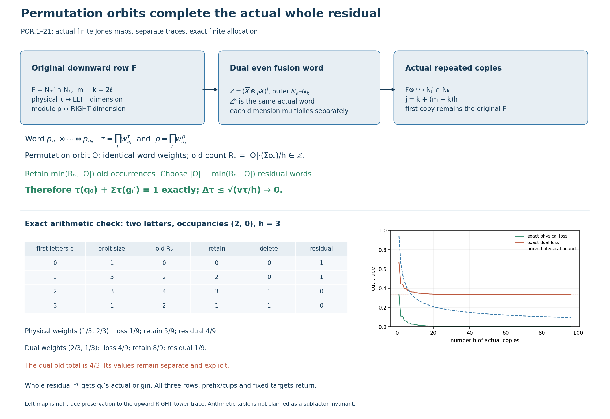

Figure POR. The upper arrows are the actual finite maps of POR.2–POR.7, using the original first-step inclusion \(N_{k+1}\subset N_k\). Relative tensor products are fusion words; the physical trace is normalized left dimension and the original module trace is normalized right dimension. The table gives Exercise86's exact orbit capacities and counts. The plotted curves are its exact finite physical and dual losses, together with the proved physical bound \(\sqrt{(8/9)/h}\); the dotted dual level is its limit \(1/3\). The table and plot are arithmetic checks, not claimed subfactor invariants. The final marked return is POR.18–POR.21. Human programme context: Popa (1994), Theorem4.4.1(1), printed p.222, cited above. [Portable reproducible figure and exact checks](figures/permutation-orbit-residual-v25.py).

*Written by GPT-6.1 Sol (OpenAI). Public domain (CC0-1.0).*

## Nonextremal finite reflection separates the two tracial completions

A finite Jones reflection always exists. Its pullback of the upward tower trace is the original normalized module trace, which can differ from the physical trace. Repeated actual fusion blocks amplify that finite discrepancy into a sequence of projections converging to one in one tracial representation and to zero in the other. Consequently a nonextremal inclusion obstructs every normal extension of the specified reflection, even when the ordinary core is not a factor.

This conclusion concerns the specified unmodified finite reflection. It does not refute a bicommutant equality, construct the separate opposite-model representation, or rule out different abstract maps between limiting pairs. In particular the actual index-ten example below satisfies bicommutant equality by its independent proof PG14.

The exact prerequisites are finite-module comparison2.0–2.4; finite commutant reversal14.1–14.2; the two finite trace systems and tracial extension theorem40.1–40.3; representation independence62.2 and the adjacent inverse-density comparison63.4; arbitrary-chain density66.3/66.5; and actual even tensor copies POR.1–POR.7. The required finite proofs are supplied in [module dimensions](module-dimension-and-local-index.md), [finite reflection](reflected-traces-and-uniform-bounds.md), [tracial extension](trace-compatible-reflection.md), [canonical cups](canonical-rescaling-of-jones-cups.md), [canonical density transitivity](canonical-density-transitivity.md), and [the actual permutation-orbit construction](general-tail-supports-and-controlled-tunnels.md). The concentration and normality arguments are proved below.

### The exact finite trace and its compatibility

Let \(N\subset M\) be a proper finite-index inclusion of II₁ factors, with index \(d>1\), and retain an arbitrary prescribed ordinary tunnel prefix and its Jones projections. Use \(N_{-1}=M,N_0=N\). Fix \(k\ge-1\), put \(Q=N_k,P=N_{k+1}\), and continue that actual prefix. For \(a\ge0\), set

\[
 F_a=N_{k+a}'\cap Q,\qquad
 T_a=(J_QN_{k+a}J_Q)',\qquad
 B_a=Q'\cap T_a.
 \tag{CTS.1}
\]

Here \(J_Q\widehat x=\widehat{x^*}\) on \(L^2(Q)\). The whole finite factor \(T_a\) acts in this coherent representation;14.2 identifies its inclusions and marked cups with the actual upward tracial Jones tower of \(P\subset Q\). The map

\[
 \Theta_a:F_a\longrightarrow B_a,\qquad
 \Theta_a(x)=J_Qx^*J_Q
 \tag{CTS.2}
\]

is a linear *-anti-isomorphism. Let \(\tau\) denote the physical trace of \(Q\). Let \(\rho_a\) be the normalized trace of the whole left-\(N_{k+a}\) commutant on \(L^2(Q)\), restricted to \(F_a\). Its unnormalized total dimension is \(d^a\).

**Lemma CTS.1 — the pulled-back tower trace.** For every \(a\) and \(x\in F_a\),

\[
 \tau_{T_a}(\Theta_a(x))=\rho_a(x).
 \tag{CTS.3}
\]

The traces \(\rho_a\) restrict compatibly along the actual \(F_a\subset F_{a+1}\). Thus \(s|_{F_a}=\rho_a\) defines a faithful tracial state on the norm closure \(\mathcal F=\overline{\bigcup_aF_a}^{\|\cdot\|}\). The physical trace defines a second faithful tracial state \(t=\tau|_{\mathcal F}\).

**Proof.** Conjugation by \(J_Q\), followed by adjoint, identifies the entire finite factor \((N_{k+a})'\) with \(T_a\). Transporting its normalized factor trace gives the unique normalized trace on the entire \(T_a\), proving CTS.3. This compares whole factors, rather than assuming equality of two factor traces restricted to their intersection.

For a projection \(p\in F_a\), restricting its left-\(N_{k+a}\) module \(pL^2(Q)\) to \(N_{k+a+1}\) multiplies its dimension by \(d\), by the restriction formula2.1–2.4. The whole dimension \(d^a\) also becomes \(d^{a+1}\). Hence \(\rho_{a+1}(p)=\rho_a(p)\). Finite spectral decompositions prove compatibility on the entire finite algebra. Compatible bounded tracial states extend continuously to the norm closure; their faithfulness follows, for example, from the faithful finite-stage expectations in each tracial GNS completion. \(\square\)

Write

\[
 R_k=\left(\bigcup_aF_a\right)''\subset Q,\qquad
 \widehat B_k=\left(\bigcup_aB_a\right)''\subset T_\infty,
 \tag{CTS.4}
\]

where \(T_\infty\) is the canonical tracial upward completion. The second closure is \(Q'\cap T_\infty\): expectations onto the finite \(T_a\) preserve commutation with \(Q\), are bounded, and converge in tracial \(L^2\). The first closure is the physical ordinary core and can have nontrivial center. Reflection identifies \(\mathcal F^{\mathrm{op}}\) with the norm closure of the \(B_a\); its canonical tracial completion corresponds exactly to \(s\).

### A witness after every prescribed prefix

**Lemma CTS.2 — propagation through the actual downward triples.** If \(N\subset M\) is nonextremal, choose a projection \(g_{-1}\in N'\cap M\) with

\[
 a_{-1}=\tau_M(g_{-1})\ne
 b_{-1}=\rho_{N,M}(g_{-1}).
 \tag{CTS.5}
\]

For every prescribed prefix through \(N_{k+1}\), there is a projection \(g_k\in N_{k+1}'\cap N_k=F_1\) whose physical and module values \(a_k,b_k\) are the original two values, exchanged at each downward step. In particular \(0<a_k,b_k<1\) and \(|a_k-b_k|=|a_{-1}-b_{-1}|>0\).

**Proof.** Nonextremality means that the two tracial states differ on the finite-dimensional \(N'\cap M\). Finite spectral decomposition gives a projection on which they differ; its values are strictly between zero and one because both traces are faithful and normalized.

Use the exact adjacent comparison63.4 in each actual ordinary triple

\[
 A=N_{j+2}\subset Q_0=N_{j+1}\subset R_0=N_j.
\]

In its standard realization on \(L^2(Q_0)\), that provider gives the anti-isomorphism

\[
 \eta_{Q_0}:A'\cap Q_0\longrightarrow Q_0'\cap R_0
\]

and the two separate equalities

\[
 \tau_{R_0}(\eta_{Q_0}(z))=\rho_{A,Q_0}(z),\qquad
 \rho_{Q_0,R_0}(\eta_{Q_0}(z))=\tau_{Q_0}(z).
 \tag{CTS.6}
\]

These are precisely the inherited and commutant trace identifications used in its proof of the inverse dual density63.17. The finite representation-independence proof62.2 compares an arbitrary finite \(R_0\)-module with its standard module by amplification and compression in the **full** \(R_0\)-commutant factor; conditional expectation onto that factor makes the trace of a commuting \(z\) factor through the compression. Thus CTS.6 holds in the given actual ordinary triple, after its marked finite basic-construction identification. It introduces no infinite normal representation.

Starting at \(j=-1\), define \(g_{j+1}=\eta_{N_{j+1}}^{-1}(g_j)\). CTS.6 gives \(a_{j+1}=b_j,b_{j+1}=a_j\). Iteration uses only the chosen actual triples and proves the claim for every prefix. No assumption of nonextremality at all steps was made: it is a consequence of these identities. \(\square\)

For use with POR.3, include \(g_k\in F_1\) into \(F_2\). Lemma CTS.1 preserves its module value, and its physical value is unchanged. The source is now the even suffix of length two. The construction remains within the actual smallest commuting row after the prefix.

### Spectral separation from actual tensor copies

**Theorem CTS.3 — quantitative two-trace separation.** More generally let \(g\in F_{m-k}\) be a finite source projection with even \(m-k>0\), and set \(a=\tau(g),b=\rho_{m-k}(g)\), with \(a\ne b\). For every \(h\ge1\), POR.3 gives commuting actual copies \(g^{(1)},\ldots,g^{(h)}\in N_j'\cap N_k\), where \(j=k+(m-k)h\), retaining the original first copy. Set

\[
 G_h=\frac1h\sum_{r=1}^h g^{(r)},\quad c=\frac{a+b}{2},\quad
 q_h=\begin{cases}
 1_{(-\infty,c)}(G_h),&a<b,\\
 1_{(c,\infty)}(G_h),&a>b.
 \end{cases}
 \tag{CTS.7}
\]

These are actual finite-row projections, and

\[
 \tau(1-q_h)\le\frac{4a(1-a)}{h(a-b)^2},\qquad
 \rho_{j-k}(q_h)\le\frac{4b(1-b)}{h(a-b)^2}.
 \tag{CTS.8}
\]

Hence \(q_h\to1\) strongly in the physical tracial representation and \(q_h\to0\) strongly in the canonical \(s\)-tracial representation. The two representations have no nonzero bounded intertwiner.

**Proof.** POR.5–POR.6 places the copies in the actual row and gives the two product traces separately. For either trace, the copies are Bernoulli projections. The mean of \(G_h\) is respectively \(a\) or \(b\), and its variance is respectively \(a(1-a)/h\) or \(b(1-b)/h\). On the complement of \(q_h\), \(|G_h-a|\ge|a-b|/2\); on \(q_h\), \(|G_h-b|\ge|a-b|/2\). The positive spectral inequalities followed by the corresponding trace prove CTS.8. Inclusion or exclusion of a midpoint eigenvalue does not invalidate these nonstrict estimates.

Because \(q_h\) is a projection, CTS.8 gives \(\|1-q_h\|_{2,t}\to0\) and \(\|q_h\|_{2,s}\to0\). For a bounded vector \(x\) in either standard tracial space, \(\|p_hx\|_2\le\|x\|\|p_h\|_2\); density of bounded vectors and \(\|p_h\|\le1\) give strong convergence of the left multiplication projections. The right representations have the same argument. If a bounded intertwiner \(V\) from the physical representation to the canonical representation existed, then \(V\pi_t(q_h)=\pi_s(q_h)V\). Strong limits give \(V=0\). This proves the last statement without assuming either core factorial. \(\square\)

The exact finite values are also available. With \(C_h=\{r:0\le r\le h,\ r/h<c\}\) when \(a<b\), and \(C_h=\{r:r/h>c\}\) when \(a>b\),

\[
 \tau(q_h)=\sum_{r\in C_h}\binom hr a^r(1-a)^{h-r},\qquad
 \rho_{j-k}(q_h)=\sum_{r\in C_h}\binom hr b^r(1-b)^{h-r}.
 \tag{CTS.9}
\]

These formulas evaluate actual projection traces supplied by POR, rather than hypothesizing an independent tensor model for the full Jones row.

### No positive normal mass and no normal extension

We say that the state \(s\) is **purely singular relative to the physical completion** if every positive normal functional \(\mu\) on \(R_k\) satisfying \(\mu(x)\le s(x)\) for \(x\in\mathcal F_+\) is zero. Allowing any fixed positive scalar multiple of \(s\) gives the same definition. This is the precise normal-component assertion used here.

**Lemma CTS.4 — normal absolute continuity.** Let \(V\) be a finite von Neumann algebra with faithful normal finite trace \(u\), and let \(\mu\) be any positive normal finite functional on \(V\), without a traciality assumption. If projections \(p_n\) satisfy \(u(p_n)\to0\), then \(\mu(p_n)\to0\).

**Proof.** Otherwise pass to a subsequence with \(\mu(p_n)\ge\varepsilon>0\) and \(\sum_nu(p_n)<\infty\). The tail joins \(r_l=\bigvee_{n\ge l}p_n\) decrease and satisfy \(u(r_l)\le\sum_{n\ge l}u(p_n)\to0\). Faithfulness makes their infimum zero. Normality gives \(\mu(r_l)\downarrow0\), contradicting \(\mu(p_l)\ge\varepsilon\). The trace bound for joins follows first from \(u(p\vee q)\le u(p)+u(q)\), by finite-factor projection comparison or the polar-decomposition equivalence of \((p\vee q)-p\) with a subprojection of \(q\), and then by normality for countable joins. The same equivalence works in every finite von Neumann algebra. \(\square\)

**Theorem CTS.5 — singularity in both directions.** In the hypotheses of CTS.3, \(s\) has no nonzero positive normal dominated component on \(R_k\). Conversely the physical state \(t\), transported through finite reflection, has no nonzero positive normal dominated component in the canonical reflected completion \(\widehat B_k\).

**Proof.** Suppose \(0\le\mu\le s\) on \(\mathcal F\), with \(\mu\) normal on \(R_k\). Lemma CTS.4 and CTS.8 give \(\mu(1-q_h)\to0\), while

\[
 0\le\mu(q_h)\le s(q_h)=\rho_{j-k}(q_h)\to0.
\]

Thus \(\mu(1)=0\), so positivity gives \(\mu=0\). For the converse let \(\nu\) be normal on the canonical reflected completion and dominated on the finite union by the transported physical state. The projection \(\Theta(q_h)\) has canonical trace \(s(q_h)\to0\), so Lemma CTS.4 gives \(\nu(\Theta(q_h))\to0\). Domination gives \(\nu(\Theta(1-q_h))\le t(1-q_h)\to0\). Their sum is \(\nu(1)\), proving \(\nu=0\). This is the symmetric argument in the other completion. \(\square\)

**Corollary CTS.6 — universal nonextremal obstruction.** For every nonextremal finite-index II₁ inclusion, every prescribed ordinary prefix and every actual continuation, the specified finite reflection CTS.2 has no normal *-anti-homomorphism extension

\[
 R_k\longrightarrow\widehat B_k.
 \tag{CTS.10}
\]

This includes extensions permitted to change the trace and cores with arbitrary center. No amenability, finite depth, generating hypothesis or separability is required.

**Proof.** Lemma CTS.2 provides a mismatched first-step projection in the chosen prefix. Promote it to the actual even source \(m=k+2\) and apply CTS.3–CTS.5. A normal *-anti-homomorphism extending the specified finite map must send one to one. Composing it with the faithful normal canonical target trace gives a positive normal state on \(R_k\), whose restriction is exactly \(s\) by CTS.3. This is a nonzero normal dominated component, contradicting CTS.5. No uniqueness of trace on \(R_k\) was used. \(\square\)

### The exact extension criterion

**Theorem CTS.7 — extremality is necessary and sufficient.** For any finite-index II₁ inclusion and any prescribed ordinary prefix, the following are equivalent:

1. The original inclusion \(N\subset M\) is extremal.
2. Every finite reflected row after that prefix has its physical trace equal to the pulled-back canonical tower trace.
3. The specified reflection extends to a normal *-anti-homomorphism \(R_k\to\widehat B_k\).
4. It extends to a normal trace-preserving anti-isomorphism of the full reflected pair
   \[
   \left(\left(\bigcup_a(N_{k+a}'\cap P)\right)''\subset R_k\right)
   \longrightarrow
   \left(T_1'\cap T_\infty\subset Q'\cap T_\infty\right).
   \tag{CTS.11}
   \]

**Proof.** If the original inclusion is extremal, its adjacent canonical density is one. Provider63.4 makes the dual density the reflected inverse, so every actual downward adjacent density is one, by induction through the chosen ordinary triples. The arbitrary-chain identity66.5 then makes the density of every composite \(N_{k+a}\subset Q\) equal to one. Thus \(\rho_a=\tau|_{F_a}\), proving1⇒2 at every finite stage. The trace-isometric construction40.1 extends the opposite algebra map normally onto the two specified weak closures, including their smaller endpoints, proving2⇒4. This uses bounded density of the finite union; it does not need trace uniqueness for a nonfactor core. Statement4 implies3. If1 fails, CTS.6 rules out3, proving3⇒1. The equalities also give2⇒1 by contrapositive CTS.2 and trace restriction from \(F_2\) to its witness in \(F_1\). \(\square\)

For index one the inclusion and all rows are scalar relative commutants, and the same equivalences hold directly. At finite depth14.4 already supplies the equality in2. The present theorem removes the finite-depth hypothesis in the extremal case and supplies the full normality obstruction in the nonextremal case.

The distinction in40.3 between trace-preserving and trace-changing normal maps remains correct for general finite AF algebras. The actual repeated Jones rows supply additional projections CTS.7 that eliminate a trace-changing extension in this particular setting. Likewise47.5 remains a valid explicit generating example, now included in the universal obstruction. Corrected maps62.6 are different finite maps and are unaffected.

### An actual index-ten projection example

Use the actual PG1–PG18 construction in [Finite shifted comparisons without coherence](finite-shifted-comparisons-without-coherence.md). Its inclusion \(M_{-1}\subset M_0\) has index ten, its physical site-zero weights are \((2/5,1/5,2/5)\), and the original normalized module weights are \((1/4,1/2,1/4)\). Let \(g\) be the site-zero diagonal projection for label1. Then

\[
 a=\tau(g)=1/5,\quad b=\rho(g)=1/2,\quad c=7/20.
 \tag{CTS.12}
\]

In the actual even suffix interval \([-2h+1,0]\), the diagonal words give the projection \(q_h\) selecting strictly fewer than \(7h/20\) label1 entries on its \(h\) even sites. These are genuine balanced-word diagonal projections in the finite relative commutant PG8. Their original first selected site is site zero. Both product traces are the actual interval traces: PG17–PG18 give minimal physical and module weights \(2^{-r}/10^h\) and \(2^r/10^h\) in charge block \(sz^r\). Summing its full matrix ranks gives CTS.9 with the values CTS.12. Thus this concrete test has both its actual projection realization and its original normalized trace domains established.

At \(h=4\), \(q_4\) permits zero or one selected labels, and

\[
 \tau(q_4)=512/625,\qquad \rho(q_4)=5/16.
 \tag{CTS.13}
\]

For all \(h\), the proved bounds are \(\tau(1-q_h)\le64/(9h)\) and \(\rho(q_h)\le100/(9h)\). They are conservative estimates; the exact binomial tails in CTS.9 are also checked. This is an actual nonextremal, strongly amenable example with a generating tunnel, and PG14 separately proves its bicommutant equality. The obstruction therefore concerns finite reflection normality rather than bicommutant failure.

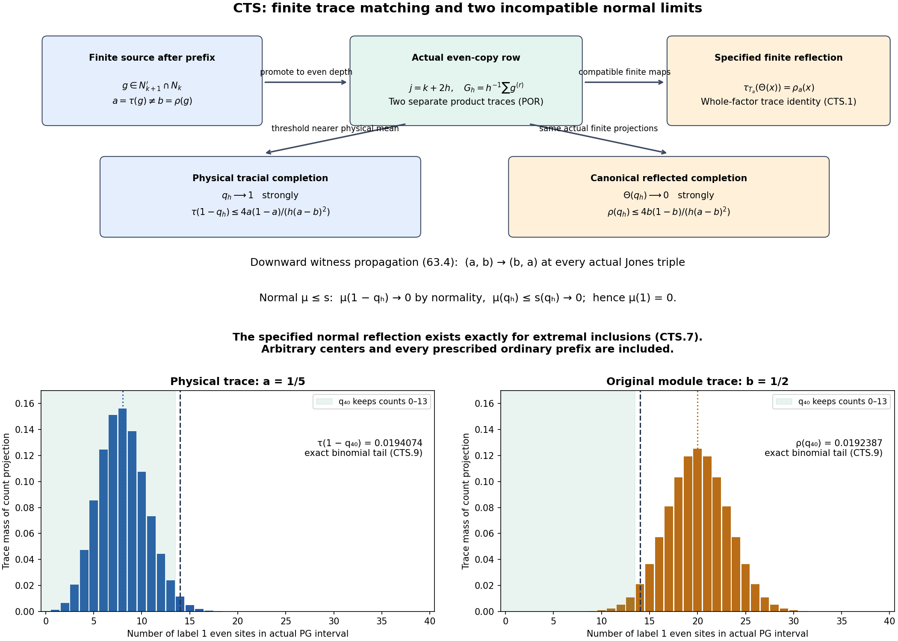

**Figure CTS.** The upper diagram records the exact finite domains and trace identifications CTS.1–CTS.6, the actual POR even-copy stage, and the two strong limits in CTS.3. The lower distributions are the actual index-ten PG projection counts at \(h=40\), with means8 and20 and strict dividing count14. The displayed projection keeps counts0 through13; the two resulting tail masses are exact rational evaluations of CTS.9. These are projection trace probabilities, rather than areas or dimensions of the whole row. The bound constants and normality consequence are proved in equation CTS.8 and Lemma CTS.4–Theorem CTS.7. [Reproducible figure and exact checks](figures/canonical-trace-separation-v26.py).

The human comparison source is Sorin Popa, [*Classification of amenable subfactors of type II*](https://doi.org/10.1007/BF02392646), Acta Mathematica172 (1994),163–255, Sections1.3.6 and1.4.3, which distinguish the nonextremal weights and state the extremal opposite-model comparison. The ordinary and modified-cup arguments in Section4.5.1, printed pp.223–224, remain separate from this specified-reflection theorem. The actual spectral projections, quantitative estimates and normal-component argument above are supplied in full here.

## Modified cups and the physical tower

Replacing a Jones cup by its canonical rescaling keeps its containing factors and scalar index. It changes the implemented expectation. The natural finite reflection sends this cup to the canonical modified upper cup, and transports a finite-module trace rather than the physical tower trace. We determine these changes exactly, including a positive cup-distance that survives two-step blocking.

The human construction sources are Sorin Popa, [*Classification of amenable subfactors of type II*](https://doi.org/10.1007/BF02392646), and Mihai Pimsner and Sorin Popa, [*Entropy and index for subfactors*](https://www.numdam.org/articles/10.24033/asens.1504/). The treatment uses the complete proofs of [finite normal reflection](reflected-traces-and-uniform-bounds.md), 14.1–14.2; [representation independence of commutant traces](scalar-commutants-and-tracial-tunnels.md), 62.2; [canonical rescaling](canonical-rescaling-of-jones-cups.md), 63.1–63.4; and [canonical density transitivity](canonical-density-transitivity.md), 66.1–66.5. The conclusions below concern finite constructions and their exact traces.

### The actual dual expectation of a modified cup

Let \(P\subset Q\subset R=\langle Q,e\rangle\) be a tracial basic-construction triple of II₁ factors. Put \(d=[Q:P]\), \(\lambda=d^{-1}\), \(B=P'\cap Q\), and \(A=Q'\cap R\). All traces are normalized factor traces. On \(L^2(Q)\) the linear *-anti-isomorphism

\[
\eta:B\longrightarrow A,\qquad \eta(z)=J_Qz^*J_Q
\tag{MCF.1}
\]

is right multiplication. Write \(\rho(z)=\tau_R(\eta(z))\), and let \(\kappa\in Z(B)\) be the positive invertible density

\[
\rho(z)=\tau_Q(\kappa z),\qquad \tau_Q(\kappa)=1.
\tag{MCF.2}
\]

The canonical modified cup and expectation are

\[
g=\kappa^{1/2}e\kappa^{1/2},\qquad
F(x)=E_P(\kappa^{1/2}x\kappa^{1/2})\quad(x\in Q).
\tag{MCF.3}
\]

By63.2–63.3, \(g\) is a projection of physical trace \(\lambda\), \(R=\langle Q,g\rangle\), \(gxg=F(x)g\), and its scalar basis index is \(d\). Its physical expectations are

\[
E_Q(g)=\lambda\kappa,
\qquad E_A(g)=\lambda1.
\tag{MCF.4}
\]

**Theorem MCF.1.** The dual expectation for this modified expected construction is

\[
\begin{split}
b&=\eta(\kappa^{-1})\in Z(A),\\
\widehat F(x)&=E_Q(b^{1/2}xb^{1/2})\quad(x\in R),\\
\widehat F(xgy)&=\lambda xy\quad(x,y\in Q).
\end{split}
\tag{MCF.5}
\]

It is faithful and normal. The compatible extension of the physical trace of \(Q\) through this expectation is

\[
\tau_Q\widehat F(x)=\tau_R(bx).
\tag{MCF.6}
\]

It equals the physical trace of \(R\), and is tracial on \(R\), precisely when \(\kappa=1\).

**Proof.** The dual density formula63.4 gives \(b=\kappa_{Q,R}\) and \(\tau_R(b)=1\). Since \(b\) commutes with the factor \(Q\), \(E_Q(b)=1\). Consequently the symmetric expression in(MCF.5) is a unital faithful normal completely positive \(Q\)-bimodular map fixing \(Q\). It is a conditional expectation onto \(Q\).

Left and right multiplication by \(\kappa^{1/2}\) agree on \(L^2(P)\). The cup identity63.9 therefore gives

\[
g=\eta(\kappa^{1/2})e\eta(\kappa^{1/2}),
\qquad b^{1/2}gb^{1/2}=e.
\tag{MCF.7}
\]

The element \(b\) commutes with \(x,y\in Q\). The tracial Markov formula now gives
\(\widehat F(xgy)=xE_Q(e)y=\lambda xy\). This is exactly the defining dual expectation on the Jones ideal. To check its density explicitly, 63.3 supplies a finite basis \((c_j)\) with \(\sum_jc_jgc_j^*=1\). Thus the linear span of \(QgQ\) contains \(Q\). The compression relation \(gQg\subset Pg\) makes this span a *-algebra, and it contains \(g\). Since \(R=\langle Q,g\rangle\), its ultraweak closure is \(R\). Normality therefore determines the expectation on all of \(R\).

Trace preservation of \(E_Q\) and tracial cyclicity prove(MCF.6). If this state is the physical trace then faithfulness of \(\tau_R\), paired against \(b-1\), gives \(b=1\). If it is tracial, its density \(b\) must be central in \(R\): the trace identity implies \(\tau_R((by-yb)x)=0\) for every \(x,y\in R\), hence \(by=yb\). Since \(R\) is a factor and \(\tau_R(b)=1\), this again gives \(b=1\). Invertibility of \(\eta\) identifies this condition with \(\kappa=1\). Conversely \(b=1\) makes the expectation tracial. \(\square\)

Thus the physical expectation \(E_Q\) and the modified dual expectation \(\widehat F\) are distinct in the nonextremal case. Both have their exact domains \(R\to Q\); calling both simply “the expectation” would lose the density in(MCF.5).

### Blocking preserves the discrepancy

Define the affinity

\[
a(P,Q)=\tau_Q(\kappa_{P,Q}^{1/2}).
\tag{MCF.8}
\]

It lies in \((0,1]\). Cauchy–Schwarz gives \(a^2\le\tau_Q(\kappa)\tau_Q(1)=1\), and equality holds precisely when \(\kappa=1\). This is an exact criterion for extremality of this inclusion.

**Theorem MCF.2.** In the basic-construction triple above,

\[
\begin{split}
\kappa_{P,R}&=L_\kappa R_{\kappa^{-1}},\\
a(Q,R)&=a(P,Q),\\
a(P,R)&=a(P,Q)^2.
\end{split}
\tag{MCF.9}
\]

In particular \(P\subset R\) is extremal if and only if \(P\subset Q\) is extremal. More generally a skipped inclusion of \(l\) consecutive ordinary tower steps has affinity \(a^l\), where \(a\) is the affinity at any one step.

**Proof.** Theorem66.3 and the inverse dual-density formula63.4 give
\(\kappa_{P,R}=\kappa\eta(\kappa^{-1})\). In the finite normal representation on \(L^2(Q)\) this is \(L_\kappa R_{\kappa^{-1}}\). This equality concerns operators in the actual finite upper factor.

The normalized inherited trace of \(\eta(z)\) is \(\rho(z)=\tau_Q(\kappa z)\). Thus

\[
\tau_R(\eta(\kappa^{-1/2}))
=\tau_Q(\kappa^{1/2})=a(P,Q),
\]

which is the dual affinity. The adjacent densities commute. The trace expectation onto \(Q\) sends every element of \(Q'\cap R\) to its scalar trace. Consequently

\[
\tau_R(\kappa^{1/2}\eta(\kappa^{-1/2}))
=\tau_Q(\kappa^{1/2})\tau_R(\eta(\kappa^{-1/2}))=a^2.
\]

This proves(MCF.9). The equality \(a^2=1\) is equivalent to \(a=1\), giving the extremality assertion. One can also check it directly: \(L_\kappa R_{\kappa^{-1}}=1\) makes \(\kappa\) commute with every element of the factor \(Q\); normalization then makes it one. Iterating density transitivity and the same scalar-expectation calculation proves the skipped-step formula. The dual-affinity identity shows that every consecutive step has the same \(a\). \(\square\)

**Theorem MCF.3.** The physical distance between the canonical modified and ordinary cups is

\[
\|g-e\|_{2,\tau_R}^2=2\lambda(1-a^2).
\tag{MCF.10}
\]

For the ordinary two-step cup \(q\) and its canonical modification \(g^{\mathrm{blk}}\) in the same upper factor, the distance is

\[
\|g^{\mathrm{blk}}-q\|_2^2
=2d^{-2}(1-a^4).
\tag{MCF.11}
\]

It is strictly positive for every nonextremal original inclusion.

**Proof.** Both \(e,g\) are projections of trace \(\lambda\). Since \(\kappa^{1/2}\in P'\cap Q\), cup compression gives
\(e\kappa^{1/2}e=E_P(\kappa^{1/2})e=ae\). The Markov trace gives \(\tau_R(e\kappa^{1/2})=\lambda a\). Hence

\[
\tau_R(eg)=\tau_R(e\kappa^{1/2}e\kappa^{1/2})=\lambda a^2.
\]

Expanding the squared difference proves(MCF.10). Apply that result to the actual blocked basic construction, whose index is \(d^2\) and whose affinity is \(a^2\) byMCF.2. This proves(MCF.11), with every trace taken in the physical blocked upper factor. \(\square\)

### What the normal finite reflection actually carries

Let \((M_t)_{t\in\mathbb Z}\) be a prescribed ordinary tracial tunnel and its canonical upward tower, with \(M_0=M\). Represent every finite upper level coherently on \(L^2(M)\) by

\[
M_j=(JM_{-j}J)',\qquad \Theta(x)=Jx^*J.
\tag{MCF.12}
\]

This is a faithful normal representation at each finite level. No normal representation of the infinite physical tracial completion is being asserted. For integers \(m\ge i+1\), put

\[
\begin{array}{ll}
F_{m,i}=M_{-m}'\cap M_{-i+1},&G_{m,i}=M_{-m}'\cap M_{-i},\\
U_{m,i}=M_{i-1}'\cap M_m,&V_{m,i}=M_i'\cap M_m.
\end{array}
\tag{MCF.13}
\]

**Theorem MCF.4.** The linear normal *-anti-isomorphism \(\Theta:F_{m,i}\to U_{m,i}\) carries \(G_{m,i}\) onto \(V_{m,i}\). Write

\[
\zeta_{m,i}=\kappa_{M_{-m},M_{-i+1}}\in Z(F_{m,i}).
\]

Its exact trace formula is

\[
\tau_{M_m}(\Theta(x))
=\tau_{M_{-i+1}}(\zeta_{m,i}x)\quad(x\in F_{m,i}).
\tag{MCF.14}
\]

Let \(\kappa_i^-\) be the canonical density for \(M_{-i-1}\subset M_{-i}\), and let \(\kappa_i^+\) be that for \(M_{i-1}\subset M_i\). Then

\[
\begin{split}
g_i^-&=(\kappa_i^-)^{1/2}e_{-i}(\kappa_i^-)^{1/2},\\
\Theta(g_i^-)&=(\kappa_i^+)^{1/2}e_i(\kappa_i^+)^{1/2}=:g_i^+.
\end{split}
\tag{MCF.15}
\]

In a nonextremal tower the image \(g_i^+\) differs from the prescribed ordinary cup \(e_i\), by the positive distance(MCF.10), independently of \(m\).

**Proof of the endpoints and trace.** Taking commutants in(MCF.12) gives the algebraic endpoint formula14.3, with the precise endpoints(MCF.13). Under \(\Theta\), the normalized trace of \(M_m\) is the normalized trace of the full commutant of left \(M_{-m}\) on \(L^2(M)\). On \(M_{-m}'\cap M_{-i+1}\), the representation-independence argument62.2 identifies its restriction with the normalized commutant trace for \(M_{-m}\subset M_{-i+1}\). Its defining canonical density is \(\zeta_{m,i}\), proving(MCF.14).

**Proof of the cup image.** Set \(B_-=M_{-i-1}'\cap M_{-i}\) and \(A_+=M_i'\cap M_{i+1}\). Reflection maps \(B_-\) onto \(A_+\). Its inherited target trace is the normalized source commutant trace, as just proved. The normalized commutant trace for \(M_i\subset M_{i+1}\), on \(\Theta(z)\in A_+\), is instead \(\tau_{M_{-i}}(z)\): its finite commutant in(MCF.12) is \(JM_{-i}J\). Representation independence again makes this the standard commutant trace.

Therefore the canonical density on \(A_+\) is \(\Theta((\kappa_i^-)^{-1})\). Indeed, for every \(z\in B_-\), pairing this candidate against \(\Theta(z)\) gives

\[
\rho_-(z(\kappa_i^-)^{-1})=\tau_{M_{-i}}(z).
\]

Let \(\eta_i:M_{i-1}'\cap M_i\to A_+\) be the basic-construction reflection at the upper triple. Inverse duality63.4 says that the same canonical density is \(\eta_i((\kappa_i^+)^{-1})\). Uniqueness of the density gives

\[
\Theta(\kappa_i^-)=\eta_i(\kappa_i^+).
\tag{MCF.16}
\]

The coherent finite tower has \(\Theta(e_{-i})=e_i\). Apply \(\Theta\) to the symmetric definition of \(g_i^-\), and use the left/right cup identity63.9 with \(\eta_i\). This yields(MCF.15). The positive distance now follows fromMCF.3 and the dual invariance of the affinity inMCF.2. \(\square\)

For the original two-step endpoints, applyMCF.4 to \(L_j=M_{2j}\). Its finite pairs are exactly

\[
\begin{array}{ll}
F^{\mathrm{blk}}_{m,i}=M_{-2m}'\cap M_{-2i+2},&G^{\mathrm{blk}}_{m,i}=M_{-2m}'\cap M_{-2i},\\
U^{\mathrm{blk}}_{m,i}=M_{2i-2}'\cap M_{2m},&V^{\mathrm{blk}}_{m,i}=M_{2i}'\cap M_{2m}.
\end{array}
\tag{MCF.17}
\]

The actual ordinary upper target is \(Q_{2i-2}=d e_{2i}e_{2i-1}e_{2i+1}e_{2i}\). Natural reflection carries the modified lower cup to

\[
\widetilde Q_i=(\kappa^+_{\mathrm{blk},i})^{1/2}
Q_{2i-2}(\kappa^+_{\mathrm{blk},i})^{1/2},
\tag{MCF.18}
\]

whose implemented expectation \(M_{2i}\to M_{2i-2}\) is the canonical generally nontracial expectation. Its expectation onto \(M_{2i}\) is \(d^{-2}\kappa^+_{\mathrm{blk},i}\), whereas that of \(Q_{2i-2}\) is \(d^{-2}1\). Its physical distance from \(Q_{2i-2}\) is(MCF.11).

### Finite relative-commutant expectations and the remaining analytic boundary

**Proposition MCF.5.** Set \(K=G_{m,i}'\cap F_{m,i}\) and \(H=V_{m,i}'\cap U_{m,i}\). Their physical trace expectations satisfy

\[
E_H\Theta(x)=\Theta(E_Kx),\qquad
\|\Theta(x)\|_{2,\tau_{M_m}}^2
=\tau_{M_{-i+1}}(\zeta_{m,i}x^*x).
\tag{MCF.19}
\]

Thus preservation of these expectations does not assert physical \(L^2\)-isometry.

**Proof.** In a finite-dimensional tracial algebra \((F,t)\), another faithful normalized trace \(s=t(\zeta\,\cdot)\), with \(\zeta\) central positive invertible, has expectation onto a unital subalgebra \(K\) given by

\[
E_K^s(x)=E_K^t(\zeta x)\,[E_K^t(\zeta)]^{-1}.
\tag{MCF.20}
\]

The denominator \(c=E_K^t(\zeta)\) is central in \(K\) and bounded below by \(\min\operatorname{spec}(\zeta)>0\): for \(k\in K\), bimodularity gives \(kc=E_K^t(k\zeta)=E_K^t(\zeta k)=ck\). The expression in (MCF.20) is \(K\)-bimodular and fixes \(K\). It is positive because \(\zeta x=\zeta^{1/2}x\zeta^{1/2}\) for \(x\ge0\), and multiplication by \(c^{-1}\) is conjugation by \(c^{-1/2}\) on \(K\). To verify trace pairing, for \(k\in K\) write \(y=E_K^t(\zeta x)c^{-1}\). Then

\[
s(ky)=t(\zeta ky)=t(cky)
=t(kE_K^t(\zeta x))=t(k\zeta x)=s(kx).
\]

These pairings determine the trace expectation. Here \(Z(F)\subset K\), since every central element commutes with \(G\). Hence \(\zeta\in K\), and (MCF.20) reduces to \(E_K^s=E_K^t\).

The finite anti-isomorphism \(\Theta\) carries \(K\) onto \(H\) and is trace preserving from \((F,s)\) to \((U,\tau_{M_m})\). It therefore intertwines these two expectations, giving the first identity(MCF.19). The second follows from(MCF.14), anti-multiplicativity and centrality of \(\zeta\): \(\Theta(x)^*\Theta(x)=\Theta(xx^*)\) and \(t(\zeta xx^*)=t(\zeta x^*x)\). \(\square\)

Generation of the lower ordinary tunnel gives the physical \(L^2\) limit 65.5. Formula (MCF.19) contains the additional weights \(\zeta_{m,i}\); it does not identify that limit with a limit in the reflected trace. Moreover the fixed cup image is (MCF.18), whose gap from the required ordinary cup stays positive. These are two precise failures of using natural reflection to supply 65.14. The actual strongly amenable example PG separately excludes every physical trace-preserving endpoint-pair map at the same endpoints, before imposing a cup image; its full proof is [PG1–PG26](finite-shifted-comparisons-without-coherence.md). Its physical bicommutant equality is proved there as well.

Popa's nonextremal paragraph passes to a two-step inclusion, replaces the downward projections, and invokes a separately cited finite comparison. That comparison is a distinct mathematical input. Theorems MCF.1–MCF.5 describe the prescribed factors and their natural finite reflection; they do not construct a different comparison.

The analytic discrepancy can be measured without taking an infinite representation. If \(t_m\) is a finite physical trace, \(s_m=t_m(\zeta_m\,\cdot)\), \(t_m(\zeta_m)=1\), and \(\|x_m\|\le C\), then for every \(R>0\),

\[
\begin{split}
\|x_m\|_{2,s_m}^2
&\le R\|x_m\|_{2,t_m}^2
+C^2t_m\bigl(\zeta_m1_{(R,\infty)}(\zeta_m)\bigr).
\end{split}
\tag{MCF.21}
\]

Indeed split the positive central density at its spectral projection \(1_{(R,\infty)}(\zeta_m)\). On the complementary projection it is at most \(R\); on the displayed projection use \(x_m^*x_m\le C^21\). Thus lower physical \(L^2\) convergence transfers for these bounded errors if the last density tails tend to zero uniformly as \(R\to\infty\). Normalization alone supplies no such tail estimate. Even such a transfer would still leave the prescribed ordinary cup image to establish.

The exact remaining theorem is the following unconditional assertion at its original hypotheses: for a finite-index II₁ inclusion with an actual generating ordinary Jones tunnel, its canonical physical tracial upward completion \(\mathcal T\) satisfies

\[
(M'\cap\mathcal T)'\cap\mathcal T=M.
\tag{MCF.22}
\]

The general nonextremal proof of (MCF.22), and hence the full original bicommutant implication, is not supplied by this finite correction. The finite-collapse implication of [65.1–65.5](finite-shifted-comparisons-without-coherence.md) remains proved at its stated comparison hypotheses. A complete general argument must reach the physical upper scalar-cup estimates or give another route to (MCF.22), without assuming the refuted universal premise 65.14, changing the physical traces, or extending the specified nonextremal reflection normally to the infinite completion.

### Two exact calculations

**Weighted spin.** At weights \(p=1/4,q=3/4\), the canonical density has physical weights \((1/4,3/4)\) and coefficients \((3,1/3)\). Therefore \(a=\sqrt3/2\) and \(d=16/3\). The one-step cup distance squared is \(3/32\); the two-step cup distance squared is \(63/2048\). In the exact four-site cup vectors64.26, their inner product is \(4pq=3/4\), whose square is \(9/16=a^4\), reproducing(MCF.11).

**PG.** The initial density has physical weights \((2/5,1/5,2/5)\) and coefficients \((5/8,5/2,5/8)\). Thus \(a=3\sqrt{10}/10\), \(a^2=9/10\), and \(d=10\). The one-step distance squared is \(1/50\); the two-step distance squared is \(19/5000\). The reflected trace density at an odd-even relative interval of length \(2n\) is \(4^r\) on integer grade \(r\), byPG18. Its maximal and minimal values are \(4^n\) and \(4^{-n}\), because all \(n\) two-site factors can have grade \(+1\) or \(-1\). Thus no depth-independent bound on these finite densities follows merely from their normalization.

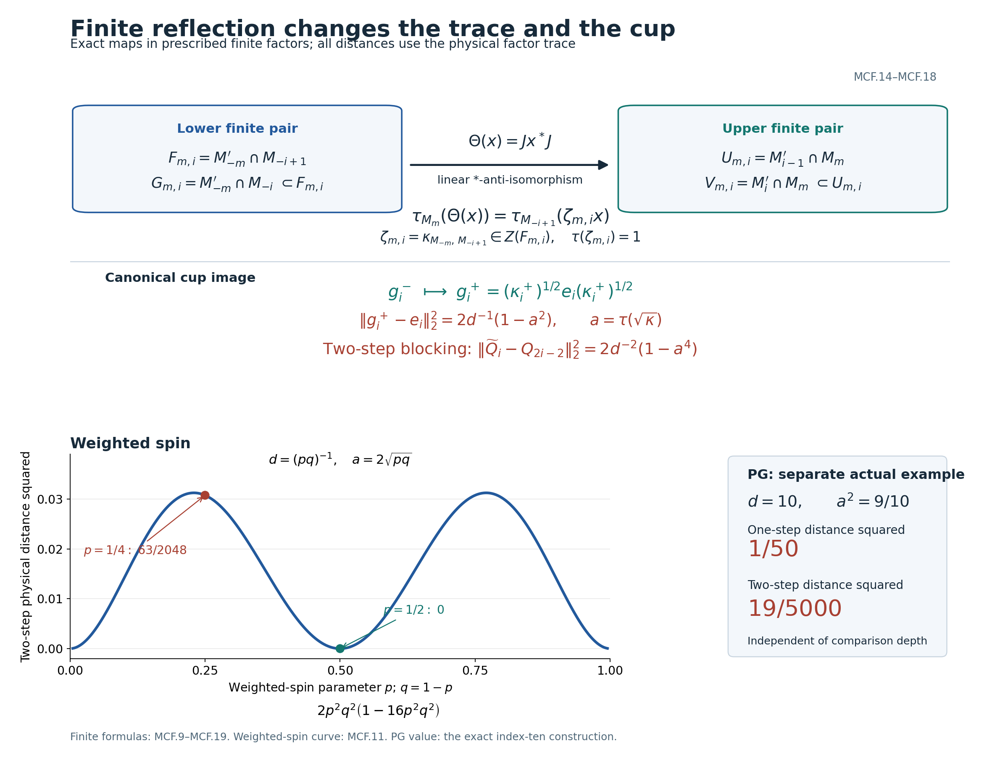

**Figure MCF.1.** The upper panel names the actual finite endpoints, the finite-module trace density and the canonical cup image (MCF.14–MCF.18). It depicts finite maps only. The lower-left panel plots the exact two-step physical cup-distance squared (MCF.11) for the weighted-spin family \(d=1/[p(1-p)]\), and marks the proved values at \(p=1/4\) and the extremal value \(p=1/2\). The lower-right panel gives the separate exact PG value; PG is not assigned a weighted-spin parameter. The labels and curve retain their actual physical traces. [Reproducible figure source](figures/modified-cup-trace-boundary-v26.py).

## Physical Haar averages and gaps at every finite tower stage

This section uses the original normalized trace on the Jones tower throughout. An ordinary generating tunnel gives a finite-intersection theorem and, more strongly, a positive physical spectral gap at each fixed stage. The proof supplies a single finite averaging algebra that works for every input in that stage. The constants depend on the stage. Their behavior as depth tends to infinity is the exact remaining analytic issue; the general bicommutant theorem is not proved here.

The exposition, proofs, exercises, solutions and accompanying figure are dedicated to **CC0 1.0**. For the original generating and bicommutant formulations, see Sorin Popa, *Classification of amenable subfactors of type II*, Acta Mathematica **172** (1994), Theorem 4.1.2 and §4.5.1, printed pp. 210 and 223–225, [DOI](https://doi.org/10.1007/BF02392646). The finite physical argument below makes its own scope explicit.

### The original tower and its finite normal representations

Let \(N\subset M\) be II₁ factors of finite index \(d\), and set \(\lambda=d^{-1}\). Write

\[
M_{-1}=N,\qquad M_0=M\subset M_1\subset M_2\subset\cdots,
\qquad
T=\left(\bigcup_{l\geq0}M_l\right)''_{\tau}.
\tag{PH.1}
\]

Here \(\tau\) is the compatible normalized tower trace, and the completion is its tracial GNS completion. The cup \(e_j\in M_{j+1}\) implements \(M_{j-1}\subset M_j\), so \(E_{M_j}(e_j)=\lambda1\). Every expectation between subalgebras of \(T\) in this section is the **normal trace-preserving** conditional expectation for this same \(\tau\).

Choose an ordinary tunnel \(\cdots\subset M_{-2}\subset N\subset M\), and assume the actual generation identity

\[
\left(\bigcup_{m\geq0}(M_{-m}'\cap M)\right)''=M.
\tag{PH.2}
\]

Under the original strongly amenable hypothesis with separable predual, the completed generating-tunnel theorem SA.7 of [General tail supports and controlled tunnels](general-tail-supports-and-controlled-tunnels.md) supplies (PH.2). The present argument needs (PH.2), finite index and the original trace. It does not add extremality or a comparison with another trace.

The exact finite prerequisite is Proposition 14.2 and equation (14.3) of [Reflected traces and a uniform bound along a tunnel](reflected-traces-and-uniform-bounds.md). On \(H=L^2(M,\tau_M)\), with \(J\widehat x=\widehat{x^*}\), they give compatible faithful normal representations

\[
\pi_l:M_l\longrightarrow B(H),\qquad
\pi_l(M_l)=(JM_{-l}J)',\qquad \pi_0(M)=L(M),
\tag{PH.3}
\]

and, for \(m\geq j\geq0\),

\[
\pi_m(M_j'\cap M_m)
=J(M_{-m}'\cap M_{-j})J.
\tag{PH.4}
\]

These statements concern finite stages. No normal representation \(T\to B(H)\) is asserted. The involution \(x\mapsto Jx^*J\) is an algebraic anti-isomorphism in (PH.4); this proof does not assert that it preserves the physical finite relative-commutant traces.

The other finite prerequisites are the basic-construction commutant identity, index multiplicativity and finite dimensionality of a finite-index relative commutant: [Projection and basic construction](projection-and-basic-construction.md), [Towers and tunnels](towers-and-tunnels.md), and Theorem 2.5 of [Module dimension and local index](module-dimension-and-local-index.md). The spectral-truncation argument needed for \(L^2\) intersections is given explicitly below.

### Generation separates every finite stage

Put

\[
B_{j,m}=M_j'\cap M_m\quad(m\geq j),\qquad
B_j=M_j'\cap T,\qquad D_j=B_j'\cap T.
\tag{PH.5}
\]

Every \(B_{j,m}\) is a unital finite-dimensional algebra. The \(B_{j,m}\) increase with \(m\). In particular \(B_0=M'\cap T\), and \(D_0=(M'\cap T)'\cap T\) is the original bicommutant.

**PH.1 — the physical commutant is the closure of its finite parts.** For every \(j\),

\[
B_j=\left(\bigcup_{m\geq j}B_{j,m}\right)'',\qquad
D_j=\bigcap_{m\geq j}(B_{j,m}'\cap T).
\tag{PH.6}
\]

**Proof.** If \(b\in B_j\), then \(E_{M_m}(b)\) commutes with \(M_j\) for \(m\geq j\), by \(M_j\)-bimodularity. Thus \(E_{M_m}(b)\in B_{j,m}\). These expectations have norm at most \(\|b\|\) and converge to \(b\) in \(L^2(T,\tau)\). Bounded \(L^2\) convergence implies strong convergence in the standard tracial representation, first on bounded vectors and then by density. This proves the first identity, and commutation with the increasing union proves the second. \(\square\)

**PH.2 — finite-intersection theorem, with the original trace.** Under (PH.2),

\[
D_j\cap M_l=M_j\qquad(l\geq j\geq0).
\tag{PH.7}
\]

**Proof.** First the downward algebras \(C_m=M_{-m}'\cap M\) generate \(M\) by assumption. For \(m\geq j\), the expectation \(E_{M_{-j}}\) takes \(C_m\) onto \(M_{-m}'\cap M_{-j}\): it preserves commutation with \(M_{-m}\subset M_{-j}\), and fixes the latter intersection. Expectation is normal and \(L^2\)-contractive, so these images have \(L^2\)-dense union in \(M_{-j}\). Their norm-bounded approximants also show that their von Neumann closure is \(M_{-j}\).

Now take \(x\in D_j\cap M_l\). For every \(m\geq j\), the equality \([x,B_{j,m}]=0\) holds in the finite algebra \(M_r\), where \(r=\max(l,m)\). Apply the compatible finite map \(\pi_r\). By (PH.4), \(\pi_l(x)\) commutes with \(J(M_{-m}'\cap M_{-j})J\). These algebras generate \(JM_{-j}J\); multiplication by a fixed bounded operator is ultraweakly continuous. Hence

\[
\pi_l(x)\in(JM_{-j}J)'=\pi_j(M_j).
\]

Compatibility and faithfulness of \(\pi_l\) imply \(x\in M_j\). Conversely \(M_j\) commutes with \(B_j\), so \(M_j\subset D_j\cap M_l\). Only finite maps were applied. \(\square\)

### The actual Haar averages

For \(m\geq j\), let \(\mu_{j,m}\) be probability Haar measure on the compact group \(\mathcal U(B_{j,m})\). Define

\[
Q_{j,m}:T\longrightarrow B_{j,m}'\cap T,\qquad
Q_{j,m}(x)=\int_{\mathcal U(B_{j,m})}uxu^*\,d\mu_{j,m}(u).
\tag{PH.8}
\]

The integral is ultraweak. Its \(L^2\) realization is a Bochner integral of unitary conjugations. Each \(Q_{j,m}\) is normal, unital, completely positive and trace preserving. Haar invariance makes its range the fixed algebra \(B_{j,m}'\cap T\), and it fixes that algebra pointwise. It is therefore its trace-preserving conditional expectation, including as an orthogonal projection on \(L^2(T)\).

Normality can be checked on the predual without exchanging an arbitrary net with an integral. For every normal functional \(\omega\in T_*\), the map \(u\mapsto\omega\circ\operatorname{Ad}_u\) is norm continuous: its difference at two unitaries has norm at most \(2\|\omega\|\|u-v\|\). The compact finite-dimensional unitary group is norm metrizable, so this continuous predual-valued map has a Bochner integral in \(T_*\). That integral equals \(\omega\circ Q_{j,m}\) on every bounded input. Thus every normal output functional pulls back to a normal input functional, proving normality. Complete positivity follows by integrating at each matrix size. These properties are stated on \(T\); no singular state or auxiliary represented trace enters (PH.8).

**PH.3 — physical finite-stage averaging and its limit.** If \(x\in M_l\) and \(m\geq l\geq j\), then

\[
Q_{j,m}(x)\in M_m,\qquad
Q_{j,m}(x)=E_{B_{j,m}'\cap M_m}^{M_m}(x),\qquad
Q_{j,m}(x)\longrightarrow E_{D_j}(x)\quad\text{in }L^2(T,\tau).
\tag{PH.9}
\]

The limit statement holds for every \(x\in L^2(T)\).

**Proof.** The integrand lies in \(M_m\), which is ultraweakly closed. The averaged element commutes with \(B_{j,m}\), and restriction preserves the original trace. This proves the first two statements. The \(L^2\) projections in (PH.8) decrease with \(m\). Their strong limit is the orthogonal projection onto the intersection of their ranges: for \(n\geq m\), the squared norm of the difference of the two projected vectors is the difference of their squared norms, so they form a Cauchy sequence. The limit lies in every range and fixes their intersection. The next lemma identifies that intersection as \(L^2(D_j)\). \(\square\)

**PH.4 — \(L^2\) intersections really are algebra intersections.** For any family of von Neumann subalgebras \(A_i\subset T\),

\[
\bigcap_i L^2(A_i,\tau)=L^2\!\left(\bigcap_iA_i,\tau\right).
\tag{PH.10}
\]

In particular,

\[
L^2(D_j)\cap L^2(M_l)=L^2(M_j)\qquad(l\geq j).
\tag{PH.11}
\]

**Proof.** An \(L^2(T)\) vector is represented by a unique square-integrable measurable operator \(h\) affiliated with \(T\). Membership in \(L^2(A_i)\) means that the same operator is affiliated with \(A_i\). Its polar part \(v\) and the spectral projections of (|h|) therefore belong to every \(A_i\). The bounded spectral truncations

\[
h_n=v|h|1_{[0,n]}(|h|)
\tag{PH.12}
\]

belong to their algebra intersection. They converge to \(h\) in \(L^2\), since

\[
\|h-h_n\|_2^2=\tau\bigl(|h|^2 1_{(n,\infty)}(|h|)\bigr)\longrightarrow0.
\]

This proves one inclusion; the other follows from the isometric inclusions of all the \(L^2(A_i)\). Equation (PH.11) then follows from PH.2. Thus an \(L^2\) vector fixed by a compressed expectation is not silently treated as a bounded element. \(\square\)

### A positive physical gap on each entire finite stage

Write \(H_l=L^2(M_l)\subset L^2(T)\), and let \(P_l\) be its orthogonal projection. For fixed \(l\geq j\), define bounded Hilbert-space operators

\[
K_{j,l,m}=P_l Q_{j,m}|_{H_l},\qquad
K_{j,l}=P_l E_{D_j}|_{H_l}.
\tag{PH.13}
\]

These are positive self-adjoint contractions. Both factors in each compression are orthogonal projections; positivity follows from
\(\langle K_{j,l,m}\xi,\xi\rangle=\|Q_{j,m}\xi\|_2^2\).

**PH.5 — operator-norm convergence on every fixed stage.** The operators (PH.13) belong to the finite-dimensional C*-algebra

\[
\mathcal F_{j,l}=\operatorname{End}_{M_j-M_j}(H_l),
\tag{PH.14}
\]

and

\[
K_{j,l,m}\downarrow K_{j,l},\qquad
\|K_{j,l,m}-K_{j,l}\|_{B(H_l)}\longrightarrow0.
\tag{PH.15}
\]

**Proof.** Elements of \(B_{j,m}\) commute with \(M_j\). Thus \(Q_{j,m}\), its limit \(E_{D_j}\), and \(P_l\) commute with left and right multiplication by \(M_j\). This proves membership in (PH.14).

Here is the finite-index reason that (PH.14) is finite dimensional. On \(L^2(M_l)\), the commutant of right \(M_j\) is the basic construction
\(\mathcal R=\langle M_l,e_{M_j}^{M_l}\rangle\).
It is a finite factor. Since \([M_l:M_j]=d^{l-j}\), the two consecutive basic-construction indices and multiplicativity give
\([\mathcal R:L(M_j)]=d^{2(l-j)}<\infty\).
The bimodule endomorphism algebra is \(L(M_j)'\cap\mathcal R\), finite dimensional by Theorem 2.5. When \(l=j\) it is scalar. This argument uses a normal representation of this single finite basic construction, and its normalized trace only to establish finite index. The Haar operators themselves remain the physical operators in (PH.13).

PH.3 gives strong operator convergence of the compressed operators. A bounded sequence in a fixed finite-dimensional space of operators has norm-convergent subsequences; every such limit equals the strong limit. Thus the entire sequence converges in norm, and its limit belongs to the same algebra. Decrease follows by compressing the decreasing projections \(Q_{j,m}\). \(\square\)

Let \(H_l^0=H_l\ominus L^2(M_j)\). Every \(K_{j,l,m}\) and \(K_{j,l}\) fixes \(L^2(M_j)\) and preserves \(H_l^0\). If \(H_l^0\ne0\), set

\[
g_{j,l,m}=1-\|K_{j,l,m}|_{H_l^0}\|,
\qquad g_{j,l}=1-\|K_{j,l}|_{H_l^0}\|.
\tag{PH.16}
\]

If the complement is zero, define both gaps to be one.

**PH.6 — one finite Haar algebra separates the whole fixed stage.** Under (PH.2), for every \(l\geq j\),

\[
g_{j,l}>0,\qquad
g_{j,l,m}\uparrow g_{j,l},
\tag{PH.17}
\]

so some finite \(m\geq l\) has \(g_{j,l,m}>0\). For every \(x\in L^2(M_l)\),

\[
\begin{aligned}
g_{j,l,m}\|x-E_{M_j}(x)\|_2^2
&\leq\|x-Q_{j,m}(x)\|_2^2\\
&=\frac12\int_{\mathcal U(B_{j,m})}\|[u,x]\|_2^2\,d\mu_{j,m}(u).
\end{aligned}
\tag{PH.18}
\]

For such an \(m\), one also has the exact finite separation

\[
M_l\cap B_{j,m}'=M_j.
\tag{PH.19}
\]

**Proof.** By PH.5, \(K_{j,l}|_{H_l^0}\) has finite spectrum. If one were an eigenvalue with eigenvector \(\xi\in H_l^0\), then

\[
\|\xi\|_2^2=\langle K_{j,l}\xi,\xi\rangle
=\|E_{D_j}\xi\|_2^2.
\]

The orthogonal-projection identity forces \(\xi\in L^2(D_j)\cap L^2(M_l)=L^2(M_j)\) by the affiliated-operator truncations in PH.4. This contradicts \(\xi\in H_l^0\setminus\{0\}\). Finite spectrum therefore gives norm strictly below one. PH.5 and monotonicity prove (PH.17).

Subtract \(E_{M_j}(x)\), which all these projections fix. The Rayleigh bound on \(H_l^0\) gives
\(\|Q_{j,m}(x-E_{M_j}x)\|_2^2\leq(1-g_{j,l,m})\|x-E_{M_j}x\|_2^2\).
Pythagoras gives the first inequality in (PH.18). To prove the equality, expand the squared commutator norm, use trace invariance, and integrate. The cross term is
\(\operatorname{Re}\langle x,Q_{j,m}x\rangle=\|Q_{j,m}x\|_2^2\).
For bounded \(x\), \([u,x]=ux-xu\); the same equality holds by \(L^2\) continuity for every square-integrable \(x\). Finally an element in the left side of (PH.19) has zero averaging energy. A positive gap places it in \(M_j\). \(\square\)

This is a physical estimate with simultaneous quantification over an entire fixed stage. It is stronger than testing one target at a time. It supplies no lower bound independent of \(l\), and the chosen finite \(m\) may depend on \(j,l\).

### Exact cup variance and the remaining infinite-depth estimate

Choose matrix units \(b^{\alpha}_{rs}\) for each full matrix summand of \(B_{j,m}\), of size \(n_\alpha\), with their units summing to \(1\). Haar integration has the finite formula

\[
Q_{j,m}(x)=\sum_\alpha\frac1{n_\alpha}
\sum_{r,s=1}^{n_\alpha}b^{\alpha}_{rs}x b^{\alpha}_{sr}.
\tag{PH.20}
\]

Indeed the independent scalar phases of the summands remove off-diagonal summand corners. Within a summand, averaging matrix conjugation replaces its matrix leg by normalized matrix trace, which is the displayed matrix-unit sum. This formula does not identify any trace transported by reflection.

**PH.7 — a strict physical variance bound at every fixed cup.** For \(m\geq j+1\), define

\[
\begin{aligned}
v_{j,m}&=\|Q_{j,m}(e_j)-\lambda1\|_2^2\\
&=\sum_\alpha\frac1{n_\alpha}\sum_{r,s}
\tau(e_jb^{\alpha}_{rs}e_jb^{\alpha}_{sr})-\lambda^2.
\end{aligned}
\tag{PH.21}
\]

Then

\[
v_{j,m}\downarrow v_j
=\|E_{D_j}(e_j)-\lambda1\|_2^2,
\qquad
0\leq v_j\leq(1-g_{j,j+1})\lambda(1-\lambda).
\tag{PH.22}
\]

For any finite \(m\) with \(g_{j,j+1,m}>0\),

\[
v_{j,m}\leq(1-g_{j,j+1,m})\lambda(1-\lambda).
\tag{PH.23}
\]

If \(d>1\), these bounds are strictly smaller than the initial cup variance \(\lambda(1-\lambda)\).

**Proof.** Every averaging projection fixes \(1\), preserves trace, and contains \(M_j\) in its range. Since \(E_{M_j}(e_j)=\lambda1\), its orthogonal scalar component is exactly \(\lambda1\). Therefore
\(\|Q_{j,m}(e_j)-\lambda1\|_2^2=\langle e_j,Q_{j,m}(e_j)\rangle-\lambda^2\), which with (PH.20) gives (PH.21). Decreasing projections and PH.3 give the monotonicity and the limit. Apply the Rayleigh bound used in PH.6 to \(e_j-\lambda1\in H_{j+1}^0\), whose squared norm is \(\lambda(1-\lambda)\). This gives both bounds. \(\square\)

The strict bound in PH.7 is not the scalar-cup identity \(v_j=0\). If that identity were proved for every \(j\), Lemma 61.4 of [Smooth representations and tower compression](smooth-representations-and-tower-compression.md) would give the original bicommutant. Its finite spanning argument is applicable because \(M_j\subset D_j\). PH.7 does not establish the missing zero.

There is also an exact description of the depth dependence of the local gaps. For fixed \(j\), the \(g_{j,l}\) are nonincreasing as \(l\) increases: their Rayleigh forms are the restrictions of the single form \(\|x-E_{D_j}x\|_2^2\) to increasing spaces orthogonal to \(L^2(M_j)\).

**PH.8 — the uniform-depth remainder is precise.** For each fixed \(j\), exactly one of the following holds:

1. \(D_j=M_j\), and \(g_{j,l}=1\) for every \(l\geq j\).
2. \(D_j\ne M_j\), and the strictly positive finite-stage gaps satisfy \(g_{j,l}\downarrow0\).

Consequently,

\[
D_j=M_j\quad\Longleftrightarrow\quad\inf_{l\geq j}g_{j,l}>0.
\tag{PH.24}
\]

**Proof.** If \(D_j=M_j\), then the compression is zero on \(H_l^0\), giving the first alternative. Otherwise choose nonzero bounded \(y\in D_j\) with \(E_{M_j}(y)=0\), by subtracting the expectation of an element outside \(M_j\). Put \(x_l=E_{M_l}(y)\in H_l^0\). Density gives \(x_l\to y\) in \(L^2\). Hence

\[
0<g_{j,l}\leq
\frac{\|x_l-E_{D_j}(x_l)\|_2^2}{\|x_l\|_2^2}
\leq\frac{\|x_l-y\|_2^2}{\|x_l\|_2^2}\longrightarrow0,
\tag{PH.25}
\]

for all sufficiently large \(l\). Together with monotonicity, this proves the second alternative and (PH.24). \(\square\)

For the original problem, \(j=0\) in (PH.24) is the exact unresolved requirement. The present unit proves every individual gap positive; it does **not** derive a uniform positive bound from the original strongly amenable hypotheses. It likewise does not derive all the scalar-cup zeros in (PH.22). The original general nonextremal bicommutant obligation is retained at its full hypotheses.

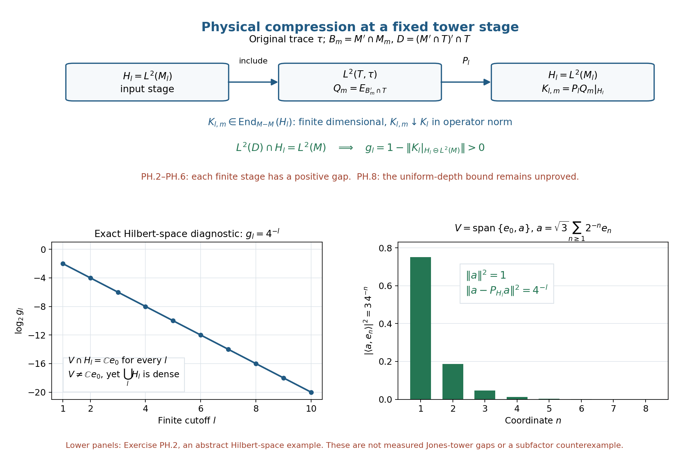

**Figure PH.1.** The upper panel displays the physical maps and the finite-dimensional compression in PH.3–PH.6. Its arrows act on \(L^2(T,\tau)\), with normal expectations on their bounded domains. The lower panel is the exact Hilbert-space diagnostic of Exercise PH.2, whose gap is \(4^{-l}\). It demonstrates how positive finite-stage gaps can tend to zero. It is not a Jones tower, not an actual subfactor counterexample, and not a claimed value of the physical gaps in PH.16. [Reproducible CC0 figure source](figures/physical-haar-finite-stage-gaps-v26.py).

### The actual commutant tower as a smooth expected representation

The finite full corners of the actual opposite tower give another interface with the original amenability theorem. This construction uses the original physical algebra \(T\); it introduces no normally extended reflection. In the next three results, finite index alone suffices. The generation assumption (PH.2) is needed only when the generating-tunnel hypertrace theorem is applied.

Put \(B_{-1}=N'\cap T\), \(D_{-1}=B_{-1}'\cap T\), and retain \(B_j,D_j\) from (PH.5). At a fixed \(j\geq0\), abbreviate
\[
\begin{gathered}
A=B_{j-1},\quad B=B_j,\\
C=B_{j+1},\quad e=e_j,\\
U=D_{j-1},\quad V=D_j,\\
W=D_{j+1}.
\end{gathered}
\tag{PH.26}
\]
Thus \(U\subset V\subset W\). The original pair \(M_{j-1}\subset M_j\) is contained in \(U\subset V\).

The precise input is [63.6–63.8 and 63.11](canonical-rescaling-of-jones-cups.md). They give
\[
\begin{gathered}
eAe=Ce,\quad A=W^*(B,e),\\
h>0,\quad h,h^{-1}\in B,\\
q=h^{-1/2}eh^{-1/2},\\
u_r\in B,\qquad \sum_r u_rq u_r^*=1.
\end{gathered}
\tag{PH.27}
\]
The \(h\) here is the actual bounded invertible density \(h_j\) of (63.23). In particular the finite elements \(v_r=u_rh^{-1/2}\in B\) satisfy
\[
\begin{gathered}
\sum_r v_re v_r^*=1,\\
L:=\sum_r\|v_r\|^2<\infty.
\end{gathered}
\tag{PH.28}
\]
These finite corner identities hold with the inherited trace and with arbitrary centers.

**PH.9 — an explicit normal full-corner commutant isomorphism.** Multiplication by \(e\) gives a normal unital *-isomorphism
\[
\begin{gathered}
\theta:U\longrightarrow (Ce)'\cap eTe,\\
\theta(u)=ue,\\
\theta^{-1}(y)=\sum_r v_ryv_r^*.
\end{gathered}
\tag{PH.29}
\]
The unit of the target is \(e\).

**Proof.** Elements of \(U=A'\cap T\) commute with \(e\). They also commute with \(Ce=eAe\), so the displayed map has its asserted range. If \(ue=0\), commutation with \(v_r\in A\) and (PH.28) imply \(u=0\). Thus it is faithful.

For \(y\) in the target, write \(\psi(y)=\sum_r v_ryv_r^*\). Given \(a\in A\), insert (PH.28) on both sides of \(a\). Every coefficient \(ev_s^*av_re\) belongs to \(eAe=Ce\) and commutes with \(y\). Consequently
\[
\begin{aligned}
a\psi(y)
&=\sum_{s,r}v_s(ev_s^*av_re)y v_r^*\\
&=\sum_{s,r}v_s y(ev_s^*av_re)v_r^*\\
&=\psi(y)a .
\end{aligned}
\]
So \(\psi(y)\in U\). Since \(ev_re\) also belongs to \(Ce\), the same commutation and (PH.28) give
\[
e\psi(y)e=y,\qquad \psi(ue)=u.
\]
These prove that \(\psi\) is the inverse of the faithful *-homomorphism \(\theta\). Both maps are normal: multiplication and finite sums are ultraweakly continuous. The inverse is completely positive by its displayed finite sum and is unital because \(\psi(e)=1\). No factorality of \(A,B,C,U,V,W\) was used. \(\square\)

**PH.10 — the whole commutant tower is an actual smooth expected tower.** There is a normal faithful conditional expectation
\[
\begin{gathered}
\mathcal E_j:D_j\longrightarrow D_{j-1},\\
e_jxe_j=\mathcal E_j(x)e_j .
\end{gathered}
\tag{PH.30}
\]
It restricts to \(E_{M_{j-1}}^{M_j}\) on \(M_j\). If \(a_i\in M_j\) is any original supported right basis over \(M_{j-1}\), with supports \(f_i\), then
\[
\begin{gathered}
\mathcal E_j(a_i^*a_k)=\delta_{ik}f_i,\\
a_if_i=a_i,\\
x=\sum_i a_i\mathcal E_j(a_i^*x),\\
x\in D_j,\\
\sum_i a_ie_ja_i^*=1,\\
\sum_i a_ia_i^*=d1 .
\end{gathered}
\tag{PH.31}
\]
In particular \(D_j=\sum_i a_iD_{j-1}\) and this representation is nondegenerate. Its scalar basis index is \(d\). The next actual algebra \(D_{j+1}\), with its original cup \(e_j\), is the finite expected basic construction of (PH.30); \(\mathcal E_{j+1}\) is its dual expectation.

**Proof.** For \(x\in W=C'\cap T\), the compression \(exe\) commutes with \(Ce\). Apply (PH.29) to obtain the normal UCP map \(F:W\to U\), \(F(x)=\theta^{-1}(exe)\). Restrict it to \(V\), and call the restriction \(\mathcal E_j\). It fixes \(U\) and is \(U\)-bimodular. If \(x\in V\) and \(\mathcal E_j(x^*x)=0\), then \(xe=0\). Every \(v_r\) belongs to \(B\), which commutes with \(x\), so (PH.28) gives \(x=0\). Thus this restriction is faithful. The map \(F\) on the larger \(W\) need not be faithful; indeed \(F(1-e)=0\).

The original cup identity and injectivity of \(u\mapsto ue\) show that the restriction to \(M_j\) is the original expectation. All Gram and support identities in (PH.31) are therefore the original ones. For \(x\in V\), the full original cup row gives
\[
\begin{aligned}
xe&=\sum_i a_i e a_i^*xe\\
&=\left(\sum_i a_i\mathcal E_j(a_i^*x)\right)e .
\end{aligned}
\]
Multiplication by \(e\) on \(V\) is injective by the same \(v_r\) argument. This proves the full reconstruction formula, with no density restriction on \(x\). The index sum is the original basis identity.

For completeness, the actual matrix model of the next stage is
\[
\begin{gathered}
f=\operatorname{diag}(f_i),\\
\Psi:f\operatorname{Mat}_n(U)f\longrightarrow W,\\
\Psi((c_{ik}))=\sum_{i,k}a_ic_{ik}e a_k^*,\\
(\Psi^{-1}(x))_{ik}=F(a_i^*xa_k).
\end{gathered}
\tag{PH.32}
\]
The Gram identities give multiplication of matrix units, and \(\sum_i a_iea_i^*=1\) gives both inverse formulas. For arbitrary \(x\in W\), expanding this identity on its two sides gives exactly the stated inverse coefficients, so the range is the entire \(W\). The coefficients have the indicated supports. Finite sums and the normal map \(F\) make both maps normal. This proves the actual expected basic-construction identification.

The conditional expectation on the next commutant pair, constructed in exactly the same way with \(e_{j+1}\), fixes \(V\). The original Temperley–Lieb relation gives
\[
e_{j+1}e_je_{j+1}=\lambda e_{j+1},
\quad\text{hence}\quad \mathcal E_{j+1}(e_j)=\lambda1 .
\]
On the full span \(Ve_jV=W\), bimodularity now determines it as the dual expectation. In coordinates it is
\(\Psi((c_{ik}))\mapsto\lambda\sum_{i,k}a_ic_{ik}a_k^*\). These are the finite expected constructions of [61.2](smooth-representations-and-tower-compression.md), with their original supports and index. \(\square\)

At \(j=0\), every original \(N'\cap M_l\) lies in \(B_{-1}\) and therefore commutes with \(D_{-1}\). Thus \(D_{-1}\subset_{\mathcal E_0}D_0\) is a smooth nondegenerate expected representation of the original \(N\subset M\), in the precise sense used in [61.13–61.15](smooth-representations-and-tower-compression.md). Moreover \(D_{-1}\cap M=N\): an element of this intersection commutes with the actual \(e_0\in B_{-1}\), and the original cup identity and its scalar expectation imply that it belongs to \(N\). Under (PH.2), the already proved generating-tunnel return 61.15 supplies a compatible \(M\)-hypertrace on \(D_0\), including the possibility of a singular state. This application does not assert that \(D_0=M\).

**PH.11 — the exact relation to the physical trace.** All the algebras in (PH.26) retain their inherited physical trace \(\tau\). Write \(E_U^\tau,E_V^\tau\) for the normal trace-preserving expectations inside \(T\), and put
\[
\begin{gathered}
c=E_U^\tau(e),\quad t=E_V^\tau(e),\\
k=c^{-1}t .
\end{gathered}
\tag{PH.33}
\]
Then
\[
\begin{gathered}
c\in Z(U),\quad t\in U'\cap V,\\
L^{-1}1\le c,t\le1,\\
k>0,\quad k,k^{-1}\in U'\cap V,\\
L^{-1}1\le k\le L1,\\
\tau(c)=\tau(t)=\lambda,\quad \tau(k)=1,\\
\tau(\mathcal E_j(x))=\tau(kx),\\
E_U^\tau(x)=\mathcal E_j(k^{-1/2}xk^{-1/2}),\\
x\in V.
\end{gathered}
\tag{PH.34}
\]
In particular \(\mathcal E_j\) preserves the physical trace exactly when \(k=1\), or equivalently \(t=c\). Its restriction to \(M_j\) is nevertheless always the original trace expectation; indeed
\[
E_{M_j}^\tau(k)=1.
\tag{PH.35}
\]

**Proof.** Because \(e\in A\) commutes with \(U\), bimodularity makes \(c\) central in \(U\) and \(t\) commute with \(U\). Both lie between zero and one. For \(x\in V_+\), the \(v_r\in B\) commute with \(x\), so (PH.28) and cyclicity give
\[
\begin{aligned}
\tau(x)
&=\sum_r\tau(xv_re v_r^*)\\
&=\sum_r\tau(e x v_r^*v_r)\\
&\le L\tau(ex)=L\tau(tx).
\end{aligned}
\]
The inequality is valid because \(x\) commutes with each positive \(v_r^*v_r\), whence \(xv_r^*v_r\le\|v_r\|^2x\), before pairing with the positive \(e\). Faithfulness of \(\tau\) gives \(t\ge L^{-1}1\). Restricting the same pairing to \(U_+\) gives \(c\ge L^{-1}1\). Thus \(c,t\) are invertible and commute, and their quotient has the asserted bounds.

The cup compression yields, for \(x\in V\),
\[
\begin{aligned}
\tau(c\mathcal E_j(x))&=\tau(e\mathcal E_j(x))\\
&=\tau(exe)=\tau(tx).
\end{aligned}
\]
Apply this to \(c^{-1}x\), using \(U\)-bimodularity, to obtain
\(\tau(\mathcal E_j(x))=\tau(c^{-1}tx)\). Its value at \(1\) gives \(\tau(k)=1\). The two cup trace identities in (PH.34) follow directly from trace preservation of \(E_U^\tau,E_V^\tau\).

Since \(k\) commutes with \(U\), \(\mathcal E_j(k^{-1})\) is central in \(U\). Pairing it with \(u\in U\) gives
\[
\begin{aligned}
\tau(u\mathcal E_j(k^{-1}))&=\tau(\mathcal E_j(uk^{-1}))\\
&=\tau(kuk^{-1})=\tau(u).
\end{aligned}
\]
Therefore \(\mathcal E_j(k^{-1})=1\). The sandwich formula in (PH.34) defines a normal unital CP \(U\)-bimodular map, fixes \(U\), and preserves \(\tau\):
\[
\begin{aligned}
&\tau(\mathcal E_j(k^{-1/2}xk^{-1/2}))\\
&\qquad=\tau(kk^{-1/2}xk^{-1/2})\\
&\qquad=\tau(x).
\end{aligned}
\]
Uniqueness of the normal trace expectation gives the asserted formula. The equality \(\tau\mathcal E_j=\tau\) is equivalent, by faithful trace pairing, to \(k=1\). Finally the original restriction in PH.10 gives \(\tau(km)=\tau(m)\) for all \(m\in M_j\), which is (PH.35). \(\square\)

The bounded constants in PH.11 concern one fixed expected step. They are not asserted uniform under arbitrarily many compositions along the commutant tower. In particular neither the smooth expected representation in PH.10 nor its compatible hypertrace identifies \(D_0\) with \(M\). The general physical bicommutant remains the full original question (PH.24); the inherited trace, the expectations \(\mathcal E_j\), and the explicit correction \(k\) must retain their distinct meanings.

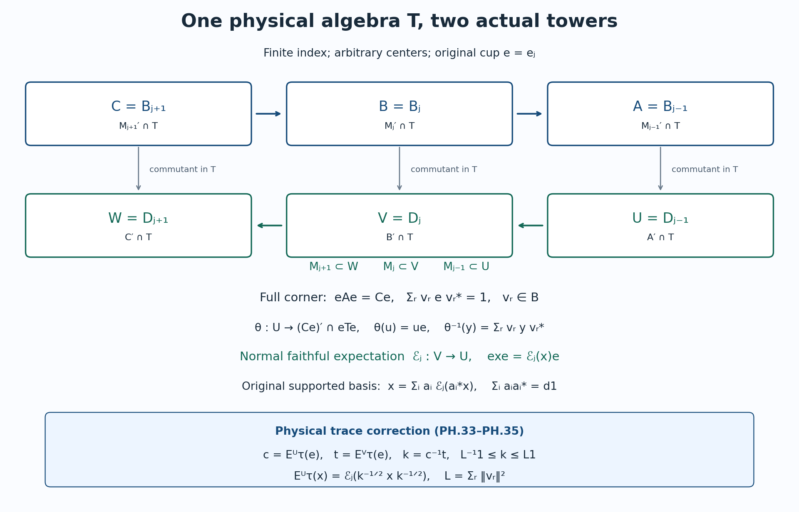

**Figure PH.2.** The upper row is the actual opposite triple \(C\subset B\subset A\) in (PH.26); the lower row reverses its commutants inside the same physical \(T\). The original factors embed in the lower row. The full corner uses the original \(e_j\) and the finite frame \(v_r\in B\) of (PH.28). PH.9–PH.10 supply the normal maps and full supported basis; PH.11 gives the precise physical trace correction and the bounds \(L^{-1}1\le k\le L1\). Arrows are algebra inclusions or the named normal expectations, not infinite reflection maps. Source context: Popa, *Classification of amenable subfactors of type II*, §§3.1 and 4.5.1, together with the finite corner results cited above. The exposition, proof and diagram are independently authored and dedicated to CC0 1.0. [Full-size diagram](figures/physical-commutant-expected-representation.svg); [reproducible source](figures/physical-commutant-expected-representation.py).

**Exercise PH.3 — the compression domain.** Why is \(F(x)=\theta^{-1}(exe)\) not faithful on all of \(W\), while \(\mathcal E_j=F|_V\) is faithful? Is a factor hypothesis needed?

**Solution.** In the proper-index case \(e\ne1\), \(F(1-e)=0\). For \(x\in V\) with \(F(x^*x)=0\), compression gives \(xe=0\). Since \(x\) commutes with every \(v_r\in B\), multiplying the finite identity \(\sum_r v_re v_r^*=1\) by \(x\) forces \(x=0\). The full-corner argument works with arbitrary centers. At index one, \(e=1\) and there is no nonzero \(1-e\) example.

**Exercise PH.4 — the physical expectation.** If \(\tau(\mathcal E_j(x))=\tau(kx)\), why does unitality of the corrected sandwich require a proof? Derive it, and explain whether \(E_{M_j}^\tau(k)=1\) implies \(k=1\).

**Solution.** The correction at the unit is \(\mathcal E_j(k^{-1})\), which is not its unitality identity \(\mathcal E_j(1)=1\). For each \(u\in U\), the trace formula and bimodularity give \(\tau(u\mathcal E_j(k^{-1}))=\tau(kuk^{-1})=\tau(u)\). Faithful pairing proves \(\mathcal E_j(k^{-1})=1\). The equation \(E_{M_j}^\tau(k)=1\) only describes a conditional expectation of \(k\); it does not make \(k\) scalar. Even in \(\mathbb C\subset\operatorname{Mat}_2\), the normalized-trace expectation of \(\operatorname{diag}(1/2,3/2)\) is \(1\). This finite example illustrates that inference only and is not a counterexample to the physical bicommutant theorem.

### Composed physical returns and their central limit density

Keep the actual algebras and normal expectations of PH.9–PH.11, and put \(U=D_{-1}\). Let \(k_j\in D_{j-1}'\cap D_j\) be the bounded positive invertible density in (PH.33)–(PH.34). Define
\[
\begin{gathered}
\Phi_l=\mathcal E_0\mathcal E_1\cdots\mathcal E_l:
D_l\longrightarrow U,\\
K_{-1}=1,\\
K_l=k_0k_1\cdots k_l\quad(l\geq0).
\end{gathered}
\tag{PH.36}
\]
Composition acts from right to left. Every trace and conditional expectation with superscript \(\tau\) below is for the original physical \(T\). No extremality, amenability, core factoriality or generating assumption is added to PH.12–PH.15.

**PH.12 — the actual commuting density martingale.** The \(k_j\) commute pairwise, and
\[
\begin{gathered}
K_l>0,\\
K_l,K_l^{-1}\in U'\cap D_l,\\
\tau(K_l)=1,\\
\tau(\Phi_l(x))=\tau(K_lx),\\
x\in D_l,\\
E_{D_{l-1}}^\tau(K_l)=K_{l-1},\\
\Phi_l|_{M_l}=E_N^{M_l},\\
E_{M_l}^\tau(K_l)=1.
\end{gathered}
\tag{PH.37}
\]
Moreover, writing \(A_l=N'\cap M_l\), one has
\[
\begin{gathered}
K_l\in A_l'\cap B_{-1},\\
B_{-1}=\left(\bigcup_{l\geq0}A_l\right)''.
\end{gathered}
\tag{PH.38}
\]

**Proof.** For \(j>i\), \(k_i\in D_i\subset D_{j-1}\), whereas \(k_j\) commutes with \(D_{j-1}\). This proves pairwise commutation and positivity of the finite product. Every factor commutes with \(U\). The trace formula follows inductively from (PH.34) and bimodularity:
\[
\begin{aligned}
\tau(K_{l-1}\mathcal E_l(x))
&=\tau(\mathcal E_l(K_{l-1}x))\\
&=\tau(k_lK_{l-1}x)=\tau(K_lx).
\end{aligned}
\]
Each \(\Phi_l\) is a normal conditional expectation onto \(U\), so its value at \(1\) gives \(\tau(K_l)=1\). Restricting the trace formula to \(D_{l-1}\), which \(\mathcal E_l\) fixes, proves the martingale identity by faithful trace pairing. The restrictions of the successive expectations to the original factors are the original tracial expectations. Their composition on \(M_l\) is \(E_N^{M_l}\), proving the last line of (PH.37).

Iterating the full supported reconstruction in PH.10 gives
\(D_l=\sum_s b_sU\), where the finitely many \(b_s\in M_l\) form an original supported basis over \(N\). Let \(a\in A_l\). It commutes with \(U=B_{-1}'\cap T\). Also
\(E_N^{M_l}(ab)=E_N^{M_l}(ba)\) for \(b\in M_l\): pairing with \(n\in N\), traciality and \(an=na\) prove this identity. Hence for \(x=\sum_s b_su_s\),
\[
\begin{aligned}
\tau(\Phi_l(ax))
&=\sum_s\tau(E_N^{M_l}(ab_s)u_s)\\
&=\sum_s\tau(E_N^{M_l}(b_sa)u_s)\\
&=\tau(\Phi_l(xa)).
\end{aligned}
\]
Faithful trace pairing on \(D_l\) therefore gives \([K_l,a]=0\). Since \(K_l\) commutes with \(U\supset N\), it lies in \(B_{-1}=N'\cap T\). Finally \(E_{M_l}^\tau\) takes \(B_{-1}\) into \(A_l\), preserves operator norm bounds, and converges in \(L^2\) to the identity on \(B_{-1}\). This is the same finite-expectation argument as PH.1 and proves the closure assertion in (PH.38). \(\square\)

**PH.13 — a bounded central limit and the exact loss of mass.** In the abelian algebra generated by the commuting \(K_l\), the sequence converges almost everywhere to an integrable limit \(h\). As an operator affiliated with \(T\), this limit satisfies
\[
\begin{gathered}
h\in Z(B_{-1})=Z(U),\\
0\leq h\leq1,\\
h\leq K_l\quad(l\geq-1),\\
\lim_l\|K_l-h\|_{1,\tau}\\
=1-\tau(h),\\
\lim_l\|K_l-1\|_{1,\tau}\\
=2(1-\tau(h)).
\end{gathered}
\tag{PH.39}
\]
In particular the limit is bounded, although no uniform operator-norm bound for the finite products has been assumed.

**Proof of convergence.** Let \(\mathcal C_l=W^*(K_0,\ldots,K_l)\) and \(\mathcal C=W^*(\bigcup_l\mathcal C_l)\). The martingale identity in (PH.37), followed by expectation onto \(\mathcal C_l\), makes \(K_l\) a classical nonnegative martingale in the probability algebra \((\mathcal C,\tau)\), with mean one.

Here is the classical upcrossing argument for convergence. For \(0<a<b\), buy one unit when the process first lies at most \(a\), sell when it first reaches at least \(b\), and repeat up to time \(n\). The predictable holding coefficients are zero or one, so the expected gain is zero by the martingale identity. Every completed upcrossing earns at least \(b-a\), while a final unsold unit loses at most \(a\), since the process is nonnegative. Thus the expected number of upcrossings is at most \(a/(b-a)\). There are almost surely finitely many upcrossings for every rational \(0<a<b\). Otherwise the increasing crossing counts would have unbounded expectation on a set of positive measure. Countability of these rational intervals gives existence of a limit in \([0,\infty]\). Fatou's inequality and the constant mean one exclude an infinite limit on a set of positive measure, and give \(\tau(h)\leq1\).

To identify its algebra, use the bounded function \(f(t)=t/(1+t)\). Almost-everywhere convergence and bounded convergence give \(f(K_l)\to f(h)\) in \(L^2\). Every \(K_l\) lies in \(B_{-1}\), so \(f(h)\) does also. For fixed \(a\in A_n\), (PH.38) gives \([f(K_l),a]=0\) for every \(l\geq n\). Bounded multiplication is \(L^2\)-continuous. Therefore \(f(h)\) commutes with every \(A_n\), and hence with \(B_{-1}\). It belongs to its center. Functional calculus shows that \(h\) is affiliated with this same center. The centers of a von Neumann algebra and its relative commutant inside a factor agree here: \(U=B_{-1}'\cap T\) and \(B_{-1}=N'\cap T\), with \(N\subset U\), imply
\(U'\cap T=B_{-1}\). Indeed the latter inclusion follows from \(N\subset U\), and its reverse is the definition of \(U\). Thus \(Z(U)=Z(B_{-1})\).

For \(x\geq0\) in \(M_n\), (PH.37) gives \(\tau(K_lx)=\tau(x)\) for \(l\geq n\). Restrict the normal positive functional \(y\mapsto\tau(xy)\) to the abelian \(\mathcal C\), and apply ordinary weighted Fatou there. It gives
\(\tau(hx)\leq\tau(x)\). Kaplansky approximation in the increasing original factor union and normality of the two functionals extend this inequality to every \(x\in T_+\). Testing the spectral projections of \(h\) proves \(h\leq1\). It is now a bounded element of \(Z(U)\).

Fixing \(l\) and instead testing \(x\in(D_l)_+\) gives, by the same weighted Fatou argument and the martingale identity,
\(\tau(hx)\leq\tau(K_lx)\). Both \(h\) and \(K_l\) belong to \(D_l\), so \(h\leq K_l\). Their positive difference consequently has trace \(1-\tau(h)\). This proves the first norm limit in (PH.39), in fact with that same norm at every \(l\).

Finally \(\min(K_l,1)\to h\) almost everywhere, because \(0\leq h\leq1\), and the minimum is bounded by one. Hence its trace tends to \(\tau(h)\). The identity
\(\lvert K_l-1\rvert=K_l+1-2\min(K_l,1)\) proves the second norm limit. \(\square\)

**PH.14 — the normal minorant has only finite-index atomic support.** The normal positive map
\[
\begin{gathered}
\Xi:T\longrightarrow U,\\
\Xi(x)=hE_U^\tau(x)
\end{gathered}
\tag{PH.40}
\]
satisfies
\[
\begin{gathered}
\Xi(x)\leq\Phi_l(x)\quad(x\in(D_l)_+),\\
\Xi(x)\leq E_N^\tau(x)\quad(x\in T_+),\\
hx\leq E_N^\tau(x)\quad(x\in U_+).
\end{gathered}
\tag{PH.41}
\]
For \(\varepsilon>0\), the central projection \(z_\varepsilon=1_{[\varepsilon,1]}(h)\) has at most \(\lfloor1/\varepsilon\rfloor\) central atoms and no diffuse part. If \(z_i\) is a minimal central projection of \(U\), write
\[
p_i=\tau(z_i),\qquad hz_i=a_i z_i.
\tag{PH.42}
\]
On every atom with \(a_i>0\),
\[
\begin{gathered}
0<a_i\leq p_i,\\
N z_i\subset U z_i,\\
\text{both are II}_1\text{ factors},\\
[U z_i:N z_i]\leq p_i/a_i .
\end{gathered}
\tag{PH.43}
\]
The support of \(h\) lies entirely in the atomic part of \(Z(U)\), and
\[
\tau(h)=\sum_i p_i a_i\leq\sum_i p_i^2.
\tag{PH.44}
\]
If the opposite-model centers are diffuse, \(h=0\) and the state-distance limit in (PH.39) is exactly two.

**Proof.** Let \(x\in(D_l)_+\), \(u\in U_+\). Since \(K_l-h\geq0\) and both terms commute with \(U\), their product with \(u\) is positive. Trace pairing gives
\[
\begin{aligned}
\tau(u\Xi(x))
&=\tau(uhx)\\
&\leq\tau(uK_lx)
=\tau(u\Phi_l(x)).
\end{aligned}
\]
The last equality follows from the trace-density formula and \(U\)-bimodularity. Faithful pairing inside \(U\) proves the first inequality in (PH.41). On the positive cone of \(M_l\), its right side is \(E_N^{M_l}\). Both \(\Xi\) and \(E_N^\tau\) are normal maps on \(T\), so positive Kaplansky approximation by the original stage union proves the second inequality on all of \(T_+\). Restrict to \(U_+\) for the third. This is a normal minorant; no claim about a maximal normal component of an arbitrary extension state is needed.

For every central projection \(w\in Z(U)\), the normal functional \(n\mapsto\tau(wn)\) on the factor \(N\) is a scalar multiple of its normalized trace. Its value at \(1\) is \(\tau(w)\), so
\[
E_N^\tau(w)=\tau(w)1.
\tag{PH.45}
\]
If \(0\ne w\leq z_\varepsilon\), (PH.41) at \(x=w\) yields
\(\varepsilon w\leq\tau(w)1\), and therefore \(\tau(w)\geq\varepsilon\).
Thus there are at most \(\lfloor1/\varepsilon\rfloor\) nonzero mutually orthogonal central projections under \(z_\varepsilon\). An infinite or diffuse central algebra would admit arbitrarily long such finite lists. This proves the finite atomic assertion. Taking the increasing union over positive \(\varepsilon\) shows that the support of \(h\) is atomic. On an atom, (PH.45) and (PH.41) give \(a_i\leq p_i\).

For \(x\in(Uz_i)_+\), its normalized trace expectation onto \(Nz_i\) is
\[
\begin{gathered}
F_i(x)=p_i^{-1}E_N^\tau(x)z_i\\
\geq(a_i/p_i)x.
\end{gathered}
\tag{PH.46}
\]
Indeed \(E_N^\tau(nz_i)=p_i n\), so this is unital onto \(Nz_i\), normal and bimodular. Its normalized trace is preserved: pairing with \(z_i\) multiplies the trace of an \(N\)-element by \(p_i\). The target is the factor \(Nz_i\), faithfully isomorphic to \(N\); the source is a finite factor because \(z_i\) is a minimal central projection of \(U\). It contains a II₁ factor and is therefore II₁. The exact positive-bound converse and sharp constant of [Theorem3.5b](finite-bases-and-positive-index.md) now give (PH.43).

The trace sum and (PH.44) follow from normality and \(a_i\leq p_i\). Finally \(Z(U)=Z(B_{-1})\); the atomic/diffuse alternative for adjacent actual opposite centers is [63.12–63.13](canonical-rescaling-of-jones-cups.md). In the diffuse case no positive part of \(h\) can remain. \(\square\)

**PH.15 — the unit-mass and bicommutant endpoints.** For this actual martingale, the following are equivalent:
\[
\begin{gathered}
\tau(h)=1;\qquad h=1;\\
K_l=1\text{ for every }l\geq0;\\
D_0=M .
\end{gathered}
\tag{PH.47}
\]
Uniform integrability of the commuting \(K_l\) is also equivalent to these conditions. These equivalences do not establish any of them from the original strongly amenable hypotheses.

**Proof.** If \(\tau(h)=1\), the bound \(0\leq h\leq1\) and faithful trace give \(h=1\). Since \(1\leq K_l\) and \(\tau(K_l)=1\), all products are one. Conversely this constant martingale has \(h=1\).

If all products are one, \(\Phi_l\) is trace preserving by (PH.37), so it equals \(E_U^\tau|_{D_l}\), by uniqueness of the normal trace expectation. On \(M_l\) this is \(E_N^{M_l}\). Normality and density of the original tower therefore give \(E_U^\tau=E_N^\tau\) on \(T\), whence \(U=N\). The full row in PH.10 gives \(D_0=\sum_i a_iU=M\).

Conversely, if \(D_0=M\), the intersection assertion after PH.10 gives \(U=N\). Its full next-stage construction then gives \(D_1=M_1\), and induction gives \(D_l=M_l\) at every stage. The expectations are the original trace expectations, so all \(k_j\) and \(K_l\) are one. Finally, uniform integrability together with almost-everywhere convergence implies preservation of the mean: cut at a common level \(R\), use bounded convergence on the cut, and then use the uniformly small tails. Thus it implies \(\tau(h)=1\); the reverse implication follows from the constant martingale already proved. \(\square\)

The full original bicommutant assertion still requires the unit-mass conclusion under its generating/strongly amenable hypotheses. Finite invertibility of every \(k_j\), normalization of every \(K_l\), and the atomic bound (PH.44) do not establish that conclusion.

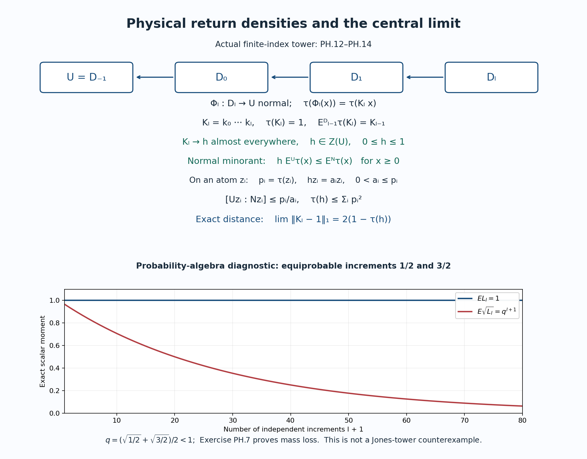

**Figure PH.3.** The top panel displays the actual normal returns (arrows denote compositions of the successive expectations), their commuting densities and the normal minorant of PH.12–PH.14, with all maps inside the original physical \(T\). The lower panel is the probability-algebra calculation of Exercise PH.7: mean-one increments \(1/2,3/2\) have \(E\sqrt{K_l}=q^{l+1}\), where \(q=(\sqrt{1/2}+\sqrt{3/2})/2<1\), despite \(E K_l=1\). It is an analytic diagnostic, not an original Jones tower or a subfactor counterexample. Proof locators are (PH.36)–(PH.47) and the complete exercises below. Source context: Popa, *Classification of amenable subfactors of type II*, §§1.4.2 and4.5.1; finite-index normalization uses the existing sharp theorem3.5b cited above. The exposition, proofs, solutions and diagram are independently authored and dedicated to CC0 1.0. [Full-size diagram](figures/physical-return-density-martingale.svg); [reproducible source](figures/physical-return-density-martingale.py).

**Exercise PH.5 — the exact state distance.** Why can states with density \(K_l\) agree with the physical trace on every \(M_l\), yet have distance tending to two on \(D_l\)?

**Solution.** Their restriction to \(M_l\) is the physical trace because \(E_{M_l}^\tau(K_l)=1\). On the full finite algebra \(D_l\), the predual norm of their difference is \(\tau|K_l-1|\). Formula (PH.39) makes its limit \(2(1-\tau(h))\), which equals two when \(h=0\). The tested ambient algebra changes with \(l\); no normal extension with those consistent finite densities has been asserted.

**Exercise PH.6 — the central mass bound.** Suppose \(Z(U)\) has precisely three atoms of physical traces \(1/2,1/3,1/6\). What is the upper bound in (PH.44)? If the limit value on the third atom is \(1/12\), what is the index bound on that factor corner?

**Solution.** The mass is at most \(1/4+1/9+1/36=7/18\). Hence the state-distance limit is at least \(2(1-7/18)=11/9\). On the third atom the index is at most \((1/6)/(1/12)=2\). This is a necessary bound from the stated central data, not an assertion that these data occur in an actual tower.

**Exercise PH.7 — uniformly bounded local densities still lose mass.** Let independent equiprobable increments \(r_j\) have values \(1/2,3/2\), and set \(L_l=\prod_{j=0}^l r_j\). Prove that this is a positive mean-one martingale with uniformly bounded invertible increments, but \(L_l\to0\) almost everywhere and it is not uniformly integrable.

**Solution.** Independence and \(E r_j=1\) give the martingale and mean identities; each increment and its inverse is bounded by two. Put \(q=(\sqrt{1/2}+\sqrt{3/2})/2\). Independence gives \(E\sqrt{L_l}=q^{l+1}\), while \(q^2=(2+\sqrt3)/4<1\). For each \(\delta>0\),
\[
\Pr(L_l\geq\delta)\leq q^{l+1}/\sqrt\delta .
\]
The sum over \(l\) is finite. The probability of any such event after time \(n\) is at most the corresponding tail sum, which tends to zero. Taking positive rational \(\delta\) proves almost-everywhere convergence to zero. Uniform integrability would preserve the means under this convergence, contradicting \(E L_l=1\). This example disproves only the proposed inference from bounded local increments and normalized products; it supplies none of the additional original Jones-tower hypotheses.

### The exact atomic index formula for the physical return

The bounded central limit in PH.13 is determined exactly by the finite-index part of \(N\subset U\), where \(U=D_{-1}\). The comparison has to hold at every matrix size. A merely positive scalar comparison would not suffice for the finite-basis passage used below.

Retain the physical expectations \(E_N^\tau:T\to N\) and \(E_U^\tau:T\to U\). For normal maps write \(\Psi\leq_{\mathrm{cp}}\Theta\) when \(\Theta-\Psi\) is completely positive. Let \((z_i)\) be all minimal central projections of \(U\), and put
\[
\begin{gathered}
p_i=\tau(z_i),\qquad N_i=Nz_i,\quad U_i=Uz_i,\\
d_i=[U_i:N_i]\in[1,\infty],\\
t_*=\sum_i\frac{p_i}{d_i}z_i,\qquad
\frac1\infty=0 .
\end{gathered}
\tag{PH.48}
\]
The corner traces are normalized by \(p_i\). The map \(n\mapsto nz_i\) is a faithful normal isomorphism \(N\to N_i\), since \(N\) is a factor and \(z_i\ne0\) commutes with it. Each \(U_i\) is a II₁ factor. There are at most countably many atoms because \(\tau\) is faithful and finite. The sum in (PH.48) is a bounded normal central sum; its coefficients lie between zero and \(p_i\). It is zero on the diffuse central part.

**PH.16 — sharp complete-positive central domination.** For every bounded \(t\in Z(U)_+\),
\[
\begin{gathered}
tE_U^\tau\leq_{\mathrm{cp}}E_N^\tau\\
\Longleftrightarrow\\
0\leq t\leq t_* .
\end{gathered}
\tag{PH.49}
\]

**Proof of the factor constant.** For the normalized tracial expectation \(F:P\to Q\) between II₁ factors of extended index \(d\), let \(c_{\mathrm{cp}}(F)\) be the supremum of the nonnegative \(c\) for which \(F-c\,\mathrm{id}_P\) is completely positive. Then
\[
c_{\mathrm{cp}}(F)=d^{-1}.
\tag{PH.50}
\]
Necessity follows from the sharp positive-operator bound, including its infinite-index case, in [Theorem 3.5b](finite-bases-and-positive-index.md). For finite index, the same supported basis of Theorem 3.2, tensored with the identity matrix, is a basis at every finite matrix amplification, with the same support row and scalar index sum \(d1\). Apply the positive bound of Theorem 3.5 at each of these matrix sizes. This proves complete positivity at \(c=d^{-1}\); smaller nonnegative constants follow by adding a positive multiple of the identity map. If \(d=\infty\), the sharp positive bound excludes every \(c>0\), and \(c=0\) is the original expectation. Thus (PH.50) uses the existing sharp index theorem, with its full matrix amplification, and does not assume a new trace inequality.

**Necessity in (PH.49).** Restrict the assumed comparison to \(U\). For any central projection \(w\in Z(U)\), (PH.45) gives
\[
tw\leq E_N^\tau(w)=\tau(w)1 .
\tag{PH.51}
\]
The central projection argument in PH.14 now applies to \(t\): each nonzero central subprojection of \(1_{[\varepsilon,\infty)}(t)\) has trace at least \(\varepsilon\). Such a spectral region is finite atomic. Taking their union shows that \(t\) is supported on the atomic center. Write \(tz_i=t_i z_i\).

The normalized corner expectation is the actual map
\[
\begin{gathered}
F_i:U_i\to N_i,\\
F_i(x)=p_i^{-1}E_N^\tau(x)z_i .
\end{gathered}
\tag{PH.52}
\]
Its unitality, normalized trace and normal bimodularity are exactly the calculation in (PH.46). Restrict the completely positive map \(E_N^\tau-t\,\mathrm{id}_U\) to \(U_i\), and compress its output by the central \(z_i\). The resulting map is
\(p_iF_i-t_i\,\mathrm{id}_{U_i}\).
By (PH.50), \(t_i\leq p_i/d_i\), with \(t_i=0\) at infinite index. This proves \(t\leq t_*\).

**Sufficiency.** Suppose \(0\leq t\leq t_*\). It is supported on the atoms, with \(t_i\leq p_i/d_i\). On input \(x\in U_i\), the map \(G=E_N^\tau|_U-t\,\mathrm{id}_U\) has two orthogonal output parts:
\[
\begin{gathered}
G(x)=(1-z_i)E_N^\tau(x)\\
+\bigl(p_iF_i(x)-t_i x\bigr).
\end{gathered}
\tag{PH.53}
\]
The first is completely positive because \(1-z_i\) is central in \(U\), hence commutes with \(N\). The second is completely positive by (PH.50), and lies in \(U_i\). On the diffuse input summand, \(t\) vanishes, so \(G\) is just \(E_N^\tau\). Summing central input pieces first over finite sets of atoms and then normally proves complete positivity of \(G\), including at every matrix size. Finally
\[
E_N^\tau E_U^\tau=E_N^\tau
\]
by uniqueness of the tracial expectation onto \(N\subset U\). Therefore \(GE_U^\tau=E_N^\tau-tE_U^\tau\) is completely positive on all \(T\). \(\square\)

**PH.17 — complete-positive order lifts through the entire supported return.** For bounded \(t\in Z(U)_+\), the following are equivalent:
\[
\begin{gathered}
tE_U^\tau\leq_{\mathrm{cp}}E_N^\tau\\
\hbox{on }T,\\
tE_U^\tau|_{D_l}\leq_{\mathrm{cp}}\Phi_l\\
\hbox{for every }l\geq0 .
\end{gathered}
\tag{PH.54}
\]
In particular the largest \(t\) in this central family is \(t_*\).

**Proof.** For the forward implication put \(G=E_N^\tau-tE_U^\tau\). Fix \(l\), and take the original finite supported basis \(b_s\in M_l\) over \(N\). PH.10 and its iteration give the exact, whole-algebra identity \(D_l=\sum_s b_sU\). Both \(\Phi_l\) and \(tE_U^\tau|_{D_l}\) are \(U\)-bimodular. For finitely many \(x_r=\sum_s b_su_{sr}\), with \(u_{sr}\in U\), their difference \(G_l\) therefore satisfies
\[
\begin{gathered}
G_l(x_r^*x_q)\\
=\sum_{s,v}u_{sr}^*G(b_s^*b_v)u_{vq}.
\end{gathered}
\tag{PH.55}
\]
Here its restriction to \(M_l\) is \(G|_{M_l}\), by (PH.37). Since \(G\) is completely positive, \([G(b_s^*b_v)]_{s,v}\) is positive. Multiplication by the finite coefficient matrix proves positivity of the matrix in (PH.55). At any matrix size a positive element factors as \(Y^*Y\); expanding the finitely many entries of \(Y\) in this same supported row expresses its image as a finite sum of these positive Gram matrices. Thus \(G_l\) is completely positive on the full \(D_l\), not just on a dense list of vectors.

Conversely restrict the second line of (PH.54) to the original \(M_l\). It says that the normal map \(G\) is completely positive on every \(M_l\). Apply positive Kaplansky approximation in each finite matrix amplification of the increasing original tower. Normality passes these positive matrix images to all of \(T\), proving the first line. The last assertion follows from PH.16. \(\square\)

**PH.18 — exact limiting density, index mass and factorial gap.** The actual physical return martingale satisfies
\[
h=t_*=\sum_i\frac{p_i}{d_i}z_i .
\tag{PH.56}
\]
Consequently
\[
\begin{gathered}
\tau(h)=\sum_i\frac{p_i^2}{d_i},\\
\lim_l\|K_l-1\|_{1,\tau}\\
=2\left(1-\sum_i\frac{p_i^2}{d_i}\right).
\end{gathered}
\tag{PH.57}
\]
In particular a finite-index atomic factor corner contributes strictly positive limiting mass, even though no such contribution was assumed in PH.14.

**Proof.** PH.14 already places \(h\) on atomic central components and gives \([U_i:N_i]\leq p_i/a_i\) when \(hz_i=a_i z_i>0\). Thus \(a_i\leq p_i/d_i\). At an infinite-index atom \(a_i=0\). On the diffuse part \(h=0\). Hence \(h\leq t_*\).

For the reverse inequality, PH.16 and PH.17 give
\(t_*E_U^\tau|_{D_l}\leq_{\mathrm{cp}}\Phi_l\)
for every \(l\). Taking the physical trace of these positive maps and using (PH.37) yields
\[
\begin{gathered}
\tau((K_l-t_*)x)\geq0\\
(x\in(D_l)_+).
\end{gathered}
\tag{PH.58}
\]
Since both \(K_l\) and \(t_*\) belong to \(D_l\), faithful trace pairing proves \(K_l\geq t_*\). Also \(t_*\in Z(U)\) commutes with every \(K_l\). Work in the abelian algebra generated by all \(K_l\) and \(Z(U)\). The almost-everywhere convergence in PH.13 remains true there, and these inequalities pass to the limit. They give \(h\geq t_*\). This proves (PH.56). Normality of the trace sum and the exact distance identity in (PH.39) give (PH.57). \(\square\)

If \(U\) is a factor, put \(r=[U:N]\in[1,\infty]\). Formula (PH.56) specializes to
\[
\begin{gathered}
h=r^{-1}1,\\
\lim_l\|K_l-1\|_{1,\tau}\\
=2(1-r^{-1}).
\end{gathered}
\tag{PH.59}
\]
If \(U\ne N\), the II₁ index restriction [Theorem 7.2](positivity-and-index-rigidity.md) gives \(r\geq2\), including the infinite endpoint. Thus, in this factorial case, the limiting state distance is either zero or at least one; equivalently the limiting mass is either one or at most \(1/2\).

These statements determine the normal central minorant exactly from the actual intermediate corner indices. They do not compute those indices under the original generating/strongly amenable hypotheses. In particular factoriality alone does not supply \(r=1\), and no finite-index atomic component is assumed to exist. The full nonextremal physical bicommutant still requires the original-hypothesis unit-mass conclusion of PH.15.

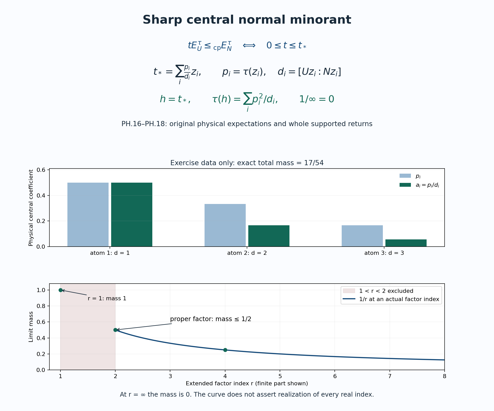

**Figure PH.4.** The upper panel displays the actual maps and the sharp coefficient \(p_i/d_i\) from PH.16–PH.18. The middle bars use only the exercise data \(p=(1/2,1/3,1/6)\), \(d=(1,2,3)\); their resulting total mass is exactly \(17/54\). They evaluate the coefficient formula; PH.24 excludes these particular data from an actual physical tower. The lower analytic curve is \(1/r\), evaluated at an actual factor index in (PH.59). The interval \(1<r<2\) is excluded by the index restriction; the curve does not assert that every real \(r\geq2\) is an admissible II₁ index. At infinite index the coefficient is zero. Source context: Pimsner–Popa's sharp finite-index bound and Popa's amenable-subfactor framework, with the exact existing proofs 3.2, 3.5b and 7.2 linked above. The proofs, solutions and diagram are independently authored and dedicated to CC0 1.0. [Full-size diagram](figures/physical-return-sharp-index-mass.svg); [reproducible source](figures/physical-return-sharp-index-mass.py).

**Exercise PH.8 — why positive order is insufficient.** On \(\operatorname{Mat}_2\), let \(F(x)=\tfrac12\operatorname{Tr}_2(x)1\). Show that \(F-\tfrac12\mathrm{id}\) is positive but not completely positive. Find the sharp complete-positive constant and explain its use in PH.17.

**Solution.** For \(x\geq0\), its largest eigenvalue is at most \(\operatorname{Tr}_2(x)\), so \(\tfrac12\operatorname{Tr}_2(x)1-\tfrac12x\geq0\). With \(\Omega=(1,0,0,1)^\mathsf T\), the matrix of the amplified Gram test is
\[
J(F-c\,\mathrm{id})
=\tfrac121_4-c\,\Omega\Omega^* .
\]
Its eigenvalues are \(1/2\), three times, and \(1/2-2c\). At \(c=1/2\) the last is \(-1/2\), while for nonnegative \(c\) all are nonnegative exactly when \(0\leq c\leq1/4\). To see that the displayed matrix test suffices here, a positive coefficient matrix decomposes into a sum of rank-one vectors, each reshaped into a matrix; these give a finite Kraus sum for the map. The reverse follows by applying a completely positive map to \([E_{ij}]\). PH.17 needs such positivity of the entire coefficient Gram matrix, rather than only positivity of its separate diagonal entries. This finite matrix calculation is not the II₁ positive-bound theorem; that theorem is imported at the appropriate amplified factor index in (PH.50).

**Exercise PH.9 — exact atomic mass.** For central data \(p=(1/2,1/3,1/6)\) and \(d=(1,2,3)\), compute the coefficients of \(h\), its trace and the limiting state distance. Does the calculation construct these data in an actual physical tower?

**Solution.** The coefficients are \(1/2,1/6,1/18\). Therefore
\[
\begin{gathered}
\tau(h)=\frac14+\frac1{18}+\frac1{108}
=\frac{17}{54},\\
2(1-\tau(h))=\frac{37}{27}.
\end{gathered}
\]
The arithmetic correctly evaluates the formula for the stated data. PH.24 excludes their realization in an actual physical tower because the computed mass is strictly between zero and one.

**Exercise PH.10 — an infinite-index atom and the factorial gap.** An atom has trace \(1/5\) and infinite index over its compressed copy of \(N\). What is its contribution to \(h\) and to \(\tau(h)\)? In the factorial case, can the limiting state distance lie strictly between zero and one?

**Solution.** Both contributions are zero by the convention \(1/\infty=0\) and (PH.56)–(PH.57). In the factorial case the distance is \(2(1-r^{-1})\). Index one gives \(U=N\), and hence distance zero. Every proper factor inclusion has extended index at least two by Theorem 7.2, giving distance at least one. This excludes the proposed interval without asserting that the original hypotheses select the zero endpoint.

### Finite-index physical extensions cannot retain a proper positive mass

The exact coefficient in PH.18 allows a finite-index branch of the original bicommutant problem to be decided. The decisive uniform bound below comes from the actual two-step center trace transport, not from a bound on the individual return increments.

Assume the original **global finite approximation** condition of [Theorem 61.20](smooth-representations-and-tower-compression.md#global-finite-approximation-without-a-separability-assumption): every finite subset of \(M\) can be approximated in the physical \(L^2\) norm by a terminal ordinary relative commutant, with the stated finite-prefix retention. That theorem identifies this condition with original strong amenability without an ambient separability assumption. An ordinary generating tunnel also supplies it. The identity inclusion satisfies the conclusions directly; the proof below concerns proper inclusions. We do not add extremality, finite depth, or an infinite normal reflection.

**PH.19 — shifted amenability and finite normal hypertraces.** The global finite approximation condition holds for every shifted original inclusion \(M_{j-1}\subset M_j\), \(j\geq0\). If the actual limit in PH.18 satisfies
\[
h\geq\varepsilon1
\qquad(\varepsilon>0),
\tag{PH.60}
\]
then each actual \(D_j\) is generated by a finite bounded right \(M_j\)-row. Its physical tracial expectation onto \(M_j\) has a strictly positive operator bound. Consequently every state on \(D_j\) extending \(\tau|_{M_j}\) is normal. Every such state that is central over \(M_j\) is a trace.

**Shifted finite approximation.** A finite subset of \(M_j\) can first be approximated in \(L^2\) by bounded polynomials in \(M\) and the fixed upper cups \(e_0,\ldots,e_{j-1}\). There are finitely many coefficients in \(M\). Apply the original global approximation simultaneously to those coefficients, replacing them by their norm-contracting expectations onto one terminal \(M_{-m}'\cap M\). Every fixed upper cup commutes with \(M_{-m}\). The resulting polynomials therefore belong to \(M_{-m}'\cap M_j\). The usual product estimate, with the other bounded factors fixed, makes their total \(L^2\) error arbitrarily small. This proves the shifted finite-set condition in Theorem 61.20. Apply that theorem to obtain shifted strong amenability; its prefix-matching result 61.17 then supplies approximation after every prescribed shifted finite prefix. This includes prefixes whose lower segment differs from the canonical original segment. The theorem also gives the full every-smooth-representation amenability conclusion. This argument uses finite coefficient lists; it does not introduce a countable diagonal in a nonseparable factor.

**The finite row.** In the notation of (PH.48), (PH.60) says that there are finitely many central atoms, that they sum to one, and that all \(d_i\) are finite. Indeed \(p_i/d_i\geq\varepsilon\) implies \(p_i\geq\varepsilon\); there is no diffuse or infinite-index part. On \(U_i\) choose the existing supported basis \(c_{ir}\) over \(N_i\) from [Theorem 3.2](finite-bases-and-positive-index.md). Write its support as \(n_{ir}z_i\), with \(n_{ir}\in N\), and set
\[
\begin{gathered}
v_{ir}=p_i^{-1/2}c_{ir},\\
E_N^\tau(v_{ir}^*v_{ks})\\
=\delta_{ik}\delta_{rs}n_{ir},\\
u=\sum_{i,r}v_{ir}E_N^\tau(v_{ir}^*u),\\
\sum_{i,r}v_{ir}v_{ir}^*=h^{-1}.
\end{gathered}
\tag{PH.61}
\]
The normalized corner expectation is (PH.52), so its factor \(p_i\) cancels the two factors \(p_i^{-1/2}\) in the Gram calculation. Products from different atoms vanish. The corner basis reconstruction and index sum give the last two identities. Thus this is an actual finite row in \(U\), not only a finite-dimensional approximation to one.

Let \(b_s\in M_j\) be an original supported basis over \(N\). The whole reconstruction in PH.10 gives
\[
\begin{gathered}
D_j=\sum_s b_sU\\
=\sum_{s,i,r}b_sv_{ir}N\\
=\sum_{s,i,r}b_sv_{ir}M_j .
\end{gathered}
\tag{PH.62}
\]
The last equality means equality of the finite sums as sets: the middle sum is contained in the last, while every term of the last belongs to \(D_j\). Each row coefficient is bounded. Left multiplication by these finitely many coefficients maps a finite sum of copies of \(L^2(M_j)\) onto a dense right-module subspace of \(L^2(D_j)\). Its polar decomposition gives a module quotient of that finite sum. In particular the right \(M_j\)-dimension is finite, by the dimension definition of index in [Lesson 2](module-dimension-and-local-index.md).

**Centers and the positive bound.** First \(Z(U)\) is finite dimensional by (PH.60). The finite basis of \(D_0\) over \(U\) in PH.10 gives the positive bound \(\mathcal E_0\geq d^{-1}\mathrm{id}\), using the same row argument as Theorem 3.5. For orthogonal nonzero central projections \(w_t\in Z(D_0)\), the elements \(\mathcal E_0(w_t)\) are central in \(U\), sum to at most one, and each has norm at least \(d^{-1}\). If \(Z(U)\) has \(a\) atoms, there can be at most \(ad\) such projections: sum their coefficients over those \(a\) atoms. Hence \(Z(D_0)\) is finite dimensional. The actual trace-preserving two-step center isomorphisms [63.11, (63.42)](canonical-rescaling-of-jones-cups.md#finite-bases-and-the-centers-of-the-actual-models), together with \(Z(D_j)=Z(B_j)\), give finite centers at every stage.

For a central atom \(w_t\) of \(D_j\), put
\[
\begin{gathered}
q_t=\tau(w_t),\\
s_t=[D_jw_t:M_jw_t]<\infty .
\end{gathered}
\tag{PH.63}
\]
Finiteness of \(s_t\) follows by compressing the finite right-module row in (PH.62). The normalized corner trace restricts to the normalized trace of \(M_jw_t\), so this is precisely its factor index. Apply the existing sharp factor bound (PH.50), followed by the central-output decomposition (PH.52)–(PH.53), to obtain
\[
\begin{gathered}
E_{M_j}^\tau(x)\geq\gamma_jx,\\
x\in(D_j)_+,\\
\gamma_j=\min_t(q_t/s_t)>0 .
\end{gathered}
\tag{PH.64}
\]
No uniform lower bound on \(\gamma_j\) is claimed. If \(\rho|_{M_j}=\tau\), positivity gives
\[
\begin{gathered}
\rho(x)\leq\gamma_j^{-1}\tau(x)\\
(x\in(D_j)_+).
\end{gathered}
\tag{PH.65}
\]
A positive functional dominated by a normal functional is normal: apply the inequality to the decreasing positive remainders of any bounded increasing net. Finally
\[
\begin{gathered}
M_j'\cap D_j=Z(D_j)\\
=Z(B_j).
\end{gathered}
\tag{PH.66}
\]
Indeed \(B_j=M_j'\cap T\), \(D_j=B_j'\cap T\), and \(M_j\subset D_j\). A normal \(M_j\)-central state therefore has its trace density affiliated with \(Z(D_j)\); equivalently it is a normal tracial state. This proves PH.19. \(\square\)

**PH.20 — a uniformly positive physical density limit forces the full return.** Under the original global finite approximation hypothesis, (PH.60) implies
\[
\begin{gathered}
K_l=1\quad(l\geq0),\\
h=1,\\
U=N,\qquad D_0=M .
\end{gathered}
\tag{PH.67}
\]

**Proof.** Every shifted actual representation \(D_{j-1}\subset_{\mathcal E_j}D_j\) is smooth and nondegenerate by PH.10. Shifted amenability in PH.19 supplies a compatible \(M_j\)-hypertrace \(\varphi_j\) on \(D_j\). PH.19 makes it normal and tracial. Its density in the physical trace is a positive central element \(c_j\).

There is a bound independent of \(j\). Let \(\delta>0\) be the smallest physical trace of a central atom of either \(U\) or \(D_0\). The actual center trace transport (63.42) preserves these atom traces two steps at a time. Thus every central atom of every \(D_j\) has trace at least \(\delta\). Since \(\varphi_j\) is a state,
\[
\begin{gathered}
c_j\in Z(D_j)_+,\qquad\tau(c_j)=1,\\
0\leq c_j\leq\delta^{-1}1 .
\end{gathered}
\tag{PH.68}
\]
This uniform bound is on central densities of the hypertraces, not on the products \(K_j\).

Compatibility descends through every earlier expected step. More explicitly, for \(s\geq1\), \(x\in D_{s-1}\), and the original cup \(e=e_{s-1}\in D_s\), the dual identities are
\[
\begin{gathered}
\mathcal E_{s-1}(x)
=d\,\mathcal E_s(exe),\\
\mathcal E_s(e)=d^{-1}1 .
\end{gathered}
\tag{PH.69}
\]
If a tracial state \(\varphi\) on \(D_s\) satisfies \(\varphi\mathcal E_s=\varphi\), then
\[
\begin{aligned}
\varphi(\mathcal E_{s-1}(x))
&=d\varphi(exe)\\
&=d\varphi(xe)\\
&=d\varphi(\mathcal E_s(xe))\\
&=\varphi(x).
\end{aligned}
\tag{PH.70}
\]
Its restriction is still a trace. Induction therefore gives
\[
\begin{gathered}
\varphi_j(\mathcal E_l(x))=\varphi_j(x)\\
(x\in D_l,\ 0\leq l\leq j).
\end{gathered}
\tag{PH.71}
\]

The order interval in (PH.68) is ultraweakly compact in \(T\). If \(c\) is any subnet cluster point of the sequence \((c_j)\), then for each fixed \(m\in M_l\) all sufficiently late \(c_j\) commute with \(m\). Hence \(c\) commutes with the entire increasing original tower, and thus with \(T\). The physical completion is a factor, while \(\tau(c)=1\). Consequently every cluster point is \(1\), so
\[
c_j\longrightarrow1
\quad\hbox{ultraweakly in }T.
\tag{PH.72}
\]
The compactness argument retains subnet limits and is valid without separability. The normal extensions \(x\mapsto\tau(c_jx)\) agree with \(\varphi_j\) on \(D_j\). Passing to the limit in (PH.71) at fixed \(l,x\) gives \(\tau\mathcal E_l=\tau\) on \(D_l\). Every composed return is therefore physical-trace preserving, so its density \(K_l\) is one. PH.15 proves the full endpoint (PH.67). \(\square\)

**PH.21 — no proper finite-index factorial branch.** Under the same original global approximation hypothesis, if \(U\) is a factor then
\[
\begin{gathered}
\bigl[U:N\bigr]\in\{1,\infty\},\\
h=1\quad\hbox{or}\quad h=0,\\
\lim_l\|K_l-1\|_{1,\tau}\\
\in\{0,2\}.
\end{gathered}
\tag{PH.73}
\]
In particular every proper finite-index physical extension \(N\subset U\) is excluded. The two lines involving \(h\) and distance correspond to the same index alternative, rather than independent choices.

**Proof.** If \(r=[U:N]<\infty\), PH.18 gives \(h=r^{-1}1\). It satisfies (PH.60), and PH.20 gives \(h=1\), hence \(r=1\) and the physical bicommutant. If \(r=\infty\), PH.18 gives \(h=0\) and distance two. This states the only remaining branch; it does not prove that branch occurs under the original hypotheses. \(\square\)

More generally, if \(Z(U)\) is finite dimensional and every factor corner \(Uz_i\) has finite index over \(Nz_i\), then (PH.48) makes \(h\) bounded below. PH.20 forces \(U=N\). Therefore any failure of the original general conclusion must have \(0\) in the spectrum of \(h\): a diffuse part, an infinite-index corner, or coefficients approaching zero along infinitely many atoms. PH.24 rules out partial positive survival, including the faithful noninvertible case. The remaining h=0 branch, including factorial infinite index, remains part of the original unrestricted bicommutant assignment.

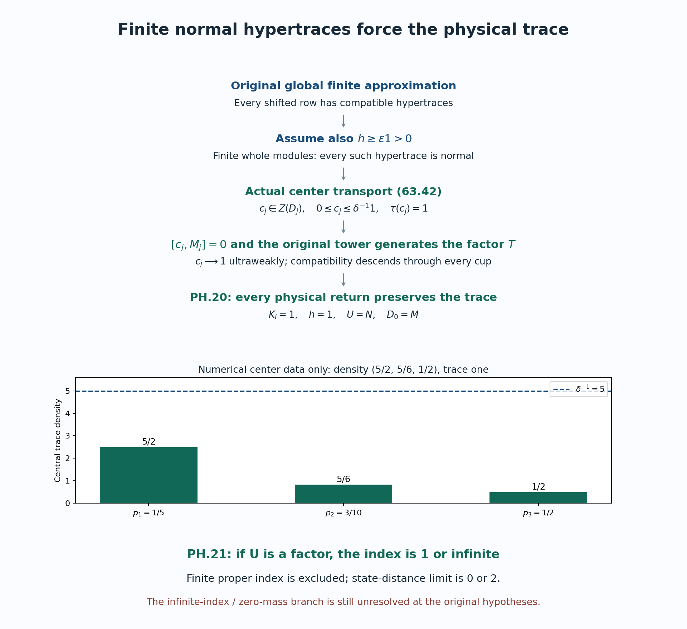

**Figure PH.5.** The proof chain keeps the original global approximation hypothesis. The uniform bound uses the two actual center trace measures, transported by (63.42), and applies to \(c_j\), not to \(K_j\). The lower numerical bars use only \(p=(1/5,3/10,1/2)\) and state weights \(q=(1/2,1/4,1/4)\): the central density is \(q_i/p_i\), with trace one and bound \(1/\min p_i=5\). This illustrates (PH.68) and does not construct these data in a physical tower. The factorial alternatives in (PH.73) exclude finite proper index; occurrence of the infinite-index alternative at the original hypotheses is not asserted. Source context: Popa, §§3.1, 4.1.2 and 4.5.1, with the exact existing finite-basis, amenability and center-transport proofs linked above. The proof, solutions and diagram are independently authored, CC0 1.0. [Full-size diagram](figures/physical-return-finite-index-exclusion.svg); [reproducible source](figures/physical-return-finite-index-exclusion.py).

**Exercise PH.11 — normality has a finite positive bound.** Suppose \(E_M^W(x)\geq\gamma x\) for \(x\geq0\), with \(\gamma>0\), and \(\rho|_M=\tau_M\). Prove normality of \(\rho\). Does normality alone imply it is a trace?

**Solution.** Positivity gives \(\rho(x)\leq\gamma^{-1}\tau_W(x)\). For a bounded increasing net \(x_\alpha\uparrow x\), apply this estimate to \(x-x_\alpha\); normality of \(\tau_W\) makes the remainder tend to zero. Thus \(\rho\) is normal. It need not be a trace: a noncentral positive density of trace one defines a normal state. In PH.19 it is the additional \(M_j\)-centrality and the exact equality (PH.66) that make the density central.

**Exercise PH.12 — the correct uniform density.** For the numerical center data in Figure PH.5, compute the density and its trace. Explain why stage-dependent constants \(\gamma_j\) in (PH.64) are not the uniform compactness bound.

**Solution.** The density coefficients are \(5/2,5/6,1/2\), and
\[
\frac15\frac52+\frac3{10}\frac56
+\frac12\frac12=1.
\]
Every coefficient is at most \(5\). In general a tracial state assigns at most one to an atom of physical trace at least \(\delta\), so its density is at most \(\delta^{-1}\). The positive constants \(\gamma_j\) may tend to zero; they establish normality one stage at a time. The fixed bound on center weights in (PH.68) then bounds the resulting tracial densities uniformly. No uniform-integrability claim for \(K_j\) is inferred from the local constants.

**Exercise PH.13 — which index branches remain?** At the original global approximation hypotheses, assume \(U\) is a factor. Can \([U:N]=7\)? If the index is infinite, does PH.21 furnish an example contradicting the original bicommutant claim?

**Solution.** Index seven would give \(h=1/7\), which is bounded below; PH.20 would instead force \(h=1\). Hence it is impossible in this actual physical setting. At infinite index the exact formula gives \(h=0\) and state-distance two. The argument neither constructs that branch under the original hypotheses nor proves it impossible. The unrestricted problem still has to exclude it or supply an exact example satisfying every original assumption.

### A zero-one law for the actual physical return

The physical return has no intermediate surviving mass. The argument uses all shifted limits, the actual full corners and their two trace measures. It imposes neither amenability nor a lower spectral bound on the limit. Throughout this section the inclusion is proper; the identity inclusion satisfies the conclusion directly.

Keep the original finite-index tower and the actual expected commutant tower PH.9–PH.12. For every \(j\geq-1\), apply the structural results PH.12–PH.18 to the shifted original inclusion \(M_j\subset M_{j+1}\). Its upward physical completion is the same \(T\). Define
\[
\begin{gathered}
L_{j,l}=\prod_{s=j+1}^{l}k_s,\\
l\geq j+1,\\
H_j=\lim_{l\to\infty}L_{j,l},\\
H_{-1}=h,\qquad m_j=\tau(H_j).
\end{gathered}
\tag{PH.74}
\]
These are the almost-everywhere limits in the common abelian algebra generated by the commuting \(k_s\). There are countably many shifts, so all limits can be taken on one common full-measure set. No separability of the ambient factor is required.

**PH.22 — a common support and compatible reciprocal traces.** The shifted limits satisfy
\[
\begin{gathered}
H_j\in Z(D_j),\\
0\leq H_j\leq1,\\
H_{j-1}=k_jH_j\quad(j\geq0),\\
E_{D_{j-1}}^\tau(k_j)=1.
\end{gathered}
\tag{PH.75}
\]
Their support projections are all the same projection, and that projection is either zero or one. Thus either every \(H_j\) is zero, or every \(H_j\) is faithful. Faithfulness here does not mean bounded invertibility.

On the faithful branch, the normal semifinite traces
\[
\begin{gathered}
\Theta_j(x)=\tau(H_j^{-1}x),\\
x\in(D_j)_+,\\
\Theta_j=\Theta_{j-1}\mathcal E_j,\\
\Theta_j|_{D_{j-1}}=\Theta_{j-1}
\quad(j\geq0)
\end{gathered}
\tag{PH.76}
\]
are compatible on the entire positive cone. Their values may be infinite. The inverse density is a central affiliated operator; no normalization of an infinite trace is made.

**Proof.** Shifted PH.13 gives centrality and the bound in (PH.75). Taking the one fixed bounded invertible factor \(k_j\) out of the product limit gives its second line. For \(u\in D_{j-1}\), the trace-density identity and the fact that \(\mathcal E_j\) fixes \(u\) give \(\tau(k_ju)=\tau(u)\), proving the third line by normal trace pairing.

The factors \(k_j\) commute with the shifted limits and are invertible, so the second line of (PH.75) gives equal support projections. Call their common support \(p\). It belongs to every \(Z(D_j)\), hence commutes with every original \(M_j\). Those original factors generate the factor \(T\). Therefore \(p\in Z(T)=\mathbb C1\), and \(p=0\) or \(p=1\). This conclusion uses the actual increasing commutant algebras inside \(T\); it does not identify any two adjacent centers.

If \(p=1\), the increasing central spectral cuts of each \(H_j\) on \([1/n,1]\) have finite \(\Theta_j\)-trace and increase to one. They prove semifiniteness. Centrality of the density gives the trace property, and monotone convergence gives normality and faithfulness.

For \(x\in(D_j)_+\), use the bounded central truncations \(a_n=\min(n,H_{j-1}^{-1})\) in \(D_{j-1}\). Bimodularity and the bounded trace-density formula give
\[
\tau(a_n\mathcal E_j(x))
=\tau(k_ja_nx).
\]
The positive products \(k_ja_n\) increase to \(k_jH_{j-1}^{-1}=H_j^{-1}\). Passing to the limit proves (PH.76), including infinite values. Its restriction follows because \(\mathcal E_j\) fixes \(D_{j-1}\). Only the bounded trace-density identity and monotone convergence enter this passage. \(\square\)

**PH.23 — two-step preservation of physical and reciprocal center weights.** On the faithful branch, the full corner in PH.9 gives a normal center isomorphism
\[
\begin{gathered}
\beta_j:Z(D_{j+1})\\
\longrightarrow Z(D_{j-1}),\\
ze_j=\beta_j(z)e_j,\\
\tau(z)=\tau(\beta_j(z)),\\
\Theta_{j+1}(z)=\Theta_{j-1}(\beta_j(z))
\end{gathered}
\tag{PH.77}
\]
for positive central \(z\); the last equality is in the extended positive reals. Consequently
\[
m_{j+1}=m_{j-1}\quad(j\geq0).
\tag{PH.78}
\]
This compares the actual centers two steps apart through the original cup, not through an unspecified reflection.

**The full center map and its physical trace.** The target of PH.9 is exactly \(e_jD_{j+1}e_j\): a supported element commuting with \(B_{j+1}e_j\) commutes with \(B_{j+1}\), since \(e_j\) itself does. The row in (PH.31) makes \(e_j\) full in \(D_{j+1}\). Thus the full-corner center theorem, followed by the normal isomorphism \(u\mapsto ue_j\) from PH.9, gives \(\beta_j\) with the displayed cup identity.

Put \(w=\beta_j(z)\). There are two actual unital factors to use. Since \(z\) is central in \(D_{j+1}\), its normalized central trace restricts on the unital original factor \(M_{j+1}\) to the original factor trace. Since \(w\in Z(D_{j-1})=Z(B_{j-1})\), its normalized central trace restricts on the unital Markov cup factor \(W^*(e_j,e_{j+1},\ldots)\subset B_{j-1}\) to that factor's trace. The cup-factor input and its exact Markov value are the existing proof of [63.11](canonical-rescaling-of-jones-cups.md#finite-bases-and-the-centers-of-the-actual-models). Both restrictions give the same scalar \(\lambda=d^{-1}\):
\[
\begin{gathered}
\tau(ze_j)=\lambda\tau(z),\\
\tau(we_j)=\lambda\tau(w).
\end{gathered}
\tag{PH.79}
\]
The cup identity makes the left sides equal, proving physical trace preservation. The argument applies to every positive central element by normality, including a central element with a zero summand.

**Reciprocal weights.** The dual expectation satisfies \(\mathcal E_{j+1}(e_j)=\lambda1\). Equation (PH.76) gives
\[
\begin{aligned}
\Theta_{j+1}(we_j)
&=\lambda\Theta_j(w)\\
&=\lambda\Theta_{j-1}(w).
\end{aligned}
\tag{PH.80}
\]
Also \(\Theta_{j+1}(ze_j)=\lambda\Theta_{j+1}(z)\). To justify this last equality with an unbounded reciprocal density, multiply \(z\) first by bounded central truncations of \(H_{j+1}^{-1}\), apply (PH.79), and pass monotonically to the limit. The equality \(ze_j=we_j\) now proves the last line of (PH.77).

On the faithful branch, shifted PH.18 says that each center is purely atomic and that every actual factor-corner index is finite. If \(z_i\) is a central atom at stage \(j\), write
\[
\begin{gathered}
p_{j,i}=\tau(z_i),\\
d_{j,i}=[D_jz_i:M_jz_i]<\infty,\\
H_jz_i=(p_{j,i}/d_{j,i})z_i,\\
\Theta_j(z_i)=d_{j,i}.
\end{gathered}
\tag{PH.81}
\]
The center isomorphism (PH.77) preserves both \(p\) and \(d\), and therefore their ratio. It bijects all atoms, even if there are infinitely many. Normal summation of their \(p\)-weighted ratios proves (PH.78). No finiteness of the total reciprocal trace or of the number of atoms was used. \(\square\)

**PH.24 — the physical return zero-one law.** For every original finite-index inclusion and its actual physical commutant return,
\[
\begin{gathered}
h=0\quad\hbox{or}\quad h=1,\\
\lim_l\|K_l-1\|_{1,\tau}\\
\in\{0,2\}.
\end{gathered}
\tag{PH.82}
\]
The unit branch is exactly the physical bicommutant branch. In particular, one finite-index atomic factor corner at any shifted stage forces the whole physical bicommutant and all the original tower equalities. No amenability hypothesis is used in this structural alternative.

**Proof.** The zero-support branch of PH.22 gives \(h=0\). On the faithful branch put \(R_j=(k_j-1)^2k_j^{-1}\geq0\). Equation (PH.75) gives the exact positive mass increment
\[
\begin{gathered}
m_j-m_{j-1}\\
=\tau\!\left(H_{j-1}(k_j^{-1}-1)\right)\\
=\tau(H_{j-1}R_j)\geq0 .
\end{gathered}
\tag{PH.83}
\]
For the second equality use \(E_{D_{j-1}}^\tau(k_j)=1\) and \(H_{j-1}\in D_{j-1}\). The scalar identity is \(k+k^{-1}-2=(k-1)^2k^{-1}\). All factors in the final product commute, and \(k_j,k_j^{-1}\) are bounded at this fixed step.

Thus the masses are nondecreasing. They are two-periodic by PH.23, so every increment in (PH.83) is zero. Faithfulness of \(H_{j-1}\) is enough to conclude \(k_j=1\): its increasing spectral cuts on \([1/n,1]\) make the trace of the positive final factor zero on each cut, and those cuts increase to one. This does not assume a uniform lower spectral bound. Therefore all \(k_j=1\), and all products and shifted limits are one. PH.15 gives
\[
\begin{gathered}
H_j=1\quad(j\geq-1),\\
U=N,\\
D_l=M_l\quad(l\geq0).
\end{gathered}
\tag{PH.84}
\]
The distance statement follows from (PH.39).

Finally a finite-index atom at any stage gives a strictly positive coefficient in (PH.81), by shifted PH.18. Its shifted limit is nonzero, so PH.22 places every shift in the faithful branch just proved. This establishes the atomic-corner assertion. Conversely, on the zero branch every finite-index atomic coefficient is absent. A purely atomic center then has infinite index on every atom; a diffuse center contributes no atomic coefficient. \(\square\)

The original unrestricted implication from global finite approximation or strong amenability to the physical bicommutant still has to exclude \(h=0\), or supply an exact counterexample at all its original hypotheses. The structural alternative rules out partial positive survival, including a faithful noninvertible surviving limit. It does not rule out the remaining zero branch. Neither a conditional criterion nor an abstract example of a density replaces that original task.

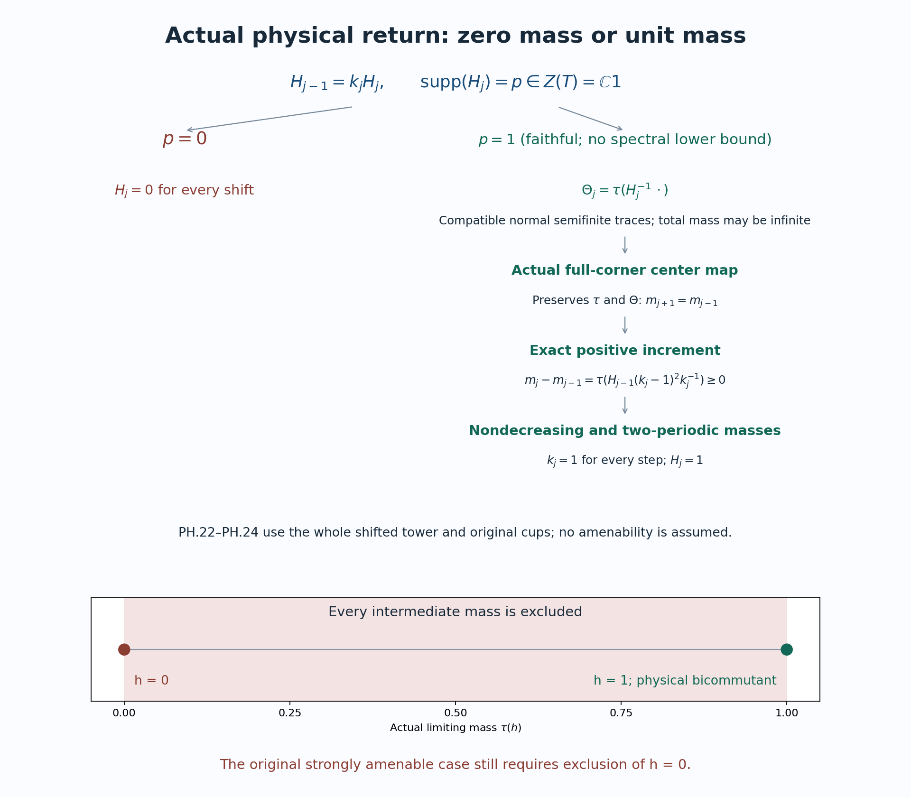

**Figure PH.6.** All arrows refer to the actual shifted limits and original cups. The nonzero support is one, but the proof allows its density to have zero in its spectrum. The reciprocal traces can have infinite total mass; only the finite weights of individual atoms are transported. Two-step periodicity and the nonnegative increment (PH.83) force constant products. The final endpoints are the proved structural alternatives, without asserting that the zero branch occurs under original strong amenability. The numerical increment in Exercise PH.14 illustrates why strict growth is incompatible with the actual two-step return. Source context: Popa, §§1.4.3 and 4.5.1, with the exact physical corner, Markov cup-factor and return-density proofs linked above. The proof, solutions and diagram are independently authored, CC0 1.0. [Full-size diagram](figures/physical-return-zero-one-law.svg); [reproducible source](figures/physical-return-zero-one-law.py).

**Exercise PH.14 — positive growth cannot complete a two-step return.** On a two-point probability space with equal weights, let \(k=(1/2,3/2)\) and let the previous limit be the scalar \(a=1/4\). Compute the mean of \(a/k\) and the increment in (PH.83). Can these scalar data participate in a faithful actual shifted limit with two-step periodic mass?

**Solution.** The next values are \(1/2,1/6\), with mean \(1/3\), so the increment is \(1/12\). Equivalently
\[
\frac14\left(\frac12\cdot\frac12
+\frac12\cdot\frac16\right)=\frac1{12}.
\]
A further nonnegative increment cannot return the mass from \(1/3\) to \(1/4\). Hence these data cannot give that faithful physical return. They test the positive identity and are not a construction of a Jones tower.

**Exercise PH.15 — numerical atomic data and actual realization.** Reconsider Exercise PH.9, with \(p=(1/2,1/3,1/6)\) and \(d=(1,2,3)\). Is its computed mass \(17/54\) realizable as the actual physical return limit? Explain the distinction from the sharp central comparison PH.16.

**Solution.** No. The mass lies strictly between zero and one, which PH.24 excludes in the actual tower. The arithmetic in PH.9 is the correct evaluation of the coefficient formula for those hypothetical data. PH.16 characterizes a central completely positive comparison for a factor sitting in a finite algebra; that comparison alone does not assert that the algebra arises as this physical commutant return. PH.24 uses the additional whole shifted tower and both actual corner traces.

**Exercise PH.16 — faithful need not be bounded below.** On the commutative algebra of bounded sequences, give atom \(n\geq1\) trace \(2^{-n}\), and set \(H(n)=2^{-n}\). Compute its support, lower spectral bound, trace and reciprocal trace of one. Why does PH.24 not permit it as an actual surviving limit?

**Solution.** The support is one, but the lower spectral bound is zero. The trace is
\[
\begin{gathered}
\tau(H)=\sum_{n\geq1}4^{-n}=\frac13,\\
\tau(H^{-1})=\sum_{n\geq1}1=\infty.
\end{gathered}
\]
The reciprocal trace is normal and semifinite: every finite set of atoms has finite reciprocal trace, and such sets increase to one. Thus normalizing the total reciprocal trace would be invalid. PH.22–PH.23 instead transports weights on individual atoms and proves periodicity before using faithfulness. This abstract density has partial positive mass and cannot satisfy all the actual shifted return identities required by PH.24.

### The physical two-step shift and bilateral cup commutant

A forward shift of the original tower has a different trace behavior from a reflection into its opposite model. The former can be constructed with the physical trace even when the inclusion is nonextremal. We give its full supported-row construction before applying it to a generating tunnel.

Keep the ordinary integer convention: \(e_k\in M_{k+1}\), with \(e_kx e_k=E_{M_{k-1}}(x)e_k\) for \(x\in M_k\), and \(d=[M:N]>1\), \(\lambda=d^{-1}\). For all integers \(i\leq j\), put
\[
\begin{gathered}
A_{ij}=M_i'\cap M_j,\\
R_j=\left(\bigcup_{i\leq j}A_{ij}\right)'',\\
\mathcal R=\left(\bigcup_j R_j\right)'',\\
L_i=\{e_k:k\leq i-1\}'',\\
K_i^+=\{e_k:k\geq i\}''.
\end{gathered}
\tag{PH.85}
\]
All closures and norms use the actual trace in \(T\). In particular \(R_j\subset M_j\), whereas \(\mathcal R\subset T\). Both half-cup algebras in (PH.85) are unital II₁ factors: the Markov word argument and faithful path identification in [50.5](relative-tensor-absorption.md), with [11.1–11.5](tail-inclusions.md), apply at every integer and in either orientation. They also identify \(L_i\subset L_{i+1}\subset L_{i+2}\) as the tracial Jones triple with cup \(e_{i+1}\) and index \(d\). This uses only the ordinary scalar cup expectations and does not assume factoriality of \(R_j\).

**PH.25 — full matrix corners give the finite shift.** Choose a partial orthonormal basis \((m_r)_{r=1}^q\) for \(L_{i+1}\) over \(L_i\), with support projections \(p_r\in L_i\), using [3.2](finite-bases-and-positive-index.md). Thus
\[
\begin{gathered}
q\leq\lfloor d\rfloor+1,\quad \|m_r\|\leq\sqrt d,\\
E_{L_i}(m_r^*m_s)=\delta_{rs}p_r,\\
\sum_r m_r e_{i+1}m_r^*=1,\\
\sum_r\tau(p_r)=d.
\end{gathered}
\tag{PH.86}
\]
Write \(f=\operatorname{diag}(p_r)\). For every \(j\geq i\), define
\[
\begin{gathered}
c_{ij}=e_{i+1}e_{i+2}\cdots e_{j+1},\\
v_r^{ij}=d^{(j-i)/2}m_r c_{ij},\\
\Phi_{ij}:f\operatorname{Mat}_q(M_j)f\\
\longrightarrow M_{j+2},\\
\Phi_{ij}(x)=\sum_{r,s}v_r^{ij}x_{rs}(v_s^{ij})^*.
\end{gathered}
\tag{PH.87}
\]
This is an onto normal *-isomorphism, with the entire corner retained. Its trace is
\[
\tau(\Phi_{ij}(x))=\lambda\sum_r\tau(x_{rr}).
\tag{PH.88}
\]
The corner unit has this trace equal to one. The induced relative-commutant map is the trace-preserving onto *-isomorphism
\[
\begin{gathered}
\theta_{ij}:A_{ij}\longrightarrow A_{i+2,j+2},\\
\theta_{ij}(z)=\Phi_{ij}(\operatorname{diag}(zp_r)).
\end{gathered}
\tag{PH.89}
\]

**Proof.** First \(E_{M_i}|_{L_{i+1}}=E_{L_i}\). Indeed the word reduction for \(W^*(L_i,e_i)\) reduces to elements of \(L_i\) and terms \(a e_i b\), \(a,b\in L_i\). The physical expectation sends the latter to \(\lambda ab\), just as the Markov cup-factor expectation does. Bounded approximation and normality extend this equality to the closure. In particular the Gram identities (PH.86) hold with \(E_{M_i}\).

Successive adjacent-cup reductions give
\[
\begin{gathered}
c_{ij}c_{ij}^*=\lambda^{j-i}e_{i+1},\\
(v_r^{ij})^*v_s^{ij}=\delta_{rs}p_r e_{j+1},\\
\sum_r v_r^{ij}(v_r^{ij})^*=1.
\end{gathered}
\tag{PH.90}
\]
For the middle equality, compress \(m_r^*m_s\in M_{i+1}\) first by \(e_{i+1}\), obtaining \(\delta_{rs}p_r e_{i+1}\); move \(p_r\in M_i\) through all subsequent cups and reduce the remaining chain. There are exactly \(j-i\) factors \(\lambda\), canceled by the two row normalizations. The final equality follows from the first and (PH.86).

The last cup \(e_{j+1}\) commutes with \(M_j\). The row equations therefore prove multiplicativity, preservation of the adjoint, and unitality of (PH.87). The original full corner is \(e_{j+1}M_{j+2}e_{j+1}=M_j e_{j+1}\). For \(y\in M_{j+2}\), its inverse matrix is the unique matrix \(x\) satisfying
\[
x_{rs}e_{j+1}=(v_r^{ij})^*y v_s^{ij}.
\tag{PH.91}
\]
These entries belong to \(p_rM_jp_s\); uniqueness, boundedness and normality follow from the faithful normal full-corner identification. Equations (PH.90) reconstruct \(y\), proving the full range and the normal inverse. Tracial cyclicity and \(\tau(a e_{j+1})=\lambda\tau(a)\), \(a\in M_j\), prove (PH.88).

For entries in \(M_i\), moving them through the cup chain shows that \(\Phi_{ij}\) restricts to \(\Phi_{ii}\). Hence it maps \(f\operatorname{Mat}_q(M_i)f\) onto \(M_{i+2}\). The full-corner commutant theorem [31.2](compactness-and-relative-commutants.md) identifies the commutant of this matrix corner inside \(f\operatorname{Mat}_q(M_j)f\) with \(A_{ij}\), by the diagonal map in (PH.89). The projection \(f\) is full because \(M_i\) is a factor and \(f\ne0\). Thus (PH.89) is onto the exact stated relative commutant. Finally \(z\in A_{ij}\) commutes with the unital factor \(M_i\), so \(\tau(zp_r)=\tau(z)\tau(p_r)\), by uniqueness of its normal trace. Equations (PH.86) and (PH.88) prove preservation of the physical trace. \(\square\)

**PH.26 — compatibility, normal extension and mixing.** The maps (PH.89) agree under both inclusions \(A_{ij}\subset A_{i,j+1}\) and \(A_{ij}\subset A_{i-1,j}\). They yield a normal trace-preserving automorphism
\[
\begin{gathered}
\theta:\mathcal R\longrightarrow\mathcal R,\\
\theta(A_{ij})=A_{i+2,j+2},\\
\theta(R_j)=R_{j+2},\\
\theta(e_k)=e_{k+2}.
\end{gathered}
\tag{PH.92}
\]
For \(a,b\in\mathcal R\) it is mixing:
\[
\lim_{n\to\infty}\tau(a\theta^n(b))=\tau(a)\tau(b).
\tag{PH.93}
\]

**Proof.** Changing the basis in (PH.86) does not change (PH.89). If \((n_s)\) is another such basis, write \(n_s=\sum_r m_r a_{rs}\), where \(a_{rs}=E_{L_i}(m_r^*n_s)\in L_i\). The two reconstruction identities say that this coefficient matrix is a partial unitary between their support-diagonal corners. Each \(a_{rs}\) commutes with \(z\in A_{ij}\) and with every cup in \(c_{ij}\). Substitution and cancellation of the two support matrices prove equality of the two formulas, including a fractional last support.

For compatibility in \(j\), expand (PH.89) using (PH.87). Every \(z\in M_j\) commutes with \(e_{j+1}\) and \(e_{j+2}\). In the formula at \(j+1\), reducing \(e_{j+1}e_{j+2}e_{j+1}\) contributes \(\lambda\). This cancels the extra factor \(d\), giving exactly the formula at \(j\).

For compatibility in \(i\), choose a basis \((n_s)\) of \(L_i\) over \(L_{i-1}\). Its dual basis for \(L_{i+1}\) over \(L_i\) is \(m_s=\sqrt d\,n_s e_i\), with the same supports, by the finite dual-basis calculation in [3.2](finite-bases-and-positive-index.md) and [63.11](canonical-rescaling-of-jones-cups.md). Inserting this basis in (PH.87) replaces \(m_s c_{ij}\) by \(\sqrt d\,n_s c_{i-1,j}\). Its squared extra normalization is precisely the factor between \(d^{j-i}\) and \(d^{j-i+1}\). Thus the two formulas coincide on \(A_{ij}\). Basis independence proves compatibility for every choice.

The algebraic union of the \(A_{ij}\) is directed by decreasing the lower index and increasing the upper index. The compatible trace-preserving maps and their inverses on the shifted union extend by their GNS unitary to inverse normal maps on \(\mathcal R\). This proves the first three assertions in (PH.92). To check the cups, use \(e_k\in A_{k-1,k+1}\). In this case the chain is \(e_k e_{k+1}e_{k+2}\). Adjacent reduction in the expression with middle entry \(e_k\) gives \(\lambda^2e_k e_{k+2}\). The factor \(d^2\) cancels it; the basis identity \(\sum_r m_r e_km_r^*=1\), with \(m_r\in L_k\), leaves exactly \(e_{k+2}\).

For mixing, first take \(a,b\in A_{ij}\). If \(i+2n\geq j\), then \(\theta^n(b)\) commutes with the whole factor \(M_j\), while \(a\in M_j\). The normal functional obtained by pairing with \(\theta^n(b)\) restricts to a scalar multiple of the unique trace on \(M_j\). Consequently the equality in (PH.93) already holds for every such \(n\). For arbitrary \(a,b\in\mathcal R\), approximate both in \(L^2\) by one sufficiently large \(A_{ij}\). Cauchy–Schwarz and the \(L^2\) isometry of \(\theta\) bound the two approximation errors uniformly in \(n\). Let the errors tend to zero. This proves (PH.93), without separability of the original ambient factor. \(\square\)

**PH.27 — lower-cup return and the entire bilateral commutant.** If \(x\in R_j\) commutes with every \(e_k\), \(k\leq j-1\), then
\[
\theta(x)e_{j+1}=x e_{j+1}.
\tag{PH.94}
\]
Moreover
\[
\{e_k:k\in\mathbb Z\}'\cap\mathcal R=\mathbb C1.
\tag{PH.95}
\]
In particular \(\mathcal R\) is a factor. This does not assert factoriality of an individual \(R_j\).

**Proof.** Fix \(\varepsilon>0\) and choose \(i\leq j-2\) with \(x_i=E_{A_{ij}}(x)\) satisfying \(\|x-x_i\|_2<\varepsilon\). Bimodularity makes \(x_i\) commute with \(e_{i+1},\ldots,e_{j-1}\). Both \(x_i\) and \(x\) commute with \(e_{j+1}\); their shifted images do also. Compressing (PH.87) on both sides by this last cup, the two end reductions and these finite commutations give
\[
\begin{gathered}
\theta(x_i)e_{j+1}\\
=\left(\sum_r m_r x_i e_{i+1}m_r^*\right)e_{j+1}.
\end{gathered}
\tag{PH.96}
\]
Here the chain reductions contribute \(\lambda^{j-i}\), canceling the normalization. The element \(x\) commutes with \(m_r\in L_{i+1}\), since these are generated by cups of index at most \(i\). Therefore
\[
\begin{gathered}
\|\theta(x)e_{j+1}-x e_{j+1}\|_2\\
\leq (2+2qd)\varepsilon.
\end{gathered}
\tag{PH.97}
\]
Indeed the two approximation errors cost at most \(2\varepsilon\); the difference between the sum in (PH.96) and \(x_i\) is \(\sum_r[m_r,x_i]e_{i+1}m_r^*\). Its norm is at most \(2\varepsilon\sum_r\|m_r\|^2\leq2qd\varepsilon\). The bound is independent of the chosen lower index. Letting \(\varepsilon\) decrease proves (PH.94).

Now take \(z\) in the commutant in (PH.95), with \(\tau(z)=0\), and put \(z_j=E_{R_j}(z)\). Then \(z_j\to z\) in \(L^2\), \(\tau(z_j)=0\), and \(z_j\) commutes with every lower cup through \(j-1\). For any such lower-cup-commuting \(x\in R_j\), the difference \(z-x\) commutes with \(K_{j+1}^+\), while \(z-\theta(x)\) commutes with \(L_{j+2}\). Both are unital factors containing \(e_{j+1}\). The scalar normal trace of a unital factor gives the exact identities
\[
\begin{gathered}
\|(z-x)e_{j+1}\|_2^2\\
=\lambda\|z-x\|_2^2,\\
\|(z-\theta(x))e_{j+1}\|_2^2\\
=\lambda\|z-\theta(x)\|_2^2.
\end{gathered}
\tag{PH.98}
\]
For example, pair the cup with the commuting positive element \((z-x)^*(z-x)\); its trace pairing on the factor is a scalar multiple of that factor's trace. Equation (PH.94) makes the two left sides of (PH.98) equal. Iterating, since \(\theta^n(x)\) has the same lower-cup commutations at the shifted cutoff, gives
\[
\|z-\theta^n(z_j)\|_2=\|z-z_j\|_2.
\tag{PH.99}
\]
Mixing (PH.93) and \(\tau(z_j)=0\) now imply
\[
\begin{gathered}
2\|z_j\|_2^2\\
=\lim_n\|z_j-\theta^n(z_j)\|_2^2,\\
2\|z_j\|_2^2\leq4\|z-z_j\|_2^2.
\end{gathered}
\tag{PH.100}
\]
The second line follows from (PH.99) and the triangle inequality. Let \(j\to\infty\). Its right side tends to zero and its left side to \(2\|z\|_2^2\); hence \(z=0\). Subtracting the scalar trace proves (PH.95). A central element of \(\mathcal R\) commutes with all its cups, so the center is scalar. \(\square\)

**PH.28 — the whole physical specialization for a generating tunnel.** Suppose the original tunnel is generating, namely \(R_0=M\). Then \(R_j=M_j\) for every integer \(j\), \(\mathcal R=T\), and (PH.92) is a mixing normal trace-preserving automorphism of the original entire completion. In particular
\[
\begin{gathered}
\theta(M_j)=M_{j+2},\\
\theta(B_j)=B_{j+2},\\
\theta(D_j)=D_{j+2}.
\end{gathered}
\tag{PH.101}
\]
For the actual expected returns and their physical densities from PH.9–PH.12,
\[
\begin{gathered}
\theta\circ E_j=E_{j+2}\circ\theta,\\
\theta(k_j)=k_{j+2},\\
j\geq0,\\
\theta(H_j)=H_{j+2},\\
j\geq-1.
\end{gathered}
\tag{PH.102}
\]
Thus the full original bicommutant question can be studied in this physical mixing system. These identities do not exclude the zero-return alternative in PH.24.

**Proof.** For \(j\geq0\), the algebra \(R_j\) contains \(R_0=M\) and all upper cups through \(e_{j-1}\). They generate \(M_j\), so equality holds. For \(j<0\), the physical expectation onto \(M_j\) sends \(A_{i0}\) into \(A_{ij}\) whenever \(i\leq j\), by \(M_i\)-bimodularity. Normality and \(R_0=M\) therefore give \(M_j\subset R_j\), proving equality in the other direction too. Taking upper closures gives \(\mathcal R=T\). Normal onto maps preserve relative commutants, proving (PH.101).

The original cup identity (PH.92) transports the exact full corner defining \(E_j\) to the corner defining \(E_{j+2}\). Uniqueness of the compression coefficient in PH.9 gives the first equality in (PH.102). Preservation of \(\tau\) and the defining equality \(\tau(E_j(x))=\tau(k_jx)\) then identify the unique trace density as \(k_{j+2}\). Finally \(\theta(L_{j,l})=L_{j+2,l+2}\) for the products in (PH.74). A trace-preserving normal automorphism preserves spectral measures and convergence in measure. Uniqueness of the limits in PH.22 proves the last line of (PH.102). No reflected trace, changed cup, or opposite identification has entered this argument. The zero family of limits obeys the same covariance, so this construction alone cannot prove its exclusion under the original amenability hypotheses. \(\square\)

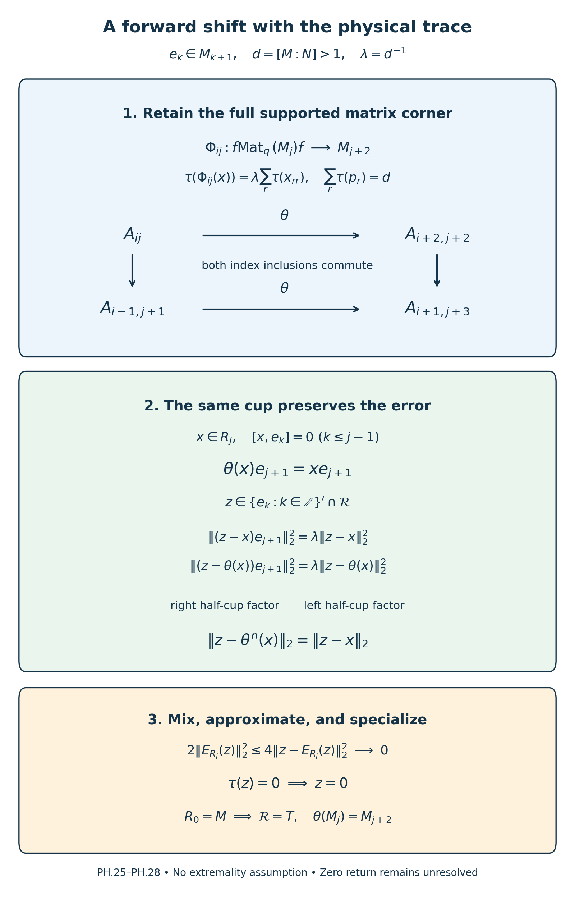

**Figure PH.7.** The corner unit and normalization in the first panel are the full supported matrices of PH.25, including a possible fractional support. The two index arrows express the compatibilities proved in PH.26. The middle panel shows the mechanism of PH.27: multiplication by the same actual cup retains the error, each half-cup factor gives the exact factor \(\lambda\) in its squared norm, and mixing forces the centered bilateral commutant to vanish. The last box specializes to the whole physical completion under a generating tunnel; it does not assert exclusion of \(H_j=0\). Human-source context: Sorin Popa, [*Some properties of the symmetric enveloping algebra of a subfactor, with applications to amenability and property T*](https://ems.press/content/serial-article-files/25850), Documenta Mathematica 4 (1999), 665–744, Theorem 4.10(a), pp.695–697. The full finite-corner construction, exposition, exercises and diagram here are independently authored, CC0 1.0. [Full-size figure](figures/bilateral-cup-shift.svg); [reproducible source](figures/bilateral-cup-shift.py).

**Exercise PH.17 — the fractional support remains part of the map.** At \(d=9/2\), use four full supports and one support of trace \(1/2\) in (PH.86). Compute the trace of \(f\) with the unnormalized matrix trace and with the trace of (PH.88). For \(j-i=3\), give the row multiplier and the cup-chain squared multiplier. What happens if the fractional support is discarded?

**Solution.** The unnormalized matrix trace is \(4+1/2=9/2\); multiplying by \(\lambda=2/9\) gives one. The row multiplier is \((9/2)^{3/2}\), whose square cancels the chain multiplier \((2/9)^3=8/729\). Discarding the last support leaves normalized trace \(8/9\). It cannot give an onto unital corner map. The unused part is genuine mathematical data.

**Exercise PH.18 — a finite approximation forces a numerical commutant bound.** For a centered \(z\) commuting with every cup, suppose \(\|z-E_{R_j}(z)\|_2\leq1/100\). Bound \(\|E_{R_j}(z)\|_2\) and \(\|z\|_2\) using (PH.100) and orthogonality of a tracial conditional expectation. Explain why the bound implies (PH.95) as the approximation improves.

**Solution.** Equation (PH.100) gives \(\|E_{R_j}(z)\|_2\leq\sqrt2/100\). The expectation is the orthogonal \(L^2\) projection, so
\[
\begin{gathered}
\|z\|_2^2\leq\\
\frac{2}{10000}+\frac1{10000}\\
=\frac3{10000}.
\end{gathered}
\tag{PH.103}
\]
Thus \(\|z\|_2\leq\sqrt3/100\). The same bound holds with \(1/100\) replaced by every positive approximation error, which tends to zero. Therefore every centered element of the commutant is zero.

**Exercise PH.19 — forward covariance and a reflected trace are different requirements.** Does (PH.102) identify the original tower with its actual opposite model? Does covariance of \(H_j\) prove that the physical return is nonzero?

**Solution.** Neither conclusion follows. The map constructed here is a *-automorphism of the original envelope moving both ordinary endpoints forward by two. Its matrix trace is explicitly (PH.88). The opposite comparison has a different source and target and must carry the appropriate cups and traces; the nonextremal obstructions in 63.9 and MCF remain applicable to that comparison. Also the family \(H_j=0\) satisfies (PH.102). PH.24 leaves exactly this branch to be excluded at the original unrestricted amenability hypotheses. A mixing shift is a proved interface, not that missing exclusion.

### Physical bicommutants for weighted group models

For balanced-word models one can prove the physical bicommutant directly, retaining unequal weights. The important input is factoriality of the actual balanced half, rather than a comparison with an opposite trace. Factoriality gives zero endpoint entropy; this transfers to the other phase and to inverse walks. Both directions of mixing then follow, and they determine the entire commutants.

Here is the precise class. Let \(G\) be the group generated by a finite list \(x_0=1,x_1,\ldots,x_{r-1}\), with \(r\geq2\), and let \(\chi:G\to\mathbb R_{>0}\) be a homomorphism. Repeated labels are permitted. Define
\[
\begin{gathered}
A=\sum_i\chi(x_i),\\
B=\sum_i\chi(x_i)^{-1},\\
a_i=\chi(x_i)/A,\\
b_i=\chi(x_i)^{-1}/B,\\
d=AB,\quad\lambda=d^{-1},\\
a_i b_i=\lambda.
\end{gathered}
\tag{PH.104}
\]
Give odd sites the diagonal probability vector \(a\), even sites the vector \(b\), and write \(w_j\) for the vector at site \(j\). For a word \(u\) on \([s,t]\), its ordered charge is \(c(u)=\prod_{j=s}^t x_{u_j}^{\epsilon_j}\), with \(\epsilon_j=-1\) on odd sites and \(+1\) on even sites. Let \(C_{[s,t]}\) be the full matrix-block algebra spanned by \(E_{uv}\) with \(c(u)=c(v)\). The weight of each diagonal word is
\[
\begin{gathered}
\tau(E_{uu})=A^{-n_o}B^{-n_e}\\
\cdot\chi(c(u))^{-1}.
\end{gathered}
\tag{PH.105}
\]
Equal-charge minimal projections have equal strictly positive weights. Thus the restricted product state is a faithful trace, and the identity embeddings at both ends preserve it. Complete the whole finite interval union in this trace, calling the resulting finite algebra \(T_G\), and put
\[
\begin{gathered}
\mathsf P_t=\\
\left(\bigcup_{s\leq t}C_{[s,t]}\right)'',\\
\mathsf Q_s=\\
\left(\bigcup_{t\geq s}C_{[s,t]}\right)''.
\end{gathered}
\tag{PH.106}
\]
An empty interval means the scalar algebra. These are actual tracial closures of the displayed matrices. Their factoriality is a mathematical condition, not a consequence of calling them halves.

We use the full finite-marked-step entropy proof [AB.4](#ab-4-a-finite-marked-step-entropy-criterion-with-its-full-proof), including its decreasing conditional-probability argument. The onto center/tail mechanism is the one proved in [FWT.7](#fwt-7-return-to-the-actual-two-tracial-af-core-centers); we verify its general application below. Finite Markov cup factors and their bases are [11.1–11.5](tail-inclusions.md), [50.5](relative-tensor-absorption.md), and [3.2](finite-bases-and-positive-index.md). Full-corner recognition and the original basic-construction trace keep their exact existing proofs, [31.2](compactness-and-relative-commutants.md) and [63.8](canonical-rescaling-of-jones-cups.md).

**PH.29 — one factorial half controls all four endpoint laws.** If \(\mathsf P_0\) is a factor, then the two phase laws
\[
\begin{gathered}
\alpha=\sum_i a_i\delta_{x_i^{-1}},\\
\beta=\sum_i b_i\delta_{x_i},\\
p=\alpha*\beta,\qquad q=\beta*\alpha
\end{gathered}
\tag{PH.107}
\]
and their inverse laws \(\check p(g)=p(g^{-1})\), \(\check q(g)=q(g^{-1})\) have sublinear endpoint entropy. The entire completed marked endpoint tail is trivial for each law. In particular, for \(\rho\) equal to any of these four laws and every fixed \(g\in G\),
\[
\begin{gathered}
\|\delta_g*\rho^{*n}-\rho^{*n}\|_1\longrightarrow0,\\
\|\rho^{*n}*\delta_g-\rho^{*n}\|_1\longrightarrow0.
\end{gathered}
\tag{PH.108}
\]
The norm is the full sum of absolute differences; no factor \(1/2\) is included.

**Proof.** First identify the entire center of \(\mathsf P_0\). Read pairs from the right edge towards negative infinity. A pair has charge law \(p\), but its inverse endpoint, in this reading order, is the right product of independent marks with law \(\check p\). If the successive pair charges are \(Y_1,Y_2,\ldots\), the finite interval charge is \(Y_n\cdots Y_1\), whose inverse is \(Y_1^{-1}\cdots Y_n^{-1}\). Retain each ordered pair of original labels as the mark, even when two marks have the same group endpoint.

A central element has central trace expectations in every finite algebra \(C_{[-2n+1,0]}\). Each expectation is scalar on each whole charge block, hence lies in the word diagonal and is a function of that interval's endpoint. Its bounded \(L^2\) limit is measurable with respect to the endpoint and all unused pair marks at every cutoff. Conversely, a bounded function in this completed marked endpoint tail has conditional expectation on the first \(n\) pairs depending only on their endpoint: the unused marks are independent, and the tail function is measurable in the endpoint-future sigma algebra. These expectations are bounded central matrices in \(C_{[-2n+1,0]}\). They converge in \(L^2\) to an element commuting with each earlier finite matrix algebra. This proves an onto normal trace-preserving identification of the whole center with the whole marked endpoint tail. It neither drops hidden choices within a pair nor restricts to stationary harmonic functions.

Factoriality therefore makes this tail trivial for the \(\check p\) walk. Write \(Z_n\) for its right endpoint, \(Q_1\) for its first finite mark, and \(h_n=H(Z_n)\). The unconditional entropy identity proved in AB.4 is
\[
\begin{gathered}
h_n-h_{n-1}=I(Q_1;Z_n),\\
H(Q_1\mid\mathscr T_n)\\
=H(Q_1)-h_n+h_{n-1}.
\end{gathered}
\tag{PH.109}
\]
Decreasing conditional probabilities converge to those on the trivial tail. Entropy of a finite probability vector is bounded and continuous, so the conditional entropy in (PH.109) tends to \(H(Q_1)\). Thus \(h_n-h_{n-1}\to0\), and telescoping gives \(h_n/n\to0\). This direction does not assume the entropy hypothesis of AB.4; it uses its unconditional identity and the now-proved tail triviality.

Inverting a discrete law permutes its probabilities. Moreover
\[
\begin{gathered}
H(p^{*n})=H(\check p^{*n}),\\
q^{*n}=\beta*p^{*(n-1)}*\alpha,\\
H(q^{*n})\leq H(\beta)\\
+H(p^{*(n-1)})+H(\alpha).
\end{gathered}
\tag{PH.110}
\]
The last inequality follows because the product of three independent group variables is a function of their joint value. All entropies are finite here. It follows that \(p,q,\check p,\check q\) have sublinear endpoint entropy. Apply AB.4 with the one-point boundary, whose equivariance and independent-suffix conditions are automatic. This proves triviality of the entire completed marked endpoint tail for all four walks.

For clarity, derive the required mixing from that conclusion. Fix a marked word \(v\) of length \(k\), endpoint \(g\), and positive probability \(t_v\), for a walk of law \(\rho\). Let \(\varepsilon_{n,v}\) be the \(L^1\) distance of \(\mathbb E(1_{\{v\}}\mid\mathscr T_{n+k})\) from the constant \(t_v\). Independence of the remaining marks gives the exact identity
\[
\begin{gathered}
\varepsilon_{n,v}/t_v\\
=\|\delta_g*\rho^{*n}-\rho^{*(n+k)}\|_1.
\end{gathered}
\tag{PH.111}
\]
It follows by multiplying the conditional probability by the endpoint mass and summing; zero endpoint masses contribute zero on both sides. The left side tends to zero by the trivial tail. Each phase law has positive identity mass, and its support contains every \(x_i\) and \(x_i^{-1}\). Thus every \(g\in G\) is a positive-probability endpoint of some finite marked word. For that same length \(k\), the all-identity word has positive probability and gives \(\|\rho^{*n}-\rho^{*(n+k)}\|_1\to0\). The triangle inequality proves left mixing. Applying this to \(\check\rho\), then inverting endpoints, proves right mixing. This retains each original probability law; inversion is used only to transfer entropy and the norm identity, not to identify two physical traces. \(\square\)

**PH.30 — all finite and infinite commutants.** Under the factoriality hypothesis of PH.29, all the halves in (PH.106) and \(T_G\) are hyperfinite II₁ factors. For every finite cut,
\[
\begin{gathered}
\mathsf P_c'\cap\mathsf P_t=C_{[c+1,t]},\\
c\leq t,\\
\mathsf Q_c'\cap\mathsf Q_s=C_{[s,c-1]},\\
s\leq c,\\
\mathsf P_c'\cap T_G=\mathsf Q_{c+1},\\
\mathsf Q_s'\cap T_G=\mathsf P_{s-1}.
\end{gathered}
\tag{PH.112}
\]
In particular the entire physical bicommutant of each left half is itself.

**Proof.** End partial trace preserves the balanced algebras. Indeed equal removed labels cancel from the ordered charge equality, and unequal removed labels have zero weighted partial trace. Its restriction is the actual tracial expectation onto the shorter interval algebra.

Let \(x\in\mathsf P_c'\cap\mathsf P_t\), and set \(x_s=E_{C_{[s,t]}}(x)\) for \(s\leq c\). Bimodularity makes it commute with the whole prefix algebra \(C_{[s,c]}\). Central prefix projections first exclude distinct prefix charges. Within a fixed prefix charge \(g\), commutation with its full matrix algebra forces identity on that matrix factor. Canceling \(g\) in the residual charge equality leaves exactly the suffix balance condition. Consequently
\[
\begin{gathered}
x_s=\bigoplus_g 1_{n_g}\otimes f_s(g),\\
f_s(g)\in C_{[c+1,t]},\\
\|f_s(g)\|\leq\|x\|.
\end{gathered}
\tag{PH.113}
\]
Extending the left prefix by \(2n\) sites and taking its actual weighted trace gives
\[
\begin{gathered}
f_s(g)=\\
\sum_h\rho^{*n}(h)f_{s-2n}(hg),
\end{gathered}
\tag{PH.114}
\]
where \(\rho=p\) or \(q\) according to the starting parity. This is an equality of finite suffix matrices, with the physical pair probabilities of (PH.107).

For two fixed reachable charges \(g,g'\) at the chosen cutoff, extend the deeper bounded field by zero off its reachable set. Every point charged by either sum is reachable, because concatenating the corresponding actual words realizes it. Subtracting (PH.114) therefore bounds \(\|f_s(g)-f_s(g')\|\) by \(\|x\|\) times the full distance between \(\rho^{*n}*\delta_g\) and \(\rho^{*n}*\delta_{g'}\). This tends to zero by (PH.108). Thus \(f_s\) is exactly constant, and \(x_s\) lies in the single fixed suffix algebra. Let \(s\to-\infty\). The expectations converge to \(x\) in physical \(L^2\), so \(x\) belongs to that finite-dimensional algebra. The reverse inclusion follows from disjoint supports. This proves the first line of (PH.112), including \(c=t\), when the suffix is empty and the center is scalar.

For the second line, take finite right-interval expectations of an element commuting with \(\mathsf Q_c\). The same prefix/suffix block argument now leaves a bounded field on suffix charges. Extending to the right multiplies these charges on the right. Its two comparison laws are the left translates of the phase convolution powers. Left mixing in (PH.108) makes the field constant, giving exactly \(C_{[s,c-1]}\). The empty-prefix case proves factoriality of every right half. This also explains why one direction of mixing alone was insufficient for the two full commutants.

For the third line, expectations onto \(\mathsf P_t\), \(t\geq c\), send a commuting element into \(C_{[c+1,t]}\), by the first line and bimodularity. They converge to that element in \(L^2(T_G)\), since the union of the left halves contains every finite interval. Its limit belongs to \(\mathsf Q_{c+1}\); disjoint support gives the reverse inclusion. Expectations onto the increasing right halves as \(s\to-\infty\), using the second line, prove the fourth line. These are normal physical expectations throughout.

The finite interval algebras provide countable finite-dimensional approximating unions. Every diagonal word projection has positive trace at most \((\max_i\{a_i,b_i\})^n\) on an interval of length \(n\); this tends to zero, because all weights are positive and \(r\geq2\). Thus the half factors are infinite dimensional and diffuse. A central element of \(T_G\) has scalar expectations onto each left factor, hence is scalar. This proves the factor and type II₁ assertions and hyperfiniteness. \(\square\)

**PH.31 — actual Jones towers and exclusion of zero return in this class.** Define the projection at sites \(j,j+1\) by
\[
\begin{gathered}
\Omega_j=\sum_i\sqrt{w_j(i)}\,|i,i\rangle,\\
e_j=|\Omega_j\rangle\langle\Omega_j|.
\end{gathered}
\tag{PH.115}
\]
Then the factors \(M_j=\mathsf P_j\) form an ordinary two-sided Jones tower, with these actual projections, physical trace and consecutive index \(d\). Its lower tunnel is generating, its canonical upward tracial completion is exactly \(T_G\), and
\[
\begin{gathered}
B_j=\mathsf Q_{j+1},\\
D_j=M_j,\\
k_j=1,\qquad H_j=1.
\end{gathered}
\tag{PH.116}
\]
Thus the zero branch is excluded for the entire weighted balanced-word group class with factorial left completion. The factoriality assumption is automatic if the chosen finitely generated group has subexponential word-ball growth; in particular it is automatic for every finitely generated Abelian group and every positive character \(\chi\).

**Proof.** Each pair \((i,i)\) has identity charge, so (PH.115) is an actual balanced matrix projection, not a picture of one. The relation \(w_j(i)w_{j+1}(i)=\lambda\) gives the adjacent Jones relations directly by contraction of the three-site vectors; disjoint cups commute. The actual end partial trace gives \(E_{M_j}(e_j)=\lambda1\). Compressing a balanced matrix unit by \(e_j\) gives its physical expectation onto \(M_{j-1}\), multiplied by \(e_j\). Compressing a unit in an interval ending at \(j+1\) can survive only when both final label pairs are \((i,i)\) and \((k,k)\); their charges cancel, leaving exactly a balanced unit ending at \(j-1\). Bounded approximation consequently gives the entire corner
\(e_jM_{j+1}e_j=M_{j-1}e_j\).
Multiplication on \(M_{j-1}\) by the cup is faithful, since its trace pairing is \(\lambda\tau\).

There is also a full finite row in \(M_j\): the lower cups with their actual Markov trace form the unital Markov factors of 11.1–11.5 and 50.5. Their scalar Markov rule follows from the end partial trace just computed. Their finite basis from 3.2 supplies \(m_s\in M_j\) with \(\sum_s m_s e_jm_s^*=1\). The full-corner argument of 31.2 now proves \(M_{j+1}=W^*(M_j,e_j)\), retaining the whole unit. The standard-form identification in 63.8 applies to this exact compression, full row and scalar expectation. It identifies the triple with the ordinary tracial basic construction; its existing canonical trace normalization gives consecutive index \(\lambda^{-1}=d\). The normality, full-corner and trace-normalization hypotheses are exactly the ones verified above. The parameter is admissible for those Markov factors because Cauchy–Schwarz gives \(d=AB\geq r^2\geq4\).

The first line of (PH.112) identifies every actual lower relative commutant with the displayed finite interval algebra; their union is \(M_j\). Thus the ordinary tunnel is generating at every cut. The increasing union of the upper \(M_j\) generates all finite intervals with their original trace, so its canonical tracial completion is exactly \(T_G\). The last two lines of (PH.112) give \(B_j\) and \(D_j\). Original cup compression is then the original trace-preserving expectation, so PH.11 and PH.22 give the last line of (PH.116).

For the growth assertion, the endpoints of \(n\) marked pairs lie in the word ball of radius \(2n\) for the finite symmetric label set. Entropy is at most the logarithm of this finite cardinality. Subexponential growth therefore gives \(H(p^{*n})=o(n)\). AB.4 and the center/tail identification in PH.29 give factoriality of \(\mathsf P_0\), after which the whole theorem applies. For a finitely generated Abelian group, write it as a quotient of \(\mathbb Z^m\) using its finite generators. The ball has at most \((4n+1)^m\) elements, because a length-\(2n\) word has an exponent vector in \([-2n,2n]^m\). Its logarithm is \(O(\log n)\), proving the stated case without a symmetry assumption on the probabilities. \(\square\)

The group model in PG, with \(G=S_3\times\mathbb Z\), also has only linearly many possible endpoints at each depth. Both the explicit finite-convolution argument in PG2 and the entropy argument here prove its bicommutant equality. Its opposite-pair counterexample remains valid. This does not supply the unrestricted non-group bicommutant theorem. In the fixed WM problem, the balanced core center is the nontrivial full boundary from FWT.22–FWT.26; its original ambient II₁ factor must not be substituted for the factorial balanced half required here. None of the fixed WM data or invariant-state obligations is changed.

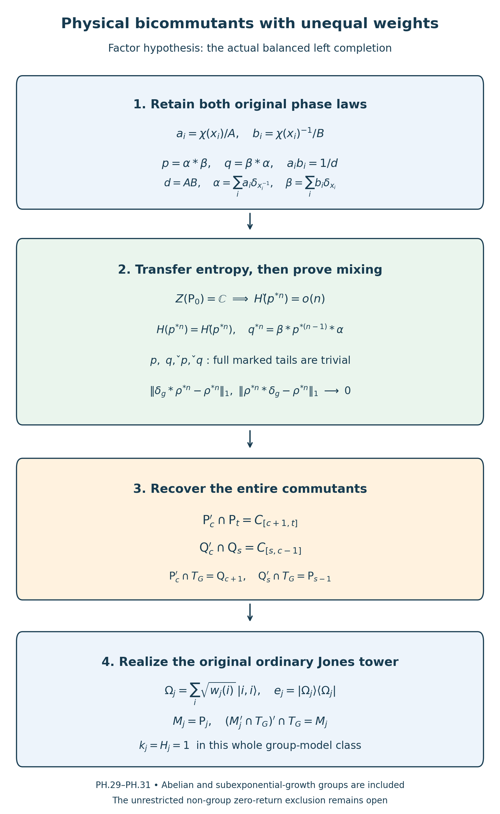

**Figure PH.8.** The first arrows retain the original two phase laws: inversion preserves endpoint entropy, and the displayed convolution transfers a sublinear bound to the other phase. AB.4 then gives the full marked tails, and the exact finite-word identity (PH.111) gives both directions of mixing. The lower boxes show the actual finite commutants and their normal physical limits, followed by the ordinary Jones realization with the same weights and cups. The factoriality condition belongs to the balanced half, and the unrestricted non-group zero-return problem remains outside this class theorem. Source context: Kaimanovich, *The Poisson formula for groups with hyperbolic properties*, Annals of Mathematics 152 (2000), 659–692, §§4–5, [author manuscript](https://arxiv.org/abs/math/9802132v2), through the complete internal AB.4 proof; Popa, *Classification of amenable subfactors of type II*, §§1.4 and 4.5, for the original physical bicommutant question. The proofs, solved exercises and diagram here are independently authored, CC0 1.0. [Full-size diagram](figures/weighted-group-bicommutants.svg); [reproducible source](figures/weighted-group-bicommutants.py).

**Exercise PH.20 — biased probabilities need both orientations.** Take \(G=\mathbb Z\), \(x_0=1,x_1=z\), \(\chi(z)=2\). Compute both site vectors, the index and the odd-even charge law. Prove the full physical bicommutant without replacing that law by a symmetric walk.

**Solution.** The site vectors are \(a=(1/3,2/3)\), \(b=(2/3,1/3)\), and \(d=9/2\). The odd-even law has masses \(4/9,4/9,1/9\) at \(-1,0,1\), hence drift \(-1/3\). Its inverse law has the opposite drift and is a distinct law. Every \(n\)-step endpoint lies in \([-n,n]\), so its entropy is at most \(\log(2n+1)=o(n)\). AB.4 makes the completed marked tail trivial. PH.29–PH.31 give the actual ordinary Jones tower and full physical bicommutant with these unequal weights. They do not equate its two probability laws or their physical traces.

**Exercise PH.21 — recover a whole matrix field.** Suppose the two right translates in (PH.114) have full \(\ell^1\) distance at most \(\varepsilon\), and \(\|x\|\leq3\). Bound \(\|f_s(g)-f_s(g')\|\). Explain why charges of zero physical probability do not require a new assumption.

**Solution.** Subtract the two sums and use \(\|f_{s-2n}\|\leq3\); the bound is \(3\varepsilon\). Every charge with positive mass in either sum is realized by concatenating actual words. Thus the same bounded field is defined on both supports. Its arbitrary zero extension elsewhere changes neither sum. Letting \(n\) increase proves equality of the full matrices, including their off-diagonal entries, rather than only equality of center traces.

**Exercise PH.22 — the factorial half is a specific algebra.** Does the fact that the original ambient factor of the fixed WM inclusion is II₁ make PH.31 apply to its balanced core? Does a positive character force the group walk to be symmetric?

**Solution.** No. PH.29 requires the left completion of the actual balanced matrix union to be a factor. The fixed WM core instead has the full nontrivial center identified in FWT.26. Its original ambient factor is a different algebra. Also Exercise PH.20 has a nontrivial positive character and an asymmetric walk. The proof transfers entropy to the inverse law and proves its needed mixing separately; it never assumes equality of the original trace systems. The original unrestricted bicommutant and fixed-WM invariant endpoint remain separate obligations.

### Scalar central multiplicity and the affine obstruction

A projection-valued central profile behaves more rigidly than a general positive density. We first prove the exact distinction, then apply it to the index-ten affine inclusion AH.1–AH.20. The counterexample concerns matrix deletions of one fixed actual core, with the original physical inclusion and trace. The bounded-frame property BF in [57.2](actual-supported-local-approximation.md) permits a new ordinary tunnel after the targets; the additional bridge BFQ.1–BFQ.4 treats that quantifier.

Use the actual joint centers and maps of [68.1–68.5](core-central-transition-bounds.md):

\[
\begin{gathered}
\begin{gathered}
U=Z(S),\\
 V=Z(R),\\
 D_0=U\vee V,\\
P_0=E_V,\\
 Q_\kappa=E_U(\kappa\,\cdot),\\
T=Q_\kappa P_0,\\
 d^{-1}\leq\kappa\leq b_d/d,\\
E_U\kappa=E_V\kappa=1,\\

b_d=1+d(\lceil d\rceil-1).
\end{gathered}\\
\text{(IRG.1)}
\end{gathered}
\]

The norm on the commutative joint algebra is its physical tracial norm. In particular, \(T\) is positive, unital and trace preserving; the two expectations and the weight are the original ones.

**Lemma IRG.1 — indicator rigidity.** For every projection \(z\in U\), with \(\beta=P_0z\),

\[
\begin{gathered}
\begin{gathered}
\|z-\beta\|_1=2\tau(z(1-\beta)),\\
\|z-Tz\|_1=2\tau(\kappa z(1-\beta)),\\
d^{-1}\|z-\beta\|_1
\leq\|z-Tz\|_1,\\
\|z-Tz\|_1\leq(b_d/d)\|z-\beta\|_1.
\end{gathered}\\
\text{(IRG.2)}
\end{gathered}
\]

For any \(\zeta\in L^1(U)_+\), any \(t\geq0\), and any projection \(z\in U\), put \(e_*=\|\zeta-tz\|_1\). Then

\[
\begin{gathered}
\begin{gathered}
\|\zeta-P_0\zeta\|_1\\
\leq d\|\zeta-T\zeta\|_1+2(d+1)e_*.
\end{gathered}\\
\text{(IRG.3)}
\end{gathered}
\]

**Proof.** Both \(\beta\) and \(Tz\) are positive contractions. Since \(z\) is a projection in the commutative algebra, for either such contraction \(y\) with \(\tau(y)=\tau(z)\),

\[
\begin{gathered}
\begin{gathered}
|z-y|=z(1-y)+(1-z)y,\\
\|z-y\|_1=2(\tau(z)-\tau(zy)).
\end{gathered}\\
\text{(IRG.4)}
\end{gathered}
\]

For \(y=\beta\), this gives the first identity of IRG.2. For \(y=Tz\), expectation adjointness and the smaller marginal give

\[
\begin{gathered}
\tau(zTz)=\tau(\kappa z\beta),\qquad
\tau(z)=\tau(\kappa z).\\
\text{(IRG.5)}
\end{gathered}
\]

This gives the second identity. Bounding the nonnegative function \(z(1-\beta)\) by the two original bounds on \(\kappa\) proves both inequalities.

The maps \(P_0,T\) contract \(L^1\): positivity gives \(|Fh|\leq F|h|\) for selfadjoint \(h\), and their trace preservation gives the norm estimate. Thus

\[
\begin{gathered}
\begin{aligned}
\|\zeta-P_0\zeta\|_1
&\leq2e_*+t\|z-P_0z\|_1\\
&\leq2e_*+dt\|z-Tz\|_1\\
&\leq d\|\zeta-T\zeta\|_1+2(d+1)e_*.
\end{aligned}\\
\text{(IRG.6)}
\end{gathered}
\]

All differences in this argument are selfadjoint and integrable. No uniform lower bound on \(\zeta\), bounded inverse or normality of a limiting state is used. \(\square\)

The lemma does not turn stationarity of an arbitrary positive density into joint balance. Its additional information is the distance to a *single* scalar multiple of one central projection. A variable integer-valued profile need not have that distance small.

**Proposition IRG.2 — finite projection states across matrix deletions.** Fix an actual core \(S\subset R\) of the original finite-factor pair. For each unital finite matrix factor in \(S\), form the actual deleted core and canonical pair of [52.3](canonical-core-traces-and-integer-rounding.md). Include the identity deletion. Denote its canonical expectation and trace by \(E_{\widetilde A},\widetilde{\operatorname{Tr}}\). If \(p\in\widetilde A\) is a nonzero finite projection, put

\[
\begin{gathered}
\begin{gathered}
c=\widetilde{\operatorname{Tr}}(p),\\

\zeta=C_{\widetilde A}(p),\\
\sigma_p(x)=c^{-1}\widetilde{\operatorname{Tr}}(px)
\\
(x\in B),\\
J(p)=c^{-1}\|\zeta-P_0\zeta\|_1,\\
\delta_u(p)=c^{-1/2}\|[p,u]\|_{2,\widetilde{\operatorname{Tr}}}.
\end{gathered}\\
\text{(IRG.7)}
\end{gathered}
\]

Here \(B\) is the *fixed old* larger canonical algebra, embedded in every deleted algebra. The functional \(\sigma_p\) is a state, satisfies \(\sigma_pE_A=\sigma_p\), and its original joint restriction has discrepancy exactly \(J(p)\). If a net of these projections satisfies \(\delta_u(p_i)\to0\) for every physical unitary \(u\in M\), every cluster state on the fixed \(B\) is an original compatible \(M\)-central state with marginal \(\tau\).

**Proof.** In the actual tensor coordinates of 52.11, the old and deleted pairs are

\[
\begin{gathered}
\begin{gathered}
A=A_0\bar\otimes L(D),\\

B=B_0\bar\otimes L(D),\\
\widetilde A=A_0\bar\otimes B(L^2D),\\

\widetilde B=B_0\bar\otimes B(L^2D).
\end{gathered}\\
\text{(IRG.8)}
\end{gathered}
\]

Their canonical expectations are respectively \(E_{A_0}\otimes\mathrm{id}_{L(D)}\) and \(E_{A_0}\otimes\mathrm{id}_{B(L^2D)}\). Indeed these are the trace-preserving expectations for the product traces in 52.14, and their restrictions to the Jones corners are the prescribed physical expectations. The full-corner uniqueness in 52.2a identifies the entire expectations. In particular the new expectation restricts to the old one on \(B\). Trace adjointness and \(p\in\widetilde A\) give exact compatibility of \(\sigma_p\). Its positivity follows equally by writing the trace as the trace of \(p^{1/2}xp^{1/2}\), and its value on one is one.

The two center algebras, their actual lifted operators, their corner probabilities and \(P_0\) are unchanged by 52.12–52.15. For every bounded joint test \(a\in D_0\), the full-corner dimension pairing of 68.12 therefore gives

\[
\begin{gathered}
\begin{gathered}
\sigma_p(\widehat a)=\frac{\tau(\zeta a)}c,\\

\sigma_p(\widehat{P_0a})=\frac{\tau((P_0\zeta)a)}c.
\end{gathered}\\
\text{(IRG.9)}
\end{gathered}
\]

Taking the supremum over the joint unit ball proves the stated discrepancy. The supported trace estimate already proved in 58.11 gives

\[
\begin{gathered}
\begin{gathered}
\|\sigma_p\operatorname{Ad}u-\sigma_p\|
\leq\sqrt2\,\delta_u(p)
\\
(u\in\mathcal U(M)).
\end{gathered}\\
\text{(IRG.10)}
\end{gathered}
\]

It is applied in the deleted algebra and then restricted to the fixed \(B\); the estimate uses its original trace and support hypotheses. Weak-star compactness and exact compatibility now give the claimed limit state. Its restriction to the physical factor is tracial and hence is its normalized trace, as in the factor-trace step of 49.2. No normality of that limit is asserted. \(\square\)

For clarity, weighted stationarity is also uniform over these deletions. Choose once a common finite basis \(a_i\in R\) for the *old* pair. It remains a basis for \(\widetilde B/\widetilde A\): the new right matrix action commutes with the physical left \(M\), and the old finite expansions extend to its generated algebra and then normally to its closure. Equivalently the coefficients are the product expectations in IRG.8. On a lifted old central test the sum \(\sum_i a_i\widehat a a_i^*\) is the same old operator; its central label is still \(dP_\kappa a\). Thus the calculation 68.14–68.15 applies with the same physical tests, independently of the chosen matrix factor. At the integer index ten, there are ten supported basis vectors with initial projection one, \(h=10\,1\), and \(\|a_i\|\leq\sqrt{10}\). There is no averaging remainder, and

\[
\begin{gathered}
\begin{gathered}
\frac{\|\zeta-T\zeta\|_1}{c}\\
\leq\frac{\sqrt2}{10}\sum_{i=1}^{10}\|a_i\|\delta_{a_i}(p).
\end{gathered}\\
\text{(IRG.11)}
\end{gathered}
\]

The four-unitary decomposition in 68.5 makes these a fixed finite physical unitary test set, chosen before any projection or deletion.

**Theorem IRG.3 — an actual affine common-multiplicity obstruction.** Fix the AH.1–AH.20 ordinary core, of index \(d=10\), with its actual original trace, centers and expectations. Allow every matrix deletion of that fixed core as above. Then:

1. For every physical Følner net of nonzero finite projections in those deleted smaller canonical algebras,

\[
\begin{gathered}
\liminf_i J(p_i)\geq\frac35.\\
\text{(IRG.12)}
\end{gathered}
\]

2. There are a finite physical unitary set \(F\) and \(\varepsilon_*>0\) such that every such projection whose central dimension is \(tz\), for any real \(t>0\) and nonzero central projection \(z\), has \(\max_{u\in F}\delta_u(p)\geq\varepsilon_*\). In particular no positive integer multiplicity escapes this obstruction.

3. For every physical Følner net in this class,

\[
\begin{gathered}
\liminf_i\inf_{\substack{t\geq0\\z\in U\text{ projection}}}
\frac{\|C_{\widetilde A_i}(p_i)-tz\|_1}
{\widetilde{\operatorname{Tr}}(p_i)}
\geq\frac3{110}.\\
\text{(IRG.13)}
\end{gathered}
\]

Both unit capacities of the original core are infinite almost everywhere. Physical Følner nets in this class exist by AH.4, the canonical representation in SA.3–SA.5 and 49.2; the obstruction concerns their central profiles.

**Proof.** AO.1–AO.5 prove for *every* original compatible physical state, including singular states, that its original joint discrepancy is exactly \(3/5\). If a subnet in IRG.12 had \(J(p_i)\leq r<3/5\), Proposition IRG.2 would give a cluster state on the one fixed old \(B\). For each bounded original joint test, the discrepancy bound passes to that cluster state by IRG.9. Its norm discrepancy would be at most \(r\), contradicting AO.3. This proves IRG.12 for all finite projection states, without requiring coisometric columns or an exactly physical marginal before taking the limit.

For an exact scalar profile, IRG.3 and IRG.11 make \(J(p_i)\to0\) whenever the physical commutators tend to zero. If conclusion 2 failed, direct finite physical unitary sets and positive tolerances by inclusion and decreasing tolerance, and select an exact-scalar projection at each index. They would form just such a net, contradicting IRG.12. This also proves that \(F,\varepsilon_*\) are fixed before the later matrix deletion is selected.

For general profiles divide IRG.3 by \(c_i\), use IRG.11 and the fixed physical basis, and take the infimum over \(t,z\). The stationarity term tends to zero. Since \(2(d+1)=22\), IRG.12 gives \( (3/5)/22=3/110\), proving IRG.13. No attainment of the infimum is needed.

Finally AB.27 identifies both complete core centers with the nonatomic affine boundary measures. By 85.2, a finite-capacity region in either center is atomic; hence it is zero here. The common-capacity conclusion 86.4 then gives infinity almost everywhere in both rows. \(\square\)

There is also a finite approximate-profile formulation. For every \(0<r<3/5\), compactness in the proof gives finite physical tests and a positive tolerance forcing \(J(p)\geq r\). Enlarge those tests by the fixed basis unitaries and decrease the tolerance so that the right side of IRG.11 is below \(r/20\). Every projection meeting these finite tests then satisfies

\[
\begin{gathered}
\inf_{t,z}\frac{\|C_{\widetilde A}(p)-tz\|_1}
{\widetilde{\operatorname{Tr}}(p)}
\geq\frac r{44}.\\
\text{(IRG.14)}
\end{gathered}
\]

The bound follows from \(J\leq10\Gamma+22\rho\), \(\Gamma<r/20\), and \(J\geq r\). Taking \(r=3/10\) gives \(3/440\). These are bounds for the actual inherited center profiles, with no change of expectation or probability measure.

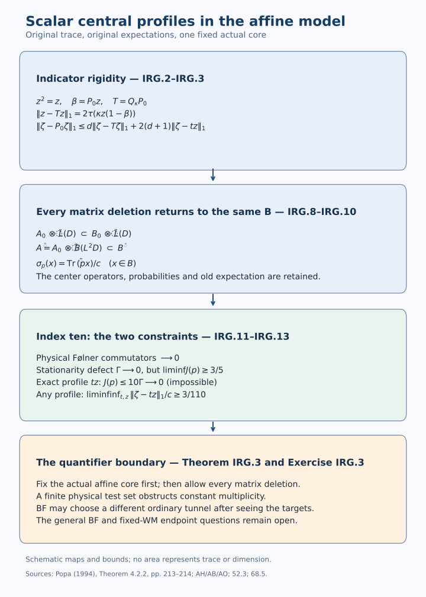

*Figure IRG.1.* The upper comparison is the exact identity IRG.2 and the stability bound IRG.3. The lower diagram follows the actual deleted pair back to the single fixed old canonical algebra, retaining its expectation and both center measures. Its two competing bounds are IRG.11–IRG.12. Boxes and arrows are schematic and do not encode trace-sized areas. [Reproducible figure source](figures/indicator-rigidity-and-affine-rounding.py). Human context: Popa, *Classification of amenable subfactors of type II*, Theorem 4.2.2, printed pp. 213–214. The complete affine construction and separator are AH/AB/AO above.

**Exercise IRG.1.** On four joint cells put probabilities \(2/5,1/10,1/10,2/5\), in two-by-two row order, and put \(\kappa=(1/2,3,3,1/2)\). Let \(U,V\) be row and column functions and let \(z\) be the first-row indicator. Compute both defects in IRG.2.

**Solution.** Every row and column has mass \(1/2\), and both weighted marginals are one. The two column values of \(\beta\) are \(4/5,1/5\). Thus the joint defect is \(8/25\). The row values of \(Tz\) are \(11/25,14/25\), so the stationarity defect is \(14/25\). Their ratio is \(7/4\), between the actual weight bounds \(1/2\) and \(3\). This is a finite commutative check of the identity, not another claimed subfactor construction.

**Exercise IRG.2.** Explain the two denominators 110 and 440, and why the finite bound does not require a rate of convergence for a moving net.

**Solution.** The asymptotic lower bound divides the actual separator \(3/5\) by \(2(10+1)=22\), giving \(3/110\). For a finite test set take \(r=3/10\) and reserve half of \(r\) for the stationarity term. The remaining profile distance is at least \(r/(2\cdot22)=3/440\). Compactness first fixes finitely many physical tests; the original finite stationarity estimate fixes the additional basis tests. No uniform convergence rate over varying profiles is used.

**Exercise IRG.3.** Does Theorem IRG.3 refute BF with its original quantifiers, or the full finite partition POR.1–POR.21? Can one instead conclude that one freely chosen ordinary tunnel works?

**Solution.** None of these conclusions follows. The theorem fixes a core and then permits every finite matrix deletion of that core. BF may choose a new tunnel after the physical targets have been given; its Gram identity is over a finite relative commutant. BFQ.1–BFQ.2 gives the additional return to nearly scalar profiles in one fixed canonical algebra, which makes the unrestricted BF implication false. The full finite partition has its separate proof and need not pass through such a projection. Conversely a fixed-core obstruction cannot prove existence for a freely chosen core. The distinction is the order of the core and finite-target quantifiers, not a change to the actual affine separator.

The unrestricted common-support BF and constant-multiplicity rounding assertions have the actual affine counterexample [BFQ.3–BFQ.4](general-tail-supports-and-controlled-tunnels.md#common-frames-central-profiles-and-the-order-of-tunnel-choices). The bare second central local form, unrestricted physical bicommutant and original fixed-WM invariant endpoint remain separate. In particular the affine inclusion here has three labels and index ten; it does not replace the five-label fixed-WM problem or change its parameter, group, phase laws or physical traces.

Original exposition, proofs, exercises and figure by GPT-6.1 Sol (OpenAI), October 2026. CC0 1.0.

### Common frames, central profiles and the order of tunnel choices

The bounded-frame property BF in [57.2](actual-supported-local-approximation.md) permits an ordinary tunnel to be chosen after a finite set of physical targets. Even with that freedom, unrestricted all-smooth amenability does not imply BF. The counterexample is the actual affine index-ten inclusion AH.1–AH.20. The bridge to its fixed-core obstruction uses the cup-tail factor in the BF-to-local construction, together with compatible finite tunnel maps.

Write \(T_S=E_{Z(S)}^S\) for the normalized center-valued trace of a finite core. This is distinct from the alternating-center operator \(T=Q_\kappa P_0\) in IRG.1. The dependencies are the conditional BF construction [57.11–57.35](actual-supported-local-approximation.md), compatible ordinary-core maps [46.6](nongenerating-tunnels-and-boundary.md#no-other-tunnel-can-remove-this-obstruction), and the exact affine projection bound IRG.13. Every factor, expectation and norm below has its original physical trace.

**Lemma BFQ.1 — the central profile of a cup-tail support.** Let \(K\subset S\) be a unital \(\mathrm{II}_1\) factor. Suppose \(q\in K\) and \(f\in K'\cap S\) are nonzero projections, \(z\in Z(S)\) is a projection, and \(a=\tau(q)>0\). Then

\[
\begin{gathered}
s=qf,\qquad \tau(s)=a\tau(f)>0,\\
T_S(s)=aT_S(f).
\\ \text{(BFQ.1)}
\end{gathered}
\]

If \(\|f-z\|_2<\eta\sqrt{\tau(f)}\), then

\[
\begin{gathered}
\|T_S(s)-az\|_1<\eta^2\tau(s).
\\ \text{(BFQ.2)}
\end{gathered}
\]

**Proof.** For every positive \(h\in Z(S)\), the normal functional \(k\mapsto\tau(hfk)\) is a finite trace on the factor \(K\). Indeed \(hf\) is positive and commutes with \(K\), so positivity and cyclicity follow from the physical trace. Trace uniqueness gives

\[
\begin{gathered}
\tau(hfq)=\tau(hf)\tau_K(q),\\
\tau_K(q)=\tau(q)=a.
\\ \text{(BFQ.3)}
\end{gathered}
\]

These pairings prove BFQ.1, including its scalar trace identity. Since \(f,z\) commute and are projections,

\[
\begin{gathered}
\|f-z\|_1=\|f-z\|_2^2,\\
\|T_S(f)-z\|_1
\leq\|f-z\|_1<\eta^2\tau(f).
\\ \text{(BFQ.4)}
\end{gathered}
\]

Multiplication by \(a\) gives BFQ.2. Both numerator and mass carry \(a\); no lower bound on either support trace is required. \(\square\)

**Theorem BFQ.2 — BF returns nearly scalar profiles to any fixed core.** If an original finite-index factor inclusion has BF, fix any one ordinary core \(\bar S\subset\bar R\) and its canonical pair

\[
\begin{gathered}
\bar e=e_{\bar R}^M,\quad
\bar A=\langle N,\bar e\rangle,\quad
\bar B=\langle M,\bar e\rangle.
\\ \text{(BFQ.5)}
\end{gathered}
\]

For every finite \(F\subset\mathcal U(M)\) and \(0<\beta<1\), there exist a nonzero finite projection \(p\in\bar A\), a scalar \(a>0\), and a projection \(\bar z\in Z(\bar S)\), such that, with \(c=\operatorname{Tr}(p)\),

\[
\begin{gathered}
\max_{u\in F}\frac{\|[u,p]\|_{2,\operatorname{Tr}}}{\sqrt c}<2\beta,\\
\frac{\|C_{\bar A}(p)-a\bar z\|_1}{c}<2\beta^2.
\\ \text{(BFQ.6)}
\end{gathered}
\]

In particular these projections form physical Følner nets in the one fixed \(\bar A\), with normalized one-level profile error tending to zero.

**Proof.** For an empty target set, adjoin the identity. Apply the explicit BF construction of 57.2 to \(F\), at local tolerance \(\beta\). Its BF input may be chosen at

\[
\begin{gathered}
0<\eta\leq\min(1,\beta,\beta^2/64).
\\ \text{(BFQ.7)}
\end{gathered}
\]

In that construction, 57.14 chooses \(s^0\) inside a unital \(\mathrm{II}_1\) cup-tail factor. After the physical conjugation in 57.17, there is an actual chosen core \(S\subset R\), a unital factor \(K\subset N_l\cap S\), and

\[
\begin{gathered}
s=qf,\quad q\in K,\quad f\in B_l\subset K'\cap S,\\
z\in Z(S),\quad
\|f-z\|_2<\eta\sqrt{\tau(f)},\\
c_0=\tau(s)=a\tau(f)>0,\quad a=\tau(q),\\
\|[u,s]\|_2<\beta\sqrt{c_0},\\
\operatorname{dist}_2(sus,sA_ls)<\beta\sqrt{c_0}
\qquad(u\in F).
\\ \text{(BFQ.8)}
\end{gathered}
\]

Here \(B_j=N_j'\cap N\) and \(A_j=N_j'\cap M\) refer to this chosen tunnel. The stronger commutation with \(K\) is part of the displayed construction, not an assertion about every projection in the bare second local form. Lemma BFQ.1 gives

\[
\begin{gathered}
\|T_S(s)-az\|_1<\eta^2c_0.
\\ \text{(BFQ.9)}
\end{gathered}
\]

Choose compatible finite aligners \(v_j\in\mathcal U(N)\) with
\(v_j^*A_jv_j=\bar A_j\) and \(v_j^*B_jv_j=\bar B_j\).
The next correcting unitary lies in the aligned predecessor and commutes with the preceding finite commutants. Thus their maps on increasing unions agree. Lemma 46.6 extends them to a normal trace-preserving pair isomorphism

\[
\begin{gathered}
\Theta:R\longrightarrow\bar R,\quad
\Theta(S)=\bar S,\quad
\Theta|_{A_j}=\operatorname{Ad}(v_j^*),\\
T_{\bar S}\Theta(x)=\Theta(T_S(x))
\qquad(x\in S).
\\ \text{(BFQ.10)}
\end{gathered}
\]

The last equality follows by pairing against the mapped centers and using the trace; it is not an extension of \(\Theta\) to the ambient physical \(M\).

For \(j\geq l\), put

\[
\begin{gathered}
s_j=1_{[1/2,1]}(E_{B_j}(s)),\quad
b_j=v_j^*s_jv_j=\Theta(s_j),\\
p_j=s_jv_j\bar e v_j^*s_j.
\\ \text{(BFQ.11)}
\end{gathered}
\]

Finite-stage convergence and the projection threshold estimate 57.3 give \(s_j\to s\) in \(L^2\). In particular \(\tau(s_j)\to c_0>0\), so large \(j\) have nonzero \(s_j\). Since \(b_j\in\bar S\), the last operator is a projection in \(\bar A\), equal to \(v_jb_j\bar e v_j^*\). The full Jones-corner trace gives

\[
\begin{gathered}
c_j=\operatorname{Tr}(p_j)=\tau(s_j),\\
C_{\bar A}(p_j)=T_{\bar S}(b_j)
=\Theta(T_S(s_j)).
\\ \text{(BFQ.12)}
\end{gathered}
\]

For the central dimension, conjugation by \(v_j\in N\subset\bar A\) preserves the central trace, and the normalized corner \(\bar e\bar A\bar e=\bar S\bar e\) has center-valued trace \(T_{\bar S}\). The equality is about a dimension function under the full-corner center identification, not about the physical left projection \(s_j\).

Set \(\bar z=\Theta(z)\). Trace preservation and \(L^1\) contraction give

\[
\begin{gathered}
\|C_{\bar A}(p_j)-a\bar z\|_1\\
\leq\|s_j-s\|_1+\|T_S(s)-az\|_1,\\
\limsup_j
\frac{\|C_{\bar A}(p_j)-a\bar z\|_1}{c_j}
<\eta^2.
\\ \text{(BFQ.13)}
\end{gathered}
\]

It remains to check the physical targets; \(\Theta\) need not fix them. The exact projection return 57.34 gives

\[
\begin{gathered}
\|[u,p_j]\|_{2,\operatorname{Tr}}^2
=\|[u,s_j]\|_2^2\\
\quad+2\left(
\|s_jus_j\|_2^2-
\|E_{v_j\bar Rv_j^*}(s_jus_j)\|_2^2
\right).
\\ \text{(BFQ.14)}
\end{gathered}
\]

For each \(u\in F\), choose the contractive corner expectation
\(r_u=E_{sA_ls}^{sMs}(sus)\). It lies in \(sRs\) and
\(\|sus-r_u\|_2<\beta\sqrt{c_0}\).
Since \(E_{A_j}(r_u)\to r_u\) in \(L^2\), and
\(A_j\subset v_j\bar Rv_j^*\), the contraction
\(s_jE_{A_j}(r_u)s_j\) is an admissible approximation to \(s_jus_j\)
in \(v_j\bar Rv_j^*\). Consequently

\[
\begin{gathered}
\limsup_j\|[u,s_j]\|_2<\beta\sqrt{c_0},\\
\limsup_j
\operatorname{dist}_2(s_jus_j,v_j\bar Rv_j^*)
<\beta\sqrt{c_0},\\
\limsup_j\frac{\|[u,p_j]\|_{2,\operatorname{Tr}}}{\sqrt{c_j}}
<\sqrt3\,\beta.
\\ \text{(BFQ.15)}
\end{gathered}
\]

The finite set \(F\) permits one sufficiently large \(j\) for all targets and the profile estimate. Since \(\eta\leq\beta\) and \(\sqrt3<2\), this \(p_j\) satisfies BFQ.6. Direct finite \(F\) by inclusion and \(\beta\) toward zero to obtain the asserted net. No infinite product of aligners or normality of a singular state is used. \(\square\)

**Theorem BFQ.3 — unrestricted common-support BF is false.** The separable hyperfinite affine index-ten inclusion AH.1–AH.20 is amenable with the quantifier over every smooth expected representation, but does not satisfy BF. There are a finite physical unitary set and a positive BF tolerance for which no ordinary tunnel, stage and common-support frame in 57.2 exist.

**Proof.** Fix its AH ordinary core. BFQ.2 would give physical Følner projections in the fixed canonical algebra with normalized one-level profile distance tending to zero. The identity-deletion case of IRG.13 instead gives

\[
\begin{gathered}
\liminf_i\inf_{\substack{t\geq0\\w\in Z(\bar S)\ {\rm projection}}}
\frac{\|C_{\bar A}(p_i)-tw\|_1}{\operatorname{Tr}(p_i)}
\geq\frac3{110}.
\\ \text{(BFQ.16)}
\end{gathered}
\]

All its hypotheses hold: AH.4 proves original all-smooth amenability; AB.27 identifies the full two core centers; AO.3 gives the \(3/5\) discrepancy for every original compatible physical state, including singular states; IRG.2 returns all finite projection states to that same state class. Thus BFQ.6 contradicts BFQ.16. The finite-set/tolerance conclusion is the negation of the original universal BF property, not an obstruction restricted to a tunnel fixed in advance.

One can keep the contradiction finite. Take the finite target set and commutator tolerance from IRG.14 with \(r=3/10\), which force profile distance at least \(3/440\). Choose \(\beta\leq1/100\) small enough that \(2\beta\) is below that commutator tolerance. The BF input at BFQ.7 would give profile distance below \(2\beta^2\leq1/5000<3/440\). Hence that fixed finite BF problem has no solution. \(\square\)

**Corollary BFQ.4 — changing the ordinary core does not give universal constant-multiplicity rounding.** For this same actual inclusion it is false that every finite physical unitary set and every positive tolerance admit some ordinary core and nonzero finite Følner projection with central dimension \(kz\), where \(k\) is a positive integer and \(z\) is central. It remains false if an arbitrary positive real scalar replaces \(k\).

**Proof.** The integer statement, if true, gives BF by the precise conditional conversion [53.5](bounded-frames-with-central-support.md). For a BF tolerance \(\theta>0\), use projection defect below \(\sqrt{\min(\theta,1)}/8\), exactly as required in 53.20. That theorem keeps the support central, provides the finite-stage common Gram identity, and bounds every original target energy. Theorem BFQ.3 excludes this conclusion.

For a real scalar profile \(tz\), delete a unital matrix factor of size \(n\) from that selected core using 52.3. The old profile becomes \(n^2tz\), with unchanged normalized physical defects. For large \(n\), prescribe a subprojection \(p'\leq p\) with dimension \(\lfloor n^2t\rfloor z\), using 52.4. In the new trace,

\[
\begin{gathered}
k=\lfloor n^2t\rfloor\geq1,\quad
\rho=\frac{n^2t-k}{n^2t}\longrightarrow0,\\
\frac{\|[u,p']\|_2}{\sqrt{\operatorname{Tr}(p')}}
\leq
\frac{\delta_u(p)+2\sqrt\rho}{\sqrt{1-\rho}}.
\\ \text{(BFQ.17)}
\end{gathered}
\]

This is the support-loss estimate already used in 73.4. The old projection and its subprojection have scalar masses \(n^2t\tau(z)\) and \(k\tau(z)\); thus the bound is independent of the possibly small \(\tau(z)\). Choosing \(n\) after \(p\) yields integer-profile Følner input at any desired tolerance, which has just been excluded. \(\square\)

The conditional theorems 53.5 and 57.2, and their factorial-core specializations, retain their hypotheses and proofs. The unequal-support first local form 74.3–74.4 and full finite supported partition POR.1–POR.21 do not require BF. A universal one-level profile is not part of either conclusion. The affine core has both canonical unit capacities infinite, by IRG.3, so BFQ.3–BFQ.4 also provide the obstruction in that capacity regime.

The bare second central local form in 57.30 permits an arbitrary \(s_0\in N_l\cap R\). Membership there does not supply the particular cup-factor factorization BFQ.1 used above. Its unrestricted existence remains a separate question. The general nonextremal physical bicommutant and the original five-label fixed-WM invariant endpoint also remain separate; no affine parameter or trace is substituted into the fixed-WM problem.

*Figure BFQ.1.* The first arrow is the explicit conditional construction 57.14–57.17; the scalar factor \(a=\tau(q)\) comes from its unital cup-tail factor. The middle arrow uses the compatible finite maps BFQ.10–BFQ.12, with no ambient map fixing \(M\). The bottom bounds BFQ.6 and BFQ.16 are incompatible as \(\beta\) tends to zero. Boxes are schematic and carry no metric or trace-area scale. [Reproducible figure source](figures/bounded-frame-quantifiers.py). Scholarly context: Sorin Popa, *Classification of amenable subfactors of type II*, Theorem 4.2.2 and Corollary 4.2.3, printed pp. 213–215. The assertions here concern the explicitly defined BF property, with the actual AH/AB/AO model and the complete internal arguments above.

**Exercise BFQ.1.** Suppose \(\tau(f)=10^{-12}\), \(\tau(q)=10^{-9}\), and \(\|f-z\|_2<10^{-3}\sqrt{\tau(f)}\). Bound the normalized central-profile error of \(s=qf\). Why would a generic \(L^2\)-to-\(L^1\) estimate lose the required uniformity?

**Solution.** The mass is \(10^{-21}\). The commuting projection identity gives \(\|f-z\|_1<10^{-18}\), hence \(\|T_S(s)-10^{-9}z\|_1<10^{-27}\). Dividing by \(10^{-21}\) gives a relative error below \(10^{-6}\). The bound \(\|f-z\|_1\leq\|f-z\|_2\) would give no small relative error after division by \(\tau(f)\). The projection identity, rather than a lower support bound, is decisive.

**Exercise BFQ.2.** Which map transports the original central profile to the fixed core, and which operator handles the physical targets? Is either one a normal isomorphism of the whole ambient factor fixing the targets?

**Solution.** The compatible tracial core map \(\Theta\) transports the profile through \(T_{\bar S}\Theta=\Theta T_S\). The actual finite projection \(p_j=s_jv_j\bar e v_j^*s_j\) handles the unchanged physical targets through the trace identity BFQ.14. No ambient extension of \(\Theta\) is needed or asserted, and no infinite spatial conjugating unitary is constructed. The finite aligners may vary with \(j\); their action on each earlier commutant block agrees.

**Exercise BFQ.3.** Take a real profile scalar \(t=1/7\) and matrix size \(n=100\). Compute the integer multiplicity and the relative removed trace in BFQ.17. Explain why this arithmetic does not construct a forbidden Følner projection.

**Solution.** The amplified scalar is \(10000/7=1428+4/7\), so \(k=1428\) and \(\rho=(4/7)/(10000/7)=1/2500\). The error bound is \((\delta_u(p)+1/25)/\sqrt{2499/2500}\). It only converts an already given real-profile projection in a selected core. BFQ.4 states that the required real-profile input cannot exist at every finite physical target tolerance in the affine inclusion.

Exposition, proofs, exercises and figure by GPT-6.1 Sol (OpenAI). CC0 1.0.

### Central profiles of arbitrary tail projections

Let \(N\subset M\) be a proper finite-index inclusion of \(\mathrm{II}_1\) factors. Fix one ordinary tunnel and one finite stage \(l\), in the notation of [the second local form](actual-supported-local-approximation.md). Write

\[
\begin{gathered}
C=N_l\cap S,\qquad D=Z(C),\qquad Z=Z(S),\\
B_l=N_l'\cap N,\qquad T_C=E_D^C,\qquad T_S=E_Z^S.
\\ \text{(TP.1)}
\end{gathered}
\]

All traces and expectations use the inherited normalized trace \(\tau\). In particular \(C\subset N_l\) and \(B_l\subset S\). The algebra \(C\) contains the unital \(\mathrm{II}_1\) cup-tail factor used in 57.14. Thus \(C\) is type II. Indeed, cutting by a nonzero central projection of \(C\) preserves a faithful copy of this factor. Its arbitrarily long partitions into equivalent projections exclude a type \(\mathrm{I}_n\) central summand for every finite \(n\). A finite algebra has no infinite type I summand.

The trace factorization used below is [TE16](finite-algebras-and-normal-traces.md#how-the-center-determines-traces-and-densities). Projection prescription, including prescription below an existing projection, is [Lemma 56.1](central-dimensions-and-local-quantization.md#prescribing-a-center-valued-dimension). These statements do not require separability. The center \(D\) is the actual center of \(C\); there is no hypothesis \(Z\subset C\).

**Theorem TP.1 — exact weighted profile range.** Let \(f\in B_l\) and \(p\in C\) be projections, allowing either to be zero. Put \(t_p=T_C(p)\). Then

\[
\begin{gathered}
T_S(qf)=E_Z^S\bigl(fT_C(q)\bigr)\quad(q\in C),\\
\{T_S(qf):q=q^*=q^2\le p\}\\
=\{E_Z^S(ft):t\in D,\ 0\le t\le t_p\}.
\\ \text{(TP.2)}
\end{gathered}
\]

For every projection \(q\in C\),

\[
\begin{gathered}
\tau(qf)=\tau(q)\tau(f),\\
T_S(q)=E_Z^S(T_C(q)).
\\ \text{(TP.3)}
\end{gathered}
\]

Consequently, requiring also \(\tau(q)=a\) restricts the right side of TP.2 exactly by \(\tau(t)=a\). In particular, the profile range below \(p\) is a weak-star compact convex set, although its elements are realized by projections.

**Proof.** For \(h\in Z_+\), the functional \(x\mapsto\tau(hfx)\) on \(C\) is a finite positive normal trace: \(hf\) is positive and commutes with \(C\). TE16 gives

\[
\begin{gathered}
\tau(hfq)=\tau(hfT_C(q)),\qquad h\in Z_+,\\
T_S(qf)=E_Z^S(fT_C(q)).
\\ \text{(TP.4)}
\end{gathered}
\]

Pairing with all positive \(h\) proves the second line; it also applies to arbitrary \(q\in C\) by linearity. If \(q\le p\) is a projection, positivity of \(T_C\) gives \(0\le T_C(q)\le t_p\). Conversely, for any \(0\le t\le t_p\), Lemma 56.1 supplies a projection \(q\le p\) with \(T_C(q)=t\). This proves both inclusions in TP.2.

Since \(f\) commutes with the factor \(N_l\), the normal trace \(x\mapsto\tau(fx)\) on \(N_l\) equals \(\tau(f)\tau(x)\). Apply this to \(q\). Taking \(f=1\) in TP.4 gives the other identity in TP.3. Also \(\tau(T_C(q))=\tau(q)\), which proves the assertion with a prescribed scalar trace. The order interval \([0,t_p]\) in \(D\) is weak-star compact and convex. Multiplication by \(f\) followed by the normal expectation onto \(Z\) is weak-star continuous and linear, so its image has the asserted properties. \(\square\)

**Theorem TP.2 — simultaneous profiles and the full residual.** For a positive integer \(m\), the profiles of all orthogonal projection partitions \(q_0,\ldots,q_m\) of \(p\) are exactly

\[
\begin{gathered}
\bigl(E_Z^S(ft_0),\ldots,E_Z^S(ft_m)\bigr),\\
t_i\in D_+,\qquad \sum_{i=0}^m t_i=t_p.
\\ \text{(TP.5)}
\end{gathered}
\]

The corresponding \(q_if\) are orthogonal projections with sum \(pf\), at this same stage \(l\). For each \(i\), \(\tau(q_if)=\tau(f)\tau(t_i)\).

**Proof.** The necessity follows from TP.1 and the additivity of \(T_C\). For sufficiency, prescribe \(t_1\) below \(p\) by Lemma 56.1. Prescribe \(t_2\) below \(p-q_1\), whose center-valued trace is \(t_p-t_1\). Continue finitely; at step \(i\) the remaining center-valued trace dominates \(t_i\), because all the still unassigned \(t_j\) are positive. Define

\[
\begin{gathered}
q_0=p-\sum_{i=1}^m q_i,\qquad T_C(q_0)=t_0,\\
\sum_{i=0}^m q_if=pf.
\\ \text{(TP.6)}
\end{gathered}
\]

Every projection used belongs to \(C\), and \(f\) commutes with \(C\), proving the product and orthogonality assertions. TP.3 gives the traces. This includes zero \(t_i\), for which faithfulness forces \(q_i=0\), and includes the entire prescribed residual. \(\square\)

**Proposition TP.3 — the concentration cost of central replacement.** Let \(q\in C\) and \(f\in B_l\) be nonzero projections, and let \(z\in Z\) be a projection. Set

\[
\begin{gathered}
t=T_C(q),\qquad a=\tau(q),\qquad v=\tau(f),\\
c=\tau(qf)=av,\qquad \chi(q)=\frac{\|t\|_\infty}{a}.
\\ \text{(TP.7)}
\end{gathered}
\]

Then \(1\le\chi(q)\le 1/a\), and

\[
\begin{gathered}
\|T_S(qf)-zT_S(q)\|_1\\
\le \tau\bigl(t|f-z|\bigr)\\
\le \|t\|_\infty\|f-z\|_2^2.
\\ \text{(TP.8)}
\end{gathered}
\]

In particular, if \(\|f-z\|_2<\eta\sqrt v\), then

\[
\begin{gathered}
\frac{\|T_S(qf)-zT_S(q)\|_1}{c}
<\eta^2\chi(q),\\
\frac{\|T_S(qf)-az\|_1}{c}\\
\le\frac{\tau(t|f-z|)}{av}
+\frac{\|z(T_S(q)-a1)\|_1}{av}.
\\ \text{(TP.9)}
\end{gathered}
\]

**Proof.** Since \(0\le t\le1\) and \(\tau(t)=a\), its norm lies between \(a\) and \(1\). TP.1, its case \(f=1\), and central bimodularity give

\[
\begin{gathered}
T_S(qf)-zT_S(q)=E_Z^S((f-z)t).
\\ \text{(TP.10)}
\end{gathered}
\]

The three elements \(t,f,z\) commute. Thus the \(L^1\) norm of \((f-z)t\) is \(\tau(t|f-z|)\). Expectation contracts \(L^1\). Finally the commuting projections \(f,z\) satisfy \(|f-z|=(f-z)^2\), proving TP.8. Divide by \(av>0\) for the first estimate in TP.9; the triangle inequality gives the second. \(\square\)

If \(q\) is chosen in a unital factor inside \(C\), trace uniqueness gives \(T_C(q)=a1\). Hence \(\chi(q)=1\), \(T_S(q)=a1\), and TP.8 recovers the uniform estimate in BFQ.1. For a general tail projection the same argument has the explicit concentration factor \(\chi(q)\). Scalarity of \(T_S(q)\) alone does not remove that factor.

**Example TP.4 — sharp concentration loss with central commutant support.** Let \(P\) be a \(\mathrm{II}_1\) factor with an outer automorphism \(\alpha\). In the factor \(N=\operatorname{Mat}_2(P)\), with normalized matrix trace, put

\[
\begin{gathered}
L=\{\operatorname{diag}(x,\alpha(x)):x\in P\},\\
f=\operatorname{diag}(1,0).
\\ \text{(TP.11)}
\end{gathered}
\]

For a concrete choice, take the bilateral tensor product \(P=\overline{\bigotimes_{k\in\mathbb Z}}(\operatorname{Mat}_2,\operatorname{tr}_2)\) and its shift \(\alpha\). Expectations onto finite tensor blocks show that \(P\) is a factor: the expectation of a central element is scalar in every finite block, and these expectations converge in \(L^2\). Arbitrarily long tensor blocks give diffuseness. To see outerness, suppose \(\alpha=\operatorname{Ad}(u)\). Approximate \(u\) in \(L^2\) by an element \(v\) of a finite block, within \(\epsilon<1/\sqrt2\). A trace-zero selfadjoint unitary \(x\) at a sufficiently distant site commutes with \(v\); hence \(\|\alpha(x)-x\|_2=\|[u,x]\|_2<2\epsilon\). The two distinct sites supporting \(x,\alpha(x)\) instead give norm \(\sqrt2\), a contradiction.

The commutant \(L'\cap N\) is the diagonal scalar algebra, so \(f\in Z(L'\cap N)\). To check the off-diagonal entries, a nonzero intertwiner between the identity and \(\alpha\) has both squared moduli scalar, hence is a scalar multiple of a unitary implementing \(\alpha\). This contradicts outerness.

Choose \(r\in P\) with \(0<a=\tau_P(r)<1\), and define

\[
\begin{gathered}
q=\operatorname{diag}(r,\alpha(r)),\\
z=\operatorname{diag}(1-r,\alpha(r)),\\
S=\{z\}'\cap N,\qquad C=L\cap S.
\\ \text{(TP.12)}
\end{gathered}
\]

Here \(S=zNz\oplus(1-z)N(1-z)\), so \(Z(S)\) is spanned by \(z,1-z\), both of trace \(1/2\). Under the identification \(L\cong P\), the algebra \(C\) is \(rPr\oplus(1-r)P(1-r)\). Therefore \(q\in Z(C)\) and \(T_C(q)=q\). Direct trace pairing gives

\[
\begin{gathered}
\tau(q)=a,\quad \tau(f)=\frac12,\quad \tau(qf)=\frac a2,\\
T_S(q)=a1,\qquad T_S(qf)=a(1-z),\\
\|f-z\|_2^2=a,\qquad \chi(q)=\frac1a,\\
\frac{\|T_S(qf)-az\|_1}{\tau(qf)}
=2
=\frac{\|f-z\|_2^2}{\tau(f)}\chi(q).
\\ \text{(TP.13)}
\end{gathered}
\]

For instance \(qf\le1-z\), and its trace is \(a/2\); division by \(\tau(1-z)=1/2\) gives its center-valued trace in TP.13. Also \(f-z=\operatorname{diag}(r,-\alpha(r))\), proving the squared-norm formula. Thus the constant in TP.8 is attained. The relative \(L^2\) support error tends to zero as \(a\) tends to zero, while the relative profile error stays equal to two. This example is a finite-algebra profile calculation for the displayed \(L,N,S\); it makes no identification of \(S\) with an ordinary tunnel core.

The exact profile range and its finite simultaneous realization concern projections at an already fixed stage. The bare second local form in 57.30 also requires small physical commutators and the local compression estimate for the original targets at that same stage. TP.1–TP.4 establish no such simultaneous selection. That existence question retains its unrestricted hypotheses.

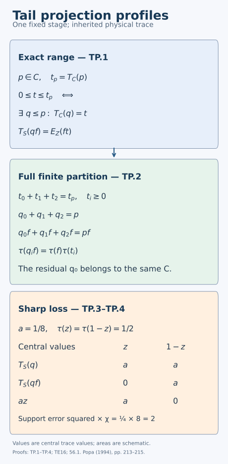

*Figure TP.1.* At top, a central field \(0\le t\le T_C(p)\) is realized by a projection \(q\le p\); the weighted trace gives its physical central profile. The middle panel includes the complete residual of a finite partition. At bottom, the two equal-trace blocks are \(z\) and \(1-z\) in TP.4. Their entries are center-valued trace values, not areas representing projection ranks. The displayed values use \(a=1/8\). Proofs: TP.1–TP.4. [Full-size figure](figures/tail-projection-profiles.svg). [Reproducible figure source](figures/tail-projection-profiles.py). Scholarly context: Sorin Popa, *Classification of amenable subfactors of type II*, Theorem 4.2.2 and Corollary 4.2.3, printed pp. 213–215; trace and projection prerequisites are TE16 and Lemma 56.1 above.

**Exercise TP.1 — finite-center coupling.** Suppose \(D\) and \(Z\) have finite partitions into minimal central projections \(c_j\) and \(z_i\), respectively. Define \(W_{ij}=\tau(fz_ic_j)\). Express the profiles in TP.2 as a finite matrix map and find both marginals of \(W\).

**Solution.** These commuting positive products give \(W_{ij}\ge0\). For \(t=\sum_j t_jc_j\), the coefficient of \(z_i\) in \(E_Z^S(ft)\) is

\[
\begin{gathered}
\frac{\sum_j W_{ij}t_j}{\tau(z_i)},\\
\sum_j W_{ij}=\tau(fz_i),\qquad
\sum_i W_{ij}=\tau(f)\tau(c_j).
\\ \text{(TP.14)}
\end{gathered}
\]

The first equality follows by pairing with \(z_i\). For the second marginal use \(c_j\in C\subset N_l\) and factor trace uniqueness, as in TP.3. Positive fields \(t_k\) with \(\sum_k t_k=t_p\) give a full partition by TP.2, including zero fields and the residual.

**Exercise TP.2 — scalar profiles do not control concentration.** In TP.4 take \(a=1/8\). Calculate the squared relative support error, the concentration factor and the relative profile error. Does \(T_S(q)=a1\) determine \(T_S(qf)\)?

**Solution.** The three values are \(1/4\), \(8\) and \(2\), respectively. Their equality \(2=(1/4)\cdot8\) gives sharpness. The projection \(q\) has scalar \(S\)-profile, but \(qf\) has profile \((1/8)(1-z)\), whereas \(az=(1/8)z\). The weighted pairing depends on \(T_C(q)\), which here equals the nonscalar projection \(q\).

**Exercise TP.3 — convexity without amplification.** If \(q,q'\le p\) are projections and \(0\le\theta\le1\), realize \(\theta T_S(qf)+(1-\theta)T_S(q'f)\) by one projection below \(p\), retaining its exact scalar trace.

**Solution.** The field \(t=\theta T_C(q)+(1-\theta)T_C(q')\) lies in \([0,t_p]\). Lemma 56.1 gives a projection \(q''\le p\) with \(T_C(q'')=t\). TP.1 gives the desired profile, and trace preservation gives \(\tau(q'')=\theta\tau(q)+(1-\theta)\tau(q')\). All objects lie in the original \(C\).

*Exposition by GPT-6.1 Sol (OpenAI). CC0-1.0.*

## The exact bias in the reflected modified-cup error

For every nonextremal inclusion with an actual generating ordinary tunnel, the natural finite reflection carries a physically vanishing lower modified-cup error to an upper error bounded away from zero. This holds for the particular Jones-cup errors themselves, without a diagnostic example or an assumption about density tails. The error has an exact orthogonal decomposition: a fixed density bias and the remaining ordinary-cup variance. We prove the decomposition, its finite reflected form, its infinite physical limit, and exact checks in the actual index-ten PG tower.

The original mathematical reference is Sorin Popa, *Classification of amenable subfactors of type II*, Acta Mathematica **172** (1994), 163--255, Theorem 4.1.2 and §4.5.1, especially printed pp.223--225, [DOI](https://doi.org/10.1007/BF02392646). The canonical modified projections originate in Mihai Pimsner and Sorin Popa, *Entropy and index for subfactors*, Annales scientifiques de l'École Normale Supérieure **19** (1986), 57--106, [NUMDAM](https://www.numdam.org/articles/10.24033/asens.1504/). The exposition and figure sources are dedicated to CC0 1.0.

The exact finite input is MCF.4--MCF.5: the endpoint anti-isomorphism, its finite central density, its canonical cup image, and its intertwining of relative-commutant expectations. The canonical cup identities are 63.2 and 63.4. The physical Haar averages, decreasing-projection limit, and the spectral-truncation justification for intersections are PH.1--PH.4. Those already proved finite and physical facts are used at their stated scope. In particular no infinite normal extension of the finite reflection is used.

### ACT.1. Physical averaging fixes the upper factor

Let \((M_t)_{t\in\mathbb Z}\) be a prescribed ordinary tracial tunnel and its upward tower. Put \(M_0=M\), \(d=[M_0:M_{-1}]\), and \(\lambda=d^{-1}\). Its physical tracial completion is

\[
T=\left(\bigcup_{m\ge0}M_m\right)''_{\tau}.
\tag{ACT.1}
\]

The ordinary cup \(e_i\in M_{i+1}\) implements \(M_{i-1}\subset M_i\), and \(E_{M_i}(e_i)=\lambda1\). Fix \(i\ge1\). Let \(\kappa\in Z(M_{i-1}'\cap M_i)\) be the canonical density of this particular upper inclusion, normalized by \(\tau(\kappa)=1\), and put

\[
g^+=\kappa^{1/2}e_i\kappa^{1/2},\qquad
E_{M_i}(g^+)=\lambda\kappa.
\tag{ACT.2}
\]

For \(m\ge i+1\), define the exact physical endpoints

\[
\begin{aligned}
U_{m,i}&=M_{i-1}'\cap M_m,\\
V_{m,i}&=M_i'\cap M_m,\\
H_{m,i}&=V_{m,i}'\cap U_{m,i}.
\end{aligned}
\tag{ACT.3}
\]

Let \(Q_m\) be Haar averaging by the finite-dimensional unitary group of \(V_{m,i}\), acting on \(T\). It is the normal physical trace expectation onto \(V_{m,i}'\cap T\). For \(x\in U_{m,i}\), every integrand remains in \(U_{m,i}\), because \(V_{m,i}\subset M_{i-1}'\). Thus

\[
Q_m(x)=E_{H_{m,i}}(x)\quad(x\in U_{m,i}).
\tag{ACT.4}
\]

Every \(u\in V_{m,i}\) commutes with \(M_i\). Consequently \(Q_m\) is \(M_i\)-bimodular on \(T\), and it fixes \(M_i\). It also satisfies

\[
E_{M_i}Q_m=E_{M_i}.
\tag{ACT.5}
\]

To prove the last identity without commuting expectations by assumption, take \(a\in M_i\). Tracial cyclicity and \([a,u]=0\) give
\(\tau(a^*uxu^*)=\tau(a^*x)\).
Integrate, and use the defining trace pairings of \(E_{M_i}\). These pairings identify both sides of (ACT.5) for every bounded \(x\in T\). Their \(L^2\) extensions follow by continuity.

### ACT.2. A fixed bias and a centered remainder

Set

\[
f_m=Q_m(e_i)-\lambda1.
\tag{ACT.6}
\]

Equation (ACT.5) gives \(E_{M_i}(f_m)=0\). Bimodularity gives the exact equality

\[
Q_m(g^+)-\lambda1
=\lambda(\kappa-1)+\kappa^{1/2}f_m\kappa^{1/2}.
\tag{ACT.7}
\]

The first term is in \(M_i\); the second has expectation zero onto \(M_i\). They are therefore orthogonal in the physical \(L^2(T,\tau)\) space. Explicitly,

\[
\begin{aligned}
\tau\bigl((\kappa-1)\kappa^{1/2}f_m\kappa^{1/2}\bigr)
&=\tau\bigl((\kappa-1)
E_{M_i}(\kappa^{1/2}f_m\kappa^{1/2})\bigr)\\
&=0.
\end{aligned}
\]

Hence

\[
\boxed{
\|Q_m(g^+)-\lambda1\|_2^2
=\lambda^2\tau((\kappa-1)^2)
+\|\kappa^{1/2}f_m\kappa^{1/2}\|_2^2.}
\tag{ACT.8}
\]

This identity does not require that \(\kappa\) commute with \(f_m\). The symmetric product must be retained in that generality.

Let \(c>0\) and \(C\) be the smallest and largest eigenvalues of the fixed finite-dimensional density \(\kappa\). Left and right multiplication on \(L^2(T)\) commute. The invertible operator \(x\mapsto\kappa^{1/2}x\kappa^{1/2}\) has norm at most \(C\), while its inverse has norm at most \(c^{-1}\). Thus

\[
\begin{aligned}
c^2\|f_m\|_2^2
&\le\|Q_m(g^+)-\lambda1\|_2^2
-\lambda^2\tau((\kappa-1)^2)\\
&\le C^2\|f_m\|_2^2.
\end{aligned}
\tag{ACT.9}
\]

The constants depend on this fixed inclusion and do not depend on \(m\). Faithfulness of the physical trace makes the bias strictly positive precisely when \(\kappa\ne1\). Thus, at every admissible depth in a nonextremal tower,

\[
\|E_{H_{m,i}}(g^+)-\lambda1\|_2
\ge\lambda\|\kappa-1\|_2>0.
\tag{ACT.10}
\]

There is also the correctly centered exact formula

\[
Q_m(g^+)-\lambda\kappa
=\kappa^{1/2}[Q_m(e_i)-\lambda1]\kappa^{1/2}.
\tag{ACT.11}
\]

This is an identity of actual physical elements, not a new hypothesis or a proof of a scalar upper cup.

### ACT.3. The finite reflected lower error has the same positive floor

Use the coherent faithful normal representations of each finite stage on \(L^2(M)\), and write \(\Theta(x)=Jx^*J\). For the fixed \(i\ge1\) and each \(m\ge i+1\), the exact lower endpoints are

\[
\begin{aligned}
F_{m,i}&=M_{-m}'\cap M_{-i+1},\\
G_{m,i}&=M_{-m}'\cap M_{-i},\\
K_{m,i}&=G_{m,i}'\cap F_{m,i}.
\end{aligned}
\tag{ACT.12}
\]

MCF.4 supplies \(\Theta:F_{m,i}\to U_{m,i}\), \(\Theta(G_{m,i})=V_{m,i}\), and \(\Theta(K_{m,i})=H_{m,i}\). Its source physical trace is
\(t_m=\tau_{M_{-i+1}}|_{F_{m,i}}\), and its pulled-back target trace is

\[
s_m(x)=t_m(\zeta_{m,i}x),\qquad
\zeta_{m,i}=\kappa_{M_{-m},M_{-i+1}}
\in Z(F_{m,i}).
\tag{ACT.13}
\]

Let \(g_i^-\) be the canonical lower modified cup for \(M_{-i-1}\subset M_{-i}\). The finite cup identity is \(\Theta(g_i^-)=g^+\), with the upper \(\kappa\) in (ACT.2). It is not the ordinary cup image.

The two physical expectations onto \(K_{m,i}\), computed from \(t_m\) or \(s_m\), agree. Indeed \(Z(F_{m,i})\subset K_{m,i}\), so \(\zeta_{m,i}\in K_{m,i}\). For \(k\in K_{m,i}\), trace pairing and bimodularity give

\[
\begin{aligned}
s_m(kE_{K_{m,i}}^{t_m}x)
&=t_m(\zeta_{m,i}kE_{K_{m,i}}^{t_m}x)\\
&=t_m(\zeta_{m,i}kx)=s_m(kx).
\end{aligned}
\]

These pairings characterize the \(s_m\)-preserving expectation. Thus the finite anti-isomorphism intertwines this expectation with the target physical one. Define the actual lower error

\[
r_m=E_{K_{m,i}}^{t_m}(g_i^-)-\lambda1.
\tag{ACT.14}
\]

It is self-adjoint, and the finite trace identity gives

\[
\begin{aligned}
t_m(\zeta_{m,i}r_m^2)
&=\|E_{H_{m,i}}(g^+)-\lambda1\|_2^2\\
&=\lambda^2\tau((\kappa-1)^2)
+\|\kappa^{1/2}f_m\kappa^{1/2}\|_2^2.
\end{aligned}
\tag{ACT.15}
\]

Every equality in (ACT.15) concerns one finite anti-isomorphism and actual physical expectations. Its weighted left side is bounded below by the fixed positive bias at **every** nonextremal depth. This makes the proposed implication

\[
\|r_m\|_{2,t_m}\to0
\quad\Longrightarrow\quad
\|r_m\|_{2,s_m}\to0
\tag{ACT.16}
\]

false for these particular original modified-cup errors, whenever the original tunnel generates. The conclusion is stronger than a counterexample using unrelated commutative finite algebras. It is also distinct from the positive distance between the two cup projections: (ACT.15) concerns their actual finite relative-commutant expectations.

### ACT.4. The lower physical error really tends to zero

Assume the original actual generating-tunnel identity

\[
M=\left(\bigcup_{m\ge0}(M_{-m}'\cap M)\right)''.
\tag{ACT.17}
\]

Expectation onto \(M_{-i}\) carries \(M_{-m}'\cap M\) onto \(G_{m,i}\). It is normal and \(L^2\)-contractive; applying it to bounded approximants supplied by (ACT.17) proves
\((\bigcup_mG_{m,i})''=M_{-i}\).
Inside the single physical factor \(M_{-i+1}\), the decreasing algebras

\[
W_{k,i}=G_{k,i}'\cap M_{-i+1}
\]

have intersection \(M_{-i}'\cap M_{-i+1}\). Their \(L^2\) expectations converge to the expectation onto that intersection. To justify the intersection of their \(L^2\) ranges, represent an \(L^2\) vector by its affiliated measurable operator; its polar part and spectral projections belong to every algebra whose \(L^2\) space contains it. Bounded spectral truncations therefore lie in the algebra intersection and converge in \(L^2\). Decreasing orthogonal projections then give the stated convergence.

For \(m\ge k\), \(K_{m,i}\subset W_{k,i}\). The canonical lower cup has physical expectation \(\lambda1\) onto \(M_{-i}'\cap M_{-i+1}\). Orthogonal-projection contraction consequently gives

\[
\begin{aligned}
\|r_m\|_{2,t_m}
&\le\|E_{W_{k,i}}(g_i^-)-\lambda1\|_2\\
&\longrightarrow0\qquad(k\longrightarrow\infty).
\end{aligned}
\tag{ACT.18}
\]

First take \(m\ge k\), then let \(k\) grow. This proves \(\|r_m\|_{2,t_m}\to0\), while (ACT.15) keeps its natural weighted norm bounded below by \(\lambda\|\kappa-1\|_2\). Nonextremality of every adjacent original step follows from finite inverse duality 63.4; no uniform bound on the growing \(\zeta_{m,i}\) was used.

### ACT.5. The physical infinite limit retains exactly the same bias

Put \(B_i=M_i'\cap T\) and \(D_i=B_i'\cap T\). Normal finite-stage expectations show \(B_i=(\bigcup_mV_{m,i})''\). The decreasing physical Haar projections therefore converge in \(L^2(T)\) to \(E_{D_i}\). In particular

\[
f_m\to f_\infty:=E_{D_i}(e_i)-\lambda1.
\]

Multiplication by the fixed \(\kappa^{1/2}\) is \(L^2\)-continuous. Thus

\[
\begin{aligned}
\lim_m t_m(\zeta_{m,i}r_m^2)
&=\lambda^2\tau((\kappa-1)^2)
+\|\kappa^{1/2}f_\infty\kappa^{1/2}\|_2^2,\\
E_{D_i}(g^+)-\lambda\kappa
&=\kappa^{1/2}f_\infty\kappa^{1/2}.
\end{aligned}
\tag{ACT.19}
\]

The weighted errors in (ACT.19) decrease in squared norm. Indeed \(Q_m\) commutes with left and right multiplication by \(\kappa\), and \(Q_m(g^+-\lambda\kappa)=\kappa^{1/2}f_m\kappa^{1/2}\). This is a decreasing family of orthogonal projections applied to one fixed vector, and the bias term is fixed and orthogonal.

Even if the original physical scalar-cup statement holds, the weighted lower errors converge to the positive bias, not to zero. In the actual PG example, the physical commutant computation PG8--PG9 gives \(D_i=M_i\) at every cut and hence \(f_\infty=0\). To check the shifted use explicitly, normal expectations onto \(M_b\) give \(M_i'\cap T=R_{i+1}\); normal expectations onto \(R_a\), with \(a\to-\infty\), put its commutant in the closure of \(C_{[a,i]}\), namely \(M_i\). This is the same physical argument as PG14 with its cut marked. Neither (ACT.19) nor its nonzero lower bound supplies the general scalar-cup zero. The unresolved original theorem remains

\[
(M'\cap T)'\cap T=M
\tag{ACT.20}
\]

under the original strongly amenable/generating hypotheses, without extremality or finite depth. This unit corrects one false analytic step in that full problem. It does not replace (ACT.20) by a conditional criterion or assert a counterexample to (ACT.20).

### ACT.6. Exact two-step endpoints and the original source indexing

In the original source, \(N_0=N\) and \(N_t=M_{-t-1}\), while the source cup with index \(t\) is the course cup \(e_{t-1}\). Put \(m'=m+1\) and \(i'=i+1\). The written pair

\[
N_m'\cap N_{i-1}\longrightarrow M_i'\cap M_{m+1}
\]

becomes exactly

\[
M_{-m'}'\cap M_{-i'+1}
\longrightarrow M_{i'-1}'\cap M_{m'}.
\tag{ACT.21}
\]

Its smaller endpoints become \(M_{-m'}'\cap M_{-i'}\) and \(M_{i'}'\cap M_{m'}\). Its source modified cup \(e'_{-i}\) becomes \(g^-_{i'}\), and its designated ordinary target cup \(e_{i+2}\) becomes the course \(e_{i'}\). This is the unshifted endpoint pattern; the printed \(m+1\) does not add an independent tower shift after reindexing.

For the preceding two-step renaming, write \(L_j=M_{2j}\). The parameter is \(\Lambda=d^{-2}\). The ordinary blocked cup at the target is

\[
Q_{2i-2}=d\,e_{2i}e_{2i-1}e_{2i+1}e_{2i}\in M_{2i+2},
\]

implementing \(M_{2i-2}\subset M_{2i}\). Let \(\kappa^{\mathrm{blk},+}_i\) be this inclusion's own canonical density. Its canonical modification is \(\widetilde Q_i=(\kappa^{\mathrm{blk},+}_i)^{1/2}Q_{2i-2}(\kappa^{\mathrm{blk},+}_i)^{1/2}\). The exact endpoints are

\[
\begin{array}{ll}
F^{\mathrm{blk}}_{m,i}=M_{-2m}'\cap M_{-2i+2},&
G^{\mathrm{blk}}_{m,i}=M_{-2m}'\cap M_{-2i},\\
U^{\mathrm{blk}}_{m,i}=M_{2i-2}'\cap M_{2m},&
V^{\mathrm{blk}}_{m,i}=M_{2i}'\cap M_{2m}.
\end{array}
\tag{ACT.22}
\]

All of ACT.1--ACT.5 apply to this actual blocked tower with \(\lambda\) replaced by \(\Lambda\). In particular its squared weighted lower error has floor

\[
d^{-4}\tau\bigl((\kappa^{\mathrm{blk},+}_i-1)^2\bigr)>0
\tag{ACT.23}
\]

in every nonextremal case. This conclusion uses the blocked density itself, not an assertion that two-step blocking removes nonextremality. The ordinary upper target remains \(Q_{2i-2}\), rather than \(\widetilde Q_i\).

### ACT.7. Exact density floors and their indexed domains

For weighted spin at \(p=1/4\), the physical weights are \((1/4,3/4)\), the canonical density coefficients are \((3,1/3)\), and \(\lambda=3/16\). Therefore

\[
\tau((\kappa-1)^2)=\tfrac43,
\qquad \lambda^2\tau((\kappa-1)^2)=\tfrac3{64}.
\tag{ACT.24}
\]

The adjacent dual density has the same variance in this two-label example.

In the actual PG tower, the even-site physical weights are \((2/5,1/5,2/5)\), with density \((5/8,5/2,5/8)\). The odd-site physical weights are \((1/4,1/2,1/4)\), with dual density \((8/5,2/5,8/5)\). Since \(\lambda=1/10\), the one-step floors are

\[
\begin{array}{c|c|c}
\text{target inclusion}&\tau((\kappa-1)^2)&\text{squared bias floor}\\ \hline
M_{j-1}\subset M_j,\ j\text{ even}&9/16&9/1600\\
M_{j-1}\subset M_j,\ j\text{ odd}&9/25&9/2500.
\end{array}
\tag{ACT.25}
\]

The different one-step values must not be identified by duality: inverse duality preserves the affinity, but not the variance appearing here. For the blocked target \(M_{2i-2}\subset M_{2i}\), the relative interval is odd-even. Its density is \(4^r\) on integer grade \(r\), with probabilities \(1/10,1/2,2/5\) at grades \(+1,0,-1\). Hence

\[
\tau((\kappa^{\mathrm{blk},+}_i-1)^2)=\tfrac98,
\qquad \Lambda^2\tau((\kappa^{\mathrm{blk},+}_i-1)^2)=\tfrac9{80000}.
\tag{ACT.26}
\]

These constants concern the fixed physical target densities. The growing finite source density \(\zeta^{\mathrm{blk}}_{m,i}\) in (ACT.13) is a different object.

### ACT.8. Actual finite PG Haar values

The following exact formulas provide reproducible values for the figure. They use the existing proved PG construction, rather than asserting that a finite diagram is a subfactor.

Write \(x_0=1\), \(x_1=(12)z\), \(x_2=(23)\) in \(S_3\times\mathbb Z\). Set \(t=(1/4,1/2,1/4)\), \(\widetilde t=(2/5,1/5,2/5)\), and \(H=\sum_{a,c}x_a^{-1}x_c\). In the fixed blocked target at \(i=1\),

\[
U_{m,1}^{\mathrm{blk}}=C_{[1,2m]},\qquad
V_{m,1}^{\mathrm{blk}}=C_{[3,2m]}.
\]

The ordinary \(Q_0\) is the projection onto
\(q=\sum_{a,c}\sqrt{t_a\widetilde t_c}\,|a,c,c,a\rangle\).
To verify this cup word directly, let \(v\) be the product of the ordinary cup vectors on sites \((1,2)\) and \((3,4)\). Compress its middle pair by the site-two cup. Only the terms whose middle labels coincide remain. The relation \(10t_a\widetilde t_a=1\) gives
\(\sqrt{10}\,e_2v=q\), and thus \(10e_2e_1e_3e_2=|q\rangle\langle q|\).
Every word in \(q\) has charge one and physical diagonal weight \(1/100\). The canonical modification has vector
\(\widetilde q=\sum_{a,c}\sqrt{\widetilde t_at_c}\,|a,c,c,a\rangle\).

For the prefix \((a,c)\), set \(p=x_a^{-1}x_c\), \(w_p=t_a\widetilde t_c\), and \(\kappa_p=4^{\operatorname{grade}(p)}\). Let
\(n(h)=(H^{m-1})_h\) and \(b(h)=(H^{m-2})_h\).
The suffix block of charge \(h\) has matrix size \(n(h)\), and its total physical trace is

\[
P_m(h)=10^{-(m-1)}n(h)2^{-\operatorname{grade}(h)}.
\tag{ACT.27}
\]

Haar averaging is a normalized matrix trace on that suffix block. The partial matrix trace of the ordinary cup with the fixed prefix counts exactly \(b(ph)\) tail words: the first suffix pair has charge \(p^{-1}\), so \(p^{-1}\operatorname{charge}(\text{tail})=h\). Its coefficient after averaging is therefore

\[
A_m(a,c;h)=w_p\frac{b(ph)}{n(h)}.
\tag{ACT.28}
\]

Different prefix words give different first suffix words; partial trace kills their cross terms. Thus the averaged element is diagonal on the prefix and scalar on each suffix matrix block. The modified cup's coefficient is \(\kappa_pA_m\). The actual physical squared errors are consequently

\[
\begin{aligned}
v_m&=\sum_{a,c,h}w_pP_m(h)(A_m-\Lambda)^2,\\
w_m^2&=\sum_{a,c,h}w_pP_m(h)(\kappa_pA_m-\Lambda)^2,\\
w_m^2-\tfrac9{80000}
&=\sum_{a,c,h}w_pP_m(h)\kappa_p^2(A_m-\Lambda)^2,
\qquad\Lambda=\tfrac1{100}.
\end{aligned}
\tag{ACT.29}
\]

The trace normalization and centering can also be checked algebraically for all \(m\). Evaluating \(H\) under the character \(\mu(sz^r)=2^r\) or its inverse gives ten. Thus \(\sum_hP_m(h)=1\). Substituting \(u=ph\) and using \(w_p=10^{-1}\mu(p)^{-1}\) gives

\[
\sum_hP_m(h)A_m
=w_p10^{-(m-1)}\mu(p)
\sum_u b(u)\mu(u)^{-1}=10^{-2}=\Lambda.
\tag{ACT.30}
\]

This proves the vanishing cross term and the last line of (ACT.29) at every depth. At \(m=2\), the charge-one suffix block has size three, the \((23)\) block has size two, and the other four reachable blocks have size one. Direct substitution yields

\[
v_2=w_2^2=\tfrac{19}{20000},\qquad
w_2^2-\tfrac9{80000}=\tfrac{67}{80000}.
\tag{ACT.31}
\]

The script checks (ACT.27)--(ACT.31) in exact rational arithmetic at depths2--12, then evaluates the displayed curves at depths2--64. A separate sparse matrix-unit calculation in \(\mathbb Q(\sqrt2)\) verifies both four-site cup projections, their physical trace \(1/100\), and the Haar scalar error \(19/20000\) using all17 matrix units of the actual two-site suffix algebra. No numerical convergence rate is claimed. The marked PG8--PG9 commutant computation in ACT.5 establishes \(D_2=M_2\), hence \(v_m\to0\); (ACT.19) then establishes \(w_m^2\to9/80000\).

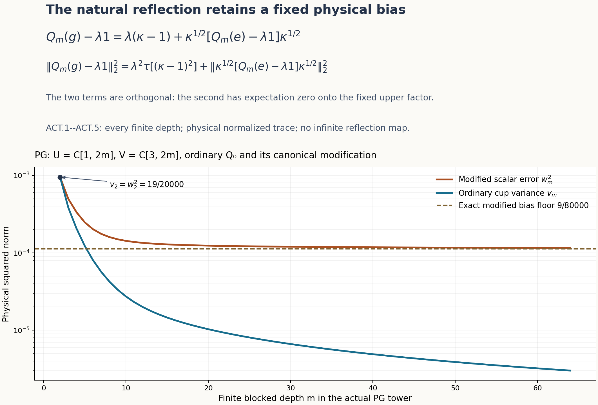

**Figure ACT.1.** The upper formulas are the exact physical orthogonal decomposition (ACT.7)--(ACT.8). The lower curves are the actual finite PG values (ACT.27)--(ACT.29), with the blocked endpoints \(C_{[1,2m]}\) and \(C_{[3,2m]}\), and the designated ordinary cup \(Q_0\). The dashed line is the exact floor (ACT.26), not a fitted constant. PG14 and (ACT.19), rather than the plotted samples, prove the stated limits. The source reflection is used only at finite stages to identify \(w_m^2\) with its weighted lower error. [Reproducible source and exact checks](figures/physical-modified-cup-bias-v27.py).

## Physical permutation averages in the weighted-spin tower

The existing weighted-spin inclusion admits an exact physical estimate at every depth: the finite compression gap is \(1-l/m\), and the ordinary cup variance is \(\lambda(1-3\lambda)/m\). This gives a direct physical averaging proof of its bicommutant identity. It also gives an actual strongly amenable Jones tower in which the finite averaging expectations do **not** commute with the stage expectations. This last calculation rules out an automatic finite commuting-square step. The unrestricted original bicommutant theorem remains unresolved by this unit: its hypotheses have not supplied the physical permutation action used here.

The exposition and figure sources are dedicated to **CC0 1.0**. The original strong-amenability and bicommutant formulations are due to Sorin Popa, [*Classification of amenable subfactors of type II*](https://doi.org/10.1007/BF02392646). The specific weighted-spin inclusion and its existing bicommutant proof are [Lesson 47](weighted-spin-tunnel.md), 47.1–47.5, and [Lesson 62](scalar-commutants-and-tracial-tunnels.md), 62.6. The quantitative calculation below acts on the actual upward tower and does not extend the unmodified reflected map normally.

### A physical realization of the same original tower

Fix \(p,q>0\) with \(p+q=1\), and put

\[
d=(pq)^{-1},\qquad \lambda=pq.
\tag{PU.1}
\]

At every integer site \(i\), take a copy of \(\operatorname{Mat}_2\). For a word \(u\) on a finite interval \([a,b]\), use signed charge \(c(u)=\sum_{i=a}^b(-1)^i u_i\), and let \(C_{[a,b]}\) be the span of \(E_{uv}\) with \(c(u)=c(v)\). Give an even site weights \((p,q)\), and an odd site weights \((q,p)\). The product state restricts to a faithful trace on every \(C_{[a,b]}\).

Here is an explicit verification and the relation with Lesson 47. Change each odd-site coordinate to \(v_i=1-u_i\), and keep \(v_i=u_i\) at even sites. Then

\[
c(u)=\sum_{i=a}^b v_i-\#\{i\in[a,b]: i\text{ odd}\},
\tag{PU.2}
\]

and every transformed coordinate has weights \((p,q)\). Thus \(C_{[a,b]}\) is exactly the full matrix block algebra organized by the number of transformed ones. A word with \(r\) transformed ones has diagonal weight \(p^{b-a+1-r}q^r\), constant on its matrix block. The identity embeddings at both ends preserve trace. Weighted partial trace at an end is the trace-preserving expectation onto the shorter balanced algebra: a surviving equal pair of end indices cancels in the charge equality, and the other pairs have zero partial trace.

Form the tracial GNS closure of all finite intervals, denoted \(T\), and within it put

\[
M_b=\left(\bigcup_{a\le b}C_{[a,b]}\right)'',\qquad
R_a=\left(\bigcup_{b\ge a}C_{[a,b]}\right)''.
\tag{PU.3}
\]

For the left half, reading transformed coordinates in order \(0,-1,-2,\ldots\) identifies \(M=M_0\) with the factor of Lesson 47. The subfactor \(N=M_{-1}\) removes its first coordinate and is exactly that lesson's weighted-spin inclusion. The same trace argument identifies every half with its shifted copy. These are II₁ factors by 47.1.

The physical projection for the triple \(M_{k-1}\subset M_k\subset M_{k+1}\) is

\[
e_k=\left|\sqrt{w_0^k}\,00+\sqrt{w_1^k}\,11\right\rangle
\left\langle\sqrt{w_0^k}\,00+\sqrt{w_1^k}\,11\right|,
\quad
w^k=\begin{cases}(p,q)&k\text{ even},\\(q,p)&k\text{ odd}.\end{cases}
\tag{PU.4}
\]

For completeness, this is the ordinary cup, with no changed expectation. Its two words have equal signed charge. Since \(w_i^kw_i^{k+1}=pq\) for both labels, weighted partial trace gives \(E_{M_k}(e_k)=\lambda1\) and \(\tau(e_k)=\lambda\). Rank-one compression gives
\(e_kxe_k=E_{M_{k-1}}(x)e_k\) for \(x\in M_k\), and \(e_kM_{k+1}e_k=M_{k-1}e_k\), first on finite balanced words and then normally. If \(x\in M_k\) commutes with \(e_k\), this compression identity gives \((x-E_{M_{k-1}}x)e_k=0\); the scalar expectation implies
\(\|(x-E_{M_{k-1}}x)e_k\|_2^2=\lambda\|x-E_{M_{k-1}}x\|_2^2\). Thus \(M_k\cap\{e_k\}'=M_{k-1}\). Both adjacent inclusions are shifted copies of 47.2 and have index \(d\). Apply the ordinary recognition theorem in Lesson 4, 4.5, to \(M_k\subset M_{k+1}\) and \(e_k\). It identifies exactly this preceding factor \(M_{k-1}\), this projection, and the actual Jones triple. Equivalently, at a lower triple, the odd-site bit change and the left-half reading turn (PU.4) into the matrix (47.11). The identical calculation applies at every integer \(k\).

The finite positive tower is consequently the original ordinary Jones tower of \(N\subset M\), with its compatible normalized trace. Since every finite interval belongs to some \(M_b\), its upward tracial completion is precisely \(T\). The construction introduces neither a second infinite trace nor a normally extended reflection.

### The actual finite averaging algebra

Let \(D_l\) be the diagonal algebra on sites \(1,\ldots,l\), with \(D_0=\mathbb C\). On these sites use transformed bits \(v_i\) from (PU.2), and write \(Y_i=1_{\{v_i=1\}}\). Their physical law is independent Bernoulli with mean \(q\). Products of left-half balanced matrices with right-half diagonal matrices have the product trace. Thus

\[
A_l=M\vee D_l\cong M\bar\otimes D_l,
\qquad
S_m=Y_1+\cdots+Y_m.
\tag{PU.5}
\]

All these statements are about subalgebras of the same finite tracial \(T\).

**PU.1 — physical finite commutants and diagonal corners.** For \(m\ge0\),

\[
B_m=M'\cap M_m=C_{[1,m]},\qquad
D_l'\cap M_l=A_l.
\tag{PU.6}
\]

The empty interval means scalars. The normalized physical trace on \(B_m\), in the transformed coordinates, assigns weight \(p^{m-r}q^r\) to each minimal word projection in the size-\(\binom mr\) block. In particular this is the physical **upward** trace of the two-sided realization.

**Proof.** The inclusion of the displayed suffix algebra in the first commutant is immediate. For the reverse inclusion, first expect a commuting element onto a finite interval \(C_{[-n,m]}\). Commutation with the prefix full blocks \(C_{[-n,0]}\) makes it identity on each prefix multiplicity block, with a bounded suffix matrix coefficient depending only on the prefix charge. Expectation after another prefix extension averages that field with the distribution of the added transformed Bernoulli variables. The total-variation distance between a binomial law and any fixed integer translate tends to zero. Here is an elementary verification at arbitrary \(p,q>0\). The binomial consecutive-mass ratio \((n-r)q/((r+1)p)\) decreases in \(r\), so the masses are unimodal and the sum of the absolute differences from a unit translate is twice their largest mass. Expanding \((p+qe^{it})^n\) and integrating its monomials gives that each mass is bounded by
\[
\frac1{2\pi}\int_{-\pi}^{\pi}|p+qe^{it}|^n\,dt
\le\frac1{2\pi}\int_{-\pi}^{\pi}
\exp\!\left(-\frac{2npq}{\pi^2}t^2\right)dt.
\]
We used \(\sin(|t|/2)\ge |t|/\pi\) and \(1-s\le e^{-s}\). Split this integral at \(|t|=n^{-1/4}\). The central contribution is at most \(n^{-1/4}/\pi\), and the other contribution is at most \(\exp(-2pq\sqrt n/\pi^2)\), both tending to zero. A fixed integer translate then follows by telescoping. Hence the bounded suffix coefficients at any two fixed reachable prefix charges agree. One can make the comparison after an arbitrarily long prefix extension; the coefficients are uniformly bounded by the original operator norm. The finite expectation therefore belongs to the single suffix algebra \(C_{[1,m]}\). Their physical \(L^2\) limit belongs to that same finite-dimensional algebra. This proves the first identity. It is the binary version of the complete prefix-field argument PG7–PG8 in Lesson 65.

For the second identity, the diagonal word projections separate every right-prefix word. Commutation with all of them removes every off-diagonal right-prefix corner. In each retained word corner the balanced left coefficients belong exactly to \(M\), since the same suffix charge cancels on both sides. Finite word calculation followed by normal closure gives \(D_l'\cap M_l=M\vee D_l\). Product trace in (PU.5) makes the resulting matrix coefficients faithful. \(\square\)

The binomial mixing in this proof is independent of extremality. No inference about an arbitrary fusion system is taken from its proof.

For \(m\ge l\), let \(Q_m:T\to B_m'\cap T\) be the probability-Haar conjugation expectation of PH.8 of the physical averaging theorem. All Hilbert spaces and norms below use the same normalized \(\tau\).

**PU.2 — Haar averaging is an exact count expectation on the diagonal part.** For \(x\in M_l\),

\[
Q_m(x)=Q_m(E_{A_l}^{M_l}x),
\qquad
Q_m(af)=a\,\mathbb E(f\mid S_m)
\quad(a\in M,\ f\in D_l).
\tag{PU.7}
\]

Here \(f\) is regarded as a function of the first \(l\) of the \(m\) physical transformed bits. The output function is embedded in \(Z(B_m)\subset M_m\).

**Proof.** Since \(D_l\subset B_m\), the fixed subspace of \(Q_m\) is contained in the fixed subspace of diagonal-unitary conjugation. The composition of the two orthogonal Haar projections is therefore \(Q_m\). By PU.1, diagonal-unitary averaging restricted to \(M_l\) is its trace expectation onto \(A_l\), proving the first identity. Elements of \(M\) commute with every \(B_m\), so bimodularity removes \(a\). In each count-\(r\) full matrix block of \(B_m\), Haar averaging a diagonal function is its normalized matrix trace times the block identity. The Bernoulli product weights are equal within that block, so its normalized matrix trace is precisely the conditional expectation at \(S_m=r\). Independent block phases remove all inter-block entries. \(\square\)

### Exact compressed spectrum at every depth

Put \(H_l=L^2(M_l)\) and

\[
K_{l,m}=E_{M_l}Q_m|_{H_l},\qquad m\ge l.
\tag{PU.8}
\]

This is the physical compression PH.13 with \(j=0\). It kills \(H_l\ominus L^2(A_l)\) by (PU.7). On \(L^2(A_l)=L^2(M)\otimes L^2(D_l)\), it is \(1\otimes k_{l,m}\), where

\[
k_{l,m}f=\mathbb E\bigl(\mathbb E(f\mid S_m)\mid Y_1,\ldots,Y_l\bigr).
\tag{PU.9}
\]

**PU.3 — exact physical norm and gap.** If \(m\ge l\ge1\), the nonzero eigenvalues on the scalar diagonal-coordinate space are

\[
\alpha_r=\frac{\binom lr}{\binom mr},\qquad 0\le r\le l,
\tag{PU.10}
\]

each on a one-dimensional symmetric subspace. All other diagonal-coordinate eigenvalues are zero. Consequently

\[
\left\|K_{l,m}|_{H_l\ominus L^2(M)}\right\|=\frac lm,
\qquad
g_{0,l,m}=1-\frac lm.
\tag{PU.11}
\]

In particular, for every \(x\in L^2(M_l)\),

\[
\left(1-\frac lm\right)\|x-E_Mx\|_2^2
\le \|x-Q_mx\|_2^2,
\qquad
\|Q_mx-E_Mx\|_2^2\le\frac lm\|x-E_Mx\|_2^2.
\tag{PU.12}
\]

The first bound is effective for \(m>l\); for instance \(m\ge2l\) gives gap at least \(1/2\) simultaneously over the entire depth-\(l\) stage. Both constants and every containing algebra are physical.

**Proof.** Set \(Z_i=(Y_i-q)/\sqrt{pq}\). For a subset \(I\subset\{1,\ldots,l\}\), put \(Z_I=\prod_{i\in I}Z_i\), and \(Z_\varnothing=1\). Independence makes these an orthonormal basis of the finite diagonal-coordinate \(L^2\) space. For \(|I|=r\), averaging the ordinary permutation group of the \(m\) transformed sites gives

\[
\mathbb E(Z_I\mid S_m)
=\frac1{\binom mr}\sum_{\substack{J\subset\{1,\ldots,m\}\\|J|=r}}Z_J.
\tag{PU.13}
\]

Indeed the permutation matrices preserve count, lie in \(B_m\), and their averaging on diagonal functions is the uniform average within each count fiber, namely the same conditional expectation as in PU.2. The orbit of an \(r\)-element subset consists of all such subsets, each with the same multiplicity. No trace transport or abstract tensor flip is used.

Expectation onto the first \(l\) coordinates kills a term \(Z_J\) having a coordinate outside that prefix, by independence and its zero mean. Thus

\[
k_{l,m}Z_I
=\frac1{\binom mr}\sum_{\substack{J\subset\{1,\ldots,l\}\\|J|=r}}Z_J.
\tag{PU.14}
\]

On the degree-\(r\) subspace this is the rank-one operator with every matrix entry \(\binom mr^{-1}\), so its symmetric eigenvalue is (PU.10) and its other eigenvalues are zero. For \(1\le r\le l\),
\(\alpha_r=\prod_{k=0}^{r-1}(l-k)/(m-k)\le l/m\), and equality occurs at \(r=1\). After tensoring with \(L^2(M)\), the scalar-coordinate space is precisely \(L^2(M)\), which is removed in (PU.11). The previously killed orthogonal complement contributes only zero. This proves the exact norm, not merely an upper bound. Pythagoras for \(Q_m\), which fixes \(L^2(M)\), gives both inequalities in (PU.12). \(\square\)

Let \(B=M'\cap T\) and \(D=B'\cap T\). The physical martingale PH.1–PH.3 gives \(Q_m\to E_D\) strongly on \(L^2(T)\). For every fixed \(l\), (PU.12) sends \(Q_mx\) to \(E_Mx\). The stage union is dense, so these two normal expectations agree on all \(L^2(T)\), and

\[
(M'\cap T)'\cap T=M,\qquad g_{0,l}=1\quad(l\ge0).
\tag{PU.15}
\]

This is a quantitative alternative proof for the same inclusion as 62.6. It is not a new subfactor counterexample, and is not an unconditional proof for arbitrary strongly amenable inclusions.

**PU.4 — every prescribed ordinary finite prefix of this same inclusion.** The original weighted-spin negative tunnel can be aligned with any prescribed finite ordinary negative prefix by one unitary \(u\in N\). Its complete conjugated continuation is generating. This alignment fixes every original upward cup and every \(B_m\) pointwise, preserves every \(M_l\) as an algebra, and preserves the physical trace. Consequently (PU.10)–(PU.17) are unchanged for every such prescribed prefix.

**Proof.** Use the actual finite marked alignment of [Lesson 57, 57.3](actual-supported-local-approximation.md), whose uniqueness input is the ordinary downward recognition 4.5. At the first unmatched negative cup, 4.5 supplies a unitary in the current smaller factor conjugating it to the prescribed cup. At the next unmatched cup use a unitary in the already matched deeper factor; this unitary commutes with all earlier cups and preserves their determined factors. The finite product belongs to \(N\) and aligns the entire prescribed marked prefix. Conjugate the remaining negative tunnel by that same product. It still has ordinary cups and its relative-commutant union generates \(M\), since \(uMu^*=M\).

For the positive side, \(u\in N\subset M_{j-1}\) for all \(j\ge0\), so \([u,e_j]=0\). Every \(b\in B_m\) commutes with \(M\), hence with \(u\). Since \(u\in M_l\), it preserves \(M_l\) as an algebra; inner conjugation preserves \(\tau\). Uniqueness of the normal tracial expectations gives
\(E_{M_l}\operatorname{Ad}_u=\operatorname{Ad}_u E_{M_l}\), and the fixed \(B_m\) gives
\(Q_m\operatorname{Ad}_u=\operatorname{Ad}_u Q_m\). Thus the compressed operators are intertwined by the physical \(L^2\) unitary \(\widehat x\mapsto\widehat{uxu^*}\), and their norms are unchanged. The cups themselves are fixed, so their physical variance is literally unchanged. This is finite marked alignment, not a claimed normal infinite reflection. \(\square\)

### Ordinary cup variance and a finite noncommutation witness

At sites \(0,1\), let \(P_0,P_1\in M\) be the site-zero diagonal projections, and set \(z=pP_0-qP_1\). In the transformed coordinates the ordinary cup \(e_0\) has diagonal part

\[
E_{A_1}(e_0)=pP_0Y_1+qP_1(1-Y_1)
=\lambda1+z(Y_1-q).
\tag{PU.16}
\]

The off-diagonal two-word terms are removed by diagonal-unitary averaging. PU.2 and (PU.13) give

\[
Q_m(e_0)=\lambda1+\frac z m\sum_{i=1}^m(Y_i-q),
\qquad
v_{0,m}=\|Q_m(e_0)-\lambda1\|_2^2
=\frac{\lambda(1-3\lambda)}m.
\tag{PU.17}
\]

For the variance, the right summands are independent, centered, and each has variance \(\lambda\). The left/right product trace and \(\tau(z^2)=p^3+q^3=1-3\lambda\) supply exactly the displayed expression. The cup retains its physical trace \(\lambda\). The same calculation at any integer stage exchanges \(p,q\) if necessary and retains (PU.17). Thus all ordinary physical scalar-cup limits vanish in this model.

Now set \(h=z(Y_1-q)\in M_1\), with
\(E_Mh=0\) and \(\|h\|_2^2=\lambda(1-3\lambda)>0\). At \(l=1,m=2\),

\[
K_{1,2}h=\tfrac12h,\qquad K_{1,2}^2h=\tfrac14h,
\tag{PU.18}
\]

so \(K_{1,2}\) is not a projection. In particular the actual normal physical expectations \(E_{M_1}\) and \(Q_2\) do not commute. More explicitly,

\[
(E_{M_1}Q_2-Q_2E_{M_1})h=-\frac z2(Y_2-q),
\quad
\|(E_{M_1}Q_2-Q_2E_{M_1})h\|_2^2
=\frac{\lambda(1-3\lambda)}4.
\tag{PU.19}
\]

For \(p=1/4,q=3/4\), these quantities are

\[
d=\frac{16}3,\quad\lambda=\frac3{16},\quad
\|h\|_2^2=\frac{21}{256},\quad
v_{0,m}=\frac{21}{256m},\quad
\|[E_{M_1},Q_2]h\|_2^2=\frac{21}{1024}.
\tag{PU.20}
\]

This inclusion is the already proved strongly amenable example of 62.6, including the every-smooth-representation quantifier. Equation (PU.19) therefore refutes the inference that the finite physical expectations must commute because the inclusion is strongly amenable or has a generating ordinary tunnel. It does not refute the limit commutation or the bicommutant identity; (PU.15) proves them here.

### Exact boundary for the unrestricted problem

For the unrestricted assigned inclusion, PH.1–PH.8 are retained unchanged. The finite-stage norm argument alone still gives no control uniform in \(l\), and still gives no zero for the ordinary cup variance. The extra object used in PU.13 is an actual unitary permutation action on \(m\) independent physical right coordinates. It comes from this model's full equal-count matrix blocks, whose physical trace is constant within each count fiber.

A general subfactor's iterated correspondence is not supplied with this physical permutation action by a generating-tunnel approximation or an all-smooth hypertrace. Permuting formal fusion labels, ranks, or equal scalar trace budgets is not a proof that the corresponding unitary exists in \(M'\cap M_m\), acts on the unchanged \(x\in M_l\), and has (PU.13). No such transfer is established in this unit. The original unrestricted implication remains exactly:

\[
\text{original strong amenability/generation}
\Longrightarrow (M'\cap T)'\cap T=M,
\]

with the actual normalized tracial completion and ordinary cups. The failed finite commuting-square step has the actual witness (PU.18)–(PU.20); the physical dilution argument is complete at the explicit model's scope only.

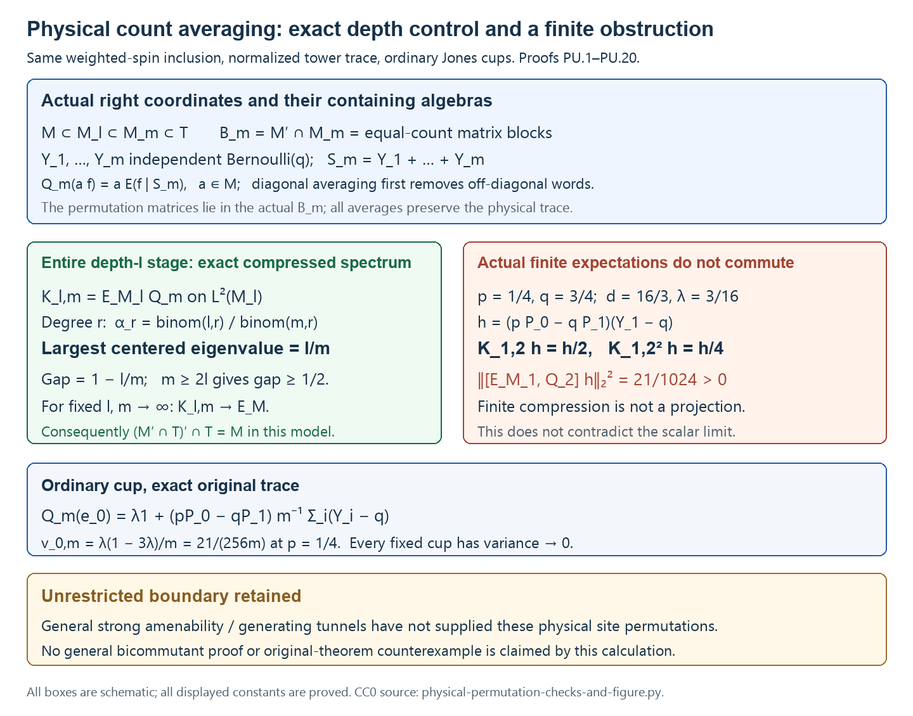

**Figure PU.1.** The algebra boxes are schematic. The degree-one compressed eigenvalue is exactly \(l/m\) and the gap is exactly \(1-l/m\), proved in PU.3. The finite witness uses \(p=1/4,q=3/4,l=1,m=2\); its commutator squared norm is (PU.20). The bottom boundary records the missing general physical permutation action. All maps act in the original \(L^2(T,\tau)\). [Reproducible CC0 source](figures/physical-permutation-averages-v27.py).

## Checks with complete solutions

**Exercise GTB.1 — padding and physical error.** Suppose actual whole-stage cells have \(d=9\), \(\tau(p_1)=2/3\), \(\tau(p_2)=1/3-1/10000\), residual trace \(1/10000\), and old target error below \(1/20\) for targets of norm at most two. Refine both cells by GTB.3 using \(h=3\). Determine the extra discarded mass and prove a strict \(1/10\) target-error bound. Does this make the supports tail-factor projections?

**Solution.** There are \(L=9^3=729\) equal-trace full-corner projections in each relevant tail factor. Their sum is exactly one there, so each realized cell is covered exactly and no extra mass is discarded. Thus GTB.11 gives
\(\|y-c_y\|_2<1/20+2\sqrt{1/10000}=7/100<1/10\).
The original residual remains \(1/10000\). The projections are still whole-stage supports, with the original compressed indices. No tail membership or exact finite origin for that residual has been produced. The traces describe a conditional test of already realized cells, not an existence claim for an arbitrary proposed numerical family.

**Exercise GTB.2 — exact versus controlled retention.** In (GTB.20), can a length-three actual corner tunnel retain all of \(G\) exactly? At that length, give the errors from (GTB.23)–(GTB.24), and prove that every one of the 36 displayed physical matrix-unit targets is approximated strictly within \(1/10\).

**Solution.** Its smaller full stage is \(\operatorname{Mat}_{27}\), for any actual tunnel by finite marked uniqueness. A unital \(\operatorname{Mat}_2\) in it would split 27 into two equal integer ranks, so exact retention is impossible. For \(j=3\), choose \(\tau_F(z)=26/27\), split it into 13 projections of trace \(2/27\), and complete the 26 old corner units with the residual of trace \(1/27\). The two-leg target \(E_{ab}^{(b)}\otimes1\) has error \(1/\sqrt{54}\) in \(D\). Each complete target \(E_{uv}^{(a)}\otimes E_{ab}^{(b)}\) has error \(1/\sqrt{162}<1/10\), since \(162>100\). The specified unitary rotates the tunnel, while these 36 targets are kept fixed. Approximation does not create an exact unital \(M_2\) inside \(M_{27}\).

**Exercise V8.1 — one density, a finite mesh.** Suppose \(L=7\) and \(n=700\). Prove the mesh bound and, if \(J_h\le1/1000\), compute the guaranteed normalized joint defect.

**Solution.** The support trace is at most seven, hence \(\eta\le1/100\). Equation (V8.12) gives \((1/1000+2/100)/(1-1/100)=7/330\). The estimate is for the supplied density; it does not assert that amenability supplied the displayed \(J_h\). A larger \(n\) reduces this same finite density's mesh error.

**Exercise V8.2 — count the actual right coordinates.** Explain the factors \(n\) and \(n^2\), and count the cuts for scalar eigenvalues \(1/4,3/4\), with \(n=4,\theta=1/2\).

**Solution.** The vectors \(\sqrt n\widehat{E_{ab}}\) form an orthonormal basis of \(L^2(M_n,\operatorname{tr}_n)\). A right minimal projection keeps one value of \(b\), leaving \(n\) left coordinates. Its left trace is \(n\operatorname{tr}_n\); summing the \(n\) right projections gives \(n^2\operatorname{tr}_n\). The four thresholds are \(1/8,3/8,5/8,7/8\). Their cut ranks on this two-eigenvalue coordinate example are \(2,1,1,0\), so their average is the original diagonal density. This is a coordinate example, not an asserted ordinary Jones core.

**Exercise V8.3 — a later coefficient is charged.** Take \(d=4\), \(\delta=1/10000\) and \(\chi\le1/10^8\). If each old coefficient defect is below \(1/1000\), bound the corresponding actual final coefficient defect after two deletions.

**Solution.** Equation (V8.30) adds at most \(4\sqrt{4\delta^2+\chi d}=\sqrt2/1250\). Thus the final defect is below \(1/1000+\sqrt2/1250<11/5000\), since \(\sqrt2<3/2\). This test uses a supplied physical-state bound and does not equate old and new coefficients.

**Exercise V9.1 — both traces and endpoint rigidity.** In the actual diagonal inclusion(V9.7), let \(t=1/3\). Compute its index, both projection weights and ambient density. Why is its actual original joint cost zero in every ordinary core? Does unequal physical and dual trace imply positive joint defect?

**Solution.** Here \(s=2/3\), \(d=3+3/2=9/2\), and \(k_C=2c+(1/2)(1-c)\). The inherited weights of \(c,1-c\) are \(1/3,2/3\); their normalized dual weights are \(2/3,1/3\). The actual cup density has those same two eigenvalues, and82.5 gives \(E_C(f)=c\). Equation(V9.3) forces \(f=c\), so \(w=\ell\) and the original cost is the zero operator. Unequal trace weights therefore do not give a positive joint defect in this example. No general full-partition or universal-amenability conclusion follows from this calculation alone.

**Exercise V9.2 — a singular witness and its physical obstruction.** For the abelian model with \(L=4\), compute the mass, twisted residual and absolute ratio test. Explain the cluster state's original joint norm. Test a matching physical extension(V9.15) with \(r=1/2,R_*=2\).

**Solution.** The mass is \(7/3\), the twisted residual is \(4/21\), and the fixed absolute ratio test is \(2/7\). As \(L\to\infty\), the residual tends to zero and the fixed test tends to \(1/3\). Thus the singular cluster has \(\alpha P_0=\ell\alpha\) and original joint norm \(1/3\). These are different statements from zero original joint norm. The stipulated physical extension would require \(\tau(zf)=1/9\le\tau(c_-f)=1/18\), which is false. The abelian example therefore refutes an abelian-only deduction, while this precise physical realization is excluded by the inherited trace.

**Exercise V10.1 — the physical target after a right move.** In (V10.7), take \(m=3\). Find the column count, support trace and density trace. What are the fixed \(s\)-defects before and after the flip? Why does the flip fail to define a map on densities?

**Solution.** Here \(k_m=8\), so there are64 columns, \(\operatorname{Tr}(q_m)=64\), and \(\operatorname{Tr}(h_m)=1\). The fixed defect is zero before the flip and exactly two afterwards, by orthogonality of the two trace64 support projections. Both coisometric rows \(a_m\) and \(s a_m\) have the same initial \(h_m\), but the same right flip sends them to the two orthogonal-support densities, at distance two. Thus the actual row is necessary data. Exact row sums and joint balance do not alone preserve the earlier physical target.

**Exercise V10.2 — one fixed bounded test excludes a stronger approximation class.** Let \(\varphi\) be the cluster state of (V10.12), and let \(\psi\) be the state of any right-sum-one row. Evaluate both at \(T=\rho_D(p)\) and give a lower bound for \(\|\varphi-\psi\|\). Does this refute the existence of a jointly balanced compatible state?

**Solution.** Equations(V10.13)–(V10.14) give values1 and\(1/2\). Since both states have value1 at the identity and \(\|2T-1\|=1\), their difference on \(2T-1\) is1. Hence \(\|\varphi-\psi\|\ge1\), and the fixed \(T\) also excludes weak-star approximation by such rows. This particular \(\varphi\) is itself joint-balanced because both actual core centers are scalar. A different balanced state is supplied by (V10.7)–(V10.8); suitable-state existence is not refuted.

**Exercise IF.1 — the exact return defect.** In the index-eighteen model, condition a compatible original hypertrace on \(c_+\), and then on \(c_-\). Compute each original compatibility defect and each corner index. Can recombining these conditional states decrease the original cost?

**Solution.** The physical traces are \(1/3\) and \(2/3\). IF.8 gives defects \(4/3\) and \(2/3\), respectively. IF.32 gives index four for each compressed pair, while the original index is eighteen. Each conditional state agrees with the old state on \(A\), and hence has exactly its original cost. IF.10 says the original trace-weighted recombination is the old state itself. These maps do not produce a strict cost decrease.

**Exercise IF.2 — interior variance and zero cost.** Use IF.28 to compute the conditional variance in each physical block and its full trace. Explain why these positive numbers do not contradict zero original joint cost.

**Solution.** The variances are \((1/2-1/\sqrt7)(1/2+1/\sqrt7)=3/28\) and \((1/2-5/(4\sqrt7))(1/2+5/(4\sqrt7))=3/112\). Their trace is \((1/3)(3/28)+(2/3)(3/112)=3/56\). The actual core has \(R=M,S=N\), so its centers are scalar and the original joint coordinate is zero. Cup conditional variance is a different inherited-trace quantity and need not vanish.

**Exercise BC3.1 — the original variance test.** Suppose \(\kappa\ne1\). Set \(t=\kappa-1\). Calculate \(P_0t\) and \(P_\kappa t\). Why does a physically fixed operator-balancing UCP map exclude the original cup state as a pullback?

**Solution.** Equation(BC3.3) gives \(P_0t=0\), while \(P_\kappa t=P_0((\kappa-1)^2)=q_\kappa\). Theorem BC3.1 forces \(\Phi(\iota(q_\kappa))=0\). The cup state has value \(\tau((\kappa-1)^2)>0\), by faithfulness of the original trace. Therefore it cannot factor through this map. This excludes the stronger operator-balancing requirement, not the weaker state identity.

**Exercise BC3.2 — balanced cyclic GNS.** Does applying unrestricted amenability to the normal faithful GNS representation of \(\psi_e\) force its returned hypertrace to have the cyclic vector's joint center marginal?

**Solution.** Proposition BC3.3 proves a normal isomorphism of the entire expected pair and a bijection of its compatible physical hypertraces. The vector state is the already existing balanced cup state. Amenability supplies a compatible central state in the represented pair but places no condition equating it with that vector state on the joint center. Its pullback therefore satisfies exactly the original hypertrace requirements; joint balance still needs its own proof.

**Exercise JB.1.** In (JB.1), suppose \(d=6\), \(\|w^{-1}\|\le6\), \(t_0=6\), \(\|b_i\|\le\sqrt6\), \(\sigma(\mathfrak a)\le\eta\), and \(r_i(\sigma)\le\eta/(6\sqrt6)\) for every basis element. Bound the full original joint discrepancy. Does checking each commutator against one fixed operator suffice?

**Solution.** Formula (JB.3) gives
\(\mathcal E_\sigma\le(6/6)\,6\sqrt6\,\eta/(6\sqrt6)=\eta\).
Theorem JB.1 therefore gives
\(\|\alpha_\sigma-\alpha_\sigma P_0\|\le2\eta\).
Each \(r_i\) is a norm on the whole dual of the original \(B\), taking the supremum over every contraction \(T\in B\). One evaluation against a specified operator cannot give the asserted bound.

**Exercise JB.2.** Let \(c\in Z(A)\) be a cost spectral projection with \(\psi(c)=3/4\) and \(c\le1_{[0,\varepsilon]}(\mathfrak a)\). Which conditions of (JB.2) survive exactly, what is its exact distance from \(\psi\), and what physical error bound follows? Is the bound enough to produce arbitrarily small original joint discrepancy?

**Solution.** AS.3 gives exact \(E_A\)-compatibility, \(N\)-centrality and \(\psi_c|_M=\tau_M\), with ideal annihilation retained when present. Formula (JB.10) gives exact state distance \(1/2\), and the conjugation error at any physical unitary is at most \(1\). Its cost is at most \(\varepsilon\), but (JB.11) still includes the finite basis budget. These fixed bounds do not make that budget tend to zero. A vanishing budget must be proved for the actual selected states, or the states must be obtained by another construction. The example introduces no smooth GNS representation or full finite partition.

**Exercise BC4.1.** Take \(m=2\) in the correlated row construction. Compute \(k_m\), the original and repaired row lengths, the two canonical support traces, and the fixed \(u\)-defect before and after the two-term repair. Is the support trace a physical support probability?

**Solution.** Here \(k_m=4\). The lengths are \(4k_m^2=64\) and \(8k_m^2=128\). The original support has canonical trace \(2k_m^2=32\), and the repaired \(P_m\) has canonical trace \(4k_m^2=64\). Their density coefficients are \(1/32\) and \(1/64\), respectively, so each density has canonical trace one. The fixed physical \(u\)-defect is exactly two before repair and zero afterward. Both states still have the exact physical probability trace on \(M\). The support traces are semifinite canonical dimensions, not probabilities or the masses of physical projections in \(M\).

**Exercise BC4.2.** Why does every fixed finite left-\(N\) averaging list fail on the correlated sequence, while \(v_m=X_0X_{m+1}\) succeeds? Explain the order of the target choice and the separate generating-tunnel conclusion.

**Solution.** Each fixed averaging unitary has vanishing defect on \(h_m\), so its finite average differs from \(h_m\) in \(L^1\) by a quantity tending to zero. The original \(u\)-defect is two; the reverse triangle inequality in BC4.3 leaves its limiting value equal to two. The repairing unitary depends on \(m\), swaps \(p_m,1-p_m\), and produces \(P_m/(4k_m^2)\), which commutes with all of \(K_m\). Given the original finite target list, choose \(m\) so that its distances to \(K_m\) are below \(\eta/2\), then construct the finite row and its two-term average. BC4.22 gives the required errors. Corollary BC4.5 separately applies the complete factorial-core providers: every prescribed prefix admits a full support-one local square and a generating continuation. It does not identify \(P_m\) with a physical corner chain.

**Exercise LF.1.** After a prescribed prefix, let two selected physical supports have traces \(7/25\) and \(9/125\), with their individual actual continuations already given. Compute the residual trace, select a finite depth that certifies it, and explain which operators stay fixed during its placement.

**Solution.** The residual trace is
\(1-7/25-9/125=81/125\).
The length-three smaller relative commutant has all projection traces \(h/125\), so a projection of total rank \(81\) gives an exact certificate. Conjugate its continuation by a unitary in the physical \(N_k\) that sends this certificate to the actual residual \(f\). The unitary fixes \(A_k=N_k'\cap M\) pointwise, retains all earlier factor algebras and cups, and does not act on the old selected continuations. Replacing just \(fA_k,fB_k,\mathbb Cf\) by the three full rows in LF.50 contains the old square and preserves the physical targets. Its support partition is exactly one; no residual mass is discarded.

**Exercise LF.2.** In LF.54–LF.56, suppose the central projection has trace \(1/4\). What strict bound follows for the fixed-family limiting packing cost? Does that prevent a full finite partition or allow a generating ordinary tunnel?

**Solution.** LF.55 gives
\(\Delta_\infty>\tau(q)/2=1/8\).
It prevents arbitrarily cheap promotion of these two fixed canonical rank classes. Their physical residual still has a 5-adic trace and therefore has its own exact finite certificate; LF.15 completes the full partition with the old supports unchanged. Generation is a different question. LF.41 gives a nonscalar core center, and LF.17 transports it to every ordinary tunnel, so this inclusion has no generating ordinary tunnel. Plain amenability therefore does not imply generation; the ergodic-core hypothesis in the strong-amenability statement remains necessary.

**Exercise CF.1.** In the actual LF inclusion retain the prefix through \(N_1\) and use the 625 unitaries CF.5. If a full finite square has errors below \(h_+/10\), can its candidates be moved by less than \(h_+/10\) into one common relative-commutant stage of another continuation of this prefix?

**Solution.** Such movement would give common-stage target errors below \(h_+/5\), by the triangle inequality and best approximation. CF.1 forces at least one error to be at least \(\sqrt2 h_+/5>h_+/5\). Therefore that movement is impossible. The complete full square still exists by LF.15; its individual continuations are essential here.

**Exercise CF.2.** Prove CF.6 for a self-adjoint element of \(\operatorname{Mat}_n\), using its \(n^2\) shift-and-clock unitaries and normalized matrix trace. Explain why the test set in CF.5 can be chosen before any continuation.

**Solution.** For each unitary \(u\),
\(\|ux-xu\|_2^2=2\tau(x^2)-2\operatorname{Re}\tau(xu^*xu)\).
The shift-and-clock average sends \(x\) to \(\tau(x)1\); hence its average squared commutator norm is
\(2\tau(x^2)-2|\tau(x)|^2\).
The fixed factor \(F\) contains the prescribed \(A_1\). Every continuation preserves the expectation \(z_1\) by CF.3, so every \(E_F(z_{\mathcal T})\) has the same positive variance lower bound CF.4. The same unitaries of \(F\) therefore work for all continuations.

**Exercise RF.1.** Explain why proving only that the particular signed class \(1-m[g_n]\) never promotes would not prove TheoremRF.2. Where does the proof exclude every other finite representative and every finite subdivision?

**Solution.** A different rank class can have the same ambient trace, as the critical path and lamplighter examples demonstrate. TheoremRF.2 instead writes the trace of every alleged residual cell as its own bounded-rank polynomial. Transcendence turns the equality of the total physical traces into an integer polynomial identity. Its endpoint value is negative on the required remainder and nonnegative on every candidate summand. This rules out all alternative finite ranks and all finite sums, without fixing the alleged cells' classes.

**Exercise RF.2.** For the two-copy length-two family, compute the residual trace interval when \(p\in(1/2,2/3)\), and the new length-four physical trace.

**Solution.** \(1-2p^2\in(1/9,1/2)\). The old residual has no finite whole-stage partition for transcendental \(p\). The length-four cuts remove physical trace \(p^4\), and the new residual has trace \(1-2p^2+p^4=(1-p^2)^2\). Its certificate has ranks \((0,0,4,4,1)\) in capacities \((1,4,6,4,1)\), so every coordinate is valid. The corresponding dual values are obtained by swapping \(p,q\), not by asserting equality of the two traces.

**Exercise RF.3.** Does TheoremRF.2 refute the unrestricted finite-dimensional approximation theorem? Does TheoremRF.4 justify general factoriality or generation from amenability?

**Solution.** The unrestricted theorem permits selection of a new full finite family. TheoremRF.2 refutes the stronger requirement that an arbitrary selected family stay unchanged while finitely many new whole cells partition only its residual. TheoremRF.4 constructs a valid new family by cutting old supports, and accounts for its physical error. Its use of a factorial smaller core is justified by the actual weighted-spin generating tunnel. The all-smooth amenable lamplighter inclusion has nonfactor cores, so the same premise is not available in general. No plain-amenability generating assertion is derived.

**Exercise RF.4.** Why do \(U_i,v\in N_k\) retain the original cups but not necessarily every element of the physical \(N_k\)?

**Solution.** Earlier cups lie in \(A_k=N_k'\cap M\), which commutes with every unitary of \(N_k\). Earlier factor algebras contain \(N_k\), so inner conjugation by such a unitary preserves each as a set. Elements of \(N_k\) itself may be conjugated nontrivially. The targets in RF.12 are the original physical operators and are not conjugated; the estimate includes the changed finite algebras explicitly.

**Exercise TR.1.** Let the original compatible state \(\psi\) be singular on the represented centers and annihilate the entire original norm-closed Jones ideal. In TR12.5, prove that the physical map \(m\mapsto qm\) is a faithful normal *-homomorphism, while the returned canonical cup has value zero. Does the original canonical normalization \(\operatorname{Tr}(e)=1\) change?

**Solution.** The support projection \(q\in A^{**}\) commutes with physical \(M\), so \(m\mapsto qm\) preserves products, adjoints and the target unit \(q\). Its squared faithful-state norm is \(\tau(m^*m)\), proving faithfulness. For an increasing positive net, the difference between its image limit and the supremum of the image net has zero faithful \(\phi\)-value by normality of the physical \(\tau\); it is therefore zero. This proves normality on the physical factor without assuming original-center normality. For \(x\) in the Jones ideal, \(\psi(x^*x)=\psi(xx^*)=0\). Faithfulness on the support corner implies \(xq=qx=0\), so \(\Lambda_\psi(x)=0\), in particular \(\Lambda_\psi(e)=0\). The original canonical trace still has \(\operatorname{Tr}(e)=1\). The finite new trace is the original state after UCP return, not an identification with that canonical trace.

**Exercise TR.2.** For a true original compatible cost minimizer \(\psi_0\), prove that the finite representation TR12.9 has no compatible state with transported original cost smaller than \(m=\psi_0(\mathfrak a)\). Identify a compatible state attaining \(m\), and explain how the same conclusion retains the full Jones-ideal face.

**Solution.** Every compatible new state \(\eta\) pulls back by the actual \(\Lambda_{\psi_0}\) to a compatible original state. Its cost \(\eta(\Lambda_{\psi_0}(\mathfrak a))\) is consequently at least \(m\). The faithful finite trace \(\tau_{\psi_0}\) is compatible, has the original physical marginal, and satisfies \(\tau_{\psi_0}\Lambda_{\psi_0}=\psi_0\); its cost is exactly \(m\). If the original minimizer kills the Jones ideal, TR12.5 gives \(\Lambda_{\psi_0}(J_e)=0\), so every pullback remains in that entire face and the same lower bound and attainment apply. This is a property of the exact constructed return; it does not decide whether the true original minimum is zero.

**Exercise WM.1 — both finite traces, with an explicit rational parameter.**
For the algebraic member \(\lambda=3/2\), compute the physical and dual weights of \(C\), their density, and the scalar coefficient in WM.35. Does the finite calculation prove positive harmonic means at that parameter?

**Solution.** One has \(S_+=11/2\), \(S_-=14/3\), \(d=77/3\). The four ordinary labels have
\(w_i^+=2/11\), \(w_i^-=3/14\); the toggle label has
\(w_1^+=3/11\), \(w_1^-=1/7\). Each list sums to one, and each product equals \(3/77=1/d\). Thus \(c_0=33/28\), \(c_1=11/21\), with physical mean
\[
4\frac2{11}\frac{33}{28}
+\frac3{11}\frac{11}{21}=1,\qquad
d(c_0-c_1)w_1^+=\frac{55}{12}.
\]
The finite formula would give the bound \((55/12)(h_++h_-)\) if those means were positive. Their positivity at \(\lambda=3/2\) is not proved by this calculation. The strict example in WM.35 uses the separately proved exact parameter WM.22.

**Exercise WM.2 — a center lift is not a change of physical measure.**
Show that \(\vartheta_i\) is faithful and determine its measure on a central projection \(v\in V\). Derive a quantitative obstruction to the constant likelihood \(r_1=w_1^+\).

**Solution.** If \(vp_i=0\), then \(v r_i=E_V(vp_i)=0\). Since \(r_i\ge1/d\), \(v=0\). The full corner theorem and the onto map \(\sigma_i\) then give the normal center isomorphism. Its normalized corner trace satisfies
\[
\tau_U(\vartheta_i(v))
=\frac{\tau(vp_i)}{w_i^+}
=\frac{\tau_V(vr_i)}{w_i^+}.
\]
This need not equal \(\tau_V(v)\). By WM.24,
\(\tau_V((r_1-w_1^+)z)=-w_1^+(h_++h_-)\).
Since \(\|z\|\le1\), physical trace duality yields
\(\|r_1-w_1^+\|_1\ge w_1^+(h_++h_-)>w_1^+b>0\).
Thus the obstruction is an actual inherited-trace pairing.

**Exercise WM.3 — the correct module projection.**
Compute the normalized dual mass of \(p_i\) from a finite Morita frame. Explain why using the range of left multiplication by \(p_i\) changes the calculation.

**Solution.** Right multiplication by \(p_i\) has range \(L^2(R)p_i\). In WM.30b this range has right-\(S\) support projections \(\sigma_i^{-1}(f_l^{(i)})\); their normalized center trace sums to \(\vartheta_i(r_i^{-1})\). Its scalar dimension is
\[
\tau_U(\vartheta_i(r_i^{-1}))
=w_i^{-1}\tau_V(r_i r_i^{-1})=w_i^{-1}.
\]
Dividing by the total matrix dimension \(d\) gives
\(\rho_0(p_i)=1/(d w_i^+)=w_i^-\).
Left multiplication by \(p_i\), in contrast, has range \(p_iL^2(R)\). Its unnormalized matrix trace is \(d\tau(p_i)=dw_i^+\), because the common basis gives \(\sum_j a_ja_j^*=d1\). Its normalized mass is \(w_i^+\), the physical trace, rather than \(w_i^-\). This precisely diagnoses the mistaken normalization avoided by WM.30–WM.30c.

**Exercise WM.4 — exactly what nonzero cost rules out.**
Using only WM.32–WM.36, prove \(w\ne\ell\). Explain what this says about a faithful normal joint restriction and why it does not refute the original possibly singular state-existence target.

**Solution.** The expectation of \(w-\ell\) onto \(V\) equals the nonzero function
\((c_0-c_1)(r_1-w_1^+)\), by WM.29 and \(c_0>c_1\). Therefore \(w-\ell\ne0\), and
\(dQ(|w-\ell|)\) is a nonzero positive function with the strict trace bound WM.35. A faithful normal \(\alpha\) has
\(\alpha(|w-\ell|)>0\), so its compatible state cannot have zero cost. A nonfaithful normal or singular state can vanish on a nonzero positive function; this calculation supplies no uniform positive lower bound over those states. The unresolved task is to construct or exclude an **actual compatible** state satisfying \(\alpha=\alpha P_0\), which is equivalent to zero discrepancy in the original identities. An arbitrary state chosen on an abelian surrogate would not establish that compatibility.

**Exercise C13.1 — recover a physical branch.**
Why do the countably many central lamp-sign tests in C13.7 recover the actual \(p_i\), rather than only an abstract event? Check the toggle-versus-translation case.

**Solution.** On \(p_i\), the first-label corner identity C13.4 makes every equality test hold. On another branch \(p_j\), the same tests assert equality of two transforms of the actual suffix final configuration. If a toggle transform equals translation by \(e_k\), the difference equation on the line through the origin is
\[
\eta(ne_k)+\eta((n-1)e_k)=1_{\{n=0\}}\pmod2.
\]
The actual suffix walk has nonzero drift transverse to this line, so its final configuration has finite support there. Summing over an interval containing that support cancels the left side, while the right side is one. Thus this equality event has trace zero. Pure translations are separated by finite support on their difference lines and infinitely many lit sites. The five transforms are therefore pairwise different almost surely. The faithful actual suffix trace gives \(f_i p_j=0\) for \(j\ne i\) and \(f_i p_i=p_i\); since the physical \(p_j\) sum to one, \(f_i=p_i\). The faithful full-corner lift on \(A'\cap B\) retains these same physical projections.

**Exercise C13.2 — prescribed singular center and physical return.**
Let \(\omega\) be an \(H\)-invariant, possibly singular state on the actual coefficient center \(Z(W)\). Which normality assertions are needed to construct its original compatible state? Does the construction automatically annihilate the Jones ideal?

**Solution.** C13.12 constructs a UCP physical projection \(\Gamma_\omega:W\to P\) which fixes \(P\), is equivariant, and has \(\Gamma_\omega(z)=\omega(z)1\). The finite complementary state extensions and the point-ultraweak cluster need not be normal. The physical factor embeddings and finite supported matrix stages remain the actual faithful normal ones of WM.15. Entrywise extension and the original finite physical corner give \(F_\omega:B\to M\), with \(F_\omega|_M=\mathrm{id}\) and \(E_NF_\omega=F_\omega E_A\). Its multiplicative domain gives \(M\)-bimodularity, so \(\psi_\omega=\tau F_\omega\) is \(M\)-central, has physical marginal \(\tau\), and is \(E_A\)-compatible. No assertion identifies its singular center restriction with either original canonical trace. The later pure-singularity result E14.12 supplies the precise hypotheses of the existing SC.2–SC.3. E14.12a therefore proves that this actual return kills the entire original Jones ideal.

**Exercise C13.3 — the two likelihood endpoints.**
For the algebraic parameter \(\lambda=3/2\), compute the endpoints in C13.22, the coefficient \(K\), and the universal bound in C13.23. What does this verify about the separately fixed parameter WM.22?

**Solution.** The displayed formulas give
\[
S_+=\frac{11}{2},\quad S_-=\frac{14}{3},\quad d=\frac{77}{3},\quad
w_1=\frac3{11},\quad w_1^-=\frac17,\quad
K=\frac{605}{36}.
\]
Thus \(0\le\epsilon_\omega\le10/77\), and
\[
\frac{22}{3}\epsilon_\omega\le C_\omega
\le\sqrt{\frac{46585}{108}\epsilon_\omega}
\le\frac{55}{3\sqrt6}.
\]
The last square is \(3025/54=dK(10/77)\). These are exact algebraic checks of the bound, not a computation of the maximizing invariant state. They neither replace the fixed physical parameter WM.22 nor establish harmonic positivity at the sample parameter.

**Exercise C13.4 — maximum moment and the unresolved zero state.**
Let \(m\) be the maximum of \(\omega(R_1)\) over invariant states on the actual \(Z(W)\). Prove the exact dichotomy supplied by C13.23–C13.24 without deciding which branch holds.

**Solution.** The invariant-state set is nonempty by the concrete Følner averages, weak-star compact because invariance is a family of closed bounded linear equations, and its moment is weak-star continuous. Hence \(m\) is attained and \(m\le w_1\). If \(m=w_1\), the attaining state has \(h_\omega=K(w_1-\omega(R_1))=0\); C13.23 forces its original cost to vanish. The physical return C13.12–C13.13 then constructs the actual compatible state. If \(m<w_1\), every original compatible state supplies an invariant state and obeys
\[
\psi(\mathfrak a)\ge \frac{2}{w_1}(w_1-m)>0.
\]
This would be an actual counterexample to the zero-cost assertion. The proved formulas do not determine \(m\). Positive physical normal operator cost alone cannot decide the dichotomy, because the original compatible states may be singular.

**Exercise E14.1 — actual central noise.**
Verify the three four-label words of E14.1 and explain why conditioning on their positions does not replace the physical endpoint distribution by an auxiliary walk.

**Solution.** With \(s_0=1\), \(s_1=az\), \(a^2=1\) and central \(z\), the alternating products of \((0,0,0,0)\), \((1,0,1,0)\), \((0,1,0,1)\) are respectively \(1,(az)^2=z^2,(az)^{-2}=z^{-2}\). Their original word weights are \(d^{-2},\lambda^2d^{-2},\lambda^{-2}d^{-2}\). Independent four-label blocks can be conditioned on the positions having one of these three words and on every other complete block. The remaining selected words still have their conditional original weights. Their endpoints are central, so their factors can be pulled through every unselected endpoint. Mixing the resulting shifted binomial laws returns the original endpoint distribution. Thus E14.4 controls an actual endpoint law, with its central coordinate and physical traces retained.

**Exercise E14.2 — fair cylinders and a singular spectral limit.**
Prove that a state with the finite lamp probabilities E14.10 has no nonzero normal positive functional below it on the actual center. Why does this not compute its original cost?

**Solution.** The actual line has only finitely many lit sites almost surely under the faithful normal core measure. Therefore its normal projections \(F_L\), requiring all sites outside \([-L,L]\) to be unlit, increase strongly to one. For each \(m\), \(F_L\) is dominated by the event that any \(m\) chosen outside sites are unlit. Its state value is at most \(2^{-m}\), hence \(\omega(F_L)=0\). If a normal positive \(\eta\le\omega\) existed, normal monotone continuity would give \(\eta(1)=\lim_L\eta(F_L)=0\). It is therefore zero. The likelihoods \(R_i\) are elements of the full actual von Neumann center, obtained through normal spectral limits. A singular state need not preserve those limits; fair finite lamp probabilities do not determine \(\omega(R_i)\) or the reciprocal cost. For the actual compatible returned states, E14.12a applies the existing complete SC.2–SC.3 and annihilates the entire Jones ideal. Bare singularity without the physical state and representation hypotheses would not suffice.

**Exercise E14.3 — the trace-character sign.**
Derive the logarithmic identity E14.15 from the two original center measures and the actual involution. Compare the two Jensen endpoints.

**Solution.** The original measure identities give
\[
D_1=\frac{w_0R_1}{w_1R_0}=\frac{R_1}{\lambda R_0}.
\]
The proved whole-center identity \(\beta_{z^2}=\mathrm{id}\) implies \(\beta_1^2=\mathrm{id}\) on this center. The Radon–Nikodym chain identity is \(D_1\beta_1(D_1)=1\). Invariance and bounded logarithms give \(2\omega(\log D_1)=0\), hence
\(\omega(\log R_1)-\omega(\log R_0)=\log\lambda\).
At the lower Jensen endpoint all reciprocal Jensen remainders vanish, and the other four means equal \(\lambda/(4\lambda+1)\), whereas the toggle mean is \(1/(4\lambda+1)\). Their logarithmic ratio is \(-\log\lambda\), which is impossible. At the upper endpoint the means are the physical \(w_i\), and the ratio is \(\log(w_1/w_0)=\log\lambda\), consistent with the identity. This comparison excludes the lower root, not the desired upper root.

**Exercise E14.4 — retain the stronger actual lower bound.**
Use the proved \(R_i\ge1/d\) to strengthen the separated interval in E14.18 without changing the inclusion.

**Solution.** Every likelihood and mean is at least \(\widehat m=1/d\). For \(t\in[w_-,w_+]\), \(t\ge\widehat m\) and \(1-t\ge4\widehat m\), so
\[
\left|\frac{d}{dt}\log\frac{4t}{1-t}\right|
\le\frac2{\widehat m},\qquad
B(t)\le\frac{d(t-w_-)}{4\widehat m^2}.
\]
The same reciprocal-variance and logarithm argument of E14.16–E14.17 uses only these bounds. If \(u=t-w_-\le\widehat m^4(\log\lambda)^2/(16d)\), its left side is at least \(15\log\lambda/8\), while its right side is at most \(9\log\lambda/64\), a contradiction. Thus
\[
\omega(R_1)>
\frac1{4\lambda+1}+\frac{(\log\lambda)^2}{16d^5}.
\]
All constants belong to the one fixed actual model. This positive separation next to the lower root does not bound the maximum strictly below the upper root and supplies no zero-cost state.

**Exercise MR.1 — recover the normalized polar cost.** Let \(p\in N\setminus\{0\}\), \(t=\tau(p)\), and suppose all \(25\) matrix units obey MR.15. Explain why the five corrected diagonal projections have normalized trace \(1/5\), why the polar errors vanish with \(\delta\) even when \(t\) is arbitrarily small, and why the Weyl target error is less than \(c/4\) at \(\delta=c/400\).

**Solution.** Since \(q_i\in N'\cap M\) and \(p\in N\), the products \(d_i=pq_i\) are exact orthogonal projections with sum \(p\). Bimodularity and \(E_N(q_i)=1/5\) give
\[
 \tau(d_i)=\tau(pE_N(q_i))=t/5,\qquad
 \tau_p(d_i)=1/5.
 \tag{MRE.1}
\]
Thus equal-trace comparison extends the polar partial isometry of \(X_i=pe_{i0}p\) to \(V_i:d_0\to d_i\). Its deficit is
\[
 a_i=\frac12\|[p,e_{i0}]\|_2^2<\delta^2t/2,
 \qquad
 \|V_i-X_i\|_2\leq\sqrt{a_i}<\delta\sqrt{t/2}.
 \tag{MRE.2}
\]
The exact matrix units \(w_{ij}=V_iV_j^*\) satisfy
\[
 \|w_{ij}-pe_{ij}p\|_2
 \leq\sqrt{a_i}+2\sqrt{a_j}
 <3\delta\sqrt{t/2}.
 \tag{MRE.3}
\]
After division by \(\sqrt t\), the cost is bounded by \(3\delta/\sqrt2\), with no factor \(t^{-1/2}\) left. Adding the normalized local approximation cost \(\delta\) gives a distance less than \(4\delta\) for each corrected matrix unit.

For the five-term shift \(S\), its expectation \(A=E_G(S)\) is a contraction and \(\|S-A\|_{2,p}<20\delta\). The clock \(D\) belongs to \(G\) exactly. For \(0\leq a,b<5\),
\[
 \operatorname{dist}_{2,p}(S^aD^b,G)
 \leq\|S^a-A^a\|_{2,p}
 \leq a\|S-A\|_{2,p}<80\delta=c/5<c/4.
 \tag{MRE.4}
\]
There is no assertion that a uniform absolute \(M\)-error stays small after normalizing a tiny corner. The actual local input already contains the factor \(\sqrt t\). A weighted family estimate alone would require a separate weighted-average selection argument before this calculation.

**Exercise MR.2 — retain all finite continuation quantifiers and the physical budget.** Let \(Y=\{E_G(u):u\in\mathcal W_p\}\), and complete a near-cover containing \(p,G\), with \(\tau(f)<\varepsilon^2/16\), \(\varepsilon=c\sqrt t\), and \(\varepsilon_0=\varepsilon/8\). Show that no finite number of freely chosen ordinary corner chains on its good supports can meet GTB.27. Explain why an exact full whole-cell completion is nevertheless possible here.

**Solution.** Each proposed finite ordinary chain on \(pNp\subset pMp\) extends to an infinite ordinary chain. Its core has the central witness of MR.7, transported by the compatible normal core map fixing \(pA_0\); this holds at every length. The Weyl average forces some \(u\in\mathcal W_p\) to have normalized distance at least \(c\) from its finite relative commutant. Since \(\|u-E_G(u)\|_{2,p}<c/4\), the corresponding fixed \(y\in Y\) has normalized distance greater than \(3c/4\). Converting to the inherited physical norm gives
\[
 \delta_p(y)\geq
 \|y-E_{\mathcal L}(y)\|_2>
 (3c/4)\sqrt t=3\varepsilon/4 .
 \tag{MRE.5}
\]
The target index may depend on the proposed main-cell chain. The maximum over the already fixed finite \(Y\) therefore remains valid for any choices of the other chains, their finite lengths and their number. Their nonnegative squared errors cannot reduce the main-cell term:
\[
 \varepsilon_0+\max_{y\in Y}
 \Bigl(\sum_i\delta_i(y)^2\Bigr)^{1/2}
 >\varepsilon/8+3\varepsilon/4=7\varepsilon/8>\varepsilon/2.
 \tag{MRE.6}
\]
The near-cover itself has zero old error because \(Y\subset G\subset P_0\). It satisfies every unconditional GTB.25 hypothesis; it fails the proposed universal existence of the additional approximate input.

For this actual inclusion, the finite scalar trace fibers are exactly \(\mathbb Z[1/5]\cap[0,1]\) after every prescribed prefix. The selected supports have finite origins, so their residual has an exact finite certificate in that fiber. Comparison in the physical retained factor moves only that new certificate onto the original \(f\). The old blocks and targets are untouched, and MR.31–MR.32 give a full finite whole-cell square with \(E_{P_*}(y)=y\). This is a family of individual whole-inclusion continuations; it does not ask each old good cell to become a unital corner-tunnel stage.

**Exercise 42 — the logarithmic enclosure does not construct an endpoint.** Let \(\omega\) be an invariant state of the actual center, let \(\ell_j=\omega(\log D_{j+1})\), and let \(s=(\ell_1+\ell_2+\ell_3)/3\). Use the two original Jensen bounds to prove \(0\le s\le\log\lambda\). If \(s=0\), prove that the original reciprocal cost vanishes. Explain which existence claim is still required.

**Solution.** Put \(c=\omega(\log R_0)\). The two bounds give

\[
(1+\lambda+\sum_j e^{\ell_j})(1+\lambda^{-1}+\sum_j e^{-\ell_j})
\le d=(4+\lambda)(4+\lambda^{-1}).
\tag{T16E.1}
\]

Arithmetic–geometric mean on each three-term sum bounds the left side below by
\((1+\lambda+3e^s)(1+\lambda^{-1}+3e^{-s})\). Subtracting \(d\) gives

\[
\frac{3(1+\lambda^{-1})(e^s-1)(e^s-\lambda)}{e^s}\le0.
\tag{T16E.2}
\]

Since \(\lambda>1\), this is equivalent to \(0\le s\le\log\lambda\). At \(s=0\), equality holds in both arithmetic–geometric means, so all three \(\ell_j\) are zero. The two original Jensen bounds then force \(c=-\log(4+\lambda)\), and their five lower bounds on \(\omega(R_i)\) sum to one. Thus \(\omega(R_i)=w_i^+\) for every \(i\). Each quantity

\[
\omega\!\left(\frac{(R_i-w_i^+)^2}{(w_i^+)^2R_i}\right)
=\omega(R_i^{-1})-\frac1{w_i^+}\ge0
\tag{T16E.3}
\]

has sum zero by the original reciprocal identity. Positive-functional Cauchy–Schwarz, applied to
\((R_i-w_i^+)/(w_i^+\sqrt{R_i})\) and \(w_i^+\sqrt{R_i}\), gives
\(\omega(|R_i-w_i^+|)=0\). The same inequality with the bounded factor \(R_i^{-1}\) gives
\(\omega(|R_i^{-1}-(w_i^+)^{-1}|)=0\). C13.19 consequently gives zero original cost. The compact invariant-state set is nonempty, but compactness and the enclosure only give a minimum somewhere in the interval. They do not prove that this minimum is zero. One must construct an actual invariant state attaining that endpoint or prove an exact actual separation.

**Exercise 43 — a normal tail calculation and a failed invariant return.** For \(K\ge2\), let
\(\rho_K(t)=\mu_V(E_Kt)/\mu_V(E_K)\), with the actual height-tail projections of T15.7. Compute all five likelihood means from the original two trace tails. Prove that every cluster of these states is singular and cannot be used as the invariant center state in C13's physical return.

**Solution.** The original trace formula is
\(\mu_V(R_i t)=w_i^+\mu_U(\beta_i^{-1}t)\). The identity and lamp labels fix \(E_K\); a translation label sends it to \(E_{K-1}\). T15.11 therefore gives

\[
\rho_K(R_0)=\frac{w_0^+}{A}=\frac1{1+4\lambda},
\qquad
\rho_K(R_i)=\frac{\lambda}{1+4\lambda}\quad(1\le i\le4).
\tag{T16E.4}
\]

The lamp uses \(w_1^+=\lambda/(4+\lambda)\), while each translation uses \(w_i^+=1/(4+\lambda)\) and the extra tail factor \(\lambda\). These are the same actual parameter and both original measures, rather than new physical weights.

For each fixed \(L\), the inequality \(E_K\le E_L\) holds for \(K\ge L\), so every cluster \(\rho\) gives \(\rho(E_L)=1\). The projections \(E_L\) decrease strongly to zero under the original faithful normal center trace. If a normal positive functional \(\xi\le\rho\), then \(\xi(1-E_L)\le\rho(1-E_L)=0\); normality gives \(\xi(1)=0\). Hence \(\rho\) is purely singular.

The exact likelihood deviations satisfy

\[
\sum_i\rho(|R_i-w_i^+|)
\ge\sum_i|\rho(R_i)-w_i^+|
=\frac{6(\lambda^2-1)}{(1+4\lambda)(4+\lambda)}>0.
\tag{T16E.5}
\]

More decisively, T15.18–T15.20 prove
\(\rho(L_0)=\widetilde h_+(\lambda)>b/2\), while the actual lamp flip sends \(L_0\) to \(-L_0\). Invariance would force this expectation to be zero. Thus these actual singular states are not invariant and cannot supply C13's invariant-center input. Their conformal covariance and stationary finite averaging law do not change that conclusion; averaging them over the full group can change the tested likelihoods.

**Exercise 44 — the derivative convention fixes the character sign.** Verify the inverse dilation derivative and the sign in NZ.11.

**Solution.** For \(T^{-1}x=tx\), NZ.8 gives \(D_{T^{-1}}(x)=2f(t^{-1}x)/f(x)\). If \(|x|\le1/2\), both arguments lie in \(\mathcal O\), so this is two. Otherwise expansion crosses or remains outside the unit ball and the density ratio is \(1/4\), giving \(1/2\). It integrates to one because \(\mu(t\mathcal O)=1/3\). Every invariant state annihilates \(1_{t\mathcal O}\), so its logarithmic mean is \(-\log2\), opposite to \(T\). This matches NZ.1 and the actual character convention.

**Exercise 45 — compact escape and the original full derivative.** Does zero on every fixed compact ball imply zero logarithmic mean?

**Solution.** No. In the explicit action it gives the opposite conclusion: \(\log D_T=\log2-2\log2\,1_{\mathcal O}\), so every such state has mean \(\log2\). In the fixed weighted model it proves only an escape property of the actual affine observable \(X\). A conclusion about \(\log D_{t_j}\) requires a comparison with that bounded full-center function. Neither replacing it by a conditional expectation nor passing through a normal spectral limit is valid for an arbitrary singular state.

**Exercise 46 — two stationary laws still permit positive cost.** In AC.3–AC.18, verify both probability normalizations and compute the likelihoods and invariant reciprocal cost.

**Solution.** The unit ball has Haar mass one and each shell \(2^k\) has mass \(2^{k-1}\). Thus the mass of \(\mu_U\) is
\[
\frac67\left(1+\frac12\frac{1/4}{1-1/4}\right)=1.
\]
The \(\mu_V\) mass is \((6/7)(3/4+5/16+5/48)=1\). AC.7 follows from the piecewise densities: on the inner half and unit shell addition by one interchanges the pieces, while outside the unit ball it preserves the shell. The dilation pushforwards have densities \(2f_U(x/t)\) and \(f_V(tx)/2\), so the outer equality is exactly AC.8. Dividing the three summands in the first stationary equation by \(f_V\) gives AC.16. The second equation gives AC.17; its three cases have inverse sums \(6+5/2+3/2\), \(5/2+6+3/2\), and \(5/2+5/2+5\), all ten. Every invariant state annihilates the unit ball by AC.12. Its likelihood vector is therefore \((2/5,2/5,1/5)\), and its reciprocal cost is
\[
|5/2-4|+|5/2-4|+|5-2|=6.
\]
This is a complete counterexample to an implication from the displayed measurable identities. It does not supply the additional identification of the full physical ordinary-core center.

**Exercise 47 — the physical and dual word weights.** For AH, calculate the first-branch masses, their dual density, and both masses of a minimal endpoint-word projection of length \(2m\) and height \(n\).

**Solution.** The trace scales are \((1,1,2)\), so \(S_+=4\), \(S_-=5/2\), \(d=10\). The physical masses are \((1/4,1/4,1/2)\); the dual masses \(1/(10w_i^+)\) are \((2/5,2/5,1/5)\). Their relative density is \((8/5,8/5,2/5)\). At length \(2m\) the two inherited masses are \(2^n/10^m\) and \(2^{-n}/10^m\), each summing to one over all words. The physical cup trace is \(1/10\).

**Exercise 48 — the actual hitting laws and full centers.** Prove the two normal limit laws, and explain the additional argument that makes them full physical-center laws.

**Solution.** Independent bounded pair-height increments have mean \(3/10\), so heights tend to positive infinity and each Laurent digit is eventually fixed. For an independent \(Y\) with the respective stationary law, \(B_{2n}+t^{S_{2n}}Y\) has that law at every time by AC.7 and converges to \(X\). Bounded continuous tests, including clopen ball indicators, therefore identify the entire law: plus first gives \(\mu_V\), minus first gives \(\mu_U\). This proves AH.17, but stationarity alone is not maximality. AB.16–AB.18 show \(H(G_{2n}\mid X)=o(n)\). The fully proved finite-marked entropy lemma AB.4 identifies the whole raw endpoint tail with \(\sigma(X)\). Equal-endpoint prefix substitutions identify the whole AF center with that tail, by AB.26–AB.27. Thus the actual normal maps AH.18 are onto as AB.31 asserts. Their canonical likelihoods are AB.30 on the entire center; no singular state is passed through a conditional expectation.

**Exercise 49 — the coefficient-window entropy bound.** On the event \(E_n\) of AB.16, bound the number of possible endpoints given \(X\), and deduce sublinear conditional entropy.

**Solution.** All coefficients below \(\ell_n\) are the known coefficients of \(X\), and all above \(u_n\) are zero. Only \(u_n-\ell_n+1\) binary coefficients and the height in that same interval remain free. Hence there are at most
\[
(u_n-\ell_n+1)\,2^{u_n-\ell_n+1}
\]
possibilities. Overall there are at most \(9^n\) endpoints. Conditioning also on \(1_{E_n}\) costs at most \(\log2\), so
\[
H(G_{2n}\mid X)\le\log2+\log(u_n-\ell_n+1)
 +(u_n-\ell_n+1)\log2+\mathbb P(E_n^c)n\log9.
\]
The height law gives \(\mathbb P(E_n^c)\to0\). Divide by \(n\), take the limsup, and send \(\varepsilon\downarrow0\); the result is \(o(n)\). No uniform past lower-height bound is needed: the known lower truncation of each Laurent series is finite.

**Exercise 50 — an actual finite physical separator.** Deduce AO.8 from the exact state discrepancy, and state what it implies for the V8 spectral stacks.

**Solution.** Every invariant full-center state kills each compact ball by disjoint Laurent translations. Therefore every compatible physical central state sees \((R_0,R_1,R_2)=(2/5,2/5,1/5)\), giving original joint norm
\[
2|2/5-1/4|+|1/5-1/2|=3/5
\]
and reciprocal cost \(2|5/2-4|+|5-2|=6\). If AO.8 failed for a fixed \(r<3/5\), choose a coisometric Jones column for every finite unitary set and positive tolerance, with errors below that tolerance and \(J_h<r\). Direct these choices by inclusion and decreasing tolerance. A weak-star cluster is exactly compatible, has physical marginal \(\tau\), and is \(M\)-central; the bounded original joint pairings give discrepancy at most \(r\). This contradicts \(3/5\). For spectral stacks, V8's retained lower estimate is \(\max(0,J_h-2\eta)/(1+\eta)\). Thus centrality errors and mesh loss tending to zero force liminf normalized joint error at least \(3/5\), after any prescribed prefix. This refutes the universal joint-state route; it does not refute a separate full-family construction.

**Exercise 51 — equal numerical weights and actual residual placement.** In the actual WM inclusion take \(\lambda=3/2\). After a prescribed prefix, select twenty orthogonal physical supports, each individually conjugate to the identity-pair word diagonal at paired suffix level one. Compute the old residual trace, the endpoint-wise and grade-wise canonical overbooking costs at that level, and the residual certificate of HG.3. Give the extra fixed-target error bound from HG.14.

**Solution.** The actual index is \(d=(11/2)(14/3)=77/3\), and the chosen word trace is \(1/d=3/77\). Twenty physically orthogonal copies exist in the factor \(N_k\), since their total trace is \(60/77<1\); individual unitary comparison places each canonical word projection onto its support and gives its actual finite continuation. Thus \(\tau(f)=17/77\).

There are five identity-endpoint pairs, namely the pairs of equal raw labels, so that actual endpoint block has unit rank five. Twenty copies of its rank-one projection have endpoint-wise excess fifteen, of physical weight \(3/77\) per rank, giving \(45/77\). The total grade-zero capacity is seventeen, so HG.8 instead has excess three and cost \(9/77\). The cut leaves seventeen of the twenty ranks and enlarges the physical residual to \(26/77\). The actual canonical certificate takes all four grade-one and all four grade-minus-one word diagonals. Its trace is \(4(\lambda+\lambda^{-1})/d=26/77\). These are genuine word projections in actual endpoint blocks, and their sum is an actual canonical projection. HG.3 places it onto the enlarged physical residual. Its dual trace is also \(26/77\) in this particular symmetric certificate, by the separate inverse-grade calculation. The extra error for the original physical \(y\) is at most \(3(1+\sqrt2)\|y\|/\sqrt{77}\). Later paired stages make the physical grade cost arbitrarily small, by HG.2; this level-one calculation does not substitute that limit. The strict decrease from \(45/77\) to \(9/77\) records the role of the scalar certificate, which need not pack the canonical old supports endpoint by endpoint.

**Exercise 52 — the index-ten full residual with both traces.** In the actual AH index-ten inclusion suppose a finite selected near-cover after a prescribed prefix has residual trace \(7/400\), and every old finite origin has been aligned and extended into paired depth \(m=2\). Give an exact full-family completion, both inherited finite trace values of each new certificate, and the change in every old target error. Explain whether it supplies a common stage for the same physical old blocks.

**Solution.** The grade-minus-two word diagonal has physical trace \(20^{-2}=1/400\) and normalized finite dual trace \(5^{-2}=1/25\). Split the physical residual in \(N_k\) into seven orthogonal projections of trace \(1/400\). For each, separately conjugate the canonical continuation by a unitary of \(N_k\) placing that same word certificate onto it. The seven resulting actual cells cover the entire old residual, retain every earlier cup, and carry the stated two trace values in their respective actual terminal-factor representations. The old good cells and blocks stay unchanged. Each new upper block contains its compression of \(A_k\), so the completed algebra contains the old residual \(fA_k\) and hence all of \(P_0\). Every old expectation error is therefore preserved or improved. The source's permitted individual whole tunnels suffice. This construction does not align all the same physical old blocks into one common ordinary stage, and it proves no generating tunnel or ergodic-core conclusion.

**Exercise 53 — correct the actual central integer, not only the quotient.** In the full group \(H\), suppose the selected-toggle/spatial word in FWT.3 has length \(80\) and central integer \(u=11\), while the desired relative endpoint has central integer \(m_n-M_{2n}=5\). They have the same lamps and spatial coordinate. Give the exact correction and resulting word-length bound. Explain why it fixes both the lamps and the actual parity relation.

**Solution.** Their central difference is \(5-11=-6\), which is even. Append \((z^2)^{-3}=(s_1^{-1})^6\), using six letters. The corrected word has the desired full endpoint and length at most \(86\). The element \(s_1=az\) is not an involution, but \(s_1^2=z^2=(0,0,2)\) is central and has no lamp or spatial component. Its inverse power therefore changes only the central integer by \(-6\); parity modulo two is unchanged. Agreement in the quotient alone would leave this genuine central error. In the general ray the selected toggles number at most \(2(l-k)\), while \(m_n-M_{2n}=o(n)\). The even correction therefore adds at most \(2(l-k)+o(n)\) letters to the \(4(l-k)+o(n)\) spatial/toggle construction, giving FWT.12.

**Exercise 54 — actual endpoint counts and a singular-state limit.** In a plus-initial single pair of the original WM walk, compute the five first-branch probabilities conditional on the full identity endpoint, retaining the original parameter and physical weights. Then explain why convergence of the full count ratios in \(L^2(\mathbb P_+)\) does not determine their value under every singular state.

**Solution.** The endpoint is \(s_i s_j^{-1}\). It equals the identity exactly when \(i=j\), because the five actual labels are distinct in \(H\). There are five such marked pairs. Each has original physical probability
\[
 w_i^+w_i^-=\frac{\nu_i}{S_+}\frac{\nu_i^{-1}}{S_-}=\frac1d,
\]
so the identity event has probability \(5/d\) and every conditional first-branch probability is \(1/5\). Thus FWT.29 gives \(r_{i,1}(1)=1/5\), even though the original unconditioned \(w_1^+\) differs from the other branch weights. The original dual weight of each identity word is also \(1/d\), since its full central integer is zero.

An explicit bounded example explains the limitation of \(L^2\) convergence. In \(L^\infty((0,1),dx)\), put \(f_n=1_{(0,1/n)}\), so \(\|f_n\|_2=n^{-1/2}\to0\). The normal states \(\omega_N(f)=N\int_0^{1/N}f(x)\,dx\) have a weak-star convergent subnet by the complete dual compactness input used earlier. Every cluster state \(\omega\) has \(\omega(f_n)=1\) for every fixed \(n\), because this equality holds whenever \(N>n\). It cannot be normal, since normality would give continuity on the decreasing projections \(f_n\downarrow0\). Hence it does not pass through their \(L^2\) limit. This example does not construct an invariant WM state or assign WM likelihood moments; it proves precisely why the normal convergence FWT.30 leaves the original singular-state optimization unresolved.

**Exercise 55 — an actual inclusion beyond abstract divisibility.** Compute the groups at length five and decide whether numerical divisibility repairs the length-three extension. Then explain why a much later level whose grouped sizes are both divisible by four still cannot repair an extension of the actual length-three inclusion.

**Solution.** From GW.15,
\(m_5=(1,1,10,5)\), so \(\widehat C_5=\operatorname{Mat}_2\oplus\operatorname{Mat}_{15}\). Neither size is divisible by four. At length nine the ranks are \(m_9=(36,36,127,93)\), so the grouped sizes \(72,220\) are divisible by four. A unital abstract representation of \(\operatorname{Mat}_4\) then exists, but extension of the actual source remains impossible: the six-step rank difference in the dimension-one group is
\(2(-1)^5f_6=-16\), by GW.23. The two equivalent length-three minimal projections still have unequal target ranks. Abstract divisibility is necessary for an abstract representation; it does not replace the prescribed multiplicity condition.

**Exercise 56 — physical mesh after a prescribed prefix.** For any actual prescribed-prefix continuation of index \(d=4\), give a finite level guaranteeing a physical subprojection of trace below a requested \(t\in[0,\tau(p)]\), with deficit less than \(10^{-3}\). Explain what this says about an original residual that must be represented exactly.

**Solution.** Here \(\beta_d=3/4\). Choose
\(n\ge m\) with \(\lfloor n/2\rfloor\ge25\), since \((3/4)^{25}<10^{-3}\); for example \(n=\max(m,50)\). GW.26 gives \(q\le p\) in the actual finite \(C_n\) with physical deficit less than \(10^{-3}\), and the endpoint \(t=\tau(p)\) is exact. Its ordinary prefix and cups are unchanged, and both finite trace evaluations are those of this actual \(q\). The mesh result does not make a particular residual scalar an exact finite projection trace or finite positive sum of such traces. Approximate density and exact residual realization are distinct assertions.

**Exercise 57 — two original bounded moments must change.** Suppose the original joint height cluster has \(a,q\ge5b/8\), with \(b=\frac12 25^{-66051}\). Determine the guaranteed lower bound on \(\rho(\sum_iR_i^{-1}-d)\) and upper bound on \(\eta(\log D_1)\). Explain why invariant averaging cannot retain both values.

**Solution.** The sum satisfies \(a+q\ge5b/4\), so HD18.3 gives \(\rho(\sum_iR_i^{-1}-d)\ge25b^2/16>0\). HD18.7 gives \(\eta(\log D_1)\le-2(5b/8)^2/d^2=-25b^2/(32d^2)<0\). Every invariant state has value zero on both original bounded elements, by C13.20 and E14.15. Consequently an average attaining invariance must change these values. This does not compute any invariant state's five likelihood moments or exclude zero original cost.

**Exercise 58 — equality of first moments does not preserve reciprocal dimension.** In the original height cluster, let \(\rho(R_i)=u_i\), \(\sum_i u_i^{-1}=d\), and \(\rho((R_1-u_1)L_0)=-u_1(a+q)\), with \(L_0^2=1\). Prove a strictly positive reciprocal excess without assuming normality.

**Solution.** Positive-functional Cauchy–Schwarz gives \(\rho((R_1-u_1)^2)\ge u_1^2(a+q)^2\). The scalar identity
\[
 R_i^{-1}-u_i^{-1}+\frac{R_i-u_i}{u_i^2}
 =\frac{(R_i-u_i)^2}{u_i^2R_i}
\]
holds by bounded functional calculus. Its middle term has zero \(\rho\)-value. Every resulting reciprocal excess is nonnegative, and \(R_1\le1\) makes the first excess at least \((a+q)^2\). Summing proves \(\rho(\sum_iR_i^{-1}-d)\ge(a+q)^2>0\). A state's first likelihood moments do not authorize applying the invariant-state reciprocal identity to that state.

**Exercise 59 — cancel the origin and retain remote defects.** For an actual height-state cluster \(\xi\), let \(\sigma=\frac12(\xi+\xi\beta_{a_0})\). Compute \(\sigma(L_0)\). Explain why \(\sup_x\|\sigma-\sigma\beta_{a_x}\|=2\), and why this is consistent with invariant Følner clusters.

**Solution.** The actual center lamp action gives \(\beta_{a_0}(L_0)=-L_0\), so \(\sigma(L_0)=0\). HC19.6 gives \(\xi(L_x)\to1\) at remote sites. The fixed origin flip acts trivially on every other lamp, so \(\sigma(L_x)\to1\) as well. Testing on the norm-one \(L_x\) gives \(\|\sigma-\sigma\beta_{a_x}\|\ge2\sigma(L_x)\), while the difference of two states has norm at most two. The supremum is therefore exactly two. Each larger finite Følner average requires its own remote test. For every fixed lamp, its invariance defect tends to zero, so the varying remote tests supply no fixed defect of a cluster state.

**Exercise 60 — a continuous restriction and a normal spectral projection.** The original normal configuration laws give \(\mathcal B_\uparrow\) full mass, whereas the positive-drift comparison law gives it zero mass. A height-state cluster agrees with that comparison law on \(C(\Omega)\). What value does the height state give the original spectral projection of \(\mathcal B_\uparrow\)? Why is there no contradiction?

**Solution.** In the original full center the spectral projection is \(1\), because its complement is null for the original normal law. Every state therefore gives it value one. The indicator of \(\mathcal B_\uparrow\) is not a continuous cylinder limit in uniform norm. Agreement of two functionals on \(C(\Omega)\) does not identify their evaluations of this normal Borel spectral projection. The positive-drift law describes the continuous restriction of the singular height state; it does not give a normal measure representing that state on the original full center. This is the same obstruction to evaluating the five bounded measurable \(R_i\) from cylinder convergence alone.

**Exercise 61 — reconstruct all original moments with a finite normal mixture.** Include all five \(R_i\), their five original inverse-cost functions and three original spatial logarithms in a fixed real test family. How many translates of \(\mu_U\) suffice at each Følner stage? At \(L=100\), bound the invariance defect of the resulting state under a fixed word of length seven. Does the same mixture evaluate a singular state on a normal \(L^2\) limit?

**Solution.** There are \(N=13\) real tests. OM.7 and OM.12 require at most \(N+1=14\) actual translates, each averaged over the same original \(F_L\). The fixed word has defect at most \(2\cdot7/(2L+1)=14/201\), uniformly in the mixture. Each finite mixture is normal and its fixed summands can be evaluated by the original count-depth limit. The possibly singular invariant state appears only in the subsequent Følner limit. No singular state is applied to a normal \(L^2\) limit, and this reconstruction does not evaluate the original upper endpoint.

**Exercise 62 — fix the odd prefix before counting translated likelihoods.** A plus-first odd word of length \(2k+1\) has actual endpoint \(h^{-1}\). A complete plus-first word of length \(2n\) has endpoint \(z\). Determine the suffix endpoint and the normalized prefix posterior. Explain why finite zero first-label posteriors must be clamped before evaluating an inverse cost.

**Solution.** If the suffix endpoint is \(y\), the ordered group product is \(h^{-1}y=z\), hence \(y=hz\). The suffix starts in the minus phase and has length \(2(n-k)-1\). All complete words ending at \(z\) have the same original probability, so the conditional prefix probability is \(N^-_{2(n-k)-1}(hz)/N^+_{2n}(z)\). Divide it by the strictly positive original prefix probability \(p_w=\lambda^{m(h^{-1})}/(S_+d^k)\) to obtain OM.18. It is bounded by \(p_w^{-1}\). The original full likelihood satisfies \(1/d\le R_i\le1\), but a finite posterior can be zero. Clamping to this interval fixes the limit and is \(1\)-Lipschitz; inversion on the interval is \(d^2\)-Lipschitz. Thus the normal count limit gives the true inverse cost without ever inverting a finite zero. The chosen prefix and finite orbit mixture remain fixed throughout that count limit.

**Exercise 63 — an exact finite lamp average on the full center.** Starting from the original WM.16 average \(\mathcal A_L\), define \(\overline{\mathcal A}_L=\frac12\mathcal A_L(\mathrm{id}+\beta_1)\). Explain why it is invariant under the original lamp generator on the entire center, and compute its dimension-error bound. Does it preserve the physical trace character of \(z^2\)?

**Solution.** For each lamp configuration in \([-L,L]^3\) and each endpoint there, the two parity multiplicities add to \(n_0+n_1=2L+1\). The proved full-center identity \(\beta_{z^2}=\mathrm{id}\) therefore reduces the average to the uniform lamp sum FM21.10b. Right multiplication by \(s_1\) permutes that finite sum, giving \(\overline{\mathcal A}_L\beta_1=\overline{\mathcal A}_L\) exactly. Only the three spatial labels contribute to the dimension defect, so \(\|\overline{\mathcal A}_L(Q)-d\|\le3(d-1)/(2L+1)\). The physical trace character remains \(\lambda^2\); the calculation uses triviality only on the already identified full center. This finite average has exact lamp invariance, while full group invariance arises at a Følner cluster.

**Exercise 64 — a sharper compatible-state cost and a definite finite scale.** At the unchanged original \(\delta=2^{-31}25^{-198153}\), prove the cost bound \(C_\omega<18\delta\) for every original compatible state. Give the balanced finite scale that guarantees cost \(<19\delta\) for every seed. Explain why these strict upper bounds do not prove zero cost.

**Solution.** Invariance gives \(\omega(Q)=d\). The tangent identity at \(1/5\) and positive-functional Cauchy–Schwarz give \(C_\omega\le2\delta\sqrt{d/\lambda}+4(\lambda-\lambda^{-1})\). Since \(d/\lambda=4+17/\lambda+4/\lambda^2<25\) and \(\lambda-\lambda^{-1}<2\delta\), the right side is strictly below \(10\delta+8\delta=18\delta\). For \(\overline L_*=156\delta^{-2}\), the balanced dimension error is less than \(\delta^2/4\). Consequently the radicand in FM21.13 is below \((221/2)\delta^2<121\delta^2\), and its square root plus the remaining term is below \(19\delta\), for every seed. The unchanged \(\delta\) is strictly positive. These are small positive upper bounds; they establish neither attainment of zero nor a positive lower bound.

**Exercise 65 — a simultaneous finite trace budget.** Let an old row be \(\operatorname{Mat}_2\oplus\operatorname{Mat}_3\), with physical minimal weights \((1/7,5/21)\) and module minimal weights \((3/10,2/15)\). Both unit masses sum to one. Give the first of two fractional columns the ranks \((1/2,2)\). Apply two \(d=3\) cup copies and the floor allocation of CTR.2. Compute both desired and actual first-column budgets.

**Solution.** The original desired physical budget is \(1/14+10/21=23/42\); the desired module budget is \(3/20+4/15=5/12\). On the matrix components of either cup tensor copy the old ranks multiply by 4 or2, so both first-column ranks become integers. Only the scalar-scalar component retains the fractional rank \(1/2\) of the old \(\operatorname{Mat}_2\) block. Its physical minimal weight is \(1/63\), and its module minimal weight is \(1/30\). Flooring loses \(1/126\) and \(1/60\), respectively. The actual first-column budgets are therefore \(34/63\) and \(2/5\); the second column receives these exact losses. Their two-column absolute budget errors are \(1/63\) and \(1/30\). The total minimal weights of this actual tensor subalgebra are \(32/189\) and \(26/135\). Thus the separate bounds \(2\beta^\tau=64/189\) and \(2\beta^\rho=52/135\) hold. The weights and resulting budgets were never identified between the two trace systems.

**Exercise 66 — a finite level for a prescribed tolerance.** At \(d=4\), take three budget columns in any of the three rows, and use only \(\beta_m^{L,\sigma}\le1\). Find a finite number of separated cup copies making each inherited-trace budget error less than \(1/100\).

**Solution.** CTR.15 bounds each total error by \(4(3/4)^h\). The choice \(h=21\) works: \(4(3/4)^{21}<1/100\), equivalently \(400\cdot3^{21}<4^{21}\). The stage is \(m+63\) in the existing ordinary continuation. The same finite level works for both traces and all three rows. This controls numerical integer allocation. It does not imply that an unchanged selected family fits the canonical capacities or that its fractional physical cut cost is small.

**Exercise 67 — the sharp physical return comparison.** In \(\operatorname{Mat}_3\) with normalized matrix trace, take \(r=E_{11}+E_{22}\), \(e=E_{11}\), \(d=E_{22}\), \(a=-r\), and \(c=1\). Evaluate FS.7, and compare the old universal return factor.

**Solution.** The difference is \(-2E_{22}\), with squared norm \(4/3\). Since \(R=1\) and \(\tau(d)=1/3\), FS.7 is equality \(2/\sqrt3\). The previously proved factor \(1+\sqrt2\) is strictly larger than 2. Equality here concerns the prescribed candidate, not optimal conditional-expectation error.

**Exercise 68 — an intermediate residual lift.** Use normalized trace on \(\operatorname{Mat}_3\), cut its second coordinate, and take the unit-first-two-coordinates matrix \(a=\left(\begin{smallmatrix}-3/5&4/5\\4/5&3/5\end{smallmatrix}\right)\), with \(c=-3/5\,1\). Compute the sharper bound using \(\gamma=3/5\).

**Solution.** The displayed matrix squares to its unit, hence \(\|a\|=1\). The cut difference has off-diagonal entries \(4/5\) and cut diagonal \(6/5\), with squared norm \((2(16/25)+36/25)/3=68/75\). The bound in FS.7 is exactly \(2(1+9/25)(1/3)=68/75\). This is equality for an intermediate residual-lift norm, not only for \(\gamma=0\) or 1.

**Exercise 69 — a zero-residual cut tolerance.** Suppose the original near-cover residual is zero, and a valid cut/residual certificate has total cut mass \(\Delta\). For a target of norm \(R>0\), find a sufficient strict cut condition for added error below \(\eta\).

**Solution.** Choose the old-residual lift \(c=0\). FS.10 adds at most \(\sqrt2 R\sqrt\Delta\), so \(\Delta<\eta^2/(2R^2)\) suffices. The general factor-2 consequence would require \(\Delta<\eta^2/(4R^2)\). This sharper tolerance is useful only after a genuine full residual certificate is supplied; it does not construct the missing unrestricted selection.

**Exercise 70 — finite logarithmic root errors.** For the actual balanced finite state, prove the uniform error
estimate
\[
\begin{gathered}
 1-z_-\le\frac{\alpha}{\lambda-1},\\
 z_+-\lambda\le\frac{\lambda\alpha}{\lambda-1}.
\end{gathered}
 \tag{FL22.13}
\]
**Solution.** Set \(u=1-z_->0\), \(v=z_+-\lambda>0\), and
\(\delta=\lambda-1\). The root equation gives
\(u(\delta+u)=\alpha(1-u)\le\alpha\), so \(u\le\alpha/\delta\).
Vieta's sum identity gives \(v=\alpha+u\), hence
\(v\le\alpha+\alpha/\delta=\lambda\alpha/\delta\).
Every original parameter in this calculation is unchanged.

**Exercise 71 — the remaining endpoint question.** Can the new anisotropy estimate prove the zero-character
endpoint by setting \(e=0\)?
**Solution.** No. It yields
\(\sum_j(\ell_j-s)^2\le b(\sqrt\lambda-1)^2\), whose right side is
strictly positive at the original fixed \(\lambda>1\). Both the zero
tuple and the upper symmetric tuple have zero anisotropy and satisfy
the estimate. Positivity of the radicand and root enclosure establish
necessary restrictions, not existence of a state with any particular
tuple. If a zero tuple were constructed independently, the actual T15.5–6
and C13.24 proofs would then give zero original physical cost.

**Exercise 72 — a physical-null exchange with a nonzero dual value.** Let \(n=(2,3)\), \(\omega=(1/8,1/4)\), \(w^\rho=(1/5,1/5)\), \(h_1=h_2=a_1=a_2=(2,0)\), and \(\kappa=(2,-1)\), \(\theta=7/5\). Use \(d=3,h=2\). Compute the actual retained and residual traces of the finite algorithm. These numerical ranks are a check of the finite formulas, not an assertion that this chosen two-block fixture itself is a Jones invariant.

**Solution.** Both source traces are normalized. The physical kernel value is \(2/8-1/4=0\), while \(\rho(\kappa)=1/5\). The real residual ranks are \((4/5,8/5)\), so \(\eta=4/5,K=1,D_0=4\). The four cup blocks have dimensions \(4,2,2,1\), each with minimal weight \(1/9\). Only the dimension-four block is large. There \(k=\lfloor(4)(7/5)+1/2\rfloor=6\), each retained rank is \((8,0)\), and the residual rank is \((4,6)\), within capacity \((8,12)\). The other blocks return their entire units. Total physical retention is \(2/9\), loss \(1/2-2/9=5/18\), and residual trace \(7/9\). Total dual retention is \(16/45\), loss \(4/5-16/45=4/9\), and the residual dual value is also \(7/9\) by its direct rank calculation. Its difference from \(1-16/45\) is \(2/15\), exactly \((1/9)6(1/5)\) in (SFQ.17). Equal resulting values in this fixture do not identify the two trace systems.

**Exercise 73 — a prescribed finite physical tolerance.** In the same source fixture retain \(a_1=a_2=(19/10,0)\), keeping \(\kappa,\theta\). Give a finite cup depth making the actual physical loss less than \(3/100\), and compute the added candidate error bound for target norm at most one and old residual lift norm at most one.

**Solution.** Now \(C_\tau=1/40\), \(A_\tau=19/40\), \(W_\tau=3/8\), and the real residual ranks are \((1,8/5)\). Thus \(\eta=1,K=1,D_0=3\). The coarser added-loss constant is \(2(3/8)+2(19/40)=17/10\). At \(h=15\), \((17/10)(2/3)^{15}<1/200\), so (SFQ.9a) gives \(\Delta<1/40+1/200=3/100\), at the finite actual stage \(m+45\). The sharper binomial bound (SFQ.9) is smaller. The exact physical return adds strictly less than \(2\sqrt{3/100}=\sqrt3/5\) to the old target error. A requested smaller final target tolerance would require a smaller fractional loss \(C_\tau\); increasing cup depth only removes the integral excess.

**Exercise 74 — the mixed residual and both trace values.** The old residual traces are \(1/100\) and \(1/200\), and a finite cup split has \(\alpha=49/100\). Compute the new residual trace. If one old cell has physical trace \(3/10\) and finite module trace \(2/5\), give its two new values.

**Solution.** PCM.11 gives \(49/10000+51/20000=149/20000\). PCM.9 gives physical trace \(147/1000\) and module trace \(49/250\) on its first-family split. Both are exact values. The unequal old traces remain unequal after multiplication; they were never replaced by one common budget.

**Exercise 75 — the limiting physical midpoint error.** Suppose two good candidates have errors \(1/20\) and \(1/10\). Give the limiting midpoint error bound, apart from an arbitrarily small chosen perturbation. Why would merely adding the two old errors discard useful information?

**Solution.** The limit of PCM.13 is \(\sqrt{(1/2)(1/400)+(1/2)(1/100)}=\sqrt{10}/40\). The orthogonal left supports give an exact sum of squared errors, and the matrix projection supplies the needed trace independence for the two fixed error squares. A plain sum would give \(3/20\), which loses both facts.

**Exercise 76 — the exact normal core comparison.** A reference continuation is rotated by \(u\in N_m\), and all canonical old supports lie in \(F_m^{N_k}\). State the center comparison used in PCM.14. Does the profile formula establish a whole-cell origin for the residual?

**Solution.** The whole new core is \(uS^Lu^*\), and its central expectation is \(\widetilde T^L(x)=uT^L(u^*xu)u^*\). Since \(u\) commutes with every old \(F_m^L\), transporting the mixed profile back by \(u^*\) gives the exact convex combination of the old profiles. The residual is still \(f_CA_k\) with its actual corner origin. Neither a finite canonical scalar certificate for its trace nor a full residual tunnel is supplied by the profile identity.

**Exercise 77 — why the residual arrow is indispensable.** In CGP.9 let \(q_0\ne0\), and let the old residual component be \(fc\), with \(c\in A_k\). Prove that the candidate on the enlarged physical residual is \(f_*c\in P_*\). Would an arbitrary norm-bounded element of \(f_*Mf_*\) suffice for CGP.11?

**Solution.** The projection \(q_0\in N_k\) commutes with \(c\), and \(c\in A_k\subset A_j\), so \(q_0c\in q_0A_jq_0\). Since \(Wq_0W^*=f_*\) and \(WcW^*=c\), conjugation gives \(Wq_0cW^*=f_*c\in P_*\). An arbitrary element of \(f_*Mf_*\) need not belong to \(P_*\) or match the old component. The exact lift makes the difference a sum of the controlled cut terms \(a_i-r_i'a_ir_i'-d_ic\).

**Exercise 78 — compute both uniform floors.** For error at most \(h_+/10\), compute the universal canonical loss floor for a near-cover and for a full family. Why may the two constants differ while the original physical target set is unchanged?

**Solution.** Substituting \(c=\sqrt2h_+/5\) gives \((c-h_+/10)^2=(9-4\sqrt2)h_+^2/100\). Dividing by four gives the near-cover floor \((9-4\sqrt2)h_+^2/400\); dividing by two gives the full-family floor \((9-4\sqrt2)h_+^2/200\). The full family has no old residual component, so the exact lift can be zero. FS.7 then replaces the added error \(2\sqrt\Delta\) by \(\sqrt{2\Delta}\). All 625 targets remain the same physical unitaries.

**Exercise 79 — a trace from separated physical choices.** Explain why the trace in CGP.21 is normal. Could the proof replace actual PCM mixing by formal convex combinations of the displayed profiles?

**Solution.** Hahn–Banach acts on the actual \(L^1\) space. Its continuous functional is represented by bounded central \(b\); the positive part \(z=b_+\) belongs to \(Z(S)\). Hence \(x\mapsto\tau(zx)\) is normal, positive, tracial and dominated by \(\tau\). Formal combinations would not prove that the convex profile set stays at positive distance from unit capacity: the floor CGP.18 applies to actual physical families. PCM supplies such families with exact zero residual, all original target errors below the threshold, and the fixed-core profile comparison CGP.22. Only then does the uniform floor extend to their convex closure.

**Exercise 80 — a lower boundary and a persistent upper boundary.** Use the arithmetic fixture
\(n=(2,3,1)\), \(\omega=(1/10,1/5,1/5)\), dual weights
\(w^\rho=(1/8,1/8,3/8)\), two old rank vectors \(h_1=h_2=(2,0,0)\), retained ranks \(a_i=h_i\), and \(z=(2,-1,0)\). Find the repaired data at \(\epsilon=1/4\).

**Solution.** Both trace vectors have total unit mass one. The physical-null generator is \(\ell=(2,-1,0)\). The weak residual is \((0,2,1)\); coordinate3 is inactive. Here \(H=(4,0,0)\), \(\nu=1/4\), \(a_i^0=(1/2,0,0)\), and \(a_i^{\epsilon}=(13/8,0,0)\). The exchange is \(z^{\epsilon}=(3/2,-3/4,0)\), so the repaired residual is \((1/4,9/4,1)\). Active margin is \(1/4\), \(K_A=1\), and \(D_\epsilon=12\). Exact physical fractional loss is \(3/40\), bounded by \(\epsilon S_\tau=1/10\). Exact dual fractional loss is \(3/32\), bounded by \(\epsilon S_\rho=1/8\). The inactive unit contributes physical mass \(1/5\) and dual mass \(3/8\); neither active restriction is normalized. With \(d=2,h=4\), the only cup block has dimension16 and minimal weight1/16. Each retained rank is \((26,0,0)\), the rounded exchange coefficient is12, and residual ranks are \((4,36,16)\). The physical residual is \(27/40=1-13/40\). The dual residual is \(11/16\); dual retention is \(13/32\), so the residual discrepancy is \(3/32=(12/16)(w^\rho\cdot\ell)\). This is an arithmetic check of the construction, not a claim that this fixture is a subfactor invariant.

**Exercise 81 — eliminate inactive coordinates before rounding.** Suppose the given physical-null list is
\(\kappa^1=(2,-1,0)\), \(\kappa^2=(2,0,-1)\),
\(\kappa^3=(0,1,-1)=\kappa^2-\kappa^1\), with the physical weights of Exercise80. Assume coordinate3 is inactive and \(z=(2,-1,0)\). Compute the rational intersection used in LemmaWBR.1.

**Solution.** A coefficient vector \((t_1,t_2,t_3)\) satisfies the inactive row equation \(-t_2-t_3=0\), so its image is
\((t_1-t_3)(2,-1,0)\). The intersection is precisely the real line spanned by \((2,-1,0)\). Thus one may round a single coefficient while returning coordinate3's whole unit. Rounding the three original coefficients independently could introduce a nonzero integer exchange in coordinate3 even though their real sum vanishes there. The rational intersection prevents that error exactly, rather than estimating it.

**Exercise 82 — retain the actual one-step multiplicities.** Start at the even source in DNP.6. Compute the grade aggregate after one positive step and after a following negative step. Are the two nonzero aggregates compatible with exact physical nullity?

**Solution.** The first aggregate is
\(4\lambda+(\lambda-4)X-X^2\), obtained by multiplication by the exact five-label factor \(4+X\). The second is
\[
 4\lambda X^{-1}+(17\lambda-4)+(4\lambda-17)X-4X^2
 =(\lambda-X)(17+4X+4X^{-1}).
\]
Both are nonzero Laurent polynomials, with highest coefficients −1 and −4. Substitution \(X=\lambda\) gives zero in each case, so their actual normalized physical traces are exactly zero. Substitution \(X=\lambda^{-1}\), followed by division by the exact dual normalizer, gives the unchanged source value \((\lambda-\lambda^{-1})/d^u\). The coefficient −4 alone already rules out zero grade aggregate at the two-step level. At arbitrary levels DNP.9–DNP.11 give the full proof, rather than extrapolating from these two computations.

**Exercise 83 — all higher commutants, rather than one endpoint.** For \(x\in N'\cap M_4\), locate the core and represented stage, and identify both commutation requirements proving smoothness.

**Solution.** Every \(N_l\subset N\), so \(x\in R_4\). On \(L^2(M_4)\), it commutes with \(p_4=e_{R_4}^{M_4}\), because \(L^2(R_4)\) reduces the left \(R_4\)-action; it commutes with the left \(N\)-action by its original membership. Thus it commutes with the normal image of \(\mathcal A=\langle N,p\rangle\) in \(\mathcal B_4=\langle M_4,p_4\rangle\). Nothing about the remaining represented commutants is asserted.

**Exercise 84 — original prefix, exact depth and trace.** Take \(k=2\), and let the higher approximating segment end at \(U_2\). Find its index, ordinary endpoint and unchanged cups. At \(d=10\), compare the three distinct projection normalizations that occur.

**Solution.** The higher index is \(a=d^3\); its skipped ordinary levels are \(N_2,N_5,N_8\), so \(m=8\). The aligner lies in \(N_2\), and the original cups \(g_0,g_1\) are fixed exactly. At \(d=10\), each ordinary physical cup has \(\tau(e_j)=1/10\), the higher skipped cup has physical trace \(1/a=1/1000\), and the canonical core projection has \(\operatorname{Tr}(p)=1\). These values use the specified physical or canonical trace, not an exchanged trace system.

**Exercise 85 — no separability assumption hidden in finite approximation.** Can SA.6 be applied to a finite set in a nonseparable factor? Does repeatedly choosing one countable list of targets establish approximation of its entire unit ball?

**Solution.** SA.6 quantifies over every finite set and applies without separability, using 49.2 and 58–60 only at their nonseparable finite-set scope. A countable list covers the entire unit ball in \(L^2\) only when a dense countable list exists. Otherwise it generates only a separable closure. This is precisely why SA.7 separately assumes separable predual.

**Exercise 86 — the three-word mixed orbit.** Let a two-letter arithmetic alphabet have weights \((1/3,2/3)\), occupancies \((2,0)\), and \(h=3\). Each of two old canonical cells contains the first letter. Compute the orbit allocation and physical loss.

**Solution.** Words with \(c\) first letters form an orbit of size \(\binom3c\); total old occurrences are \(\binom3c(2c/3)\). For \(c=0,1,2,3\), these integers are \(0,2,4,2\), capacities \(1,3,3,1\), retained counts \(0,2,3,1\), residual counts \(1,1,0,0\), and deleted counts \(0,0,1,1\). Each word in the \(c=2\) orbit has mass \(2/27\), and the \(c=3\) word has mass \(1/27\). The loss is \(1/9\), retention \(2/3-1/9=5/9\), and residual \(4/9\). The scalar equality is exact. This arithmetic fixture tests the algorithm; it is not asserted to be an actual subfactor invariant.

**Exercise 87 — a separately large dual budget.** Keep the same occurrence choices but use dual alphabet weights \((2/3,1/3)\). Compute its exact dual data and explain why small physical cuts do not imply small dual cuts.

**Solution.** The same two deleted counts have per-word masses \(4/27\) and \(8/27\), so dual loss is \(4/9\). Old dual mass is \(4/3\), retained dual mass \(8/9\), and dual residual \(1/9\). Thus the original dual complement equality also holds, but the physical and dual values differ. At increasing depth the physical mean is \(2/3<1\) and the physical loss tends to zero, whereas dual mean is \(4/3\) and dual loss tends to \(1/3\), by POR.13 and Jensen's lower bound. All three module traces retain these declared data through their separate actual transport; no false dual budget of one was assigned to the old family.

**Exercise 88 — a finite target tolerance.** In the physical fixture, \(S_\tau=2/3\) and \(v_\tau=8/9\). For target norms and old residual-lift norms at most one, give a finite depth ensuring added target error below \(1/10\).

**Solution.** POR.21 is at most \(2((8/9)/h)^{1/4}\). It is strictly below \(1/10\) whenever \(h>16(8/9)10^4=1280000/9\). Thus \(h=142223\) is sufficient at the actual stage \(j=k+(m-k)142223\). This is a conservative proved bound; the exact finite multinomial loss is smaller. No infinite support or limiting projection is used.

The portable check script also enumerates the full actual five-label WM endpoint blocks, rather than grade-only substitutes, at the separate test parameter \(\lambda=7/5\). Providers WM.1–WM.17 give that actual model and its two endpoint weights. The script checks suffix lengths2,4,6, the complete lamp/translation/grade/parity coordinates, every residual rank against its full matrix capacity, every retained rank against its original rank, and both original trace values of the full integral-kernel exchange. At index \(891/35\), its test family has physical old mean \(875/891<1\) and dual old mean \(1715/891>1\). This test parameter and family are distinct from the original rational WM.22 model and its unchanged invariant endpoint.

**Exercise 89 — a canonical overlap that is physically legal.** In an arithmetic source with alphabet \(\{a,b,c\}\), weights \((1/4,1/4,1/2)\), take \(p_1=p_2=e_a+e_b\). At \(h=3\), inspect the orbit of the word \(aac\). How many old occurrences can remain, and how is the new residual chosen? Must the canonical residual be orthogonal to the retained canonical cells?

**Solution.** This orbit is \(\{aac,aca,caa\}\). Its size is three, its total occupancy along one word is four, and it has four old first-copy occurrences: the two cells each occur on \(aac\) and \(aca\). Retain three and delete one. No residual word from this orbit is needed. By contrast the orbit \(\{acc,cac,cca\}\) has two old occurrences, retains both, and contributes one independently chosen residual word. That word can be \(acc\), which overlaps the retained canonical cells. Each word there has physical mass \((1/4)(1/2)^2=1/16\), so its rank choice has the required scalar mass regardless of this overlap. The retained cells become orthogonal after their original individual aligners; the residual is placed onto their physical complement by POR.18–POR.19. Canonical orthogonality is unnecessary.

**Exercise 90 — the full residual lift and the lowest expectation.** Prove that the map \(A_k\to fA_k\), \(x\mapsto fx\), permits a norm-preserving lift, even when it is not injective. Then show why \(E_{N_k}(P_*)=D_*\) and its reversed expectation order require the whole lowest supported row, rather than a scalar row in every cell.

**Solution.** Since \(f\in N_k\), it commutes with \(A_k\). The map is a surjective *-homomorphism. Its kernel is a central direct summand of the finite-dimensional domain, and restriction to the complementary summand is a *-isomorphism onto \(fA_k\). Its inverse is isometric, giving the lift. In the new cells, bimodularity of \(E_{N_k}\) sends \(s_a(T_a'\cap M)s_a\) onto \(s_a(T_a'\cap N_k)s_a\), which may have dimension greater than one. These images sum to \(D_*\). Invariance of \(P_*\) under this self-adjoint orthogonal projection makes both composition orders equal the projection onto \(P_*\cap N_k=D_*\). Replacing this whole image by scalars would change the actual expectation range and generally invalidate that identity.

**Exercise 91 — an exact projection calculation.** In the actual PG example, compute the two traces of \(q_2\) and \(q_4\), and explain why the threshold at \(h=4\) retains one selected site but excludes two.

**Solution.** The count must be strictly below \(7h/20\). At \(h=2\) it must be below \(7/10\), so only count zero survives. The physical trace is \((4/5)^2=16/25\), and the module trace is \((1/2)^2=1/4\). At \(h=4\) the bound is \(7/5\), so counts zero and one survive. The physical sum is \((4/5)^4+4(1/5)(4/5)^3=512/625\); the module sum is \((1+4)/16=5/16\). These values are original actual finite projection traces, not Hilbert-space rank fractions.

**Exercise 92 — a finite depth for separation.** For the same projection, choose an integer \(h\) ensuring both \(\tau(1-q_h)<1/100\) and \(\rho(q_h)<1/100\). Give the tunnel depth for a source promoted to length two after prefix \(k\).

**Solution.** CTS.8 gives bounds \(64/(9h)\) and \(100/(9h)\). The second is larger. It is strictly below \(1/100\) when \(h>10000/9\), so \(h=1112\) suffices. The actual terminal level is \(j=k+2h=k+2224\). Both projections and traces exist at that finite depth. No infinite limiting projection was required to obtain this estimate.

**Exercise 93 — why a nonfactor cannot rescue the specified map.** Let \(R\) be a finite von Neumann algebra with arbitrary center, and let a dense finite union contain projections \(q_h\) with \(t(1-q_h)\to0,s(q_h)\to0\). Prove that a positive normal \(\mu\) whose restriction is bounded above by \(Cs\), for a fixed \(C<\infty\), vanishes. Contrast this with two different faithful traces on \(\mathbb C^2\).

**Solution.** Lemma CTS.4 gives \(\mu(1-q_h)\to0\). Domination gives \(0\le\mu(q_h)\le Cs(q_h)\to0\). Their sum is \(\mu(1)\), so positivity gives \(\mu=0\). For \(\mathbb C^2\), all functionals are normal and any two faithful traces are comparable by a finite positive central density. If such \(q_h\) existed there, the second trace itself would provide a nonzero dominated normal \(\mu\), contradicting the just-proved conclusion. Thus a single finite discrepancy permits a normal map; the actual repeated-copy separation is the extra obstruction.

**Exercise 94 — a dual expectation is not the physical expectation**

In the weighted-spin example find both \(E_Q(g)\) and \(\widehat F(g)\), in the lower relative-commutant order with physical weights \((1/4,3/4)\). Compute the density of \(\tau_Q\widehat F\) in the reflected order \(\eta(P_0),\eta(P_1)\).

**Solution.** Here \(\lambda=3/16\), so(MCF.4) gives \(E_Q(g)=(9/16)P_0+(1/16)P_1\). Equation(MCF.5) gives \(\widehat F(g)=(3/16)1\). The extension density is \(b=(1/3)\eta(P_0)+3\eta(P_1)\). The reflected physical weights are \((3/4,1/4)\), so its trace is \((3/4)(1/3)+(1/4)3=1\). Its nonconstant coefficients prove that this state is not tracial on the upper factor.

**Exercise 95 — a nontrivial cup error at every depth**

In the actualPG tower, can the natural finite reflection satisfy the approximate cup condition65.14 with errors tending to zero along unbounded depths? Does the answer by itself refutePG's bicommutant equality?

**Solution.** ByMCF.4 its two-step image is the canonical modified upper cup. Its physical distance from the designated ordinary cup is exactly \(\sqrt{19/5000}>0\), for every admissible depth and every fixed endpoint. Therefore these errors cannot tend to zero. This statement concerns the specified natural reflection. The separatePG pair obstruction rules out all other physical trace-preserving pair maps. Neither conclusion refutesPG's bicommutant equality:PG14 proves that equality directly by actual normal physical expectations. This distinguishes failure of a comparison route from falsity of its desired endpoint theorem.

**Exercise 96 — when a small physical error remains small**

Prove (MCF.21). Show by an exact finite commutative example that normalized densities and bounded errors alone do not transfer convergence. Explain which additional estimate in (MCF.21) repairs this inference.

**Solution.** The spectral split in the proof gives (MCF.21). For a diagnostic, take \(F_m=\mathbb C\oplus\mathbb C\), with physical trace \(t_m(u,v)=m^{-1}u+(1-m^{-1})v\), for \(m\ge2\). Set

\[
\zeta_m=\left(\frac m2,\frac{m}{2(m-1)}\right),
\qquad x_m=(1,0).
\]

Both density coordinates are positive, and \(t_m(\zeta_m)=1\). The errors have norm one and \(\|x_m\|_{2,t_m}^2=1/m\to0\), but \(\|x_m\|_{2,s_m}^2=1/2\). For every fixed \(R\), once \(m>2R\), the first density coordinate contributes \(1/2\) to the tail in (MCF.21). Uniform smallness of that tail, followed first by \(m\to\infty\) and then by \(R\to\infty\), would instead give weighted convergence. This example tests the inference for normalized finite traces; it is not asserted to be a Jones tower or a subfactor counterexample.

**Exercise 97 — check both the matrix legs and the scalar phases.** Let \(B=M_2(\mathbb{C})\oplus\mathbb{C}\oplus\mathbb{C}\subset M_4(\mathbb{C})\) be block diagonal, and let the ambient trace be \(\operatorname{Tr}/4\). Compute its Haar expectation on \(p=vv^*\), where \(v=(1,1,1,1)/2\). Compute \(\|p-Q_Bp\|_2^2\) and the mean squared commutator. Why is it wrong to average only the first \(M_2\) block and leave the other summands' phases tied together?

**Solution.** The independent central phases remove every off-diagonal block corner. The first diagonal block of \(p\) has matrix trace \(1/2\), and its normalized matrix average is \(I_2/4\). Each one-dimensional diagonal block equals \(1/4\). Hence \(Q_Bp=I_4/4\). Orthogonality gives

\[
\|p-Q_Bp\|_2^2=\tau(p)-\tau((Q_Bp)^2)=1/4-1/16=3/16.
\]

Equation (PH.18) gives mean squared commutator \(3/8\). If the phases of the two scalar summands are tied, their \(1\times1\) off-diagonal entries of size \(1/4\) survive. Those entries do not commute with the full algebra \(B\). Such an average is not \(Q_B\); the separate summands in (PH.20) are necessary.

**Exercise 98 — exact finite intersections do not control an infinite completion.** On \(\ell^2(\{0,1,2,\ldots\})\), let \(H_l=\operatorname{span}\{e_0,\ldots,e_l\}\), let \(a=\sqrt{3}\sum_{n\geq1}2^{-n}e_n\), and let \(V=\operatorname{span}\{e_0,a\}\). Compute \(V\cap H_l\), the nontrivial eigenvalue of \(P_{H_l}P_V|_{H_l}\), and its gap on \(H_l\ominus\mathbb{C}e_0\). What does this example establish about PH.17?

**Solution.** The geometric series gives \(\|a\|^2=3\sum_{n\geq1}4^{-n}=1\). Every finite cutoff leaves a nonzero tail of \(a\), so \(V\cap H_l=\mathbb{C}e_0\). On the complement of \(e_0\), the compressed projection is the rank-one operator \(a_l a_l^*\), where \(a_l=P_{H_l}a\). For \(l\geq1\), its nonzero eigenvalue is
\(\|a_l\|^2=3\sum_{n=1}^l4^{-n}=1-4^{-l}\), and all other eigenvalues are zero. The gap is \(4^{-l}>0\), tending to zero, while \(\bigcup_l H_l\) is dense and \(V\) contains the additional vector \(a\). This refutes the bare Hilbert-space inference from finite intersections and individual positive gaps to the infinite intersection conclusion. It does not satisfy or refute the subfactor hypotheses of the original bicommutant theorem.

**Exercise 99 — an eigenvector need not be bounded.** Suppose \(\xi\in L^2(D_j)\cap L^2(M_l)\) has norm one. Show precisely how PH.2 applies to it, even when its affiliated operator \(h\) is unbounded.

**Solution.** Affiliation puts the polar part of \(h\) and every spectral projection of \(|h|\) in both \(D_j\) and \(M_l\). Thus each \(h_n\) in (PH.12) is a bounded member of \(D_j\cap M_l=M_j\). The tail integral of \(|h|^2\) tends to zero, so \(h_n\to h\) in \(L^2\). Closedness of \(L^2(M_j)\) gives \(\xi\in L^2(M_j)\). PH.2 is applied only to the bounded \(h_n\); it is never applied directly to an unbounded operator.

**Exercise 100 — a strict cup improvement is not a zero.** Suppose an actual finite averaging calculation for one cup produces \(g_{j,j+1,m}\geq2/5\), and \(d=2\). What bound follows for \(v_{j,m}\) and \(v_j\)? Does this calculation prove the original bicommutant?

**Solution.** Here \(\lambda=1/2\) and \(\lambda(1-\lambda)=1/4\). Equation (PH.23) gives \(v_{j,m}\leq(3/5)(1/4)=3/20\), and monotonicity gives \(v_j\leq3/20\). The initial variance is \(1/4\), so the improvement is strict. It does not give \(v_j=0\), does not cover every cup, and supplies no uniform-in-depth gap for \(j=0\). It therefore does not prove the bicommutant. The numerical gap is an assumed output of this exercise's finite calculation, not a claimed universal bound for index two.

**Exercise 101 — identify the exact normal domain.** Which part of PH.5 permits operator-norm convergence, and why does that fact not produce a normal representation of \(T\) on \(L^2(M)\)?

**Solution.** For each fixed \(j,l\), the compressed operators all lie in the single finite-dimensional algebra \(\operatorname{End}_{M_j-M_j}L^2(M_l)\). Strong convergence inside that fixed finite-dimensional space is norm convergence. The algebra and its constants change when \(l\) changes. This argument acts on the physical space \(L^2(T,\tau)\) and uses a separate finite basic construction only to establish finite dimensionality. The representations \(\pi_l\) on \(L^2(M)\) were used in PH.2 at finite levels; no limiting normal map was constructed. Neither statement transfers the physical infinite trace to that different Hilbert space.

**Exercise 102 — Does \(\tau(\kappa)=1\) make the bias in (ACT.8) vanish? Can a nontrivial \(\kappa\) cancel the second term?**

**Solution.** Normalization only gives \(\tau(\kappa-1)=0\). The bias is the squared norm \(\lambda^2\tau((\kappa-1)^2)\), which vanishes precisely when \(\kappa=1\) by trace faithfulness. Equation (ACT.8) is a sum of two nonnegative squared norms, and orthogonality forbids cancellation. Thus no second-term behavior can force the full scalar modified-cup error to zero in the nonextremal case.

**Exercise 103 — In the PG tower, why is the one-step floor \(9/1600\) incorrect for the upper target \(M_0\subset M_1\)? What is the actual65.14 blocked floor?**

**Solution.** The upper target \(M_0\subset M_1\) is the odd-site dual inclusion. Its density variance is \((1/2)(3/5)^2+(1/2)(-3/5)^2=9/25\), and its cup parameter is \(1/10\). Its floor is therefore \(9/2500\). For65.14 the inclusion is \(M_{2i-2}\subset M_{2i}\), with cup parameter \(1/100\) and variance \(9/8\); the floor is \(9/80000\). These density variances are indexed by the actual target inclusions, rather than assigned by an unmarked trace reflection.

**Exercise 104 — Suppose \(D_i=M_i\) is already known at the relevant upper cut in a particular generating nonextremal example. What do the two lower norms in (ACT.14)--(ACT.15) do? Does the answer refute that example's bicommutant equality?**

**Solution.** Lower generation proves \(\|r_m\|_{2,t_m}\to0\). Physical bicommutant equality at the relevant upper stage makes \(f_\infty=0\), so the weighted squared norm tends to \(\lambda^2\tau((\kappa-1)^2)>0\). The two limits use different actual traces on the finite lower algebra. Their discrepancy refutes the proposed norm-transfer step, while remaining fully compatible with the physical bicommutant equality. The correctly centered upper modified-cup expectation is \(\lambda\kappa\), by (ACT.19).

**Exercise 105 — choose a physical averaging depth.** In the weighted-spin tower let \(p=1/4\), and fix the entire stage \(M_7\). Choose one depth giving a gap at least \(1/2\) on that stage and ordinary-cup variance below \(10^{-3}\).

**Solution.** PU.11 gives gap \(1-7/m\), so \(m\ge14\) suffices for the gap. PU.20 gives variance \(21/(256m)\). The strict variance bound requires \(m>21000/256=82.03125\). Thus \(m=83\) gives gap \(76/83\) and variance \(21/21248<10^{-3}\). This one finite Haar algebra works simultaneously for every \(x\in L^2(M_7)\), by PU.12.

**Exercise 106 — distinguish a compression from a projection.** For the actual element \(h\) in PU.18, explain why \(K_{1,2}h=h/2\) rules out commutation of \(E_{M_1}\) and \(Q_2\). Find the squared norm of their commutator on \(h\) at \(p=1/4\).

**Solution.** If the two orthogonal expectations commuted, their product would be an orthogonal projection and its compression to \(L^2(M_1)\) would be idempotent. But \(K_{1,2}^2h=h/4\ne h/2\), since \(h\ne0\). The actual difference in PU.19 is \(-z(Y_2-q)/2\). Independence and the physical product trace give squared norm \(\lambda(1-3\lambda)/4=21/1024\). This finite noncommutation is compatible with the scalar limit proved in PU.15.

**Exercise 107 — extremality does not force finite commutation.** Evaluate the physical ordinary-cup variance and the squared commutator norm in PU.19 at \(p=q=1/2\). Does the nonextremal density bias explain this finite witness?

**Solution.** Here \(\lambda=1/4\), so PU.17 gives variance \(1/(16m)\). Equation PU.19 gives squared commutator norm \(1/64>0\). The inclusion is extremal and its canonical density is one, so the bias in ACT.8 vanishes. Finite noncommutation and the canonical-density bias are separate phenomena; neither changes the physical scalar-cup limit in this model.

## Current conclusions and remaining work

The physical bias formula gives a positive weighted-error floor for every nonextremal canonical cup, without using a bicommutant conclusion. The physical permutation calculation gives the exact whole-stage gap and cup decay for the actual weighted-spin inclusion. Its finite-stage and Haar expectations do not commute. No general physical permutation action or uniform-depth bound follows from this example. The original general nonextremal physical bicommutant remains unresolved; the distinct model conclusions are the full comparisons and corrections in [17.8–17.18](generating-tunnels-and-classification.md), [51.7–51.8](transporting-a-core-through-a-tensor-factor.md#a-represented-standard-model-need-not-be-an-embedded-core) and [63.6–63.13](canonical-rescaling-of-jones-cups.md#the-tracial-tower-in-the-actual-opposite-model).

CTS.3–CTS.6 proves pure two-trace singularity and excludes every normal extension of the specified reflection at every nonextremal prefix. CTS.7 gives the exact extremality criterion, without a finite-depth assumption in the extremal case. MCF.1–MCF.5 identifies the modified dual expectation, finite trace density and positive blocked-cup gap. The direct physical finite-stage gap is proved without transferring infinite representations; a uniform gap, or another unconditional argument for the original general bicommutant, remains required. These results do not substitute a conditional criterion for that conclusion.

POR.1–POR.21 and CorollaryPOR.5 prove GTB.0–GTB.1 under the original representation-amenability hypothesis, without factoriality, extremality, finite depth or separability. The finite construction keeps every prescribed prefix, the unchanged physical targets, the full upper, middle and lowest supported rows, both expectation orders and the entire old residual. It supplies a nearly uncut integral scalar trace-fiber allocation directly, rather than an additional criterion. Each cell has its own actual continuation.

SA.3–SA.5 admits the canonical expected core representation for arbitrary cores and obtains relative Følner from original all-smooth amenability. With the original ergodic-core hypothesis, SA.6 gives approximation after every prescribed finite prefix without separability. SA.7 gives an actual generating ordinary tunnel and inherited-trace standard-part map when the predual is separable. Conversely, [61.13–61.16](smooth-representations-and-tower-compression.md#extending-a-smooth-representation-down-the-original-tunnel) extends every smooth expected representation down the actual tunnel and returns a compatible possibly singular hypertrace central over the entire original factor. Thus original strong amenability is equivalent to generation, including every prescribed finite prefix, at proper finite index and separable predual. The full original global finite-approximation equivalence without ambient separability is [61.17–61.20](smooth-representations-and-tower-compression.md#global-finite-approximation-without-a-separability-assumption).

The recovered downward trace reconstructs every whole ordinary core, and proper strongly amenable separable inclusions are classified at arbitrary depth, by [17.8–17.10](generating-tunnels-and-classification.md#reconstruct-the-whole-ordinary-core-with-its-actual-trace). The full whole-pair standard-model converse is [17.14–17.16](generating-tunnels-and-classification.md#a-core-carries-its-own-ordinary-tunnel). Under extremality, the independent CTS.7 comparison and [17.17–17.18](generating-tunnels-and-classification.md#the-full-extremal-opposite-model-characterization) give both directions of the physical opposite-model characterization. The actual nonextremal unmarked pair obstruction 63.9 and the represented-copy/embedded-core correction 51.7–51.8 remain in force. No general physical bicommutant is inferred from these model results.

AH/AB/AO, CGP and DNP retain their exact negative conclusions. Amenability does not force the original simultaneous joint balance, small canonical packing loss, or exact promotion of every prescribed real-null direction. POR uses new integral orbit relations and individual physical placement. Its normal trace quotient statement does not exclude the actual CGP normal separator, which need not annihilate those relations.

The unrestricted common-support BF and constant-multiplicity rounding assertions have the actual affine counterexample [BFQ.3–BFQ.4](general-tail-supports-and-controlled-tunnels.md#common-frames-central-profiles-and-the-order-of-tunnel-choices). Both canonical capacities are infinite in the affine example. The bare second central local form remains open. The general nonextremal physical bicommutant also remains required. The finite-pair premise 65.14 refuted by PG cannot be assumed as its general input; the finite scalar-cup implication and the physical finite-stage estimates retain their proved scopes. The separate original WM.22 invariant zero-cost endpoint, or an exact positive floor for every invariant state of that same model, remains unresolved. The problem uses its specified parameter, full center, both phase laws, full group and all five likelihoods. The finite estimates do not determine that endpoint. Each assertion uses the exact prerequisite interfaces declared beside its proof.

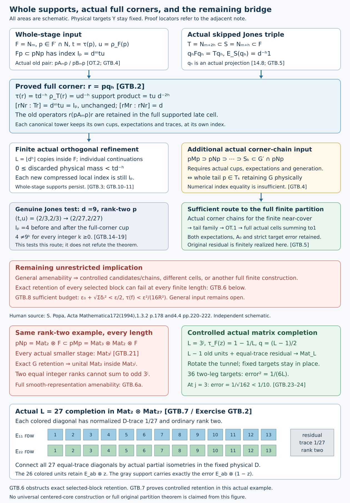

Figure GTB.1. The upper panels show the actual full-corner and skipped-cup maps, both support traces, and the conditional finite return. The lower panels show the same rank-two index-nine example at every depth and the controlled matrix completion at length three. Areas are schematic; the labels state exact traces and ranks. Proofs: GTB.1–GTB.8, including the full smooth-representation argument GTB.6a; Exercises GTB.1–GTB.2. Human context: Popa's §§1.3 and4.4, cited above. On a narrow screen, scroll the figure horizontally or [open the full-size figure](figures/general-tail-support-and-controlled-tunnel-v4.svg). [Editable figure source](figures/general-tail-support-and-controlled-tunnel-v4.py).

Course text and original figures: public domain, CC0 1.0.
