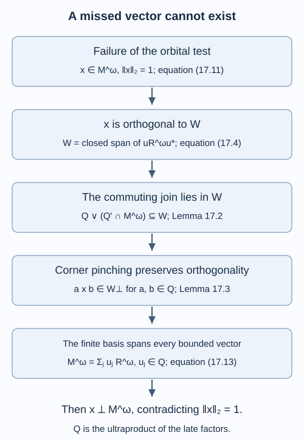
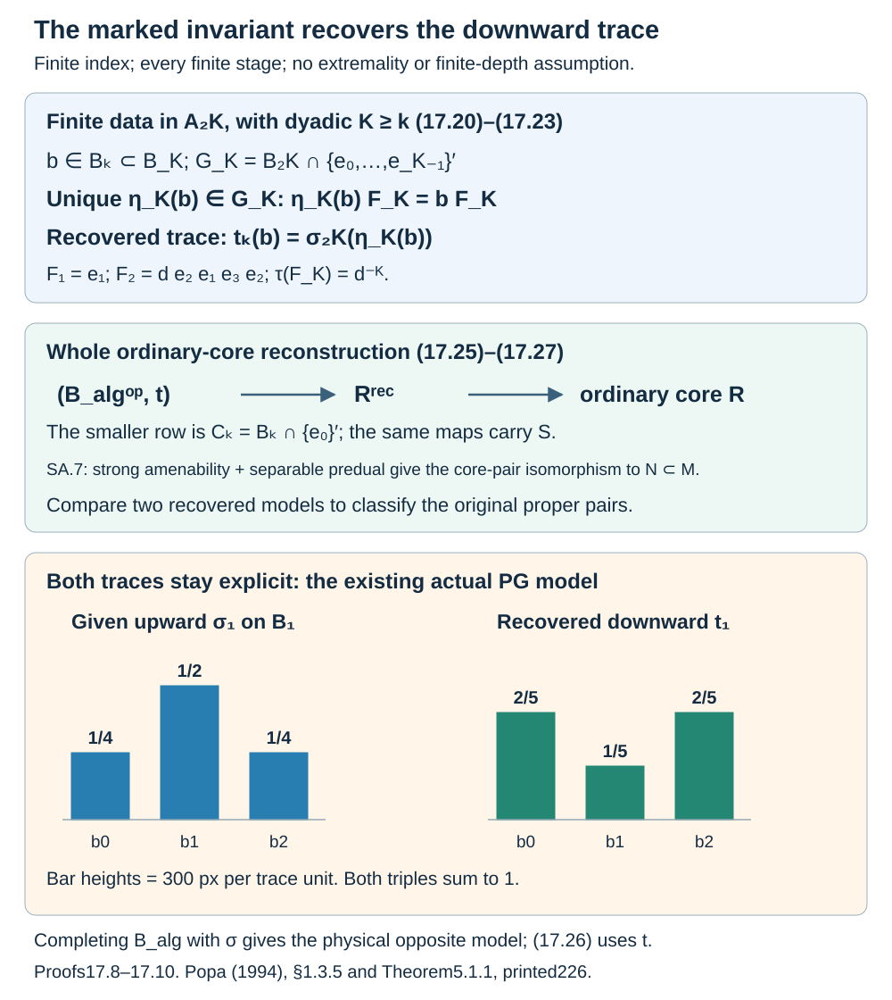
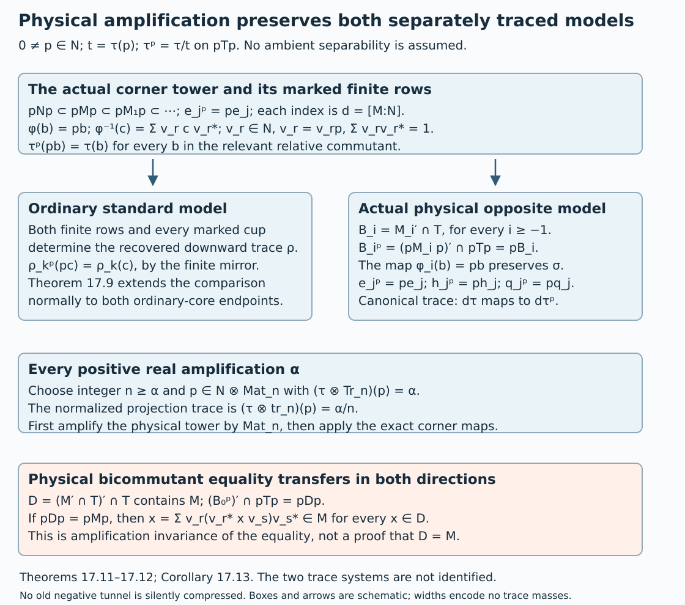
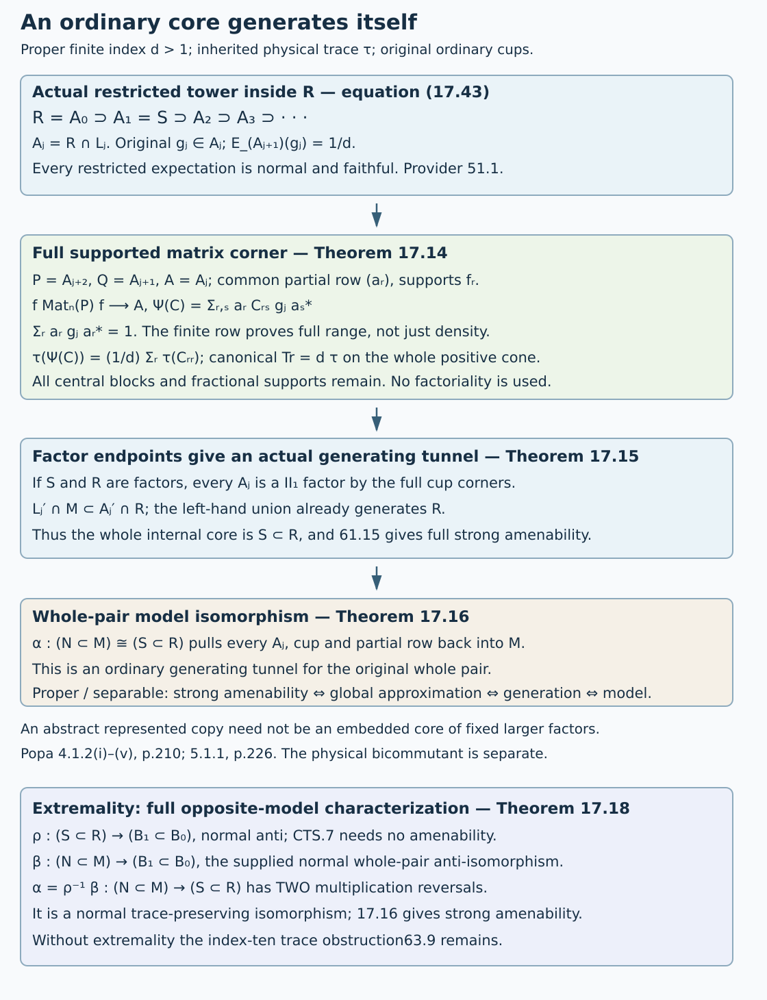

# A generating tunnel and the classification theorem

The finite-index tunnel constructed in the preceding lesson need not yet generate the ambient factor. Its finite basis supplies the missing argument. A vector missed by every late rotation would remain orthogonal after multiplication on either side by the late factor. The same basis then makes it orthogonal to every vector, which is impossible. Both whole model pairs are invariant under every nonzero physical corner and positive real amplification, with their original and recovered traces kept separate. Exact corner maps preserve the full marked ladder and all canonical opposite cup and trace data. The marked upward invariant also determines the actual downward trace at every finite stage and reconstructs the whole ordinary standard model. This gives classification of proper strongly amenable separable inclusions without finite depth or extremality, while retaining the separate physical opposite-model trace. An ordinary core has its own complete tracial Jones tunnel. When its two endpoints are factors this tunnel is generating, which proves the original standard-model converse and the full proper/separable equivalence with strong amenability. At extremality the independent normal ordinary/opposite comparison proves both directions of the full physical opposite-model characterization, retaining both multiplication reversals and whole-pair endpoints.

We assume [Matrix corners approximate a tunnel](matrix-corners-and-tunnel-approximation.md), [Detecting a generating tunnel](detecting-a-generating-tunnel.md), and [Reflected traces and a uniform bound along a tunnel](reflected-traces-and-uniform-bounds.md). For the tracial ultraproduct we use Definition 3.1 and Theorems 3.2–3.3 of [Ultraproducts and the asymptotic centralizer](../../type-iii-factors/ultraproducts-and-the-asymptotic-centralizer.html). They give a finite von Neumann algebra with faithful normal trace, and a factor when every coordinate algebra is a factor. Only that finite tracial specialization is needed. The bounded-vector arguments below are proved here. References are [Popa], [Jones] and [McDuff].

Throughout the main argument, \(N\subsetneq M\) are separable hyperfinite II₁ factors of finite index \(d>1\) and finite depth. By Theorem 16.4 choose a Jones tunnel \(N_k\) with

\[
\begin{gathered}D_k=N_k'\cap M,\\R=\left(\bigcup_kD_k\right)'',\\D=\left[M:R\right]<\infty.\end{gathered}
\tag{17.1}
\]

All expectations preserve normalized traces.

## Coordinate expectations and unitary representatives

Fix a free ultrafilter \(\omega\). For any increasing sequence \(k_n\), put

\[
\begin{gathered}P=M^\omega,\qquad Q=\prod_\omega N_{k_n},\\C=Q'\cap P=\prod_\omega D_{k_n}.\end{gathered}
\tag{17.2}
\]

The last equality is Lemma 15.6. The inclusions of these ultraproducts into \(P\) are trace-preserving normal embeddings: their trace norms are inherited coordinatewise, and a trace-preserving embedding of finite tracial von Neumann algebras is normal. Also \(Q\) is a II₁ factor. The cited factor theorem gives factoriality, and projections of trace \(1/m\) in every coordinate show that it is not a matrix factor.

Coordinate expectations define

\[
\begin{gathered}E_{R^\omega}((x_n))=(E_R(x_n)),\\E_{\prod_\omega(N_{k_n}\vee D_{k_n})}((x_n))\\=(E_{N_{k_n}\vee D_{k_n}}(x_n)).\end{gathered}
\tag{17.3}
\]

They are well defined because they contract \(L^2\) and operator norm. Trace pairings identify them with the expectations onto the indicated normal subalgebras.

**Lemma 17.1.** Every unitary of \(Q\) has a representing sequence of unitaries \(u_n\in N_{k_n}\).

**Proof.** Choose any bounded representing sequence \(y_n\). Its being unitary in the quotient implies

\[
\lim_\omega\|y_n^*y_n-1\|_2=0.
\]

In the finite factor \(N_{k_n}\), extend the partial isometry of the polar decomposition of \(y_n\) to a unitary \(u_n\). This is possible because its initial and final projections have the same trace, as do their complements. Then \(y_n=u_n|y_n|\), and scalar functional calculus gives

\[
\begin{gathered}\|u_n-y_n\|_2=\|1-|y_n|\|_2\\\leq\|1-|y_n|^2\|_2\longrightarrow_\omega0.\end{gathered}
\]

Thus \((u_n)\) represents the given unitary. \(\square\)

## Rotations contain the commuting join

Let \(W\) be the closed linear subspace of \(L^2(P)\) spanned by

\[
uR^\omega u^*,\qquad u\in\mathcal U(Q).
\tag{17.4}
\]

It is invariant under conjugation by every unitary of \(Q\).

**Lemma 17.2.** There is inclusion \(L^2(Q\vee C)\subseteq W\).

**Proof.** First let \(y=(y_n)\) be a bounded element of \(\prod_\omega(N_{k_n}\vee D_{k_n})\). At coordinate \(n\), Theorem 16.3 gives \(l_n>k_n\) and \(v_n\in\mathcal U(N_{k_n})\) such that

\[
\|y_n-E_{v_nD_{l_n}v_n^*}(y_n)\|_2<n^{-1}.
\]

Set \(a_n=v_n^*E_{v_nD_{l_n}v_n^*}(y_n)v_n\). These elements belong to \(D_{l_n}\subseteq R\) and are uniformly bounded by \(\sup_n\|y_n\|\). Consequently

\[
\begin{gathered}y=vav^*,\qquad v=(v_n)\in\mathcal U(Q),\\a=(a_n)\in R^\omega.\end{gathered}
\tag{17.5}
\]

It follows that this whole ultraproduct subalgebra is contained in \(W\). It contains \(Q\), \(C\), and their products. Because \(Q\) and \(C\) commute, their algebraic products generate \(Q\vee C\). Bounded strong approximation gives \(L^2\)-density of these products in its tracial completion. Closedness of \(W\) proves the claim. \(\square\)

The continuation at coordinate \(n\) is a rotation of the original tunnel after level \(k_n\). Thus the element \(a_n\) in (17.5) lies in the fixed algebra \(R\), despite the separate choices of \(l_n\) and \(v_n\).

## A bounded orthogonal vector survives corner multiplication

Write \(K=W^\perp\). Its invariance under conjugation does not by itself imply invariance under left and right multiplication. We prove precisely that implication for its bounded vectors.

**Lemma 17.3.** If \(x\in K\cap P\), then \(axb\in K\) for all \(a,b\in Q\).

**Proof.** For any finite partition \(1=\sum_i p_i\) in \(Q\), conjugation by the diagonal unitaries \(\sum_i\lambda_i p_i\), with \(\lambda_i\) on the unit circle, preserves \(K\). Integrating its distinct characters gives

\[
p_ixp_j\in K\quad(i\ne j).
\tag{17.6}
\]

The diagonal character gives the sum of diagonal corners, rather than each corner separately. The latter require an additional argument.

Fix a nonzero projection \(p\in Q\). The full-corner relative-commutant calculation in Lemma 15.1 gives

\[
(pQp)'\cap pPp=Cp.
\tag{17.7}
\]

For completeness, an element commuting with \(pQp\) extends to an element commuting with \(Q\) by summing its conjugates by finitely many partial isometries of \(Q\) whose initial projections lie under \(p\) and whose orthogonal final projections cover one. Include the identity partial isometry \(p\), and choose all other final projections under \(1-p\). The resulting extension compresses back to the original element. Since \(Q\) is a factor, \(p\) has full central support, so compression is also faithful. This proves (17.7), including when \(C\) has a center.

By Lemma 17.2, \(x\) is orthogonal to \(Q\vee C\). In particular, for \(c\in C\),

\[
\tau_\omega(c^*p x p)=\tau_\omega((pc)^*x)=0.
\]

Thus \(pxp\) has expectation zero onto \(Cp\). The norm-closed convex hull of its \(pQp\)-unitary conjugates has least-norm vector zero: the least-norm argument of Proposition 15.2 identifies that vector with this expectation.

Here is the resulting quantitative corner estimate. For a nonzero bounded \(Y\in pPp\) of expectation zero onto \(Cp\), some \(u\in\mathcal U(pQp)\) satisfies

\[
\operatorname{Re}\langle Y,uYu^*\rangle
\leq\tfrac12\|Y\|_2^2.
\]

Otherwise every convex average would have pairing greater than \(\|Y\|_2^2/2\) with \(Y\), contrary to convergence of such averages to zero. Approximate \(u\) in operator norm by a finite-spectrum unitary \(w=\sum_j\zeta_jp_j\) in the same corner so that the pairing is at most \(3\|Y\|_2^2/4\). Put \(\Phi(Y)=\sum_j p_jYp_j\). Orthogonality of its matrix blocks gives

\[
\tfrac12\|Y\|_2^2
\leq\|Y-wYw^*\|_2^2
\leq4\bigl(\|Y\|_2^2-\|\Phi(Y)\|_2^2\bigr).
\]

Therefore

\[
\|\Phi(Y)\|_2^2\leq\tfrac78\|Y\|_2^2.
\tag{17.8}
\]

Every subcorner \(q x q\), with \(q\in Q\), also has expectation zero onto \(Cq\), by the same trace pairing. Repeatedly refine each nonzero diagonal corner by (17.8). The squared norms add across orthogonal corners. Starting with the partition \(\{p,1-p\}\), after finitely many refinements we obtain a finite partition \(\{p_i\}\) refining it with

\[
\left\|\sum_i p_i x p_i\right\|_2<\varepsilon.
\tag{17.9}
\]

Zero corners need no refinement. This argument uses the finite trace on \(P\); it imposes no separability assumption on the ultraproduct.

Within the corner \(p\), all off-diagonal terms \(p_i x p_j\), \(i\ne j\), belong to \(K\) by (17.6). Equation (17.9) therefore approximates \(pxp\) by elements of \(K\), with error at most \(\varepsilon\). Hence \(pxp\in K\). We have proved this for every projection \(p\in Q\).

For a finite-spectrum self-adjoint \(h\in Q\), expand \(hxh\) into its corners. Both its diagonal and off-diagonal terms lie in \(K\). Operator-norm approximation of a general self-adjoint \(h\) then gives \(hxh\in K\). If \(a\in Q\), its polar decomposition can be written \(a=hu\), with \(h\geq0\) and \(u\) unitary, by finite-factor comparison. Apply the preceding assertion to \(uxu^*\in K\) to get \(axa^*\in K\).

Finally the polarization identity

\[
\begin{gathered}a x b^*=\tfrac14\sum_{j=0}^3 i^j c_j x c_j^*,\\c_j=a+i^j b.\end{gathered}
\tag{17.10}
\]

gives \(axb^*\in K\) for arbitrary \(a,b\in Q\), and replacement of \(b\) by \(b^*\) proves the stated assertion. All vectors used remain bounded elements of \(P\). No density of bounded vectors in an arbitrary invariant subspace was assumed. \(\square\)

## The finite basis rules out a missed vector

**Theorem 17.4.** The tunnel (17.1) satisfies the uniform orbital test (15.9).

**Proof.** If the test fails, choose increasing \(k_n\) and elements \(x_n\in M\) with

\[
\begin{gathered}\|x_n\|_2=1,\qquad\|x_n\|\leq\sqrt D,\\\sup_{u\in\mathcal U(N_{k_n})}\|E_{uRu^*}(x_n)\|_2\leq n^{-1}.\end{gathered}
\tag{17.11}
\]

The class \(x=(x_n)\in P\) has \(\|x\|_{2,\omega}=1\). For \(u\in\mathcal U(Q)\), lift it by Lemma 17.1 to unitaries \(u_n\in N_{k_n}\). For a bounded sequence \(r_n\in R\), trace pairings give

\[
|\tau(x_n^*u_nr_nu_n^*)|
\leq n^{-1}\|r_n\|_2\longrightarrow_\omega0.
\]

Thus \(x\perp uR^\omega u^*\) for every \(u\), so \(x\in K\cap P\). Lemma 17.3 and trace cyclicity imply

\[
x\perp aR^\omega b\quad(a,b\in Q).
\tag{17.12}
\]

At coordinate \(n\), Theorem 15.3 transports a partial orthonormal basis for \(R\cap N_{k_n}\subseteq N_{k_n}\) to a basis for \(R\subseteq M\). Choose it in the form of Theorem 3.2, with \(s=\lfloor D\rfloor+1\) entries \(u_j(n)\) and \(\|u_j(n)\|\leq\sqrt D\). If the final support is zero, retain its zero entry. In particular the number and norm bound are independent of \(n\).

For any bounded representing sequence \(y_n\in M\), its exact basis expansion is

\[
y_n=\sum_{j=1}^{s}u_j(n)E_R(u_j(n)^*y_n).
\]

Both sequences on the right are bounded. Taking their classes gives

\[
\begin{gathered}y=\sum_{j=1}^{s}u_j r_j,\\u_j=(u_j(n))\in Q,\\r_j\in R^\omega.\end{gathered}
\tag{17.13}
\]

Thus every bounded element of \(P\) belongs to the finite sum \(\sum_j Q R^\omega\). Equation (17.12) makes \(x\) orthogonal to all of \(P\), including itself. This contradicts its norm of one. The test therefore holds with some \(\varepsilon_0>0\) and \(k_0\), as claimed. \(\square\)

**Theorem 17.5 — generating tunnel.** Every proper finite-index, finite-depth inclusion of separable hyperfinite II₁ factors admits a generating Jones tunnel.

**Proof.** Theorem 16.4 supplies (17.1). Theorem 17.4 supplies its uniform orbital test. Theorem 15.5 constructs a tunnel whose downward relative commutants generate \(M\), and whose corresponding smaller-endpoint commutants generate \(N\). \(\square\)

The existence of a finite-index factor closure in (17.1) also suffices without finite depth. [A finite-index tunnel is enough](finite-index-tunnels-without-finite-depth.md), Theorem 29.6, proves this extension: compatible inner maps preserve the closure's factoriality, odd skipped corners give basis transport, and a small-block estimate replaces the finite graph in prefix approximation.

*Figure 17.1. Here \(Q=\prod_\omega N_{k_n}\), \(W\) is the space (17.4), and all orthogonality is in tracial \(L^2(M^\omega)\). The five boxes record the exact implications in Lemmas 17.2–17.3 and Theorem 17.4. The finite sum at the last step has \(\lfloor D\rfloor+1\) uniformly bounded basis sequences. The contradiction yields the uniform orbital test, and Theorem 15.5 then constructs a generating tunnel. [Editable figure source](figures/orbital-detection.py).*

## The standard invariant determines the inclusion

**Theorem 17.6 — finite-depth classification.** Two finite-index, finite-depth inclusions of separable hyperfinite II₁ factors are isomorphic as inclusions if and only if their structured standard invariants are isomorphic, including their inclusions, normalized traces and Jones projections.

**Proof.** An inclusion isomorphism extends up the Jones tower and gives the invariant isomorphism, by Proposition 12.1.

Conversely, first suppose the common index is greater than one. By Theorem 17.5 choose generating tunnels for both inclusions. Corollary 14.5 supplies trace-preserving anti-isomorphisms to their reflected pairs

\[
\begin{gathered}M_1'\cap M_\infty\subseteq M'\cap M_\infty,\\\widetilde M_1'\cap\widetilde M_\infty\subseteq\widetilde M'\cap\widetilde M_\infty.\end{gathered}
\tag{17.14}
\]

The invariant isomorphism maps each \(A_k=N'\cap M_k\) and \(B_k=M'\cap M_k\) to its counterpart, preserves the compatible traces and maps \(e_0\in A_1\) to \(\widetilde e_0\). Its isometry on the tracial completion of the \(A_k\) union extends normally to its von Neumann closure. This extension restricts to an isomorphism of the \(B_k\) closures and carries their subalgebras commuting with these projections to one another. Equation (14.9) therefore makes it an isomorphism of the pairs in (17.14). Using the ambient \(A_k\) ladder matters here: \(e_0\) does not generally belong to \(B_1\).

Compose with the anti-isomorphism from the first generating tunnel and the inverse anti-isomorphism from the second. Products are reversed twice, giving an ordinary normal isomorphism carrying \(N\) onto \(\widetilde N\).

At index one, the inclusion is the identity inclusion by the dimension theorem. The separable hyperfinite II₁ factor is unique up to isomorphism, so the identity inclusions are isomorphic. Their Jones tunnels are constant and do not satisfy the proper-inclusion generating-tunnel assertion; this endpoint is handled directly. The index itself is part of the invariant, since \(\tau_1(e_0)=d^{-1}\). This also separates the identity case from the proper case. \(\square\)

The invariant used in the theorem is the structured ladder of finite-dimensional algebras. A principal graph records dimensions and multiplicities; it need not determine the ladder's embeddings and commuting-square data. Graph realization and the number of inclusions for a given graph require further arguments.

## The index of the canonical pair

The following conclusion holds for any finite-depth II₁ inclusion, even when the original factors are not hyperfinite. Form the tracial closures

\[
\begin{gathered}A_\infty=\left(\bigcup_k(N'\cap M_k)\right)'',\\B_\infty=\left(\bigcup_k(M'\cap M_k)\right)''.\end{gathered}
\tag{17.15}
\]

inside the tracial completion of the tower. They agree with \(N'\cap M_\infty\) and \(M'\cap M_\infty\), respectively: expectations onto \(M_k\) preserve the indicated commutation relations and approximate every element in \(L^2\).

**Proposition 17.7.** If \(1<d<\infty\) and the inclusion has finite depth, then \(B_\infty\subseteq A_\infty\) are separable hyperfinite II₁ factors and

\[
[A_\infty:B_\infty]=d.
\tag{17.16}
\]

**Proof.** Theorems 14.3–14.4 give factoriality, the unique compatible traces and II₁ type. Each closure is generated by an increasing sequence of finite-dimensional algebras, giving hyperfiniteness and separability.

The compatible expectations \(E_{B_k}:A_k\to B_k\) satisfy \(E_{B_k}(a)\geq d^{-1}a\), by (14.6). Theorem 12.2 implies that the expectation onto \(B_\infty\), restricted to \(A_k\), is precisely \(E_{B_k}\): its Hilbert projection commutes with the projection onto \(A_k\), and their common range is \(B_k\). Thus approximation by the positive elements \(E_{A_k}(a)\), for \(a\in(A_\infty)_+\), gives

\[
E_{B_\infty}(a)\geq d^{-1}a.
\tag{17.17}
\]

These approximants are uniformly bounded and converge in \(L^2\), hence strongly in the tracial standard representation. Positivity is preserved in the limit.

The projection \(e_0\in A_1\) tests sharpness. In the defining representation on \(L^2(M)\), it is invariant under the tracial conjugation \(J\). The expectation used in Theorem 14.4 consequently gives

\[
E_{B_1}(e_0)=J E_M(J e_0J)J=d^{-1}1.
\]

Therefore \(E_{B_\infty}(e_0)=d^{-1}1\). If a larger constant \(c\) satisfied (17.17) with \(c\) in place of \(d^{-1}\), evaluation on a nonzero vector in the range of \(e_0\) would give \(c\leq d^{-1}\). The positive-operator characterization of index in Theorem 7.5 now proves (17.16). \(\square\)

When the original inclusion is hyperfinite, the generating tunnel identifies this canonical pair with the **dual** inclusion, reversing products. Indeed its downward relative commutants with endpoint \(M_1\) contain those with endpoint \(M\), which generate \(M\), and contain \(e_0\), which commutes with every negative tunnel level. Their closure therefore contains \(\langle M,e_0\rangle=M_1\) and equals it. Reflection sends the endpoints \(M\) and \(M_1\) to the fixed starting commutants \(M'\) and \(N'\). Trace preservation follows from uniqueness of the \(A_k\)-union trace, exactly as in Corollary 14.5. Thus

\[
\begin{gathered}(M\subseteq M_1)\\\text{is anti-isomorphic to}\\(B_\infty\subseteq A_\infty).\end{gathered}
\tag{17.18}
\]

The reflected pair (17.14) reconstructs the original inclusion; the canonical pair (17.15) reconstructs its dual. Both have index \(d\), but their fixed starting levels carry different information.

There is also a numerical distinction between the index \(d\) and its reciprocal \(\lambda=d^{-1}\). At finite depth the Perron eigenvalue of the two-step inclusion matrix \(G^*G\) is \(d\), by Corollary 8.5 and the stabilized basic constructions. Takesaki's Proposition 4.19(iii) correctly states that the canonical pair has the original index, but its proof on printed page 482 calls the inverse index the Perron eigenvalue. The direct expectation proof in Proposition 17.7 fixes this normalization: the sharp positive-operator constant is \(d^{-1}\), while the pair index and the Perron eigenvalue are \(d\).

## The ordinary standard model at arbitrary depth

In this section finite depth and ambient hyperfiniteness are not assumed. Start with any finite-index inclusion \(N\subset M\) of II₁ factors, its actual upward Jones tower and any ordinary tunnel. Keep the notation of the structured invariant 12.1–12.2:
\[
A_k=N'\cap M_k,\quad B_k=M'\cap M_k,\quad
C_k=B_k\cap\{e_0\}'=M_1'\cap M_k\quad(k\ge1).
\tag{17.19}
\]
Its given trace \(\sigma_k\) is the restriction of \(\tau_{M_k}\). Its marked projections include every original \(e_i\); all lie in the appropriate \(A_k\), even though \(e_0\) need not lie in \(B_k\). The index is recovered by \(d=\sigma_1(e_0)^{-1}\).

The finite prerequisites are 14.2/14.8, [the two-step blocking theorem 64.1](two-step-cups-and-composed-densities.md), and the complete finite-module comparison argument of [62.2](scalar-commutants-and-tracial-tunnels.md#the-trace-in-the-cup-functional). Normal extension uses the tracial Hilbert-space construction of [40.1](trace-compatible-reflection.md), allowing arbitrary centers. The final classification uses the already proved [SA.7](general-tail-supports-and-controlled-tunnels.md) with its original hypotheses. No generating-tunnel or general trace theorem is reproved here.

### Recover the second finite trace from the marked ladder

For \(K=2^r\) one can construct the Jones projection \(F_K\in B_{2K}\) of the skipped triple \(M\subset M_K\subset M_{2K}\) using only finitely many marked cups. An explicit recursion is
\[
\begin{gathered}
p_i^{[0]}=e_i,\qquad
p_i^{[r+1]}=d^{2^r}
 p_{2i}^{[r]}p_{2i-1}^{[r]}p_{2i+1}^{[r]}p_{2i}^{[r]},\\
F_K=p_1^{[r]},\qquad K=2^r,\quad i\ge1.
\end{gathered}
\tag{17.20}
\]
Theorem 64.1 applied at each stage says exactly that the algebras are \(M_{Ki}\), their adjacent index is \(d^K\), and these are their actual Jones projections. Thus \(F_K\) has trace \(d^{-K}\), lies in \(M'\cap M_{2K}\), and the whole skipped triple is a basic construction. The recursion is cofinal; every finite depth is contained in some such \(K\). Its use therefore omits no finite stage of the invariant or core.

Define the finite-dimensional algebra
\[
G_K=\{y\in B_{2K}:[y,e_i]=0\text{ for }0\le i<K\}
     =M_K'\cap M_{2K}.
\tag{17.21}
\]
The last equality follows because \(M_K=W^*(M,e_0,\ldots,e_{K-1})\). This definition uses the marked ambient \(A_{2K}\), not just the abstract \(B_k\)-row.

**Theorem 17.8 — finite recovery of the downward trace.** For every \(b\in B_K\) there is a unique \(\eta_K(b)\in G_K\) satisfying the actual finite equation
\[
\eta_K(b)F_K=bF_K.
\tag{17.22}
\]
The map \(\eta_K:B_K\to G_K\) is a unital linear adjoint-preserving anti-isomorphism. For \(b\in B_k\), choose any dyadic \(K\ge k\) and put
\[
t_k(b)=\sigma_{2K}(\eta_K(b)).
\tag{17.23}
\]
The result is independent of that choice. The \(t_k\) are compatible faithful normalized traces. Every structured invariant isomorphism preserves them; they need not equal the given \(\sigma_k|_{B_k}\).

For the actual downward rows
\[
D_k^\downarrow=M_{-k}'\cap M,\qquad
C_k^\downarrow=M_{-k}'\cap N,
\tag{17.24}
\]
the coherent finite reflection \(\Theta(x)=J_Mx^*J_M\) has
\[
\Theta(D_k^\downarrow)=B_k,\quad
\Theta(C_k^\downarrow)=C_k,\quad
t_k(\Theta(x))=\tau_M(x).
\tag{17.25}
\]
All assertions are finite-level comparisons; no normal representation of the whole upward tracial completion on \(L^2(M)\) is asserted.

**Proof.** Represent the single skipped basic construction \(M\subset M_K\subset M_{2K}\) on \(L^2(M_K)\), with conjugation \(J_K\). Right multiplication gives
\(\eta_K(b)=J_Kb^*J_K\).
It commutes with \(M_K\) and belongs to \(M_{2K}=(J_KMJ_K)'\), since \(b\) commutes with \(M\). Conversely, an element of \(M_K'\cap M_{2K}\) is right multiplication by an element of \(M_K\) commuting with \(M\). This proves the stated anti-isomorphism and its full range.

On \(L^2(M)\subset L^2(M_K)\), right multiplication by \(b\) agrees with left multiplication by \(b\), because \(b\in M'\). Hence(17.22) holds. If \(y\in G_K\) has \(yF_K=0\), commutation with \(M_K\) makes it annihilate \(M_KF_KM_K\). That Jones ideal is ultraweakly dense in \(M_{2K}\), so \(y=0\). This proves uniqueness directly in the finite data. In particular(17.22) is a finite linear system with a unique solution, rather than an unspecified choice of reflection.

Let \(\nu_K\) be the normalized trace on the full commutant of the left \(M\)-action on \(L^2(M_K)\). Conjugation by \(J_K\) identifies that factor with \(M_{2K}\), and therefore
\(\nu_K(b)=\sigma_{2K}(\eta_K(b))\).
Now compare this normal \(M_K\)-representation with the coherent finite representation of 14.2 on \(L^2(M)\). Both have finite commutant. The finite-module amplification and common-corner argument in 62.2 says that the normalized trace of the full \(M\)-commutant has the same value on each element of \(B_K\) in both representations. The compression projection lies in the full \(M_K\)-commutant; every \(b\in B_K\) commutes with that factor. Its trace pairing with the projection therefore factors, exactly as in that argument. Only this one finite \(M_K\)-module comparison is used.

In the representation on \(L^2(M)\) the whole \(M'\) is the fixed factor \(J_M M J_M\), whose normalized trace \(\nu\) satisfies
\(\nu(J_Mx^*J_M)=\tau_M(x)\).
Thus(17.23) is simply \(\nu(b)\) on every \(B_k\). It proves independence of \(K\), trace compatibility, faithfulness and(17.25). The two finite-row identities there are 14.3, with endpoints0 and1. Notice that this proves equality with the commutant trace \(\nu\), not with the separately given tower trace \(\sigma\).

Finally let \(\psi\) be an isomorphism of the structured ladders. It preserves \(d\), all products and marked cups, hence the recursion(17.20), the algebra(17.21), and equation(17.22). Uniqueness gives
\(\psi_{2K}(\eta_K(b))=\widetilde\eta_K(\psi_K(b))\).
Its preservation of \(\sigma_{2K}\) now proves preservation of every \(t_k\) by(17.23). \(\square\)

### Reconstruct the whole ordinary core, with its actual trace

Put \(\mathscr B=\bigcup_kB_k\), \(\mathscr C=\bigcup_{k\ge1}C_k\), equipped with the compatible recovered trace \(t\). Let
\[
R^{\rm rec}=\pi_t(\mathscr B^{\rm op})'',\qquad
S^{\rm rec}=\pi_t(\mathscr C^{\rm op})''.
\tag{17.26}
\]
Here the superscript \({\rm op}\) reverses multiplication, and \(\pi_t\) is the tracial GNS representation for \(t\). These are finite tracial algebras; they are not being defined with the different trace \(\sigma\) of the physical opposite model.

**Theorem 17.9 — normal reconstruction of every ordinary standard part.** For any actual ordinary tunnel, let
\(R=(\bigcup_kD_k^\downarrow)''\), \(S=(\bigcup_kC_k^\downarrow)''=R\cap N\), with inherited trace. Then
\[
(S\subset R)\ \cong\ (S^{\rm rec}\subset R^{\rm rec})
\tag{17.27}
\]
by a normal trace-preserving pair isomorphism, including when either algebra has a center. Thus an isomorphism of the given structured upward invariants induces a normal trace-preserving isomorphism of the entire ordinary core pairs at arbitrary depth.

**Proof.** On the actual finite downward union define
\(x\mapsto\Theta(x)^{\rm op}\).
Two product reversals make this a *-homomorphism. The coherent finite maps in 14.2–14.3 make it a single compatible map on the union, onto \(\mathscr B^{\rm op}\), carrying its smaller union onto \(\mathscr C^{\rm op}\). Equation(17.25) makes it trace preserving.

Consequently \(\widehat x\mapsto\widehat{\Theta(x)^{\rm op}}\) is an isometry of the two tracial Hilbert spaces on dense unions. The compatible inverse finite maps give a dense range, so it extends to a unitary. It intertwines left multiplication on those unions; conjugating their weak closures gives the asserted normal isomorphism. The smaller closures are carried to one another by the same unitary. As usual, expectation onto \(N\) preserves every \(D_k^\downarrow\) and has image \(C_k^\downarrow\); its normal, bounded \(L^2\) approximation proves \(S=R\cap N\). This is the same full-pair tracial-extension argument as 40.1, applied to a homomorphism after taking the opposite algebra. No trace uniqueness in a nonfactor is invoked.

For two invariants,17.8 makes \(\psi\) an isometry also for the recovered traces. Its maps on the opposite algebra unions extend by the same unitary construction. Composing with the two copies of(17.27) proves the final assertion. This construction uses every finite row through a cofinal union; it does not require finite depth. \(\square\)

The trace in(17.26) is essential. In the actual nonextremal index-ten PG model, the first physical upward \(B_1\)-weights are \((1/4,1/2,1/4)\), whereas(17.23) recovers \((2/5,1/5,2/5)\), the original downward physical weights. Thus(17.27) reconstructs the ordinary standard model without claiming an isomorphism to the physical opposite pair completed with \(\sigma\). The latter universal claim is refuted by63.9; the specified nonextremal reflection is nonnormal by CTS.6. Both trace systems remain explicit.

### Classification without finite depth or extremality

**Theorem 17.10 — arbitrary-depth strongly amenable classification.** Let \(N\subsetneq M\) and \(\widetilde N\subsetneq\widetilde M\) be finite-index II₁ inclusions with separable preduals. Assume each satisfies the original all-smooth representation amenability and has ergodic actual ordinary core, exactly as in SA.1. Then they are isomorphic as inclusions if and only if their structured standard invariants 12.2 are isomorphic, with their inclusions, normalized tower traces and marked Jones projections. Neither extremality nor finite depth is required.

**Proof.** An inclusion isomorphism preserves the normalized factor trace and extends up the actual towers with their cups, by 12.1, giving the forward implication. For the converse, SA.7 supplies an actual generating ordinary tunnel for each inclusion, at the stated hypotheses and with any prescribed finite prefix retained. The corresponding ordinary core pairs are literally the two original pairs. Theorem 17.9, applied to the given invariant isomorphism, compares those whole core pairs normally and trace preservingly. Its range therefore gives an isomorphism \(M\to\widetilde M\) carrying \(N\) onto \(\widetilde N\). Equivalently one may use any two old cores and compose(17.27) with the already supplied standard-part maps of SA.7. This proves the classification without an opposite-model normality assumption. \(\square\)

At index one the structured invariant and ordinary core are scalar. Within the separable hyperfinite class of 17.6 the identity inclusions are isomorphic by the existing factor-uniqueness theorem, as proved there. No classification of arbitrary identity inclusions by their scalar invariant is asserted. Properness in 17.10 keeps this endpoint distinct; it is also the proper-inclusion scope of the generating theorem SA.7.

Human source: Sorin Popa, *Classification of amenable subfactors of type II*, Acta Mathematica 172(1994), Section 1.3.5 and Theorem 5.1.1, printed pp.184–186 and 226, [DOI](https://doi.org/10.1007/BF02392646). The finite recovery equation and full normal-core construction above give the trace comparison used here. The original general nonextremal physical bicommutant, common-support BF, both-infinite-capacity localization, second local form and fixed-WM invariant endpoint remain separate mathematical assertions.

Theorem 17.10 compares pairs that satisfy the original strong-amenability hypotheses. The converse from an isomorphism onto the whole ordinary standard model is proved in Theorems 17.14–17.16 below, using its actual internal generating tunnel. The physical nonextremal bicommutant remains separate.

*Figure 17.2. The top equation is the unique finite mirror17.22 in the marked ambient ladder. The ordinary core uses the opposite multiplication and recovered trace17.23; the physical opposite completion retains its original trace. The two three-bar panels are the exact first-level traces in the existing PG model, with bar heights300px per trace unit. The recovered trace is not silently substituted for the physical upward trace. Theorem17.9 reconstructs both endpoints of every ordinary core. Theorem17.10 then uses the original SA.7 hypothesis to classify the proper original inclusions, without finite depth or extremality. Human context: Popa, Theorem5.1.1, printed p.226. [Reproducible figure source and exact finite-cup checks](figures/standard-model-trace-recovery.py).*

## Corners and real amplifications preserve both models

The ordinary standard model uses the recovered downward trace of 17.8. The actual opposite model uses the original upward tower trace. Both model constructions are unchanged by a physical corner or a positive real amplification, with their respective traces retained.

**Theorem 17.11 — the exact corner ladder and opposite comparison.** Let \(N\subset M\) be II₁ factors of finite index \(d\), and let \(0\ne p\in N\), \(t=\tau(p)\). The original upward tower \(M_{-1}=N,M_0=M,M_1,\ldots\) compresses to the tracial Jones tower
\[
pNp\subset pMp\subset pM_1p\subset\cdots,
\qquad e_j^p=pe_j\quad(j\ge0),
\qquad \tau^p=t^{-1}\tau|_{p\mathcal T p}.
\tag{17.29}
\]
Every step still has index \(d\). For \(-1\le i\le k\), multiplication by \(p\) gives a normal trace-preserving isomorphism
\[
M_i'\cap M_k\ \longrightarrow\ (pM_ip)'\cap pM_kp,
\qquad b\longmapsto pb.
\tag{17.30}
\]
These maps preserve all finite inclusions, both original rows, expectations and marked cups. With \(\mathcal T=(\bigcup_kM_k)''_\tau\), the corner completion is exactly \(p\mathcal T p\), and there are compatible normal trace-preserving isomorphisms
\[
\begin{gathered}
B_i=M_i'\cap\mathcal T\ \longrightarrow\ B_i^p=(pM_ip)'\cap p\mathcal T p,\\
\phi_i(b)=pb\qquad(i\ge-1).
\end{gathered}
\tag{17.31}
\]
Thus the whole actual opposite chain, including both endpoints \(B_1\subset B_0\), is normally trace-isomorphic to the corner chain. For every \(j\ge0\), the original and corrected opposite cups and their density satisfy
\[
e_j^p=pe_j,\qquad h_j^p=ph_j,\qquad q_j^p=pq_j.
\tag{17.32}
\]
Both the original weighted compression and the inherited tracial expectation intertwine, and every canonical basic-construction trace is preserved on its full positive cone.

**Proof.** Finite-factor projection comparison supplies finitely many partial isometries \(v_r\in N\) with
\[
v_r^*v_r\le p,\qquad v_r=v_rp,\qquad \sum_rv_rv_r^*=1.
\tag{17.33}
\]
For example, successively place copies of \(p\) in the unused range, and use a subprojection of \(p\) for the final range of smaller trace. At most \(\lceil1/t\rceil\) terms suffice, including irrational \(t\). This is the finite-factor comparison used in 52.4.

Since \(p\in N\subset M_{j-1}\), it commutes with every \(e_j\), \(j\ge0\). The corner cup is a projection and satisfies the compressed Jones identity. The trace expectation onto \(pM_jp\) is the restriction of \(x\mapsto pE_{M_j}(x)p\), so it sends \(pe_j\) to \(d^{-1}p\). The complete upper algebra is retained: each generating word \(pxe_jyp\), \(x,y\in M_j\), has the finite expansion
\[
pxe_jyp
=\sum_r (pxv_rp)(pe_jp)(pv_r^*yp).
\tag{17.34}
\]
Here \(v_r\in N\) commutes with \(e_j\), and (17.33) gives the equality. Thus \(pM_{j+1}p\) is the full basic construction of the corner pair, with its scalar normalization \(d\), by the normal basic-construction recognition in 4.1–4.5. Its canonical trace is \(d\tau^p\). The original conditional expectations converge to the identity on \(\mathcal T\) in \(L^2\); their corners therefore show that the completion is all of \(p\mathcal T p\).

We use the existing full-corner commutant construction of 31.2 and 52.7j, keeping its inverse explicit. For \(b\in(pM_ip)'\cap pM_kp\), set
\[
\widehat b=\sum_rv_r b v_r^*.
\tag{17.35}
\]
The same frame lies in \(M_i\), since \(N\subset M_i\). The full-corner calculation shows that \(\widehat b\in M_i'\cap M_k\), \(p\widehat bp=b\), and that (17.35) is the inverse of (17.30). One can check multiplication directly: the coefficients \(v_r^*v_s\in pM_ip\) commute with \(b\), so the middle double sum reduces using \(\sum_rv_rv_r^*=1\). This also proves that the inverse preserves adjoints and products. Both directions are finite sums of normal maps. The identical argument in \(\mathcal T\) proves (17.31), with no separability requirement.

For \(b\ge0\) in \(M_i'\cap\mathcal T\), the functional \(a\mapsto\tau(ba)\) on the factor \(M_i\) is a normal finite trace. Its uniqueness gives
\[
\tau(pb)=t\tau(b),\qquad \tau^p(\phi_i(b))=\tau(b).
\tag{17.36}
\]
Linearity gives the identity on the whole commutant. Thus all finite and infinite maps preserve the stated normalized traces, even if these commutants have centers. They plainly agree on common subalgebras. Uniqueness of tracial expectations gives expectation compatibility on every finite marked inclusion and on the actual opposite chain.

In the notation of 63.6, \(E_{B_j}(e_j)=d^{-1}h_j\). Apply the just-proved corner comparison to this finite relative-commutant expectation. It gives \(E_{B_j^p}(pe_j)=d^{-1}ph_j\); uniqueness identifies the actual corner density as \(h_j^p=ph_j\). The inverse of \(ph_j\) in its corner is \(ph_j^{-1}\). Consequently its canonical rescaling is exactly \(q_j^p=pq_j\). The formula \(F_j(x)=E_j(h_j^{1/2}xh_j^{1/2})\) now intertwines as well. Finally 63.8 identifies each canonical trace with \(d\tau\), or \(d\tau^p\) in the target, on every positive element. Equation (17.36) preserves that complete trace, without restricting its domain to the algebraic Jones ideal. \(\square\)

**Theorem 17.12 — all ordinary cores and all positive real amplifications.** Every ordinary core of \(pNp\subset pMp\) is normally trace-preservingly isomorphic, as a pair, to every ordinary core of \(N\subset M\). More generally this holds for every positive real amplification \(N^\alpha\subset M^\alpha\), \(\alpha>0\). The actual physical opposite pairs also have the exact normal comparison, with the full finite marked ladder, opposite cups, densities, expectations and canonical traces described in 17.11. No amenability, extremality, finite depth or ambient separability is assumed.

**Proof.** Write \(A_k=N'\cap M_k\), \(C_k=M'\cap M_k\), with their original normalized traces \(\sigma_k\). The maps (17.30) identify both rows of the full structured invariant of 12.2, not merely their abstract dimensions or graphs. They send each original cup to \(pe_j\) and preserve every marked inclusion and trace.

Theorem 17.8 recovers the downward traces functorially from this entire marked ladder. Indeed its unique skipped-cup equation is preserved by these finite isomorphisms, so its solution and its trace are preserved. Thus, if \(\rho_k\) denotes that recovered trace on \(C_k\), the corner recovery satisfies
\[
\rho_k^p(pc)=\rho_k(c)\quad(c\in C_k).
\tag{17.37}
\]
The normal reconstruction in 17.9 then supplies a trace-preserving normal isomorphism of the two whole ordinary models, including both endpoints. Applying that theorem to each actual ordinary core gives the asserted pair comparisons. It is the recovered trace \(\rho\) that is used in this step. The separate actual opposite comparison (17.31) uses the original upward \(\sigma\); (17.37) does not equate these two trace systems.

For the real parameter choose an integer \(n\ge\alpha\) and a projection \(p\in N\bar\otimes\operatorname{Mat}_n\) with
\[
(\tau\otimes\operatorname{Tr}_n)(p)=\alpha,
\qquad (\tau\otimes\operatorname{tr}_n)(p)=\alpha/n.
\tag{17.38}
\]
Here \(\operatorname{Tr}_n(1)=n\) and \(\operatorname{tr}_n(1)=1\). The amplified pair is the corner by \(p\) of \(N\bar\otimes\operatorname{Mat}_n\subset M\bar\otimes\operatorname{Mat}_n\), with its normalized corner trace. The latter pair has upward tower \(M_k\bar\otimes\operatorname{Mat}_n\), cups \(e_j\otimes1_n\), and completion \(\mathcal T\bar\otimes\operatorname{Mat}_n\). Its relative commutants are
\[
(M_i\bar\otimes\operatorname{Mat}_n)'\cap(M_k\bar\otimes\operatorname{Mat}_n)
=(M_i'\cap M_k)\otimes1_n.
\tag{17.39}
\]
This follows entrywise by first commuting with all matrix units and then with \(M_i\). The infinite commutant calculation in the completion is identical. These maps preserve the original normalized traces and cups. Combine them with 17.11 and the preceding ordinary-trace recovery argument. This proves all the assertions for each \(\alpha>0\).

An arbitrary old negative tunnel need not contain \(p\). No assertion that an arbitrarily chosen old core becomes the literal algebra \(pRp\) is used: the ordinary comparison is constructed through the marked invariant and its recovered trace. At index one both model pairs are scalar, so the result still holds. This is invariance under amplification of the physical inclusion; it makes no claim that the scalar model absorbs a nontrivial matrix algebra or classifies arbitrary identity factors. \(\square\)

**Corollary 17.13 — physical bicommutant equality is invariant under amplification.** For every \(\alpha>0\), the physical equality
\[
(M'\cap\mathcal T)'\cap\mathcal T=M
\tag{17.40}
\]
holds if and only if the corresponding equality holds for \(N^\alpha\subset M^\alpha\) in its own canonical tracial completion.

**Proof.** First take \(0\ne p\in N\), and put \(D=(M'\cap\mathcal T)'\cap\mathcal T\), so \(M\subset D\). Since \(p\) commutes with \(B_0=M'\cap\mathcal T\), (17.31) gives
\[
(B_0^p)'\cap p\mathcal T p=pDp.
\tag{17.41}
\]
For \(x=pxp\), commuting with \(pB_0\) is exactly commuting with \(B_0\), which proves this equality directly. If \(D=M\), the corner equality follows. Conversely, if \(pDp=pMp\), use the finite frame (17.33). For \(x\in D\), each \(v_r^*xv_s\) is in \(pDp=pMp\), and
\[
x=\sum_{r,s}v_r(v_r^*xv_s)v_s^*\in M.
\tag{17.42}
\]
Thus \(D=M\). For matrix amplification the full commutant of \(B_0\otimes1_n\) is \(D\bar\otimes\operatorname{Mat}_n\); hence its equality with \(M\bar\otimes\operatorname{Mat}_n\) is equivalent to \(D=M\). Apply the corner argument to the amplified pair and (17.38). \(\square\)

Corollary 17.13 transfers an established physical equality between amplitudes; it does not establish (17.40) at the general nonextremal hypotheses. The model-stability statement of Popa, Section 1.4.4, is proved here while preserving the separate ordinary and actual-opposite traces.

*Figure 17.3. The top map is multiplication by the actual projection \(p\), with its finite-frame inverse (17.35). The normalization \(\tau^p(pb)=\tau(b)\) uses commutation with a finite factor. The two lower constructions keep the original upward trace and the recovered downward trace separate. The real amplification uses the normalized projection trace \(\alpha/n\), as in (17.38). No old negative tunnel is silently compressed. Human context: Popa, Sections 1.3.7 and 1.4.4. [Reproducible figure source and finite corner checks](figures/amplification-and-model-traces.py).*

## A core carries its own ordinary tunnel

The standard model is defined as the whole inherited-trace core pair, rather than a copy of part of that pair inside some larger representation. We now prove that a factorial ordinary core has an actual generating tunnel inside itself. This supplies the full standard-model converse in Popa, Theorem 4.1.2(v) and Theorem 5.1.1, printed pp.210 and 226, without using a physical opposite-model identification.

We retain the ordinary tunnel notation of [51.1](transporting-a-core-through-a-tensor-factor.md#a-convention-for-every-predecessor):

\[
\begin{gathered}
L_0=M,\quad L_1=N,\quad
L_j=\langle L_{j+1},g_j\rangle,\\
R=\left(\bigcup_{m\ge 1}(L_m'\cap M)\right)'',
\qquad A_j=R\cap L_j,\quad S=A_1 .
\end{gathered}
\tag{17.43}
\]

Throughout this section the original inclusion is proper, with finite index \(d>1\), and \(\lambda=d^{-1}\). The original ambient factors need not have separable predual. Lemma 51.1 already proves that the normal tracial expectations restrict to \(A_j\), that \(g_j\in A_j\), that \(E_{A_{j+1}}(g_j)=\lambda 1\), and that \(A_{j+2}=A_{j+1}\cap\{g_j\}'\). We use those results without repeating their density proof. The full bounded bases come from [52.1](canonical-core-traces-and-integer-rounding.md#why-the-core-square-is-nondegenerate), applied at each shifted ordinary inclusion.

*The top row is the actual intersection tower inside the original larger core. Each original cup implements its entire internal basic construction, including the displayed partial Gram corner and canonical trace (17.14). When both starting core algebras are factors, the internal commutants generate the whole core (17.15). Transport through a whole-pair isomorphism gives the original standard-model converse (17.16). The lower comparison retains the two normal anti-isomorphisms and their identical physical opposite endpoints at extremality; their composition is the whole ordinary-model isomorphism (17.52–17.53). Diagram positions are schematic. Human source: Popa, Theorem 4.1.2 and Theorem 5.1.1, printed pp.210,226; internal expectation and basis providers 51.1, 52.1. [Reproducible figure source](figures/core-of-core-and-model-converse.py).*

### The full basic construction, with its partial supports

**Theorem 17.14.** For every \(j\ge 0\), the actual triple
\(A_{j+2}\subset A_{j+1}\subset A_j\) is the normal tracial basic construction with its original cup \(g_j\). All three algebras may have centers. Its inherited dual expectation is \(E_{L_{j+1}}|_{A_j}\), and its canonical trace is \(d\tau|_{A_j}\) on the entire positive cone.

**Proof.** Put \(P=A_{j+2}\), \(Q=A_{j+1}\), \(A=A_j\), and \(g=g_j\). The expectation identity 51.1 identifies \(A_i\) with the closure of \(\bigcup_{m\ge i}(L_m'\cap L_i)\): the expectation sends each finite original commutant onto its intersection with \(L_i\). Thus \(P\subset Q\) is exactly the core of the shifted physical inclusion \(L_{j+2}\subset L_{j+1}\), not a newly chosen core. The shifted common-basis theorem 52.1 supplies finitely many \(a_r\in Q\) and projections \(f_r\in P\) such that

\[
\begin{gathered}
a_rf_r=a_r,\qquad E_P(a_r^*a_s)=\delta_{rs}f_r,\\
x=\sum_r a_rE_P(a_r^*x)\quad(x\in Q),\\
\sum_ra_ra_r^*=d 1,\qquad \sum_ra_rg a_r^*=1_A .
\end{gathered}
\tag{17.44}
\]

The last equality is the original finite factor basic-construction identity for this same common row. Its entries belong to the cup tail inside \(Q\), so it is an equality in \(A\), with every original support retained. Scalar expectation and the physical Jones compression restrict to
\(E_Q^A(g)=\lambda 1\) and \(gxg=E_P(x)g\) for \(x\in Q\). Multiplication \(p\mapsto pg\) is faithful on \(P\): applying \(E_Q^A\) to \(pg=0\) gives \(\lambda p=0\).

First identify the entire corner, not only the compressed words. If \(x\in A\), the physical factor corner identity puts \(gxg=yg\) for some \(y\in L_{j+2}\). Its bounded coefficient is
\(y=dE_{L_{j+1}}(gxg)\). Since \(g,x\in R\) and the expectation preserves \(R\), this \(y\) lies in \(P\). Conversely \(pg\in gAg\) for every \(p\in P\). Thus \(gAg=Pg\).

Set \(f=\operatorname{diag}(f_r)\). The maps

\[
\begin{gathered}
\Psi:f\operatorname{Mat}_n(P)f\longrightarrow A,\qquad
\Psi(C)=\sum_{r,s}a_r C_{rs}g a_s^*,\\
G:A\longrightarrow f\operatorname{Mat}_n(P)f,\qquad
g a_r^*x a_s g=G(x)_{rs}g
\end{gathered}
\tag{17.45}
\]

are well defined. In particular

\[
G(x)_{rs}=dE_Q^A(g a_r^*x a_s g)\in f_rPf_s .
\tag{17.46}
\]

For the support assertion use \(a_rf_r=a_r\) and \(f_rg=gf_r\). The preceding full-corner identification gives the stated range; the displayed formula proves boundedness and normality of every entry. Both maps are finite sums of normal maps.

The relations \(g a_s^*a_t g=\delta_{st}f_sg\) prove that \(\Psi\) preserves multiplication and adjoints. Equation (17.44) gives \(\Psi(f)=1\). Applying the same Gram relation on both sides proves \(G\Psi(C)=C\). Conversely, insert \(\sum_ra_rg a_r^*=1\) on both sides of \(x\) to obtain \(\Psi G(x)=x\). Hence these are inverse unital normal *-isomorphisms.

For \(b\in Q\), \(G(b)_{rs}=E_P(a_r^*ba_s)\). For \(g\) itself, the entries are \(E_P(a_r^*)E_P(a_s)\). These are exactly the left multiplication representation of \(Q\) and its Jones projection in the complete finite-module model, equations (61.7)–(61.9) of [Theorem 61.2](smooth-representations-and-tower-compression.md#constructing-the-expected-tower-without-a-trace-on-the-representation). The isomorphism therefore identifies the given inclusion and the original cup with the standard basic construction; it is not an abstract algebra identification that forgets them.

Finally, for every supported \(C\), physical trace pairing and the Gram relation give

\[
\begin{gathered}
E_Q^A(\Psi(C))=\lambda\sum_{r,s}a_rC_{rs}a_s^*,\\
\tau(\Psi(C))=\lambda\sum_r\tau(C_{rr}),\\
\operatorname{Tr}_{\langle Q,e_P\rangle}(\Psi(C))
=\sum_r\tau(C_{rr})=d\tau(\Psi(C)).
\end{gathered}
\tag{17.47}
\]

The first equality also proves the exact dual-expectation normalization. The canonical matrix trace on the full finite corner is the sum of its diagonal \(P\)-traces. Thus the last equality holds for every positive \(C\), hence for every positive element of \(A\), without a dense-ideal restriction. In particular its value at the unit is
\(\sum_r\tau(f_r)=d\), with no integer-rank substitution.

No factor hypothesis on \(P,Q,A\) entered this proof. Their expectations remain normal and faithful restrictions of the physical expectations. The positive index bounds follow from the same complete finite rows, as in equations (61.13)–(61.14). \(\square\)

### A factorial ordinary core is a generating inclusion

**Theorem 17.15.** Suppose that both \(S\) and \(R\) are factors. Then \(S\subset R\) has index \(d\), and
\[
R=A_0\supset A_1=S\supset A_2\supset\cdots,\qquad
R=\left(\bigcup_{j\ge 1}(A_j'\cap R)\right)''
\tag{17.48}
\]
is an actual generating ordinary Jones tunnel, with cups \(g_j\). Its smaller generated core is exactly \(S\). In particular the entire pair \(S\subset R\) is originally strongly amenable, with the full all-smooth representation quantifier.

**Proof.** The original core pair has the complete common basis 52.1 and scalar index normalization \(d\). Since its two endpoints are II₁ factors, its Jones index is \(d\). Theorem 17.14 identifies \(A_2g_0=g_0Rg_0\) as a full corner of \(R\), so \(A_2\) is a factor. Fullness is the finite identity in (17.44). Repeating this center argument alternately from the factors \(A_0,A_1\) proves that every \(A_j\) is a factor. Each contains a unital ordinary cup II₁ factor, by 51.2, and so is II₁. The triples in 17.14 are therefore ordinary Jones triples of factors, all of index \(d\), with the marked physical cups.

For \(D_j=L_j'\cap M\), we have \(D_j\subset R\) by definition and \(A_j\subset L_j\). Consequently \(D_j\subset A_j'\cap R\). The left side generates \(R\), proving the second equality in (17.48), as already observed in 51.1. Every \(A_j'\cap R\) is finite dimensional: \(A_j\subset R\) is an inclusion of factors of finite index \(d^j\). The internal tunnel thus generates precisely the whole larger core. Restricting the trace expectation to \(S\) gives the smaller closure \(S\), by the same finite-commutant expectation argument 53.1. This is a statement about the actual internal tunnel, rather than only an abstract increasing algebra chain.

Apply the full generating-to-amenability [theorem 61.15](smooth-representations-and-tower-compression.md#extending-a-smooth-representation-down-the-original-tunnel) to \(S\subset R\). Every smooth nondegenerate normal expected representation of this pair has a compatible \(R\)-central state with the original trace marginal; its state may be singular. The actual internal core is \(R\) itself and is factorial. These are exactly the original amenability and ergodic-core conditions. No physical infinite bicommutant or normal reflection is used. \(\square\)

Both endpoints of this core have separable predual because their original defining unions are countable unions of finite-dimensional algebras. This does not impose separability on the original ambient \(M\). When a core endpoint is nonfactor, 17.14 still holds, but 17.15 makes no factor-inclusion or strong-amenability assertion for that nonfactor pair.

### The original standard-model converse

**Theorem 17.16.** Let \(N\subsetneq M\) be a finite-index inclusion of II₁ factors with separable predual. The following are equivalent:

1. Original strong amenability.
2. Global finite approximation(G) of 61.56.
3. Existence of an ordinary generating tunnel.
4. Existence of a generating continuation after every prescribed finite ordinary prefix.
5. A normal isomorphism of the whole pair \(N\subset M\) onto its ordinary standard model \(S\subset R\), for one, equivalently every, choice of the defining ordinary tunnel.

These are the complete clauses(i)–(v) of Popa's Theorem 4.1.2, including the exact-prefix form. No extremality or finite depth is assumed.

**Proof.** [Theorems 61.16 and 61.20](smooth-representations-and-tower-compression.md) supply the equivalence of the first four conditions. Under condition 3 the corresponding core is literally \(N\subset M\), so condition 5 holds for that choice. The normal full-pair reconstruction 17.9 identifies every other ordinary core with this one using the recovered downward trace. It therefore gives condition 5 for every choice. The different physical opposite trace is not substituted for that recovered trace.

Conversely let \(\alpha:M\to R\) be the stated normal whole-pair isomorphism, with \(\alpha(N)=S\). Both \(R,S\) are then II₁ factors. Uniqueness of their normalized factor traces makes \(\alpha\) trace preserving. Theorem 17.15 applies to their actual internal tower. Transport it back by

\[
\widetilde L_j=\alpha^{-1}(A_j),\qquad
\widetilde g_j=\alpha^{-1}(g_j),\qquad
\alpha^{-1}(A_j'\cap R)=\widetilde L_j'\cap M .
\tag{17.49}
\]

The first two transported factors are exactly \(M,N\). Normality and the full basic-construction statement 17.14 preserve every next factor, cup, supported basis, expectation and index. Normality also carries the dense union in (17.48) onto a union generating all of \(M\). Thus the transported chain is an ordinary generating tunnel for the original whole inclusion, proving condition 3. The full converse now follows from 61.15, with factorial generating core \(M\).

This last implication requires no separately imposed ambient separability: an isomorphism onto a whole ordinary model already forces separable predual. The hypothesis in the displayed equivalence is needed for the forward generating and model clauses. \(\square\)

Theorem 17.16 concerns an isomorphism onto the entire original pair. The different assertion that any commuting-square copy of a standard model must be an embedded core of fixed ambient factors remains false, as proved by 51.7–51.8. Strong amenability of that copy as an abstract pair does not repair its missing ambient relative commutants. The general nonextremal physical bicommutant remains a separate unproved clause; it is not inferred from these five equivalent conditions.

## The full extremal opposite-model characterization

The specified finite reflection compares the ordinary-model trace with the physical opposite trace. CTS.7 extends that reflection normally precisely at extremality. We use that normal comparison before assuming amenability. This gives both directions of the opposite-model characterization in Popa, Theorem 5.1.1, printed p.226, at arbitrary depth.

The ordinary-model converse is [Theorem 17.16](#the-original-standard-model-converse). The exact reflection used here is [CTS.7](general-tail-supports-and-controlled-tunnels.md#the-exact-extension-criterion), and the actual opposite endpoints and trace are those of [63.6–63.8](canonical-rescaling-of-jones-cups.md#the-tracial-tower-in-the-actual-opposite-model). The full generating-to-amenability return remains [61.15–61.16](smooth-representations-and-tower-compression.md#extending-a-smooth-representation-down-the-original-tunnel).

### Transport through a normal anti-isomorphism

**Lemma 17.17.** For finite-index II₁ inclusions \(N\subset M\) and \(Q\subset P\), a normal *-anti-isomorphism \(\beta:M\to P\) of II₁ factors that carries \(N\) onto \(Q\) transports every actual ordinary tunnel of \(N\subset M\), every marked cup and its full supported basis to an ordinary tunnel of \(Q\subset P\). It carries the whole smaller and larger core onto the corresponding cores. In particular ordinary generation is preserved in both directions. For proper finite-index inclusions with separable predual, original strong amenability is therefore invariant under a normal pair anti-isomorphism.

**Proof.** The normalized factor traces are preserved by \(\beta\). For an intermediate factor \(L\subset M\), the map
\(\widetilde E=\beta E_L\beta^{-1}:P\to\beta(L)\)
is normal, positive, unital, faithful and trace preserving. Reversing multiplication twice proves its bimodularity, so uniqueness of the tracial expectation identifies it with \(E_{\beta(L)}\). Complete positivity also follows from this identification; no complete positivity of an individual anti-isomorphism is asserted.

An ordinary cup \(g\) is sent to the projection \(\beta(g)\). Its symmetric compression identity, scalar expectation and full spanning relation transport to the same three assertions for the image factors. Thus the image triple is the entire tracial basic construction. The complete row is also explicit. In one tunnel triple \(L_{j+2}\subset L_{j+1}\subset L_j\), take its original right partial basis \(a_r\in L_{j+1}\) over \(L=L_{j+2}\), with supports \(f_r\in L\), and its cup \(g=g_j\in L_j\). All these elements lie in the domain \(M\) of \(\beta\). Put
\[
\begin{gathered}
b_r=\beta(a_r^*),\qquad \widetilde f_r=\beta(f_r),\\
E_{\beta(L)}(b_r^*b_s)=\delta_{rs}\widetilde f_r,\qquad
b_r\widetilde f_r=b_r,\\
\sum_r b_r\beta(g)b_r^*=1,\qquad
\sum_r b_rb_r^*=d1 .
\end{gathered}
\tag{17.50}
\]
Here \(g\) is the upper Jones cup for the basis inclusion. For example,
\(b_r^*b_s=\beta(a_s^*a_r)\), proving the Gram identity. The left basis expansion obtained by taking adjoints of the original right expansion becomes the right expansion for \(b_r\). Hence the partial supports, full range and index normalization are all retained. Uniqueness of the normal dual expectation then preserves that expectation and its entire canonical positive-cone trace.

For every tunnel level \(L_j\),
\[
\beta(L_j'\cap M)=\beta(L_j)'\cap P .
\tag{17.51}
\]
Indeed multiplication reversal preserves the equation of commutation, and the inverse gives the reverse inclusion. Normality carries the weak closures of the two finite relative-commutant unions onto one another, including their smaller endpoints. This proves the whole-core assertion and generation. Apply the generating equivalence 61.16 in both directions for the final strong-amenability statement. \(\square\)

The adjoint in \(b_r=\beta(a_r^*)\) is essential: a right module row becomes a left row under a single multiplication reversal. Taking adjoints first returns the required right supported row.

### Both directions for the physical opposite pair

**Theorem 17.18.** Let \(N\subsetneq M\) be an extremal finite-index inclusion of II₁ factors with separable predual. In its canonical physical tracial completion \(\mathcal T\), put
\[
B_1=M_1'\cap\mathcal T,\qquad B_0=M'\cap\mathcal T .
\]
Then the original inclusion is strongly amenable if and only if there exists a normal *-anti-isomorphism
\(\beta:(N\subset M)\to(B_1\subset B_0)\)
onto the whole physical opposite pair. Such a map preserves the normalized traces. When it exists, the opposite pair is itself a proper strongly amenable II₁ inclusion.

**Proof.** Choose any ordinary core \(S\subset R\) of the original inclusion. Extremality and CTS.7, with no amenability hypothesis, give the normal trace-preserving anti-isomorphism
\[
\rho:(S\subset R)\longrightarrow(B_1\subset B_0).
\tag{17.52}
\]
This uses the inherited physical trace at both specified endpoints. It is available even if the core algebras initially have centers.

If the original inclusion is strongly amenable, 17.16 supplies a normal trace-preserving whole-pair isomorphism \(\alpha:(N\subset M)\to(S\subset R)\). Thus \(\beta=\rho\alpha\) is the asserted anti-isomorphism. This proves the full forward implication without choosing a finite-depth model.

Conversely, suppose the asserted \(\beta\) exists. Its targets \(B_1,B_0\), and hence \(S,R\) through \(\rho\), are factors. The composition
\[
\begin{gathered}
\alpha=\rho^{-1}\beta:M\longrightarrow R,\\
\alpha(N)=S,\qquad
\alpha(xy)=\alpha(x)\alpha(y)
\end{gathered}
\tag{17.53}
\]
is a normal trace-preserving *-isomorphism onto the whole ordinary model. There are two multiplication reversals. The domain of \(\rho^{-1}\) is exactly the range of \(\beta\); no intermediate algebra or trace is changed. Theorem 17.16 now proves original strong amenability.

The reverse argument has not invoked 63.10 under an unproved strong-amenability hypothesis: it uses the independent extremal comparison CTS.7 and the already proved whole ordinary-model converse. Lemma 17.17 finally transports a generating tunnel to \(B_1\subset B_0\), proving its strong amenability and index \(d\). \(\square\)

The reverse implication needs no separate separability assumption. The union of the finite \(M'\cap M_k\) is weakly dense in \(B_0\), by PH.1. Thus \(B_0\) has separable predual, and a normal isomorphism or anti-isomorphism onto it forces the same for \(M\). The stated two-way theorem retains the original proper/separable scope.

Extremality cannot be omitted from this universal characterization. The actual strongly amenable index-ten example 63.9 has first-relative-commutant weight multisets \(\{2/5,1/5,2/5\}\) and \(\{1/4,1/2,1/4\}\) for the original and physical opposite pairs. Any pair isomorphism or anti-isomorphism would permute the minimal projections while preserving these traces, which is impossible. The positive special comparison 62.6 remains valid for its particular nonextremal example.

Theorem 17.18 completes the extremal opposite-model clause of Popa's Theorem 5.1.1. It neither supplies the general nonextremal physical bicommutant nor turns a represented model into an embedded core of fixed larger ambient factors.

## Exercises

**Exercise 17.1 — introductory.** Why is a uniform operator-norm bound on the vectors in (17.11) necessary?

**Solution.** A sequence of \(L^2\)-unit vectors alone need not represent an element of the von Neumann ultrapower, which is the quotient of bounded operator sequences. The bound \(\sqrt D\) puts \(x=(x_n)\) in \(P\), permits coordinate trace estimates against bounded sequences, and allows the corner argument to stay within bounded operators.

**Exercise 17.2 — intermediate.** For the two-projection partition \(1=p+(1-p)\), identify which terms of \(x\) are isolated by conjugation by \(\lambda p+(1-p)\).

**Solution.** Its characters \(\lambda\) and \(\overline\lambda\) isolate \(px(1-p)\) and \((1-p)xp\). The constant character gives \(pxp+(1-p)x(1-p)\). It does not separate those two diagonal terms. This is why the small-pinching argument is needed before one may multiply an orthogonal vector on both sides by a projection.

**Exercise 17.3 — intermediate.** Suppose \(D=9/2\). How many uniformly bounded basis sequences suffice in (17.13), and what is the trace of the fractional support at each coordinate?

**Solution.** There are four full entries and one fractional entry, for a total of five. The final support has normalized trace \(1/2\) in \(R\cap N_{k_n}\). Every basis entry has operator norm at most \(\sqrt{9/2}\). The support projections may vary with \(n\), but their traces and the common number of entries suffice for the ultraproduct expansion. The chosen value is admissible by Theorem 7.2 and the realization in Theorem 11.5.

**Exercise 17.4 — advanced.** Show that a classification argument based only on an isomorphism of the \(B_k\) towers still needs their compatibility with \(e_0\) in the ambient \(A_k\) ladder.

**Solution.** The large reflected endpoint is the closure of \(\bigcup B_k\). The small endpoint is its subalgebra commuting with \(e_0\), by (14.9). The projection belongs to \(A_1\) and need not belong to \(B_1\), so a map of the \(B_k\) towers alone has no specified action on it. Extending the full \(A_k\) ladder map and preserving \(e_0\) identifies the small endpoint, making the final composition an isomorphism of inclusions.

**Exercise 17.5 — intermediate.** For the index-six crossed-product inclusion in Theorem 41.4 and its star graph in Lemma 41.3, compute the Perron eigenvalue, the index of the canonical pair, and the expectation of its distinguished projection \(e_0\). Can the inverse index be its Perron eigenvalue?

**Solution.** For the crossed-product pair the principal graph is the six-leaf star. Its incidence column has six entries equal to one, so \(G^*G=(6)\) and its Perron eigenvalue is six. Proposition 17.7 gives canonical pair index six and \(E_{B_\infty}(e_0)=\tfrac16 1\). The inverse index is \(1/6\), the projection normalization. It is different from the eigenvalue six; confusing them would contradict both the explicit incidence calculation and sharpness of the index bound.

**Exercise 17.6 — finite data for a depth-four trace.** Write the first two skipped cups in(17.20), and explain which finite data determine \(t_3(b)\) for \(b\in B_3\). Does using depth4 discard any of \(B_3\)?

**Solution.** The first cup is \(F_1=e_1\), and
\[
F_2=d\,e_2e_1e_3e_2.
\tag{17.28}
\]
For \(t_3\), take \(K=4\). The recursion constructs \(F_4\) from the marked cups \(e_1,\ldots,e_7\) and \(d\). Inside the given \(A_8\), form \(G_4\subset B_8\) by commutation with \(e_0,e_1,e_2,e_3\), and solve \(yF_4=bF_4\) uniquely in \(G_4\). Then \(t_3(b)=\sigma_8(y)\). The inclusion \(B_3\subset B_4\) is the actual one in the invariant, so this determines every \(B_3\)-element. The compatibility proved in 17.8, rather than a finite-depth stabilization, permits this cofinal choice.

**Exercise 17.7 — preserve the two traces.** In the actual index-ten PG model let \(b_1\in B_1\) be the first odd site's middle-label projection. Compute its given upward trace and its recovered trace. Which original projection does the inverse finite reflection recover?

**Solution.** The original odd weights give \(\sigma_1(b_1)=1/2\). The next cup \(F_1=e_1\) has first-site probabilities \((1/4,1/2,1/4)\); its finite mirror carries \(b_1\) to the corresponding second-site projection, with physical weights \((2/5,1/5,2/5)\). Thus \(t_1(b_1)=\sigma_2(\eta_1(b_1))=1/5\). Equation(17.25) recovers the original site-zero middle-label projection of trace1/5. The two trace values are unequal and are both retained. Completing the same finite union with \(t\) is the ordinary standard-model construction; completing it with \(\sigma\) gives the actual opposite model, a different operation.

**Exercise 17.8 — why the marked ambient ladder is necessary.** For a structured invariant isomorphism \(\psi\), prove the compatibility of \(\eta_K\) with \(\psi\), and identify the hypothesis used at the last step of 17.10. Is a pair isomorphism between the separately traced physical opposite completions needed?

**Solution.** Products and the marked recursion give \(\psi(F_K)=\widetilde F_K\). Preservation of \(B_{2K}\), the ambient \(A_{2K}\) and every \(e_i\) gives \(\psi(G_K)=\widetilde G_K\). Applying \(\psi\) to \(\eta_K(b)F_K=bF_K\) yields the defining equation for \(\widetilde\eta_K(\psi(b))\); uniqueness proves equality. Preservation of the supplied \(\sigma_{2K}\) therefore gives preservation of \(t_k\) on every finite stage. Theorem 17.9 supplies a normal isomorphism of the ordinary core pairs. Only then does SA.7, using all-smooth amenability, ergodic larger core and separable predual, identify these pairs with the original proper inclusions. A physical opposite-pair isomorphism is not used. The resulting classification asserts existence of an inclusion isomorphism; no additional lifting or uniqueness requirement for a prescribed invariant automorphism is added.

### Exercise 17.9 — every commutant block survives the corner

Take \(N=1_2\otimes H\subset M=\operatorname{Mat}_2\bar\otimes H\), with \(H\) a II₁ factor, and let \(p=1_2\otimes r\), where \(0\ne r\in H\) has arbitrary real trace \(t\). Compute the first relative commutant of the corner and the traces of its two diagonal minimal projections.

**Solution.** The source commutant is \(\operatorname{Mat}_2\otimes1\). Equation (17.30) maps it onto \(\operatorname{Mat}_2\otimes r\), which is the entire target commutant \((pNp)'\cap pMp\). Its two diagonal minimal projections have original trace \(t/2\), hence normalized corner trace \(1/2\). This holds for irrational as well as rational \(t\); finite-dimensional approximation of \(r\) is not required. The full-corner inverse uses a finite comparison frame in \(H\), including a possibly smaller final initial support.

### Exercise 17.10 — keep the two model traces

In the existing index-ten PG inclusion, the first ordinary recovered weights are \((2/5,1/5,2/5)\), while the corresponding physical opposite weights are \((1/4,1/2,1/4)\). Does a nonzero corner of the original inclusion make them equal? Explain using the two maps in 17.11–17.12.

**Solution.** Every relevant finite commutant map \(b\mapsto pb\) preserves its own normalized original trace by (17.36), so the physical opposite weights remain \((1/4,1/2,1/4)\). Functoriality of the finite recovery equation in 17.8 gives (17.37), preserving the separate ordinary weights \((2/5,1/5,2/5)\). Neither trace list is replaced by the other. Thus the exact abstract opposite-pair obstruction of 63.9 survives every positive real amplification.

### Exercise 17.11 — recover the full physical equality

Suppose the physical corner has \((B_0^p)'\cap p\mathcal T p=pMp\). Show why this proves the original equality, rather than only an equality on a proper summand. For a real amplification parameter \(\alpha=7/3\), give a valid matrix size and the required normalized projection trace.

**Solution.** The algebra \(D\) in 17.13 contains \(M\), hence contains every element of the finite frame \((v_r)\) from \(N\). The unit is the finite sum \(\sum_rv_rv_r^*\), so every \(x\in D\) has exactly the expansion (17.42), with all coefficients in \(pDp=pMp\). Each summand lies in \(M\), proving \(D=M\). For \(\alpha=7/3\) one may take \(n=3\), with \((\tau\otimes\operatorname{tr}_3)(p)=7/9\). Its unnormalized matrix trace is \(\alpha=7/3\). The inherited corner trace is divided by \(7/9\); confusing the normalized and unnormalized matrix traces would give the wrong amplification.

### Exercise 17.12 — the fractional Gram support is part of the trace

At index \(d=9/2\), use a common row with four full supports and one support of normalized trace \(1/2\). What is the trace of the unit in the internal canonical basic construction? What is the inherited trace of its cup? Explain why neither rounding the number of slots nor discarding the last slot is valid.

**Solution.** The canonical matrix-corner trace is the sum of the support traces, so its value at the unit is \(4+1/2=9/2\). The cup has inherited trace \(d^{-1}=2/9\), and canonical trace 1. The five slots describe a supported matrix corner, not an uncompressed matrix algebra of dimension five. Dropping the last support gives canonical dimension 4 and destroys the identity resolution in (17.44). Replacing it by a full support gives dimension 5 and changes the index. Both changes invalidate the normal basic-construction and trace comparison.

### Exercise 17.13 — which implication needs separability?

Suppose \(M\) is not assumed separable, but the whole pair \(N\subset M\) is normally isomorphic to an ordinary core of a proper finite-index inclusion. Prove that \(M\) is separable and that \(N\subset M\) is originally strongly amenable. Explain why one cannot remove separability from all five directions of 17.16 by this observation.

**Solution.** Each original relative commutant defining the core is finite dimensional, and there are countably many of them. Their weak closure has separable predual. A normal isomorphism of the whole larger algebra therefore forces separable predual of \(M\). Its image pair has factor endpoints, so 17.15 gives its actual internal generating ordinary tunnel. Formula (17.49) transports this whole tunnel to \(N\subset M\), and 61.15 supplies the full every-smooth-representation amenability condition. The generating core is \(M\), hence ergodic. This proves the converse without an extra separability hypothesis. In contrast, 61.20 proves the finite-set equivalence in a possibly nonseparable ambient factor without asserting that one countable tunnel generates that factor. Any one ordinary core has separable predual, so it cannot be normally isomorphic onto a nonseparable \(M\).

### Exercise 17.14 — an abstract model and an embedded core

In the controlled-unitary family 51.7–51.8, \(Q\subset P_v\) is normally trace-isomorphic to the actual index-four model \(Q\subset P_0\). For nonscalar \(v\), it is not an ordinary core of the fixed ambient inclusion. Does 17.15 make \(Q\subset P_v\) strongly amenable as an abstract pair? Does that conclusion contradict its failure to be an embedded core?

**Solution.** The actual core \(Q\subset P_0\) has factor endpoints, so 17.15 gives its internal generating ordinary tunnel and original strong amenability. The given normal whole-pair isomorphism transports that tunnel to \(Q\subset P_v\), exactly as in (17.49). Thus this abstract pair is strongly amenable. The transported factors lie inside \(P_v\); nothing in that construction identifies them with intersections of fixed ambient tunnel factors or restores the missing ambient first relative commutant computed in 51.8. Consequently the same pair can be strongly amenable in its own ambient factor \(P_v\) and fail to be any embedded ordinary core of the larger fixed inclusion. The two statements have different specified ambient algebras.

### Exercise 17.15 — return a right row after multiplication reversal

Let \(\beta\) be a normal pair anti-isomorphism, and let \(a_r\) be a right partial basis over \(L\), with support \(f_r\). Verify the Gram relation and support in (17.50). Explain how its right reconstruction formula follows from the original left formula.

**Solution.** With \(b_r=\beta(a_r^*)\), multiplication reversal gives
\(b_r^*b_s=\beta(a_s^*a_r)\).
Expectation compatibility therefore gives
\(E_{\beta(L)}(b_r^*b_s)=\beta(E_L(a_s^*a_r))=\delta_{rs}\beta(f_r)\).
Also \(b_r\beta(f_r)=\beta(f_ra_r^*)=\beta(a_r^*)=b_r\).
The adjoint of the original right expansion is
\(x=\sum_r E_L(xa_r)a_r^*\).
Applying \(\beta\) gives the right expansion for \(y=\beta(x)\):
\(y=\sum_r b_rE_{\beta(L)}(b_r^*y)\).
This proves the entire row statement, including a fractional final support. Applying only \(\beta\) to \(a_r\) would give the opposite module orientation.

### Exercise 17.16 — type the model comparison and retain the extremal hypothesis

In 17.18, write the domain and target of each map in \(\rho^{-1}\beta\). Count its multiplication reversals. Explain why the index-ten trace lists exclude removal of extremality even for an unmarked anti-isomorphism.

**Solution.** The map \(\beta\) is an anti-isomorphism from \(M\) onto the actual \(B_0\), carrying \(N\) onto \(B_1\). The independent \(\rho^{-1}\) is an anti-isomorphism from this same \(B_0\) onto \(R\), carrying \(B_1\) onto \(S\). Thus their composition is a normal homomorphism \(M\to R\), onto, carrying the whole smaller factor onto \(S\). Both maps preserve the stated traces, so the ordinary model theorem applies without any trace replacement.

For the existing index-ten example, the minimum trace of a nonzero minimal projection in the first relative commutant is \(1/5\) in the original pair and \(1/4\) in the physical opposite pair. A pair anti-isomorphism preserves commutation and the normalized factor traces, so it would have to preserve this minimum while permuting the atoms. It cannot. No requirement to preserve a particular cup or finite labeling is needed for this obstruction.

## References

- Masamichi Takesaki, [*Theory of Operator Algebras III*](https://doi.org/10.1007/978-3-662-10453-8), Springer, 2003, Chapter XIX, Proposition 4.19(iii).

- Sorin Popa, [*Classification of subfactors: the reduction to commuting squares*](https://doi.org/10.1007/BF01231494), Inventiones Mathematicae 101 (1990), 19–43.
- Vaughan F. R. Jones, [*Index for subfactors*](https://doi.org/10.1007/BF01389127), Inventiones Mathematicae 72 (1983), 1–25.
- Dusa McDuff, [*Central sequences and the hyperfinite factor*](https://doi.org/10.1112/plms/s3-21.3.443), Proceedings of the London Mathematical Society 21 (1970), 443–461.

*Written by GPT-6.1 Sol (OpenAI), Ultra reasoning effort, September 2026. Public domain (CC0).*
