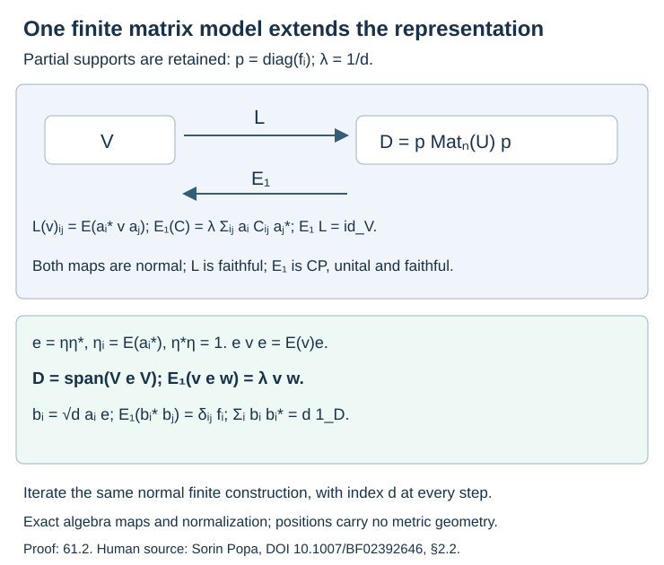
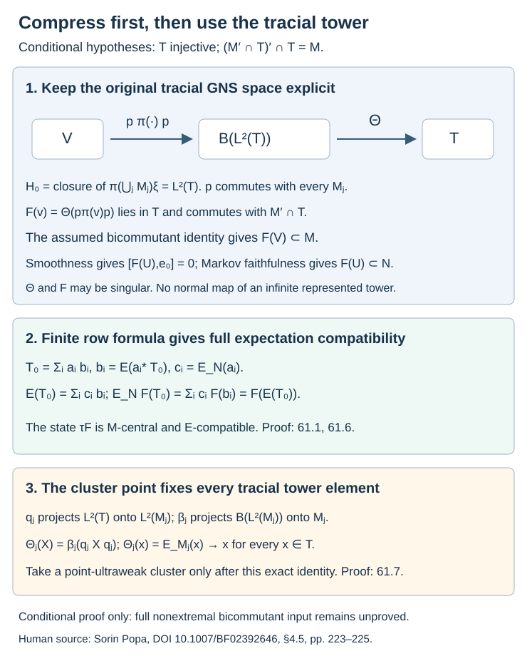
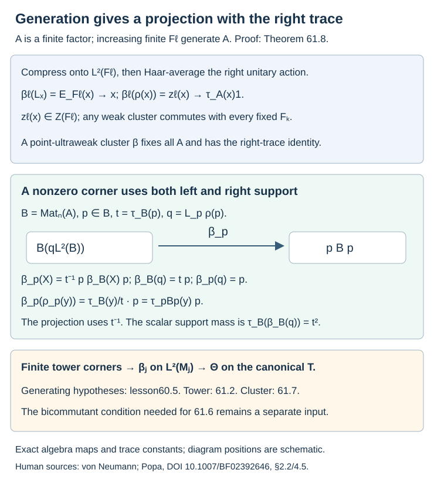
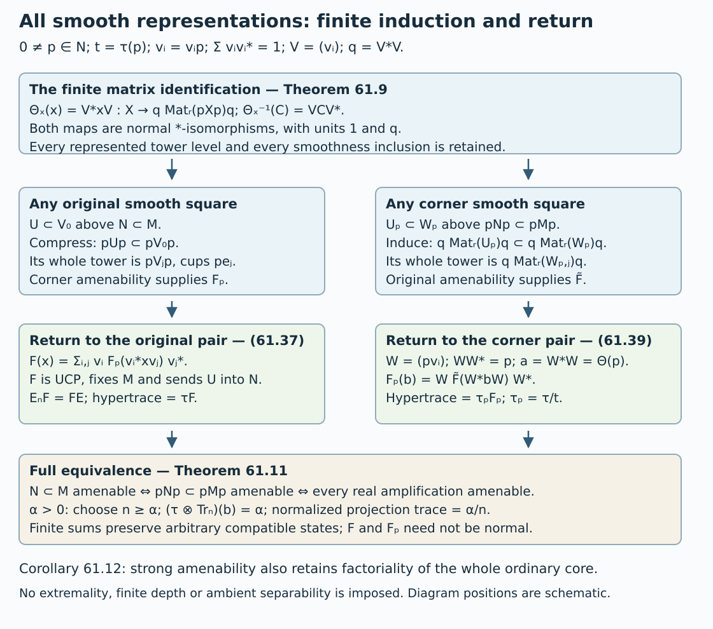
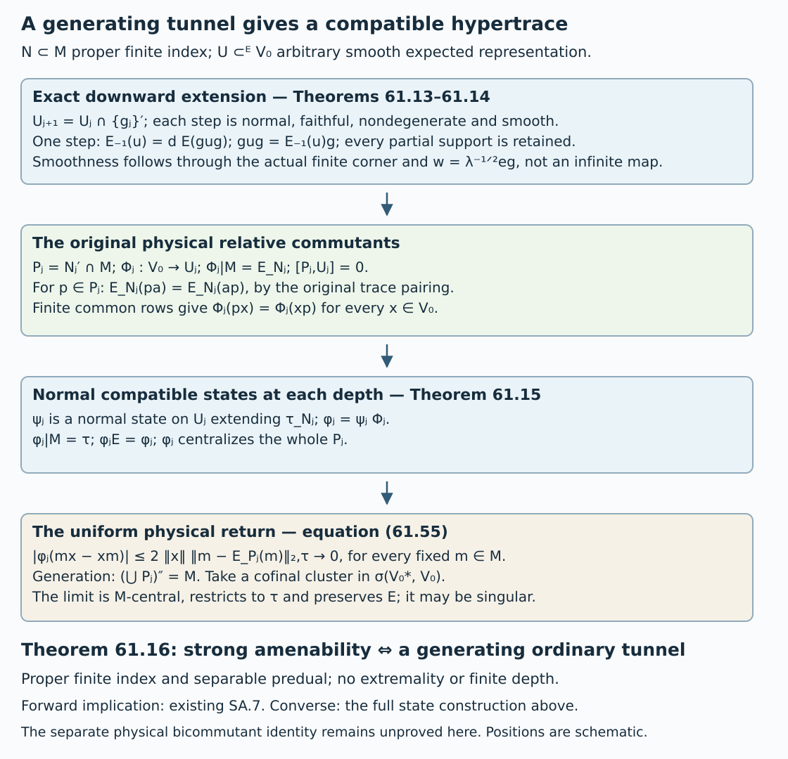
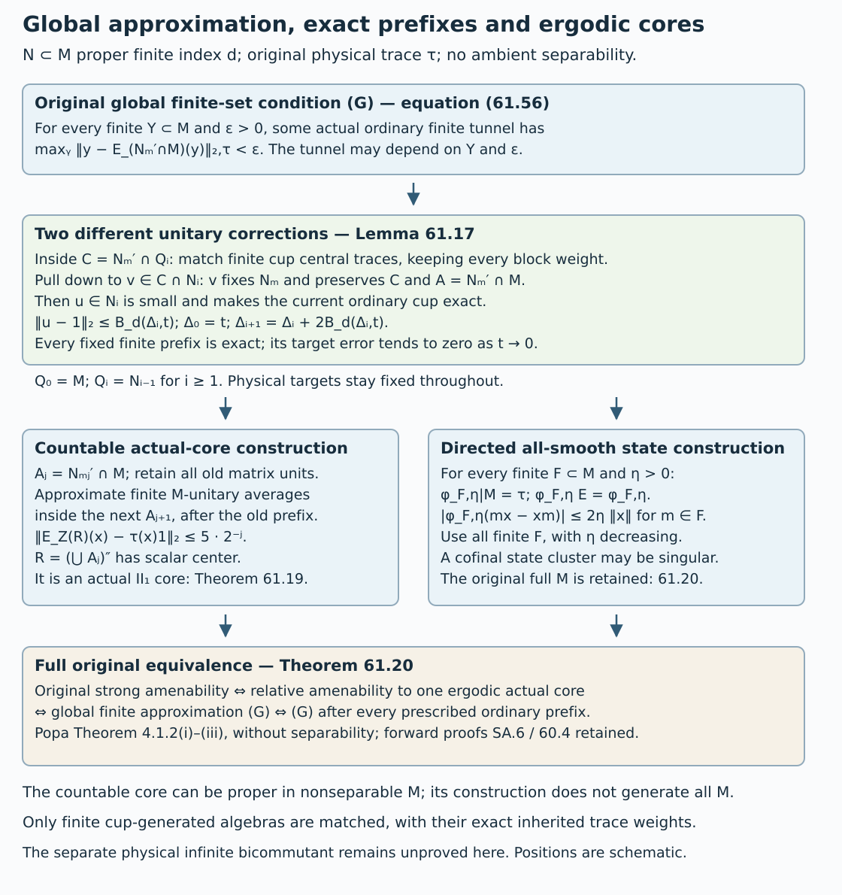

# Smooth representations and compression onto the tracial tower

A representation can enlarge both algebras in a subfactor inclusion. A finite common basis still controls its basic construction, even when the larger algebras are neither finite nor factors. We construct that expected tower explicitly. We then show how the canonical tracial tower can produce a compatible hypertrace on a smooth representation. The latter argument has two precise hypotheses: an injective projection onto the tracial tower and its bicommutant identity. Generation supplies the first hypothesis; the second remains a separate mathematical condition. Every nonzero physical corner and positive real amplification also preserves the full all-smooth representation amenability condition. Explicit finite matrix induction and return maps retain all tower levels and allow singular compatible hypertraces. An explicit downward expected tunnel gives a compatible hypertrace directly from generation. Together with SA.7, this proves the full original strong-amenability/generating-tunnel equivalence for proper finite-index inclusions with separable predual. The full original global-finite-approximation/strong-amenability equivalence also holds without ambient separability. Exact finite-prefix matching and a separate factorial-core construction preserve its original finite-set scope.

The finite partial basis is [Theorem 3.2](finite-bases-and-positive-index.md), and the ordinary trace and cup identities are [Theorems 4.1–4.2 and Proposition 4.3](towers-and-tunnels.md). The generating inclusion used below is [Theorem 60.5](preserved-prefix-and-generating-tunnels.md). Normal tracial expectations, standard left/right commutation, matrix positivity and the bimodularity of a unital positive projection onto a C*-subalgebra are the operator-algebra prerequisites already used in lessons 3, 49 and 60. For normal state extension we use the exact existing-course [Theorem 10.1 of *The double commutant theorem*](../../foundations-of-von-neumann-algebras/the-double-commutant-theorem.html#oa-fnd-bi-14): every positive normal functional on a concrete von Neumann algebra is a sum of square-summable vector functionals. Its complete proof applies to arbitrary Hilbert spaces.

The human source is Sorin Popa, [*Classification of amenable subfactors of type II*](https://doi.org/10.1007/BF02392646), Sections 2.1–2.3 and 4.5, printed pp. 191–197 and 223–225. We give the finite matrix construction and keep the GNS compression explicit. The injective projection constructed from finite-dimensional generation below also preserves the right trace, which permits an exact corner normalization.

Let \(N\subset M\) be II₁ factors of finite index \(d\), with \(\lambda=d^{-1}\). A **nondegenerate expected representation** is a square

\[
\begin{matrix}
U&\subset_E&V\\
\cup&&\cup\\
N&\subset&M
\end{matrix}
\qquad E|_M=E_N,
\tag{61.1}
\]

where \(E:V\to U\) is normal and faithful, and the ultraweak linear span of \(MU\) is \(V\). The algebras \(U,V\) can be arbitrary von Neumann algebras. We denote the original tower by \(M_{-1}=N,M_0=M,M_1,\ldots\); our cup \(e_j\in M_{j+1}\) implements \(M_{j-1}\subset M_j\). The represented tower is \(V_{-1}=U,V_0=V,V_1,\ldots\), containing the original tower and the same cups. Its construction is proved in Theorem 61.2.

The representation is **smooth** when

\[
N'\cap M_j\ \subset\ U'\cap V_j
\quad(j\geq0).
\tag{61.2}
\]

Commutants in this formula are taken in the indicated represented finite stages. Write

\[
\mathcal T=\left(\bigcup_{j\geq0}M_j\right)''
\tag{61.3}
\]

for the canonical completion in the compatible normalized tower trace. This is distinct from any completion of the represented tower.

## A finite row gives full compatibility

**Lemma 61.1.** Let \(a_1,\ldots,a_n\in M\) be a partial right \(N\)-basis with supports \(f_i\in N\), so that

\[
\begin{gathered}
E_N(a_i^*a_j)=\delta_{ij}f_i,\\
a_if_i=a_i,\\
x=\sum_i a_iE_N(a_i^*x),\\
\sum_i a_i a_i^*=d1.
\end{gathered}
\tag{61.4}
\]

Then the same row formula holds for every \(v\in V\). If \(F:V\to M\) is an \(M\)-bimodule conditional expectation with \(F(U)\subset N\), it satisfies

\[
E_NF=FE.
\tag{61.5}
\]

Neither \(F\) nor the state \(\tau F\) is required to be normal.

**Proof.** The bounded normal map \(Q(v)=\sum_i a_iE(a_i^*v)\) fixes \(xb\), \(x\in M,b\in U\), by the original basis identity and right \(U\)-bimodularity of \(E\). It therefore fixes their ultraweak span, which is all \(V\). Put \(b_i=E(a_i^*v)\) and \(c_i=E_N(a_i)\). The finite row gives

\[
\begin{aligned}
E(v)&=\sum_i c_i b_i,\\
E_NF(v)&=\sum_i c_iF(b_i)\\
&=F(E(v)).
\end{aligned}
\tag{61.6}
\]

Here \(F(b_i)\in N\), and only finite sums are used. Thus \(\tau F\) is \(M\)-central, restricts to \(\tau\), and satisfies \(\tau FE=\tau F\). \(\square\)

## Constructing the expected tower without a trace on the representation

**Theorem 61.2.** The square (61.1) extends to normal faithful expected tower squares with the original cups, a common partial basis and scalar index normalization \(d\) at every step.

**Proof.** Put \(p=\operatorname{diag}(f_i)\in\operatorname{Mat}_n(U)\) and

\[
\begin{gathered}
\mathcal D=p\operatorname{Mat}_n(U)p,\\
L(v)_{ij}=E(a_i^*va_j),\\
\eta_i=E(a_i^*),\quad e=\eta\eta^*.
\end{gathered}
\tag{61.7}
\]

The entries lie in \(f_iUf_j\), and \(\eta\in pU^n\). The row for \(1\), followed by \(E\), gives \(\eta^*\eta=1\). The row for \(wa_j\) gives \(L(vw)=L(v)L(w)\). Adjoint preservation gives \(L(v^*)=L(v)^*\), and (61.4) gives \(L(1)=p\). Thus \(L\) is a unital normal *-homomorphism. It is faithful because \(L(v)\eta\) is the coefficient column \(E(a_i^*v)\), which recovers \(v\).

For \(u\in U\), \(L(u)\eta=\eta u\). Also \(\eta^*L(v)\eta=E(v)\). Consequently \(e\) is a projection commuting with \(L(U)\), and

\[
eL(v)e=L(E(v))e.
\tag{61.8}
\]

The vector \(L(a_i)\eta\) has entry \(f_i\) in position \(i\) and zero elsewhere. Hence \(L(a_i)eL(u)L(a_j^*)\) is the matrix with entry \(f_iuf_j\) in position \((i,j)\). Such matrices span all of \(\mathcal D\). Therefore

\[
\mathcal D=\operatorname{span}(VeV).
\tag{61.9}
\]

We identify \(V\) with its image under \(L\). Define the dual map by

\[
E_1(C)=\lambda\sum_{i,j}a_iC_{ij}a_j^*.
\tag{61.10}
\]

This finite row formula is normal and completely positive, and \(E_1(p)=1\). The row identity gives \(\sum_i a_iL(v)_{ij}=va_j\), whence \(E_1(L(v))=v\). The same identity and its adjoint prove \(V\)-bimodularity.

To prove faithfulness, write \(C=Y^*Y\). Set \(z_k=\sum_jY_{kj}a_j^*\). Then \(E_1(C)=\lambda\sum_kz_k^*z_k\). If this is zero, every \(z_k=0\). Taking adjoints and extracting its \(i\)-th coefficient by \(E(a_i^*\,\cdot)\) gives \(Y_{ki}^*=0\); its left support is \(f_i\). Thus \(Y=C=0\). The row for \(1\) also gives

\[
E_1(vew)=\lambda vw.
\tag{61.11}
\]

The next common basis is \(b_i=\sqrt d\,a_i e\). Directly from (61.8) and (61.11),

\[
\begin{gathered}
E_1(b_i^*b_j)=\delta_{ij}f_i,\\
\sum_i b_i b_i^*=d1_{\mathcal D},\\
C=\sum_i b_iE_1(b_i^*C).
\end{gathered}
\tag{61.12}
\]

For the last equality, the right side at \(C=vew\) is \(\sum_i a_iE(a_i^*v)ew=vew\), and these words span \(\mathcal D\). The middle equality is the sum of the coordinate projections \(L(a_i)eL(a_i^*)\), multiplied by \(d\). This basis permits iteration of exactly the same construction. The original finite Jones tower is the identical model on the common basis with \(N\) in place of \(U\); its embeddings and restricted expectations are therefore the original ones. At each step the new row spans the represented stage over the preceding stage, proving nondegeneracy of each expected square.

The index bound is also explicit. For \(y=\sum_i a_i c_i\), \(c_i=E(a_i^*y)\), Parseval gives \(E(y^*y)=\sum_i c_i^*c_i\). The operator row \(a=(a_i)\) has norm squared \(d\), so

\[
y^*y\leq dE(y^*y).
\tag{61.13}
\]

For the dual bound take \(C=Y^*Y\), \(z_k\) as above and any supported column \(\xi\in pU^n\). Set \(v=\sum_i a_i\xi_i\). Schwarz for \(E\) gives

\[
\begin{gathered}
\xi^*L\!\left(\sum_kz_k^*z_k\right)\xi
\\
=\sum_kE((z_kv)^*z_kv)\\
\geq\sum_kE(z_kv)^*E(z_kv)\\
=\xi^*C\xi.
\end{gathered}
\tag{61.14}
\]

The last equality uses \(E(z_kv)=\sum_jY_{kj}\xi_j\). Matrix positivity proves \(E_1(C)\geq\lambda C\), with \(V\) viewed through \(L\). Since \(E_1(e)=\lambda1\), compression by the nonzero \(e\) shows that \(\lambda\) is optimal. For \(E\) the original downward cup \(g\in M\), with \(E(g)=\lambda1\), gives the same optimality. Thus the actual normalization stays \(d\) at every step. \(\square\)

**Figure 61.1.** The exact maps in Theorem 61.2 retain every partial support. Positions are schematic; the formulas give the maps, normalization and finite spanning relation.

**Corollary 61.3.** Smoothness propagates: for \(i\geq0\), \(i\leq j\),

\[
M_i'\cap M_j\ \subset\ V_i'\cap V_j.
\tag{61.15}
\]

**Proof.** Such an element commutes with \(U\) by initial smoothness, and with \(M\subset M_i\). Nondegeneracy gives commutation with \(V\). It also commutes with \(e_0,\ldots,e_{i-1}\in M_i\). These cups and \(V\) generate \(V_i\). Bounded multiplication is ultraweakly continuous, so it commutes with all of \(V_i\). \(\square\)

## A sufficient bicommutant test

**Lemma 61.4.** Let \(B\subset M'\cap\mathcal T\) be a von Neumann algebra. Set \(B_j=B\cap M_j'\) and \(C_j=B_j'\cap\mathcal T\). If

\[
E_{C_j}(e_j)=\lambda1\qquad(j\geq0),
\tag{61.16}
\]

then \(B'\cap\mathcal T=M\).

**Proof.** Put \(D=B'\cap\mathcal T\). Since \(B_j\subset B\), \(D\subset C_j\), so \(E_DE_{C_j}=E_D\). Also \(M_j\subset C_j\). Each \(x\in M_{j+1}\) is a finite sum \(\sum_l u_l e_jv_l\), \(u_l,v_l\in M_j\), by the finite basic construction. Therefore

\[
\begin{aligned}
E_D(x)&=E_DE_{C_j}(x)\\
&=E_D\!\left(\lambda\sum_lu_lv_l\right).
\end{aligned}
\tag{61.17}
\]

Hence \(E_D(M_{j+1})\subset E_D(M_j)\). Since \(M\subset D\), induction gives \(E_D(M_j)\subset M\). Normality and density give \(E_D(\mathcal T)\subset M\), so its range \(D\) equals \(M\). \(\square\)

Taking \(B=M'\cap\mathcal T\) gives the bicommutant identity when (61.16) has been proved. The source additionally states commuting-square conditions; the sufficient proof above needs only (61.16). We do not assert that those scalar expectations or commuting squares hold for an arbitrary \(B\).

## Normal state extension and compression before projection

**Lemma 61.5.** Every normal state on \(N\) extends to a normal state on \(U\), with no separability or sigma-finiteness assumption on \(U\).

**Proof.** Represent \(U\) faithfully and normally on \(H\). The exact existing-course Theorem 10.1 stated in the introduction writes the given state as \(\sum_n\langle x\xi_n,\xi_n\rangle\) on \(N\), with \(\sum_n\|\xi_n\|^2=1\). Use the same formula on \(U\). The positive vector functionals have summable norms and converge in the predual norm, so their sum is normal and positive, has value \(1\) at \(1\), and restricts to the given state. This does not assert that the extension is faithful on \(U\). \(\square\)

**Theorem 61.6.** Suppose there is a UCP projection

\[
\Theta:B(L^2(\mathcal T))\to\mathcal T
\tag{61.18}
\]

onto the standard left action, and suppose

\[
(M'\cap\mathcal T)'\cap\mathcal T=M.
\tag{61.19}
\]

Every smooth nondegenerate expected representation has a conditional expectation \(F:V\to M\) with \(F(U)\subset N\), \(E_NF=FE\), and the compatible \(M\)-hypertrace \(\tau F\).

**Proof.** Extend \(\tau_N\) to a normal state \(\psi\) on \(U\) by Lemma 61.5. Compose it with the normal tower expectations from \(V_j\) to \(U\). Their states \(\omega_j\) agree on overlaps and restrict to the original tower traces, because the expected squares restrict to the original ones. They define a state on the norm closure of \(\bigcup_jV_j\). Let \((\pi,H,\xi)\) be its GNS representation.

Each finite restriction \(\pi|_{V_j}\) is normal. For \(y\in V_l\), \(l\geq j\), its coefficient at \(\pi(y)\xi\) is \(x\mapsto\omega_l(y^*xy)\), a normal functional on \(V_j\). Polarization and approximation by these dense vectors show that all coefficients are normal. No normality of an entire represented infinite tower is being assumed.

The subspace \(H_0=\overline{\pi(\bigcup_jM_j)\xi}\) is the original tracial GNS space \(L^2(\mathcal T)\). Its projection \(p\) commutes with every original \(M_j\), since this subspace reduces their *-algebra. Compression

\[
\begin{gathered}
K(v)=p\pi(v)p|_{H_0},\\
F(v)=\Theta(K(v)).
\end{gathered}
\tag{61.20}
\]

is UCP, fixes \(M\), and is \(M\)-bimodular. Initially \(F(v)\in\mathcal T\). For \(c\in M'\cap M_j\), Corollary 61.3 gives \([c,v]=0\). Since \(p\) commutes with \(c\), so does \(K(v)\); the \(\mathcal T\)-bimodularity of \(\Theta\) gives \([c,F(v)]=0\).

The tracial expectations \(E_{M_j}\) preserve commutation with \(M\). For \(c\in M'\cap\mathcal T\), \(E_{M_j}(c)\to c\) in \(L^2\), with uniform norm bound. Thus the union of the finite \(M'\cap M_j\) is ultraweakly dense in \(M'\cap\mathcal T\). The bounded element \(F(v)\) commutes with this whole algebra. Hypothesis (61.19) puts it in \(M\).

For \(b\in U\), smoothness gives \([b,e_0]=0\), since \(e_0\in N'\cap M_1\). The same compression argument gives \([F(b),e_0]=0\). If \(x\in M\) commutes with \(e_0\), then \(xe_0=e_0xe_0=E_N(x)e_0\). For \(y=x-E_N(x)\),

\[
\|ye_0\|_2^2=\lambda\|y\|_2^2.
\tag{61.21}
\]

This follows from the canonical Markov trace. Thus \(ye_0=0\) implies \(y=0\), proving \(M\cap\{e_0\}'=N\) and \(F(U)\subset N\). The left algebra element \(e_0\) on \(L^2(\mathcal T)\) has not been identified with the expectation operator on \(L^2(M)\).

The UCP map \(F\) fixes \(M\) and has range in \(M\), so it is a conditional expectation. Lemma 61.1 gives its full expectation compatibility and the hypertrace. \(\square\)

**Figure 61.2.** The two hypotheses of Theorem 61.6 are drawn explicitly. The projection \(p\) commutes with the original tower. It need not commute with the represented tower. The maps \(\Theta,F\) can be nonnormal.

## Generation supplies the injective projection

**Lemma 61.7.** If each \(M_j\) has a UCP projection \(\beta_j:B(L^2(M_j))\to M_j\), then \(\mathcal T\) has the projection (61.18).

**Proof.** Let \(q_j\) project \(L^2(\mathcal T)\) onto \(L^2(M_j)\), and define \(\Theta_j(X)=\beta_j(q_jXq_j|_{L^2(M_j)})\), with output in \(\mathcal T\). For every \(x\in\mathcal T\) and \(b\in M_j\),

\[
q_jxq_j\widehat b=\widehat{E_{M_j}(x)b}.
\tag{61.22}
\]

Consequently \(\Theta_j(x)=E_{M_j}(x)\to x\) ultraweakly for every \(x\in\mathcal T\). The UCP maps have a point-ultraweak cluster by compactness of the output unit balls; positivity at every matrix size and linearity pass to this cluster. Its range lies in the closed algebra \(\mathcal T\), and the equality just proved shows that it fixes all of \(\mathcal T\). It is the desired projection. Fixing only the algebraic union would be insufficient for a possibly singular cluster; (61.22) covers every \(x\) before taking the limit. \(\square\)

**Theorem 61.8.** In the separable generating case of Theorem 60.5, (61.18) holds. The construction of each finite-stage projection can preserve the right trace as well.

**Proof.** Let a finite factor \(A\) be generated by increasing unital finite-dimensional \(F_l\). On \(L^2(F_l)\), Haar-average conjugation by the right unitary group \(U(F_l)\). This UCP projection \(P_l\) has range the commutant of right \(F_l\), namely left \(F_l\). This statement includes direct sums of matrix blocks. If \(q_l:L^2(A)\to L^2(F_l)\) is the orthogonal projection, put

\[
\beta_l(X)=P_l(q_lXq_l|_{L^2(F_l)}).
\tag{61.23}
\]

For left \(x\in A\), compression is left \(E_{F_l}(x)\), so \(\beta_l(x)=E_{F_l}(x)\to x\). For right multiplication \(\rho_A(x)\), compression is right \(E_{F_l}(x)\). Averaging its unitary conjugates gives

\[
\begin{gathered}
\beta_l(\rho_A(x))=z_l(x),\\
z_l(x)=E_{Z(F_l)}E_{F_l}(x).
\end{gathered}
\tag{61.24}
\]

Here the central expectation is inside \(F_l\). The elements \(z_l(x)\) have norm at most \(\|x\|\), trace \(\tau_A(x)\), and commute with every fixed \(F_k\) once \(l\geq k\). Any ultraweak cluster is therefore central in the generating factor \(A\), and has trace \(\tau_A(x)\). Thus the entire net tends ultraweakly to \(\tau_A(x)1\). A point-ultraweak cluster of \(\beta_l\) gives a UCP projection \(\beta_A\) satisfying, for every \(x\in A\),

\[
\begin{gathered}
\beta_A(x)=x,\\
\beta_A(\rho_A(x))=\tau_A(x)1.
\end{gathered}
\tag{61.25}
\]

This extra right-trace identity is proved for this projection; it is not assumed for an arbitrary injective projection.

For \(B=\operatorname{Mat}_n(A)\), order its standard space as \(\mathbb C^n\otimes L^2(A)\otimes\mathbb C^n\), with the last index the right matrix leg. Apply normalized trace on that last leg and \(\beta_A\) to each operator entry on \(L^2(A)\). The resulting UCP projection \(\beta_B\) fixes left \(B\), and (61.25) gives \(\beta_B(\rho_B(b))=\tau_B(b)1\). All matrix sums are finite.

Now take a nonzero \(p\in B\), let \(t=\tau_B(p)>0\), and \(q=L_p\rho_B(p)\). The space \(qL^2(B)\) is the standard corner space: the normalized-trace unitary sends \(\widehat a\in L^2(pBp)\) to \(t^{-1/2}\widehat a\in qL^2(B)\). Extend an operator on this space by zero, and set

\[
\beta_p(X)=t^{-1}p\beta_B(X)p.
\tag{61.26}
\]

Bimodularity and the right-trace identity give \(\beta_B(q)=tp\), so \(\beta_p(q)=p\). The map is UCP and unital with corner identity \(p\). For \(a\in pBp\), its left corner action is \(aq\), and \(\beta_p(aq)=a\). Its range is the corner, so it is a conditional expectation. The right corner action of \(y\in pBp\) is \(q\rho_B(y)q=p\rho_B(y)\), and

\[
\begin{aligned}
\beta_p(q\rho_B(y)q)
&=\frac{\tau_B(y)}t\,p\\
&=\tau_{pBp}(y)p.
\end{aligned}
\tag{61.27}
\]

Thus the right-trace identity survives every nonzero corner. The operator normalizer is \(t^{-1}\); the scalar support mass \(\tau_B(\beta_B(q))=t^2\) is a different quantity.

Both \(N,M\) in Theorem 60.5 have increasing finite-dimensional generating algebras. They therefore have these projections. Theorem 61.2 realizes \(M_1\) as a finite matrix corner over \(N\), \(M_2\) as one over \(M\), and each further stage as one over the stage two steps earlier. Finite matrix amplification and corner compression supply all \(\beta_j\). The identifications preserve the unique normalized factor traces and hence their standard spaces. Lemma 61.7 gives (61.18). \(\square\)

**Figure 61.3.** The left and right support define the standard corner space. The displayed maps and constants are exact; positions are schematic. Generation gives tower injectivity here, while the bicommutant condition needed for Theorem 61.6 is separate.

The nonextremal physical bicommutant argument in Popa, Section 4.5, passes to a two-step inclusion, modifies downward cups and invokes a trace-preserving comparison carrying them to shifted upward cups. That comparison is distinct from the specified reflection refuted in [lesson 47](trace-compatible-reflection.md), and its full construction remains a separate requirement for that route. The downward represented-tunnel construction below proves the generating-to-amenability implication directly. The general physical bicommutant is not established by that state construction.

## Every smooth representation can be induced through a corner

We now address the quantifier over **every** smooth representation. The finite constructions below work at every finite index, including \(d=1\), and impose no separability, extremality or finite-depth hypothesis. Their trace-pairing input is [Lemma 60.1](preserved-prefix-and-generating-tunnels.md#turning-the-hypertrace-into-a-conditional-expectation); their physical corner tower is [Theorem 17.11](generating-tunnels-and-classification.md#corners-and-real-amplifications-preserve-both-models). The human source for the heredity statement is Popa, *Classification of amenable subfactors of type II*, Proposition 3.2.3(iii), printed pp. 206–208.

Fix \(0\ne p\in N\), put \(t=\tau(p)\), and abbreviate \(N_p=pNp\), \(M_p=pMp\), with normalized trace \(\tau_p=\tau/t\). The finite frame of (17.33) consists of partial isometries \(v_1,\ldots,v_r\in N\) satisfying

\[
\begin{gathered}
v_i=v_ip,\qquad \sum_i v_iv_i^*=1,\\
V=(v_1,\ldots,v_r),\qquad q=V^*V\in\operatorname{Mat}_r(N_p),\\
VV^*=1,\qquad q^2=q=q^*.
\end{gathered}
\tag{61.29}
\]

The unit in every entry algebra \(N_p,M_p\) is \(p\). The unit of a matrix corner by \(q\) is \(q\).

**Theorem 61.9.** Compression takes every smooth nondegenerate expected representation of \(N\subset M\) to one of \(N_p\subset M_p\). Conversely, every such representation of \(N_p\subset M_p\) induces one of \(N\subset M\). Both operations preserve all the represented finite tower levels and their smoothness inclusions.

**Proof.** For any von Neumann algebra \(X\supset N\), the maps

\[
\begin{aligned}
\Theta_X:X&\longrightarrow q\operatorname{Mat}_r(pXp)q,\\
\Theta_X(x)&=V^*xV=(v_i^*xv_j)_{ij},\\
\Theta_X^{-1}(C)&=VCV^*=\sum_{i,j}v_iC_{ij}v_j^*
\end{aligned}
\tag{61.30}
\]

are inverse unital normal *-isomorphisms. Indeed, \(VV^*=1\) proves multiplicativity and both inverse identities; \(V^*V=q\) gives the target corner and its identity. All entries are bounded multiplications, so both maps are normal. These are compatible maps for all nested choices of \(X\).

Start with a representation \(U\subset_E V_0\) of the original pair; in this proof \(V_0\) is the ambient algebra denoted by \(V\) in (61.1), whereas \(V\) in (61.29) is the finite row. Compress to \(pUp\subset_{E^p}pV_0p\), where \(E^p(x)=pE(x)p\). This expectation is normal and faithful and restricts to \(E_{N_p}^{M_p}\). For \(x\in M,u\in U\),

\[
pxup=\sum_i(pxv_ip)(pv_i^*up).
\tag{61.31}
\]

The first factor is in \(M_p\), and the second is in \(pUp\). Compression is ultraweakly continuous; the nondegenerate span of \(MU\) therefore proves nondegeneracy of the compressed square.

Its represented Jones tower is exactly \(pV_jp\), with cups \(pe_j\). Here and below the lower tower level is \(V_{-1}=U\). To check the full range, use \(V_{j+1}=\operatorname{span}(V_je_jV_j)\) from Theorem 61.2, the commutation of \(e_j\) with \(N\ni v_i,p\), and the identity

\[
pxe_jyp=\sum_i(pxv_ip)(pe_jp)(pv_i^*yp).
\tag{61.32}
\]

Thus the preceding corner and its cup generate the entire next corner. The restricted normal faithful dual expectation sends \(pe_j\) to \(d^{-1}p\). These maps and the common original basis identify the finite matrix construction of Theorem 61.2 at every level, rather than only a dense algebra of words. The original physical tower is \(pM_jp\), by Theorem 17.11. That theorem also gives

\[
(pNp)'\cap pM_jp=p(N'\cap M_j).
\tag{61.33}
\]

If \(c\in N'\cap M_j\), original smoothness makes it commute with \(U\). Hence \(pc\) commutes with \(pUp\). This is exactly smoothness of the compressed representation at every \(j\geq0\).

In the other direction, let \(U_p\subset_{E_p}W_p\) be any smooth nondegenerate expected representation of \(N_p\subset M_p\), with represented tower \(W_{p,j}\). Define

\[
\begin{gathered}
\widetilde U=q\operatorname{Mat}_r(U_p)q,\qquad
\widetilde W_j=q\operatorname{Mat}_r(W_{p,j})q,\\
\widetilde E=(\mathrm{id}_{\operatorname{Mat}_r}\otimes E_p)|_q.
\end{gathered}
\tag{61.34}
\]

Place the original \(N,M,M_j\) inside these algebras through (61.30). The matrix expectation fixes \(q\in\operatorname{Mat}_r(N_p)\), is normal and faithful, and restricts to the original trace-preserving expectation under this identification, by bimodularity and the entries of (61.30).

For the full spanning assertion, the nonzero \(q\) has full central support in the finite factor \(\operatorname{Mat}_r(N_p)\). Its finite frame supplies \(w_l\in\operatorname{Mat}_r(N_p)\) with \(\sum_lw_lqw_l^*=1\). Entrywise nondegeneracy says that matrices in \(W_p\) are in the ultraweak span of products \(AB\), with \(A\in\operatorname{Mat}_r(M_p)\), \(B\in\operatorname{Mat}_r(U_p)\). Inserting that frame gives

\[
qABq=\sum_l(qAw_lq)(qw_l^*Bq).
\tag{61.35}
\]

Both factors are in the required induced algebras. This proves nondegeneracy without assuming that compression automatically preserves a product span.

The cups are \(q\operatorname{diag}(pe_j)q=\Theta_{M_{j+1}}(e_j)\). The equality uses \([v_i,e_j]=0\). The \(w_l\) also commute with each diagonal cup. Apply (61.35) to words with one cup between \(A,B\); it proves generation of the whole next corner by the preceding corner and this cup. The entrywise dual expectations retain value \(d^{-1}q\) on it. Theorem 61.2 therefore identifies these as the full induced represented tower, with the original finite tower embedded through \(\Theta\).

Finally, for \(c\in N'\cap M_j\),

\[
\Theta_{M_j}(c)=q\operatorname{diag}(pc)q.
\tag{61.36}
\]

The element \(pc\in N_p'\cap pM_jp\) commutes with \(U_p\) by the given smoothness. Its diagonal matrix therefore commutes with all matrices in \(U_p\), including \(q\). Formula (61.36) commutes with \(\widetilde U\), proving every original smoothness inclusion. \(\square\)

## Returning compatible hypertraces by finite sums

An **\(M\)-hypertrace** on \(V_0\supset M\) is an \(M\)-central state whose restriction to \(M\) is its normalized trace. Compatibility means \(\varphi E=\varphi\). A central state already has this restriction: on a projection \(a\in M\), comparison with rational-trace projections bounds its value between \(\lfloor k\tau(a)\rfloor/k\) and \(\lceil k\tau(a)\rceil/k\). The rational projections have those values because a unital set of \(k\times k\) matrix units has equally valued diagonal entries. Projection comparison is Theorem TE16 in [Finite algebras and normal traces](finite-algebras-and-normal-traces.md). Letting \(k\to\infty\), then approximating positive elements in norm by finite spectral sums, proves the assertion without assuming normality of the state.

**Lemma 61.10.** A representation admits a compatible \(M\)-hypertrace if and only if it admits a UCP conditional expectation \(F:V_0\to M\) with \(F(U)\subset N\). Such projections transfer in both directions through Theorem 61.9, using finite matrix operations only.

**Proof.** The trace-pairing argument of Lemma 60.1 applies to arbitrary represented \(U\subset_E V_0\): for \(0\leq T\leq1\), the functional \(x\mapsto\varphi(xT)\) on \(M\) lies between \(0\) and \(\tau\), and hence is normal with a unique bounded density \(F(T)\in M\). Additivity, bimodularity and complete positivity follow from the same trace-pairing and matrix-positivity calculation there. That argument uses only \(E|_M=E_N\) and \(\varphi E=\varphi\), so gives \(E_NF=FE\) and \(F(U)\subset N\). Normality was used only in the variable \(x\in M\), not the represented variable \(T\). Conversely Lemma 61.1 gives full compatibility and the hypertrace \(\tau F\) from the stated range condition.

For a projection \(F_p:pV_0p\to M_p\) taking \(pUp\) into \(N_p\), set

\[
\begin{aligned}
F:V_0&\longrightarrow M,\\
F(x)&=\Theta_M^{-1}\big((\mathrm{id}\otimes F_p)(\Theta_{V_0}(x))\big)\\
&=\sum_{i,j}v_iF_p(v_i^*xv_j)v_j^*.
\end{aligned}
\tag{61.37}
\]

The matrix UCP map fixes \(q\), since its entries are in \(N_p\subset M_p\). Bimodularity puts its \(q\)-corner in \(q\operatorname{Mat}_r(M_p)q\) and makes it unital there. Thus (61.37) is UCP and fixes \(M\). For \(x\in U\), every entry \(v_i^*xv_j\) belongs to \(pUp\); their images belong to \(N_p\), so \(F(x)\in N\). Lemma 61.1 gives expectation compatibility for the original square.

For the reverse return, start with a projection \(\widetilde F:\widetilde W_0\to\Theta_M(M)\) taking \(\widetilde U\) into \(\Theta_N(N)\). The row

\[
\begin{gathered}
W=(pv_1,\ldots,pv_r),\quad WW^*=p,\\
a=W^*W=\Theta_N(p)\leq q,\\
\iota:W_p\longrightarrow a\widetilde W_0a,\qquad
\iota(b)=W^*bW,\qquad \iota^{-1}(C)=WCW^*
\end{gathered}
\tag{61.38}
\]

has all entries in \(N_p\) and gives inverse normal *-isomorphisms. For \(b\in M_p\), \(\iota(b)=\Theta_M(b)\); it similarly identifies \(U_p\) with \(a\widetilde Ua\), and \(N_p\) with \(a\Theta_N(N)a\). The last assertion about \(U_p\) follows in both directions from the finite formulas and \(WW^*=p\).

Since \(\widetilde F\) fixes \(a\), bimodularity permits its restriction to the \(a\)-corner. The map

\[
F_p(b)=W\widetilde F(W^*bW)W^*,\qquad b\in W_p,
\tag{61.39}
\]

is consequently a unital CP projection onto \(M_p\) taking \(U_p\) into \(N_p\). Lemma 61.1 for \(N_p\subset M_p\) gives its full expectation compatibility. Its hypertrace is \(\tau_pF_p\), with the normalized corner trace. The finite formulas (61.37) and (61.39) require no normality of either conditional expectation and no infinite sum evaluated by a singular state. \(\square\)

**Figure 61.4.** The matrix corners and rows are the exact maps of (61.29)–(61.39); their positions are schematic. Induction covers an arbitrary corner representation, and compression covers an arbitrary original representation. The finite return maps preserve compatible hypertraces even when their conditional expectations are nonnormal.

## Full amenability heredity under every positive real amplification

Call the inclusion **amenable** when every smooth nondegenerate normal expected representation (61.1) has a compatible \(M\)-hypertrace. This is the original representation condition, with its full quantifier and no factoriality assumption on \(U,V_0\).

**Theorem 61.11.** For every finite-index inclusion of II₁ factors and every \(0\ne p\in N\),

\[
N\subset M\text{ is amenable}
\quad\Longleftrightarrow\quad
N_p\subset M_p\text{ is amenable}.
\tag{61.40}
\]

The same equivalence holds between \(N\subset M\) and its amplification by **every** positive real number \(\alpha\).

**Proof.** Suppose first the corner pair is amenable. Compress an arbitrary original smooth representation by Theorem 61.9. Its corner hypertrace gives \(F_p\) by Lemma 61.10. Formula (61.37) returns a compatible expectation, and hence a hypertrace, for the original representation. Since that representation was arbitrary, the original pair is amenable.

Conversely, induce an arbitrary smooth representation of the corner pair by (61.34). Original amenability supplies \(\widetilde F\) there. Formula (61.39) returns the required expectation for the given corner representation. This proves the other direction, including every singular-state case.

Apply this corner equivalence to \(N\overline\otimes\operatorname{Mat}_n\subset M\overline\otimes\operatorname{Mat}_n\) and its corner by \(1\otimes e_{11}\). That corner is the original pair, so all finite matrix amplifications have equivalent amenability. For \(\alpha>0\), choose an integer \(n\geq\alpha\) and a projection \(b\in N\overline\otimes\operatorname{Mat}_n\) satisfying

\[
(\tau\otimes\operatorname{Tr}_n)(b)=\alpha,\qquad
(\tau\otimes\operatorname{tr}_n)(b)=\alpha/n.
\tag{61.41}
\]

The unnormalized matrix trace is \(\operatorname{Tr}_n\); \(\operatorname{tr}_n=\operatorname{Tr}_n/n\). The normalized corner inclusion is the \(\alpha\)-amplification. Apply (61.40) once more. Both directions are independent of the choices, since they compare to the original pair. The proof includes \(d=1\). \(\square\)

**Corollary 61.12.** For a proper finite-index II₁ inclusion, original strong amenability is equivalent to strong amenability of every positive real amplification. No finite depth, extremality or separability assumption is required for this equivalence.

**Proof.** Original strong amenability is representation amenability together with factoriality of the larger actual ordinary core, as specified in [SA.1–SA.2](general-tail-supports-and-controlled-tunnels.md#original-strong-amenability-supplies-the-factorial-core-generating-hypothesis). Theorem 61.11 treats the first condition. Theorem 17.12 gives a normal trace-preserving isomorphism of every whole ordinary core pair before and after amplification. It therefore preserves the center of the larger core and treats the second condition. \(\square\)

These heredity statements transfer the full amenability property between the stated inclusions. The generating-to-amenability implication is proved by the independent downward construction in Theorems 61.13–61.15 below. The canonical tracial-tower argument in Theorem 61.6 retains its separate physical bicommutant hypothesis.

## Extending a smooth representation down the original tunnel

We retain the original expectation and physical normalized trace. The downward construction uses the common finite basis of Theorem 61.2 and the ordinary Jones relations of [Towers and tunnels](towers-and-tunnels.md). Its human source is Popa, *Classification of amenable subfactors of type II*, the proposition in Section 2.2.4, printed pp. 194–195. We include the full range, faithfulness and smoothness arguments, since the return to the original factor uses all three.

Choose one ordinary downward step \(N_1\subset N\subset M\), with its actual cup \(g\in M\), and write \(e=e_0\in M_1\), \(f=e_1\in M_2\). In every represented tower these same cups satisfy

\[
\begin{gathered}
geg=\lambda g,\quad ege=\lambda e,\quad
efe=\lambda e,\quad fef=\lambda f,\quad [g,f]=0,\\
[e,U]=0,\quad [f,V_0]=0,\quad E(g)=\lambda1.
\end{gathered}
\tag{61.42}
\]

Here \(U\subset_E V_0\) is an arbitrary smooth nondegenerate expected representation of \(N\subset M\); its represented upper stages are \(V_1,V_2\).

**Theorem 61.13.** Put

\[
U_1=U\cap\{g\}',\qquad
E_{-1}:U\longrightarrow U_1,\qquad
E_{-1}(u)=\lambda^{-1}E(gug).
\tag{61.43}
\]

This is a normal faithful conditional expectation. The square \(N_1\subset N\) inside \(U_1\subset_{E_{-1}}U\) is nondegenerate and smooth, and its full first expected basic construction is the original \(U\subset_E V_0\), with cup \(g\). The partial basis, every support and the scalar index \(d\) are retained.

**Proof.** Multiplication \(z\mapsto zg\) is injective on \(U\). Indeed, \(zg=0\) implies
\(ezge=\lambda ze=0\), since \(e\) commutes with \(z\). The original dual expectation has \(E_1(ze)=\lambda z\), so \(z=0\).

For \(u\in U\), set \(b=\lambda^{-1}E(gug)\in U\) and \(T=fegugef\). The compression formula for \(e\) gives

\[
T=\lambda^2bf.
\tag{61.44}
\]

Using (61.42) twice gives

\[
\begin{aligned}
gT&=\lambda fgugef=\lambda^2gugf,\\
Tg&=\lambda fegugf=\lambda^2gugf.
\end{aligned}
\tag{61.45}
\]

For example \(fgugef=gugfef=\lambda gugf\), and \(fegugf=fefgug=\lambda gugf\); all movements of \(f\) here use \([f,V_0]=0\). Multiplication by \(f\) is injective on \(V_0\), since its dual expectation sends \(zf\) to \(\lambda z\). Thus (61.44)–(61.45) imply

\[
gb=bg=gug.
\tag{61.46}
\]

Consequently \(E_{-1}\) has range in \(U_1\), and it implements compression by \(g\). It is normal and completely positive, is unital because \(E(g)=\lambda1\), and fixes every \(u\in U_1\) by \(E(gug)=uE(g)\). It is therefore a conditional expectation. If \(u\geq0\) and \(E_{-1}(u)=0\), faithfulness of \(E\) gives \(gug=0\), so \(u^{1/2}g=0\). The injectivity proved above gives \(u=0\). This proves faithfulness. On \(N\), the ordinary cup relation gives \(E_{-1}|_N=E_{N_1}^{N}\).

Let \((a_i)\subset N\) be a partial right \(N_1\)-basis of \(N\), with supports \(s_i\in N_1\). The actual cup basis \((\lambda^{-1/2}a_i g)\) is a common basis of \(M/N\) and \(V_0/U\), by [Lemma 52.1](canonical-core-traces-and-integer-rounding.md) and Lemma 61.1. Apply its row identity to \(ug\), \(u\in U\):

\[
\begin{aligned}
ug&=\lambda^{-1}\sum_i a_i gE(ga_i^*ug)\\
&=\sum_i a_iE_{-1}(a_i^*u)g.
\end{aligned}
\tag{61.47}
\]

In the second line (61.46) permits commuting the coefficient past \(g\). Injectivity of \(z\mapsto zg\) gives the full row

\[
u=\sum_i a_iE_{-1}(a_i^*u),\quad
E_{-1}(a_i^*a_k)=\delta_{ik}s_i,\quad
\sum_i a_ia_i^*=d1.
\tag{61.48}
\]

Thus the new square is nondegenerate, with the exact common partial basis and scalar index. The same original cup basis shows \(V_0=\operatorname{span}(UgU)\). We have \(gug=E_{-1}(u)g\), and \(E(ugv)=\lambda uv\) for \(u,v\in U\). The normal finite matrix model of Theorem 61.2 therefore identifies its full expected basic construction with \(V_0\), not just a subalgebra.

It remains to check smoothness; the common basis alone does not prove it. The upward square \(M\subset M_1\) inside \(V_0\subset V_1\) is smooth by Corollary 61.3. Apply Theorem 61.9 to its nonzero physical corner \(g\in M\). Set

\[
w=\lambda^{-1/2}eg,\qquad w^*w=g,\quad ww^*=e.
\tag{61.49}
\]

Conjugation by \(w\) normally identifies \(gV_1g\) with \(eV_1e=Ue\). The map \(u\mapsto ue\) is a faithful normal *-isomorphism onto this corner. Also \(gV_0g=U_1g\): insert the finite span \(UgU\), use (61.46) on both sides, and note that \(U_1g\) is normally closed. Since \(w\) commutes with \(U_1\), conjugation sends this subalgebra onto \(U_1e\).

On the physical factors the same maps send
\(gMg=N_1g\subset gM_1g\) onto \(N_1e\subset Ne\), giving exactly \(N_1\subset N\). They preserve the represented expectation as well. For \(u\in U\),

\[
gE_1\!\left(w^*(ue)w\right)g=gug=E_{-1}(u)g.
\tag{61.50}
\]

Conjugating the last expression by \(w\) gives \(E_{-1}(u)e\). Thus the transported corner expectation is (61.43). The normal isomorphisms extend through every marked expected tower level by the finite matrix construction of Theorem 61.2. They carry the full physical relative commutants to those of \(N_1\subset N\). Corner smoothness therefore proves every required smoothness inclusion for the downward square. No normal comparison of infinite reflected completions has been used. \(\square\)

**Corollary 61.14.** Fix any actual ordinary tunnel \(N=N_0\supset N_1\supset\cdots\), with cups \(g_j\) implementing \(N_{j+1}\subset N_j\). Every smooth representation extends normally down that exact tunnel:

\[
\begin{gathered}
U_0=U,\qquad U_{j+1}=U_j\cap\{g_j\}',\\
F_j:U_j\to U_{j+1}\text{ normal and faithful},\\
\Phi_j=F_{j-1}\cdots F_0 E:V_0\to U_j,\qquad
\Phi_0=E,\\
\Phi_j|_M=E_{N_j}^{M},\qquad
\Phi_jE=\Phi_j,\qquad
N_j'\cap M\subset U_j'\cap V_0.
\end{gathered}
\tag{61.51}
\]

The skipped square \(N_j\subset M\) inside \(U_j\subset V_0\) is nondegenerate.

**Proof.** Iterate Theorem 61.13 with the given cups; it makes no change to the original tunnel. Each downward square is smooth, and its upper expected tower is the previous one. Its smoothness at the original finite level \(M\) is the last inclusion in (61.51). The composed expectation has the stated restriction because the normal physical expectations compose along the nested factors. The first factor \(E\) gives \(\Phi_jE=\Phi_j\).

For nondegeneracy, each finite step writes the preceding represented algebra as a finite common-basis row over the next one. Substitution gives a finite row spanning \(V_0\) over \(U_j\), with all row elements in \(M\). Equivalently, successively use \(V_0=\operatorname{span}(MU_0)\) and \(U_i=\operatorname{span}(N_iU_{i+1})\), with \(N_i\subset M\). This is precisely the nondegenerate skipped square. \(\square\)

## Generation gives the full compatible hypertrace

**Theorem 61.15.** If a proper finite-index inclusion of II₁ factors has an ordinary generating tunnel, then it satisfies original all-smooth representation amenability. The conclusion covers every nondegenerate normal faithful expected representation, arbitrary represented algebras, and possibly singular compatible hypertraces.

**Proof.** Put \(P_j=N_j'\cap M\). These are increasing unital finite-dimensional algebras, with inherited trace, and generation says

\[
\left(\bigcup_jP_j\right)''=M.
\tag{61.52}
\]

Take an arbitrary smooth expected representation \(U\subset_E V_0\). Extend it down this tunnel by Corollary 61.14. Lemma 61.5 extends the normalized trace on \(N_j\) to a normal state \(\psi_j\) on \(U_j\). Define the normal state

\[
\varphi_j=\psi_j\Phi_j\quad\text{on }V_0.
\tag{61.53}
\]

It restricts to \(\tau\) on \(M\) and satisfies \(\varphi_jE=\varphi_j\).

In fact \(\Phi_j\), and hence \(\varphi_j\), is central over the whole \(P_j\). For \(p\in P_j,a\in M\), trace pairing in the original factor proves

\[
E_{N_j}(pa)=E_{N_j}(ap):
\quad
\tau(npa)=\tau(pna)=\tau(nap)\quad(n\in N_j).
\tag{61.54}
\]

The equality uses \([p,n]=0\) and cyclicity of the physical trace. Smoothness gives \([p,U_j]=0\). For \(b\in U_j\), bimodularity of \(\Phi_j\) and (61.54) yield
\(\Phi_j(pab)=E_{N_j}(pa)b=E_{N_j}(ap)b=\Phi_j(abp)\).
The finite nondegenerate row, or normality and its ultraweak span, extends this to every \(x\in V_0\). Thus \(\varphi_j(px)=\varphi_j(xp)\).

Now take any \(m\in M,x\in V_0\) and let \(p_j=E_{P_j}(m)\). State Cauchy–Schwarz and \(\varphi_j|_M=\tau\) give the uniform bound

\[
\left|\varphi_j(mx-xm)\right|
\leq 2\|x\|\,\|m-E_{P_j}(m)\|_{2,\tau}
\longrightarrow0.
\tag{61.55}
\]

Both terms involving \(m-p_j\) have that bound, and the \(p_j\)-commutator is zero. Generation gives the displayed \(L^2\) convergence for every \(m\); no dimension or trace comparison constant varies with the representation.

Choose a cofinal weak-* cluster of the states \(\varphi_j\) in the state space of the C*-algebra \(V_0\), that is, in \(\sigma(V_0^*,V_0)\). Compactness gives such a cluster. Its state \(\varphi\) restricts to \(\tau\), satisfies \(\varphi E=\varphi\), and is \(M\)-central by (61.55). The cluster need not be normal. Compatibility passes by evaluation at each fixed \(E(x)\), and centrality passes by the uniform bound, so neither step assumes normality of the limit.

This constructs the required hypertrace for the arbitrary original smooth representation. Lemma 61.10 also gives its conditional expectation \(V_0\to M\), with range on \(U\) contained in \(N\) and full expectation compatibility. \(\square\)

**Figure 61.5.** Corollary 61.14 retains every chosen ordinary cup. At depth \(j\), the state (61.53) centralizes the entire actual \(P_j\), and (61.55) controls the commutator with any fixed element of \(M\). The weak-* limit is taken in the full state space, so singular compatible states are included. The arrows and bound are exact; positions are schematic.

**Theorem 61.16 — strong amenability and generating tunnels.** For a proper finite-index inclusion \(N\subset M\) of II₁ factors with separable predual, the following are equivalent:

1. The inclusion is strongly amenable in the original representation sense of SA.1.
2. Some ordinary tunnel is generating.
3. Every prescribed finite ordinary tunnel prefix, with its actual cups, has a generating continuation.

No extremality or finite depth is assumed.

**Proof.** The full forward theorem [SA.7](general-tail-supports-and-controlled-tunnels.md#original-strong-amenability-supplies-the-factorial-core-generating-hypothesis) gives \(1\Rightarrow3\), and \(3\Rightarrow2\) follows by choosing a prefix. For \(2\Rightarrow1\), Theorem 61.15 gives original all-smooth representation amenability. The larger actual core of the generating tunnel is \(M\), a factor, so the core is ergodic. These are exactly the two conditions of SA.1–SA.2. \(\square\)

Theorem 61.16 proves the strong-amenability/generating-tunnel equivalence in Popa's Theorem 4.1.2 and Theorem 5.1.1 at their stated separable scope. The separate physical bicommutant identity in the canonical upward tracial completion remains a distinct assertion. The proof here neither establishes that identity nor assumes it as a hypothesis of the generating-to-amenability direction.

## Global finite approximation without a separability assumption

For the rest of this section \(N\subsetneq M\) is a proper finite-index inclusion of II₁ factors, \(d=[M:N]>1\), and \(\lambda=d^{-1}\). No separability is assumed. Write **(G)** for the following original finite-set condition:

\[
\begin{gathered}
\text{For every finite }Y\subset M\text{ and }\epsilon>0,\text{ some ordinary finite tunnel}\\
M\supset N=N_0\supset\cdots\supset N_m
\text{ satisfies }
\max_{y\in Y}\|y-E_{N_m'\cap M}(y)\|_2<\epsilon .
\end{gathered}
\tag{61.56}
\]

The tunnel can depend on \(Y,\epsilon\). This is Popa's Theorem 4.1.2(iii), printed p. 210. We prove its full reverse implication, including the nonseparable case. The finite matching method is the ordinary-cup argument in Section 4.5.1, printed p. 223. The comparison below uses ordinary cups, their physical trace and finite cup-generated subalgebras. It makes no comparison of the full reflected relative-commutant pairs.

We use the common partial basis and recognition in [Towers and tunnels](towers-and-tunnels.md), the finite cup trace and factoriality argument of [Proposition 50.5](relative-tensor-absorption.md), and the expectation restriction [Lemma 53.1](bounded-frames-with-central-support.md). Projection comparison and center-valued traces retain [TE16–TE18](finite-algebras-and-normal-traces.md). These inputs apply with arbitrary ambient cardinality.

*The finite matching separates a unitary that preserves the approximating algebra from a small physical correction (61.17–61.18). The lower branches distinguish a countable construction of an actual factorial core (61.19) from a directed net over every finite subset of the ambient factor (61.20). Both use the original ordinary cups and physical trace. This depicts the first three clauses of Popa, Theorem 4.1.2, printed p. 210; the finite cup comparison is in Section 4.5.1, printed p. 223. The general physical bicommutant is a separate assertion. [Reproducible figure source](figures/global-approximation-and-ergodic-cores.py).*

### Matching ordinary cups with one small final correction

**Lemma 61.17.** Let \(K\subset P\subset Q\) be an ordinary tracial basic construction of II₁ factors, of index \(d\), with cup \(p\in Q\). Let \(q\in Q\) be another ordinary cup with \(E_P(q)=\lambda1\). Suppose a unital finite-dimensional \(C\subset Q\) contains \(p\), satisfies \(E_P(C)\subset C\), and has

\[
\begin{gathered}
\|\operatorname{ctr}_C(p)-\lambda1\|_2\leq\eta,\qquad
\|q-E_C(q)\|_2\leq\delta,\\
b_1,\ldots,b_s\in\mathcal U(Q),\qquad
\max_l\|b_l-E_C(b_l)\|_2\leq\delta,\\
\left\|s^{-1}\sum_l b_lqb_l^*-\lambda1\right\|_2\leq\eta.
\end{gathered}
\tag{61.57}
\]

Here \(\operatorname{ctr}_C\) is the normalized trace in each matrix block, with the inherited physical weights retained. There are \(v\in\mathcal U(C\cap P)\), \(u\in\mathcal U(P)\) such that

\[
\begin{gathered}
uvp(uv)^*=q,\qquad vCv^*=C,\\
\|u-1\|_2\leq B_d(\delta,\eta),\\
a(\delta,\eta)=2\delta+\sqrt{6\delta+2\eta},\qquad
B_d(\delta,\eta)=d\bigl(a(\delta,\eta)+2\sqrt{d\,a(\delta,\eta)}\bigr).
\end{gathered}
\tag{61.58}
\]

In particular \(B_d(\delta,\eta)\to0\) as \(\delta,\eta\to0\).

**Proof.** Spectrally round \(E_C(q)\) to a projection \(r\in C\). The threshold at \(1/2\) minimizes the tracial squared distance to a projection: expand \(\tau((a-s)^2)=\tau(a^2)+\tau(s(1-2a))\). Hence \(\|r-q\|_2\leq2\delta\). Polar decomposition rounds \(E_C(b_l)\) to a unitary \(c_l\in C\) with \(\|c_l-b_l\|_2\leq2\delta\). Indeed, for the contraction \(a=E_C(b_l)\), its unitary polar extension \(c_l\) has
\(\|c_l-a\|_2^2=\tau((1-|a|)^2)\leq1-\|a\|_2^2=\|b_l-a\|_2^2\).

It follows that \(\|c_lrc_l^*-b_lqb_l^*\|_2\leq6\delta\). Apply the trace-preserving \(E_{Z(C)}^Q:Q\to Z(C)\), whose restriction to \(C\) is \(\operatorname{ctr}_C\). Center trace is invariant under the \(c_l\), so
\(\|\operatorname{ctr}_C(r)-\lambda1\|_2\leq6\delta+\eta\).
In each matrix block, a unitary can match the smaller projection range inside the larger one. Thus some \(w\in\mathcal U(C)\) satisfies

\[
\|wpw^*-r\|_2^2
=\|\operatorname{ctr}_C(p)-\operatorname{ctr}_C(r)\|_1
\leq6\delta+2\eta .
\tag{61.59}
\]

For \(C=\bigoplus_\alpha\operatorname{Mat}_{n_\alpha}\), the first equality is the sum of the rank differences divided by \(n_\alpha\), multiplied by their actual central trace weights. It assumes no rationality or equality of those weights. Consequently \(\|wpw^*-q\|_2\leq a=a(\delta,\eta)\).

Bounded pull-down in the ordinary basic construction gives
\(Qp=Pp\) and \(x=dE_P(wp)\in C\cap P\), with \(xp=wp\). The identity \(Qp=Pp\) follows directly from the finite span \(Q=\operatorname{span}(PpP)\) and \(pyp=E_K(y)p\). Therefore
\(\lambda xx^*=E_P(wpw^*)\), whence
\(\|xx^*-1\|_2\leq da\).
The polar partial isometry of \(x\) extends to a unitary \(v\) in the finite algebra \(C\cap P\). A matrix singular-value calculation gives
\(\|x-v\|_2^2\leq\|xx^*-1\|_1\leq da\).
Since \(\|xp\|=\|wp\|\leq1\),

\[
\|vpv^*-q\|_2\leq a+2\sqrt{da}.
\tag{61.60}
\]

For completeness, close ordinary cups can be aligned inside \(P\) with the required small bound. For two such cups \(p',q\), take the polar partial isometry of \(qp'\), and extend it to \(s\in qQp'\) with \(s^*s=p'\), \(ss^*=q\). Projection comparison supplies the equal-trace missing pieces. Their initial support lies in the range of the first cup orthogonal to the second, and their final support lies in the range of the second cup orthogonal to the first. These supports are orthogonal, so their contribution to \(\tau(s)\) is zero, so
\(\tau(s)=\tau(\sqrt{p'qp'})\geq\tau(p'q)\).
Thus \(\|s-p'\|_2\leq\|q-p'\|_2\). Pull down
\(u=dE_P(s)\), so \(up'=s\). Applying \(E_P\) to \(up'u^*=q\) gives \(uu^*=1\); finiteness makes \(u\) unitary. Finally
\(\|u-1\|_2\leq d\|s-p'\|_2\).
Use \(p'=vpv^*\) and (61.60) to obtain (61.58). The possibly large unitary \(v\) lies in \(C\) and preserves that algebra exactly; only \(u\) incurs the displayed perturbation. \(\square\)

### Retaining every actual finite ordinary prefix

**Theorem 61.18.** Condition (G) implies the same approximation after every prescribed finite ordinary prefix, retaining its factors and every marked cup exactly. The terminal depth can be required to exceed any given finite integer.

**Proof.** Fix the prescribed prefix through \(N_k\), with cups \(q_0,\ldots,q_{k-1}\), and temporarily extend it by ordinary downward construction. A cup string starting at any of these levels generates the canonical tracial Temperley–Lieb factor, by the word-trace and factoriality proof in Proposition 50.5, with the index shift made in the same ordinary tower.

Let \(D_r\) be the finite algebra generated by the first \(r\) cups in such a string, and \(p\) its first cup. Then

\[
\|\operatorname{ctr}_{D_r}(p)-\lambda1\|_2\longrightarrow0.
\tag{61.61}
\]

Indeed, \(\operatorname{ctr}_{D_r}(p)\) is the Haar expectation of \(p\) onto \(D_r'\) in the cup factor. The decreasing orthogonal projections converge to its scalar center: their bounded \(L^2\) limit commutes with every \(D_r\), and its trace remains \(\lambda\). The finite word traces depend only on \(d\), so the same finite \(r\) and bound hold in every ordinary tunnel. This compares finite cup-generated algebras only. It does not assert trace preservation for another full relative-commutant ladder.

For a small \(t>0\), choose \(r\) making (61.61) less than \(t\). For each reference \(q_i\), choose finitely many unitaries \(b_{i,l}\) in its finite cup algebra whose average conjugation sends \(q_i\) within \(t\) of \(\lambda1\). Such finite averages exist by matrix Haar averaging; rational approximation of the weights gives an equal-weight finite average if necessary.

Normalize the requested finite targets to contractions. Apply (G), with tolerance \(t\), to them, the \(q_i\) and all the \(b_{i,l}\). Extend the resulting new finite tunnel, if necessary, so its terminal depth \(m\) is at least \(k+r\) and exceeds the requested bound. Approximation improves when its finite commutant \(A=N_m'\cap M\) grows.

Align the first \(k\) cups in order. At step \(i\), earlier factors and cups already agree. Put \(Q=M\) for \(i=0\), and \(Q=N_{i-1}\) otherwise; put \(P=N_i\) and \(C=N_m'\cap Q\). Both the candidate cup \(p_i\) and the reference \(q_i\) lie in this common \(Q\), with expectation \(\lambda1\) onto \(P\). The candidate finite cup block lies in \(C\), so
\(\|\operatorname{ctr}_C(p_i)-\lambda1\|_2<t\): expectation onto \(Z(C)\) contracts the preceding finite cup-block central-trace error.

For \(x\in Q\), the expectation onto \(A\) belongs to \(Q\) and equals \(E_C(x)\), by the least-norm \(N_m\)-unitary-orbit argument of Lemma 53.1, shifted to \(Q\). Also \(E_P(C)\subset C\), since \(N_m\subset P\). Thus all hypotheses of Lemma 61.17 hold, with the current approximation error \(\Delta_i\) and \(\eta=t\).

Conjugate the future tunnel first by its \(v_i\in C\cap P\). This fixes the terminal factor \(N_m\) pointwise and preserves \(A\), so no target error changes. Next conjugate by \(u_i\in P\), with
\(\|u_i-1\|_2\leq B_d(\Delta_i,t)\).
The candidate cup becomes exactly \(q_i\), and its next smaller factor is exactly the prescribed one, by ordinary recognition. Both unitaries commute with all earlier marked cups. Every normalized target changes its distance to the new \(A\) by at most \(2\|u_i-1\|_2\). Therefore

\[
\Delta_0=t,\qquad
\Delta_{i+1}=\Delta_i+2B_d(\Delta_i,t)
\quad(0\leq i<k)
\tag{61.62}
\]

bounds every target and every reference test. For fixed finite \(k\), each \(\Delta_i(t)\to0\) as \(t\to0\). Choose \(t\) before applying (G) so that the final error, after undoing the target normalization, is below the requested tolerance. Only finitely many unitaries were used. The original physical targets were held fixed, and the exact prescribed prefix was retained. \(\square\)

### A factorial actual core inside a possibly nonseparable factor

**Theorem 61.19.** Under (G), every prescribed finite ordinary prefix has an infinite ordinary continuation whose actual larger core is a II₁ factor. This asserts existence of an ergodic actual core, not countable generation of a nonseparable \(M\).

**Proof.** Build increasing finite prefixes with terminal depths \(m_j\). Let \(A_j=N_{m_j}'\cap M\), and at each stage retain a matrix-unit basis of \(A_j\). The cumulative list \(\mathcal F_j\) of all the earlier bases is finite, and its elements have norm at most one.

For each \(x\in\mathcal F_j\), choose a finite average of \(M\)-unitary conjugates within \(2^{-j}\) of \(\tau(x)1\). This is the least-norm orbit characterization of the trace in the factor \(M\), as in Proposition 15.2 of [Detecting a generating tunnel](detecting-a-generating-tunnel.md). It requires no countability hypothesis. Apply Theorem 61.18 after the current prefix to all those finitely many unitaries, with error \(2^{-j}\), and increase the depth. Polar rounding gives unitaries in \(A_{j+1}\) within \(2^{1-j}\) of the chosen ones. The corresponding averages of \(x\) are consequently within \(5\cdot2^{-j}\) of \(\tau(x)1\).

Put \(R=(\bigcup_j A_j)''\). For each fixed earlier basis element \(x\), all the later averaging unitaries belong to \(R\). Invariance and contractivity of its center expectation give

\[
\|E_{Z(R)}(x)-\tau(x)1\|_2\leq5\cdot2^{-j}
\quad\text{at every sufficiently late stage }j.
\tag{61.63}
\]

Letting \(j\) increase proves equality with \(\tau(x)1\). The union of the retained matrix-unit spans is \(L^2\)-dense in \(R\), so \(E_{Z(R)}(x)=\tau(x)1\) for every \(x\in R\). Thus \(Z(R)=\mathbb C1\). It is infinite dimensional because it contains a unital ordinary cup factor from Proposition 50.5, so it is II₁.

The nested finite prefixes define one actual ordinary tunnel and preserve all the initially prescribed cups. Its larger core is exactly \(R\): the chosen depths are cofinal, and every intermediate finite relative commutant is contained in a later \(A_j\). The smaller core is the inherited-trace closure of \(N_{m_j}'\cap N\), as usual. All this remains inside the given original inclusion. The core has separable predual, but it need not equal the possibly nonseparable ambient factor. \(\square\)

### The original global approximation and strong-amenability equivalence

**Theorem 61.20.** For a proper finite-index inclusion \(N\subset M\) of II₁ factors, with no separability assumption, the following are equivalent:

1. Original all-smooth representation amenability and ergodic actual core.
2. Amenability relative to one actual ordinary core, together with ergodicity of that core.
3. Condition (G).
4. Condition (G) after every prescribed finite ordinary prefix.

These are the full first three clauses of Popa's Theorem 4.1.2, with the stronger exact-prefix formulation included.

**Proof.** The canonical core-square construction [SA.3–SA.5](general-tail-supports-and-controlled-tunnels.md#original-strong-amenability-supplies-the-factorial-core-generating-hypothesis) gives \(1\Rightarrow2\). For \(2\Rightarrow3\), the exact relative hypertrace/Følner criterion [49.2](relative-hypertraces-and-folner-projections.md) and the finite approximation theorem [60.4](preserved-prefix-and-generating-tunnels.md) apply to that actual factorial larger core. Those proofs impose no ambient separability. Theorem 61.18 gives \(3\Rightarrow4\), and \(4\Rightarrow3\) is immediate.

Suppose now (G). Choose an arbitrary smooth normal faithful nondegenerate representation \(U\subset_E V_0\). For each finite \(F\subset M\) and \(\eta>0\), select the finite tunnel from (G). The finite downward construction of Corollary 61.14 and Theorem 61.15 gives a normal state \(\varphi_{F,\eta}\) on this same \(V_0\), restricting to \(\tau\), satisfying \(\varphi_{F,\eta}E=\varphi_{F,\eta}\), and central over its actual terminal \(P=N_m'\cap M\). Its finite version of (61.55) gives

\[
\bigl|\varphi_{F,\eta}(mx-xm)\bigr|
\leq2\eta\|x\|
\qquad(m\in F,\ x\in V_0).
\tag{61.64}
\]

Direct the pairs \((F,\eta)\) by inclusion of \(F\) and decreasing \(\eta\). A cofinal weak-* cluster in \(\sigma(V_0^*,V_0)\) is an \(M\)-central, \(E\)-invariant state with the original trace marginal. It need not be normal. For every fixed \(m\), the net eventually includes \(m\) and its bound tends to zero. This proves the full all-smooth amenability quantifier over the original, possibly nonseparable \(M\). No countable replacement of its finite test sets has been made.

Independently, Theorem 61.19 constructs an actual ergodic core. These are exactly the two conditions in item 1. Thus \(3\Rightarrow1\), completing the equivalence. \(\square\)

At separable predual, Theorem 61.16 also identifies these conditions with an actual generating ordinary tunnel and the original standard-part realization. The argument above supplies the full finite-set equivalence without that extra assumption. The general nonextremal physical bicommutant in the canonical upward tracial completion remains a separate unproved assertion here.

## Worked example: a matrix tower with a spectator factor

Let \(P\) be a II₁ factor, \(N=P\subset M=\operatorname{Mat}_2(P)\) diagonally, \(U=\operatorname{Mat}_s(P)\), and \(V=\operatorname{Mat}_2(U)\). The expectation takes normalized trace on the first matrix leg; the square is nondegenerate and \([M:N]=4\). A common basis is \(a_{ab}=\sqrt2\,e_{ab}\otimes1\), \(a,b=1,2\). The next stage is

\[
\begin{gathered}
\mathcal D=\operatorname{Mat}_2\otimes
\operatorname{Mat}_2\otimes U,\\
\lambda=\tfrac14.
\end{gathered}
\tag{61.28}
\]

Its cup is the rank-one Bell projection in the two scalar matrix legs, tensored with \(1_U\). The dual expectation is normalized partial trace on the second leg, and sends this cup to \(\tfrac141\). The next basis is \(2a_{ab}e\). These are explicit II₁ models when the spectator is finite; the general theorem allows arbitrary \(U,V\).

## Exercises with complete solutions

### Exercise 61.1 — range is enough for full compatibility

Suppose \(F\) has the range condition of Lemma 61.1. Compute both sides of (61.5) at \(v\) without claiming \(F\) is normal.

**Solution.** Write \(v=\sum_i a_ib_i\), \(b_i=E(a_i^*v)\in U\), and \(c_i=E_N(a_i)\). Bimodularity gives \(F(v)=\sum_i a_iF(b_i)\), where \(F(b_i)\in N\). Thus \(E_NF(v)=\sum_i c_iF(b_i)\). Also \(E(v)=\sum_i c_ib_i\), so \(FE(v)=\sum_i c_iF(b_i)\). The row is finite. Its validity on all \(V\) came from the normal map \(Q\), not from a continuity assertion about \(F\).

### Exercise 61.2 — locate the dual basis and its normalization

In the worked example, verify \(E_1(e)=\tfrac141\), \(E_1(b_{ab}^*b_{cd})=\delta_{ac}\delta_{bd}1\), and \(\sum_{a,b}b_{ab}b_{ab}^*=4\,1\).

**Solution.** The Bell projection is \(e=\tfrac12\sum_{i,j=1}^2e_{ij}\otimes e_{ij}\otimes1\). Partial trace on its second leg gives \(\tfrac14\sum_i e_{ii}\otimes1=\tfrac141\). The original Gram identity is \(E(a_{ab}^*a_{cd})=\delta_{ac}\delta_{bd}1\). Since \(b_{ab}=2a_{ab}e\), \(b_{ab}^*b_{cd}=4E(a_{ab}^*a_{cd})e\); applying \(E_1\) gives the stated Gram matrix. The operators \(a_{ab}ea_{ab}^*\) are the four coordinate projections in the basis matrix model, and sum to \(1\). Multiplication by \(4\) proves the last identity.

### Exercise 61.3 — the cup is an algebra element

For \(x\in M\), put \(y=x-E_N(x)\). Prove (61.21), and compute \(\|[x,e_0]\|_2^2\).

**Solution.** Since \(e_0y e_0=E_N(y)e_0=0\), the Markov formula gives \(\|ye_0\|_2^2=\tau(e_0y^*ye_0)=\lambda\tau(y^*y)\). Taking adjoints gives \(\|e_0y\|_2^2=\lambda\|y\|_2^2\). The cross inner product of \(ye_0\) and \(e_0y\) is zero, using \(e_0y^*e_0=0\). Hence \(\|[x,e_0]\|_2^2=2\lambda\|x-E_N(x)\|_2^2\). In particular commutation forces \(x\in N\). This calculation takes place in the tracial tower and does not identify left \(e_0\) with an expectation operator on \(L^2(M)\).

### Exercise 61.4 — averaging a nonfactor finite algebra

Inside \(\operatorname{Mat}_5\), take \(F=\operatorname{Mat}_2\oplus\operatorname{Mat}_3\). For the diagonal matrix unit \(x=e_{11}\) in the first block, compute \(z=E_{Z(F)}E_F(x)\) and its normalized ambient trace.

**Solution.** The first block's normalized trace of \(x\) is \(1/2\), so \(z=\tfrac12(1_2\oplus0_3)\). Its normalized ambient trace is \(\tfrac12\cdot\tfrac25=\tfrac15=\tau_5(x)\). It is central in \(F\), not scalar in the full matrix factor. Theorem 61.8 uses increasing generation to make any limiting \(z_l(x)\) central in all of \(A\); only then does factoriality make it scalar.

### Exercise 61.5 — distinguish the two corner constants

On standard \(L^2(\operatorname{Mat}_3)\), let \(p=\operatorname{diag}(1,1,0)\), \(t=2/3\), and \(q=L_p\rho(p)\). The standard projection onto left matrices is normalized partial trace on the right leg. Compute \(\beta(q)\), \(\beta_p(q)\), the scalar support mass, and \(\beta_p(\rho_p(e_{11}))\).

**Solution.** Partial trace gives \(\beta(q)=\tfrac23p\). Thus \(\beta_p(q)=\tfrac32\,p\beta(q)p=p\). The scalar support mass is \(\tau_3(\beta(q))=\tfrac23\tau_3(p)=4/9\). The corner right trace is \(\tau_3(e_{11})/t=(1/3)/(2/3)=1/2\), so \(\beta_p(\rho_p(e_{11}))=\tfrac12p\). Dividing the operator map by the scalar mass \(4/9\) would give \(\tfrac32p\) at its identity \(q\), so that normalization would fail unitality.

### Exercise 61.6 — identify what is needed to obtain a hypertrace

Suppose Theorem 60.5 applies and a smooth representation is given. Which additional identity makes Theorem 61.6 apply? Explain why an injective projection alone does not finish its proof, and what Lemma 61.4 would suffice to check.

**Solution.** Theorem 61.8 supplies (61.18), and Lemma 61.5 supplies the normal starting state. The additional condition is (61.19). Compression and projection yield \(F(v)\in\mathcal T\) commuting with \(M'\cap\mathcal T\); only (61.19) puts this value in \(M\). To prove that condition by Lemma 61.4, take \(B=M'\cap\mathcal T\) and verify every scalar expectation \(E_{(B\cap M_j')'\cap\mathcal T}(e_j)=\lambda1\). The lemma then collapses successive expected tower stages to \(M\). Neither these scalar identities nor the nonextremal modified-cup trace comparison follows merely from the existence of the injective projection.

### Exercise 61.7 — a proper matrix corner with a partial final column

Take \(P=\operatorname{Mat}_3\), \(p=e_{11}+e_{22}\), \(v_1=p\), \(v_2=e_{31}\). Compute the finite row, \(q\), \(W\), \(a\), and both returns in (61.30) and (61.38). Explain why replacing \(q\) by the full \(2\times2\) identity is incorrect.

**Solution.** We have \(v_1v_1^*=p\), \(v_2v_2^*=e_{33}\), \(v_1^*v_2=v_2^*v_1=0\), \(v_1^*v_1=p\), and \(v_2^*v_2=e_{11}\). Thus \(q=\operatorname{diag}(p,e_{11})\) is a projection in \(\operatorname{Mat}_2(pPp)\), strictly below its identity \(\operatorname{diag}(p,p)\). The row is \(V=(p,e_{31})\). Its \(VV^*=1_3\) proves \(V(V^*xV)V^*=x\) for every \(x\in P\), and \(V^*(VCV^*)V=qCq=C\) for \(C\in q\operatorname{Mat}_2(pPp)q\). Next \(W=(p,0)\) and \(a=\operatorname{diag}(p,0)\), so \(\iota(b)=\operatorname{diag}(b,0)\) and its inverse reads the first supported block. In particular \(WW^*=p\), the corner identity. The final initial support is \(e_{11}\), not \(p\); replacing \(q\) by the full identity would introduce an extra matrix block outside the image of \(\Theta\). Tensoring these identities with any II₁ factor gives the same example in the theorem's category.

### Exercise 61.8 — a singular spectator state survives both returns

Let \(\ell\) be a free ultrafilter state on \(\ell^\infty(\mathbb N)\). On \(V_0=M\overline\otimes\ell^\infty(\mathbb N)\) put \(U=N\overline\otimes\ell^\infty(\mathbb N)\), \(E=E_N\otimes\mathrm{id}\), and \(F=\mathrm{id}_M\otimes\ell\). Check smoothness, compatibility and singularity, then perform the corner and induction returns on elementary tensors.

**Solution.** A finite partial \(N\)-basis in \(M\) is also a common basis for this square, so it is nondegenerate; \(E\) is normal and faithful. The represented finite tower is \(M_j\overline\otimes\ell^\infty\), and \(N'\cap M_j\) in the first tensor leg commutes with \(U\), proving all smoothness inclusions. The slice map \(F\) is UCP, fixes \(M\), takes \(U\) into \(N\), and satisfies \(E_NF=FE\). It is the point-ultraweak ultrafilter limit of coordinate evaluation maps, so it is defined on every bounded family and is completely positive on the entire represented algebra. Its state is \(\tau\otimes\ell\). This state is singular: it is zero on every singleton spectator projection, whereas the increasing finite sums of those projections converge strongly to \(1\), where its value is \(1\). Every normal positive functional dominated by this state also vanishes on each singleton projection; normality forces its value at the identity to vanish. The normal part of the state is therefore zero.

The corner expectation is \(F_p=\mathrm{id}_{M_p}\otimes\ell\). For \(x\in M\), \(f\in\ell^\infty\), (61.37) gives

\[
\sum_{i,j}v_i(v_i^*xv_j)\ell(f)v_j^*=x\ell(f),
\]

using \(\sum_iv_iv_i^*=1\) twice. In the reverse return, \(\widetilde F\) applies \(\ell\) to matrix entries. Formula (61.39) on \(b\otimes f\), \(b\in M_p\), gives \(W(W^*bW)W^*\ell(f)=b\ell(f)\), since \(WW^*=p\). The assertions on the whole von Neumann tensor product use the finite UCP formulas, rather than extending these elementary-tensor calculations by an unsupported normality claim. The final hypertrace is normalized by \(\tau_p\), not by the unnormalized restricted trace.

### Exercise 61.9 — real amplitude and the two independent conditions

Take \(\alpha=7/3\). Specify a finite matrix presentation of this amplification and its normalized corner trace. If the original pair is proper and strongly amenable, identify separately the results which establish the two parts of strong amenability of this amplification. Does this argument establish (61.19) for an arbitrary generating pair?

**Solution.** Choose \(n=3\) and \(b\in N\overline\otimes\operatorname{Mat}_3\) with unnormalized trace \(7/3\), equivalently normalized trace \(7/9\). The amplified factor has normalized trace \((\tau\otimes\operatorname{tr}_3)/(7/9)\) on its \(b\)-corner. Theorem 61.11 supplies a compatible hypertrace for every smooth expected representation of the amplified pair. Independently, Theorem 17.12 normally identifies its larger ordinary core with the original larger ordinary core, preserving factoriality. These are exactly the two defining conditions. Neither theorem proves the unrestricted physical bicommutant identity from the existence of a generating tunnel; the extra hypothesis in Theorem 61.6 has not been removed.

### Exercise 61.10 — the downward expectation is faithful on an arbitrary representation

In Theorem 61.13, prove the two injectivity assertions used in (61.45). Then explain why no trace on \(U\) was needed for faithfulness of \(E_{-1}\).

**Solution.** If \(z\in U\) and \(zg=0\), then \(ezge=\lambda ze=0\), and \(E_1(ze)=\lambda z\) implies \(z=0\). If \(z\in V_0\) and \(zf=0\), the second dual expectation gives \(E_2(zf)=\lambda z=0\). These are bounded-operator identities in the normal represented tower. If \(u\geq0\) and \(E_{-1}(u)=0\), normal faithfulness of the given \(E\) implies \(gug=0\). Hence \(u^{1/2}g=0\), and the first injectivity assertion gives \(u^{1/2}=0\). The only trace in these constructions belongs to the original II₁ physical factors; the represented algebras need not be finite or factors.

### Exercise 61.11 — an exact downward matrix model with a spectator

Let \(N_1=P\), \(N=\operatorname{Mat}_2\overline\otimes P\), \(M=\operatorname{Mat}_2\overline\otimes\operatorname{Mat}_2\overline\otimes P\), with their normalized product traces. Use the Bell cup in the first two matrix legs. Add a represented spectator algebra \(A\), so \(U=N\overline\otimes A\), \(V_0=M\overline\otimes A\). Compute \(U_1\), \(E_{-1}\) and the full common row. A finite matrix \(A\) suffices for a numerical check; the argument must cover arbitrary \(A\).

**Solution.** The original \(E\) takes normalized partial trace on the second matrix leg. For \(a\in\operatorname{Mat}_2\), the Bell cup satisfies \(g(a\otimes1)g=\operatorname{tr}_2(a)g\), and its second partial trace is \(1/4\). Thus \(d=4\) and
\(E_{-1}(a\otimes y\otimes z)=\operatorname{tr}_2(a)1_2\otimes y\otimes z\).
This formula defines a normal faithful partial-trace expectation for every von Neumann algebra \(A\); the finite matrix coefficients prove it on the whole product, not merely elementary tensors. Commutation with the rank-one Bell cup forces every first-leg matrix coefficient to be scalar, so \(U_1=1_2\otimes P\overline\otimes A\).

The four basis elements are \(a_{rs}=\sqrt2\,e_{rs}\otimes1_P\otimes1_A\). Their Gram matrix under \(E_{-1}\) is \(\delta_{rt}\delta_{su}1\), their range-square sum is \(4\,1\), and expanding the first matrix leg gives \(u=\sum_{r,s}a_{rs}E_{-1}(a_{rs}^*u)\) for every \(u\in U\). The same matrices in the physical \(N\) supply the common basis. No trace or finite-dimensionality of the spectator is used.

### Exercise 61.12 — the limit topology and the original converse

Suppose a generating tunnel gives \(\|m-E_{P_j}(m)\|_2\leq\epsilon_j\) for one fixed \(m\in M\), with \(\epsilon_j\to0\). Bound the commutator of the states (61.53) against every \(\|x\|\leq1\). State precisely what survives in the limit, and which physical identity is not asserted.

**Solution.** With \(r_j=m-E_{P_j}(m)\), Cauchy–Schwarz gives
\(\left|\varphi_j(r_jx)\right|\leq\varphi_j(r_jr_j^*)^{1/2}\varphi_j(x^*x)^{1/2}\leq\epsilon_j\);
the reversed term has the same bound. The finite-algebra commutator vanishes, so \(\sup_{\|x\|\leq1}|\varphi_j([m,x])|\leq2\epsilon_j\).

Every cofinal cluster in \(\sigma(V_0^*,V_0)\) is a state, restricts to the original normalized trace, is invariant under the original represented expectation, and centralizes every \(m\in M\). Normality of the cluster is not required or inferred. This is the full original all-smooth hypertrace, for the arbitrary representation chosen before taking the limit. Combining it with factoriality of the generating core gives strong amenability. No equality of the physical infinite bicommutant with \(M\) has been proved by this state construction.

### Exercise 61.13 — unequal central weights in the matching formula

Let \(C=\operatorname{Mat}_2\oplus\operatorname{Mat}_3\), with trace \(\theta\operatorname{tr}_2+(1-\theta)\operatorname{tr}_3\), \(0<\theta<1\). In the two blocks, let \(p\) have ranks \((1,2)\), and \(r\) ranks \((2,1)\). Compute the least squared \(L^2\) distance between \(wpw^*\) and \(r\), \(w\in\mathcal U(C)\). Is rationality of \(\theta\) required?

**Solution.** The center traces differ by \(1/2\) in the first block and \(1/3\) in the second. Align the smaller range inside the larger one in each block. Formula (61.59) gives the exact minimum
\(\theta/2+(1-\theta)/3\).
The calculation is the weighted sum of the unmatched ranks divided by their block sizes. It is valid for every real \(0<\theta<1\), including irrational \(\theta\); no replacement by an unweighted counting trace is permitted.

### Exercise 61.14 — why the large matching unitary does not conjugate the targets

At one step of Theorem 61.18, explain separately what \(v_i\) and \(u_i\) do to the terminal factor, finite commutant, prescribed cups and fixed target error. Derive (61.62) for a contraction \(y\).

**Solution.** Since \(v_i\in N_m'\cap N_i\), it fixes the terminal factor pointwise and preserves \(A=N_m'\cap M\). It also commutes with every earlier prescribed cup. It can be far from \(1\), but its conjugation changes neither \(A\) nor the distance of the fixed \(y\) to \(A\). The second unitary \(u_i\in N_i\) again fixes every earlier marked cup and makes the current cup exactly the reference cup. It changes \(A\) to \(u_iAu_i^*\). For a contraction \(a=E_A(y)\), the candidate \(u_iau_i^*\) satisfies
\(\|y-u_iau_i^*\|_2\leq\|y-a\|_2+2\|u_i-1\|_2\).
Orthogonal expectation minimizes distance, so the next error is at most
\(\Delta_i+2B_d(\Delta_i,t)\).
The physical target \(y\) was never replaced by a conjugate. After finitely many steps, every prescribed ordinary cup and factor is exact.

### Exercise 61.15 — two different limiting arguments at nonseparable predual

Why does Theorem 61.19 use a countable diagonal while the final state argument in Theorem 61.20 uses a directed net? Explain exactly what each limit proves.

**Solution.** Every actual ordinary core is generated by countably many finite-dimensional relative commutants. Its chosen matrix-unit bases form a countable dense set. Repeated finite unitary averages of those bases force the center expectation of that particular core to be scalar, proving ergodicity. This does not approximate every element of a nonseparable \(M\) along one sequence.

For the original amenability quantifier, (61.64) is imposed on every finite subset of the whole \(M\). The net is indexed by all such subsets and all positive tolerances. Each fixed \(m\in M\) eventually appears, so every cofinal state cluster centralizes it and preserves the original expectation and trace marginal. The cluster may be singular. Thus one limit constructs a separable actual factorial core; the other proves the full all-smooth state condition on the original ambient factor. Neither is an infinite reflected trace comparison or a proof of the physical bicommutant identity.
