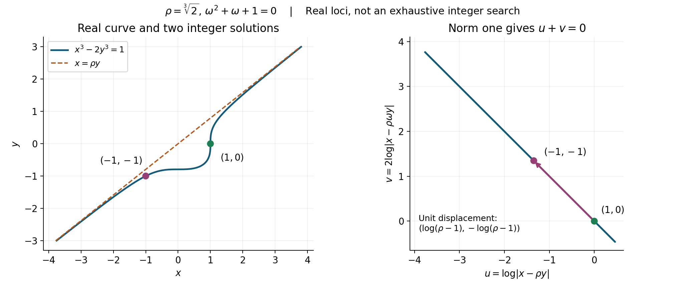
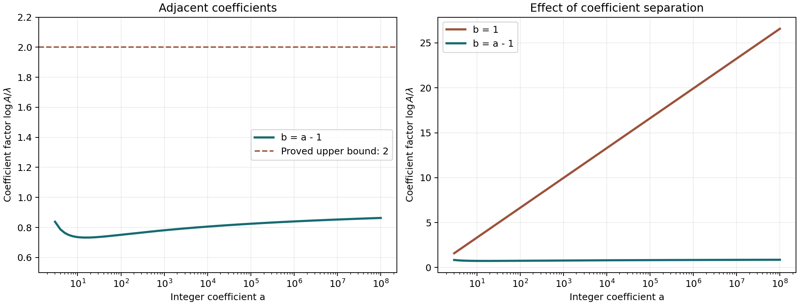

# Thue equations, effectively

*Authoring and mathematical self-check: OpenAI Codex — GPT-6 Astra,
Ultra. Original exposition, CC0.*

A product equation gives control of norms, whereas a logarithmic
estimate needs control of heights. Units can move the archimedean
sizes of an algebraic integer without changing its norm. We first
make that adjustment explicit, then apply the effective unit equation
to a relation among three factors.

The balancing idea occurs in the free paper of
[Bugeaud and Győry, *Bounds for the solutions of unit equations*,
Lemma 2](https://matwbn.icm.edu.pl/ksiazki/aa/aa74/aa7416.pdf).
The proof below uses the complete quantitative fundamental-system
and unit-equation proofs of Lesson 12. Its constants are intentionally
large; their linear dependence on the height of the varying
right-hand side is the essential feature.

## Prerequisite proofs

| Input | Programme proof |
| --- | --- |
| Heights, conjugates, the product formula and effective Northcott finiteness | [Heights of algebraic numbers, Theorems 2.4 and 2.6–2.8, Proposition 2.5](../../TR-TRANS/TR-TRANS-02.html) |
| Dirichlet units and the logarithm lattice | [Number fields, Dirichlet's unit theorem, Theorem 9.2](../../NT-ANT/dirichlets-unit-theorem.html#producing-enough-units) |
| Discriminant and lattice index | [Number fields, Discriminants and integral bases, Proposition 2.2](../../NT-ANT/discriminants-and-integral-bases.html) |
| General and refined two-logarithm estimates | [Lesson 7, Theorem 7.1](../TR-BAKER-07.html#1-an-explicit-bound-without-multiplicative-independence), [Theorem 7.6](../TR-BAKER-07.html#11-a-sharper-bound-when-the-real-bases-are-close-to-one) and [Corollary 7.7](../TR-BAKER-07.html#12-a-rational-number-close-to-one) |
| Quantitative fundamental units and the effective unit equation | [Lesson 12, Lemma 12.5](../TR-BAKER-12.html#4-effective-control-of-a-fundamental-system) and [Theorem 12.6](../TR-BAKER-12.html#5-the-effective-unit-equation) |
| Roth's theorem and the limitation of its effectivity | [Rational approximation III, Theorem 12.1](../../TR-TRANS/TR-TRANS-12.html#theorem-12-1-roth-s-theorem) and [Section 4](../../TR-TRANS/TR-TRANS-12.html#4-why-the-proof-gives-finiteness-without-a-denominator-bound) |

## 1. Representatives of principal ideals with controlled height

Let \(L\) be a number field of degree \(D\), absolute discriminant
\(\Delta_L\), and unit rank \(r\). Choose the fundamental units of
Lemma 12.5, so \(h(\varepsilon_i)\le V=V(D,\Delta_L)\).
At an infinite place put \(n_v=1\) or \(2\), and use
\(\lambda(z)_v=n_v\log|\sigma_vz|\).

**Lemma 13.1 (balancing by a unit).** If \(z\in O_L\setminus\{0\}\)
and \(k\ge1\) is an integer, there is a unit \(\epsilon\) such that
\[
h(\epsilon^kz)\le
\frac{\log|N_{L/\mathbb Q}z|}{D}
+\frac{k}{2}\sum_{i=1}^r h(\varepsilon_i).
\tag{13.1}
\]
One can effectively find a unit satisfying the slightly larger bound
\[
h(\epsilon^kz)\le
\frac{\log|N_{L/\mathbb Q}z|}{D}+krV.
\tag{13.2}
\]
For \(r=0\) the empty sums are zero and \(\epsilon=1\) works.

**Proof.** Write \(M_z=|N_{L/\mathbb Q}z|\ge1\), and let
\(a_v=(n_v/D)\log M_z\). The vector
\(\lambda(z)-a\) has coordinate sum zero. Express it as
\(\sum_i t_i\lambda(\varepsilon_i)\), using the logarithm lattice
basis from Dirichlet's theorem. Choose integers \(b_i\) nearest
to \(-t_i/k\) and put \(\epsilon=\prod_i\varepsilon_i^{b_i}\).
Then
\[
\lambda(\epsilon^kz)=a+w,\qquad
w=k\sum_i c_i\lambda(\varepsilon_i),\qquad |c_i|\le\tfrac12,
\qquad \sum_vw_v=0.
\tag{13.3}
\]
The element remains integral, so its height is the sum of the
positive infinite logarithms divided by \(D\). Since every \(a_v\)
is nonnegative,
\[
\begin{aligned}
D h(\epsilon^kz)
&\le\log M_z+\sum_v\max(0,w_v)\\
&=\log M_z+\tfrac12\sum_v|w_v|\\
&\le\log M_z+kD\sum_i|c_i|h(\varepsilon_i).
\end{aligned}
\]
This proves (13.1).

For effectivity when \(r\ge1\), enumerate integral-basis coordinate
boxes in \(O_L\) and retain the elements of absolute norm one;
these are exactly the units. Heights and \(\log M_z\) have
arbitrarily accurate rational interval approximations, obtained
from isolated algebraic conjugates and real logarithms. At stage
\(j\), inspect the units in the coordinate box of radius \(j\)
with interval precision tending to infinity, and stop when the
strict inequality in (13.2) is certified. The unit whose existence
was proved in (13.1) satisfies that strict inequality, because
\(\sum_i h(\varepsilon_i)\le rV\) and \(krV>0\). It eventually
occurs in the search, and its positive margin is eventually
certified. Thus the search terminates, without requiring an
algorithmic choice of the short fundamental system.
For \(r=0\), the logarithm hyperplane is zero-dimensional,
so \(\lambda(z)=a\) and \(\epsilon=1\) works directly.
\(\square\)

In particular the bound in Lemma 12.5 supplies a computable \(V\)
without a numerical decision about any exact logarithmic relation.

## 2. A height bound for a general Thue equation

Fix a number field \(K\), and a homogeneous form
\[
F(X,Y)=a\prod_{j=1}^n(X-\theta_jY)\in K[X,Y],
\qquad a\ne0,\qquad n\ge3,
\tag{13.4}
\]
whose roots include at least three distinct elements. Renumber
three such roots as \(\theta_1,\theta_2,\theta_3\).
Repeated additional roots are allowed. Fix a splitting field
\(L\supset K\), with degree \(D\), discriminant \(\Delta_L\) and
unit rank \(r\). All constants below depend only on this fixed data.
Choose integers \(M,P,U\ge1\) such that
\[
M\theta_j\in O_L,\qquad h(a)\le P,\qquad h(\theta_j)\le U
\quad(1\le j\le n).
\tag{13.5}
\]
Such constants are effective from minimal polynomials and height
bounds. Put \(G=C_{\rm unit}(D,\Delta_L)\), as in (12.31), and use
an effective common unit-height bound \(V\) as above. Define
\[
\begin{gathered}
T=1+nM+P+rV,\qquad W=4U+2+2T,\\
Z=2T+GW,\qquad B_0=3Z+2M+3U+3,\\
E=P+n(2B_0+U+1),\qquad C=1+E+nB_0.
\end{gathered}
\tag{13.6}
\]

**Theorem 13.2.** For every \(m\in K^\times\), every
\((x,y)\in O_K^2\) with \(F(x,y)=m\) satisfies
\[
\max\{h(x),h(y)\}\le C\max\{h(m),1\}.
\tag{13.7}
\]
In particular a finite search for all solutions can be bounded
effectively.

**Proof.** Set \(H=\max\{h(m),1\}\) and
\(z_j=M(x-\theta_jy)\). These are nonzero algebraic integers
in \(L\), and
\[
\prod_jz_j=M^nm/a.
\tag{13.8}
\]
Each absolute norm \(|N z_j|\) is a positive integer. Their
product is \(|N(M^nm/a)|\); therefore
\[
0\le\frac{\log|Nz_j|}{D}
\le h(m)+n\log M+h(a).
\tag{13.9}
\]
The second inequality follows from
\(\log|Nt|\le D h(t)\) and the height product inequalities.
It does not assume that \(m/a\) is integral independently of
the equation.

Apply (13.2) with \(k=1\), writing
\(z_j=\gamma_j\eta_j\), where \(\eta_j\) is a unit and
\[
h(\gamma_j)\le TH.
\tag{13.10}
\]
The identity
\[
(\theta_1-\theta_2)z_3+
(\theta_2-\theta_3)z_1+
(\theta_3-\theta_1)z_2=0
\tag{13.11}
\]
follows by substituting \(z_j=M(x-\theta_jy)\): the coefficients
of both \(x\) and \(y\) cancel.
After division it becomes \(\alpha u+\beta v=1\), where
\[
\begin{gathered}
u=\eta_1/\eta_3,\quad v=\eta_2/\eta_3,\\
\alpha=\frac{(\theta_2-\theta_3)\gamma_1}
              {(\theta_2-\theta_1)\gamma_3},\qquad
\beta=\frac{(\theta_3-\theta_1)\gamma_2}
             {(\theta_2-\theta_1)\gamma_3}.
\end{gathered}
\tag{13.12}
\]
All factors in the two coefficients are nonzero. Since
\(h(\theta_i-\theta_j)\le2U+\log2\), (13.10) gives
\(\max\{h(\alpha),h(\beta),1\}\le WH\).
Theorem 12.6, applied in the fixed field \(L\), yields
\(h(u),h(v)\le GWH\). Consequently the two ratios
\[
\xi_1=z_1/z_3,\qquad \xi_2=z_2/z_3
\quad\hbox{satisfy}\quad h(\xi_i)\le ZH.
\tag{13.13}
\]

Recover the two original coordinates up to the remaining scale:
\[
y=z_3 b,\quad x=z_3 c,\qquad
b=\frac{\xi_1-\xi_2}{M(\theta_2-\theta_1)},\quad
c=\frac{\xi_1}{M}+\theta_1b.
\tag{13.14}
\]
These equalities follow by subtracting the first two factors.
The height inequalities, including \(h(0)=0\), give
\[
h(b)\le(2Z+M+2U+2)H,\qquad h(c)\le B_0H.
\tag{13.15}
\]
The first displayed constant is at most \(B_0\).
Using the fixed factorization (13.4), therefore,
\[
h(F(c,b))\le
P+\sum_j\bigl(h(c)+h(\theta_j)+h(b)+\log2\bigr)
\le EH.
\tag{13.16}
\]
Homogeneity now controls the scale: \(m=z_3^nF(c,b)\).
Here \(F(c,b)\ne0\), since \(m\ne0\). Thus
\[
n h(z_3)\le h(m)+h(F(c,b))\le(1+E)H.
\tag{13.17}
\]
Combining (13.14)–(13.17) bounds both coordinate heights by
\(((1+E)/n+B_0)H\), which is at most \(CH\).
Northcott's explicit coefficient-box proof then provides an
effective finite list of possible \(x,y\) in the fixed field;
test integrality and the equation exactly. This proves the
height estimate and its effective finiteness consequence.
\(\square\)

**Corollary 13.3 (integer solutions).** For a fixed integral
form satisfying (13.4), there is an effective integer
\(C_{\mathbb Z}\ge1\) such that, for every nonzero integer \(m\),
\[
F(x,y)=m,\quad x,y\in\mathbb Z
\quad\Longrightarrow\quad
\max\{|x|,|y|\}\le |2m|^{C_{\mathbb Z}}.
\tag{13.18}
\]
One may take \(C_{\mathbb Z}=2C\).

**Proof.** For an integer \(x\), \(h(x)=\log\max\{1,|x|\}\).
For \(|m|\ge1\),
\(\max\{\log|m|,1\}\le2\log(2|m|)\), because \(\log2>1/2\).
Exponentiate (13.7). \(\square\)

## 3. An effective improvement of Liouville's exponent

**Theorem 13.4.** Let \(\theta\) be a real algebraic number of
degree \(n\ge3\). There are effective constants
\(\tau(\theta)>0\) and \(c(\theta)>0\) such that, for every
integer \(p\) and every integer \(q\ge1\),
\[
|\theta-p/q|\ge c(\theta)q^{-n+\tau(\theta)}.
\tag{13.19}
\]

**Proof.** Homogenize the primitive minimal polynomial of
\(\theta\), obtaining an integral form
\(F(X,Y)=a\prod_{j=1}^n(X-\theta_jY)\).
It is separable in characteristic zero, so its roots are distinct.
For any rational \(p/q\), \(m=F(p,q)\) is a nonzero integer:
zero would give a rational root of an irreducible polynomial
of degree at least three.
Let \(C_{\mathbb Z}\ge1\) be the constant in (13.18).
It gives
\[
|m|\ge\tfrac12 q^{1/C_{\mathbb Z}}.
\tag{13.20}
\]
Choose an effective integer
\(A\ge\max\{1,|a|\prod_{j\ne1}(1+|\theta-\theta_j|)\}\).
If \(|p/q-\theta|\le1\), factorization gives
\[
|m|\le A q^n|\theta-p/q|.
\tag{13.21}
\]
Combining the two inequalities proves (13.19) with
\(\tau(\theta)=1/C_{\mathbb Z}\) and \(c(\theta)=1/(2A)\).
If the error exceeds one, the same conclusion holds because
\(\tau\le1<n\), \(q\ge1\) and \(c\le1\).
All constants were determined from the minimal polynomial;
there is no unknown finite exceptional set. \(\square\)

This improves the Liouville exponent by a computable positive
amount. Roth gives the much stronger exponent \(2+\epsilon\)
with finitely many exceptions, but its programme proof does
not compute the last exception. Neither conclusion substitutes
for the other.

## 4. Bounding the exponent in a binomial equation

The exponent may itself be unknown. The important feature of the
two-logarithm estimate is its normalized coefficient \(B'\): after
division by a height, the remaining inequality involves \(n/H\).

**Theorem 13.5 (a uniform exponent bound).** Let \(a,b,c\) be nonzero
integers, let \(n\ge3\), and suppose
\[
ax^n-by^n=c,\qquad x,y\in\mathbb Z,\qquad |xy|>1.
\tag{13.22}
\]
With
\[
H=\max\{1,\log|a|,\log|b|,\log|c|\},
\]
one has the explicit bound
\[
n<10^8H.
\tag{13.23}
\]
No coprimality or multiplicative-independence assumption is required.

**Proof.** Put \(X=\max\{|x|,|y|\}\ge2\) and
\(Y=\min\{|x|,|y|\}\ge1\). Let \(A,B\) be the absolute values of
the coefficients attached to \(X,Y\), respectively, and set
\(P=AX^n,\ Q=BY^n\). If the original signed terms have opposite
signs, \(P+Q=|c|\), and \(n\log X\le\log|c|\le H\).
This already gives \(n<2H\).

Otherwise \(|P-Q|=|c|\). If \(|c|\ge P/2\), then
\(X^n\le2|c|\), so
\[
n\le\frac{H+\log2}{\log X}<3H.
\tag{13.24}
\]
We can therefore assume \(0<|c|<P/2\). The real logarithmic form
\[
\Gamma=\log(B/A)+n\log(Y/X)=\log(Q/P)
\tag{13.25}
\]
is nonzero. Integrating \(1/(1+t)\) on the interval between zero
and \((Q-P)/P\), where \(|t|<1/2\), gives
\[
0<|\Gamma|\le\frac{2|c|}{P}\le2|c|X^{-n}.
\tag{13.26}
\]
Apply Theorem 7.1 with \(D=1\), height parameters
\(a_1=H,\ a_2=\max\{1,\log X\}\), and coefficients \(1,n\).
For a rational number \(u/v\), its height is the logarithm of
the larger absolute reduced numerator and denominator. Hence
these parameters dominate both rational heights and absolute
real logarithms. The theorem also covers a base equal to one
and dependent bases, provided the displayed form is nonzero.

Write \(t=n/H\). Since
\(a_2\le(\log X)/\log2<2\log X\), its conclusion gives
\[
\log|\Gamma|\ge
-43200H\log X\,\max\{10,\log(t+1)\}^2.
\tag{13.27}
\]
Indeed \(B'=1/a_2+n/H\le1+t\).
Comparison with (13.26), and division by \(H\log X\), yields
\[
t\le3+43200\max\{10,\log(t+1)\}^2.
\tag{13.28}
\]
For \(t\ge10^8\), the logarithm exceeds \(10\), and
\[
\frac{3+43200\log^2(t+1)}{t}
\]
is decreasing: its derivative has the sign of
\[
-3+43200\log(t+1)
 \left(\frac{2t}{t+1}-\log(t+1)\right)<0.
\]
At \(t=10^8\), use
\(\log(10^8+1)<\log2+8\log10<21\). The numerator is then
less than \(3+43200\cdot21^2=19051203<10^8\), contradicting
(13.28). Here \(\log2<1,\ \log10<5/2\) follow, for example,
from the positive Taylor sums for \(e\) and \(e^{5/2}\).
This proves (13.23). \(\square\)

For fixed \(a,b,c\), Theorem 13.5 leaves a computable finite list
of exponents \(n\ge3\). For each exponent the polynomial
\(aX^n-bY^n\) has \(n\) distinct roots in characteristic zero.
Corollary 13.3 then bounds both coordinates. Thus the two results
together give a terminating enumeration of all solutions with
\(|xy|>1\). Solutions with \(|xy|=1\) must be considered separately:
for instance \(a-b=c\) gives \(x=y=1\) for every exponent.

## 5. A family with a bound independent of its coefficient

For the adjacent-coefficient family a large radius in the
two-logarithm estimate removes the coefficient from the final
bound. The following proof uses Theorem 7.6 and Corollary 7.7,
including the elementary treatment of dependent rational bases.

**Theorem 13.6.** For every integer \(b\ge1\) and every integer
\(n\ge100000\), the equation
\[
(b+1)x^n-by^n=1
\tag{13.29}
\]
has exactly one solution in positive integers: \(x=y=1\).

**Proof.** Suppose a different positive solution exists. If \(x\ge y\),
then \((b+1)x^n-by^n\ge x^n\), forcing \(x=y=1\).
Consequently \(y>x\), and in fact \(y\ge b+2\).
For if \(y\le b+1\), then \(x/y\le(y-1)/y\le b/(b+1)\), whence
\[
\frac{(b+1)x^n}{by^n}
\le\left(\frac b{b+1}\right)^{n-1}<1,
\]
contrary to (13.29). Define
\[
\delta=\frac1{by^n}
=\frac{b+1}{b}\left(\frac xy\right)^n-1>0.
\tag{13.30}
\]

First take \(b\ge5\). Apply Corollary 7.7 with
\((x_1,y_1,x_2,y_2)=(y,x,b+1,b)\).
Its radius parameter satisfies
\[
\eta=\frac{\log b}{\log(b+1)}>\frac45,\qquad
\eta\log(b+1)=\log b.
\]
To verify the first inequality without a decimal approximation,
observe that \((1+1/b)^4\le(6/5)^4<5\le b\);
therefore \((b+1)^4<b^5\).
All other hypotheses hold: \(y\ge7,\ y\ne x\),
\((b+1)/b\le6/5\), and the logarithmic form does not vanish
because \(\delta>0\). Comparing (7.33) with (13.30) gives
\[
n<44\max\left\{1+\frac{\log n}{\log b},10\right\}^{2}
\le44\max\left\{1+\frac{\log n}{\log5},10\right\}^{2}.
\tag{13.31}
\]
At \(n=100000\) the last maximum is \(10\):
\(\log5>3/2\) and \(\log100000<25/2\) suffice.
Its right side is then \(4400<100000\).
For \(n\ge100000\), the quotient of that right side by \(n\)
decreases. It decreases on the constant branch; on the other
branch the derivative has the sign of
\(2-(\log n+\log5)<0\).
The two branches agree at their junction.
Thus (13.31) is impossible throughout the asserted range.

It remains to handle \(1\le b\le4\). The rational numbers
\(\alpha_1=y/x>1,\ \alpha_2=(b+1)/b>1\) are multiplicatively
independent. Indeed, if they were dependent, the primitive
prime-exponent-vector argument in the proof of Corollary 7.7
would write
\(\alpha_1=(u/v)^s,\ \alpha_2=(u/v)^w\), with \(u>v\ge1\)
coprime and \(s,w\ge1\). The nonzero integer \(w-ns\) would give
\[
\delta=|(u/v)^{w-ns}-1|\ge1/u\ge1/y,
\]
where \(u\le y\) follows from the reduced numerator of \(y/x\).
But (13.30) is strictly smaller than \(1/y\).

Apply Theorem 7.6 with \(D=1,\ E=2\), height parameters
\[
a_1=\log y,\qquad a_2=\max\{1,\log(b+1)\}\le2,
\]
and coefficients \(-n,1\).
Here \(y\ge3\), so \(a_1>1\). Each height parameter dominates
the relevant real logarithm, giving
\(2\le1+a_j/\log\alpha_j\); also
\(2<e^{3a_j/2}\). These verify every radius condition.
For \(v_0=\log2\), the coefficient expression satisfies
\[
B'=\frac n{a_2}+\frac1{a_1}\le n+1,\qquad
M_E\le\max\{\log(n+1)+1,10\}.
\]
The inequalities \(v_0>69/100\) and
\(214(69/100)^3>70.2\) imply
\[
\log|\log\alpha_2-n\log\alpha_1|
\ge-214\log y\,\max\{\log(n+1)+1,10\}^{2}.
\tag{13.32}
\]
On the other hand the form equals \(\log(1+\delta)\), which is
positive and less than \(\delta\). It follows that
\[
n<214\max\{\log(n+1)+1,10\}^{2}.
\tag{13.33}
\]
At \(n=100000\), use
\(\log(100001)<\log2+5\log10<14\); the right side is
less than \(214\cdot15^2=48150\).
For larger \(n\), its ratio to \(n\) decreases, since
\[
\frac{2n}{n+1}<2<\log(n+1)+1.
\]
This is again a contradiction. Finally \(x=y=1\) does satisfy
(13.29), proving existence and uniqueness. \(\square\)

The free author version of
[Bugeaud, *Linear forms in the logarithms of algebraic numbers
close to 1 and applications to Diophantine equations*, Section 3](https://irma.math.unistra.fr/~bugeaud/travaux/ConfMumbaidef.pdf)
describes the adjacent-coefficient family and the role of a large
radius. The bound in Theorem 13.6 follows from the full parameter
checks above.

**A further theorem, stated for orientation.**
[Bennett, *Rational approximation to algebraic numbers of small
height*, Theorem 1.1](https://personal.math.ubc.ca/~bennett/B-Crelle2.pdf)
proves that, for nonzero integers \(a,b\) and an integer \(n\ge3\),
\[
|ax^n-by^n|=1
\]
has at most one solution in positive integers \(x,y\).
Its proof uses additional approximation arguments. This statement
is not an input to any proof, bound or claimed solution list in
this lesson; Theorem 13.6 is established above directly.

## 6. Explicit constants for the cube root of two

Put \(\rho=\sqrt[3]{2}\), let \(\omega\) be a nonreal cube root of
unity, and take \(L=\mathbb Q(\rho,\omega)\).
The polynomial \(X^3-2\) is irreducible: a reducible cubic over
\(\mathbb Q\) has a rational root \(p/q\) in lowest terms,
and \(p^3=2q^3\) forces \(q=1\); no integer has cube \(2\).
Thus \([\mathbb Q(\rho):\mathbb Q]=3\).
The field \(\mathbb Q(\rho)\) is real and does not contain
\(\omega\); its quadratic equation therefore gives
\([L:\mathbb Q]=6\).
No embedding of \(L\) is real, so \(r_1=0,\ r_2=3\) and its
unit rank is \(2\).

We can bound the field discriminant without computing its full
ring of integers. The six integral elements
\[
1,\rho,\rho^2,\omega,\rho\omega,\rho^2\omega
\tag{13.34}
\]
form a rational basis and span an order.
For \(T=\begin{pmatrix}3&0&0\\0&0&6\\0&6&0\end{pmatrix}\),
their trace Gram matrix is
\[
\begin{pmatrix}2T&-T\\-T&-T\end{pmatrix}.
\tag{13.35}
\]
Indeed the six embeddings independently choose one of the three
roots of \(X^3-2\) and one of the two roots of \(X^2+X+1\).
The trace of each product is consequently the product of the
corresponding traces. Adding half the first block row to the
second shows that the determinant is
\[
2^3(-3/2)^3(\det T)^2=-27\cdot108^2=-314928.
\tag{13.36}
\]
The discriminant-index formula proved in
[*Number fields*, *Discriminants and integral bases*](../../NT-ANT/discriminants-and-integral-bases.html)
now gives \(|\operatorname{disc}L|\le314928\).

Every formula defining \(V,L,C_{\rm unit}\) in Lesson 12 is
increasing in the positive discriminant parameter. We may
therefore use this integral upper bound throughout. To avoid
confusing the field \(L\) with the exponent-conversion constant,
call the latter \(L_0\). Define the following integers:
\[
\begin{gathered}
V=8\cdot6^5\cdot629856^{223},\qquad
P_0=6^2(2\cdot3^6+1)^6,\\
L_0=6\cdot6!\,V^6(72P_0)^6,\\
S_0=6(6V+5)+5,\qquad C_0=64800\cdot6^2S_0(2S_0+1),\\
q_0=(11200C_0L_0)^2,\qquad
G=6V(8L_0+44q_0^{13})+27,\\
T_0=5+2V,\qquad W_0=6+2T_0,\qquad
Z_0=2T_0+GW_0,\qquad N_0=54Z_0+160.
\end{gathered}
\tag{13.37}
\]
These are explicit positive integers; the displayed formulas are
more useful than their decimal expansions.

**Corollary 13.7.** For \(m\in\mathbb Z\setminus\{0\}\), every
integer solution of \(x^3-2y^3=m\) satisfies
\[
\max\{|x|,|y|\}\le(2|m|)^{N_0}.
\tag{13.38}
\]
For every \(p\in\mathbb Z,\ q\ge1\),
\[
\left|\rho-\frac pq\right|
\ge\frac1{50}q^{-3+1/N_0}.
\tag{13.39}
\]

**Proof.** The three roots \(\rho,\rho\omega,\rho\omega^2\)
are integral and have height \((\log2)/3<1\).
In Theorem 13.2 choose \(n=3,\ M=P=U=1,\ D=6,\ r=2\).
Its constants then satisfy
\[
T=T_0,\quad W=W_0,\quad Z=Z_0,\quad
B_0=3Z_0+8,\quad E=6B_0+7,\quad C=9B_0+8.
\]
Hence \(C_{\mathbb Z}=2C=54Z_0+160=N_0\), proving (13.38).
Since \(\rho<2\), each difference between two conjugates has
modulus less than \(4\). Thus \(A=25\) is allowed in the proof
of Theorem 13.4. This yields (13.39). \(\square\)

For the equation with \(m=1\), direct substitution gives the
solutions \((1,0)\) and \((-1,-1)\). Their first factors
\(x-\rho y\) are \(1\) and \(\rho-1\).
The latter is a unit already in \(\mathbb Z[\rho]\), because
\[
(\rho-1)(1+\rho+\rho^2)=\rho^3-1=1.
\tag{13.40}
\]
We need no assertion here that it generates the full unit group.
The norm identity is
\[
(x-\rho y)(x^2+\rho xy+\rho^2y^2)=x^3-2y^3,
\tag{13.41}
\]
and the quadratic factor is
\((x+\rho y/2)^2+3\rho^2y^2/4\), positive away from the origin.
On the real curve with right side one, therefore,
\[
x-\rho y=\frac1{x^2+\rho xy+\rho^2y^2}>0.
\tag{13.42}
\]

*Figure 13.1.* Left: the real curve \(x^3-2y^3=1\), its
line \(x=\rho y\), and the two displayed integer solutions.
Right: the same real points under
\((x,y)\mapsto(\log|x-\rho y|,
2\log|x-\rho\omega y|)\).
Equation (13.41) puts them on the line \(u+v=0\).
The two marked solutions are separated by the logarithm vector
of the unit \(\rho-1\). The curves depict real points and do not
assert an enumeration of integer solutions.

The bound \(2^{N_0}\) makes exhaustive search finite. It is much
too large for direct computation. A complete resolution needs
a proved reduction of that bound and a certificate covering the
remaining cases; Lesson 21 develops those procedures.
The two substitutions above alone do not prove completeness.

## 7. Exercises

**1. (Easy: the three-factor relation.)**
For \(\beta_j=x-\theta_jy\), verify
\[
(\theta_1-\theta_2)\beta_3+
(\theta_2-\theta_3)\beta_1+
(\theta_3-\theta_1)\beta_2=0.
\]
Then derive the two coefficients in (13.12), keeping their signs.

**2. (Medium: why three distinct factors matter.)**
Construct infinitely many integer solutions of
\(x^2-2y^2=1\), and explain why no bound depending only on
the height of its fixed right-hand side can hold.
Also give a degree-three form with only two distinct factors
over a suitable number field for which the same failure occurs.

**3. (Medium: a relative cubic equation.)**
Apply Theorem 13.2 to \(x^3-2y^3=m\), first for
\(x,y\in O_{\mathbb Q(\rho)}\) and
\(m\in\mathbb Q(\rho)^\times\), and then for rational integers.
State explicit bounds in the real embedding using (13.37).

**4. (Hard: an effective irrationality exponent.)**
Starting from the integer bound for a general irreducible
integral binary form, prove (13.19) for every rational \(p/q\),
including errors greater than one. Express the resulting
\(\tau(\rho)\) through the two-logarithm route of Lesson 12.

**5. (Medium: the unknown exponent.)**
Explain where the normalized coefficient \(B'\) is essential
in Theorem 13.5. Check all cases in which a logarithm is zero,
or the two original terms have opposite signs.

**6. (Hard: a coefficient-free family.)**
Verify the rational-base choices, nonvanishing and radius
conditions in the proof of Theorem 13.6. Explain why replacing
the large radius by \(E=2\) for all \(b\) would not give the
same coefficient-free argument.

## 8. Solutions

**1.** The coefficient of \(x\) is
\(\theta_1-\theta_2+\theta_2-\theta_3+\theta_3-\theta_1=0\).
The negative of the coefficient of \(y\) is
\[
\theta_3(\theta_1-\theta_2)+
\theta_1(\theta_2-\theta_3)+
\theta_2(\theta_3-\theta_1)=0
\]
by cancellation of its six products.
Multiplication by \(M\) gives (13.11).
Move its first summand to the right and divide by
\((\theta_2-\theta_1)\gamma_3\eta_3\).
The right side is \(1\); the left coefficients and unit ratios
are exactly \(\alpha,\beta,u,v\) in (13.12).
Distinctness and nonzero factors justify every division.

**2.** Expand
\[
(3+2\sqrt2)^k=x_k+y_k\sqrt2\qquad(k\ge0).
\tag{13.43}
\]
The binomial theorem makes both coefficients integers.
Taking the conjugate product gives \(x_k^2-2y_k^2=1\).
They are infinitely many distinct pairs, since
\(3+2\sqrt2>1\) and its positive powers are distinct.
More explicitly
\[
x_{k+1}=3x_k+4y_k,\qquad y_{k+1}=2x_k+3y_k,
\]
starting from \((1,0)\), so the positive coordinates grow.
Their heights are unbounded while \(h(1)=0\).
For a degree-three counterexample over number fields, take
\(K=\mathbb Q(\sqrt2)\) and \(F(X,Y)=X^2Y\).
With the unit \(\epsilon=3+2\sqrt2\), the pairs
\((x,y)=(\epsilon^k,\epsilon^{-2k})\in O_K^2\)
all satisfy \(F(x,y)=1\) and have unbounded height.
Equivalently, the monic-in-\(X\) form \(X^2(X-Y)\) admits
\((x,y)=(\epsilon^k,\epsilon^k-\epsilon^{-2k})\).
This example separates the three-distinct-root condition
from a degree count.

**3.** Work in the splitting field \(L=\mathbb Q(\rho,\omega)\).
The calculations (13.34)–(13.37) give \(C=N_0/2\).
For \(x,y\in O_{\mathbb Q(\rho)}\), Theorem 13.2 yields
\[
\max\{h(x),h(y)\}\le\frac{N_0}{2}\max\{h(m),1\}.
\tag{13.44}
\]
The height inequality at any embedding \(\sigma\) of this
degree-three field is
\(|\sigma z|\le e^{3h(z)}\). Thus
\[
\max\{|\sigma x|,|\sigma y|\}
\le\exp\!\left(\frac{3N_0}{2}\max\{h(m),1\}\right).
\tag{13.45}
\]
For rational integer \(m\ne0\) this is at most
\((2|m|)^{3N_0}\).
If \(x,y\) are also rational integers, their own height formula
removes the embedding factor \(3\), giving the sharper
\((2|m|)^{N_0}\) in (13.38).

**4.** Let \(F\) be the homogenized primitive minimal
polynomial of \(\theta\), and let \(C_{\mathbb Z}\ge1\)
satisfy (13.18). For every \(q\ge1\),
\(F(p,q)\ne0\); otherwise \(p/q\) would be a rational root.
The bound on \(q\) gives
\(|F(p,q)|\ge q^{1/C_{\mathbb Z}}/2\).
When \(|\theta-p/q|\le1\), each other factor has modulus
at most \(1+|\theta-\theta_j|\), so (13.21) follows.
Division gives \(c=1/(2A)\) and
\(\tau=1/C_{\mathbb Z}\).
For a larger error, \(c q^{-n+\tau}\le1\), giving the same
claim directly. No reduced-fraction assumption was needed.
For \(\rho\), use
\[
\tau(\rho)=\frac1{54(2T_0+G(6+2T_0))+160},\qquad
T_0=5+2V,
\tag{13.46}
\]
with \(V,G\) explicitly defined in (13.37); \(c=1/50\).
Here \(G\) is supplied by the complete many-to-two reduction
and unit-equation proof, ultimately using Theorem 7.1.
Thus the displayed value traces back to the proved
two-logarithm constant \(21600\), not to an unspecified
effective constant.

**5.** The term \(B'=1/a_2+n/H\) becomes at most \(1+n/H\),
whereas the main height product is at most \(2H\log X\).
After comparison with the upper estimate and division by
\(H\log X\), only \(t=n/H\) remains in (13.28).
If \(Y=X\), then \(\log(Y/X)=0\), but \(\Gamma\ne0\)
because \(c\ne0\). If \(A=B\), the other logarithm is zero;
the same nonvanishing remains. Both cannot be zero in the
difference case. Theorem 7.1 permits these bases equal to one.
Opposite original signs give a sum of positive terms, bounded
above by \(|c|\), so no logarithmic estimate is needed.
The small-denominator case \(|c|\ge P/2\) is (13.24).
These alternatives cover every sign and size possibility.

**6.** A nontrivial positive solution has \(y\ge b+2\), as
the first paragraph of Theorem 13.6 proves.
For \(b\ge5\), the four integers \((y,x,b+1,b)\) satisfy
all hypotheses of Corollary 7.7, and its radius is
\(E=b\). The quotient \(1/\eta=\log(b+1)/\log b<5/4\)
is bounded independently of \(b\). This is precisely the
cancellation of coefficient size used in (13.31).
For \(b\le4\), the prime-exponent-vector argument rules out
dependence; \(a_1=\log y>1,\ 1\le a_2\le2\) meet the
height cutoffs, and \(E=2\) meets both radius inequalities.
The form equals \(\log(1+\delta)>0\), so it cannot vanish.
For arbitrary \(b\), a fixed \(E=2\) would leave the
unbounded factor \(a_2\asymp\log b\) in (13.32).
The growing radius for \(b\ge5\) is what removes that factor.

## Coefficient proximity and the exponent

For unequal positive coefficients, their relative separation gives a
second scale besides their size. Put
\[
A=\max\{a,b,3\},\qquad L=\log A,\qquad
\lambda=\log\left(1+\frac{L}{|\log(a/b)|}\right).
\tag{13.47}
\]
The quantity \(L/\lambda\) stays bounded when the coefficients are
adjacent, even as both coefficients tend to infinity.

**Theorem 13.8 (coefficient proximity).** Let \(a,b\) be distinct
positive integers, let \(c\ne0\) be an integer, and let \(n\ge3\)
be an integer. Every integer solution of
\[
ax^n-by^n=c,\qquad y>|x|>0
\]
satisfies
\[
n\le\max\left\{
3\log\left(\frac{3|c|}{2b}\right),\;
10^7\frac{\log A}{\lambda}\right\}.
\tag{13.48}
\]
No coprimality or multiplicative-independence hypothesis is needed.

The parameter in (13.47) occurs in
[Mignotte, *A note on the equation* \(ax^n-by^n=c\), Theorem 2](https://www.impan.pl/shop/en/publication/transaction/download/product/109013).
The proof below obtains (13.48) from the
[absolute-cutoff corollary following Theorem 7.6](../TR-BAKER-07.html#an-absolute-cutoff-including-dependent-bases),
with every radius condition checked explicitly.

**Proof.** Set \(C=10^7\), and suppose, for a contradiction, that
\(n\) is greater than both quantities on the right of (13.48).
Since \(y\ge2\) and \(\log2>2/3\),
\[
\frac{3|c|}{2b}<e^{n/3}<y^{n/2}.
\tag{13.49}
\]
If \(x^n<0\), positivity of \(a,b,y\) gives
\(|c|=a|x|^n+by^n>by^n\), contrary to (13.49).
Thus \(x^n=|x|^n>0\). Write
\[
\epsilon=\frac{c}{by^n},\qquad
r=\log\frac{y}{|x|}>0,\qquad
\Gamma=\log\frac ab-nr=\log(1+\epsilon).
\tag{13.50}
\]
Here \(\Gamma\ne0\), and (13.49) gives
\(|\epsilon|<(2/3)y^{-n/2}<1/3\). Integrating
\(1/(1+u)\) between zero and \(\epsilon\) therefore gives
\[
0<|\Gamma|\le\tfrac32|\epsilon|<y^{-n/2}\le1/y,
\qquad \log|\Gamma|<-\tfrac n2\log y.
\tag{13.51}
\]
The integer inequality \(y-|x|\ge1\), together with
\(-\log(1-u)\ge u\) for \(0<u<1\), implies \(r\ge1/y\).
Consequently
\[
\ell:=\log(a/b)=nr+\Gamma>\frac{n-1}{y}>0,
\qquad r<\frac{\ell}{n-1}.
\tag{13.52}
\]
For the second inequality, use
\(|\Gamma|<1/y<\ell/(n-1)\) in
\(nr=\ell-\Gamma\). In particular, \(a>b\).

Let \(E=1+L/\ell=e^\lambda\). Since \(0<\ell\le L\),
we have \(E\ge2\). Also
\[
\ell=\log\left(1+\frac{a-b}{b}\right)
\ge\frac{a-b}{a}\ge\frac1A.
\]
The first inequality follows by integrating \(1/(1+u)\),
whose minimum on the interval in question is \(b/a\).
Using \(\log A\le A-1\), we obtain
\[
E\le1+A\log A\le1+A(A-1)<A^2,
\qquad \lambda<2L.
\tag{13.53}
\]
Our contradictory assumption \(n>CL/\lambda\) implies
\(n>C/2\). From (13.52), and \(n-1>n/2\), it follows that
\[
e^\lambda=E<1+\frac{yL}{n-1}
<1+\frac{2\lambda y}{C}.
\tag{13.54}
\]
This forces \(\lambda<2\log y\). Indeed, otherwise
\(y\le e^{\lambda/2}\), and division of (13.54) by
\(e^\lambda\) would give
\[
1<e^{-\lambda}+\frac{2\lambda}{C}e^{-\lambda/2}
\le\frac12+\frac{4}{Ce}<1.
\]
Here \(\lambda\ge\log2\), and differentiation shows that
\(u e^{-u/2}\le2/e\) for \(u>0\).

We now apply the absolute-cutoff corollary (7.76) to
\[
\alpha_1=y/|x|,\quad\alpha_2=a/b,\quad
D=1,\quad a_1=2\log y,\quad a_2=2L,\quad
(c_1,c_2)=(-n,1).
\]
Both bases exceed one. Their rational heights and real logarithms
are at most \(\log y,L\), respectively, and \(a_1,a_2>1\).
The radius conditions hold because
\[
\begin{aligned}
(E-1)\log\alpha_2&=L\le a_2,\\
(E-1)\log\alpha_1&<\frac{L}{n-1}
<\frac{2\lambda}{C}<\frac{4\log y}{C}<a_1,\\
E&<\min\{y^2,A^2\}<\min\{e^{3a_1/2},e^{3a_2/2}\}.
\end{aligned}
\tag{13.55}
\]
Thus, including the case of dependent rational bases, (7.76) gives
\[
\log|\Gamma|\ge
-\frac{1560L\log y}{\lambda}
\max\left\{3,\frac{\log B'}{\lambda}\right\}^{2},
\qquad
B'=\frac{n}{2L}+\frac1{2\log y}.
\tag{13.56}
\]
The absolute cutoff \(1\) in (7.76) is absorbed by \(3/D=3\).
No estimate without that cutoff is used.

Put \(t=n\lambda/L>C\). Since \(\lambda<2\log y\) and
\(\lambda\ge\log2>2/3\),
\[
B'<\frac{t+2}{2\lambda}<t+2.
\]
If \(\log B'\ge0\), division by \(\lambda>2/3\) yields
\(\log B'/\lambda<(3/2)\log(t+2)\); the same inequality
holds immediately when \(\log B'<0\). Comparison of (13.51)
and (13.56) now gives
\[
t<7020\max\{2,\log(t+2)\}^{2}.
\tag{13.57}
\]
For \(t\ge C\), the logarithm exceeds two, and
\(\log^2(t+2)/t\) decreases: its derivative has the sign of
\(2t/(t+2)-\log(t+2)<0\). At \(t=C=10^7\),
\[
\log(C+2)<\log2+7\log10<1+35/2<19,
\qquad 7020\cdot19^2=2534220<C.
\]
Hence (13.57) is impossible throughout \(t\ge C\).
This proves (13.48). The elementary numerical bounds used here
can be verified without decimal approximations: the positive series
for \(\log2=2\sum_{j\ge0}(1/3)^{2j+1}/(2j+1)\) gives
\(\log2>2/3\); the exponential series gives
\(2<e<3\) and \(e^{5/2}>10\). \(\square\)

**Example (adjacent and separated coefficients).** If \(a=b+1\),
then \(L/\lambda<2\) for every \(b\ge1\). For \(b\ge2\),
\(L=\log(b+1)>1\) and
\(\log(1+1/b)\le1/b\), so
\(E\ge1+bL>b\). Therefore
\[
\frac{L}{\lambda}<\frac{\log(b+1)}{\log b}\le2.
\tag{13.58}
\]
For \(b=1\), use \(A=3\), \(E>2\), and \(3<4\).
In contrast, if \(a\ge3\) and \(b=1\), then
\(\lambda=\log2\) and \(L/\lambda=\log a/\log2\).
Thus (13.48) distinguishes coefficient size from coefficient
separation. The smaller bound for right-hand side one in
Theorem 13.6 uses the more specialized estimate (7.33).

*Figure 13.2.* The factor \(\log A/\lambda\) in (13.48), for
integer values of \(a\ge3\). The left panel displays adjacent
coefficients \(b=a-1\) and the bound two proved in (13.58).
The right panel compares them with \(b=1\), where the factor is
exactly \(\log a/\log2\). These are coefficient parameters,
not counts of integer solutions or sharp bounds for a particular
equation. [Reproducible figure and exact numerical margins](../figure_sources/family_parameter_bound.py).
Human-source context: [Mignotte, Theorem 2](https://www.impan.pl/shop/en/publication/transaction/download/product/109013).

**Exercise (a varying right-hand side).** Let \(b\ge1\),
\(0<|c|\le b\), and \(n\ge3\). Show that every integer
solution of \((b+1)x^n-by^n=c\) with \(y>|x|>0\)
satisfies \(n<2\cdot10^7\). Explain why the restriction on
the coordinates cannot simply be dropped when \(c=1\).

**Solution.** The first term of (13.48) is at most
\(3\log(3/2)<3\), and its second term is strictly less than
\(2\cdot10^7\) by (13.58) and the case \(b=1\).
Their maximum is therefore strictly less than \(2\cdot10^7\).
If the strict coordinate inequality is dropped, \(x=y=1\)
solves the equation with \(c=1\) for every \(n\). The theorem
does not bound the exponents of those solutions.

## Reproducible checks and references

The [exact cubic calculations](../verification/cubic-bounds-check.py)
verify the trace determinant, the constant substitutions and the two
displayed solutions. The [binomial checks](../verification/binomial-check.py)
verify rational numerical margins and finite sign cases. The proofs
above establish the full ranges; the finite checks are supplementary.
The [figure program](../figure_sources/thue-factor-geometry.py)
reproduces Figure 13.1.

- Yann Bugeaud and Kálmán Győry, *Bounds for the solutions of unit equations*, Acta Arithmetica 74 (1996), 67–80, Lemma 2. [Free journal PDF](https://matwbn.icm.edu.pl/ksiazki/aa/aa74/aa7416.pdf).
- Maurice Mignotte, *A note on the equation \(ax^n-by^n=c\)*, Acta Arithmetica 75 (1996), 287–295, Theorems 1–3. [Free journal edition](https://www.impan.pl/shop/en/publication/transaction/download/product/109013).
- Yann Bugeaud, *Linear forms in the logarithms of algebraic numbers close to 1 and applications to Diophantine equations*, author version, Section 3. [Freely accessible text](https://irma.math.unistra.fr/~bugeaud/travaux/ConfMumbaidef.pdf).
- Michael A. Bennett, *Rational approximation to algebraic numbers of small height: the Diophantine equation \(|ax^n-by^n|=1\)*, Journal für die reine und angewandte Mathematik 535 (2001), 1–49, Theorem 1.1 (orientation statement only). [Free author-hosted edition](https://personal.math.ubc.ca/~bennett/B-Crelle2.pdf).
