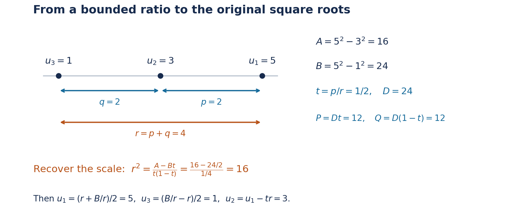

# Superelliptic, hyperelliptic and Mordell equations

*Authoring and mathematical self-check: OpenAI Codex — GPT-6 Astra,
Ultra. Original exposition, CC0.*

The factorization of a polynomial at an integral argument gives an
equation of ideals. Outside a fixed finite set of primes, the factors
are relatively prime. If their product is an \(m\)-th power up to a
fixed coefficient, their individual valuations are multiples of \(m\).
The first task is to turn this statement about ideals into a finite
list of equations about elements. Nonprincipal ideals and units must
both be accounted for.

The freely accessible paper of Bérczes, Evertse and Győry,
[*Effective results for hyper- and superelliptic equations over number
fields*](https://arxiv.org/abs/1301.7168), Lemma 4.2 and the proofs of
Theorems 2.1–2.2, develops this factorization method with explicit
height estimates. We prove the reductions needed here from the
programme's ideal, unit and Thue theorems. Our computable constants
are not asserted to be the sharper constants in that paper.

Siegel's 1926 letter to Mordell developed the descent for polynomial
square equations; his 1929 work placed integral points in a broader
geometric setting. The distinction between the affine equation
\(y^2=f(x)\) and an arbitrary affine model of the same projective
curve matters, because their integrality conditions can differ.
For this historical context see Levent Alpöge's free
[*Note on a theorem of Professor X*, Introduction](https://arxiv.org/abs/2109.14328).
Baker's logarithmic method makes the descents effective. Below,
the three-factor reduction computes integral solutions, and the
genus-one argument separately supplies the necessary denominator
control for an arbitrary affine equation.

## Prerequisite proofs

| Input | Programme proof |
| --- | --- |
| Heights and effective finite lists of bounded height | [Heights of algebraic numbers, Theorems 2.4 and 2.6–2.8](../../TR-TRANS/TR-TRANS-02.html) |
| Unique ideal factorization and ideal norms | [Discrete valuation rings and Dedekind domains](../../NT-ANT/discrete-valuation-rings-and-dedekind-domains.html) and [Norms, class groups, and modules over Dedekind domains](../../NT-ANT/norms-class-groups-and-modules-over-dedekind-domains.html) |
| A bounded integral ideal in every ideal class | [Finiteness of the class number, Theorem 8.1 and the bounded-ideal lemma](../../NT-ANT/finiteness-of-the-class-number.html) |
| Fundamental units and balancing by powers of units | [Lesson 12, Lemma 12.5](../TR-BAKER-12.html) and [Lesson 13, Lemma 13.1](../TR-BAKER-13.html) |
| Effective Thue equations over a number field | [Lesson 13, Theorem 13.2](../TR-BAKER-13.html) |

Throughout, \(h\) denotes absolute logarithmic height, with \(h(0)=0\), and
\(O_L\) the ring of integers of a number field \(L\).

## 1. A finite list of power coefficients

**Lemma 15.1.** Fix a number field \(L\), a finite set
\(\mathcal P\) of its nonzero prime ideals, and an integer \(m\ge2\).
There is an effectively computable finite set
\(\mathcal R=\mathcal R(L,\mathcal P,m)\subset L^\times\)
such that every nonzero \(z\in O_L\) satisfying
\[
\operatorname{ord}_{\mathfrak p}(z)\equiv0\pmod m
\qquad(\mathfrak p\notin\mathcal P)
\tag{15.1}
\]
has a representation
\[
z=\mu\xi^m,\qquad \mu\in\mathcal R,\quad \xi\in O_L.
\tag{15.2}
\]
The set may contain coefficients that do not occur in any solution.

Here is one explicit finite-list prescription. Put \(d=[L:\mathbb Q]\).
Choose an integer \(B\ge1\) at least the Minkowski ideal-class bound
in Theorem 8.1 of *Finiteness of the class number*. Let \(r\) be the
ordinary unit rank, and choose \(V\ge1\) bounding the heights of the
fundamental units supplied by Lemma 12.5. Set
\[
T=\prod_{\mathfrak p\in\mathcal P}N\mathfrak p,\qquad
D_0=(B!)^m,\qquad
A_0=2\log D_0+\frac{m-1}{d}\log T+mrV+1.
\tag{15.3}
\]
Empty products are one. Take an effective Northcott finite list
containing every element of \(L\) with height at most \(A_0\),
using a rational upper bound for \(A_0\), and discard zero and
any member for which \(D_0\mu\notin O_L\). The remaining set works.
No exact comparison of an algebraic number's height with \(A_0\)
is required.

**Proof.** Divide the nonnegative prime-ideal exponents of \((z)\)
by \(m\). The remainders outside \(\mathcal P\) vanish, so
\[
(z)=\mathfrak c\,\mathfrak a^m,\qquad
\mathfrak c=\prod_{\mathfrak p\in\mathcal P}
                    \mathfrak p^{e_{\mathfrak p}},
\quad 0\le e_{\mathfrak p}<m,
\tag{15.4}
\]
with \(\mathfrak a,\mathfrak c\) integral ideals. In particular
\(N\mathfrak c\le T^{m-1}\).

Minkowski's bound gives an integral ideal \(\mathfrak i\) in the
inverse class of \(\mathfrak a\), with \(N\mathfrak i\le B\).
Then \(\mathfrak a\mathfrak i=(\rho)\) for some nonzero
\(\rho\in O_L\). Put
\(\gamma=z/\rho^m\). Its fractional ideal is
\[
(\gamma)=\mathfrak c\,\mathfrak i^{-m}.
\tag{15.5}
\]
If \(q=N\mathfrak i\), the finite additive group \(O_L/\mathfrak i\)
has order \(q\), so \(qO_L\subseteq\mathfrak i\).
Since \(q\le B\), we have \(B!\in\mathfrak i\), and therefore
\(D_0\gamma\in O_L\).

Its nonzero integral norm satisfies
\[
1\le |N_{L/\mathbb Q}(D_0\gamma)|
 =D_0^d\frac{N\mathfrak c}{(N\mathfrak i)^m}
 \le D_0^dT^{m-1}.
\tag{15.6}
\]
Apply Lemma 13.1 to this algebraic integer, using the power \(m\).
Some ordinary unit \(\epsilon\) satisfies
\[
h(\epsilon^mD_0\gamma)
 \le\log D_0+\frac{m-1}{d}\log T+mrV.
\tag{15.7}
\]
Consequently, for
\[
\mu=\epsilon^m\gamma,\qquad \xi=\rho/\epsilon,
\tag{15.8}
\]
we have \(\xi\in O_L\), \(D_0\mu\in O_L\),
\(z=\mu\xi^m\), and \(h(\mu)<A_0\). Thus \(\mu\) occurs
in the prescribed finite list.

This is also an effective construction of a sufficient list.
It never has to decide which of the finitely many ideals
\(\mathfrak c\mathfrak i^{-m}\) are principal. If a particular
representation of \(z\) is wanted, enumerate the finite choices
of \(\mu\) and solve \(U^m=z/\mu\) in \(L\), testing integrality.
The existence argument proves that one test succeeds.
\(\square\)

Over \(\mathbb Q\), there is a simpler exact list. If
\(\mathcal P\) corresponds to the rational primes \(p_1,\ldots,p_t\),
unique factorization gives
\[
z=\mu\xi^m,\qquad
\mu=\operatorname{sgn}(z)\prod_{j=1}^t p_j^{e_j},
\quad 0\le e_j<m,\quad \xi\in\mathbb Z_{\ge1}.
\tag{15.9}
\]
Indeed divide each exponent of \(|z|\) by \(m\); the quotients
form \(\xi\), and the remainders form \(\mu\).
This proves the rational case without a class group or unit lattice.

## 2. Separating the factors of a polynomial

Let
\[
f(X)=aX^n+a_1X^{n-1}+\cdots+a_n\in O_K[X],
\qquad a\ne0,\qquad b\in O_K\setminus\{0\},
\tag{15.10}
\]
and assume \(f\) has no repeated root. Fix an exponent \(m\ge2\).
We study \(f(x)=by^m\) with \(x,y\in O_K\).
Multiplying \(f\) and \(b\) by a common denominator reduces
arbitrary fixed coefficients in \(K\) to this setting.

In a fixed splitting field \(L\), write
\(f(X)=a\prod_i(X-\alpha_i)\), and put \(\beta_i=a\alpha_i\).
The \(\beta_i\) are distinct algebraic integers: they are roots of
the monic polynomial
\[
a^{n-1}f(U/a)
 =U^n+a_1U^{n-1}+aa_2U^{n-2}+\cdots+a^{n-1}a_n.
\tag{15.11}
\]
For an integral \(x\) define \(z_i=ax-\beta_i\).
Then
\[
\prod_{i=1}^n z_i=a^{n-1}by^m,\qquad
z_i-z_j=\beta_j-\beta_i.
\tag{15.12}
\]

**Lemma 15.2 (finite power-factor reduction).** For fixed
\(K,f,b,m\), one can compute a finite set \(\mathcal R\subset L^\times\)
such that every solution with \(y\ne0\) satisfies
\[
ax-\beta_i=\mu_i\xi_i^m,\qquad
\mu_i\in\mathcal R,\quad \xi_i\in O_L,\quad i=1,\ldots,n.
\tag{15.13}
\]

**Proof.** Let \(\mathcal P\) contain every prime ideal dividing
the fixed nonzero algebraic integer
\[
a^{n-1}b\prod_{i<j}(\beta_i-\beta_j).
\tag{15.14}
\]
At a prime outside \(\mathcal P\), at most one \(z_i\) has
positive valuation: two such factors would force the prime to
divide their fixed difference. Taking valuations in (15.12)
shows that the sum of the valuations of all \(z_i\) is
\(m\operatorname{ord}_{\mathfrak p}(y)\).
Thus each individual valuation is a multiple of \(m\).
Every \(z_i\) is nonzero because \(b y^m\ne0\).
Apply Lemma 15.1 to each factor, with this fixed set
\(\mathcal P\). All choices of the resulting finite coefficients
can be listed before any solution is known. \(\square\)

The \(y=0\) solutions require no reduction: they are the roots of
\(f\) that belong to \(O_K\), paired with zero.

## 3. Superelliptic equations of fixed exponent

**Theorem 15.3.** Suppose \(f\) has no repeated root, \(n\ge2\),
and \(m\ge3\). For fixed \(K,f,b,m\), the integral solutions
\[
f(x)=by^m,\qquad x,y\in O_K,
\tag{15.15}
\]
form an effectively computable finite set.
A computable height bound for both coordinates follows from
finitely many applications of Theorem 13.2.

**Proof.** Treat \(y=0\) separately as above. For \(y\ne0\), choose
the first two distinct roots and apply Lemma 15.2. Subtracting
their equations gives
\[
\mu_1\xi_1^m-\mu_2\xi_2^m=\beta_2-\beta_1\ne0.
\tag{15.16}
\]
For each of the finitely many pairs \((\mu_1,\mu_2)\), the left
side is a homogeneous binary form of degree \(m\) over \(L\).
It has \(m\) distinct linear factors over its splitting field:
the polynomial \(\mu_1U^m-\mu_2\) has nonzero constant term,
and its derivative vanishes only at \(U=0\), which is not a root.
Since \(m\ge3\), Theorem 13.2 applies to the integral pair
\((\xi_1,\xi_2)\).

More explicitly, if \(C_{\mu_1,\mu_2}\) denotes its computable
constant for this binary form, put
\[
E_{\mu_1,\mu_2}
 =C_{\mu_1,\mu_2}\max\{h(\beta_2-\beta_1),1\}.
\tag{15.17}
\]
Then both \(\xi_i\) have height at most \(E_{\mu_1,\mu_2}\).
Effective Northcott finiteness supplies finite lists containing
them. Test (15.16) in exact algebraic arithmetic, and recover
\[
x=\frac{\beta_1+\mu_1\xi_1^m}{a}.
\tag{15.18}
\]
Retain only \(x\in O_K\). For each such \(x\), solve
\(Y^m=f(x)/b\) in \(K\) and retain its integral roots.
There are at most \(m\) roots, including just zero when the
right side is zero. Test the original equation.
Every solution occurs in this finite procedure.

For a height version, (15.18) gives
\[
h(x)\le h(\beta_1)+h(\mu_1)+mE_{\mu_1,\mu_2}
                  +h(a)+\log2.
\tag{15.19}
\]
Take the maximum over the finite coefficient pairs and the
finitely many integral roots of \(f\) already treated when \(y=0\).
If \(H_f=h(a)+\sum_{i=1}^n h(a_i)\), the local polynomial
estimate gives \(h(f(x))\le H_f+nh(x)+\log(n+1)\):
at a nonarchimedean place use the maximum of the terms, and at
an archimedean place multiply that maximum by \(n+1\).
Summing over normalized places and using \(\log(n+1)\le n\log2\)
therefore gives
\[
mh(y)\le h(b)+H_f+nh(x)+n\log2.
\tag{15.20}
\]
This proves a computable bound for \(y\) as well. \(\square\)

The exponent is fixed in this theorem. A bound for an unknown
exponent is a separate assertion. Repeated roots also cannot
be ignored: \(f(X)=X^m\), \(b=1\), has \(y=x\) for every
integral \(x\).

## 4. Three squares and cubic Thue equations

For exponent two, a difference of two powers is only a quadratic
form, and Theorem 13.2 does not apply. A third distinct factor
provides an extra relation.

**Lemma 15.4.** Fix a number field \(M\) and nonzero
\(A,B\in O_M\) with \(A\ne B\). All integral triples satisfying
\[
u_1^2-u_2^2=A,\qquad u_1^2-u_3^2=B,
\qquad u_1,u_2,u_3\in O_M
\tag{15.21}
\]
can be found effectively by reduction to finitely many cubic
Thue equations over \(M\).

**Proof.** Put
\[
p=u_1-u_2,\qquad q=u_2-u_3,\qquad r=u_1-u_3=p+q.
\tag{15.22}
\]
They are nonzero because their products with the corresponding
sums are \(A,B-A,B\), respectively. Thus the prime ideals
dividing \(p,q,r\) belong to the fixed set of primes dividing
\(AB(B-A)\).

Let \(D=|N_{M/\mathbb Q}(B)|\), a positive rational integer.
We have \(D/B\in O_M\). To see this, use the nonzero constant
term of the monic minimal polynomial of \(B\) to express that
constant term divided by \(B\) as an integral polynomial in \(B\);
the field norm is a signed positive integral power of that
constant term. Since \(r(u_1+u_3)=B\),
\[
\frac Dr=\frac DB(u_1+u_3)\in O_M.
\tag{15.23}
\]
Hence
\[
P=\frac{Dp}{r},\qquad Q=\frac{Dq}{r}
\tag{15.24}
\]
are nonzero algebraic integers with \(P+Q=D\).
Their prime ideal supports lie in the fixed set
\(\mathcal P\) of primes dividing \(DAB(B-A)\):
outside it, each of \(D,p,q,r\) has valuation zero.

Apply Lemma 15.1 with exponent three to \(P\) and \(Q\).
It gives finitely many nonzero coefficients \(\mu,\nu\) with
\[
P=\mu\xi^3,\qquad Q=\nu\eta^3,\qquad
\mu\xi^3+\nu\eta^3=D,\qquad \xi,\eta\in O_M.
\tag{15.25}
\]
Each binary cubic has three distinct linear factors, by the
derivative argument used in Theorem 15.3. Theorem 13.2 therefore
computes a bound, and a finite search, for \((\xi,\eta)\).
We obtain finitely many candidates
\[
t=\frac p r=\frac{\mu\xi^3}{D}.
\tag{15.26}
\]
Discard \(t=0,1\).

It remains to recover the scale; ratios alone do not suffice.
From the two difference-of-squares identities we have
\[
u_1+u_2=\frac A{tr},\qquad
u_1+u_3=\frac Br.
\]
Subtracting gives \(u_2-u_3=(1-t)r\), hence
\[
r^2=\frac{A-Bt}{t(1-t)}.
\tag{15.27}
\]
Discard a zero right side. There are at most two square roots
in \(M\). For each nonzero root recover
\[
u_1=\frac{r+B/r}{2},\qquad
u_3=\frac{B/r-r}{2},\qquad u_2=u_1-tr.
\tag{15.28}
\]
Check integrality and both equations (15.21). These tests remove
any extraneous candidate introduced by the finite coefficient
lists. Every actual triple passes through this construction, so
the procedure is complete.

The construction also gives height bounds without first listing
the solutions. If the cubic Thue bounds give \(h(t)\le H_t\),
then (15.27) yields
\[
2h(r)\le h(A)+h(B)+3H_t+2\log2.
\tag{15.29}
\]
Equation (15.28) gives
\[
h(u_1),h(u_3)\le 2h(r)+h(B)+2\log2,
\qquad
h(u_2)\le h(u_1)+H_t+h(r)+\log2.
\tag{15.30}
\]
Take the maxima of these expressions over the finitely many
cubic equations. \(\square\)

The denominators in (15.24) are controlled by the fixed norm
\(D\). This is why the reduction produces Thue equations in
algebraic integers, rather than equations with unrestricted
denominators.

*Figure 15.1. Lemma 15.4 separates the ratio from the scale. At \((u_1,u_2,u_3)=(5,3,1)\), the differences give \(p=q=2\), \(r=4\), \(A=16\) and \(B=D=24\). Hence \(P=Q=12\) and \(t=1/2\). Equation (15.27) recovers \(r^2=16\), and (15.28) recovers the original triple up to simultaneous sign. The point labels and displayed equations describe the same exact example. Reproducible source: [three-square-recovery.py](../figure_sources/three-square-recovery.py).*

## 5. Effective hyperelliptic finiteness

**Theorem 15.5.** Let \(K,f,b\) satisfy (15.10), with \(f\)
having no repeated root and degree \(n\ge3\). Then
\[
f(x)=by^2,\qquad x,y\in O_K,
\tag{15.31}
\]
has an effectively computable finite set of solutions.
In particular this applies to a product of at least three
distinct linear factors \(X-\alpha_i\) with algebraic-integral
roots in a fixed number field.

**Proof.** Treat \(y=0\) by finding the roots of \(f\).
For every other solution Lemma 15.2, with \(m=2\), gives
\[
ax-\beta_i=\mu_i\xi_i^2,\qquad \xi_i\in O_L.
\tag{15.32}
\]
Use three distinct roots. There are finitely many choices
of \((\mu_1,\mu_2,\mu_3)\). For each, pass to the fixed field
\[
M=L(\sqrt{\mu_1},\sqrt{\mu_2},\sqrt{\mu_3}).
\tag{15.33}
\]
Choose a positive integer \(c\) such that
\(c\sqrt{\mu_i}\in O_M\) for \(i=1,2,3\). Denominators in
an integral basis give such a \(c\) effectively.
Then the elements \(u_i=c\sqrt{\mu_i}\xi_i\) are integral, and
\[
u_1^2-u_2^2=c^2(\beta_2-\beta_1)=A,\qquad
u_1^2-u_3^2=c^2(\beta_3-\beta_1)=B.
\tag{15.34}
\]
Here \(A,B\in O_M\), and \(A,B,B-A\) are all nonzero.
Lemma 15.4 gives finitely many possible triples. Recover
\[
x=\frac{u_1^2/c^2+\beta_1}{a},
\tag{15.35}
\]
retain \(x\in O_K\), solve \(Y^2=f(x)/b\) in \(K\), and test
integrality and the original equation. Again all operations
involve finitely many effectively bounded lists and exact tests.

For an explicit computable height prescription, use (15.29)–(15.30)
and
\[
h(x)\le 2h(u_1)+2\log c+h(\beta_1)+h(a)+\log2.
\tag{15.36}
\]
Equation (15.20), now with \(m=2\), bounds \(h(y)\).
Maximize over the finite choices of coefficients and fields,
and the integral roots of \(f\) treated separately when \(y=0\).
The result depends only on the original fixed data. \(\square\)

Both exclusions in this theorem have mathematical content.
For a repeated-root example, \(Y^2=X^2(X+1)\) has
\[
X=t^2-1,\qquad Y=t(t^2-1),\qquad t\in\mathbb Z.
\]
For degree two, the Pell equation \(Y^2-2X^2=1\) has infinitely
many integral solutions, as proved by the recurrence in Lesson 13.
A degree condition alone does not replace the distinct-root
condition.

## 6. Mordell and Weierstrass equations

For \(k\in O_K\setminus\{0\}\), the polynomial \(X^3+k\)
has no repeated root: a common root with its derivative
\(3X^2\) would be zero, whereas its value at zero is \(k\).
Theorem 15.5 therefore computes all integral solutions of
\[
y^2=x^3+k.
\]
It also gives a computable bound for their heights.
The restriction \(k\ne0\) is necessary: \(x=t^2,y=t^3\)
gives infinitely many solutions when \(k=0\).

The same conclusion applies to a general Weierstrass equation,
with an explicit integrality test in the reverse direction.

**Corollary 15.6.** Fix \(a_1,a_2,a_3,a_4,a_6\in O_K\), and put
\[
g(X)=4X^3+(a_1^2+4a_2)X^2
             +(2a_1a_3+4a_4)X+a_3^2+4a_6.
\]
Assume \(g\) has no repeated root. Then one can compute
all \(x,y\in O_K\) satisfying
\[
y^2+a_1xy+a_3y=x^3+a_2x^2+a_4x+a_6.
\]

**Proof.** Completing the square gives the exact identity
\[
(2y+a_1x+a_3)^2=g(x).
\]
Every integral solution therefore gives an integral solution
\((x,Y)\) of \(Y^2=g(x)\), with \(Y=2y+a_1x+a_3\).
Compute the latter finite list by Theorem 15.5. For each pair,
form \(y=(Y-a_1x-a_3)/2\) and retain it precisely when
\(y\in O_K\). Substitution proves both the converse and
the completeness of the resulting list.
The height bound follows from
\[
h(y)\le h(Y)+h(a_1)+h(x)+h(a_3)+3\log2.
\]
All the coefficients are fixed, so this is effective.
\(\square\)

The condition on \(g\) can be tested exactly by computing
the greatest common divisor of \(g\) and \(g'\).
When it holds, the affine curve \(Y^2=g(X)\) is nonsingular:
simultaneous vanishing of the partial derivatives would
require \(Y=0\), \(g(X)=0\), and \(g'(X)=0\).
Its projective cubic has a unique point at infinity,
\([X:Y:Z]=[0:1:0]\); the derivative with respect to \(Z\)
of \(Y^2Z-4X^3-\cdots\) is one there. Thus the point at
infinity is nonsingular as well.

An arbitrary birational map need not preserve integral
coordinates. For example \(X=1/x\) carries most nonzero
integers to nonintegers. Passing from an arbitrary affine
genus-one equation to a Weierstrass equation therefore
requires a separate argument controlling denominators.

### General affine curves of genus one

We use genus in its geometric sense: the genus of the smooth
projective model of the function field. Thus singularities
of a chosen plane equation do not change which genus is meant.
The necessary geometric input is
[Riemann–Roch, Theorem 30.2 in *Bundles, Sheaves and Cohomology*](https://kokunoyumeto.github.io/program-matematika-indonesia/en/courses/D100/reader/bgk.html#br-bgk-2019-l30-thm-02).
It proves \(\ell(D)-h^1(O(D))=\deg D+1-g\).
We also use the programme proofs of
[finite normalization, Theorem 5.1](../../AG-MO/normalization.html),
and [the DVR criterion, Theorem 1.2](../../AG-CA/discrete-valuation-rings-normal-rings-and-serres-criterion.html).
The arguments below explain the additional curve facts and
the effective passage needed for integral points.

The reduction is developed quantitatively in Wolfgang
M. Schmidt's freely accessible paper
[*Integer points on curves of genus 1*, Proposition 1
and Section 6](https://www.numdam.org/item/CM_1992__81_1_33_0.pdf).
Here we need a terminating construction, without the sharper
coefficient-height estimates of that paper.

**Theorem 15.7 (effective integral points on an affine genus-one curve).**
Let \(K\) be a number field and \(F\in K[X,Y]\) an absolutely
irreducible polynomial whose curve has geometric genus one.
There is an algorithm, terminating for every such input, that
finds exactly the pairs \((x,y)\in O_K^2\) with \(F(x,y)=0\).
Consequently their heights have a computable upper bound.
The statement concerns integral points in the given affine
coordinates, not all rational points on the projective curve.

**Proof.** We first prove the existence of appropriate
functions, then give a finite-verification search for them.
The latter separates effectivity from the choice of a
particular implementation of Riemann–Roch.

**Functions with one pole.** Work initially over an algebraic
closure \(\overline K\). Normalize the projective closure of
the plane curve. Finite normalization gives a projective
normal curve \(C\); its local rings at closed points are
DVRs, so it is nonsingular. Let \(A=\overline K[X,Y]/(F)\),
and let \(B\) be its integral closure in the function field.
The preimage of the affine plane curve in \(C\) is
\(\operatorname{Spec}B\).

Choose a point \(P\) outside this affine open. Such a point
exists: the nonconstant coordinate \(X\) must have a pole
on the projective curve. A global regular function on an
integral projective curve is constant. One way to see this
is to view it as a morphism to the projective line: the image
of the proper curve is closed, and a nonconstant image
would be the whole line, including infinity.

We claim
\[
\ell(nP)=n\qquad(n\ge1).
\]
Riemann–Roch gives \(\ell(nP)\ge n\), since \(g=1\).
There cannot be a nonconstant function with just a simple
pole at \(P\). Such a function would define a degree-one
map to the projective line and identify their function
fields, forcing genus zero.

Here are the curve facts in this last step. A rational map
from a nonsingular curve to projective space extends at
every point: in its DVR, multiply homogeneous coordinates
by a common power of a uniformizer until all are integral
and at least one is a unit. A nonconstant map of projective
curves is finite. Indeed its fibers are zero-dimensional;
the proper quasi-finite case of
[Zariski's Main Theorem, Theorem 5.1](../../AG-MO/zariskis-main-theorem.html#5-properness-and-normality)
is finite. At a point of the target, the finite
torsion-free module over its DVR is free, of rank equal to
the function-field degree. Reducing modulo the uniformizer
shows that this degree is the sum of the orders of its
pullback at the points of the fiber. A single simple pole
therefore gives degree one. Birational nonsingular
projective curves are isomorphic: extend the rational
maps in both directions by the DVR argument, and use
equality on their dense open sets to see that the
composites are identities. Finally
\(H^1(\mathbb P^1,O)=0\): on its two affine charts, every
Laurent polynomial is the sum of a polynomial in \(T\)
and a polynomial in \(T^{-1}\). This computes the first
Čech cohomology. Thus a degree-one function would indeed
contradict genus one.

It follows that \(\ell(P)=1\).
For each \(n\), taking the coefficient of a local term
of order \(-n\) at \(P\) gives an injection
\(L(nP)/L((n-1)P)\hookrightarrow\overline K\).
Hence \(\ell(nP)\le n\), proving the claim.
Choose \(u\in L(2P)\setminus L(P)\) and
\(v\in L(3P)\setminus L(2P)\). Their pole orders at
\(P\) are exactly two and three.

The seven functions
\[
1,\quad u,\quad v,\quad u^2,\quad uv,\quad u^3,\quad v^2
\]
belong to the six-dimensional space \(L(6P)\).
Their linear relation must involve both \(u^3\) and \(v^2\):
otherwise the nonzero summands have different pole orders,
and the largest pole cannot cancel. After division and
completing a square, this relation has the form
\[
w^2=g(u),\qquad
w=v+\alpha u+\beta,\qquad \deg g=3.
\]
Both \(u,w\) are regular on \(C\setminus\{P\}\).

We check that \(g\) is squarefree. The monomials
\[
1,u,u^2,\ldots,\qquad v,uv,u^2v,\ldots
\]
have distinct pole orders \(0,2,4,\ldots\) and
\(3,5,7,\ldots\). Those of order at most \(n\) form a
basis of \(L(nP)\), since there are \(n\) of them
for \(n\ge1\). Given any rational function \(h\), multiply
it by a sufficiently high product of factors
\(u-u(Q)\), for its finitely many poles \(Q\ne P\).
The product clears those poles and has no new pole
outside \(P\). The resulting function lies in some
\(L(nP)\), so \(h\in\overline K(u,v)=\overline K(u,w)\).
Thus \(u,w\) generate the function field.
If \(g(T)=c(T-e)^2(T-f)\), putting
\(t=w/(u-e)\) gives
\(u=f+t^2/c,\ w=(u-e)t\).
This also covers a triple root. It would make the
function field rational, contradicting genus one by
the preceding birational argument. Therefore \(g\)
has no repeated root.

**Integral equations for the functions.** Since \(u,w\)
are regular on the affine normalization
\(\operatorname{Spec}B\), they belong to \(B\).
By its definition, each satisfies a monic polynomial
with coefficients in \(A\). All coefficients occurring
in \(u,w,g\) and these two monic identities belong to
some finite extension \(L/K\). Enlarge \(L\) once to
contain them. Write the identities with coefficients
in \(L[X,Y]\), modulo \(F\).

Choose a positive rational integer \(D\) clearing the
coefficients of both monic identities. If, for example,
\[
u^s+c_1u^{s-1}+\cdots+c_s=0,\qquad c_i\in L[X,Y],
\]
then \(U=Du\) satisfies
\[
U^s+(Dc_1)U^{s-1}+\cdots+D^sc_s=0
\]
with coefficients in \(O_L[X,Y]\). The same holds for
\(W=Dw\). At every integral pair \((x,y)\in O_K^2\)
where their rational formulas are defined, \(U(x,y)\)
and \(W(x,y)\) are algebraic integers in \(L\), hence
belong to \(O_L\). They satisfy
\[
W^2=D^2g(U/D).
\]
Multiplying this equation by a fixed common denominator
puts it into the form \(f_0(U)=b_0W^2\), with
\(f_0\in O_L[U]\), \(b_0\in O_L\setminus\{0\}\),
and \(f_0\) a squarefree cubic. Theorem 15.5 computes
all its integral solutions over \(L\).

**A terminating search and recovery.** The functions and
identities just described are finite algebraic data.
Enumerate finite extensions \(L/K\), rational functions
\(U,W\in\operatorname{Frac}(L[X,Y]/(F))\), a squarefree cubic and two monic
integrality identities. All have finite encodings, so
enumerate them by successively larger encoding lengths.
Test each candidate by clearing denominators and reducing
the polynomial identities modulo \(F\). Nonconstancy of
\(U=A/B\) is decidable by testing whether \(A-cB\)
vanishes modulo \(F\) for a scalar \(c\in L\); coefficient
comparison is a finite linear system. Require \(U\) to
be nonconstant. The preceding existence proof ensures
that a passing candidate eventually appears.
Clear its fixed denominators as above and apply
Theorem 15.5.

For each resulting value \(U_0\), recover all original
pairs by solving
\[
F(x,y)=0,\qquad A(x,y)-U_0B(x,y)=0.
\]
The second polynomial is nonzero modulo \(F\), because
\(U\) is nonconstant. Its intersection with the
absolutely irreducible curve is therefore finite and
effectively computable. Explicitly, the Euclidean
algorithm over \(L(X)[Y]\), followed by clearing
denominators, gives a nonzero polynomial in \(X\)
in the ideal of these two equations. List its roots,
then solve the resulting polynomials in \(Y\).
For any fixed root \(x_0\), \(F(x_0,Y)\) is not the
zero polynomial: otherwise \(X-x_0\) would divide \(F\),
contrary to absolute irreducibility and genus one.
This bounds and computes every candidate.

Apply the same finite-intersection procedure to \(F=0\)
and each denominator in the original rational formulas,
retaining only denominators nonzero modulo \(F\).
This accounts separately for every point where a
formula was undefined, including any singular points
in this exceptional set. For all lists, test the
original equation, membership in \(K\), and integrality
in \(O_K\), and discard repetitions.
Every integral point either passes through the
Weierstrass reduction or lies in one of the computed
exceptional sets. Conversely all retained points
satisfy the original requirements.
The procedure terminates and gives exactly the desired
set. A rational upper bound for the largest height in
that finite set, taking zero for the empty set, is a
computable height bound. \(\square\)

The denominator control here comes from monic equations
on the affine normalization. It is stronger than simply
writing down a birational map: it bounds the denominators
of its values independently of the integral point.

## 7. Three complete elementary examples

The effective general theorem bounds a search. In special cases,
factorization and congruences can determine the solutions directly.
Keith Conrad's free notes
[*Examples of Mordell's equation*, Theorems 2.1 and 3.4](https://kconrad.math.uconn.edu/blurbs/gradnumthy/mordelleqn1.pdf)
give the two Mordell examples below. We include the requisite
factorization argument in the quadratic ring.

**Proposition 15.8.** The integer solutions of \(y^2=x^3-2\)
are exactly \((x,y)=(3,5),(3,-5)\).

**Proof.** Write \(w=\sqrt{-2}\) and \(R=\mathbb Z[w]\).
The norm \(N(a+bw)=a^2+2b^2\) is multiplicative. If
\(\alpha,\beta\in R\) with \(\beta\ne0\), express
\(\alpha/\beta=s+tw\) with \(s,t\in\mathbb Q\). Choose
integers \(a,b\) within \(1/2\) of \(s,t\). Then
\[
N\bigl(\alpha/\beta-(a+bw)\bigr)
 =(s-a)^2+2(t-b)^2\le\frac34<1.
\tag{15.37}
\]
Thus \(\alpha=\beta(a+bw)+\rho\), where
\(N(\rho)<N(\beta)\). The Euclidean algorithm terminates and
expresses a greatest common divisor as a linear combination.
Consequently every irreducible \(\pi\) is prime: if
\(\pi\nmid a\), a relation \(u\pi+va=1\) shows from
\(\pi\mid ab\) that \(\pi\mid b\). Factorization into
irreducibles terminates because a proper factorization of a
nonunit strictly decreases its positive integral norm.
Primality then gives uniqueness, up to units and order.
The units are precisely \(1,-1\), since \(a^2+2b^2=1\)
has just \((a,b)=(1,0),(-1,0)\).

Now \(y^2+2=x^3>0\), so \(x>0\). An even \(x\) would give
\(y^2\equiv6\pmod8\), which is impossible. Hence both
\(x,y\) are odd. In \(R\),
\[
(y+w)(y-w)=x^3.
\tag{15.38}
\]
Any common irreducible factor of \(y+w,y-w\) divides \(2w\).
Since \(2w=-w^3\) and \(N(w)=2\), that factor must be associated
to \(w\). But
\[
w(a+bw)=-2b+aw
\]
has even constant coefficient, whereas \(y+w\) has odd constant
coefficient. Therefore the two factors in (15.38) are relatively
prime. Each irreducible exponent in \(y+w\) is divisible by
three. Its unit is also a cube, and hence
\[
y+w=(u+vw)^3
 =u^3-6uv^2+v(3u^2-2v^2)w,\qquad u,v\in\mathbb Z.
\tag{15.39}
\]
The coefficient of \(w\) gives
\(v(3u^2-2v^2)=1\). Thus \(v=1\) or \(-1\).
For \(v=1\), \(u^2=1\); for \(v=-1\), \(3u^2=1\),
which is impossible. Substituting \(u=\pm1,v=1\) gives
\(y=\mp5\), and then \(x^3=27\). Both resulting pairs
satisfy the equation. \(\square\)

**Proposition 15.9.** There are no integers \(x,y\) satisfying
\(y^2=x^3+7\).

**Proof.** If \(x\) were even, reducing modulo eight would give
\(y^2\equiv7\pmod8\), impossible. Thus \(x\) is odd and
\(y\) is even. Reduction modulo four gives \(x\equiv1\pmod4\).
Also \(x\ge-1\), because \(x\le-2\) makes \(x^3+7<0\).
In particular \(x+2\) is positive and congruent to three modulo
four. In its prime factorization some prime \(q\equiv3\pmod4\)
must have odd exponent; otherwise the product would be one
modulo four. On the other hand,
\[
y^2+1=x^3+8=(x+2)(x^2-2x+4)
\tag{15.40}
\]
would imply \(y^2\equiv-1\pmod q\).

For completeness, this last congruence is impossible.
If \(y\not\equiv0\pmod q\), multiplication by \(y\) permutes
the \(q-1\) nonzero residues. Multiplying them and cancelling
their nonzero product gives \(y^{q-1}\equiv1\pmod q\).
But \(y^2\equiv-1\pmod q\) gives instead
\(y^{q-1}\equiv(-1)^{(q-1)/2}=-1\pmod q\), a contradiction.
\(\square\)

**Proposition 15.10.** The integer points on
\[
Y^2=X(X-1)(X+1)
\tag{15.41}
\]
are \((-1,0),(0,0),(1,0)\). For a hypothetical solution
with \(X\ge2\), the squarefree coefficient triples in
\[
(X-1,X,X+1)=(\mu_1u^2,\mu_2v^2,\mu_3w^2),
\qquad \mu_i\text{ positive and squarefree},
\tag{15.42}
\]
are restricted to \((1,1,1)\) when \(X\) is even and
\((2,1,2)\) when \(X\) is odd.

**Proof.** For \(X\le-2\) the product is negative.
The values \(X=-1,0,1\) give exactly the asserted points.
It remains to exclude \(X\ge2\), when all three factors
are positive.

An odd prime divides at most one of \(X-1,X,X+1\), since
the difference of any two is one or two. Its exponent there
must be even. Thus each \(\mu_i\) is one or two. If \(X\)
is even, the outer factors are odd, so
\(\mu_1=\mu_3=1\); the product being a square forces
\(\mu_2=1\). The outer factors would then be odd squares
differing by two, impossible modulo four.

If \(X\) is odd, the middle factor is an odd square, so
\(\mu_2=1\). Exactly one of its two neighbors has
2-adic valuation one. The sum of their 2-adic valuations is
even, so both valuations are odd and \(\mu_1=\mu_3=2\).
Write \(X-1=2u^2\) and \(X+1=2w^2\), with \(u,w>0\).
Then \((w-u)(w+u)=1\), which would force \(u=0,w=1\).
This contradicts \(X\ge2\). \(\square\)

The coefficient triples in (15.42) are obtained before solving
the remaining equations. Listing possible coefficients is an
intermediate reduction; it does not assert that every listed
triple occurs for a solution.

## 8. Ramanujan–Nagell with a finite certificate

Here the exponent is a variable. Splitting its parity turns
the problem into a difference of squares or a Pell-type
equation. Curtis Bright's freely accessible paper
[*Solving Ramanujan's square equation computationally*,
pages 1–3](https://cs.uwaterloo.ca/~cbright/nsra/ramanujans-square-equation.pdf)
supplies a useful congruence modulus. We prove the needed
Pell reduction directly and give an exact certificate for
the resulting finite arithmetic check.

**Theorem 15.11.** For \(x\in\mathbb Z\) and \(n\in\mathbb Z_{\ge0}\),
\[
x^2+7=2^n
\tag{15.43}
\]
holds exactly when
\[
(|x|,n)\in\{(1,3),(3,4),(5,5),(11,7),(181,15)\}.
\tag{15.44}
\]

**Proof.** The equation has no solution for \(n<3\), and
\(x=0\) is impossible. Replacing \(x\) by \(|x|\), assume
\(x>0\).

First let \(n=2k\). Since \(2^k>x\),
\[
(2^k-x)(2^k+x)=7.
\tag{15.45}
\]
The positive factors must be one and seven, respectively.
Their sum and difference give \(2^k=4,x=3\), hence \(n=4\).

Now let \(n=2k+1\) and put \(y=2^k\). We must solve
\[
x^2-2y^2=-7,\qquad y\text{ a positive power of two}.
\tag{15.46}
\]
Put \(\epsilon=3+2\sqrt2\), so \(\epsilon^{-1}=3-2\sqrt2\).
For any integer solution with \(y>0\), the real number
\(\alpha=x+y\sqrt2\) is positive and has conjugate
\(-7/\alpha\). Multiplication by any integral power of
\(\epsilon\) keeps both coefficients integral and preserves
the norm. Choose \(j\in\mathbb Z\) such that
\[
\frac{\sqrt7}{1+\sqrt2}
 \le \alpha\epsilon^{-j}
 <\sqrt7(1+\sqrt2).
\tag{15.47}
\]
Such \(j\) exists because the ratio of the endpoints is
\(\epsilon>1\). Write \(\alpha\epsilon^{-j}=a+b\sqrt2\).
The norm identity gives
\[
b=\frac{\alpha\epsilon^{-j}
                 +7/(\alpha\epsilon^{-j})}{2\sqrt2}.
\tag{15.48}
\]
Over the closed interval in (15.47), the numerator has its
minimum at \(\sqrt7\) and its maximum at the endpoints.
It follows that
\[
\sqrt{7/2}\le b\le\sqrt7<3.
\tag{15.49}
\]
Since \(b\) is an integer, \(b=2\); then \(a^2=1\).
We have proved, without assuming a general Pell theorem,
that every solution arises from \(1+2\sqrt2\) or
\(-1+2\sqrt2\) by multiplying by a power of \(\epsilon\).

Define integers \(X_i,Y_i\), for all \(i\in\mathbb Z\), by
\[
X_i+Y_i\sqrt2=(1+2\sqrt2)\epsilon^i.
\tag{15.50}
\]
The second initial element is the negative conjugate of the
first, so its multiples have the same \(Y\)-coordinates
as \(Y_{-i}\). Thus every \(y\) in (15.46) equals some \(Y_i\).
Since \(\epsilon+\epsilon^{-1}=6\),
\[
Y_0=2,\qquad Y_1=8,\qquad
Y_{i+2}=6Y_{i+1}-Y_i
\quad(i\in\mathbb Z).
\tag{15.51}
\]
This recurrence is invertible: \(Y_i=6Y_{i+1}-Y_{i+2}\).

We next show that \(Y_i\) cannot be \(2^k\) for \(k\ge8\).
Take
\[
M=256\cdot7681=1966336.
\tag{15.52}
\]
Iteration of (15.51) modulo \(M\) for 256 steps gives
\[
(Y_{256},Y_{257})\equiv(2,8)\pmod M.
\tag{15.53}
\]
The recurrence and its inverse imply that these 256 steps
cover every residue \(Y_i\), including negative indices.
Among these residues, the ones divisible by 256, after
division by 256 and reduction modulo 7681, form exactly
\[
\{2532,5149\}.
\tag{15.54}
\]
The following modular powers finish the exclusion:
\[
2^{3840}\equiv1,\qquad
2532^{3840}\equiv5149^{3840}\equiv-1\pmod{7681}.
\tag{15.55}
\]
Indeed if \(Y_i=2^k\) with \(k\ge8\), division by 256 would
make \(2^{k-8}\) congruent to one of (15.54). Its 3840th
power is one by the first congruence in (15.55), contradicting
the other two. No primality test for 7681 is needed.

For clarity, here is the entire exact arithmetic certificate
for (15.53)–(15.55). It uses only integer arithmetic; the loop
invariant is \(a\equiv Y_i,\ b\equiv Y_{i+1}\pmod M\).
The modular power routine maintains
\(r b^e\) congruent to the original requested power.

~~~python
M = 256 * 7681
a, b = 2, 8
divided_residues = set()
for i in range(256):
    if a % 256 == 0:
        divided_residues.add(a // 256)
    a, b = b, (6*b - a) % M
assert (a, b) == (2, 8)
assert divided_residues == {2532, 5149}

def power_mod(b, e, m):
    r = 1
    while e:
        if e % 2:
            r = (r*b) % m
        b = (b*b) % m
        e //= 2
    return r

assert power_mod(2, 3840, 7681) == 1
assert power_mod(2532, 3840, 7681) == 7680
assert power_mod(5149, 3840, 7681) == 7680
~~~

Only \(0\le k\le7\) remains. The possible values of
\(x^2=2^{2k+1}-7\) are
\[
-5,\quad1,\quad25,\quad121,\quad505,\quad2041,\quad
8185,\quad32761.
\tag{15.56}
\]
Here \(505\) lies strictly between \(22^2\) and \(23^2\);
\(2041\) lies strictly between \(45^2\) and \(46^2\);
\(8185\) lies strictly between \(90^2\) and \(91^2\).
The nonnegative squares in the list are therefore
\(1,5^2,11^2,181^2\), giving the four odd-exponent
solutions in (15.44). Together with (15.45), these are all
the solutions. Substitution verifies every listed pair, and
both signs of \(x\) are allowed. \(\square\)

The finite calculation is a proof of an infinite exclusion
because the recurrence is periodic modulo a specified modulus
and every power \(2^k\) with \(k\ge8\) fails the same modular
test. A search through small \(x\) or small \(n\) alone would
not establish completeness.

## 9. A bound uniform in the Mordell parameter

The preceding algorithms fix the defining equation. We now allow its
nonzero integer parameter \(k\) to vary and prove the classical estimate
\[
\max\{|x|,|y|\}<\exp(c_\epsilon |k|^{1+\epsilon})
\quad\text{when }y^2=x^3+k,
\]
where \(c_\epsilon\) is effectively computable and depends only on
\(\epsilon>0\). The free primary source is H. M. Stark,
[*Effective estimates of solutions of some diophantine equations*,
Theorem 1 and Sections 2–4](https://www.impan.pl/shop/en/publication/transaction/download/product/98735).
The argument below supplies its ingredients within the programme.
We use the product of unit heights from Theorem 12.12 and the logarithmic
estimate proved in Theorem 8.6. A coarse geometric regulator bound
suffices; an analytic class-number estimate is unnecessary.

In this section \(C\) denotes a positive, effectively computable absolute
constant, allowed to increase between inequalities. Dependence on
\(\epsilon\) is indicated by a subscript. No such constant depends on a
particular field, form, solution or \(k\).

### A regulator bound from a covering

**Lemma 15.12.** Let \(K\) be a cubic number field, of absolute
discriminant \(D_K\) and regulator \(R_K\), with the unscaled
place-logarithm convention of Theorem 12.12. Then
\[
\max\{1,R_K\}\le C\sqrt{D_K}\bigl(\log(2D_K)\bigr)^4.
\tag{15.57}
\]

**Proof.** Write \(d=3\), \(m=r_1+r_2\), \(r=m-1\), and
\(n_v=1\) or \(2\) at a real or complex place. Thus \(r=1\) or \(2\).
Put \(X=2\sqrt{D_K}\) and \(T=X^{1/m}\). For every
\(z=(z_v)\) in the hyperplane \(\sum z_v=0\), Minkowski's theorem
applied to the intervals and complex discs
\[
|\sigma_v a|^{n_v}\le T e^{z_v}
\]
gives a nonzero \(a\in O_K\). Indeed their volume is
\(2^{r_1}\pi^{r_2}X\), whereas the required threshold is
\(2^{r_1+r_2}\sqrt{D_K}\). The first is strictly larger.
The Minkowski embedding and this convex-body theorem are proved in
[*Lattices, Minkowski's theorem and the Minkowski embedding*,
Theorem 7.1](../../NT-ANT/lattices-minkowskis-theorem-and-the-minkowski-embedding.html).
Multiplication of the inequalities, and integrality of the norm, give
\[
1\le |Na|\le X,\qquad
-(m-1)\log T\le n_v\log|\sigma_v a|-z_v\le\log T.
\]
The lower bound follows by subtracting the other upper bounds from
\(\log|Na|\ge0\).

Center the logarithm vector by subtracting \(\log|Na|/m\) from
each coordinate. Its distance from \(z\), in every coordinate, is
at most \(\log X\). If two such \(a\)'s generate the same ideal,
their centered vectors differ by a unit logarithm.
Consequently the quotient of the hyperplane by the unit lattice
is covered by at most \(J\) images of boxes of side \(2\log X\)
in the \(r\) coordinates obtained by deleting one place, where
\(J\) is the number of integral ideals of norm at most \(X\).

Here is a bound for \(J\) that uses only prime-ideal factorization.
At each rational prime there are at most \(d\) prime ideals, and
their norms are \(p^f\), \(f\ge1\). The generating series for their
norm exponents is coefficientwise bounded by \((1-t)^{-d}\).
Unique ideal factorization therefore bounds the number of ideals of
norm \(n\) by the number of ordered \(d\)-tuples of positive integers
with product \(n\). Summing and then bounding the last coordinate gives
\[
J\le
\sum_{n_1\cdots n_d\le X}1
\le X\left(\sum_{n\le X}\frac1n\right)^{d-1}
\le X(1+\log X)^{d-1}.
\]
The last harmonic-sum inequality follows by comparison with
\(\int_1^X dt/t\). The ideal factorization, norm formula and number
of primes above \(p\) are the programme results in
[*Discrete valuation rings and Dedekind domains*, Theorem 3.2](../../NT-ANT/discrete-valuation-rings-and-dedekind-domains.html),
[*Norms, class groups, and modules over Dedekind domains*, Proposition 4.1](../../NT-ANT/norms-class-groups-and-modules-over-dedekind-domains.html),
and [*Decomposition of primes in extensions*, Theorem 5.2](../../NT-ANT/decomposition-of-primes-in-extensions.html).

The quotient has volume \(R_K\) in these deleted-row coordinates.
Projection of a measurable box to the quotient has volume at most
the box's volume: partition it by translates of a lattice fundamental
parallelepiped, translate the pieces back, and take their union.
Subadditivity applied to the finite covering proves
\[
R_K\le X(1+\log X)^2(2\log X)^r.
\]
Since \(r\le2\) and \(X=2\sqrt{D_K}\), this proves (15.57), including
the harmless replacement of \(R_K\) by \(\max\{1,R_K\}\).
\(\square\)

### Small coefficients for equivalent binary cubics

**Lemma 15.13.** Every irreducible binary cubic
\(F\in\mathbb Z[S,T]\), of nonzero discriminant \(\Delta\),
has a transform \(G(S,T)=F(pS+qT,rS+sT)\), with
\(ps-qr=1\), whose coefficients have absolute value at most
\(8|\Delta|\). Its root field is isomorphic to that of \(F\).

**Proof.** We first recall an elementary reduction of a positive
definite real quadratic form \(Q\). Choose a nonzero integral vector
minimizing \(Q\); it exists because a bounded ellipsoid contains
only finitely many integral vectors. It is primitive, since dividing
a nonprimitive vector decreases \(Q\). Extend it to an oriented
integral basis by Bezout's identity. Add an integral multiple of the
first vector to the second so that, in this basis,
\[
Q=A_0 S^2+B_0 ST+C_0T^2,\qquad |B_0|\le A_0\le C_0.
\tag{15.58}
\]
The first inequality is nearest-integer reduction of the cross
coefficient; the second follows from the minimal choice of the first
vector. In particular
\[
3A_0^2\le 4A_0C_0-B_0^2.
\tag{15.59}
\]
All transformations used have determinant one.

Write a cubic as \(aS^3+bS^2T+cST^2+dT^3\), and put
\[
P=b^2-3ac,\quad Q_0=bc-9ad,\quad R=c^2-3bd,\quad
U=2b^3-9abc+27a^2d.
\]
Expansion gives
\[
Q_0^2-4PR=-3\Delta,\qquad
4P^3=U^2+27a^2\Delta.
\tag{15.60}
\]
The quadratic \(H=PS^2+Q_0ST+RT^2\) is minus one quarter
of the determinant of the cubic's matrix of second derivatives.
The chain rule therefore gives \(H_{F\circ M}=H_F\circ M\)
when \(\det M=1\).

If \(\Delta>0\), the three roots \(\alpha_i\) are real and distinct,
and
\[
P=\frac{a^2}{2}\sum_{i<j}(\alpha_i-\alpha_j)^2>0.
\]
Thus \(H\) is positive definite. Reduce it by (15.58).
Equations (15.59)–(15.60) give
\(P\le\sqrt\Delta\) and \(|a|\le\Delta^{1/4}\).
The leading coefficient is nonzero: otherwise the transformed
irreducible homogeneous cubic would have \(T\) as a factor.
An additional translation \(S\mapsto S+jT\) arranges
\(|b|\le3|a|/2\) without changing \(a,P,U\).
Now
\[
|c|\le \frac{3|a|}{4}+\frac{\sqrt\Delta}{3|a|}
       \le2\sqrt\Delta,\qquad |U|\le2\Delta^{3/4}.
\]
Solving the formula for \(U\) for \(d\), using \(|a|\ge1\),
gives \(|d|\le 2\Delta^{3/4}\). These bounds imply the stated
coefficient bound.

If \(\Delta<0\), write the roots as \(\alpha\in\mathbb R\)
and \(\beta=s_0+it_0,\overline\beta\), with \(t_0>0\).
Reduce the positive quadratic
\((S-\beta T)(S-\overline\beta T)\).
Under a real linear substitution this quadratic is a positive
multiple of the corresponding quadratic for the transformed
complex roots. Thus, after the same integral substitution on the
cubic, its complex roots satisfy
\[
|s_0|\le\tfrac12,\qquad s_0^2+t_0^2\ge1,
\qquad t_0\ge\sqrt3/2.
\]
For the transformed leading coefficient and roots the
discriminant identity is
\[
|\Delta|=4a^4t_0^2
              \bigl((\alpha-s_0)^2+t_0^2\bigr)^2.
\tag{15.61}
\]
It follows that \(|a|\le|\Delta|^{1/4}\) and
\((\alpha-s_0)^2+t_0^2\le\sqrt{|\Delta|}\), since
\(|a|\ge1\) and \(2t_0>1\).
In particular \(|\alpha|\le\frac32|\Delta|^{1/4}\).
Using the elementary symmetric functions of
\(\alpha,s_0+it_0,s_0-it_0\), we obtain
\[
|b|\le\tfrac52|\Delta|^{1/2},\qquad
|c|\le3|\Delta|^{3/4},\qquad
|d|\le2|\Delta|.
\]
Again the asserted bound follows.

Finally the roots before and after a nonsingular rational
substitution are related by a fractional linear transformation.
Its denominator cannot vanish at a root of an irreducible cubic,
since that would make the root rational. The inverse transformation
shows that the two roots generate the same field. \(\square\)

This proof uses the elementary real-root and conjugate-pair
reductions explained in J. E. Cremona's free author edition,
[*Reduction of binary cubic and quartic forms*,
Sections 2.1, 3.1–3.3](https://johncremona.github.io/papers/r34jcm.pdf).
Only the coarse coefficient bound above is needed here.

### Keeping the regulator in the Thue estimate

**Lemma 15.14.** Let
\[
G(S,T)=aS^3+bS^2T+cST^2+dT^3
\]
be an irreducible integral binary cubic, with coefficients bounded
by \(A\ge2\). Let \(K\) be its cubic root field and put
\[
R_*=\max\{1,R_K\},\qquad L=\log(2A),\qquad
Q=R_*(R_*+L).
\]
For every integral solution \(G(u,v)=1\),
\[
\log\max\{e,|u|,|v|\}\le C Q\log(2Q).
\tag{15.62}
\]

**Proof.** Let \(\alpha_1,\alpha_2,\alpha_3\) be the roots
of \(G(S,1)\). They have modulus at most \(1+A\le2A\).
For example, outside \(1+\max\{|b/a|,|c/a|,|d/a|\}\),
the leading term exceeds the sum of the other terms by the
geometric-series inequality. Since the discriminant is a nonzero
integer,
\[
\delta:=\min_{i\ne j}|\alpha_i-\alpha_j|
       \ge\frac1{16A^4}.
\tag{15.63}
\]
Indeed the product of the three pairwise distances is
\(\sqrt{|\operatorname{disc}G|}/|a|^2\ge A^{-2}\);
the other two distances are at most \(4A\).

The case \(v=0\) gives \(au^3=1\). Assume henceforth \(v\ne0\),
and relabel so that \(\phi_1=u-\alpha_1v\) has smallest modulus.
Since \(a\phi_1\phi_2\phi_3=1\), we have \(|\phi_1|\le1\).
Thus \(|u|\le2A|v|+1\). If \(|v|\le2/\delta\), the desired
bound follows already from \(Q\ge L\), on increasing \(C\).
Otherwise
\[
|\phi_2|,|\phi_3|\ge\tfrac12\delta|v|,\qquad
|\phi_1|\le4\delta^{-2}|v|^{-2}.
\tag{15.64}
\]

The algebraic number \(\theta=a\alpha_1\) is integral:
it satisfies
\(\theta^3+b\theta^2+ac\theta+a^2d=0\).
Set \(\beta=au-\theta v\in O_K\). Its norm has absolute
value \(|a|^2\).
Choose the fundamental units \(\varepsilon_1,\ldots,\varepsilon_r\)
from Theorem 12.12. Here \(r=1\) or \(2\). That theorem, including
its degree-only positive height gap, gives
\[
\prod_{j=1}^r\max\{1,h(\varepsilon_j)\}\le C R_*,
\quad h(\varepsilon_j)\le C R_*,
\quad \|E^{-1}\|_\infty\le C,
\tag{15.65}
\]
where \(E\) is a deleted-row matrix of their place logarithms.
The first assertion follows from its height-product bound by
using the fixed positive lower bound for every unit height.

Subtract \(\log|N\beta|/m\) from each of the \(m\) place
logarithms of \(\beta\), solve with \(E^{-1}\), and round
the resulting \(r\) coordinates to integers \(b_j\).
Then
\[
\beta=\gamma\prod_j\varepsilon_j^{b_j},\qquad
\gamma\in O_K,\qquad
h(\gamma)\le C(R_*+L).
\tag{15.66}
\]
To see the height bound, the centered logarithm vector of
\(\gamma\) is a linear combination of the unit-logarithm
columns with coefficients of modulus at most one half.
The absolute value of every coordinate is at most
\(C\sum_j h(\varepsilon_j)\le CR_*\).
Restore the centering term, of size at most \(2\log A\),
and use the height formula for an algebraic integer.

Put \(M=\max\{e,|u|,|v|\}\) and \(Z=\log M\).
Every conjugate of \(\beta\) has modulus at most \(3A^2M\).
The norm is an integer of modulus at least one, so each conjugate
also has logarithm bounded below by minus twice this upper
logarithmic bound. The place multiplicities are at most two.
The inverse-matrix bound in (15.65) and the rounding therefore give
\[
\max_j|b_j|\le C(L+Z).
\tag{15.67}
\]
Notice that \(R_*\) is absent from this last bound.

The exact three-root identity gives the nonzero small quantity
\[
z-1=
-\frac{(\alpha_2-\alpha_3)\phi_1}
        {(\alpha_2-\alpha_1)\phi_3},\qquad
z=\frac{(\alpha_3-\alpha_1)\phi_2}
        {(\alpha_2-\alpha_1)\phi_3}.
\tag{15.68}
\]
It is nonzero because the roots are distinct and every \(\phi_i\)
is nonzero. Equations (15.63)–(15.64) show
\[
0<|z-1|\le32A\delta^{-4}|v|^{-3}.
\tag{15.69}
\]
If \(|z-1|\ge1/2\), this bounds \(Z\) by \(CL\), which suffices.
We may therefore assume \(|z-1|<1/2\).

Work in the splitting field, whose degree is at most six, and write
\[
z=\eta\prod_{j=1}^r\xi_j^{b_j},\qquad
\eta=\frac{\alpha_3-\alpha_1}{\alpha_2-\alpha_1}
                  \frac{\gamma^{(2)}}{\gamma^{(3)}},
\qquad
\xi_j=\frac{\varepsilon_j^{(2)}}{\varepsilon_j^{(3)}}.
\]
The root-height formula and (15.66) imply
\[
h(\eta)\le C(R_*+L),\qquad
h(\xi_j)\le2h(\varepsilon_j).
\]
Here the root-height bound \(h(\alpha_i)\le CL\) follows also
directly from the proved Mahler-measure formula and the root bound
\(2A\). Superscripts denote conjugate embeddings.

Choose principal logarithms of the nonidentity bases. The principal
logarithm \(\Lambda=\log z\), which is nonzero and has
\(|\Lambda|\le2|z-1|\), differs from their integer logarithmic
sum by \(2t\log(-1)\) for an integer \(t\).
Comparison of imaginary parts gives
\(|t|\le C(1+\sum_j|b_j|)\). Terms with zero logarithm are
omitted. A logarithm of a nonzero algebraic number \(\rho\)
has principal modulus at most \(6h(\rho)+\pi\) in this field,
by the one-place height inequality. Consequently (15.65)
allows the height-cutoff product in Theorem 8.6 to be at most
\[
C R_*(R_*+L)=CQ.
\]
For clarity, take cutoffs \(C\max\{1,h(\varepsilon_j)\}\)
for the unit ratios, \(C(R_*+L)\) for \(\eta\), and a fixed
cutoff for \(-1\). Omitting a factor can only improve this
upper bound if all these chosen cutoffs are at least one.
The ordinary coefficient version of that theorem and (15.67)
now prove
\[
\log|\Lambda|\ge -CQ\log\bigl(C(L+Z)\bigr).
\tag{15.70}
\]
All constants in this application are uniform: the field degree
is at most six and there are at most four logarithms.

Combining (15.69)–(15.70), using
\(M\le3A|v|\), gives
\[
Z\le CL+CQ\log\bigl(C(L+Z)\bigr).
\]
Since \(Q\ge L\), either \(Z\le CQ\) or this implies
\(Z\le C_0Q\log(C_1Z)\) for absolute \(C_0,C_1\ge2\).
The latter inequality gives \(Z\le C Q\log(2Q)\).
Here is an elementary verification of the absorption:
put \(T=C_0Q\) and \(Z_0=4T\log(4C_1T)\).
For \(Z\ge Z_0\), the function
\(\log(C_1Z)/Z\) is decreasing, and at \(Z_0\) it is
strictly less than \(1/T\), because
\(\log\log(4C_1T)\le\log(4C_1T)\).
Thus \(Z\le T\log(C_1Z)\) forces \(Z<Z_0\).
Increasing the fixed constant treats the earlier small cases.
This proves (15.62). \(\square\)

### Recovering the original coordinates

**Theorem 15.15 (the uniform Mordell bound).** For every
\(\epsilon>0\) there is an effectively computable \(c_\epsilon>0\)
such that every integral solution of
\(y^2=x^3+k\), \(k\in\mathbb Z\setminus\{0\}\), satisfies
\[
\max\{|x|,|y|\}<\exp(c_\epsilon |k|^{1+\epsilon}).
\tag{15.71}
\]

**Proof.** Associate to the solution the binary cubic
\[
F(S,T)=S^3-3xST^2-2yT^3,\qquad
\operatorname{disc}F=-108k.
\tag{15.72}
\]
First suppose it is reducible. Its monic polynomial has an integer
root \(a_0\). Substitution of \(2y=a_0^3-3xa_0\) gives
\[
(a_0^2-x)^2(a_0^2-4x)=4k.
\]
Put \(u_0=a_0^2-x\) and \(v_0=a_0^2-4x\).
They are nonzero integers, with
\(|u_0|\le2\sqrt{|k|}\), \(|v_0|\le4|k|\), and
\(3a_0^2=4u_0-v_0\). Hence
\[
|a_0|\le2\sqrt{|k|},\qquad
|x|\le6|k|,\qquad |y|\le22|k|^{3/2}.
\]
These polynomial bounds imply (15.71), after enlarging
\(c_\epsilon\).

Suppose now that \(F\) is irreducible. Its monic polynomial has
an integral root generating a cubic field \(K\).
The discriminant-index formula proved in
[*Discriminants and integral bases*](../../NT-ANT/discriminants-and-integral-bases.html)
gives
\[
D_K\le108|k|.
\tag{15.73}
\]
Use Lemma 15.13 to write \(G=F\circ M_0\), where
\(M_0=\begin{pmatrix}p&q\\r&s\end{pmatrix}\) has determinant one,
and all coefficients of \(G\) are at most
\(A=864|k|\). Its root field is still \(K\).
For \((u,v)=(s,-r)\) we have \(M_0(u,v)=(1,0)\), so
\(G(u,v)=1\). Lemmas 15.12 and 15.14 imply
\[
\log\max\{e,|u|,|v|\}
 \le C |k|\bigl(\log(2|k|)\bigr)^9.
\tag{15.74}
\]
Indeed \(R_*\le C\sqrt{|k|}\log^4(2|k|)\),
\(L\le C\log(2|k|)\), hence
\(Q\le C|k|\log^8(2|k|)\) and
\(\log(2Q)\le C\log(2|k|)\).

We must recover \(x,y\), since the transformation matrix itself
has not been bounded. Let \(H_G\) be the quadratic in (15.60),
and define
\[
J_G=(\partial_S G)(\partial_T H_G)
              -(\partial_T G)(\partial_S H_G).
\]
The chain rule and \(\det M_0=1\) give
\(H_G=H_F\circ M_0\) and \(J_G=J_F\circ M_0\).
Directly from (15.72),
\[
H_F(1,0)=9x,\qquad J_F(1,0)=54y.
\]
Therefore
\[
x=\frac{H_G(u,v)}9,\qquad
y=\frac{J_G(u,v)}{54}.
\tag{15.75}
\]
This is the classical cubic recovery also described in the free
paper of M. A. Bennett and A. Ghadermarzi,
[*Mordell's equation: a classical approach*,
Section 2](https://arxiv.org/abs/1311.7077).

If \(N=\max\{1,|u|,|v|\}\), the formulas for \(H_G\) give
\(|H_G(u,v)|\le18A^2N^2\). Its two first derivatives are at
most \(18A^2N\), and those of \(G\) are at most \(6AN^2\).
Thus \(|J_G(u,v)|\le216A^3N^3\). Equations (15.74)–(15.75)
prove
\[
\log\max\{e,|x|,|y|\}
 \le C |k|\bigl(\log(2|k|)\bigr)^9.
\]
Finally, for \(t\ge1\) and fixed \(\epsilon>0\),
\((\log(2t))^9\le C_\epsilon t^\epsilon\).
For example, differentiate \(s^9e^{-\epsilon s}\)
on \(s\ge\log2\); its maximum occurs at an endpoint or at
\(s=9/\epsilon\). This supplies an explicit computable
constant. Increase it once to make (15.71) strict.
\(\square\)

The hypothesis \(k\ne0\) is essential: \(x=t^2,y=t^3\)
gives infinitely many solutions when \(k=0\).
The uniform estimate is far larger than the exact answers in the
elementary examples; its purpose is a finite search bound valid
for every nonzero parameter.

## 10. Exercises and solutions

**Exercise 1 (easy: a congruence obstruction).** Solve
\(y^2=x^3+7\) over the integers using reduction modulo four
and the factorization of \(x^3+8\).

**Solution.** Modulo eight an even \(x\) would give
\(y^2\equiv7\), so \(x\) is odd and \(y\) is even.
Modulo four the equation then gives \(x\equiv1\).
Also \(x\ge-1\), so \(x+2>0\) and \(x+2\equiv3\pmod4\).
Some prime \(q\equiv3\pmod4\) divides \(x+2\).
But \((x+2)(x^2-2x+4)=y^2+1\) would make \(-1\) a
square modulo \(q\). Multiplication of the nonzero residues
by \(y\) gives \(y^{q-1}\equiv1\), whereas the square
congruence gives \(y^{q-1}\equiv-1\). This contradiction
excludes every integer solution.

**Exercise 2 (medium: the finite square coefficients).**
Carry out the finite-factor reduction for
\(Y^2=X(X-1)(X+1)\) over \(\mathbb Z\). For \(X\ge2\),
list the possible positive squarefree coefficients for the
ordered factors \(X-1,X,X+1\), then finish the solution.

**Solution.** An odd prime divides at most one factor,
and has even exponent there. Each squarefree coefficient
is therefore one or two. If \(X\) is even, the outer
coefficients are one and the square product forces the
middle coefficient to be one. This gives \((1,1,1)\),
which would make \(X-1\) and \(X+1\) odd squares differing
by two, impossible modulo four. If \(X\) is odd, the
middle coefficient is one. One neighbor has 2-adic
valuation one; the total 2-adic valuation must be even,
so the other neighbor also has odd valuation. This
gives \((2,1,2)\). Writing \(X-1=2u^2,X+1=2w^2\)
gives \((w-u)(w+u)=1\); nonnegative integers force
\(u=0,w=1\), inconsistent with \(X\ge2\).
The product is negative for \(X\le-2\), and the remaining
values \(X=-1,0,1\) all give \(Y=0\).

**Exercise 3 (medium: factorization in a quadratic ring).**
Prove that \(y^2=x^3-2\) has only \((3,5)\) and \((3,-5)\)
as integer solutions. Justify the factorization property
of the ring you use.

**Solution.** For \(R=\mathbb Z[\sqrt{-2}]\), rounding the
two rational coordinates of a quotient gives a remainder
whose norm divided by the divisor's norm is at most
\(1/4+2/4=3/4\). Thus the norm is Euclidean.
The terminating Euclidean algorithm gives Bezout's identity,
irreducibles are prime, and decreasing positive norms give
factorization. This proves unique factorization.
The norm-one equation shows that the units are \(1,-1\).
Modulo eight, \(x\) cannot be even, so \(x,y\) are odd.
The factors \(y+\sqrt{-2}\) and \(y-\sqrt{-2}\) of \(x^3\)
are relatively prime: a common prime divides
\(2\sqrt{-2}=-(\sqrt{-2})^3\), but \(\sqrt{-2}\) cannot
divide an element with odd constant coefficient.
Thus \(y+\sqrt{-2}=(u+v\sqrt{-2})^3\), since both units
are cubes. The coefficient equation is
\(v(3u^2-2v^2)=1\). It gives \(v=1,u=\pm1\);
the other possibility \(v=-1\) would give \(3u^2=1\).
The constant coefficient is then \(y=\mp5\), and
\(x^3=y^2+2=27\). Both pairs satisfy the original equation.

**Exercise 4 (hard: rational power-factor reduction).**
Let \(m\ge2\), and let \(\mathcal P\) be a fixed finite
set of rational primes. Prove Lemma 15.1 over \(\mathbb Q\),
giving an exact list of sufficient coefficients.
Then let \(a,b\in\mathbb Z\setminus\{0\}\) and distinct
\(\beta_1,\ldots,\beta_n\in\mathbb Z\) be fixed.
If
\[
\prod_{i=1}^n(ax-\beta_i)=by^m,\qquad x,y\in\mathbb Z,\quad y\ne0,
\]
give finite lists for the coefficients in
\(ax-\beta_i=\mu_i\xi_i^m\).

**Solution.** For each prime \(p\), write
\(v_p(|z|)=mq_p+e_p\) with \(0\le e_p<m\).
The assumed divisibility makes \(e_p=0\) for
\(p\notin\mathcal P\). Therefore
\[
\xi=\prod_p p^{q_p},\qquad
\mu=\operatorname{sgn}(z)\prod_{p\in\mathcal P}p^{e_p}
\]
satisfy \(z=\mu\xi^m\). The finite sufficient list is
\(\{\pm\prod_{p\in\mathcal P}p^{e_p}:0\le e_p<m\}\),
which has \(2m^{|\mathcal P|}\) elements; for odd \(m\)
one may absorb the sign into \(\xi\) and use only the
positive coefficients. Zero is handled separately by
\(\xi=0,\mu=1\).

For the product equation, take \(\mathcal P\) to be the
prime divisors of \(b\prod_{i<j}(\beta_i-\beta_j)\).
Outside this set, two factors cannot both have positive
valuation, because their difference is
\(\beta_j-\beta_i\). The product identity forces the
one possible positive valuation to be divisible by \(m\).
Apply the list just constructed to each nonzero factor.
This gives an effective coefficient list independent of
\(x,y\); it includes every actual factorization even when
some list entries never arise.

**Exercise 5 (medium: recovering a triple from its ratio).**
In Lemma 15.4 take \((u_1,u_2,u_3)=(5,3,1)\).
Compute \(A,B,D,P,Q,t\), then recover the triple from
\(t\) and the positive choice of \(r\).

**Solution.** Here \(A=25-9=16\), \(B=25-1=24\),
\(D=|B|=24\), \(p=q=2\), and \(r=4\).
Consequently \(P=Q=12\), \(P+Q=D\), and \(t=1/2\).
The scale equation gives
\[
r^2=\frac{16-24/2}{(1/2)(1-1/2)}=16.
\]
Taking \(r=4\), formula (15.28) gives
\(u_1=(4+6)/2=5\), \(u_3=(6-4)/2=1\),
and \(u_2=5-2=3\). The other square root gives the
simultaneous negative triple \((-5,-3,-1)\).

**Exercise 6 (hard: why the finite certificate is complete).**
Explain why the 256 recurrence steps in the proof of
Theorem 15.11 exclude all \(k\ge8\), including recurrence
indices \(i<0\). Explain why primality of 7681 is unnecessary.

**Solution.** The recurrence state map
\((a,b)\mapsto(b,6b-a)\) has integral inverse
\((c,d)\mapsto(6c-d,c)\). Once the initial state returns
after 256 steps modulo \(M\), every positive or negative
index is represented by one of these 256 states.
If \(Y_i=2^k\) with \(k\ge8\), its residue is divisible
by 256; division reduces the congruence modulo
\(M/256=7681\), giving \(2^{k-8}\equiv2532\) or \(5149\).
Raising to 3840 gives one on the left and 7680 on the
right by the checked power identities. These residues
are distinct. The contradiction uses those explicit
modular identities and exponent laws, not a primality
criterion or Euler's theorem.

**Exercise 7 (easy: failed finiteness hypotheses).**
Show why the assumptions \(k\ne0\), distinct roots, and
the exclusion of degree two in the square case are
substantive.

**Solution.** The equation \(y^2=x^3\) has
\((x,y)=(t^2,t^3)\) for every integer \(t\).
The repeated-root polynomial \(X^2(X+1)\) gives
\((X,Y)=(t^2-1,t(t^2-1))\).
For degree two, start with \((Y_0,X_0)=(1,0)\) and set
\(Y_{j+1}=3Y_j+4X_j,\ X_{j+1}=2Y_j+3X_j\).
Direct expansion preserves \(Y_j^2-2X_j^2=1\);
all coordinates are nonnegative, and \(X_{j+1}>X_j\).
Thus this quadratic square equation has infinitely
many distinct integral solutions.

## References

- Attila Bérczes, Jan-Hendrik Evertse and Kálmán Győry, *Effective results for hyper- and superelliptic equations over number fields* (2013), Lemma 4.2 and the proofs of Theorems 2.1–2.2. [Free preprint](https://arxiv.org/abs/1301.7168).
- Keith Conrad, *Examples of Mordell's equation*, Theorems 2.1 and 3.4. [Free author notes](https://kconrad.math.uconn.edu/blurbs/gradnumthy/mordelleqn1.pdf).
- Curtis Bright, *Solving Ramanujan's square equation computationally*, pages 1–3. [Free author text](https://cs.uwaterloo.ca/~cbright/nsra/ramanujans-square-equation.pdf).
- Wolfgang M. Schmidt, *Integer points on curves of genus 1*, Compositio Mathematica 81 (1992), 33–59, Proposition 1 and Section 6. [Free journal text](https://www.numdam.org/item/CM_1992__81_1_33_0.pdf).
- H. M. Stark, *Effective estimates of solutions of some diophantine equations*, Acta Arithmetica 24 (1973), 251–259, Theorem 1 and Sections 2–4. [Free journal text](https://www.impan.pl/shop/en/publication/transaction/download/product/98735).
- J. E. Cremona, *Reduction of binary cubic and quartic forms*, LMS Journal of Computation and Mathematics 2 (1999), 62–92, Sections 2.1 and 3.1–3.3. [Free corrected author edition](https://johncremona.github.io/papers/r34jcm.pdf).
- Michael A. Bennett and Amir Ghadermarzi, *Mordell's equation: a classical approach*, LMS Journal of Computation and Mathematics 18 (2015), 633–646, Section 2. [Free preprint](https://arxiv.org/abs/1311.7077).
- Levent Alpöge, *Note on a theorem of Professor X* (2021), Introduction, for the historical distinction between polynomial square equations and other affine models. [Free preprint](https://arxiv.org/abs/2109.14328).
