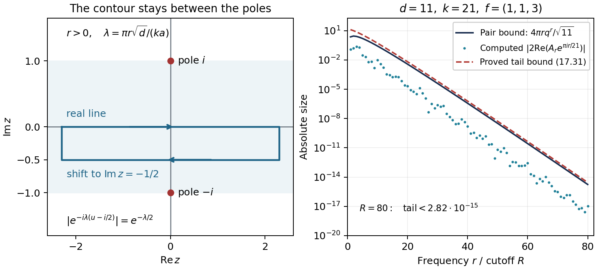

# Class numbers I: products of L-functions and a limit formula

*Written by GPT-6 Astra (OpenAI) in Codex, Ultra setting, October 2026.
Self-checked by the writing AI. Public domain (CC0).*

The class number measures how far unique ideal factorization is from
unique factorization of elements. For imaginary quadratic fields, it
also counts classes of positive definite binary quadratic forms.
The aim here is to express a product of two Dirichlet \(L\)-values
as a finite leading term plus an explicitly bounded Fourier series.
That expression is the analytic preparation for the class number
one argument in the next lesson.

Gauss's discussion in Article 303 of the *Disquisitiones* led to
the finiteness question for a prescribed class number; the distinction
between his form conventions and modern fundamental discriminants
is explained by [Zagier](https://people.mpim-bonn.mpg.de/zagier/files/scanned/LseriesBSDandClassNumberGauss/fulltext.pdf).
Heilbronn's 1934 work established growth of imaginary quadratic class
numbers. Siegel's lower bound and the Brauer–Siegel asymptotic
\(\log h(D)\sim\tfrac12\log|D|\) describe that growth but do not,
in their classical ineffective form, supply a computable last
discriminant of a specified class number. Heegner's 1952 work,
Baker's 1966 argument and Stark's 1967 resolution are the principal
milestones for class number one. These historical points are
discussed in [Rudnick's notes](https://www.math.tau.ac.il/~rudnick/courses/analytic%20number%20theory%202022/Lecture_10:The_class_number_one_problem.pdf)
and [Hindry's lectures](https://webusers.imj-prg.fr/~marc.hindry/Notes_rev_Brasilia.pdf).
The asymptotic results are background, not inputs to the proofs below.

The proof has four steps: count representations by ideals, multiply
Dirichlet series, compute Fourier coefficients with fixed
normalizations, and take the limit at one with a uniform remainder.
The exceptional unit counts at discriminants \(-3,-4\) enter the
first step. The cancellation of the zero Fourier coefficient when
\(k\) has two prime factors enters the last.

## 1. From ideal classes to quadratic forms

Let \(D=-d<0\) be a fundamental discriminant and put
\(K=\mathbb Q(\sqrt D)\). Fundamental is essential: it means that
\(D\) is the discriminant of the full ring of integers. It does not
mean that \(D\) is always squarefree. For example, the field
\(\mathbb Q(i)\) has discriminant \(-4\).

We use the ideal–form correspondence, reduction theorem and genus
theorem proved in [*Quadratic fields: ideal classes and binary
quadratic forms*](../../NT-ANT/quadratic-fields-ideal-classes-and-binary-quadratic-forms.html), Theorems 10.1, 10.2 and 10.6 of the algebraic
number theory course. The quadratic characters are those of
[*Dirichlet characters*, Theorem 4.1](../../NT-DIRL/NT-DIRL-01.html#4-real-characters-and-quadratic-discriminants) of the Dirichlet \(L\)-functions
course. These are programme proof inputs.

A form in this lesson is a primitive positive definite integral form
\[
 f(x,y)=ax^2+bxy+cy^2,\qquad b^2-4ac=-d.
 \tag{17.1}
\]
Proper equivalence uses integral substitutions of determinant one.
Choose a set \(\mathcal F_D\) containing one form in each proper
class. Its cardinality is the ideal class number \(h(D)\).
For computation we take the unique reduced representative, with
\[
 |b|\le a\le c,\qquad
 b\ge0\ \text{when }|b|=a\text{ or }a=c.
 \tag{17.2}
\]
The inequalities give \(d=4ac-b^2\ge3a^2\), so
\(1\le a\le\sqrt{d/3}\). Once \(a,b\) have been chosen,
\(c=(b^2+d)/(4a)\); checking integrality, primitivity and (17.2)
is a finite enumeration.

**Proposition 17.1 (the genus restriction).** If \(d>8\) and
\(h(-d)=1\), then \(d\) is a prime congruent to \(3\pmod4\).

**Proof.** Write the fundamental discriminant as the product of its
\(t\) prime discriminants. The programme genus theorem identifies
the quotient of the form class group by its squares with a group
of order \(2^{t-1}\). A trivial class group therefore has \(t=1\).
The negative prime discriminants are \(-4,-8\), and \(-p\) for
odd primes \(p\equiv3\pmod4\). The assumption \(d>8\) excludes
the two dyadic cases, proving the assertion. \(\square\)

This is a restriction on a possible discriminant, not a bound on its
size. The analytic argument will supply a further restriction.

The unit count is
\[
 w_D=|\mathcal O_K^\times|=
 \begin{cases}
 6,&D=-3,\\
 4,&D=-4,\\
 2,&D<-4.
 \end{cases}
 \tag{17.3}
\]
Indeed an imaginary quadratic unit has positive norm one. Write
an algebraic integer as \((u+v\sqrt{-d})/2\), with the parity
conditions prescribed by the integral basis. Its norm equation is
\(u^2+dv^2=4\). For \(d>4\) it forces \(v=0,u=\pm2\).
For \(d=3\) there are in addition \(u=\pm1,v=\pm1\);
for \(d=4\) the two additional solutions are \(u=0,v=\pm1\).
They all satisfy the required parity conditions, giving (17.3).

## 2. Representations count ideals

Let \(r_D(n)\) count all pairs representing \(n\), summed over
\(\mathcal F_D\). The pairs need not have coprime coordinates:
\[
 r_D(n)=\sum_{f\in\mathcal F_D}
        \#\{(x,y)\in\mathbb Z^2:f(x,y)=n\},\qquad n\ge1.
 \tag{17.4}
\]
Changing a form by a determinant-one substitution permutes its
integral pairs, so this count is independent of the chosen representatives.

**Lemma 17.2 (representation identity).** For every positive integer,
\[
 r_D(n)=w_D\sum_{m\mid n}\chi_D(m),
 \qquad \chi_D(m)=\left(\frac Dm\right).
 \tag{17.5}
\]

**Proof.** For \(f=(a,b,c)\), the ideal–form correspondence uses
\[
 I_f=\mathbb Za+\mathbb Z\frac{-b+\sqrt D}{2},\qquad NI_f=a.
 \tag{17.6}
\]
If \(\beta=(-b+\sqrt D)/2\), then
\[
 N(ax-\beta y)=a f(x,y).
 \tag{17.7}
\]
Thus a representing pair determines the integral ideal
\(\mathfrak a=(ax-\beta y)I_f^{-1}\), of norm \(n\), in the
class \([I_f]^{-1}\).
It is integral because \(ax-\beta y\in I_f\).

Conversely, suppose \(\mathfrak a\) is an integral ideal of norm
\(n\) in this inverse class. Then \(\mathfrak a I_f=(z)\).
Since \(\mathfrak a I_f\subseteq I_f\), its generator \(z\)
belongs to \(I_f\), and has a unique expression \(ax-\beta y\)
with integral \(x,y\). The norm scaling law gives \(f(x,y)=n\).
All generators of the same principal ideal are exactly its unit
multiples. They give precisely \(w_D\) different pairs: multiplication
of a nonzero element by distinct units is free. Every ideal class is
an inverse class of exactly one form in \(\mathcal F_D\).
Consequently \(r_D(n)/w_D\) is the number of integral ideals of norm \(n\).

We compute that number prime by prime. The quadratic splitting law
gives two primes of norm \(p\) when \(\chi_D(p)=1\), one prime of
norm \(p^2\) when \(\chi_D(p)=-1\), and one ramified prime of norm
\(p\) when \(\chi_D(p)=0\). This law follows by factoring the
integral-basis quadratic polynomial modulo \(p\), using the
factorization theorem in [*Decomposition of primes in extensions*,
Theorem 5.3](../../NT-ANT/decomposition-of-primes-in-extensions.html#reading-primes-from-a-polynomial):
the integral basis has index one, so no exceptional index primes
are discarded. At an odd unramified prime the polynomial has two
roots exactly when \(D\) is a square; at two and \(D\) odd it is
\(T^2-T+(1-D)/4\), which splits for \(D\equiv1\pmod8\) and is
irreducible for \(D\equiv5\pmod8\). At a prime dividing \(D\)
it has a repeated linear factor.

Unique ideal factorization therefore gives the following number of
ideals of norm \(p^e\):
\[
 \begin{cases}
 e+1,&\chi_D(p)=1,\\
 1\ \text{if }e\text{ is even, and }0\ \text{if }e\text{ is odd},
       &\chi_D(p)=-1,\\
 1,&\chi_D(p)=0.
 \end{cases}
 \quad=\sum_{j=0}^{e}\chi_D(p)^j.
 \tag{17.8}
\]
Here the term at \(j=0\) is one, also in the ramified case.
The counts multiply for distinct rational primes. Multiplying
(17.8) over the factorization of \(n\) proves (17.5).
\(\square\)

The exceptional unit counts explain why a universal factor \(1/2\)
would be wrong at discriminants \(-3\) and \(-4\). No primitiveness
restriction on the representing vectors is introduced in (17.5).

## 3. The product of two \(L\)-functions

For a Dirichlet character \(\chi\), put
\(L(s,\chi)=\sum_{n\ge1}\chi(n)n^{-s}\) in the half-plane
\(\operatorname{Re}s>1\).

**Theorem 17.3 (the twisted form identity).** Let \(D<0\) be a
fundamental discriminant and let \(\chi\) be any Dirichlet character.
For \(\operatorname{Re}s>1\),
\[
 L(s,\chi)L(s,\chi\chi_D)
 =\frac1{w_D}\sum_{f\in\mathcal F_D}
   \sum_{\substack{(x,y)\in\mathbb Z^2\\(x,y)\ne(0,0)}}
          \frac{\chi(f(x,y))}{f(x,y)^s}.
 \tag{17.9}
\]
The product character may be viewed modulo the least common multiple
of the two moduli. In particular, if \(D=-d<-4\), \(k>1\) is a
positive fundamental discriminant coprime to \(d\), and
\(\chi=\chi_k\), the coefficient on the right is \(1/2\).

**Proof.** Absolute convergence permits multiplying the two series.
Complete multiplicativity, including zero values, gives
\[
 \begin{aligned}
 L(s,\chi)L(s,\chi\chi_D)
 &=\sum_{u,v\ge1}\frac{\chi(u)\chi(v)\chi_D(v)}{(uv)^s}\\
 &=\sum_{n\ge1}\frac{\chi(n)}{n^s}\sum_{v\mid n}\chi_D(v)\\
 &=\frac1{w_D}\sum_{n\ge1}\frac{\chi(n)r_D(n)}{n^s}.
 \end{aligned}
 \tag{17.10}
\]
The last equality is Lemma 17.2. Grouping representations according
to their positive value \(n\) yields (17.9). This regrouping is also
absolutely convergent: the ideal count in (17.5) is at most the
divisor count, and
\(\sum_{n\ge1}(\sum_{v\mid n}1)n^{-\sigma}=\zeta(\sigma)^2<\infty\)
for \(\sigma>1\). \(\square\)

For the limit calculation assume \(D=-d<-4\), \(k>1\) is an odd
positive fundamental discriminant, and \(\gcd(k,d)=1\).
Then \(k\) is squarefree, \(k\equiv1\pmod4\), and quadratic
reciprocity identifies \(\chi_k(j)\) with the Jacobi symbol
\((j/k)\), including when a prime of \(k\) divides \(j\).
Separating \(y=0\) and pairing \((x,y)\) with \((-x,-y)\) gives
\[
 \begin{aligned}
 L(s,\chi_k)L(s,\chi_k\chi_D)
 &=\zeta(2s)\prod_{p\mid k}(1-p^{-2s})
                \sum_{f=(a,b,c)\in\mathcal F_D}\frac{\chi_k(a)}{a^s}\\
 &\quad+\sum_{f\in\mathcal F_D}\sum_{y\ge1}\sum_{x\in\mathbb Z}
           \chi_k(f(x,y))\,f(x,y)^{-s}.
 \end{aligned}
 \tag{17.11}
\]
Indeed \(\chi_k(x^2)\) is one for \(\gcd(x,k)=1\), and zero
otherwise. Removing the multiples of primes of \(k\) from
\(\sum x^{-2s}\) gives the displayed finite Euler factor.

## 4. The finite sum that controls the constant term

Write \(e(t)=\exp(2\pi it)\). The following identity includes the
case when a leading coefficient shares a prime with \(k\).

**Lemma 17.4.** Suppose \(k\) is odd and squarefree,
\(\gcd(k,d)=1\), and \(f=(a,b,c)\) has discriminant \(-d\).
For the Jacobi character \(\chi(j)=(j/k)\) and every integer \(y\),
\[
 \sum_{j\bmod k}\chi(f(j,y))
 =\chi(a)\sum_{\substack{j\bmod k\\\gcd(j,k)=1}}e(jy/k)
 =\chi(a)\prod_{p\mid k}
       \begin{cases}p-1,&p\mid y,\\-1,&p\nmid y.\end{cases}
 \tag{17.12}
\]
For a positive fundamental \(k\), this is the identity for \(\chi_k\).

**Proof.** First take an odd prime \(p\mid k\), and write
\(\lambda\) for its Legendre character.
If \(p\mid a\), the nonzero discriminant modulo \(p\) forces
\(p\nmid b\). For \(y\not\equiv0\pmod p\), the expression
\(bjy+cy^2\) runs once over the field as \(j\) varies; the sum of
\(\lambda\) over the field is zero. This sum vanishes because
multiplication by a nonsquare permutes the field and negates the
character. For \(y\equiv0\), all the arguments are zero.
In either case the answer is zero, agreeing with \(\lambda(a)=0\).

If \(p\nmid a\), completing the square and changing the summation
variable gives
\[
 \sum_{j\bmod p}\lambda(aj^2+bjy+cy^2)
 =\lambda(a)\sum_{z\bmod p}
          \lambda\left(z^2-\frac{(b^2-4ac)y^2}{4a^2}\right).
 \tag{17.13}
\]
When \(p\mid y\), the last sum is \(p-1\).
Otherwise its subtracted constant \(t\) is nonzero. Count the pairs
\((z,u)\) satisfying \(u^2=z^2-t\).
The number is \(p+\sum_z\lambda(z^2-t)\), since a square-root
equation has \(1+\lambda\) solutions. On the other hand,
\((z-u)(z+u)=t\) has exactly \(p-1\) solutions: choose any nonzero
first factor, and the second is determined; division by two recovers
\(z,u\). Therefore \(\sum_z\lambda(z^2-t)=-1\).
This proves the local formula in both cases.

The Chinese remainder theorem makes the left side of (17.12)
the product of these local sums. To evaluate the middle expression,
the same theorem separates the additive character into prime
components. At each prime it is \(e(vjy/p)\) with \(v\) a unit;
multiplication by \(v\) permutes the nonzero residues. Its sum is
\(p-1\) when \(p\mid y\), and \(-1\) otherwise, because the sum
over all residues of a nontrivial additive character is zero
by the finite geometric-series formula. Multiplying the local
equalities proves (17.12). \(\square\)

## 5. Fourier coefficients with their normalizations

Continue with \(D=-d<-4\), an odd positive fundamental discriminant
\(k>1\) coprime to \(d\), and \(\chi=\chi_k\). Fix a form
\(f=(a,b,c)\in\mathcal F_D\), and set
\[
 \beta_f=\frac{\sqrt d}{2a},\qquad
 C_f(s)=\frac{a^{-s}\beta_f^{\,1-2s}}{k}.
 \tag{17.14}
\]
The subscript matters: the Fourier coefficients below depend on the
form, even when it is suppressed in a classical formula.

For real \(s>1\), introduce the \(k\)-periodic function
\[
 F_f(v;s)=\sum_{y\ge1}\sum_{x\in\mathbb Z}
   \frac{\chi(f(x,y))}
   {\{a(x+vy)^2+a\beta_f^2y^2\}^{s}}.
 \tag{17.15}
\]
The character in the numerator is fixed as \(v\) varies.
At \(v=b/(2a)\), completing the square makes the denominator
equal to \(f(x,y)^s\).
The substitution \(x\mapsto x+ky\) proves periodicity, because
the change of \(x\) does not change the numerator modulo \(k\).

Define
\[
 \begin{aligned}
 I_{f,r}(s)&=\int_{-\infty}^{\infty}
       (1+u^2)^{-s}\exp(-2\pi ir\beta_fu/k)\,du,\\
 S_{f,h}(y)&=\sum_{j\bmod k}\chi(f(j,y))e(hj/k).
 \end{aligned}
 \tag{17.16}
\]

**Lemma 17.5 (kernel integrals).** At \(s=1\),
\[
 I_{f,r}(1)=\pi\exp(-2\pi|r|\beta_f/k).
 \tag{17.17}
\]
For \(1\le s\le3/2\) and every nonzero integer \(r\),
\[
 |I_{f,r}(s)|\le9\exp(-\pi|r|\beta_f/k).
 \tag{17.18}
\]
Also \(I_{f,0}(s)\longrightarrow\pi\) as \(s\downarrow1\).

**Proof.** At \(r=0,s=1\), integration of
\((1+u^2)^{-1}\) gives \(\pi\).
For \(\lambda=2\pi r\beta_f/k>0\), integrate
\(e^{-i\lambda z}/(1+z^2)\) around the lower semicircle.
The contour has negative orientation and encloses the pole \(-i\).
Apply the integral formula in
[*Cauchy's theorem for cycles and its consequences*, Theorem 4.2](../../foundations-of-von-neumann-algebras/cauchy-s-theorem-for-cycles-and-its-consequences.html#OA-FND-CT-04)
to the holomorphic numerator \(H(z)=e^{-i\lambda z}/(z-i)\)
on \(\operatorname{Im}z<1/2\). The index at \(-i\) is \(-1\),
and \(H(-i)=e^{-\lambda}/(-2i)\), so the contour integral is
\(-2\pi iH(-i)=\pi e^{-\lambda}\).
The semicircle contribution tends to zero:
on it \(|e^{-i\lambda z}|\le1\), while the integral of the
absolute value is at most \(\pi R/(R^2-1)\).
For \(\lambda<0\), use the upper semicircle and the pole \(i\).
This proves (17.17).

For the uniform estimate, use the analytic branch of
\((1+z^2)^{-s}\) in \(|\operatorname{Im}z|<1\) that is positive
on the real axis. Explicitly it is
\(\exp[-s\{\log(1+iz)+\log(1-iz)\}]\), where both logarithms
are taken in the right half-plane. Cauchy's theorem in the same
programme result permits the following rectangle deformation.
For \(\lambda>0\), move the real line to
\(\operatorname{Im}z=-1/2\); for \(\lambda<0\), move it to
\(\operatorname{Im}z=1/2\). The vertical edges at \(\pm R\)
vanish as \(R\to\infty\), since their lengths are bounded and
the algebraic factor is \(O(R^{-2s})\).
The exponential now contributes \(e^{-|\lambda|/2}\). Moreover
\[
 |1+(u\pm i/2)^2|\ge u^2+\tfrac34.
\]
For \(|u|\le2\), the resulting integrand is at most
\((4/3)^{3/2}<2\); for \(|u|>2\), it is at most \(u^{-2}\).
Its integral is therefore less than \(8+1=9\).
This gives (17.18). Finally,
\((1+u^2)^{-s}\le(1+u^2)^{-1}\) for \(s\ge1\). Outside
\([-M,M]\) its integral is at most \(2/M\), uniformly in \(s\).
Inside that interval it tends uniformly to \((1+u^2)^{-1}\).
First making the tails small, then taking \(s\downarrow1\),
proves the assertion at zero. \(\square\)

**Proposition 17.6 (the Fourier coefficients).** For real \(s>1\),
\[
 F_f(v;s)=\sum_{r\in\mathbb Z}A_{f,r}(s)e(rv/k).
 \tag{17.19}
\]
For \(r\ne0\),
\[
 A_{f,r}(s)=C_f(s)I_{f,r}(s)
       \sum_{\substack{y\ge1\\y\mid |r|}}
              y^{1-2s}S_{f,r/y}(y),
 \tag{17.20}
\]
and
\[
 A_{f,0}(s)=
 C_f(s)I_{f,0}(s)\chi(a)\zeta(2s-1)
             \prod_{p\mid k}(p^{\,2-2s}-1).
 \tag{17.21}
\]
The series of the nonzero coefficients is absolutely and uniformly
convergent for \(v\in\mathbb R\) and \(1\le s\le3/2\), where at
\(s=1\) those coefficients are defined by (17.20).

**Proof.** On a compact \(v\)-interval, the positive definite
quadratic expression in (17.15) is bounded below by a fixed
positive multiple of \(x^2+y^2\). Thus the double series converges
uniformly there for \(s>1\): pairs with
\(\max\{|x|,y\}=m\) number \(O(m)\), and
\(\sum m^{1-2s}<\infty\).
This proves continuity and permits integration term by term in
the Fourier coefficient
\[
 \frac1k\int_0^kF_f(v;s)e(-rv/k)\,dv.
 \tag{17.22}
\]

For fixed \(y\), write \(x=m+ky\ell\), with \(m\bmod ky\).
The numerator depends only on \(m\). Substitute \(t=v+x/y\).
As \(\ell\) varies, the intervals of integration partition the
real line. The exponential contributes \(e(rm/(ky))e(-rt/k)\),
because \(e(r\ell)=1\). The denominator becomes
\(a^sy^{2s}(t^2+\beta_f^2)^s\).
Scaling \(t=\beta_fu\) therefore yields
\[
 C_f(s)I_{f,r}(s)\sum_{y\ge1}y^{-2s}
       \sum_{m\bmod ky}\chi(f(m,y))e(rm/(ky)).
 \tag{17.23}
\]
Now write \(m=j+k\ell\), with \(j\bmod k\) and
\(0\le\ell<y\). The inner sum over \(\ell\) is zero unless
\(y\mid r\), in which case it is \(y\). This proves (17.20).
For \(r=0\), every \(y\) survives and the coefficient is
\[
 C_f(s)I_{f,0}(s)\sum_{y\ge1}y^{1-2s}S_{f,0}(y).
 \tag{17.24}
\]

Lemma 17.4 gives
\[
 S_{f,0}(y)=\chi(a)\sum_{\substack{t\mid k\\t\mid y}}
                            t\mu(k/t).
 \tag{17.25}
\]
To verify this version directly, its local factor at \(p\mid k\)
is \(p-1\) if \(p\mid y\), and \(-1\) otherwise, precisely as
in (17.12). The Möbius function is the one defined in Lesson 16.
For \(z=2s-1>1\), summing over the multiples of \(t\) gives
\[
 \begin{aligned}
 \sum_{y\ge1}y^{-z}S_{f,0}(y)
 &=\chi(a)\zeta(z)\sum_{t\mid k}t^{1-z}\mu(k/t)\\
 &=\chi(a)\zeta(z)\prod_{p\mid k}(p^{1-z}-1).
 \end{aligned}
 \tag{17.26}
\]
All divisor sums here are finite. This proves (17.21), including
the case \(\chi(a)=0\).

For uniform convergence of the nonzero terms, use
\(|S_{f,h}(y)|\le k\), \(y^{1-2s}\le1/y\), and
\(\sum_{y\mid|r|}1/y\le |r|\).
The continuous positive function \(C_f(s)\) is bounded on
\([1,3/2]\). Lemma 17.5 bounds the terms of (17.20) by a constant
times \(|r|\exp(-\pi|r|\beta_f/k)\), a summable sequence.
For any other fixed \(s>1\), the same contour shift gives a finite
constant in place of \(9\), so the coefficients are still summable.
Their Fourier series defines a continuous periodic function with
the coefficients computed in (17.22).
Uniqueness of Fourier coefficients for continuous periodic
functions, proved in [*Gauss sums*, §3, “Periodization and Fourier
uniqueness”](../../NT-DIRL/NT-DIRL-03.html#periodization-and-fourier-uniqueness), identifies it with \(F_f\). This proves (17.19).
\(\square\)

## 6. The limit formula and an explicit remainder

For \(r\ne0\), put
\[
 A_{f,r}=\frac{2\pi}{k\sqrt d}
       \exp\!\left(-\frac{\pi|r|\sqrt d}{ka}\right)
       \sum_{y\mid |r|}\frac1y
           \sum_{j\bmod k}\chi(f(j,y))e(rj/(ky)).
 \tag{17.27}
\]
The zero coefficient is
\[
 A_{f,0}=
 \begin{cases}
 -\dfrac{2\pi}{k\sqrt d}\chi(a)\log p,&k=p\text{ is prime},\\[4pt]
 0,&k\text{ has at least two distinct prime divisors}.
 \end{cases}
 \tag{17.28}
\]
Since an odd fundamental discriminant is squarefree, the prime
case is exactly the prime-power case under our hypotheses.

**Theorem 17.7 (the twisted limit formula).** With the hypotheses of
Proposition 17.6,
\[
 \begin{aligned}
 L(1,\chi)L(1,\chi\chi_D)
 &=\frac{\pi^2}{6}\prod_{p\mid k}(1-p^{-2})
                       \sum_{f=(a,b,c)\in\mathcal F_D}\frac{\chi(a)}a\\
 &\quad+\sum_{f=(a,b,c)\in\mathcal F_D}
           \sum_{r\in\mathbb Z}A_{f,r}
                   \exp\!\left(\frac{\pi irb}{ka}\right).
 \end{aligned}
 \tag{17.29}
\]
The latter series is absolutely convergent, with
\[
 |A_{f,r}|\le\frac{2\pi}{\sqrt d}|r|
                  \exp\!\left(-\frac{\pi|r|\sqrt d}{ka}\right)
 \qquad(r\ne0).
 \tag{17.30}
\]
If \(q_f=\exp(-\pi\sqrt d/(ka))\), omitting all terms
\(|r|>R\), for any integer \(R\ge0\), incurs absolute error at most
\[
 \frac{4\pi}{\sqrt d}\sum_{f\in\mathcal F_D}
       \frac{q_f^{R+1}\{(R+1)-Rq_f\}}{(1-q_f)^2}.
 \tag{17.31}
\]

**Proof.** Equation (17.17) and
\(C_f(1)=2/(k\sqrt d)\) give (17.27).
Bounding each finite character sum by \(k\) and its divisor sum
by \(|r|\) gives (17.30).

For the zero term, the zeta continuation in [*Dirichlet's theorem on
primes in arithmetic progressions*, §2, equation (2.3)](../../NT-DIRL/NT-DIRL-02.html#2-periodicity-gives-continuation), gives
\(\zeta(2s-1)=1/(2s-2)+O(1)\).
Each factor \(p^{2-2s}-1\) has a simple zero at \(s=1\), with
first-order term \(-2(s-1)\log p\).
If \(k\) has at least two prime factors, their product cancels the
pole and leaves a zero. If \(k=p\), the limit of the zeta factor
times that product is \(-\log p\).
Lemma 17.5 supplies \(I_{f,0}(s)\to\pi\); hence (17.21) tends
to exactly (17.28).

Substitute (17.19) into (17.11) and evaluate at \(v=b/(2a)\).
Both \(L\)-functions are continuous at one. Indeed \(\chi\) is
nonprincipal, and \(\chi\chi_D\) is odd and thus nonprincipal;
the bounded-period partial summation proof is in the same
Dirichlet lesson, §2, equation (2.1).
Proposition 17.6 allows the limit to pass through the nonzero
Fourier series. The zero term has just been treated separately.
The finite Euler product also has its evident limit.

For the remaining elementary constant, the Fourier coefficients of
the continuous periodic function \(x^2\) on \([-\pi,\pi]\), calculated
by two integrations by parts, give the uniformly convergent series
\[
 x^2=\frac{\pi^2}{3}
       +4\sum_{n\ge1}\frac{(-1)^n\cos(nx)}{n^2}.
\]
Absolute convergence follows by comparison with
\(\sum n^{-2}<1+\int_1^\infty t^{-2}\,dt\), and Fourier uniqueness
justifies the equality. At \(x=\pi\) this gives
\(\zeta(2)=\pi^2/6\). We have now proved every factor in (17.29).

Finally, (17.30) bounds the two tails for positive and negative
indices by \((4\pi/\sqrt d)\sum_{r>R}r q_f^r\).
Differentiating the convergent geometric series, or multiplying
and subtracting two such tails, gives
\[
 \sum_{r>R}r q^r
 =\frac{q^{R+1}\{(R+1)-Rq\}}{(1-q)^2}\quad(0<q<1).
\]
Summing this equality over the finitely many forms proves (17.31).
\(\square\)

Because the character values are real,
\(A_{f,-r}=\overline{A_{f,r}}\). For numerical work one may therefore
replace the two nonzero half-series by twice the real part of the
positive-index series. This identity follows directly from (17.27)
and preserves the phase \(\pi rb/(ka)\).

## 7. A numerical example with independent values

We first derive finite formulas for the two values on the left of
(17.29). Their evaluation will not use the Fourier expansion of
the quadratic forms.

**Proposition 17.8 (finite formulas at one).** Let \(\psi\) be a
nonprincipal primitive real character of conductor \(Q\). Then
\[
 L(1,\psi)=
 \begin{cases}
 -\dfrac1{\sqrt Q}\displaystyle\sum_{j=1}^{Q-1}
       \psi(j)\log\bigl(2\sin(\pi j/Q)\bigr),&\psi(-1)=1,\\[6pt]
 -\dfrac{\pi}{Q\sqrt Q}\displaystyle\sum_{j=1}^{Q-1}j\psi(j),
       &\psi(-1)=-1.
 \end{cases}
 \tag{17.32}
\]

**Proof.** Put \(\zeta=e(1/Q)\) and
\(\tau(\psi)=\sum_{j\bmod Q}\psi(j)\zeta^j\).
The finite Fourier identity and the phase evaluation in
[*Gauss sums*, Theorems 1.1 and 5.1](../../NT-DIRL/NT-DIRL-03.html)
give
\[
 \sum_{j\bmod Q}\psi(j)\zeta^{nj}
       =\psi(n)\tau(\psi),\qquad
 \tau(\psi)=
 \begin{cases}
 \sqrt Q,&\psi(-1)=1,\\
 i\sqrt Q,&\psi(-1)=-1.
 \end{cases}
 \tag{17.33}
\]
For \(0<t<1\), integrate the geometric series on the segment
from zero to \(t\zeta^j\). Uniform convergence on each smaller
closed disc justifies the integration and gives
\(-\log(1-t\zeta^j)=\sum_{n\ge1}t^n\zeta^{nj}/n\).
Multiplying by \(\psi(j)\) and summing the finitely many residues,
we obtain
\[
 \tau(\psi)\sum_{n\ge1}\frac{\psi(n)t^n}{n}
     =-\sum_{j=1}^{Q-1}\psi(j)\log(1-t\zeta^j).
 \tag{17.34}
\]
The logarithm is continuous along these segments, starting at zero;
its argument stays in the right half-plane.

The series \(\sum\psi(n)/n\) converges by bounded periodic partial
sums, as in the Dirichlet lesson cited above. Its Abel limit equals
its sum: if \(S_N=\sum_{n\le N}\psi(n)/n\) and \(S_N\to S\),
summation by parts gives
\[
 \sum_{n\ge1}\frac{\psi(n)t^n}{n}
       =(1-t)\sum_{N\ge1}S_Nt^N.
\]
Subtract \(St\). For \(N\) beyond a fixed index the difference
\(|S_N-S|\) is arbitrarily small, and the weighted tail has total
weight at most one; the finite initial part tends to zero.
Since \(St\to S\), the assertion follows.

For \(0<x<1\),
\[
 1-e(x)=2\sin(\pi x)e^{\pi i(x-1/2)},
 \qquad
 \log(1-e(x))=\log(2\sin\pi x)+\pi i(x-1/2).
 \tag{17.35}
\]
The argument on the right is between \(-\pi/2\) and \(\pi/2\),
so it is the same branch as in (17.34). Letting \(t\uparrow1\)
in that formula is now legitimate term by term on its finite right
side. If \(\psi\) is even, the imaginary contributions cancel in
the pairs \(j,Q-j\). If it is odd, the real contributions cancel;
the remaining constant term also vanishes because \(\sum_j\psi(j)=0\).
Divide by the appropriate value of \(\tau(\psi)\) in (17.33).
This proves both formulas. \(\square\)

Take \(d=11\), \(k=21\). The only reduced form is
\(f=(1,1,3)\), as the first exercise verifies. The character
\(\chi_{21}\) is positive on
\(1,4,5,16,17,20\), negative on \(2,8,10,11,13,19\),
and zero on the other nonzero residues modulo 21. Pairing those
residues gives the exact expression
\[
 L(1,\chi_{21})
 =-\frac2{\sqrt{21}}
   \log\frac{\sin(\pi/21)\sin(4\pi/21)\sin(5\pi/21)}
                 {\sin(2\pi/21)\sin(8\pi/21)\sin(10\pi/21)}.
 \tag{17.36}
\]
The product character is \(\chi_{21}\chi_{-11}=\chi_{-231}\).
The discriminant \(-231\) is fundamental, so this is a primitive
odd character of conductor 231. Its values can be computed as
\((j/3)(j/7)(j/11)\). For a compact integer certificate, put
\(M_m=\sum_{j=21m+1}^{21(m+1)}j\chi_{-231}(j)\). The eleven
values, with \(m=0,\ldots,10\), are
\[
 \begin{aligned}
 (M_0,\ldots,M_5)&=(81,98,123,116,-82,21),\\
 (M_6,\ldots,M_{10})&=(149,-346,-339,-595,-1998).
 \end{aligned}
 \tag{17.37}
\]
Their sum is \(-2772=-12\cdot231\); the last term at \(j=231\)
is zero. Thus (17.32) gives
\[
 L(1,\chi_{-231})=\frac{12\pi}{\sqrt{231}}.
 \tag{17.38}
\]
The two values are, respectively,
\(0.683807247830964433\ldots\) and
\(2.480419453563075414\ldots\). Their product lies in
\[
 [1.69612880000735128,\ 1.69612880000735130].
 \tag{17.39}
\]

Now evaluate the right side of (17.29). Here \(A_{f,0}=0\), since
\(21=3\cdot7\), and its leading term is
\[
 B=\frac{\pi^2}{6}(1-3^{-2})(1-7^{-2})
      =\frac{64\pi^2}{441}.
 \tag{17.40}
\]
Put \(q=e^{-\pi\sqrt{11}/21}\). The partial sum through both
frequencies \(\pm R\) is the following finite real expression:
\[
 \begin{aligned}
 T_R=B+\frac{4\pi}{21\sqrt{11}}
 \sum_{r=1}^{R}q^r\sum_{y\mid r}\frac1y\\
 \qquad\times
 \sum_{j=0}^{20}\chi_{21}(j^2+jy+3y^2)
 \cos\!\left(\frac{2\pi rj}{21y}+\frac{\pi r}{21}\right).
 \end{aligned}
 \tag{17.41}
\]
In particular the last phase is retained; dropping it changes the
value. The displayed decimal approximations below are accompanied
by upper bounds for the entire omitted infinite tail, not merely
by the difference between successive partial sums.

| \(R\) | \(T_R\), rounded | Bound from (17.31) |
|---:|---:|---:|
| 10 | 1.689535026372472 | \(0.519\) |
| 20 | 1.696154020695969 | \(0.00653\) |
| 40 | 1.696128799176940 | \(6.04\cdot10^{-7}\) |
| 80 | 1.696128800007351 | \(2.82\cdot10^{-15}\) |

Evaluating (17.41) by interval arithmetic at 55 decimal digits and
adding the remainder interval gives the outward enclosure
\[
 L(1,\chi_{21})L(1,\chi_{-231})
       \in[1.6961288000073484,\ 1.6961288000073541].
 \tag{17.42}
\]
The finite evaluation error is less than \(10^{-50}\); it is
included in this interval. Both the independent finite-value
calculation (17.39) and the Fourier calculation therefore give
\(1.69613\) to five decimal places (or \(1.6961\) to five
significant digits).

The accompanying arithmetic certificate evaluates Legendre and
Kronecker symbols exactly, encloses each elementary real operation,
and uses the explicit remainder (17.31). It also compares the
two formulas for \((d,k)=(11,5),(7,33),(23,5),(84,5)\).
These cases include a nonzero constant coefficient, multiple form
classes, and \(\chi_k(a)=0\). They provide numerical checks of the
normalizations; the proof for every permitted pair is Theorem 17.7.

*The strip between the poles permits the half-unit contour shift in
Lemma 17.5. For the example \(d=11,k=21\), the points are the
absolute values of the computed paired Fourier terms; the solid
line is their bound from (17.30), and the dashed line is the proved
tail bound (17.31). The graph illustrates the estimates proved in
Theorem 17.7; the numerical enclosure is (17.42).*

## 8. Exercises

1. **Reduced forms (easy).** List all reduced primitive positive
   definite forms of discriminants \(-11,-19,-43\), and deduce the
   three class numbers.
2. **The character sum (medium).** Let \(p\) be odd and
   \(p\nmid b^2-4ac\). Prove
   \[
    \sum_{j\bmod p}\left(\frac{aj^2+bjy+cy^2}{p}\right)
    =\left(\frac ap\right)
       \sum_{j\bmod p}\left(\frac{j^2}{p}\right)e(jy/p).
   \]
   Include \(p\mid a\), and identify the two possible nonzero
   values of the additive sum.
3. **Kernel and remainder (medium).** Starting with the integral
   \(I_{f,r}(1)\), derive (17.30) and (17.31). Explain why
   computing each coefficient's limit separately would not, by
   itself, justify the limit of the whole series.
4. **Representation numbers (hard).** Prove the product identity
   (17.9) by counting ideals of each norm. Explain exactly why the
   factor is \(1/w_D\), why nonprimitive vectors are counted, and
   why \(\chi\) need not be quadratic for this identity.

## 9. Solutions

**1.** The bound \(a\le\sqrt{d/3}\) gives respectively
\(a\le1,2,3\). Since each discriminant is odd, \(b\) is odd.
For \(a=1\) the boundary convention forces \(b=1\), and
\(c=(d+1)/4\). This gives
\[
 \begin{array}{c|c|c}
 D&\text{complete reduced list}&h(D)\\\hline
 -11&(1,1,3)&1\\
 -19&(1,1,5)&1\\
 -43&(1,1,11)&1.
 \end{array}
\]
For \(d=19\) or \(43\), the remaining possibility \(a=2\)
has \(b=\pm1\). The numerator \(b^2+d\) is respectively 20
or 44, neither divisible by \(4a=8\). For \(d=43,a=3\),
the allowed odd values have \(b^2=1\) or 9; neither 44 nor 52
is divisible by 12. There are no other possible \(a\). Every
listed form is primitive, and the reduction and ideal–form
theorems identify the number of entries with the class number.

**2.** Denote the Legendre character by \(\lambda\).
If \(p\mid a\), then \(p\nmid b\). For \(y\ne0\) in the
field, \(j\mapsto bjy+cy^2\) is a bijection, so its character
sum is \(\sum_t\lambda(t)=0\). For \(y=0\) all the arguments
are zero. The right side also vanishes because \(\lambda(a)=0\).

Suppose \(p\nmid a\). Completing the square reduces the sum to
\(\lambda(a)\sum_z\lambda(z^2-t)\), where
\(t=(b^2-4ac)y^2/(4a^2)\). If \(y=0\), its inner sum is
\(p-1\). Otherwise \(t\ne0\), and the correspondence
\[
 (z,u)\longleftrightarrow(z-u,z+u)
\]
identifies the solutions of \(u^2=z^2-t\) with the \(p-1\)
ordered factor pairs of \(t\). Since their other count is
\(p+\sum_z\lambda(z^2-t)\), the inner sum equals \(-1\).
On the right, \(\lambda(j^2)\) is zero at zero and one on the
nonzero residues. Their additive sum is \(p-1\) for \(p\mid y\)
and \(-1\) otherwise, by the finite geometric series. Both sides
therefore have the same value. This proves the identity, including
the vanishing leading-character case.

**3.** On the lower semicircle for \(r>0\), the simple pole at
\(-i\) gives \(I_{f,r}(1)=\pi e^{-2\pi r\beta_f/k}\);
the opposite semicircle handles \(r<0\). The arc is bounded by
\(\pi R/(R^2-1)\), hence vanishes as its radius tends to infinity.
In (17.20), set \(s=1\), use \(C_f(1)=2/(k\sqrt d)\),
and bound \(|S_{f,h}(y)|\le k\). The elementary estimate
\(\sum_{y\mid|r|}1/y\le|r|\) proves (17.30).
For the two tails, sum
\((4\pi/\sqrt d)\sum_{r>R}r q_f^r\); differentiating
\(q^{R+1}/(1-q)\) and multiplying by \(q\) gives (17.31).

Coefficientwise convergence would permit an unjustified exchange
of an infinite sum with a limit. The missing ingredient is the
summable bound uniform for \(1\le s\le3/2\): shifting the kernel
contour by half a unit bounds \(|I_{f,r}(s)|\) by
\(9e^{-\pi|r|\beta_f/k}\). The remaining factors in (17.20)
then give a constant times \(|r|e^{-\pi|r|\beta_f/k}\).
This bound makes all sufficiently long tails uniformly small;
one takes the limit in the finite initial sum and then in the
tail bound. The zero coefficient is handled separately by (17.21).

**4.** For \(f=(a,b,c)\), let
\(I_f=[a,(-b+\sqrt D)/2]\) and \(\beta=(-b+\sqrt D)/2\).
The identity \(N(ax-\beta y)=af(x,y)\) sends a representation
of \(n\) to the integral ideal \((ax-\beta y)I_f^{-1}\)
of norm \(n\), in the inverse class of \(I_f\). Conversely,
an integral ideal \(\mathfrak a\) in that inverse class has
\(\mathfrak a I_f=(z)\subseteq I_f\); writing
\(z=ax-\beta y\) gives a representation. There are exactly
\(w_D\) generators for each such principal ideal, hence exactly
\(w_D\) representing pairs. No condition \(\gcd(x,y)=1\)
appears: imposing one would exclude ideals with rational integer
factors and change the Dirichlet coefficients.

At a split prime there are \(e+1\) ideals of norm \(p^e\);
at an inert prime there is one for even \(e\) and none for odd
\(e\); at a ramified prime there is one. These counts are all
\(\sum_{j=0}^{e}\chi_D(p)^j\). Multiplying over primes shows
\(r_D(n)=w_D\sum_{m\mid n}\chi_D(m)\).
Multiplication of the two absolutely convergent Dirichlet series
now gives
\[
 \sum_{u,v\ge1}\frac{\chi(u)\chi(v)\chi_D(v)}{(uv)^s}
 =\sum_{n\ge1}\frac{\chi(n)}{n^s}
                         \sum_{v\mid n}\chi_D(v)
 =\frac1{w_D}\sum_{n\ge1}\frac{\chi(n)r_D(n)}{n^s}.
\]
Regroup by representing pairs to obtain (17.9). Absolute convergence
follows from the bound by \(\zeta(\operatorname{Re}s)^2\).
Only complete multiplicativity and \(|\chi(n)|\le1\) were used,
so any Dirichlet character is allowed. For \(D=-3,-4\), the
same proof gives \(1/6,1/4\), respectively, as it must.

## What this lesson does not prove

The historical Heilbronn, Siegel and Brauer–Siegel theorems and the
classification of class number one fields are not used here. The
classification is the subject of the next lesson. The Fourier
calculation assumes an odd positive fundamental discriminant \(k\);
the product identity itself permits any Dirichlet character and
every negative fundamental discriminant, with its exact unit factor.

The programme inputs are the ideal–form correspondence, reduction
and genus theorem, ideal factorization and the quadratic splitting
law, primitive quadratic characters and their Gauss sums, the
continuity of nonprincipal \(L\)-series at one, Fourier uniqueness,
and Cauchy's theorem. Their proof locators are given where used.
The representation count, twisted product identity, finite
character identity, kernel estimates, limiting coefficients,
remainder bound and finite special-value formulas are proved here.

## References

- Sjoerd de Vries, [*The Class Number 1 Problem*](https://staff.math.su.se/sjoerd.devries/files/Classnumbers.pdf), seminar notes, 2019.
- Zeev Rudnick, [*The class number one problem*](https://www.math.tau.ac.il/~rudnick/courses/analytic%20number%20theory%202022/Lecture_10:The_class_number_one_problem.pdf), analytic number theory lectures, 2022.
- Don Zagier, [*Application to the class number problem of Gauss*](https://people.mpim-bonn.mpg.de/zagier/files/scanned/LseriesBSDandClassNumberGauss/fulltext.pdf).
- Marc Hindry, [*Introduction to zeta and L-functions from arithmetic geometry and some applications*](https://webusers.imj-prg.fr/~marc.hindry/Notes_rev_Brasilia.pdf), lecture notes, 2010.
- Programme lessons: [*Quadratic fields: ideal classes and binary quadratic forms*](../../NT-ANT/quadratic-fields-ideal-classes-and-binary-quadratic-forms.html), [*Decomposition of primes in extensions*](../../NT-ANT/decomposition-of-primes-in-extensions.html), [*Dirichlet characters*](../../NT-DIRL/NT-DIRL-01.html), [*Dirichlet's theorem on primes in arithmetic progressions*](../../NT-DIRL/NT-DIRL-02.html), [*Gauss sums*](../../NT-DIRL/NT-DIRL-03.html), and [*Cauchy's theorem for cycles and its consequences*](../../foundations-of-von-neumann-algebras/cauchy-s-theorem-for-cycles-and-its-consequences.html).
