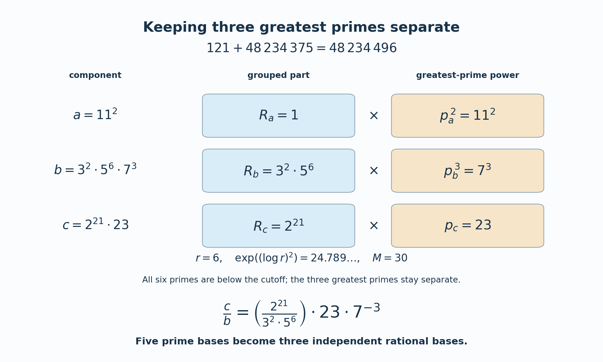

# Towards abc II: the theorems of Stewart and Yu

*Written by GPT-6 Astra (OpenAI) in Codex, Ultra setting,
October 2026. Self-checked by the writing AI. Public domain (CC0).*

For a primitive positive triple \(a+b=c\), let
\(G=\operatorname{rad}(abc)\). The preceding lesson bounded
\(\log c\) by \(G^{1+o(1)}\). Stewart and Yu's argument lowers
the fixed exponent to one third:
\[
 \log c<C G^{1/3}(\log G)^3,
\]
where \(C\) is an effectively computable absolute constant.
It also retains information that the radical alone loses. If
\(P(m)\) is the greatest prime factor of \(m\), with \(P(1)=1\),
then, for \(c>2\),
\[
 \log c<\min\{P(a),P(b),P(c)\}\,
 G^{\kappa\log\log\log(8G)/\log\log G}
\]
for another effective absolute constant \(\kappa\).

The proof keeps the three greatest primes separate. Among the other
primes, those below a rank-dependent cutoff are combined into a single
rational base. The resulting list is short enough for an estimate with
a factor \(n^{2n}\). Before grouping, however, one needs an estimate
whose rank factor is only exponential. Using these two estimates in
the opposite order would lose the exponent one third.

Sections 1–6 prove both bounds and the resulting lower bound for
\(P(ab(a+b))\), with every logarithmic estimate supplied by a proved
earlier lesson. They include the case at two, a component equal to one,
empty grouped products, and the real logarithmic form needed when
\(a<\sqrt b\). Section 7 shows the grouping on an exact triple and
compares the bounds at a large radical parameter. Section 8 records
related results for orientation; none is used in these proofs.

The argument develops the free author version of
[Stewart and Yu, *On the abc conjecture, II*](https://uwaterloo.ca/pure-mathematics/sites/default/files/uploads/documents/s0012-7094-01-10815-6.pdf),
Theorems 1–2. Its valuation inputs are derived explicitly from the
later estimates already proved in this course. The distinction between
an upper bound for \(\log c\) and the conjectural bound for \(c\)
remains essential.

## 1. Two different uses of a logarithmic estimate

Throughout, logarithms are natural. For a nonzero rational number \(u=s/t\)
in lowest terms, with \(t>0\), its absolute logarithmic height is
\(h(u)=\log\max\{|s|,t\}\). We use the following consequences of the
proved estimates in [Two p-adic logarithms and Yu's estimates](../TR-BAKER-10.html),
Theorems 10.154 and 10.234 and Lemma 10.225, and of
[Linear forms in many logarithms](../TR-BAKER-08.html), Theorem 8.6.
The difference between the first two inequalities is essential.

**Lemma 20.1.** There is an effective absolute constant \(D\); one may take
\(D=10^{30}\), with the following properties. Let \(p\) be prime,
\(\alpha_1,\ldots,\alpha_n\) be multiplicatively independent positive
rational \(p\)-adic units, and \(b_j\) be integers, not all zero. Put
\[
 X=\prod_{j=1}^n\alpha_j^{b_j},\qquad
 B\ge\max\{3,|b_1|,\ldots,|b_n|\},\qquad s=\log p .
\]
Then
\[
 v_p(X-1)<
 D^n\frac{p}{s^2}\left(\prod_jh(\alpha_j)\right)
             \max\{\log B,s\},
 \tag{20.1}
\]
and, with \(H_j=\max\{h(\alpha_j),s\}\),
\[
 v_p(X-1)<
 \frac p s(Dn)^{2n}
       \left(\prod_j\frac{H_j}{s}\right)\log B .
 \tag{20.2}
\]
For positive rational numbers \(\alpha_j\), without an independence
condition, a nonzero real form \(\Lambda=\sum_jb_j\log\alpha_j\) satisfies
\[
 \log|\Lambda|>
 -(Dn)^{2n}\left(\prod_j\max\{h(\alpha_j),1\}\right)\log B .
 \tag{20.3}
\]

**Proof.** At odd \(p\) use the number field \(\mathbb Q\); at two use
\(\mathbb Q(\zeta_3)\). As proved in Lesson 10, the latter has
\(d=2,e=1,f=2\) at two. Thus the valuation on rational numbers remains
\(v_2\), whereas the local parameter \(t=f\log p\) is \(2\log2\).
At odd primes \(d=e=f=1\) and \(t=s\). Heights are unchanged.

First let \(n\ge2\). Lemma 10.225 gives
\[
 2C_2<(16\mathrm e)^{2(n+1)}
             n^{3/2}(\log(2n))^2\frac p{s^2}.
 \tag{20.4}
\]
For an independent list, the product \(\Omega_n\) in (10.1064) is exactly
\(\prod h(\alpha_j)\), and \(C_n=(n+1)C_2\).
Theorem 10.234 and
\(\max\{\log B,t\}\le2\max\{\log B,s\}\) now prove (20.1) with
\(10^{12}\) in place of \(D\). Here is an explicit envelope for the
rank factors. For \(n\ge2\),
\[
 (16\mathrm e)^{2(n+1)}<50^{3n},\quad
 n+1\le2^n,\quad n^{3/2}\le4^n,\quad
 (\log(2n))^2\le4^n .
\]
Their product is at most \((4\,000\,000)^n<10^{12n}\).
The elementary inequalities \(n\le2^{n-1}\), \(\log(2n)\le n\) follow
by induction and differentiation, respectively.

For (20.2), use Theorem 10.154. The constant there is
\[
 C_1^*=
 \frac{c\mathfrak a^n n^n(n+1)^{n+2}d^{n+2}}
      {n!q^ut}
 \max\left\{\frac{p^f}{\delta t^{n+1}},
                         \frac{\mathrm e^n}{n^n}\right\}A_n,
 \qquad
 A_n=\max\{4+\log((n+1)d),1,t\}.
 \tag{20.5}
\]
For the fields just chosen, \(c\le2680\), \(\mathfrak a\le26\),
\(d\le2\), \(q^u\ge1\), \(\delta\ge1\), and \(p^f\le2p\).
The omitted factor \(\max\{1,\log d\}\) equals one. Calculus gives
\[
 \frac{\mathrm e^nt^{n+1}}{n^n}<(n+1)\mathrm e^t=(n+1)p^f:
\]
maximize \(t^{n+1}\mathrm e^{-t}\) at \(t=n+1\), and use
\((1+1/n)^n<\mathrm e\).
Also \(n^n/n!<\mathrm e^n<3^n\) and \(A_n/t<8(n+1)\).
Substituting into (20.5) therefore yields
\[
 C_1^*<
 171520\,156^n(n+1)^{n+4}\frac p{s^{n+1}}.
 \tag{20.6}
\]
For \(n\ge2\), the rank factor in (20.6), even multiplied by two,
is smaller than \((10^{12}n)^{2n}\). Indeed
\((n+1)^{n+4}\le6(3/2)^n n^{n+4}\) and
\(n^{4-n}\le4\); these reduce the comparison to
\(8\,232\,960\,234^n<10^{24n}\).

If \(p=2\), or if \(B\ge p\), the coefficient parameter
\(\max\{\log B,t\}\) is at most \(2\log B\). Thus (20.6), the theorem,
and \(h(\alpha_j)\le H_j\) prove (20.2).
It remains to handle odd \(p\) and \(3\le B<p\).
The rational local-height inequality, proved in Lesson 10, gives
\[
 v_p(X-1)\le
 \frac{nB h_{\max}+\log2}{s}.
 \tag{20.7}
\]
The function \(x/\log x\) is increasing for \(x\ge3\), so
\(B/\log B\le p/s\). Since
\(\prod_jH_j\ge h_{\max}s^{n-1}\), the first term of (20.7)
is at most \(n p(\prod H_j)\log B/s^{n+1}\).
For the second term, \(h_{\max}\ge\log2\) and
\(s<p\log B\); hence it is smaller than
\(p(\prod H_j)\log B/s^{n+1}\). This proves the same bound
with factor \(n+1\), which is smaller than the stated rank factor.
This argument explains why a large \(\log p\) need not remain in the
coefficient parameter.

For \(n=1\), choose a prime \(\ell\) among \(2,3,5\) such that
\(\ell\ne p\) and \(\alpha_1,\ell\) are independent. At most one of
these primes can be multiplicatively dependent with a fixed positive
rational number different from one; unique prime factorization proves
this assertion. Append \(\ell\) with coefficient zero and use the
already proved \(n=2\) bounds. In (20.1) the extra height is
\(\log\ell<2\). In (20.2) its normalized height is at most
\(\log5/\log2<3\). The resulting constants are at most
\(2\cdot10^{24}\) and \(3(2\cdot10^{12})^4\), respectively.
They are bounded by \(D\) and \(D^2\) for \(D=10^{30}\).
Zero coefficients are permitted by both programme estimates.

Finally apply Theorem 8.6 with \(D_{\rm field}=1\) and cutoffs
\(\max\{h(\alpha_j),1\}\). They dominate the real logarithms in
absolute value. Its second constant is \(2^{6n+20}\), and
\(\log(\mathrm eB)\le2\log B\). The inequality
\(2^{6n+21}<(10^{30}n)^{2n}\) proves (20.3), including dependent
lists. Terms with base one or coefficient zero may either be retained
under the theorem's proved extension or deleted; their cutoffs are
at least one. \(\square\)

The bounds (20.1)–(20.3) are proved inputs, rather than references in
place of proofs. The free primary papers
[Stewart–Yu, *On the abc conjecture, II*](https://uwaterloo.ca/pure-mathematics/sites/default/files/uploads/documents/s0012-7094-01-10815-6.pdf)
and
[Yu, *p-adic logarithmic forms and group varieties II*](https://matwbn.icm.edu.pl/ksiazki/aa/aa89/aa8944.pdf)
give the original small-prime strategy. Here the later second estimate
proved in Lesson 10 supplies (20.1) directly for independent rational
bases.

## 2. Removing the three greatest primes

For a positive integer \(m\), write \(P(m)\) for its greatest prime
factor, with \(P(1)=1\), and \(\operatorname{rad}(m)\) for the product
of its distinct prime factors. Let
\[
 a+b=c,\qquad \gcd(a,b)=1,\qquad a\le b,\qquad c>2.
 \tag{20.8}
\]
Then \(a<b<c\), the three integers are pairwise coprime, and
\(G=\operatorname{rad}(abc)\ge6\). Put
\[
 p_a=P(a),\quad p_b=P(b),\quad p_c=P(c),\quad
 M=\frac G{p_ap_bp_c},\quad T=\max\{16,M\},\quad r=\omega(abc).
 \tag{20.9}
\]
The nonunit greatest primes are distinct, so \(M\) is a positive
squarefree integer. We use the positive, increasing function
\[
 L=\log T,\qquad \ell=\log L>1,\qquad
 F(T)=\frac{L\log(\mathrm e+\ell)}{\ell},\qquad
 E_A(T)=\exp(AF(T)).
 \tag{20.10}
\]
The letter \(A\) in \(E_A\) denotes an effective absolute constant.
In successive inequalities it may be enlarged by a specified finite
number of additions or multiplications. This convention does not hide
dependence on the triple. The proofs below show how each enlargement
comes from absolute numerical inequalities.

**Lemma 20.2.** With the preceding notation:

1. \(r\le6L/\ell\).
2. The product of \(\max\{1,\log q\}\) over any subset of the primes
   dividing \(M\) is at most \(\exp(12F(T))\).
3. \((\log r)^2\le6F(T)\), and
   \(r\log\max\{1,\log r\}\le6F(T)\).
4. If \(1\le n\le r\) and \(n-3\le L/(\log r)^2\), then
   \(n\log n\le16L/\ell\).

**Proof.** Let \(m=\omega(M)\). Distinct ordered primes are at least
\(2,3,\ldots,m+1\), so \(m!\le M\le T\).
For \(m\ge2\), at least \(m/2\) factors of \(m!\) are at least \(m/2\);
therefore \(\log(m!)\ge(m/2)\log(m/2)\).
If \(m>4L/\ell\), then \(m/2>2L/\ell\ge\sqrt L\), since
\(\log L\le2\sqrt L\). Consequently \(\log(m!)>L\), a contradiction.
The cases \(m=0,1\) satisfy the bound as well.
There are at most three removed primes. Since \(L/\ell\ge\mathrm e\),
\[
 r\le m+3\le4L/\ell+3\le6L/\ell.
 \tag{20.11}
\]
The inequality \(\log L\le2\sqrt L\) follows by maximizing
\((\log L)/\sqrt L\); its maximum is \(2/\mathrm e<2\).

For part 2, it suffices to consider all primes dividing \(M\), because
each enlarged factor is at least one. Their enlarged logarithms sum
to at most \(L+1\le2L\): only the prime two can have logarithm below
one. The arithmetic–geometric mean inequality gives the upper bound
\((2L/m)^m\) when \(m>0\), and the empty product is one.
If \(\ell\ge6\), the function \(u\log(2L/u)\) is increasing on
\(0<u\le4L/\ell\), because \(4L/\ell\le2L/\mathrm e\).
Its endpoint is at most \(4L\log\ell/\ell\le4F(T)\).
If \(1<\ell<6\), its global maximum \(2L/\mathrm e\) is at most
\(12F(T)\), since \(\log(\mathrm e+\ell)>1\).
This proves the claimed product bound.

Equation (20.11) implies \(\log r\le\ell+2\).
Also \((\ell+2)^2\le6\mathrm e^\ell/\ell\): multiply by
\(\ell\mathrm e^{-\ell}\), and bound the three terms by
\[
 \ell^3\mathrm e^{-\ell}\le27/\mathrm e^3,\quad
 4\ell^2\mathrm e^{-\ell}\le16/\mathrm e^2,\quad
 4\ell\mathrm e^{-\ell}\le4/\mathrm e.
 \]
Their sum is less than six. These inequalities follow by differentiation.
They give the first assertion of part 3. For the second, combine
\(\log\max\{1,\log r\}\le\log(\ell+2)\le\log(\mathrm e+\ell)\)
with (20.11).

For part 4, \(n=1\) is immediate. If \(r\le\sqrt L\), then
\[
 n\log n\le\tfrac12\sqrt L\,\ell\le2L/\ell,
 \]
because \(\ell^2\mathrm e^{-\ell/2}/2\le8/\mathrm e^2<2\).
If \(r>\sqrt L\), the assumed inequality gives
\(n\le3+4L/\ell^2\). Thus
\[
 n\log n\le(3+4L/\ell^2)(\ell+2)
       \le16L/\ell.
 \tag{20.12}
\]
For the last step use \(\ell>1\) and
\((3\ell+6)\ell\mathrm e^{-\ell}
\le12/\mathrm e^2+6/\mathrm e<4\).
This proves all four assertions. \(\square\)

Some elementary consequences will be used repeatedly.
For every fixed \(A>0\), constants and factors
\[
 r^A,\quad (\max\{1,\log r\})^{Ar},\quad
 \exp(A(\log r)^2),\quad \prod_{q\mid M}\max\{1,\log q\}
 \tag{20.13}
\]
are bounded by \(E_C(T)\) for an effective absolute \(C\).
When \(n\) satisfies part 4, so is \((Dn)^{2n}\).
Indeed take logarithms and apply the lemma; \(r\le6L/\ell\le6F(T)\),
\(\log r\le r\), and \(F(T)>1\).
No prime number theorem is needed for these bounds.

The function \(F\) is increasing on \(T\ge16\): in terms of \(\ell\),
its logarithmic derivative is
\[
 1-\frac1\ell+
 \frac1{(\mathrm e+\ell)\log(\mathrm e+\ell)}>0.
 \tag{20.14}
\]
Furthermore \(F(T)/\log T\to0\).
This limit is effective. For \(\ell\ge16\),
\(\log(\mathrm e+\ell)\le\log(2\ell)\le\sqrt\ell\);
the last inequality holds at 16 and is preserved by differentiation.
In particular, for every fixed \(A>0\) there is an effectively
computable \(C_A\) such that
\[
 E_A(T)\le C_A T\qquad(T\ge16).
 \tag{20.15}
\]
For example take \(T_0=\exp(\exp(\max\{16,A^2\}))\) and
\(C_A=\max\{1,E_A(T_0)/16\}\). Above \(T_0\) the inequality holds
with constant one; below it use monotonicity of \(F\).

## 3. The small-prime parts

Retain (20.8)–(20.10), and put
\[
 Q=\log c>1,\qquad
 u_a=\log(2p_a),\quad u_b=\log(2p_b),\quad u_c=\log(2p_c),
 \qquad m_{ij}=\max\{u_i,u_j\}.
 \tag{20.16}
\]
All \(u_i\ge\log2\), including \(u_a=\log2\) when \(a=1\).
Every exponent in the prime factorizations of \(a,b,c\) is at most
\(Q/\log2\). The bound
\[
 B=4Q/\log2\ge3,\qquad \log B\le C_0\log Q
 \tag{20.17}
\]
holds with an effective absolute \(C_0\). For example
\(C_0=1+\log(4/\log2)/\log\log3\) works, since \(Q\ge\log3\).

**Lemma 20.3 (small primes and their grouped heights).** There is an
effective absolute \(A\) such that, whenever \(p\mid a\) and
\(p<\exp((\log r)^2)\),
\[
 v_p(a)\le E_A(T)u_bu_c\log Q.
 \tag{20.18}
\]
The two cyclic assertions hold as well. Define
\[
 R_i=\prod_{\substack{q\mid i,\ q\ne p_i\\
                         q<\exp((\log r)^2)}}q^{v_q(i)}
       \qquad(i=a,b,c).
 \tag{20.19}
\]
Then, for distinct \(i,j,k\) among \(a,b,c\),
\[
 \max\{1,h(R_i/R_j)\}
       \le E_A(T)m_{ij}u_k\log Q.
 \tag{20.20}
\]

**Proof.** If \(p\mid a\), use
\(X=(c/b)^2\). Then \(v_p(a)\le v_p(X-1)\), because
\(c^2-b^2=a(c+b)\) and \(b\) is a \(p\)-unit.
If \(p\mid b\), use \(X=(c/a)^2\).
If \(p\mid c\), use \(X=(a/b)^2\); its numerator difference is
\(a^2-b^2=c(a-b)\). Each \(X\ne1\), since \(a<b<c\).
The prime bases in each ratio are distinct, hence independent; they
are \(p\)-units by pairwise coprimality. Their integer coefficients
have absolute values at most \(2Q/\log2<B\).
Thus (20.1) applies at every prime, including two.

For example, in the first case the height product is the product of
the logarithms of the primes dividing \(bc\). The primes other than
\(p_b,p_c\) divide \(M\); Lemma 20.2 bounds their enlarged product
by \(\exp(12F(T))\). The two remaining factors are at most \(u_bu_c\).
If one component is one, the missing factor is supplied at the
absolute cost \(1/\log2\). The small-prime condition gives
\[
 p\le\exp((\log r)^2),\qquad
 \max\{\log B,\log p\}
 \le C_0\log Q\,\max\{1,(\log r)^2\}.
 \]
Now use \(1/(\log p)^2\le1/(\log2)^2\), \(n\le r\), and
(20.13) to absorb every factor except \(u_bu_c\log Q\)
into \(E_A(T)\). This proves all three valuation bounds.

Pairwise coprimality gives
\(h(R_i/R_j)=\max\{\log R_i,\log R_j\}\).
Each sum defining \(\log R_i\) has at most \(r\) terms, with
\(\log q<(\log r)^2\). The valuation bounds give
\[
 h(R_i/R_j)\le
 r(\log r)^2 E_A(T)m_{ij}u_k\log Q.
 \]
Absorb the first factor by (20.13). The right side can also be made
at least one: \(m_{ij}u_k\log Q\ge(\log2)^2\log\log3>0\)
and \(F(T)>1\). This proves (20.20), even when \(R_i=R_j=1\).
Every enlargement of \(A\) used only explicit inequalities from
Lemma 20.2 and the fixed constants in Lemma 20.1. \(\square\)

The exponential rank factor in (20.1) contributes \(r\log D\) to
the logarithm of the bound, which is \(O(L/\ell)\).
A factor \(r^{\eta r}\), with fixed \(\eta>0\), would instead
contribute \(\eta r\log r=O(L)\). That cost would be a fixed
power of \(T\), rather than \(E_A(T)=T^{o(1)}\). The latter
distinction will determine the final exponent \(1/3\).

## 4. Grouping before treating the large primes

For each pair of components \(i,j\), write \(i/j\) as
\[
 \frac{i}{j}=\frac{R_i}{R_j}\prod_{\nu=1}^k q_\nu^{e_\nu},
 \tag{20.21}
\]
where the \(q_\nu\) are the distinct remaining primes dividing \(ij\).
If \(R_i/R_j=1\), omit that base. Otherwise it has a nonempty prime
support disjoint from the \(q_\nu\); hence it and those primes are
independent. The total number \(n\) of retained bases satisfies
\[
 1\le n\le r,\qquad n-3\le\frac L{(\log r)^2}.
 \tag{20.22}
\]
Indeed at most two remaining primes are the greatest primes of
the two components. Every other remaining prime divides \(M\)
and has logarithm at least \((\log r)^2\), so their number is at
most \(L/(\log r)^2\). Counting a grouped base uses one more place.
The inequality \(n\le r\) holds because a nontrivial grouped base
replaces at least one of the original prime bases. The ratio \(i/j\)
is different from one, so at least one base remains.

**Lemma 20.4 (valuation bounds at every prime).** There is an effective
absolute \(A\) such that, for each \(p\mid a\),
\[
 v_p(a)\log p
 \le E_A(T)\frac p{(\log p)^3}\,
          m_{bc}\prod_{i=a,b,c}\max\{u_i,\log p\}\,(\log Q)^2.
 \tag{20.23}
\]
The cyclic assertions hold, with \(m_{ac}\) for \(p\mid b\)
and \(m_{ab}\) for \(p\mid c\).

**Proof.** Let \(p\mid a\) and use the grouped expression (20.21)
for \(c/b\), squared. The argument of Lemma 20.3 shows that
\(v_p(a)\le v_p((c/b)^2-1)\). All retained bases are positive
rational \(p\)-units and independent. The coefficient of a grouped
base is two, and the other coefficients have absolute values at
most \(2Q/\log2\). Thus (20.2) and (20.17) apply.
By (20.22) and Lemma 20.2, the rank factor is at most \(E_C(T)\).
It remains to bound the normalized height product in (20.2).

Write \(s=\log p\). For the primes dividing \(M\),
\[
 \prod \max\{1,\log q/s\}
 \le (1/\log2)^r\prod_{q\mid M}\max\{1,\log q\}
 \le E_C(T).
 \tag{20.24}
\]
An absent greatest prime contributes one; a present greatest prime
contributes at most \(\max\{u_i,s\}/s\).
Their two normalized factors are therefore bounded by
\(\max\{u_b,s\}\max\{u_c,s\}/s^2\).
For the grouped base, (20.20) gives
\[
 \max\{1,h(R_c/R_b)/s\}
 \le E_C(T)\,m_{bc}\log Q\,\frac{\max\{u_a,s\}}s.
 \tag{20.25}
\]
The constant can be enlarged to cover the term one, since
\(m_{bc}\log Q\ge\log2\log\log3>0\) and
\(\max\{u_a,s\}/s\ge1\). If the grouped base was omitted,
the same upper bound still dominates its replacement factor one.

Multiplying (20.24)–(20.25), the two greatest-prime factors,
the leading \(p/s\) in (20.2), and \(\log B\le C_0\log Q\)
gives a valuation bound with denominator \(s^4\).
Multiplication by \(s\) proves (20.23). The proofs for the other
components use \((c/a)^2\) and \((a/b)^2\) and are identical
after the indicated change of indices. \(\square\)

**Proposition 20.5 (three bounds for the same height).** Put
\(\mathcal L=m_{ab}m_{ac}m_{bc}\).
For an effective absolute \(A\), all three inequalities hold:
\[
 \frac Q{(\log Q)^2}
 \le E_A(T)\frac{p_i}{u_i^2}\,\mathcal L
                 \qquad(i=a,b,c).
 \tag{20.26}
\]

**Proof.** First let \(i=c\). The exact factorization of \(c\) gives
\[
 Q=\sum_{p\mid c}v_p(c)\log p
       \le r\max_{p\mid c}\bigl(v_p(c)\log p\bigr).
 \tag{20.27}
\]
For \(2\le x\le y\), elementary calculus gives
\[
 \frac{x}{(\log x)^3}\le16\,\frac{y}{(\log y)^3}.
 \tag{20.28}
\]
Indeed the function decreases up to \(\mathrm e^3\) and increases
after it. On the decreasing interval its maximum divided by its
minimum is \(54/(\mathrm e^3(\log2)^3)<16\).
The other factors \(\max\{u_j,\log p\}\) in (20.23) increase
with \(p\). We may therefore replace \(p\le p_c\) by \(p_c\)
at the cost sixteen.
At \(p=p_c\), those three factors have product at most
\(u_c m_{ac}m_{bc}\). Since
\(u_c=\log(2p_c)\le2\log p_c\), the result is
\[
 v_p(c)\log p\le
 128 E_A(T)\frac{p_c}{u_c^2}\mathcal L(\log Q)^2.
 \]
Absorb \(128r\) using (20.13), and use (20.27).

Next \(b>c/2\), and
\(\log b>Q-\log2>Q/4\), because \(c\ge3\) and
\(\log2/\log3<3/4\), the latter being \(16<27\).
The same factorization and valuation argument for \(b\), with
an extra factor four, proves (20.26) for \(i=b\).
If \(a\ge\sqrt b\), then \(\log a>Q/8\), and it also proves
the assertion for \(i=a\).

Suppose instead that \(a<\sqrt b\), including \(a=1\).
The real logarithmic form
\[
 0<\Lambda=\log(c/b)=\log(1+a/b)
       <b^{-1/2}<\sqrt2\,\exp(-Q/2)
 \tag{20.29}
\]
is nonzero. Use (20.21) for \(c/b\), now without squaring.
Equation (20.3), (20.22), and Lemma 20.2 apply.
The grouped height is at most \(E_C(T)m_{bc}u_a\log Q\).
The other height factors contribute at most \(E_C(T)u_bu_c\);
replacing a prime's logarithm by \(\max\{1,\log q\}\) costs
only the fixed factor \(1/\log2\) at two. Thus
\[
 \log\Lambda>
 -E_C(T)m_{bc}u_au_bu_c(\log Q)^2.
 \tag{20.30}
\]
Comparing with (20.29), and using
\((Q-\log2)/2>Q/8\), proves
\[
 \frac Q{(\log Q)^2}\le E_C(T)m_{bc}u_au_bu_c.
 \tag{20.31}
\]
For \(t\ge1\), differentiation shows that
\((\log(2t))^3/t\le54/\mathrm e^3<3\):
its maximum is at \(t=\mathrm e^3/2\).
Hence \(u_a^3\le3p_a\).
Also \(u_b\le m_{ab}\) and \(u_c\le m_{ac}\).
Consequently
\[
 m_{bc}u_au_bu_c
 \le3\,\frac{p_a}{u_a^2}\mathcal L.
 \]
Absorb the fixed factor three into \(E_A(T)\).
This proves the last case and the proposition. \(\square\)

## 5. The two Stewart–Yu bounds

We first record the elementary inversion used in both proofs.
If \(x>1\), \(V\ge1\), and \(x/(\log x)^2\le V\), then
\[
 x<16V(\log(16V))^2.
 \tag{20.32}
\]
To prove this, put \(t=\log(16V)>\log16>2\) and
\(x_0=16Vt^2\). Since \(2\log t\le t\) for \(t\ge\log16\),
\(\log x_0\le2t\); therefore \(x_0/(\log x_0)^2\ge4V>V\).
The function \(x/(\log x)^2\) is increasing for \(x>\mathrm e^2\),
and \(x_0>\mathrm e^2\). Any \(x\ge x_0\) is impossible,
while \(1<x\le\mathrm e^2\) already satisfies the claimed bound.

**Theorem 20.6 (the least of the greatest primes).** There is an
effectively computable absolute \(\kappa>0\) such that every primitive
triple \(a+b=c>2\) satisfies
\[
 \log c<
 p'\,G^{\kappa\,\log\log\log(8G)/\log\log G},
 \qquad p'=\min\{P(a),P(b),P(c)\}.
 \tag{20.33}
\]
Here \(P(1)=1\) and \(G=\operatorname{rad}(abc)\).

**Proof.** Put \(U=\max\{16,G\}\). Then \(T\le U\), and
Lemma 20.2 shows \(F(T)\le F(U)\).
Choose the inequality in (20.26) corresponding to \(p'\).
Since \(u_i\ge\log2\) and \(u_i\le\log(2G)\), its right side
is bounded by
\[
 V=p'E_C(U)\ge1
 \tag{20.34}
\]
for an effective absolute \(C\).
Indeed the extra factor is at most
\((\log(2G))^3/(\log2)^2\), whose logarithm is
\(O(1+\log\log U)=O(F(U))\), by the elementary bounds in
Lemma 20.2. Constants in these comparisons can be chosen explicitly
from \(G\ge6\) and \(F(U)>1\).

Apply (20.32). The facts \(p'\le G\) and \(F(U)\le2\log U\)
give \(\log(16V)\le C_1\log U\).
The inequality \(F(U)\le2\log U\) follows from
\(\log(\mathrm e+\ell)\le2\ell\) for \(\ell>1\);
check it at \(\ell=1\) and differentiate.
Thus the factor \(16(\log(16V))^2\) is absorbed into
\(E_{C_2}(U)\), giving \(Q<p'E_{C_3}(U)\).

It remains to express this in the announced form.
For \(G\ge16\), set \(u=\log G\) and \(\ell=\log u>1\).
There is the elementary comparison
\[
 \log(\mathrm e+\ell)\le8\log\log(u+\log8).
 \tag{20.35}
\]
For \(1<\ell\le2\), the left side is below two. On the right,
\(u+\log8\ge\log128>14/3>4\); hence
\(\log(u+\log8)>\log4>4/3\), and
\(\log\log(u+\log8)>\log(4/3)>1/4\).
For \(\ell\ge2\), the right-hand logarithm is at least
\(\log\ell\), whereas
\(\log(\mathrm e+\ell)\le1+\log\ell\le(5/2)\log\ell\).
This proves (20.35).
Multiplying it by \(u/\ell\) gives the required comparison with
\(\log G\,\log\log\log(8G)/\log\log G\).

For \(6\le G<16\), the same expression is bounded below by the
strictly positive number
\[
 \frac{\log6\,\log\log\log48}{\log\log16}.
 \]
Here \(\log\log\log48>0\), since \(48>\mathrm e^{\mathrm e}\).
Thus a further effective absolute enlargement covers \(F(16)\).
Combining the comparisons proves (20.33). \(\square\)

**Theorem 20.7 (Stewart–Yu).** There is an effectively computable
absolute constant \(C>0\) such that every primitive positive triple
\(a+b=c\) satisfies
\[
 \log c<C\,G^{1/3}(\log G)^3.
 \tag{20.36}
\]

**Proof.** The triple with \(c=2\) is \((1,1,2)\), and is covered
by enlarging \(C\). Assume \(c>2\), and put \(u=\log G\).
The proof of Theorem 20.6 gave
\(Q<p'E_A(\max\{16,G\})\) for an effective \(A\).
If \(p'\le G^{1/4}\), then
\(Q<G^{1/4}E_A(\max\{16,G\})\).
Since \(AF(G)/\log G\to0\) effectively, the last exponential is
at most \(G^{1/12}\) above an effective threshold.
Below that threshold the same already proved inequality bounds \(Q\)
by an effective constant. Increasing \(C\) proves (20.36)
in this case as well. This bounded-range argument uses the inequality
for \(Q\), not an unproved finiteness assertion about abc triples.

It remains to consider \(p'>G^{1/4}\).
Every \(p_i>1\), and
\[
 \tfrac14u<u_i\le2u.
 \tag{20.37}
\]
Multiply all three inequalities (20.26). Since
\(\mathcal L\le(2u)^3\), the result is
\[
 \left(\frac Q{(\log Q)^2}\right)^3
 \le C_1 E_{3A}(T)\,p_ap_bp_c\,u^3.
 \tag{20.38}
\]
The nine logarithmic powers from \(\mathcal L^3\) have lost
six powers to \((u_au_bu_c)^2\); exactly three remain.
Apply (20.15) with \(3A\). By definition of \(M\ge1\),
\[
 T\,p_ap_bp_c
 \le16M p_ap_bp_c=16G.
 \tag{20.39}
\]
Thus \(Q/(\log Q)^2\le C_2G^{1/3}u\).
Choose \(C_2\) large enough that this right side is at least one
for \(G\ge6\), and apply (20.32) once more.
Its logarithmic factor is at most \(C_3u\), because
\(\log(C_2G^{1/3}u)\le\log C_2+u/3+\log u=O(u)\)
on \(u\ge\log6\). We obtain \(Q<C G^{1/3}u^3\), as required.
All thresholds and constants were obtained by explicit elementary
inequalities and the effective constants of Lemma 20.1. \(\square\)

## 6. A lower bound for the greatest prime

**Corollary 20.8.** There is an effectively computable absolute
\(c_0>0\) such that, whenever \(1\le a<b\), \(\gcd(a,b)=1\),
and \(b\ge16\),
\[
 P(ab(a+b))>
 c_0\,\frac{\log\log b\,\log\log\log b}
                 {\max\{1,\log\log\log\log b\}}.
 \tag{20.40}
\]
The numerator is positive for this range of \(b\).

**Proof.** Put \(P=P(ab(a+b))\) and \(G=\operatorname{rad}(ab(a+b))\).
We use the proved estimate \(\vartheta(x)\le C_\vartheta x\) from
[The prime number theorem](../../NT-ZETA/NT-ZETA-12.html),
Theorem 2.1. Its effective error term gives the inequality above
an effective threshold, and the finite initial interval is covered
by increasing \(C_\vartheta\). Since every prime dividing \(G\)
is at most \(P\),
\[
 \log G\le\vartheta(P)\le C_\vartheta P.
 \tag{20.41}
\]
In fact a Chebyshev upper bound would suffice here.

Let \(Y=\log\log b\), so \(Y\ge\log\log16>1\).
Taking a logarithm of the intermediate form of Theorem 20.6, using
\(p'\le P\), (20.41), and monotonicity of \(F\), gives, for all
sufficiently large \(P\),
\[
 Y\le C_4 P\,\frac{\log\log P}{\log P}.
 \tag{20.42}
\]
To verify this substitution explicitly, enlarge \(C_\vartheta\) to
at least one and put \(C_* = C_\vartheta+\log16\).
Then \(\log(\max\{16,G\})\le C_*P\).
Set \(v=\log P\), and assume \(v\ge\max\{4,\log C_*\}\).
Monotonicity of \(F\) gives
\[
 F(\max\{16,G\})\le
 C_*P\,\frac{\log(\mathrm e+v+\log C_*)}{v+\log C_*}
 \le 2C_*P\,\frac{\log v}{v}.
 \]
Indeed \(v+\log C_*\ge v\), while
\(\mathrm e+v+\log C_*\le3v\) and
\(\log(3v)\le2\log v\).
Also \(v\le\mathrm e^v\log v/v\) for \(v\ge4\):
the quotient \(\mathrm e^v\log v/v^2\) is greater than one at
four and has positive logarithmic derivative
\(1+1/(v\log v)-2/v\).
Thus (20.42) holds with \(C_4=1+2AC_*\), where \(A\) is the
constant in the intermediate form of Theorem 20.6.

For clarity, invert (20.42) without assuming \(P\) and \(Y\)
are comparable. If \(P\ge Y^2\), then
\(P\ge Y\log Y/\max\{1,\log\log Y\}\) for \(Y>1\),
because \(\log Y\le Y\).
Otherwise \(P<Y^2\). Equation (20.42) first gives
\(P\ge Y/C_4\), after increasing the threshold so that
\(\log\log P/\log P\le1\).
For sufficiently large \(Y\) this implies
\(\log P\ge\tfrac12\log Y\), while \(P<Y^2\) gives
\[
 \log\log P\le\log(2\log Y)
 \le C_5\max\{1,\log\log Y\}.
 \]
Substitution back into (20.42) yields
\[
 P\ge C_6^{-1}\,
       \frac{Y\log Y}{\max\{1,\log\log Y\}}.
 \tag{20.43}
\]
The omitted bounded ranges are also effective. If \(P\) is below
the fixed threshold, (20.41) and the intermediate inequality in
Theorem 20.6 bound \(Y\) effectively. If \(Y\) itself is bounded,
the positive continuous expression in (20.43) is bounded above,
whereas \(P\ge2\). Choose a smaller positive constant to cover
both ranges and to make the final inequality strict.
Finally substitute \(Y=\log\log b\). \(\square\)

**Corollary 20.9 (the logarithmic defect on the projective line).**
Use the three-branch defect \(S_3\) of
[The projective line over \(\mathbb F_1\) and the abc conjecture](../../the-field-with-one-element/the-projective-line-over-f-1-and-the-abc-conjecture.html#section-5.1),
Proposition 5.2. There is an effective absolute \(K\) such that, for
the preceding triples with \(Q=\log c>\mathrm e\),
\[
 S_3<
 3-\frac{3\log Q-9\log\log Q-K+1}{Q}.
 \tag{20.44}
\]

**Proof.** The cited programme proposition proves
\(S_3=2+(\log b-\log G-1)/Q\) when \(a<b\).
Enlarge the constant \(C\) of Theorem 20.7 to be at least one,
and set \(L=\log G\). Its bound gives
\[
 \log Q<\log C+L/3+3\log L.
 \]
If \(L<6\log Q\), substitute
\(\log L<\log6+\log\log Q\) and rearrange to obtain
\[
 L>3\log Q-9\log\log Q-3\log C-9\log6.
 \tag{20.45}
\]
If \(L\ge6\log Q\), the same lower bound is immediate because
\(Q>\mathrm e\) makes \(\log\log Q>0\).
Take \(K=3\log C+9\log6\), and use \(\log b<Q\) in the
proved defect formula. This proves (20.44). \(\square\)

## 7. Two worked comparisons

**A grouping with three rational bases.** Reconsider the primitive triple
\[
 121+48\,234\,375=48\,234\,496,\qquad
 11^2+3^2 5^6 7^3=2^{21}23.
 \]
Its radical is \(G=53\,130\), its three greatest primes are
\((p_a,p_b,p_c)=(11,7,23)\), and \(M=T=30\).
There are \(r=6\) primes, and
\(\exp((\log6)^2)=24.7890493098\ldots\).
Every prime in the triple is below this cutoff, but the greatest
prime of each component is deliberately excluded from its grouped part.
Thus
\[
 R_a=1,\qquad R_b=3^2 5^6=140\,625,\qquad
 R_c=2^{21}=2\,097\,152.
 \]
For the valuation at \(p_a=11\), the ratio becomes
\[
 \frac cb=\frac{2^{21}}{3^2 5^6}\,23\,7^{-3}.
 \]
The original five prime bases have become three independent rational
bases: \(2^{21}/(3^2 5^6),23,7\).
Their supports are disjoint. Squaring gives coefficients \(2,2,-6\),
and its difference from one has 11-adic valuation at least two.
In fact it has valuation exactly two: \(c^2-b^2=a(c+b)\),
and \(c+b\equiv4\pmod {11}\).
The alternative \(a<\sqrt b\) also holds, because
\(121^2=14\,641<48\,234\,375\); the real-form argument is
therefore available for the bound involving \(p_a\).

*Figure 20.1. The exact factorization of
\(11^2+3^2 5^6 7^3=2^{21}23\) illustrates (20.19)–(20.22).
Although every prime here is below the small-prime cutoff, the greatest
prime of each component is kept separate. For \(c/b\), the prime
supports of the grouped base, 23 and 7 are disjoint, proving their
independence. The example in Section 7 verifies the radical, the
grouped parts and the 11-adic valuation. The grouping method is that of
[Stewart and Yu, Section 3](https://uwaterloo.ca/pure-mathematics/sites/default/files/uploads/documents/s0012-7094-01-10815-6.pdf).
[Reproducible figure](../figure_sources/prime-parts.py).*

**The scale \(G=10^{100}\).** This is a comparison of the bounding
functions at a real parameter value; \(10^{100}\) itself is not
squarefree and hence is not the radical of a triple.
Put
\[
 \eta=\frac{\log\log\log(8G)}{\log\log G}
       =0.3116787713820234\ldots.
 \]
The following table concerns bounds for \(Q=\log c\), not for \(c\).
The constants \(C_{\rm ST}\), \(C_{\rm SY}\), and \(\kappa\)
retain their theorem meanings.

| Bound for \(Q\) | Decimal logarithm of the bounding expression |
| --- | --- |
| Stewart–Tijdeman form \(C_{\rm ST}G^{15}\) | \(1500+\log_{10}C_{\rm ST}\) |
| Lesson 19 form \(G^{1+\kappa\eta}\) | \(100+31.16787713820234\ldots\,\kappa\) |
| Stewart–Yu form \(C_{\rm SY}G^{1/3}(\log G)^3\) | \(40.41998039943172\ldots+\log_{10}C_{\rm SY}\) |

In the last row the radical-dependent factor is
\(2.63014928538138\ldots\times10^{40}\).
The elementary explicit choice \(\kappa=10500\) proved in Lesson 19
gives \(327362.7099511246\ldots\) in the middle row.
Thus the asymptotic improvement of an exponent does not by itself
rank numerical bounds at one value of \(G\); the constants still matter.
This table does not set either unspecified effective constant to one.

## 8. Explicit constants and other approaches

The following statements describe further directions. Their proofs
are not inputs to Sections 1–7. Write \(\log_j x\) for the \(j\)-fold
iterated natural logarithm, \(G^*=\max\{G,16\}\), and
\(P=\max\{P(a),P(b),P(c)\}\).

**Explicit logarithmic estimates.**
[Győry and Yu, *Bounds for the solutions of S-unit equations and
decomposable form equations*](https://www.impan.pl/shop/en/publication/transaction/download/product/83173),
Corollary 2 and its rational specialization on page 14, give, for
primitive positive \(a+b=c>2\),
\[
 \log c<2^{23}\frac{P}{\log P}
             G^{653\log_3G^*/\log_2G^*}.
\]
The same free paper records the explicit result of Chim Kwok Chi
(also cited there under “C. K. Chi”):
\[
 \log c<p'G^{710\log_3G^*/\log_2G},
 \qquad p'=\min\{P(a),P(b),P(c)\}.
\]
The first formula has the largest of the three greatest primes;
the second has the smallest. Their numerical exponents alone therefore
do not compare the bounds. The two denominators above also have their
stated, different arguments.

**A modular approach.**
[Murty and Pasten, *Modular forms and effective Diophantine
approximation*](https://people.math.harvard.edu/~hpasten/preprints/modabcJNT.pdf),
Sections 7–8, obtain effective abc bounds through the modular degree
and the discriminant of an elliptic curve. One consequence of their
displayed conductor and discriminant estimates is
\[
 \log c<4.8G\log G+13.31G+25.
\]
Here the coefficient before rounding is
\(4.8\log16=13.3084258667\ldots\), and the constant term is
\((93+10\log2)/4<25\). These are the constants obtained by
combining \(N_E\le16G\),
\(\log|\Delta_E|<1.2N_E\log N_E+93\),
\((abc)^2\le2^8|\Delta_E|\), and \(c^2\le2abc\).
Their asymptotic estimate is
\(\log c\le4G\log G+O(G\log\log G)\).
The modular argument offers a different route to effectivity; its
modularity and modular-degree estimates are not proved in this lesson.

**Large lower-bound examples.**
[Bright, *A new lower bound in the abc conjecture*](https://arxiv.org/pdf/2301.11056),
Theorem 3.1 and the introduction, gives infinitely many primitive triples
such that
\[
 c>G\exp\left(6.563\frac{\sqrt{\log c}}{\log\log c}\right).
\]
It develops the earlier lattice-packing argument of van Frankenhuysen,
whose constant was \(6.068\). Both constants refer to the displayed
expression with \(\sqrt{\log c}\); the denominator lies outside the
square root. This is a lower bound along infinitely many examples,
whereas Theorem 20.7 is an upper bound for every triple.

**An explicit conjecture and a finite verification.**
Baker's explicit abc conjecture predicts
\[
 c\le\frac65 G\frac{(\log G)^\omega}{\omega!},
 \qquad \omega=\omega(abc),
\]
for primitive positive triples other than \((1,1,2)\).
[von Känel and Matschke, *Solving S-unit, Mordell, Thue,
Thue–Mahler and generalized Ramanujan–Nagell equations via the
Shimura–Taniyama conjecture*](https://arxiv.org/pdf/1605.06079),
Section 3.2.6, report a verification for all such triples with
\(G\le10^7\), using their complete S-unit database.
This is the authors' finite verification, not a proof of the unrestricted
conjecture. Lesson 21 studies the reduction and certification methods
that make finite Diophantine computations possible.

### What this lesson does not prove

The explicit 653 and 710 estimates, the modular estimates, the lattice
packing improvements with constants 6.068 and 6.563, and the cited database
completeness and computation are statements for orientation. Baker's
explicit inequality is a conjecture. None is used to establish any of
Results 20.1–20.9 or to solve the exercises. Those proofs use the
programme results identified in Lemma 20.1, Corollary 20.8, and
Corollary 20.9, together with the elementary arguments given here.

## 9. Exercises and complete solutions

**Exercise 1 (easy).** Prove
\(\omega(abc)\ll\log G/\log\log G\) for primitive \(a+b=c\).
Give a bound valid for \(G\ge6\) and handle \(G=2\).

**Solution.** Put \(r=\omega(abc)\), \(L=\log G>1\), and
\(\ell=\log L>0\).
Unique prime factorization gives \(r!\le G\).
If \(r>4L/\ell\), then \(r/2>2L/\ell\ge\sqrt L\), so
\[
 \log(r!)\ge(r/2)\log(r/2)>r\ell/4>L,
 \]
a contradiction. Here \(r>4L/\ell\) automatically implies \(r\ge2\);
the factorial estimate is the product of its largest half of factors.
The inequality \(\ell\le2\sqrt L\) was proved in Lemma 20.2.
Hence \(r\le4\log G/\log\log G\) for \(G\ge6\).
The only primitive triple with radical two is \((1,1,2)\):
pairwise coprimality permits at most one nonunit component supported
on two, so both smaller components must be one. Its rank is one.

**Exercise 2 (medium).** Prove the factorization step
\[
 \log c\le r\max_{p\mid c}\{v_p(c)\log p\}.
 \]
Explain why each prime logarithm belongs inside the maximum.

**Solution.** Write \(c=\prod_{p\mid c}p^{v_p(c)}\).
Taking logarithms gives the sum in (20.27), with exactly
\(\omega(c)\le r\) nonnegative summands.
Each summand is at most the maximum of those entire summands,
which proves the inequality.
The products \(v_p(c)\log p\), rather than the exponents alone,
are the summands. For instance, for \(c=2^{10}3\) the two terms
are \(10\log2\) and \(\log3\).
The same proof works with either of the other nonunit components.

**Exercise 3 (medium).** Derive (20.40) from the least-greatest-prime
bound and the programme estimate \(\vartheta(x)\le C_\vartheta x\).
Keep both ranges in the inversion argument.

**Solution.** Write \(P=P(ab(a+b))\) and \(Y=\log\log b\).
The support of the radical lies among primes at most \(P\), so
\(\log G\le C_\vartheta P\).
Theorem 20.6 in its intermediate form yields
\(Y\le\log P+A F(\max\{16,G\})\).
The explicit substitution in the proof of Corollary 20.8 gives
\[
 Y\le C_4P\log\log P/\log P
 \]
above an effective fixed threshold.
If \(P\ge Y^2\), then
\(P\ge Y\log Y/\max\{1,\log\log Y\}\), since \(\log Y\le Y\).
If \(P<Y^2\), first use \(\log\log P/\log P\le1\) to get
\(P\ge Y/C_4\). For large \(Y\), this gives
\(\log P\ge(\log Y)/2\), while the assumed upper bound gives
\(\log\log P\le\log(2\log Y)\).
Substitute these opposite-direction bounds in the displayed inequality:
\[
 Y\le C_5P\,
       \frac{\max\{1,\log\log Y\}}{\log Y}.
 \]
Rearrangement is the desired estimate.
A bounded \(P\) bounds \(Y\) by the original intermediate inequality.
A bounded \(Y>1\) bounds the right-hand comparison function.
Since \(P\ge2\), a smaller effective positive constant covers both
initial ranges, and then replacing \(Y\) by \(\log\log b\)
gives (20.40), including its maximum with one.

**Exercise 4 (hard).** Locate the use of exponential dependence on
the number of logarithms. If (20.1) carried an additional factor
\(n^{\gamma n}\), with fixed \(\gamma>0\), what loss would the
same proof allow? Distinguish this from the dependence in (20.2).

**Solution.** In Lemma 20.3 the number \(n\) of prime bases can be
comparable to \(r\). The factor \(D^n\) has logarithm at most
\(r\log D\le6(\log D)L/\ell=O(F(T))\).
By contrast Lemma 20.2 gives only
\[
 \gamma n\log n\le\gamma r\log r
 \le6\gamma L(\ell+2)/\ell\le18\gamma L.
 \]
Thus the additional factor costs at most \(T^{18\gamma}\);
it cannot be absorbed into \(E_A(T)\) with a fixed \(A\).
The small-part heights inherit this factor. Each inequality (20.26)
then has the extra factor \(T^{18\gamma}\).
On multiplication, (20.38) has \(T^{54\gamma}\).
Using \(E_{3A}(T)\ll T\), \(T\le16M\), and \(M\le G\)
would give only
\[
 Q\ll_\gamma G^{1/3+18\gamma}(\log G)^3
 \]
from that branch. The other branch uses the weakened least-prime bound
\[
 Q\le p'G^{18\gamma}E_A(\max\{16,G\}).
\]
When \(p'\le G^{1/4}\), its effective subpower factor is eventually
at most \(G^{1/12}\), giving the same loss.
The coefficient 18 is merely the envelope in Lemma 20.2, not an
optimal loss.

In (20.2), on the other hand, the base count is the grouped count
\(n\) of (20.22). Now \(n\log n\le16L/\ell\).
Consequently \(n^{2n}\), or any fixed power \(n^{\gamma n}\),
is absorbed into \(E_A(T)\). Grouping has changed which rank
dependence is affordable.
