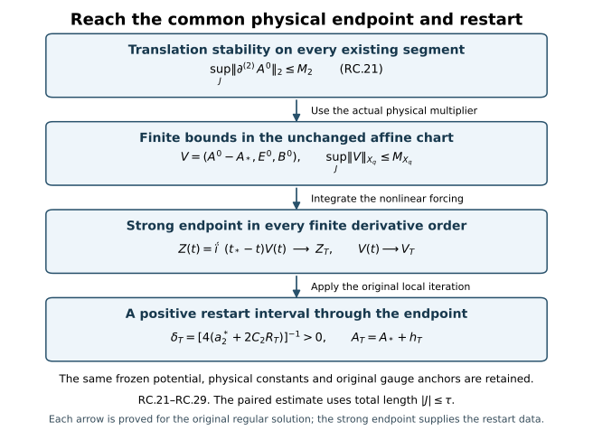

# A common existence interval for regular initial data

An estimate for existing solutions becomes an existence theorem only
after proving that the solutions reach its calculated endpoint. This
chapter completes that argument. It constructs the auxiliary heat flow
for the actual affine connection space, uses translation stability to
bound a second spatial derivative, and obtains a strong endpoint at
which the original local iteration restarts.

Read [the regular affine local construction](../classical-regular-restart.html),
[initial-data stability](../classical-initial-data-stability.html),
and [smooth constrained approximation](../classical-constrained-approximation.html).
The heat arguments use the [heat construction](../classical-heat-construction.html),
[caloric gauge](../classical-caloric-gauge.html),
[curvature estimates](../classical-heat-analysis.html), and
[dynamic heat extension](../classical-dynamic-heat.html).
The [original physical bound](../classical-uniform-difference.html#eq-UD-4a)
includes the actual static gauge. Equation prefixes in this chapter
refer to those complete proofs.

The norm \(H_\ell^q\) always means the exact Fourier-weighted norm
in RC.1. Membership in every finite-order space means that each
specified derivative is square-integrable. The potential itself remains
in its original \(L^6\) representative.

The four implications are proved in RC.21–RC.27. Higher initial
derivative norms enter the bounds, but do not determine the common
initial-data interval RC.3.

## 1. The precise data, interval, and common constants

Keep the original physical coordinates, metric
\(\operatorname{diag}(-c^2,1,1,1)\), speed \(c>0\), length
\(\ell>0\), heat endpoint \(S>0\), horizon \(H>0\), reference
physical time \(t_*\), and closed matrix group in its fixed unitary
representation. Every derivative and output tuple below is the full
ordered tuple, with Hilbert--Schmidt matrix norm. Define

\[
\begin{aligned}
\|f\|_{H_\ell^q}^2
 &=\frac1{(2\pi)^3}\int(1+\ell^2|\xi|^2)^q
                         |\widehat f(\xi)|^2\,d^3\xi
 =\sum_{j=0}^q{q\choose j}\ell^{2j}\|\partial^{(j)}f\|_2^2,\\
\|(h,E,B)\|_{X_q}^2
 &=\ell^{-2}\|h\|_{H_\ell^q}^2
          +c^{-2}\|E\|_{H_\ell^q}^2+\|B\|_{H_\ell^q}^2.
\tag{RC.1}
\end{aligned}
\]

The regular original initial data satisfy

\[
\begin{gathered}
A_*=A^0(t_*)\in L^6,\qquad
\partial A_*\in\bigcap_{q\ge0}H_\ell^q,\qquad
E_*\in\bigcap_{q\ge0}H_\ell^q,\\
B_* =\mathscr B(A_*)\in\bigcap_{q\ge0}H_\ell^q,\qquad
\mathscr G(A_*,E_*)=0,\\
\mathscr B(A)_i=\sum_{j,k}\epsilon_{ijk}\partial_jA_k
             +\frac12\sum_{j,k}\epsilon_{ijk}[A_j,A_k],\qquad
\mathscr G(A,E)=\sum_i(\partial_iE_i+[A_i,E_i]),\\
d^2=c^{-2}\sum_i\|E_{*,i}\|_2^2+\|B_*\|_2^2
 =c^{-2}\sum_i\|E_{*,i}\|_2^2+\sum_{i<j}\|F_{ij}(A_*)\|_2^2
 =\frac{g_{\rm YM}^2}{\hbar c}\mathcal E_{\rm YM},\qquad
\epsilon_{123}=1.
\tag{RC.2}
\end{gathered}
\]

The finite magnetic curvature condition is a separate datum. No \(L^2\)
norm of \(A_*\) is imposed. The affine chart is exactly
\(V=(h,E,B)\mapsto(A_*+h,E,B)\), with inverse
\((A,E,B)\mapsto(A-A_*,E,B)\). Its regular constrained datum is
\(V_*=(0,E_*,B_*)\).

For a bounded set of such data, fix common upper bounds for
\(\|\partial A_*\|_2\) and d, and use the original common reference
radius and original S satisfying the heat-construction conditions in
CP Section 1. Evaluate CP.46--CP.49 using common individual majorants
in both of its solution slots. Thus the same evaluation applies to
any pair in the set and to either member and any of its actual spatial
translates. It gives the explicit positive number

\[
\tau=\begin{cases}
\min(H,\tau_{\rm ind}),&L=0,\\
\min(H,\tau_{\rm ind},(2L)^{-2}),&L>0,
\end{cases}
\quad L=\nu+\mu(1+b),\quad \mu=2cK,
\quad C_\rho=2\{(b+\nu\sqrt\tau)i+a\}.
\tag{RC.3}
\]

Here every letter on the right is the exact finite arithmetic
evaluation in CP, including both original heat/time anchors and the
ell-weighted nine-wave-norm sum. Common majorants are necessary: a
coefficient evaluated for two unequal individual bounds must not be
silently reused for a translated pair with a larger second bound.
Using the common evaluation in RC.3 is precisely CP's bounded-family
choice. It makes no further reduction of S.

The target is any original closed physical interval
\(J_0=[t_*-T_-,t_*+T_+]\), where \(T_\pm\ge0\) and
\(T_-+T_+\le\tau\). We prove that the regular solution exists on
an open interval containing \(J_0\). Higher initial norms affect the
regular restart size in the proof; they do not affect the common
length RC.3.

## 2. The affine heat-domain operation needed before applying CP

HD.2 states its dynamic theorem with the spatial potential itself in
every inhomogeneous Sobolev space. RC.2 does not assert that condition.
The following construction proves the missing domain extension.
It concerns auxiliary heat existence for a given regular physical
curve, and does not assume that the physical curve already continues.

For a spatial connection F in \(L^6\) with \(\partial F\in H_\ell^\infty\),
retain the exact maps

\[
Q(X,Y)_i=\sum_j\{2[X_j,\partial_jY_i]-[X_j,\partial_iY_j]\},
\qquad C(X,Y,Z)_i=\sum_j[X_j,[Y_j,Z_i]],
\qquad N(X)=Q(X,X)+C(X,X,X).
\tag{RC.4}
\]

The DeTurck equation for \(D=F+v\) is the actual affine equation

\[
v_s=\Delta v+F_0+N(F+v)-N(F),\qquad
F_0=\Delta F+N(F),\qquad v(0)=0.
\tag{RC.5}
\]

Each \(F_0\) belongs to every \(H_\ell^q\). Indeed F is bounded by homogeneous
Morrey, every positive derivative is in \(\bigcap_{q\ge0}H_\ell^q\), the quadratic
term has one such derivative, and the undifferentiated cubic is in
\(L^2\) by three \(L^6\) factors. At positive derivative order put one
differentiated factor in \(L^2\) and all other factors in \(L^\infty\).
The complete Leibniz sums prove every stated finite order.

Here are explicit local contraction constants. For \(r\ge2\) use the
actual multiplier from RI.7

\[
K_r(F)=\left[\sum_{j=0}^r{r\choose j}
 \left(\sum_{l=0}^j{j\choose l}
 \frac{\ell^l\|\partial^{(l)}F\|_\infty}
                        {\sqrt{{r\choose j-l}}}\right)^2\right]^{1/2},
\quad k_{r,\ell}=2^{r-1}b_\ell,
\quad b_\ell=\frac{\pi}{(2\pi)^{3/2}\ell^{3/2}}.
\tag{RC.6}
\]

The proof of this multiplier only uses bounded derivatives of F,
not its \(L^2\) norm: partition the ordered derivative positions, put the
F factor in \(L^\infty\) and the other in \(L^2\), then take the weighted
Euclidean sum RC.1. It applies equally to either matrix order and to
the full tuple \(\partial F\).

Fix \(q\ge3\), put r=q-1, \(\gamma_Q=18\sqrt3\),
\(\gamma_C=12\sqrt3\), and let v,w lie in an \(H_\ell^q\) ball of radius R>0.
The complete two quadratic and three cubic difference placements give

\[
\begin{aligned}
\|N(F+v)-N(F+w)\|_{H_\ell^{q-1}}
 &\le\Lambda_q(R)\|v-w\|_{H_\ell^q},\\
\Lambda_q(R)
 &=\gamma_Q\{K_r(\partial F)+\ell^{-1}K_r(F)\}
   +2(36\sqrt3 k_{r,\ell}/\ell)R
   +3\gamma_C\{K_r(F)+2k_{r,\ell}R\}^2.
\tag{RC.7}
\end{aligned}
\]

For Q with one frozen factor, its derivative is either on F or on
v-w, giving the first brace. The two factors from the ball give the
second term by HC.4 at order q-1. Expand each of the three cubic
placements into its frozen and variable slots. Multiplication by F
costs \(K_r(F)\); multiplication by a ball element costs 2krR by F9.13.
The four matrix products of a nested bracket, its three spatial
indices and the full output triangle give \(\gamma_C\) for each placement.
This gives exactly the last square. The same component counting
gives \(\gamma_Q\) for the frozen quadratic terms. These upper constants
retain every original summand and matrix order.

Let \(D_q=\Lambda_q(R)+\|F_0\|_{H_\ell^{q-1}}/R\) and choose

\[
\eta=\min\{(8D_q)^{-1},\ e/(128\ell^2D_q^2)\},\qquad
J_\ell(\eta)=\eta+\ell\sqrt{2\eta/e},\qquad
D_qJ_\ell(\eta)\le\tfrac14.
\tag{RC.8}
\]

\(D_q\) is positive for R>0. The Duhamel map for RC.5, with its unchanged
heat kernel, maps the radius-R ball into radius R/4 and has Lipschitz
factor at most 1/4, by HC.6 and RC.7. More generally an initial affine
increment v0 of norm at most R/2 gives radius at most 3R/4. Completeness
and geometric iteration construct the solution. The heat multiplier
and its integrable endpoint tail prove continuity in \(H_\ell^q\) and the
equation in \(H_\ell^{q-2}\), exactly as HC.9--HC.12. Thus this is a constructed
local affine solution. Its potential lies in the original \(L^6\)
representative F+\(H_\ell^q\). The original group and Lie algebra are preserved.

We next prove regularity on the common gradient-controlled heat
interval HG.5, rather than let its lifespan decrease with q. Write
\(g_j=\|\partial^{(j)}D\|_2\) for j>=1 and define

\[
\mathcal L_0=(2\pi)^{-3}\int|\widehat D(\xi)|\,d^3\xi,
\quad\mathcal L_1=(2\pi)^{-3}\int|\xi||\widehat D(\xi)|\,d^3\xi,
\quad C_F=\frac{2\sqrt{4\pi}}{(2\pi)^{3/2}}.
\tag{RC.9}
\]

These Fourier integrals exist for the current regular affine solution.
To justify the Fourier representative without an \(L^2\) potential,
\(i\xi_j\widehat D\) is the \(L^2\) transform of its gradient. Away from
zero this determines a measurable \(\widehat D\), with
\(|\xi|\widehat D\) in \(L^2\). The Cauchy--Schwarz estimates below
make it locally integrable at zero and integrable at infinity. The
inverse transform has the same gradient as D; their difference is a
constant distribution. Approximation by frequency annuli and the
homogeneous Sobolev inequality put this inverse transform in \(L^6\), so
that constant is zero. This identifies the actual \(L^6\) representative.
Splitting the integral at an arbitrary physical frequency radius r>0
gives

\[
\begin{aligned}
\mathcal L_0&\le\frac{\sqrt{4\pi}}{(2\pi)^{3/2}}
                        (r^{1/2}g_1+r^{-1/2}g_2),\qquad
\mathcal L_0\le C_F\sqrt{g_1g_2},\\
\mathcal L_1&\le C_F\sqrt{g_2g_3}.
\tag{RC.10}
\end{aligned}
\]

For the last bound in the first line choose r=\(g_2/g_1\) when both are
positive; if either is zero the original \(L^6\)/\(L^2\) derivative conditions
give D=0. The second line applies the identical split to its full
gradient. The integrals used are exactly
\(\int_{|\xi|\le r}|\xi|^{-2}d^3\xi=4\pi r\) and
\(\int_{|\xi|>r}|\xi|^{-4}d^3\xi=4\pi/r\).
The frequency split does not change a coordinate or field.

For \(n\ge1\) the convolution formula and
\(|\xi+\zeta|^n\le2^{n-1}(|\xi|^n+|\zeta|^n)\), together
with its three-frequency version, prove

\[
\begin{aligned}
\|\partial^{(n)}Q(D,D)\|_2
 &\le\gamma_Q2^{n-1}(\mathcal L_0g_{n+1}+\mathcal L_1g_n),\\
\|\partial^{(n)}C(D,D,D)\|_2
 &\le\gamma_C3^n\mathcal L_0^2g_n,\\
\|N(D)\|_2&\le\gamma_Q\mathcal L_0g_1
                                      +\gamma_CC_S^3g_1^3,
\qquad C_S=4/\sqrt3.
\tag{RC.11}
\end{aligned}
\]

For the first line the differentiated second factor also has its
original one derivative, giving \(g_{n+1}\) in one term and the Fourier
L1 gradient in the other. In the cubic each of the three high-frequency
placements is kept. The constants \(\gamma_Q\),\(\gamma_C\) bound the original
component sums as in RC.7. Parseval identifies the full ordered
n-tuple multiplier exactly with |xi|^n; no subset of derivative words
has been selected.

The affine solution belongs to HG's gradient energy space on its
initial local interval: its high regularity, \(L^6\) representative and
RC.5 imply that the forced term is in C \(L^2\), so the HC mild identity
also holds in the homogeneous gradient space. Its uniqueness there
identifies it with HC.23--HC.31's constructed gradient-space solution.
Consequently, on every existing subinterval of the common HG.5 heat
length, HG.5 and HG.9--HG.11 give the same bounds \(X\le R_g\),
\(Y\le Y_g\), where \(R_g\) and \(Y_g\) are HG's explicit constants.
Their derivative energy proofs involve only gradients, \(L^6\) and the
displayed products, so remain valid on this affine solution.

Suppose a regular endpoint \(s_\dagger\le S_{R_g}\) occurs. Fix an
existing \(0<\varepsilon<s_\dagger\). On
\([\varepsilon,s_\dagger)\), put

\[
\begin{aligned}
D_0&=C_F^2R_g^2\sqrt{S_{R_g}},\qquad
D_1=C_F^2Y_g^2\sqrt{S_{R_g}}/\varepsilon,\qquad
D_{00}=C_F^4R_g^4,\\
\int\mathcal L_0^2&\le D_0,\qquad
\int\mathcal L_1^2\le D_1,\qquad
\int\mathcal L_0^4\le D_{00}.
\tag{RC.12}
\end{aligned}
\]

The first bound uses \(g_1\le R_g\) and
\(\int g_2\le\sqrt{S_{R_g}}R_g\). The second uses
\(\sup g_2\le Y_g/\sqrt\varepsilon\) and
\(\int g_3\le\sqrt{S_{R_g}}Y_g/\sqrt\varepsilon\).
The third uses \(\int g_2^2\le R_g^2\). All integral domains
in RC.12 are the stated original heat segment.

Pair the differentiated equation with
\(-\Delta\partial^{(m-1)}D\), for \(m\ge2\), and use Young with its
two equal coefficients. The exact Laplacian norm is \(g_{m+1}\) by
Parseval. RC.11 gives

\[
\begin{aligned}
\frac d{ds}g_m^2+g_{m+1}^2
 &\le2A_m^2g_m^2+2B_m^2g_{m-1}^2,\\
A_m&=\gamma_Q2^{m-2}\mathcal L_0,\qquad
B_m=\gamma_Q2^{m-2}\mathcal L_1
                           +\gamma_C3^{m-1}\mathcal L_0^2,\\
H_1&=R_g^2,\\
H_m&=\{g_m(\varepsilon)^2+
 [4\gamma_Q^2 4^{m-2}D_1+4\gamma_C^2 9^{m-1}D_{00}]H_{m-1}\}
                         \exp(2\gamma_Q^24^{m-2}D_0),\\
\sup_{\varepsilon\le s<s_\dagger}g_m(s)^2&\le H_m.
\tag{RC.13}
\end{aligned}
\]

Induction and the scalar integrating-factor proof give every finite
\(H_m\). The term containing a fixed initial higher derivative remains
explicit; this argument claims a common existence length, not a
bound on all those derivatives by the gradient alone.

This energy argument also supplies the required common regularity
interval, without intersecting a sequence of possibly shrinking
construction intervals. First construct the q=3 affine solution by
RC.8. For each fixed q>3 construct its \(H_\ell^q\) solution for its own
positive initial interval; uniqueness of the q=3 construction identifies
the two there. The low X,Y bounds on their overlap are the same
gradient-space bounds above. To justify RC.13 at the highest existing
order m=q, apply a smooth Fourier cutoff to the equation, pair its
full differentiated tuple and integrate first. Its forcing is in
\(H_\ell^{q-1}\), controlled by RC.11 and the existing \(H_\ell^q\) increment. Pass to
the limit in the lower terms by strong convergence, and in the
nonnegative highest-derivative integral by lower semicontinuity.
Thus no unconstructed q+1 derivative is assumed in RC.13. That
estimate bounds every order through q up to a possible endpoint of
this \(H_\ell^q\) solution inside the q=3 interval. The following strong
endpoint argument, at that same finite q, restarts it and contradicts
such an endpoint. Each q therefore persists on the entire q=3
interval. The limits under inclusions agree by uniqueness. Applying
the same argument to q=3 up to the common gradient-controlled
endpoint proves the claimed common interval for all q. The heat
equation at successively larger finite q then supplies every heat
derivative.

The actual affine increment is also bounded and Cauchy in \(L^2\) at this
endpoint, since

\[
\|D(s)-D(u)\|_2
 \le\int_u^s\{g_2+\gamma_Q\mathcal L_0g_1
                                  +\gamma_CC_S^3g_1^3\}\,dr.
\tag{RC.14}
\]

All terms are integrable on the original common heat interval. Together
with RC.13 this bounds D-F in every \(H_\ell^q\). Its affine Duhamel formula has
a strong \(H_\ell^q\) endpoint: the last heat segment has norm bounded by
\(J_\ell(2\delta)\) times a uniform \(H_\ell^{q-1}\) forcing norm, while its
earlier part converges by strong heat-semigroup continuity. The higher
derivative bounds just proved supply that uniform forcing norm. The
endpoint lies in the same affine chart, and RC.8 restarts it; uniqueness
identifies the overlapping solution. This contradicts the supposed
endpoint. Hence the regular affine solution exists throughout HG's
same common heat interval.

The caloric gauge equation
\(V_s=V\operatorname{div}D\), \(V(0)=I\), has
\(V-I\in H_\ell^\infty\) on compact heat intervals, since
\(\operatorname{div}D\in H_\ell^\infty\). Its unitary ODE and
finite derivative recursions are the original HC/HG construction.
The caloric connection \(C_i=VD_iV^{-1}-(\partial_iV)V^{-1}\)
is in F+\(\bigcap_{q\ge0}H_\ell^q\): expand its affine difference into
\(V(D-F)V^{-1}\), \((V-I)FV^{-1}\),
\(F(V^{-1}-I)\), and the displayed differentiated gauge term.
RC.6 controls the frozen F products. This also proves \(L^6\) membership
and every positive derivative. Two such caloric solutions with the
same original initial connection have an actual difference e in
\(\bigcap_{q\ge0}H_\ell^q\), because their affine increments share that base. Hence
the \(L^2\) identity HG.39 is valid for e, and HG.40 gives exactly

\[
\frac d{ds}\|e\|_2^2\le
\{2\|e\|_\infty^2+4\sqrt2\|F^{\widetilde C}\|_\infty\}\|e\|_2^2.
\]

The coefficient is bounded on each compact regular heat interval;
the zero initial value and integrating factor give e=0. This is the
actual caloric uniqueness domain used here, including after a restart.

For the remaining global spatial heat argument require, separately,
that the original magnetic curvature belongs to \(L^2\). This is precisely
the condition in RC.2 and holds at each regular physical time by the
original conserved curvature energy.
The spatial curvature energy and covariant heat estimates used in
HD.3--HD.9 remain valid on this class for the following precise reason.
Bianchi and the spatial heat equation give H9.32's actual identity

\[
\frac12\sum_{i<j}\|F_{ij}(s_2)\|_2^2
 +\int_{s_1}^{s_2}\sum_i\|G_i(s)\|_2^2\,ds
 =\frac12\sum_{i<j}\|F_{ij}(s_1)\|_2^2.
\]

Its cutoff error is bounded by
\(2M_\chi R^{-1}\int\sum_{i,j}\|F_{ij}\|_2\|G_j\|_2\,ds\),
which tends to zero. Curvature and its covariant derivatives belong
to \(\bigcap_{q\ge0}H_\ell^q\) because the curvature is initially in \(L^2\), every positive connection
derivative is in \(\bigcap_{q\ge0}H_\ell^q\), and the connection is bounded. The
weighted covariant energy calculation H9.42, product bounds H9.44,
continuity argument H9.45 and higher-order induction H9.46--H9.47
therefore apply with exactly their original terms: each uses only
these curvature derivatives, their covariant Sobolev bounds and the
zero weighted higher-order initial term. No potential \(L^2\) norm enters
that proof. Thus the stronger domain statement follows by applying
the verified calculations, not by overlooking H9's stated domain.

Retain its constants

\[
\begin{gathered}
e_*=2+\sqrt2,\quad K_0=12\sqrt6 C_S^{3/2},\quad
K_1=36\sqrt{18}C_S^{3/2},\quad a_*=e_*(1+e_*),\\
b_*=e_*\{(1+e_*)K_0+K_1\},\quad
\varepsilon_*=(8a_*b_*)^{-1},\quad R_1=2a_*,\\
Q_2=12\sqrt{6\,3^2}\{4C_MC_SR_1^2+3C_S^{3/2}R_1^2\},
\qquad R_2=e_*(\sqrt2R_1+Q_2\varepsilon_*).
\end{gathered}
\]

For dmag>0 put \(\Theta=(\varepsilon_*/(2d_{\rm mag}))^4\).
On any existing segment with endpoint at most Theta, HD.6--HD.9
now gives, for any fixed existing \(s_0\)>0,

\[
\begin{aligned}
\|C(s)\|_6&\le M_6:=\|C(s_0)\|_6
                    +\sqrt6 C_SR_2d_{\rm mag}\log(\Theta/s_0),\\
\|\partial C(s)\|_2
 &\le\|\partial C(s_0)\|_2+\sqrt6R_2d_{\rm mag}\log(s/s_0)\\
 &\quad+8\sqrt6 C_S^{1/2}\sqrt{R_1R_2}d_{\rm mag}M_6
                               (s^{1/4}-s_0^{1/4}).
\end{aligned}
\]

Here \(d_{\rm mag}^2=\sum_{i<j}\|F_{ij}(C(0))\|_2^2\).
Choose \(R_g\) with \(R_g\)/4 larger than that full gradient supremum, including
the already regular initial segment before \(s_0\).
The common affine heat interval just proved restarts from interior
regular times approaching a possible endpoint, with length S(\(R_g\))
independent of their higher derivatives. This proves continuation
through Theta. Magnetic energy decreases, so finitely many repetitions
reach the prescribed original S. For zero magnetic curvature the
original connection is stationary in heat time, and uniqueness proves
the same conclusion. This constructs global regular spatial heat
flow in the affine domain needed here.

## 3. Physical parameter derivatives and the original time component

On a compact part of an existing regular physical solution,
\(A^0(t)=A_*+h(t)\) with \(h\in C^\infty_tH_\ell^\infty\),
by RI.12--RI.15. Freeze the spatial base F at one physical time t0.
In a neighbourhood of t0 the initial increment
\(v_0(t)=A^0(t)-F\) is a smooth \(H_\ell^q\) curve of norm at most R/2.
RC.8 gives a common contraction. Its derivative is
\(I-\mathcal K DN(F+v)\), whose inverse is its convergent geometric
series with norm at most 4/3. The exact first-order remainder is

\[
\begin{aligned}
N(D+H)-N(D)-DN(D)[H]
={}&Q(H,H)+C(H,H,D)+C(H,D,H)\\
&+C(D,H,H)+C(H,H,H).
\tag{RC.15}
\end{aligned}
\]

RC.6--RC.7 bound this by a finite constant times
\(\|H\|_{H^q}^2+\|H\|_{H^q}^3\), in \(H_\ell^{q-1}\).
Subtracting the two fixed-point equations gives Lipschitz dependence
on v0; hence H=O(|h|) for a physical-time increment h. Dividing the
remainder by h makes it tend to zero, so the actual first derivative
exists. The resolvent identity proves its continuity. Repetition gives

\[
\begin{aligned}
D^{(m)}&=(I-\mathcal K DN(D))^{-1}
       \{H_s(A^0)^{(m)}+\mathcal K P_m\},\qquad m\ge1,\\
P_m&=\sum_{k=1}^{m-1}{m\choose k}Q(D^{(k)},D^{(m-k)})\\
&\quad+\sum_{\substack{k+l+n=m\\0\le k,l,n\le m-1}}
                  \frac{m!}{k!l!n!}C(D^{(k)},D^{(l)},D^{(n)}).
\tag{RC.16}
\end{aligned}
\]

Here the superscript denotes the actual physical-time derivative;
D^(0)=D. The full lower sums and their original factor order are
retained. The terms with the highest derivative form DN(D), and
all other terms involve previously constructed derivatives. Finite
heat-block covering, endpoint evaluation and uniqueness propagate
these derivatives throughout the original \([0,S]\), as in HD.16--HD.17.
The gauge derivative satisfies the same full binomial ODE HD.17.
Therefore the caloric spatial connection satisfies
\(C_i(t,s)-A_i^0(t)\in C^\infty_tH_\ell^\infty\), and all its
positive physical-time derivatives belong to \(\bigcap_{q\ge0}H_\ell^q\).

Construct its actual time component U=\(C_t\), with original value U(t,0)=0,
from the exact equation

\[
\begin{aligned}
(\partial_s-\Delta)U&=\mathcal L_CU+\mathcal F_C,\\
\mathcal L_CU&=\sum_j\{2[C_j,\partial_jU]
             +[\partial_jC_j,U]+[C_j,[C_j,U]]\},\\
\mathcal F_C&=-\sum_j\{\partial_j\partial_tC_j
                                      +[C_j,\partial_tC_j]\}.
\tag{RC.17}
\end{aligned}
\]

No \(L^2\) potential norm is required for its bounded coefficients. For
\(q\ge3\) and r=q-1, RC.6 gives the explicit replacements for HD.19:

\[
\begin{aligned}
\|\mathcal L_CU\|_{H_\ell^{q-1}}&\le L_q^{\rm aff}U_q,\qquad
U_q=\|U\|_{H_\ell^q},\\
L_q^{\rm aff}&=12\ell^{-1}K_r(C)+6K_r(\partial C)+12K_r(C)^2,\\
\|\mathcal F_C\|_{H_\ell^{q-1}}
 &\le(\sqrt3\ell^{-1}+6K_r(C))
                              \|\partial_tC\|_{H_\ell^q}.
\tag{RC.18}
\end{aligned}
\]

The three spatial sums and bracket factor two give respectively
12,6,12 in the operator; the contracted derivative has factor sqrt3
and the three forcing brackets have coefficient six. These constants
are finite on every compact physical/heat rectangle by the preceding
construction. Using their uniform bounds L,F, take
\(\eta=\min((4L)^{-1},e/(32\ell^2L^2))\) when L>0.
Then \(LJ_\ell(\eta)\le1/2\). The linear affine Duhamel map is a
contraction on the whole continuous \(H_\ell^q\) path space on each heat block,
and its nth-block bound is exactly
\(2^nU_q(0)+2J_\ell(\eta)F(2^n-1)\). If L=0 the forced heat
formula supplies the solution directly. Finitely many blocks reach S.
The full derivative equations HD.22--HD.23 apply with these proved
affine multiplier bounds: their lower-order forcings are in \(H_\ell^{q-1}\),
the inverse on each block has norm at most two, and the same
difference-quotient remainder argument proves each derivative.
This constructs \(C_t\in C^\infty_tH_\ell^\infty\) and joint heat
regularity, rather than presuming an affine version of HD.2.

Substitution in the curvature identities proves the actual electric
heat equation HD.24. The zero-data difference energy HD.25 and the
time-component uniqueness HD.26 are valid in \(\bigcap_{q\ge0}H_\ell^q\) and identify
this connection with any existing dynamic caloric extension having
the same original initial field. Thus the old and extended auxiliary
fields will coincide wherever both exist.

## 4. The actual affine physical construction and the Hessian receiver

RI.5--RI.11 constructs the original physical local solution in the
chart RC.1--RC.2. Its equations are

\[
\partial_tA^0=E^0,\qquad
\partial_tE^0=-c^2(\operatorname{curl}B^0+\beta(A^0,B^0)),\qquad
\partial_tB^0=\operatorname{curl}E^0+\beta(A^0,E^0),
\quad\beta(A,f)_i=\sum_{j,k}\epsilon_{ijk}[A_j,f_k].
\tag{RC.19}
\]

With V=(\(A^0\)-\(A_*\),E0,B0), its exact Fourier group has RI.6's isometry
on \(X_q\). The frozen linear term R* contains both products with \(A_*\),
bounded by RC.6. The constants and nonlinear tame bound are

\[
\begin{aligned}
L_q&=24c\ell\,2^{q-1}b_\ell,\quad C_2=96c\ell b_\ell,
\quad a_q^*=c/\ell+12cK_q(A_*),\\
\|N_*(V)\|_{X_q}
 &\le(a_q^*+2L_q\|V\|_{X_2})\|V\|_{X_q},
\quad N_*(V)=SV+Q(V,V)+R_*V.
\tag{RC.20}
\end{aligned}
\]

RI.10's contraction with ratio 1/4 proves local existence; RI.11
proves uniqueness on every overlap, not just on its construction
ball. Taking the union of all such intervals constructs the maximal
affine \(X_2\) solution. RI.12--RI.15 proves persistence of all its original
regular data on every compact subinterval. No finite endpoint is
assumed to be a restart datum at this stage.

Sections 2--3 construct its original dynamic heat extension on each
such compact subinterval. The original anchor is fixed, as specified
in Section 6 below, so CP now applies on each existing compact interval
containing \(t_*\) of length at most \(\tau\). Translations preserve both data
bounds in RC.3 and both constraints. CP.55 therefore gives, for
j=1,2,3,

\[
\begin{aligned}
D_j^*&=\|\partial_j\partial A_*\|_2
                         +c^{-1}\|\partial_jE_*\|_2,\\
\sup_J\|\partial_j\partial A^0\|_2
       +c^{-1}\sup_J\|\partial_jE^0\|_2
 &\le C_\rho D_j^*,\\
\sup_J\|\partial^{(2)}A^0\|_2&\le
 M_2:=C_\rho\left(\sum_{j=1}^3(D_j^*)^2\right)^{1/2}.
\tag{RC.21}
\end{aligned}
\]

The last line sums all ordered outer derivative labels. It retains
the three initial cross terms inside the squares of Dj*. The proof
does not infer this bound from individual smoothed wave norms; it uses
the proved nonlinear translation comparison with its uniform common
constant. CP.52--CP.55 proves the difference-quotient limit in the
actual \(L^6\) representative.

Use \(M_1=R_{\rm orig}\) from UD.4a for the original physical
gradient bound; its constant includes the actual \(Q_0\) transformation
from FC's identity-anchored representative. This prevents identifying
those two representatives without their affine map. Thus on all
these compact intervals
\(\|\partial A^0\|_2\le M_1\) and
\(\|A^0\|_6\le C_SM_1\). Original curvature energy is d².
All constants \(M_1\),\(C_\rho\),\(\tau\) depend only on the common original data
radius and c,ell,S,H; \(M_2\) additionally retains the stated original
first electric derivative and second potential derivative.

## 5. Strong endpoints and a constructed continuation through the target

Retain the exact Morrey constant
\(C_M=2\sqrt{(4\pi/3)^{-1/6}(4\pi)^{-1}(20\pi/3)^{5/6}}\).
The full product estimate RI.30--RI.31 gives, for the actual field \(A^0\),

\[
\begin{aligned}
K_{\rm mix}(A^0)
 &=\|A^0\|_\infty+2C_S\|\partial A^0\|_3
                                  +\ell^2b_\ell\|\partial^{(2)}A^0\|_2\\
 &\le K_*:=(C_MC_S+2C_S^{3/2})\sqrt{M_1M_2}
                                         +\ell^2b_\ell M_2,\\
\|A^0f\|_{H_\ell^2},\ \|fA^0\|_{H_\ell^2}
 &\le K_{\rm mix}(A^0)\|f\|_{H_\ell^2}.
\tag{RC.22}
\end{aligned}
\]

For completeness its second derivative has both mixed placements:

\[
\partial^{(2)}(Af)=A\partial^{(2)}f+
(\partial A)(\partial f)+(\partial A)(\partial f)+
(\partial^{(2)}A)f
\]

, with the two distinct ordered tensors.
Their \(L^3\text{–}L^6\) bounds cost \(2C_S\); the last \(L^2\text{–}L^\infty\) product costs
\(b_\ell\). Weight the orders 0,1,2 by \(1,\sqrt2\ell,\ell^2\) and take their
Euclidean norm to get exactly RC.22. Morrey and \(L^2\)-\(L^6\) interpolation
give its first line's upper bound \(K_*\). This verifies the RI receiver
in the original affine domain and units: \(K_*\) has inverse-length unit.

Group the existing nonlinear equation exactly as
\(V_t=LV+SV+R_{A^0(t)}V\). This identity retains the actual evolving
\(A^0\); it does not prescribe a new coefficient problem. Its two weighted
curvature blocks cost \(12cK_{\rm mix}\|V\|_{X_2}\). The mild
equation and the scalar integrating factor therefore give

\[
\begin{aligned}
\sup_{J}\|V(t)\|_{X_2}
 &\le M_{X_2}:=\|V_*\|_{X_2}
                   \exp\{\tau(c/\ell+12cK_*)\},\\
\sup_J\|V(t)\|_{X_q}
 &\le M_{X_q}:=\|V_*\|_{X_q}
              \exp\{\tau(a_q^*+2L_qM_{X_2})\},\qquad q\ge2.
\tag{RC.23}
\end{aligned}
\]

The first estimate is equivalently RI.33 with
\(N_2(J)\le|J|M_2\), now proved by RC.21. The second is RI.12
with its actual \(X_2\) integral. Both hold on every existing compact
initial segment of length at most \(\tau\). Every higher initial \(X_q\) norm
is explicitly retained. The exponential arguments are dimensionless.

Suppose the maximal forward endpoint T satisfies
\(0<T-t_*\le\tau\). Increasing compact intervals to T preserves
the same constants in RC.23. Let \(\mathcal U(t)\) be the actual
linear Fourier isometry of RI.6 and put
\(Z(t)=\mathcal U(t_*-t)V(t)\). The mild identity gives

\[
\begin{aligned}
Z(t)-Z(u)&=\int_u^t\mathcal U(t_*-r)N_*(V(r))\,dr,\\
\|Z(t)-Z(u)\|_{X_q}
 &\le(a_q^*+2L_qM_{X_2})M_{X_q}|t-u|,\\
Z_T&=\lim_{t\uparrow T}Z(t)\text{ in }X_q,
\qquad V_T=\mathcal U(T-t_*)Z_T,\qquad
V(t)\longrightarrow V_T\text{ in }X_q.
\tag{RC.24}
\end{aligned}
\]

Completeness constructs the limit. Strong continuity and norm one
of the actual group prove the final convergence. The \(X_q\) endpoint
limits agree under their continuous inclusions, since each is the
limit of the same \(X_2\) path. Thus \(V_T\) belongs to every finite \(X_q\).
Passing the norm-integrable mild equation to T gives

\[
V(t)=\mathcal U(t-T)V_T
                  +\int_T^t\mathcal U(t-r)N_*(V(r))\,dr.
\tag{RC.25}
\]

The potential endpoint is exactly \(A_T=A_*+h_T\) in the same chart,
and \(A(t)-A_T\) converges in every \(H_\ell^q\) although neither potential is
required to be \(L^2\). Sobolev gives its \(L^6\) convergence; its positive
derivatives and both E,B converge strongly in every finite required
Sobolev space. In particular

\[
B_T=\mathscr B(A_T),\quad\mathscr G(A_T,E_T)=0,
\qquad c^{-2}\|E_T\|_2^2+\|B_T\|_2^2=d^2.
\tag{RC.26}
\]

The curvature products pass to the limit by the fixed-base multiplier
RC.6 and the \(H_\ell^2\) product estimate for the increments. The Gauss
products use the same maps with E. The energy equality uses strong
convergence of the joint weighted E,B tuple, not separate weak lower
bounds. Thus no energy defect remains at this endpoint.

Now construct, rather than assume, the restart. Keep the same frozen
\(A_*\), let \(m_*=\ell^{-1/2}>0\), and set

\[
M_0=\max(m_*,\|V_T\|_{X_2}),\quad R_T=2M_0,\quad
\delta_T=[4(a_2^*+2C_2R_T)]^{-1}>0.
\tag{RC.27}
\]

RI.10's actual iteration at time T and datum \(V_T\) maps its radius-\(R_T\)
ball into radius 3RT/4 and has difference ratio 1/4. This proves a
solution on \([T-\delta_T,T+\delta_T]\). Its backward branch and RC.25 share
the same \(X_2\) endpoint and satisfy the same oriented mild equation.
RI.11 backward from T gives zero difference on their overlap.
Additivity of the oriented integral then proves the equation on the
joined interval. The affine chart, potential representative, c and
ell have not changed. The defect equations
\(K_t=0\), \(\mathscr G_t=c^2\sum_k[K_k,B_k]\),
\(K=B-\mathscr B(A)\), retain the signs in RI.16 and propagate
RC.26 through the restart. RI.12 gives all finite spatial orders on
the new \(X_2\) interval. Its exact temporal recursion RI.15 retains all
ordered binomial placements and supplies all physical-time orders.
The joined solution is therefore the original regular Yang--Mills
solution, contradicting maximality at T.

This contradiction also applies to equality T-\(t_*\)=\(\tau\). The backward
endpoint argument uses the same group, the absolute interval lengths
and the oriented integral; it does not reverse a sign in RC.19.
Consequently the maximal regular interval contains an open
neighbourhood of \([t_*-\tau,t_*+\tau]\), and in particular of
every target \(J_0\) with total length at most \(\tau\). The CP comparison is
asserted on \(J_0\), whose full length satisfies its hypothesis; the two
one-sided existence arguments do not assert a CP estimate on an
interval of total length \(2\tau\).

## 6. The unchanged heat endpoint and both original gauge anchors

Apply Sections 2--3 to the continued original temporal solution. On
every compact physical interval it produces its unique dynamic caloric
connection C on the original \([0,S]\), with \(C_s=0\),
\(C_i(t,0)=A_i^0(t)\) and \(C_t(t,0)=0\). The constructions on
overlapping physical intervals coincide by heat uniqueness. Hence
they define one extension of the actual previous auxiliary field.

At the original \(t_*\), retain the original DeTurck heat gauge
\(V_0(t_*,0)=I\), its entire original \([0,S]\) path, and
\(Q_0=V_0(t_*,S)\). Solve throughout the extended physical interval

\[
W_t=W C_t(t,S),\qquad W(t_*)=Q_0^{-1},\qquad W_s=0,
\qquad a=W\cdot C.
\tag{RC.28}
\]

The coefficient \(C_t(S)\) is smooth in every \(H_\ell^q\) by RC.17--RC.18.
The unitary integral ODE gives W in the original closed group.
Spatial derivatives follow its complete Leibniz recurrence; on each
compact interval Gronwall bounds \(W-I\) in every \(H_\ell^q\), since \(Q_0-I\) has that
property by the original heat ODE. Thus the ODE has no finite endpoint
inside that interval. Its affine connection formula is exactly

\[
\begin{aligned}
a_i&=WC_iW^{-1}-(\partial_iW)W^{-1},\qquad a_s=0,\\
a_t(t,s)&=W\{C_t(t,s)-C_t(t,S)\}W^{-1},\qquad a_t(t,S)=0,\\
a_i(t_*,S)&=A_i^{\rm DeTurck}(t_*,S),\qquad
U=Q_0^{-1}W^{-1},\quad U(t_*)=I,\quad U_t=U a_t(t,0),\\
A^0&=Q_0\cdot(U\cdot a(0)),\qquad
E^0=\operatorname{Ad}(Q_0U)E^a(0),\qquad
B^0=\operatorname{Ad}(Q_0U)B^a(0).
\tag{RC.29}
\end{aligned}
\]

For the U equation, differentiate its displayed definition and use
\(a_t(t,0)=-W C_t(t,S)W^{-1}\). Its initial value is the original
identity. Gauge composition gives \(Q_0U=W^{-1}\), proving every
reconstruction formula, including the differentiated affine term of
the potential. The endpoint identity uses the unchanged initial heat
ODE, so retains the actual original DeTurck anchor. ODE and heat
uniqueness identify these \(W,U,a\) with the previous fields on their
overlap; no identity gauge is assigned at the new physical endpoint.
All these fields and their derivatives have strong limits there by
their proved regularity. The primed solution uses its own original
\(V_0\)',\(Q_0\)',W',U' and the identical construction; its anchor is not replaced
by the unprimed one.

The extended original energy is unchanged, so the common heat
conditions in CP remain valid with the same S. Reapplying the proved
CP inequalities on the now-existing target \(J_0\) gives its full original
initial-data estimate, uniform translation modulus and one-extra-
derivative bounds throughout \(J_0\). This completes the regular interval
operation. Constructing an energy-regular solution from constrained
approximants and passing the equations to its limit remains the next
course calculation; it has not been substituted for this construction.

## 7. Worked example: a stationary connection outside \(L^2\)

Let \(T\ne0\) be a fixed skew-Hermitian generator, and define

\[
\theta(x)=\log(1+|x|^2/\ell^2),\qquad
A_{*,i}(x)=\frac{2x_i}{\ell^2+|x|^2}T
          =(\partial_i\theta)T,\qquad E_*=0.
\]

The full potential norm is
\(|A_*|^2=4|T|^2r^2/(\ell^2+r^2)^2\).
For \(r\ge\ell\), it lies between \(|T|^2/r^2\) and
\(4|T|^2/r^2\). Its \(L^2\) radial integral therefore diverges,
while its sixth-power radial integral is bounded by a constant times
\(\int_\ell^\infty r^{-4}\,dr\). At zero the field is smooth
and bounded. Thus \(A_*\in L^6\setminus L^2\).

The complete first derivative is

\[
\partial_j A_{*,i}
 =\left(\frac{2\delta_{ij}}{\ell^2+r^2}
        -\frac{4x_ix_j}{(\ell^2+r^2)^2}\right)T.
\]

It decays as \(r^{-2}\). Each further derivative is a finite sum
of derivatives of these two rational terms and decays at least as
\(r^{-2-k}\) at order \(k\) beyond the displayed derivative.
This follows inductively: differentiating a numerator lowers its
polynomial degree by one, while differentiating a denominator adds
one factor of \(x_j\) and one additional denominator power, also
lowering the net radial degree by one. All denominators are positive
at zero. Every positive derivative therefore belongs to \(L^2\).

Mixed derivatives of \(\theta\) commute, and \([T,T]=0\), so
the complete curvature is \(F_{ij}(A_*)=0\). Gauss law holds for
\(E_*=0\). The actual solution is

\[
A^0(t,x)=A_*(x),\qquad E^0(t,x)=B^0(t,x)=0.
\]

Every term of RC.19 vanishes. In the affine chart, \(V=0\), so
the endpoint and restart retain exactly the same non-square-integrable
potential. The caloric spatial flow is also stationary because
\(D^jF_{ji}=0\). Its physical energy is zero with the full physical
prefactor retained. This example checks why an \(L^2\) condition
on the potential would unnecessarily exclude admissible regular data.

## 8. Exercises with full solutions

### Exercise 1. The affine chart and its endpoint

Explain why \(V_T\in X_q\) gives a meaningful connection endpoint
even if \(A_*\notin L^2\).

**Solution.** The first component of \(V_T\) is an actual
\(h_T\in H_\ell^q\), with the fixed factor \(\ell^{-2}\)
in RC.1. Define \(A_T=A_*+h_T\). For \(q\ge2\), Sobolev
puts \(h_T\) in \(L^6\); hence \(A_T\in L^6\).
Its positive derivatives are the sums of the corresponding derivatives
of \(A_*\) and \(h_T\). If \(V(t)\to V_T\) in every \(X_q\),
then \(A(t)-A_T=h(t)-h_T\to0\) in every \(H_\ell^q\).
Neither summand \(A(t)\) nor \(A_T\) needs to be in \(L^2\).
The chart and its inverse are the exact addition and subtraction
operations stated after RC.2.

### Exercise 2. An actual affine contraction time

Verify \(D_qJ_\ell(\eta)\le1/4\) from RC.8 and recover
both the zero-increment and nonzero-increment ball estimates.

**Solution.** The first defining bound on \(\eta\) gives
\(D_q\eta\le1/8\). The second gives
\(D_q\ell\sqrt{2\eta/e}\le1/8\). Their sum is at most
\(1/4\). For \(\|v\|_{C H^q}\le R\), the affine forcing
has \(H^{q-1}_\ell\) norm at most
\(\|F_0\|_{H^{q-1}_\ell}+\Lambda_q(R)R=D_qR\).
Thus the heat integral has norm at most \(R/4\).
The difference of two such integrals has factor
\(\Lambda_q(R)J_\ell(\eta)\le1/4\).
Zero initial increment gives radius \(R/4\); an initial
increment of norm at most \(R/2\) adds a contracted free term
of at most \(R/2\), giving radius \(3R/4\).

### Exercise 3. The full Fourier coefficient

Derive \(\mathcal L_0\le C_F\sqrt{g_1g_2}\), with the
Fourier convention of RC.9.

**Solution.** Split at the physical frequency radius \(r>0\).
Cauchy–Schwarz gives the low-frequency factor \(\sqrt{4\pi r}\)
against \(\||\xi|\widehat D\|_2\), and the high-frequency
factor \(\sqrt{4\pi/r}\) against
\(\||\xi|^2\widehat D\|_2\). Parseval converts these two
norms to \((2\pi)^{3/2}g_1\) and
\((2\pi)^{3/2}g_2\). Multiplying by the original inverse
Fourier factor \((2\pi)^{-3}\) gives the first line of RC.10.
When both norms are positive, choose \(r=g_2/g_1\); the two
terms each equal \(\sqrt{g_1g_2}\). Their total coefficient
is \(2\sqrt{4\pi}/(2\pi)^{3/2}=C_F\).
If one norm is zero, the actual \(L^6\) representative with that
zero derivative is zero, as proved by its homogeneous Sobolev
representative. The estimate remains valid without division.

### Exercise 4. The integrable coefficients at a positive heat time

Prove the three integral bounds RC.12 from \(X\le R_g\)
and \(Y\le Y_g\), on \([\varepsilon,s_\dagger)\).

**Solution.** RC.10 gives
\(\mathcal L_0^2\le C_F^2g_1g_2\),
\(\mathcal L_1^2\le C_F^2g_2g_3\), and
\(\mathcal L_0^4\le C_F^4g_1^2g_2^2\).
The definition of \(X\) gives
\(\sup g_1\le R_g\), \(\int g_2^2\le R_g^2\);
therefore \(\int g_2\le\sqrt{S_{R_g}}R_g\).
The definition of \(Y\) gives
\(\sup g_2\le Y_g/\sqrt\varepsilon\) and
\(\int g_3^2\le Y_g^2/\varepsilon\), hence
\(\int g_3\le\sqrt{S_{R_g}}Y_g/\sqrt\varepsilon\).
Substitution yields respectively
\(C_F^2R_g^2\sqrt{S_{R_g}}\),
\(C_F^2Y_g^2\sqrt{S_{R_g}}/\varepsilon\), and
\(C_F^4R_g^4\), exactly the three constants in RC.12.

### Exercise 5. The actual multiplier bound

Using the two full derivative bounds \(M_1,M_2\), prove the
upper bound \(K_*\) in RC.22.

**Solution.** Homogeneous Morrey and the original Sobolev bound give
\(\|A^0\|_\infty\le C_MC_S\sqrt{M_1M_2}\).
Interpolation between \(L^2\) and \(L^6\) for the full gradient,
followed by Sobolev, gives
\(\|\partial A^0\|_3\le C_S^{1/2}\sqrt{M_1M_2}\).
The second-derivative term is at most \(\ell^2b_\ell M_2\).
Adding with the actual coefficient \(2C_S\) on the middle
term gives
\((C_MC_S+2C_S^{3/2})\sqrt{M_1M_2}+\ell^2b_\ell M_2\).
Both ordered mixed derivative placements remain in that coefficient
\(2C_S\). The three terms each have units of inverse length.

### Exercise 6. A strong endpoint from the interaction variable

Prove the endpoint construction in RC.24, including compatibility
between different derivative orders.

**Solution.** For each fixed \(q\), its displayed coefficient
\(K_q^T=(a_q^*+2L_qM_{X_2})M_{X_q}\) is finite.
Thus \(\|Z(t)-Z(u)\|_{X_q}\le K_q^T|t-u|\); every sequence
approaching \(T\) is Cauchy, and the same inequality identifies
the limits of any two sequences. Completeness gives \(Z_T\).
The linear group is strongly continuous and has norm one, so

\[
\|V(t)-\mathcal U(T-t_*)Z_T\|_{X_q}
 \le\|Z(t)-Z_T\|_{X_q}
  +\|[\mathcal U(t-t_*)-\mathcal U(T-t_*)]Z_T\|_{X_q}\to0.
\]

For \(q'>q\), the continuous inclusion into \(X_q\) sends
the \(X_{q'}\) limit to the unique \(X_q\) limit of the same
path. Thus all endpoints agree. This uses a Lipschitz bound for
\(Z\); it does not assume that the original group orbit is
Lipschitz in every \(X_q\).

### Exercise 7. The full endpoint energy and Gauss constraint

Show why the strong endpoint has exactly the original curvature,
constraint and energy.

**Solution.** Write \(A(t)=A_*+h(t)\) and
\(A_T=A_*+h_T\). The full curvature difference consists of
the two differentiated differences, the two mixed frozen products
\([A_{*,i},h_j-h_{T,j}]\), \([h_i-h_{T,i},A_{*,j}]\),
and the two increment products
\([h_i-h_{T,i},h_j]\), \([h_{T,i},h_j-h_{T,j}]\).
The frozen multiplier RC.6 and the \(H^2_\ell\) product estimate
make all six contributions tend to zero in \(L^2\).
The Gauss difference consists of \(\partial(E-E_T)\),
\([A_*,E-E_T]\), \([h-h_T,E]\), and
\([h_T,E-E_T]\), summed over the original spatial indices.
The same bounds make these tend to zero. Hence the endpoint
has \(B_T=\mathscr B(A_T)\) and \(\mathscr G(A_T,E_T)=0\).
Strong convergence of \(E,B\) gives
\(c^{-2}\|E_T\|_2^2+\|B_T\|_2^2=d^2\).
Multiplication by \(\hbar c/g_{\rm YM}^2\) retains the exact
physical energy; no inequality or energy defect replaces equality.

### Exercise 8. Both original gauge anchors

Starting with \(W_t=WC_t(S)\), \(W(t_*)=Q_0^{-1}\), prove
the temporal equation for \(U=Q_0^{-1}W^{-1}\) and the full
original reconstruction.

**Solution.** Differentiate the inverse:
\(\partial_tW^{-1}=-C_t(S)W^{-1}\). Thus
\(U_t=-Q_0^{-1}C_t(S)W^{-1}\).
At zero heat time, \(a_t(0)=-WC_t(S)W^{-1}\), so
\(Ua_t(0)=-Q_0^{-1}C_t(S)W^{-1}=U_t\).
The initial value is \(U(t_*)=Q_0^{-1}Q_0=I\).
The product is \(Q_0U=W^{-1}\). The complete affine action obeys
\(Q_0\cdot(U\cdot a)=(Q_0U)\cdot a\): the product rule
\(\partial_i(Q_0U)=(\partial_iQ_0)U+Q_0\partial_iU\)
retains both derivative terms. Since \(a=W\cdot C\), this
composition is \(C\), whose zero-heat spatial value is the
original \(A^0\). Curvatures transform by conjugation, giving
the original \(E^0,B^0\) as in RC.29. The anchors are the
original \(Q_0\) and \(t_*\), including after a restart.

## 9. Source comparison and scope

Sung-Jin Oh's [original local well-posedness paper,
arXiv:1210.1558v2](https://arxiv.org/abs/1210.1558v2), was read
at author-TeX lines 1422–1445 and 1679–1685 for its derivative-regular
local theorem and translation-to-continuation argument. The complete
course argument above reaches its own affine local construction by
RC.21–RC.27 and extends the auxiliary heat domain by RC.4–RC.18.
These are explicit receiving calculations; no novelty is asserted.

The theorem proves regular existence on the calculated common interval,
with the original gauges and all higher regularity. Constructing a
solution for rough constrained data and proving global physical
continuation are the next steps. The two one-sided existence arguments
give an open neighbourhood of \([t_*-\tau,t_*+\tau]\); the paired
stability estimate retains its own total-length condition \(|J|\le\tau\).

The [figure source](../build/figures_f09_approximation_interval.py) reproduces
the diagram of the actual continuation argument.
