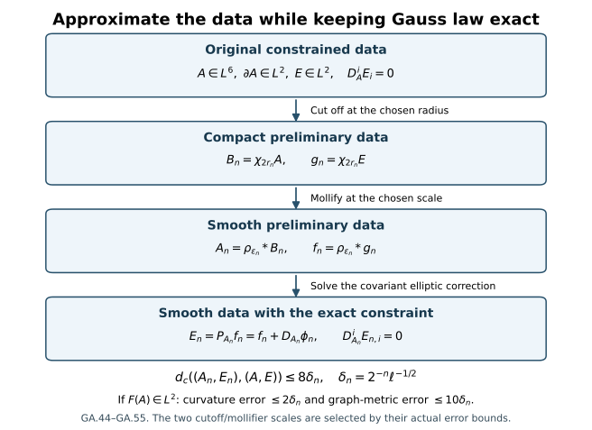

# Smooth approximation with the exact Gauss constraint

Gauss's law restricts the initial electric field. Cutting off or smoothing
that field usually changes its covariant divergence. This chapter constructs
an elliptic correction that restores the constraint exactly. The construction
works for the actual connection in \(L^6\) with gradient in \(L^2\); it
does not require a global \(L^3\) bound. When its curvature also belongs
to \(L^2\), the approximations converge in the full physical energy.

Read [initial data and energy](../constraints-initial-data-energy.html)
and [the first constrained approximation](../local-and-global-classical-evolution.html#eq-F9-37).
The earlier projection is recovered on its original domain. The larger
domain below is needed to use the [initial-data stability theorem](../classical-initial-data-stability.html)
with the course's homogeneous connection space.

The arrows are the actual operations GA.44–GA.48. The last arrow changes
only the electric field. The error estimates and curvature condition are
proved in GA.49–GA.55.

## 1. Original data, metric, norms and Gauss law

Fix the original \(c>0\), original length \(\ell>0\), and original
unitary representation of the compact gauge group. Its Lie algebra
is \(\mathfrak g\), with the fixed invariant positive inner product
\(\kappa(X,Y)=-\operatorname{tr}(XY)\) used by the course
on its skew-Hermitian matrices. All spatial derivative and output arrays
contain every ordered index. The analytic matrix convention gives

\[
|[X,Y]|\le2|X||Y|,\qquad
\kappa(X,[Z,X])=0,\qquad C_S=4/\sqrt3 .
\tag{GA.1}
\]

The original spatial base and physical metric are

\[
x\in\mathbb R^3,\qquad
g_{\mu\nu}=\operatorname{diag}(-c^2,1,1,1).
\]

At the original initial time \(t_*\), temporal gauge means

\[
A_t(t_*)=0,\qquad E_i=F_{ti}(t_*)=\partial_tA_i(t_*).
\tag{GA.2}
\]

No time or spatial coordinate is changed in this construction.

Let

\[
\mathcal A=\{A=(A_i):A\in L^6(\mathbb R^3;\mathfrak g^3),
                         \ \partial A\in L^2\}.
\tag{GA.3}
\]

This is the actual \(\dot H^1\) representative space, not a quotient
by unspecified constants. F9.37, proved by coordinate-line
integration and Hölder, gives

\[
\|\phi\|_6\le C_S\|\partial\phi\|_2 .
\tag{GA.4}
\]

For completeness, the constant follows as follows. For compact
smooth scalar \(v\), set
\(f_i(x_1,\ldots,\widehat{x_i},\ldots,x_3)
=\int_{\mathbb R}|\partial_iv|\,dx_i\).
The fundamental theorem of calculus gives \(|v|\le f_i\)
for each \(i\). Two applications of Cauchy–Schwarz,
first in \(x_1\) and then in \((x_2,x_3)\), yield

\[
\int|v|^{3/2}\le\int(f_1f_2f_3)^{1/2}
\le\prod_{i=1}^3\|\partial_iv\|_1^{1/2}.
\]

Taking the power \(2/3\) and applying the arithmetic–geometric
mean inequality gives
\(\|v\|_{3/2}\le\frac13\sum_i\|\partial_iv\|_1
\le3^{-1/2}\int|\partial v|\).
Apply this to the smooth function \(v=|\phi|^4\).
Its derivative is bounded by \(4|\phi|^3|\partial\phi|\);
Hölder gives
\(\|\phi\|_6^4\le(4/\sqrt3)\|\phi\|_6^3
\|\partial\phi\|_2\). Dividing in the nonzero case,
with the zero case immediate, proves GA.4 for every finite
real array, including the real coordinates of the full
\(\mathfrak g\)-valued fields.

Completion of \(C_c^\infty\) in its gradient norm therefore fixes
the unique \(L^6\) representative. Conversely, cutoff and
mollification, proved below with their actual error terms, put
every member of GA.3 into this completion.

The covariant derivative and full curvature are

\[
D_i^A\phi=\partial_i\phi+[A_i,\phi],\qquad
F_{ij}(A)=\partial_iA_j-\partial_jA_i+[A_i,A_j].
\tag{GA.5}
\]

For \(E\in L^2(\mathbb R^3;\mathfrak g^3)\), the distributional
Gauss constraint is

\[
\sum_i D_i^AE_i=0
\quad\Longleftrightarrow\quad
\int_{\mathbb R^3}\sum_i\kappa(E_i,D_i^A\psi)\,dx=0
\quad\text{for every }\psi\in C_c^\infty(\mathbb R^3;\mathfrak g).
\tag{GA.6}
\]

All products here are defined locally: \(A\in L^6\) in particular
belongs to \(L^3\) on compact sets, and \(E\in L^2\).
Invariant skew-adjointness of \(\operatorname{ad}(A_i)\) proves
the sign in the weak formula. Spatial index raising uses
\(g^{ij}=\delta^{ij}\); no factor \(c\) is inserted into GA.6.

Define

\[
\mathcal D=\{(A,E):A\in\mathcal A,\ E\in L^2,\ D_A^iE_i=0\},
\]

\[
d_c((A,E),(\widetilde A,\widetilde E))
=\|\partial(A-\widetilde A)\|_2+
                       c^{-1}\|E-\widetilde E\|_2.
\tag{GA.7}
\]

The corresponding \(L^6\) difference is bounded by GA.4.
The finite-curvature-energy subspace is the additional, precisely
specified class

\[
\mathcal D_{\rm curv}
=\{(A,E)\in\mathcal D:F(A)\in L^2(\mathbb R^3;\mathfrak g^{3\times3})\}.
\tag{GA.8}
\]

Membership in GA.8 is not asserted to follow from GA.7 alone.

## 2. The exact covariant homogeneous domain

For this section the coefficient need only satisfy
\(A\in L^3_{\rm loc}(\mathbb R^3;\mathfrak g^3)\). Define

\[
\mathcal V_A=
\{\phi\in L^6(\mathbb R^3;\mathfrak g):
            D_A\phi\in L^2(\mathbb R^3;\mathfrak g^3)
            \text{ in distributions}\},
\qquad \|\phi\|_{\mathcal V_A}=\|D_A\phi\|_2 .
\tag{GA.9}
\]

This is the relevant domain of the covariant elliptic equation.
For a global \(L^3\) connection it equals the ordinary
\(\dot H^1\) domain; for a merely \(L^6\) connection the equality
must not be assumed.

Every \(\phi\in\mathcal V_A\) belongs to \(H^1_{\rm loc}\),
because on compact sets
\(\partial\phi=D_A\phi-[A,\phi]\in L^2\) by
\(L^3\cdot L^6\subset L^2\), and \(\phi\in L^2_{\rm loc}\).
The weak chain rule, applied to
\(r_\epsilon=(|\phi|^2+\epsilon^2)^{1/2}-\epsilon\), gives

\[
\partial_i r_\epsilon
=\frac{\kappa(\phi,D_i^A\phi)}
       {( |\phi|^2+\epsilon^2)^{1/2}},\qquad
|\partial r_\epsilon|\le |D_A\phi|.
\tag{GA.10}
\]

The commutator vanishes in this pairing by GA.1. The weak chain
rule follows by mollifying on compact subsets and using the
bounded derivative of the scalar function; convergence in
local \(H^1\) and dominated convergence give the displayed
distributional derivative. Thus no differentiability of \(A\)
is required for GA.10.

Fix one smooth scalar cutoff \(\chi\), equal to one on
\(|x|\le1\), zero on \(|x|\ge2\), and satisfying \(0\le\chi\le1\).
Let \(\chi_R(x)=\chi(x/R)\), \(R>0\), and put

\[
C_\chi=\|\partial\chi\|_3,\qquad
\|\partial\chi_R\|_3=C_\chi.
\tag{GA.11}
\]

The equality retains the derivative factor \(R^{-1}\) and
the volume factor \(R^3\) under the cube of the norm.
The covariant product rule is exact:

\[
D_A(\chi_R\phi)=\chi_RD_A\phi+(\partial\chi_R)\phi .
\tag{GA.12}
\]

For compactly supported \(H^1\) fields, GA.10 and GA.4
give the covariant Sobolev inequality by ordinary smooth
approximation and then \(\epsilon\downarrow0\).
Apply it to \(\chi_R\phi\); since

\[
\|(\partial\chi_R)\phi\|_2
\le C_\chi\|\phi\|_{L^6(\{R\le|x|\le2R\})}\longrightarrow0 ,
\]

letting \(R\to\infty\) proves

\[
\boxed{\ \|\phi\|_6\le C_S\|D_A\phi\|_2,\quad
                                      \phi\in\mathcal V_A.\ }
\tag{GA.13}
\]

The zero norm therefore means the actual zero \(L^6\) field.

The space in GA.9 is complete. If \(D_A\phi_n\) is Cauchy
in \(L^2\), GA.13 makes \(\phi_n\) Cauchy in \(L^6\).
Write their limits as \(W,\phi\). On every compact set,
\([A,\phi_n]\to[A,\phi]\) in \(L^2\); testing the derivatives
therefore gives \(D_A\phi=W\). Hence
\(\phi\in\mathcal V_A\) and convergence holds in its norm.
The bilinear form

\[
b_A(\phi,\psi)=\int\sum_i\kappa(D_i^A\phi,D_i^A\psi)
\tag{GA.14}
\]

makes it a real Hilbert space.

Moreover \(C_c^\infty\) is dense in \(\mathcal V_A\).
First GA.12 shows

\[
\|D_A(\chi_R\phi-\phi)\|_2
\le\|(1-\chi_R)D_A\phi\|_2+
       C_\chi\|\phi\|_{L^6(\{R\le|x|\le2R\})}\to0 .
\tag{GA.15}
\]

For a fixed \(R\), \(\chi_R\phi\) is a compactly supported
\(H^1\) field. Convolution by the compact, nonnegative,
unit-mass mollifier of F09 converges in \(H^1\), hence in
\(L^6\) by GA.4. On a fixed containing compact set,

\[
\|[A,\psi_n-\chi_R\phi]\|_2
\le2\|A\|_{L^3(K)}\|\psi_n-\chi_R\phi\|_6\to0 .
\]

Thus the mollified fields converge in \(\mathcal V_A\).
Combining the cutoff and mollification proves density.
In particular GA.6 extends from compact smooth tests
to every \(\psi\in\mathcal V_A\).

## 3. Existence and exact properties of the correcting map

For \(f\in L^2(\mathbb R^3;\mathfrak g^3)\), the functional

\[
r_{A,f}(\psi)=-\int\sum_i\kappa(f_i,D_i^A\psi)
\tag{GA.16}
\]

is continuous on \(\mathcal V_A\), with dual norm at most
\(\|f\|_2\). There exists a unique
\(\phi_A[f]\in\mathcal V_A\) such that

\[
b_A(\phi_A[f],\psi)=r_{A,f}(\psi)
\quad(\psi\in\mathcal V_A).
\tag{GA.17}
\]

Here is the Hilbert-space existence argument. If \(r_{A,f}=0\),
take zero. Otherwise the closed affine set
\(\{\psi:r_{A,f}(\psi)=1\}\) has positive distance \(d\)
from zero. A minimizing sequence is Cauchy by the
parallelogram identity, because the average of two members
remains in that set. Completeness gives a minimizer \(\psi_*\).
For \(h\in\ker r_{A,f}\), minimality of
\(\psi_*+th\) for every real \(t\) gives
\(b_A(\psi_*,h)=0\). Decomposing any \(\psi\) as
\(r_{A,f}(\psi)\psi_*+h\) shows that
\(\phi_A[f]=\psi_*/d^2\) satisfies GA.17.
Testing the difference of two solutions against itself proves
uniqueness.

The correcting and projected maps are

\[
\mathcal C_A:L^2\longrightarrow L^2,\qquad
\mathcal C_A f=D_A\phi_A[f],\qquad
P_Af=f+\mathcal C_A f.
\tag{GA.18}
\]

The sign is fixed by the original covariant divergence:

\[
D_A^iD_i^A\phi_A[f]=-D_A^if_i,\qquad
D_A^i(P_Af)_i=0
\quad\text{in distributions}.
\tag{GA.19}
\]

Indeed the first left side pairs with \(\psi\) as
\(-b_A(\phi_A[f],\psi)=\int\kappa(f,D_A\psi)\).
Adding \(f\) therefore cancels the divergence exactly.

The range of \(D_A:\mathcal V_A\to L^2\) is closed:
this map is an isometry from the complete space GA.14.
By GA.17, \(P_Af\) is orthogonal to that range, while
\(f-P_Af=-D_A\phi_A[f]\) lies in the range. Thus \(P_A\)
is exactly the orthogonal projection onto

\[
\mathcal G_A
=\{e\in L^2:D_A^ie_i=0\}
=\operatorname{Ran}(D_A)^\perp .
\tag{GA.20}
\]

Linearity, self-adjointness, \(P_A^2=P_A\), and

\[
\|P_Af\|_2^2+\|\mathcal C_Af\|_2^2=\|f\|_2^2,\qquad
\|P_Af\|_2\le\|f\|_2,\qquad
\|\mathcal C_Af\|_2\le\|f\|_2
\tag{GA.21}
\]

follow from this precise decomposition.
Equation GA.13 also gives
\(\|\phi_A[f]\|_6\le C_S\|\mathcal C_Af\|_2\).
The potential is uniquely fixed by its \(L^6\) domain;
there is no freely added covariantly constant term.

For \(A\in L^3\), the comparison with the existing course
operator is exact:

\[
\mathcal V_A=\dot H^1,\qquad
K_A^{-1}\|\partial\phi\|_2
\le\|D_A\phi\|_2\le K_A\|\partial\phi\|_2,\qquad
K_A=1+2C_S\|A\|_3 .
\tag{GA.22}
\]

The upper bound uses GA.4. For the lower bound write
\(\partial\phi=D_A\phi-[A,\phi]\) and use GA.13.
Each inclusion of domains follows from those same estimates.
Uniqueness in GA.17 identifies this map with F9.40,
not merely with some other divergence-free correction.

## 4. The defect in a direct global residual estimate

The existing estimate F9.44 pairs the residual with a
\(\dot H^1\) test by global Hölder exponents \(3,2,6\).
For an arbitrary \(A\in\mathcal A\), that operation is
not supplied by the known \(L^6\) bound on \(A\):
\(L^6\cdot L^2\cdot L^6\) has reciprocal exponents
adding to \(5/6\), not one. Also the constants
\(K_{A_n}=1+2C_S\|A_n\|_3\) need not stay bounded for
compact regularizations of an \(A\) outside \(L^3\).
Consequently one cannot carry F9.44–F9.45 over to GA.7
by deleting its \(L^3\) hypothesis.

The exact alternative uses GA.17 and the original Gauss
law, with a finite spatial cutoff. Let \(A_n\in C_c^\infty\),
\(f_n\in L^2\), and put

\[
\phi_n=\phi_{A_n}[f_n],\quad
W_n=D_{A_n}\phi_n,\quad E_n=f_n+W_n=P_{A_n}f_n.
\tag{GA.23}
\]

Since \(A_n\in L^3\), GA.22 gives \(\phi_n\in\dot H^1\).
For the original \((A,E)\in\mathcal D\),
\(\chi_R\phi_n\) is an admissible compact \(H^1\) test
in GA.6, by approximation on its compact support.
Expand every term:

\[
0=\langle\chi_RE,W_n\rangle+
\langle E,(\partial\chi_R)\phi_n\rangle+
\langle E,\chi_R[A-A_n,\phi_n]\rangle .
\tag{GA.24}
\]

Here the inner products sum all spatial output entries,
and the last bracket has exactly that order.
On the other hand GA.17 with \(\psi=\phi_n\) gives

\[
\|W_n\|_2^2=-\langle f_n,W_n\rangle.
\tag{GA.25}
\]

Subtract \(E\), split its pairing into \(\chi_R\) and
\(1-\chi_R\), and use GA.24:

\[
\begin{aligned}
\|W_n\|_2^2={}&-\langle f_n-E,W_n\rangle
-\langle(1-\chi_R)E,W_n\rangle\\
&+\langle E,(\partial\chi_R)\phi_n\rangle
+\langle E,\chi_R[A-A_n,\phi_n]\rangle .
\end{aligned}\tag{GA.26}
\]

All four terms are well-defined in the stated domains.
In particular the last product is over \(B_{2R}\),
where \(A-A_n\in L^3\). The first two terms use \(L^2\)
Cauchy–Schwarz; the third uses spatial exponents \(2,3,6\)
on the annulus; the fourth uses those same exponents
on the ball. GA.13 bounds \(\|\phi_n\|_6\) independently
of \(\|A_n\|_3\). Dividing only when \(W_n\ne0\) gives

\[
\boxed{\begin{aligned}
\|W_n\|_2\le{}&
\|f_n-E\|_2+
(1+C_SC_\chi)\|E\|_{L^2(\{|x|>R\})}\\
&+2C_S\|A_n-A\|_{L^3(B_{2R})}\|E\|_2 .
\end{aligned}}
\tag{GA.27}
\]

The zero case satisfies it as well.
This is the quantitative correcting estimate replacing
the unavailable global \(L^3\) operation. Its exact
spatial cutoff terms have not been suppressed.

If \(A_n\to A\) in \(L^6\), then for each fixed \(R\),

\[
\|A_n-A\|_{L^3(B_{2R})}
\le |B_{2R}|^{1/6}\|A_n-A\|_6
=\left(\frac{32\pi}{3}\right)^{1/6}R^{1/2}\|A_n-A\|_6
\longrightarrow0 .
\tag{GA.28}
\]

First choose \(R\) so that the electric tail is small,
then choose \(n\) for the first and third terms.
Thus if \(f_n\to E\) in \(L^2\), GA.27 proves

\[
W_n\to0\text{ in }L^2,\qquad E_n\to E\text{ in }L^2.
\tag{GA.29}
\]

No density assumption has entered this argument.

## 5. Smoothness and every original derivative of the correction

Suppose now that both \(A_n\) and \(f_n\) are smooth and
compactly supported. By GA.22, \(\partial\phi_n\in L^2\).
Expanding GA.19 in the original order gives

\[
\begin{aligned}
\Delta\phi_n={}&-\partial^if_{n,i}-[A_n^i,f_{n,i}]
-[\partial^iA_{n,i},\phi_n]
-2[A_n^i,\partial_i\phi_n]
-[A_n^i,[A_{n,i},\phi_n]]
=:h_n .
\end{aligned}\tag{GA.30}
\]

Initially \(h_n\in L^2\) and is compactly supported.
Every coefficient and its derivatives are bounded and
compactly supported; \(\phi_n\in L^6\subset L^2_{\rm loc}\),
and \(\partial\phi_n\in L^2\). This accounts for every
term in GA.30.

The full Hessian identity is

\[
\widehat{\partial_j\partial_k\phi_n}(\xi)
=\frac{\xi_j\xi_k}{|\xi|^2}\widehat h_n(\xi)
\quad(\xi\ne0),\qquad
\|\partial^{(2)}\phi_n\|_2^2=\|h_n\|_2^2.
\tag{GA.31}
\]

It does not assume \(\phi_n\in L^2\). Indeed
\(v_k=\partial_k\phi_n\in L^2\) satisfies
\(\Delta v_k=\partial_kh_n\). Away from zero its Fourier
transform determines the displayed multiplier.
The transform of \(v_k\) is already an \(L^2\) function,
so it cannot hide a distribution supported at zero.
The multiplier may be assigned value zero at that
single point. The norm equality uses
\(\sum_{j,k}\xi_j^2\xi_k^2=|\xi|^4\) and the original
Parseval measure \((2\pi)^{-3}d^3\xi\).

Retain the original inhomogeneous norms

\[
\|f\|_{H_\ell^q}^2
=(2\pi)^{-3}\int(1+\ell^2|\xi|^2)^q
                                     |\widehat f(\xi)|^2d^3\xi.
\tag{GA.32}
\]

If \(\partial\phi_n\in H_\ell^q\), differentiate each
term of GA.30 by every ordered word of length at most
\(q\). The finite product rule keeps all placements
and their binomial or ordered-subset multiplicities.
For a term with an undifferentiated \(\phi_n\), its
local \(L^2\) norm is sufficient because the coefficient
has compact support; every positive derivative is already
controlled. Thus \(h_n\in H_\ell^q\).
Multiplying GA.31 by the original Fourier derivative
monomials then gives
\(\partial\phi_n\in H_\ell^{q+1}\).
The ordered product rule used here has no missing
multinomial terms. For a word \(J=(j_1,\ldots,j_m)\),
write \(\partial_J=\partial_{j_1}\cdots\partial_{j_m}\)
and \(J_I\) for its subword in the original order.
Then

\[
\partial_J[U,V]=
\sum_{I\subset\{1,\ldots,m\}}
[\partial_{J_I}U,\partial_{J_{I^c}}V],
\quad
\partial_J[U,[V,W]]=
\sum_{I_1\sqcup I_2\sqcup I_3=\{1,\ldots,m\}}
[\partial_{J_{I_1}}U,
 [\partial_{J_{I_2}}V,\partial_{J_{I_3}}W]].
\tag{GA.32a}
\]

The three sets in the second sum are labelled, may be
empty, and form an ordered partition; equal derivative
terms therefore retain their full multiplicities.
Apply this formula to each of the five summands in
GA.30, keeping its sign and its coefficient \(2\).
For integer \(q\ge0\), equivalence with the displayed
Fourier norm follows from the exact expansion

\[
\|u\|_{H_\ell^q}^2=
\sum_{m=0}^q\binom qm\ell^{2m}
                \|\partial^{(m)}u\|_2^2,
\tag{GA.32b}
\]

where the derivative norm sums all ordered words of
length \(m\), including the empty word for \(m=0\).
Starting at \(q=0\), induction proves

\[
D_{A_n}\phi_n\in\bigcap_{q\ge0}H_\ell^q,\qquad
E_n\in\bigcap_{q\ge0}H_\ell^q .
\tag{GA.33}
\]

Local cutoffs of \(\phi_n\), together with these derivatives
and the elementary Fourier Sobolev estimate, give local
smoothness at every order. Hence \(E_n\) is smooth.
Explicitly, for \(u\in H_\ell^M\), a derivative word
\(J\) of length \(m\), and \(M>m+3/2\), Fourier
inversion and Cauchy–Schwarz give

\[
\|\partial_Ju\|_\infty\le
(2\pi)^{-3/2}
\left[\int_{\mathbb R^3}|\xi|^{2m}
          (1+\ell^2|\xi|^2)^{-M}d^3\xi\right]^{1/2}
\|u\|_{H_\ell^M}.
\tag{GA.33a}
\]

The integral is finite at zero and infinity with precisely
the stated inequality on \(M\); the same integrable Fourier
majorant gives continuity of each derivative. Compact
cutoffs of \(\phi_n\) belong to every such space by the
product rule and the local \(L^2\) bound for \(\phi_n\).
The correction need not be compactly supported; no such
support claim is made. This is the same full regularity
mechanism as F9.42–F9.43.

## 6. Cutoff and mollification in the actual connection topology

For \(A\in\mathcal A\), set \(B_R=\chi_RA\). Its exact
gradient difference is

\[
\partial(B_R-A)=(\chi_R-1)\partial A+
                                     (\partial\chi_R)A .
\tag{GA.34}
\]

The first summand tends to zero in \(L^2\) by dominated
convergence. The second obeys

\[
\|(\partial\chi_R)A\|_2
\le C_\chi\|A\|_{L^6(\{R\le|x|\le2R\})}\to0 .
\tag{GA.35}
\]

Also \(B_R\to A\) in \(L^6\), either directly by dominated
convergence or by GA.4 and GA.34. Each \(B_R\) belongs
to compactly supported \(H^1\), hence to \(L^p\) for
every \(2\le p\le6\), including \(L^3\) and \(L^4\).
No global \(L^3\) bound on \(A\) was used.

Fix the same nonnegative, radial, compact unit-mass
mollifier as F09:

\[
\rho_\epsilon(x)=\epsilon^{-3}\rho(x/\epsilon),\qquad
\rho(x)=Z^{-1}
\begin{cases}e^{-1/(1-|x|^2)},&|x|<1,\\0,&|x|\ge1,\end{cases}
\quad
Z=\int_{|x|<1}e^{-1/(1-|x|^2)}dx .
\tag{GA.36}
\]

For fixed \(R\),
\(\rho_\epsilon*B_R\to B_R\) in \(H^1\), and hence in
\(L^3,L^4,L^6\). This follows by writing convolution
as an average of translations; translations are
continuous in \(L^p\), \(p<\infty\), by approximation
with compact smooth functions and the isometry of
translation. Distributional differentiation commutes
with convolution by testing and Fubini.
The resulting fields are smooth, compactly supported
and \(\mathfrak g\)-valued because \(\mathfrak g\) is a
fixed real linear subspace of matrices.
The same construction sends \(\chi_RE\) to smooth
compact \(f\), converging to it in \(L^2\).
Nonnegativity and unit mass give the useful bound

\[
\|\rho_\epsilon*(\chi_RE)\|_2
\le\|\chi_RE\|_2\le\|E\|_2 .
\tag{GA.37}
\]

## 7. The additional finite-curvature-energy operation

Assume now \((A,E)\in\mathcal D_{\rm curv}\).
The original commutator tensor itself belongs to \(L^2\):

\[
C_{ij}:=[A_i,A_j]
=F_{ij}(A)-\partial_iA_j+\partial_jA_i\in L^2.
\tag{GA.38}
\]

This recovers its contribution from the original full
formula; it does not replace the original curvature.
For the cutoff connection every term is

\[
\begin{aligned}
F_{ij}(B_R)={}&
\chi_RF_{ij}(A)
+(\partial_i\chi_R)A_j-(\partial_j\chi_R)A_i
+(\chi_R^2-\chi_R)[A_i,A_j],\\
F_{ij}(B_R)-F_{ij}(A)={}&
(\chi_R-1)(\partial_iA_j-\partial_jA_i)
+(\chi_R^2-1)[A_i,A_j]\\
&+(\partial_i\chi_R)A_j-(\partial_j\chi_R)A_i .
\end{aligned}\tag{GA.39}
\]

In the first line the four displayed contributions are
added with their actual signs. Both presentations are
identities; the second makes all convergence terms
explicit. Dominated convergence controls the first two
terms there using \(\partial A,C\in L^2\).
The full ordered tuple of the last two terms has norm
at most \(2\|(\partial\chi_R)A\|_2\), which tends to
zero by GA.35. Therefore

\[
F(B_R)\longrightarrow F(A)\quad\text{in }L^2 .
\tag{GA.40}
\]

For fixed \(R\), let \(A_{R,\epsilon}=\rho_\epsilon*B_R\).
The difference of commutator tensors is exactly

\[
[A_{R,\epsilon,i},A_{R,\epsilon,j}]-[B_{R,i},B_{R,j}]
=[A_{R,\epsilon,i}-B_{R,i},A_{R,\epsilon,j}]
 +[B_{R,i},A_{R,\epsilon,j}-B_{R,j}] .
\tag{GA.41}
\]

Its full \(L^2\) bound is

\[
2\|A_{R,\epsilon}-B_R\|_4
                      (\|A_{R,\epsilon}\|_4+\|B_R\|_4).
\tag{GA.42}
\]

The two derivative placements cost at most
\(2\|\partial(A_{R,\epsilon}-B_R)\|_2\).
All terms tend to zero by the fixed-\(R\) mollification
convergence. Thus

\[
F(A_{R,\epsilon})\to F(B_R)\text{ in }L^2
\quad\text{as }\epsilon\downarrow0.
\tag{GA.43}
\]

The order of these operations is essential to this proof:
first retain the original finite \(L^2\) commutator
through the cutoff identity; then mollify a fixed
compact \(H^1\) connection, for which \(L^4\) is available.
No global \(L^4\) hypothesis on the original connection
was inserted.

## 8. A definite diagonal and the complete approximation map

Here is one quantitative choice of the actual scales.
Put \(\delta_n=2^{-n}\ell^{-1/2}>0\). The coefficient
\(\ell^{-1/2}\) fixes the original units of the gradient
and curvature \(L^2\) errors; it does not change any
field or coordinate. Choose \(r_n=m_n\ell\), where
\(m_n\) is the least integer at least \(n\) for which

\[
\begin{aligned}
(1+C_SC_\chi)\|E\|_{L^2(\{|x|>r_n\})}
&\le c\delta_n,\\
\|\partial(\chi_{2r_n}A-A)\|_2&\le\delta_n,
\end{aligned}\tag{GA.44}
\]

and, in the finite-curvature case, also

\[
\|F(\chi_{2r_n}A)-F(A)\|_2\le\delta_n .
\tag{GA.45}
\]

The tail limits, GA.34–GA.35 and GA.40 prove that
such an integer exists. In the general class
\(\mathcal D\), omit only GA.45.

Set \(B_n=\chi_{2r_n}A\), \(g_n=\chi_{2r_n}E\).
Choose \(\epsilon_n=\ell/k_n<r_n\), with \(k_n\)
the least integer at least \(n\) for which

\[
\begin{aligned}
\|\partial(\rho_{\epsilon_n}*B_n-B_n)\|_2
&\le\delta_n,\\
\|\rho_{\epsilon_n}*g_n-g_n\|_2&\le c\delta_n,\\
2C_S\|\rho_{\epsilon_n}*B_n-B_n\|_3\|E\|_2
&\le c\delta_n,
\end{aligned}\tag{GA.46}
\]

and, in the finite-curvature case,

\[
\|F(\rho_{\epsilon_n}*B_n)-F(B_n)\|_2\le\delta_n .
\tag{GA.47}
\]

All are attainable by the preceding fixed-compact
mollification results. When \(E=0\), the third
condition in GA.46 is automatic; \(g_n=f_n=0\)
and the correcting field is exactly zero.
There is no division by \(\|E\|_2\) in the choice.

Finally define the operation

\[
\begin{aligned}
\mathfrak R_n:\mathcal D&\longrightarrow\mathcal D_{\rm reg},\\
\mathfrak R_n(A,E)&=(A_n,E_n),\\
A_n&=\rho_{\epsilon_n}*B_n,\qquad
f_n=\rho_{\epsilon_n}*g_n,\\
\phi_n&=\phi_{A_n}[f_n],\qquad
E_n=f_n+D_{A_n}\phi_n=P_{A_n}f_n,\\
\mathcal D_{\rm reg}&=
\{(a,e):a\in C_c^\infty,\quad
e\in\bigcap_{q\ge0}H_\ell^q,\quad D_a^ie_i=0\}.
\end{aligned}\tag{GA.48}
\]

The smoothness and codomain follow from GA.19 and
GA.30–GA.33. This codomain is contained in
\(\mathcal D_{\rm curv}\): its smooth compact connection
has square-integrable curvature. The scales in
\(\mathfrak R_n\) are allowed to depend on the data;
the displayed integer rules make one definite choice.

The quantitative errors are now direct. GA.44 and
GA.46 give

\[
\|\partial(A_n-A)\|_2\le2\delta_n,\qquad
\|A_n-A\|_6\le2C_S\delta_n,\qquad
\|f_n-E\|_2\le2c\delta_n .
\tag{GA.49}
\]

On \(B_{2r_n}\), the preliminary connection \(B_n\)
is exactly \(A\), because its cutoff equals one there.
Consequently GA.46 gives

\[
2C_S\|A_n-A\|_{L^3(B_{2r_n})}\|E\|_2\le c\delta_n .
\]

Use GA.27 with its test radius \(R=r_n\).
Its three terms are at most \(2c\delta_n,c\delta_n,
c\delta_n\), respectively. Hence

\[
\|D_{A_n}\phi_n\|_2\le4c\delta_n,\qquad
\|E_n-E\|_2\le6c\delta_n,\qquad
\boxed{\ d_c((A_n,E_n),(A,E))\le8\delta_n.\ }
\tag{GA.50}
\]

Every approximant satisfies the exact Gauss equation,
not an equation with a small residual. GA.37 and the
orthogonal identity GA.21 also prove

\[
\|E_n\|_2\le\|f_n\|_2\le\|E\|_2 .
\tag{GA.51}
\]

Thus the original electric energy is bounded uniformly,
without a connection \(L^3\) bound or an initial Hessian.

For data in \(\mathcal D_{\rm curv}\), GA.45 and GA.47
simultaneously give the actual curvature convergence

\[
\|F(A_n)-F(A)\|_2\le2\delta_n .
\tag{GA.52}
\]

Thus on the precisely stated finite-curvature domain the
augmented original metric

\[
d_{c,\rm curv}((A,E),(\widetilde A,\widetilde E))
=d_c((A,E),(\widetilde A,\widetilde E))
                         +\|F(A)-F(\widetilde A)\|_2
\tag{GA.52a}
\]

obeys
\(d_{c,\rm curv}((A_n,E_n),(A,E))\le10\delta_n\).
This is the cutoff-then-mollification diagonal.
It retains the connection, electric field, covariant
constraint, representative and full curvature in their
original spaces.

Define the original magnetic field by
\(B_1=F_{23},B_2=F_{31},B_3=F_{12}\), and similarly
\(B_n\) for this paragraph only. Antisymmetry gives

\[
\|B_n-B\|_2^2=\tfrac12\sum_{i,j}
                     \|F_{ij}(A_n)-F_{ij}(A)\|_2^2 .
\tag{GA.53}
\]

The original physical energy from F8.22 is

\[
\mathcal E_{\rm YM}(A,E)
=\frac{\hbar}{g_{\rm YM}^2}
       \{c^{-1}\|E\|_2^2+c\|B\|_2^2\}.
\tag{GA.54}
\]

Neither the \(c^{-1}\) electric coefficient nor the
\(c\) magnetic coefficient is removed. Equations
GA.50 and GA.52–GA.53 give

\[
\begin{aligned}
|\mathcal E_{\rm YM}(A_n,E_n)-\mathcal E_{\rm YM}(A,E)|
\le\frac{\hbar}{g_{\rm YM}^2}\bigl\{
&c^{-1}(\|E_n\|_2+\|E\|_2)\|E_n-E\|_2\\
&+c(\|B_n\|_2+\|B\|_2)\|B_n-B\|_2\bigr\}\to0 .
\end{aligned}\tag{GA.55}
\]

For example
\(\|F(A_n)\|_2\le\|F(A)\|_2+2\delta_n\)
and GA.51 give finite uniform original energy
providers for FC. This statement uses GA.8 explicitly.

## 9. Exact continuity of the projection under local coefficients

The preceding construction has a useful wider consequence.
Suppose \(A_n,A\in L^3_{\rm loc}\),
\(A_n\to A\) in \(L^3\) on every compact set, and
\(f_n\to f\) in \(L^2\). Use the GA.9 domains for every
coefficient. Then

\[
P_{A_n}f_n\longrightarrow P_Af\quad\text{in }L^2,
\qquad
\mathcal C_{A_n}f_n\longrightarrow\mathcal C_Af
                                      \quad\text{in }L^2 .
\tag{GA.56}
\]

Here is a proof including the range identification.
Write \(W_n=D_{A_n}\phi_n\).
GA.21 and GA.13 bound \(W_n\) in \(L^2\) and
\(\phi_n\) in \(L^6\). Extract weakly convergent
subsequences, with limits \(W,\phi\). For each compact
test, the strong local \(L^3\) convergence of \(A_n\)
and weak \(L^6\) convergence of \(\phi_n\) pass the
product in distributions. Therefore \(D_A\phi=W\),
so \(\phi\in\mathcal V_A\) and \(W\in\operatorname{Ran}(D_A)\).
Also \(D_{A_n}\psi\to D_A\psi\) in \(L^2\) for
compact smooth \(\psi\). Passing to the limit in
\(\langle f_n+W_n,D_{A_n}\psi\rangle=0\) gives
\(f+W\in\mathcal G_A\). By the proved compact-test
density and the orthogonal decomposition, necessarily

\[
f+W=P_Af,\qquad W=\mathcal C_Af .
\]

Finally GA.25 yields

\[
\|W_n\|_2^2=-\langle f_n,W_n\rangle
\longrightarrow-\langle f,W\rangle=\|W\|_2^2 .
\]

Weak convergence plus convergence of the norms is
strong convergence, since expansion of
\(\|W_n-W\|_2^2\) gives the difference explicitly.
Every weakly convergent subsequence has the same
identified limit; a subsequence contradiction therefore
gives convergence for the whole sequence. Adding
\(f_n\to f\) proves both lines of GA.56.

This supplies the exact relationship between the
coefficient-dependent spaces rather than merely noting
that they are different. For Gauss-constrained \(E\),
\(P_AE=E\), and GA.56 reproduces GA.29.
The quantitative finite-cutoff estimate GA.27 is
stronger information for the explicit diagonal.

## 10. The original temporal gauge and residual gauge covariance

The construction GA.48 is carried out in the same
original temporal-gauge frame as the input. It assigns
\(A_{n,t}=0\) and the initial time derivative
\(\partial_tA_{n,i}(t_*)=E_{n,i}\). No gauge map is
applied to the data during cutoff, mollification or
electric correction. In particular there is no
unrecorded nonidentity initial gauge to reset.

For an actual smooth, time-independent gauge
\(Q:\mathbb R^3\to G\) in this unitary representation,
keep its full affine action:

\[
A_i^Q=QA_iQ^{-1}-(\partial_iQ)Q^{-1},\qquad
E_i^Q=QE_iQ^{-1}.
\tag{GA.57}
\]

Direct differentiation, with the two inverse terms,
proves

\[
D_{A^Q}(\operatorname{Ad}Q\,\phi)
=\operatorname{Ad}Q(D_A\phi),\qquad
F_{ij}(A^Q)=\operatorname{Ad}Q\,F_{ij}(A).
\tag{GA.58}
\]

Indeed put \(K_i=(\partial_iQ)Q^{-1}\) and
\(U_i=\operatorname{Ad}Q\,A_i\). The derivative of
\(Q^{-1}\) is \(-Q^{-1}(\partial_iQ)Q^{-1}\), so

\[
\partial_i(\operatorname{Ad}Q\,\phi)
=\operatorname{Ad}Q\,\partial_i\phi+
                   [K_i,\operatorname{Ad}Q\,\phi],
\qquad
\partial_iK_j-\partial_jK_i=[K_i,K_j].
\tag{GA.58a}
\]

Adding \([U_i-K_i,\operatorname{Ad}Q\,\phi]\)
cancels the two \(K_i\) brackets and proves the
derivative intertwining. For curvature the full expansion is

\[
\begin{aligned}
F_{ij}(A^Q)={}&
\operatorname{Ad}Q(\partial_iA_j-\partial_jA_i)
+[K_i,U_j]-[K_j,U_i]\\
&-(\partial_iK_j-\partial_jK_i)
+[U_i,U_j]-[U_i,K_j]-[K_i,U_j]+[K_i,K_j].
\end{aligned}\tag{GA.58b}
\]

Antisymmetry cancels the two remaining mixed brackets;
the second identity in GA.58a cancels the last two
terms involving only \(K\). Conjugation carries
\([A_i,A_j]\) to \([U_i,U_j]\), which proves the
second identity in GA.58. All identities extend to
the stated local Sobolev coefficients by local smooth
approximation and distributional product convergence.
Unitary conjugation preserves the \(L^6\) scalar-field
norm and \(L^2\) vector-field norm, so it maps
\(\mathcal V_A\) isometrically onto \(\mathcal V_{A^Q}\).
Both connection coefficients are locally \(L^3\),
because \(Q\) is smooth, and the inverse map is conjugation
by \(Q^{-1}\).
It carries GA.17 to exactly the corresponding variational
equation. Uniqueness therefore proves the actual
intertwining relations

\[
\phi_{A^Q}[\operatorname{Ad}Q\,f]
=\operatorname{Ad}Q\,\phi_A[f],\qquad
P_{A^Q}(\operatorname{Ad}Q\,f)
=\operatorname{Ad}Q(P_Af).
\tag{GA.59}
\]

This identifies the correcting operation in the original
or any specified residual temporal gauge.
Cutoff and convolution themselves need not commute
with an \(x\)-dependent gauge; GA.59 asserts the exact
covariance of the elliptic projection, with its stated
input transformation.

For an explicit original-data comparison, put
\(K=(\partial Q)Q^{-1}\), and suppose
\(K\in L^3\cap L^6\), \(\partial K\in L^2\).
These hypotheses ensure \(A^Q\in\mathcal A\):

\[
\partial A^Q=\operatorname{Ad}Q\,\partial A+
                  [K,\operatorname{Ad}Q\,A]-\partial K .
\tag{GA.60}
\]

The \(L^2\) bracket uses \(K\in L^3,A\in L^6\).
For two connections transformed by this same fixed
\(Q\), the affine term cancels exactly, and

\[
\begin{aligned}
\|\partial(A_n^Q-A^Q)\|_2
&\le(1+2C_S\|K\|_3)\|\partial(A_n-A)\|_2,\\
\|E_n^Q-E^Q\|_2&=\|E_n-E\|_2,\\
\|F(A_n^Q)-F(A^Q)\|_2&=\|F(A_n)-F(A)\|_2 .
\end{aligned}\tag{GA.61}
\]

Thus the approximation convergence passes through
this actual fixed residual gauge with its full
derivative coefficient. No assertion that such a
gauge equals the identity is needed.

## 11. Why finite curvature energy is an additional hypothesis

The distinction between GA.7 and GA.8 can be proved
inside the original variables. Take \(\mathfrak{su}(2)\)
matrices \(T_j=-i\sigma_j/2\), so
\([T_1,T_2]=T_3\) and the three matrices are orthogonal
for \(\kappa=-\operatorname{tr}\).
Let

\[
f(x)=(1+|x|^2/\ell^2)^{-1/3},\qquad
A_1=\ell^{-1}fT_1,\quad A_2=\ell^{-1}fT_2,\quad
A_3=0,\qquad E=0 .
\tag{GA.62}
\]

This field is smooth. At infinity \(f\) is comparable
to \(|x|^{-2/3}\) with the displayed \(\ell\) factors,
and \(|\partial f|\) is bounded by a constant times
\(|x|^{-5/3}\). The radial integrals for \(f^6\) and
\(|\partial f|^2\) have powers \(-2\) and \(-4/3\)
after including the original volume factor \(r^2dr\);
both converge. There is no singularity at the origin.
Thus \(A\in\mathcal A\), \(E\in L^2\), and Gauss law
holds exactly because \(E=0\).

More explicitly, for \(r=|x|\ge\ell\),

\[
2^{-1/3}\ell^{2/3}r^{-2/3}\le f(x)
\le\ell^{2/3}r^{-2/3},\qquad
|\partial f(x)|=
\frac{2r}{3\ell^2}(1+r^2/\ell^2)^{-4/3}
\le\frac23\ell^{2/3}r^{-5/3}.
\tag{GA.62a}
\]

The volume measure is exactly \(4\pi r^2dr\) for
these radial scalar integrals. Thus the stated convergence
powers and, below, the divergence lower bound retain their
original constants and length factors.

But the full curvature component is

\[
F_{12}(A)=
\ell^{-1}(\partial_1f)T_2
-\ell^{-1}(\partial_2f)T_1
+\ell^{-2}f^2T_3 .
\tag{GA.63}
\]

Orthogonality prevents cancellation between the last
term and the two derivative terms. Hence

\[
|F_{12}(A)|^2\ge\ell^{-4}|T_3|^2 f^4 .
\]

The radial integral of \(f^4\) has power \(-2/3\)
after the volume factor, so it diverges. Therefore
\(F(A)\notin L^2\) and the original energy GA.54 is
infinite, although \((A,E)\in\mathcal D\).
This is the exact obstruction to inferring finite
physical curvature energy from the derivative
connection topology alone. GA.8 names the additional
space of data and GA.38–GA.55 proves its full
constraint-preserving approximation.

## 12. Closure of the data spaces in the stated topologies

The Gauss condition is closed in the actual metric GA.7.
Suppose \(A_n\to A\) in the gradient norm and
\(E_n\to E\) in \(L^2\), with the actual \(L^6\)
representatives. GA.4 gives \(A_n\to A\) in \(L^6\)
and hence in local \(L^3\). For a compact smooth
test \(\psi\) supported in \(K\),

\[
\begin{aligned}
|\langle E_n,D_{A_n}\psi\rangle-
                 \langle E,D_A\psi\rangle|
\le{}&\|E_n-E\|_2
 (\|\partial\psi\|_2+2\|A_n\|_{L^3(K)}\|\psi\|_6)\\
&+2\|E\|_2\|A_n-A\|_{L^3(K)}\|\psi\|_6
\longrightarrow0.
\end{aligned}\tag{GA.67}
\]

Thus exact Gauss law passes to the limit. The connection
space GA.3 is complete in its gradient norm by GA.4 and
the weak-derivative identification already proved, and
\(L^2\) is complete. Consequently \((\mathcal D,d_c)\)
is complete as a closed subset of their product.

The finite-curvature graph is also complete in GA.52a.
For a Cauchy sequence in that metric let \(A,E\) be the
preceding limits and let \(F_*\) be the \(L^2\) limit
of the full ordered curvature tensors. The exact bracket
difference and Hölder give

\[
\|[A_{n,i},A_{n,j}]-[A_i,A_j]\|_{L^3(\mathfrak g^{3\times3})}
\le2\|A_n-A\|_6(\|A_n\|_6+\|A\|_6)
\longrightarrow0 .
\tag{GA.68}
\]

Together with gradient convergence this proves
\(F(A_n)\to F(A)\) in distributions. Its already
obtained \(L^2\) limit must therefore equal \(F(A)\).
In particular \(F(A)\in L^2\), and convergence occurs
in GA.52a. This proves completeness without asserting
that curvature is \(L^2\)-continuous on all of GA.3.

Combining these facts with the constructed approximation,
\(\mathcal D_{\rm reg}\) is dense in \(\mathcal D\)
for \(d_c\) and dense in \(\mathcal D_{\rm curv}\)
for \(d_{c,\rm curv}\). These density conclusions are
outputs of the explicit map and its estimates.

## 13. The original-source data and energy map

The comparison with Oh's actual initial variables is explicit.
Writing its time coordinate as \(y^0=c(t-t_*)\) only for
this source map, and retaining \(y^i=x^i\), the one-form
and curvature rules give

\[
A_i^{\rm Oh}=A_i,\qquad A_0^{\rm Oh}=c^{-1}A_t=0,
\qquad \overline E_i^{\rm Oh}=F_{0i}^{\rm Oh}=c^{-1}E_i,
\qquad F_{ij}^{\rm Oh}=F_{ij}.
\tag{GA.64}
\]

Consequently its constraint is exactly
\(c^{-1}D_A^iE_i=0\), equivalent to GA.6 because \(c>0\).
The elliptic correction is compatible with the full map:
linearity and uniqueness of GA.17 give

\[
\phi_A[c^{-1}f]=c^{-1}\phi_A[f],\qquad
cP_A(c^{-1}f)=P_Af.
\tag{GA.65}
\]

Thus applying the source's correcting operation in its
own electric variable and pulling it back gives exactly
GA.18. Its admissibility hypothesis supplies global
\(L^3\) and is not transferred to the larger domain GA.7.
Its energy is

\[
\mathbf E^{\rm Oh}
=\frac12\left(c^{-2}\|E\|_2^2+
                  \sum_{i<j}\|F_{ij}\|_2^2\right),
\qquad
\mathcal E_{\rm YM}
=\frac{2\hbar c}{g_{\rm YM}^2}\mathbf E^{\rm Oh}.
\tag{GA.66}
\]

The source map retains the original electric, magnetic,
time, inner-product and coupling factors; none changes
the working data in GA.3–GA.8.

## 14. Worked example: a commuting connection outside global L3

Fix a nonzero skew-Hermitian generator \(T\in\mathfrak g\). Retain
the original length \(\ell\), put \(r=|x|\), and set

\[
u(x)=(1+r^2/\ell^2)^{-1/3},\qquad
A_1(x)=\ell^{-1}u(x)T,\quad A_2=A_3=0.
\]

For \(r\ge\ell\), the inequalities
\(r^2/\ell^2\le1+r^2/\ell^2\le2r^2/\ell^2\) compare
\(u\) with constant multiples of \((r/\ell)^{-2/3}\).
Thus the radial integral for \(\|A\|_6^6\) has tail bounded by a
constant times \(\int_\ell^\infty r^{-2}\,dr\), whereas the one
for \(\|A\|_3^3\) is bounded below by a positive constant times
\(\int_\ell^\infty 1\,dr\). Hence \(A\in L^6\) and
\(A\notin L^3\). Its full derivative is

\[
\partial_j A_1=-\frac{2x_j}{3\ell^3}
             (1+r^2/\ell^2)^{-4/3}T,\qquad
\partial_j A_2=\partial_j A_3=0.
\]

Its squared radial tail is bounded by a constant times
\(r^{-4/3}\), which is integrable. All coefficients are smooth
at the origin, so \(\partial A\in L^2\). The brackets vanish;
the only potentially nonzero independent curvature components are

\[
F_{12}=\frac{2x_2}{3\ell^3}(1+r^2/\ell^2)^{-4/3}T,
\qquad
F_{13}=\frac{2x_3}{3\ell^3}(1+r^2/\ell^2)^{-4/3}T,
\qquad F_{23}=0.
\]

They lie in \(L^2\). This connection belongs to the larger
finite-curvature domain proved above.

Choose real compactly supported smooth \(\psi\) and a real compactly
supported smooth three-vector \(w\), both with units of inverse time.
Let \(f=(\nabla\psi+\operatorname{curl}w)T\). Since every bracket
with \(T\) vanishes, the exact correcting scalar is
\(\phi_A[f]=-\psi T\). To verify the variational equation against
an arbitrary Lie-algebra-valued test, use invariance:
\(\kappa(T,[T,\eta])=0\). The bracket part of the test pairing
vanishes, and integration by parts gives
\(\int\operatorname{curl}w\cdot\nabla\eta_T=0\), where
\(\eta_T=\kappa(T,\eta)\). Thus GA.17 holds for every compact
test, and its density extends it to every \(V_A\) test. Uniqueness gives

\[
P_Af=(\operatorname{curl}w)T,\qquad C_Af=-\nabla\psi T.
\]

Finally \(\int\nabla\psi\cdot\operatorname{curl}w=0\), by the
same compact integration by parts. Consequently GA.21 reads exactly

\[
|T|^2\|\operatorname{curl}w\|_2^2+|T|^2\|\nabla\psi\|_2^2
 =|T|^2\|\nabla\psi+\operatorname{curl}w\|_2^2.
\]

## 15. Exercises with full solutions

### Exercise 1. The local coefficient factor

Derive GA.29's local \(L^3\) bound on the ball \(B_{2R}\),
retaining its exact volume factor.

**Solution.** Hölder with two equal exponents gives
\(\int_{B_{2R}}|v|^3\le(\int_{B_{2R}}|v|^6)^{1/2}|B_{2R}|^{1/2}\).
Taking cube roots and using the actual ball volume gives

\[
\|v\|_{L^3(B_{2R})}\le
 \left(\frac{32\pi}{3}\right)^{1/6}R^{1/2}\|v\|_6.
\]

For \(v=A_n-A\), GA.4 bounds the last norm by
\(C_S\|\partial(A_n-A)\|_2\). This proves the local coefficient
convergence required in GA.27 for every fixed physical radius \(R\).

### Exercise 2. The correction's sign and orthogonality

Starting from GA.17, prove both the exact Gauss equation for \(P_Af\)
and its orthogonal norm identity.

**Solution.** Write \(W=D_A\phi_A[f]\). The variational equation is
\(\langle W,D_A\eta\rangle=-\langle f,D_A\eta\rangle\).
Thus \(\langle f+W,D_A\eta\rangle=0\), which is the weak
constraint for \(P_Af=f+W\). Taking \(\eta=\phi_A[f]\) yields
\(\langle P_Af,W\rangle=0\). Since \(f=P_Af-W\), expanding
its squared norm gives
\(\|f\|_2^2=\|P_Af\|_2^2+\|W\|_2^2\).
The minus sign in \(D_A^iD_i^A\phi=-D_A^if_i\) follows because
the weak covariant Laplacian pairs as \(-\langle D_A\phi,D_A\eta\rangle\).

### Exercise 3. Why the correction is zero for constrained data

Let \(f\in L^2\) obey the Gauss equation against compact smooth
tests. Prove \(P_Af=f\) on the local-\(L^3\) domain.

**Solution.** The functional \(\eta\mapsto\langle f,D_A\eta\rangle\)
has norm at most \(\|f\|_2\) on \(V_A\). It vanishes on the
dense compact smooth tests proved in Section 2, so it vanishes on
all of \(V_A\). Equation GA.17 then gives
\(\|D_A\phi_A[f]\|_2^2=0\). Covariant Sobolev implies
\(\|\phi_A[f]\|_6=0\); hence the scalar correction and its
covariant gradient both vanish. The formula for \(P_A\) proves the result.

### Exercise 4. Every cutoff curvature term

For a real smooth scalar \(\chi\), compute \(F_{ij}(\chi A)-F_{ij}(A)\).
Use the result to identify why finite curvature is sufficient in Section 7.

**Solution.** The product rule and bilinearity give

\[
F_{ij}(\chi A)-F_{ij}(A)
 =(\chi-1)F_{ij}(A)+(\partial_i\chi)A_j-(\partial_j\chi)A_i
                    +(\chi^2-\chi)[A_i,A_j].
\]

No bracket has been omitted. If \(F(A)\in L^2\) and
\(\partial A\in L^2\), then
\([A_i,A_j]=F_{ij}(A)-\partial_iA_j+\partial_jA_i\in L^2\).
For the expanding cutoff, the first and last terms tend to zero
by their \(L^2\) tails. The middle two terms have norm bounded
by a fixed cutoff constant times the \(L^6\) tail of \(A\):

\[
R^{-1}\|A\|_{L^2(B_{2R}\setminus B_R)}
\le R^{-1}|B_{2R}\setminus B_R|^{1/3}\|A\|_{L^6(|x|>R)}
\]

.
The volume equals \(28\pi R^3/3\), so the prefactor is
\((28\pi/3)^{1/3}\), independent of \(R\). This proves the
needed cutoff convergence while retaining each term.

### Exercise 5. The quantitative error budget

Use GA.44–GA.47 and GA.27 to recover the constants 8 and 10 in
the two initial-data metrics.

**Solution.** The connection cutoff and mollification each cost
\(\delta_n\), so their gradient error is at most \(2\delta_n\).
The electric cutoff tail and mollification each cost at most
\(c\delta_n\), so \(\|f_n-E\|_2\le2c\delta_n\).
The three terms in GA.27 are bounded by \(2c\delta_n\),
\(c\delta_n\), and \(c\delta_n\), respectively. Thus
\(\|D_{A_n}\phi_n\|_2\le4c\delta_n\), and
\(\|E_n-E\|_2\le6c\delta_n\). The metric is their sum
with electric factor \(c^{-1}\), giving
\(2\delta_n+6\delta_n=8\delta_n\).
The two curvature operations each cost \(\delta_n\); adding
that \(2\delta_n\) gives \(10\delta_n\) in the graph metric.
Projection orthogonality independently gives
\(\|E_n\|_2\le\|f_n\|_2\le\|E\|_2\).

### Exercise 6. The finite-curvature condition cannot be dropped

Use GA.62's two-generator connection to prove that a connection may
belong to \(\mathcal A\) but have infinite magnetic energy.

**Solution.** In that example \(A_1=\ell^{-1}uT_1\),
\(A_2=\ell^{-1}uT_2\), \(A_3=0\), with the same radial
\(u\) as the worked example and \([T_1,T_2]=T_3\).
The preceding radial estimates apply separately to both components,
so \(A\in L^6\) and \(\partial A\in L^2\).
The complete curvature is

\[
F_{12}=\ell^{-1}(\partial_1u)T_2
              -\ell^{-1}(\partial_2u)T_1+\ell^{-2}u^2T_3.
\]

The three generators are orthogonal for \(\kappa\), so the last
term cannot cancel either derivative term. For \(r\ge\ell\),
\(u^4\ge2^{-4/3}(r/\ell)^{-8/3}\). Therefore
\(\int_{r\ge\ell}\ell^{-4}u^4|T_3|^2\,d^3x\) is bounded
below by the positive constant
\(4\pi2^{-4/3}\ell^{-4/3}|T_3|^2\) times
\(\int_\ell^\infty r^{-2/3}\,dr=\infty\).
Thus \(F_{12}\notin L^2\). Taking \(E=0\) gives exact Gauss
data, but not finite physical energy.

### Exercise 7. Projection under a residual gauge

Prove \(P_{A^Q}(QfQ^{-1})=QP_AfQ^{-1}\) for the smooth unitary
gauge and domains of GA.57–GA.58.

**Solution.** The exact affine coefficient is
\(A_i^Q=QA_iQ^{-1}-(\partial_iQ)Q^{-1}\).
Its derivative identity is
\(D_i^{A^Q}(Q\eta Q^{-1})=Q(D_i^A\eta)Q^{-1}\).
Unitary invariance preserves both the \(L^6\) norm and the
covariant gradient norm, giving an onto isometry
\(V_A\to V_{A^Q}\), whose inverse is conjugation by \(Q^{-1}\).
Substitute these identities in GA.17, testing against every image
of \(\eta\in V_A\). The scalar correction is then exactly
\(Q\phi_A[f]Q^{-1}\), by uniqueness. Applying its covariant
derivative and adding \(QfQ^{-1}\) gives the asserted projection map.

### Exercise 8. Energy convergence with the physical factors

Prove physical energy convergence from convergence in \(d_{c,\rm curv}\).

**Solution.** The curvature-to-magnetic-field map is
\(B=(F_{23},F_{31},F_{12})\). Its norm satisfies
\(\|B_n-B\|_2^2=\sum_{i<j}\|F_{ij}(A_n)-F_{ij}(A)\|_2^2\),
because \(F_{31}=-F_{13}\). Hence \(B_n\to B\) in \(L^2\),
and \(E_n\to E\) in \(L^2\). Both sequences have bounded norms.
Using 

\[
|\|u\|_2^2-\|v\|_2^2|\le(\|u\|_2+\|v\|_2)\|u-v\|_2
\]

in the two original summands gives exactly GA.55, with
\(\hbar/g_{\rm YM}^2\), \(c^{-1}\) and \(c\) unchanged.
Each product tends to zero, proving convergence of the full energy.

## 16. Source comparison

Sung-Jin Oh's [original local well-posedness paper, Lemma 4.5,
arXiv:1210.1558v2](https://arxiv.org/abs/1210.1558v2), proves the
constraint-preserving approximation on \(\dot H^1\cap L^3\) and
credits Klainerman–Machedon's Proposition 1.2. The original author TeX
was read at lines 364–454 and 1448–1505. The second paper is credited
through Oh and has not been independently checked here. Sections 2–9
give the complete larger-domain construction used in this course;
Section 13 proves its exact comparison with the source's variables.
No novelty is asserted. This chapter constructs initial data; evolution
requires the subsequent common-interval and limiting arguments.

The [figure source](../build/figures_f09_approximation_interval.py) reproduces
the displayed diagram from the stated maps and bounds.
