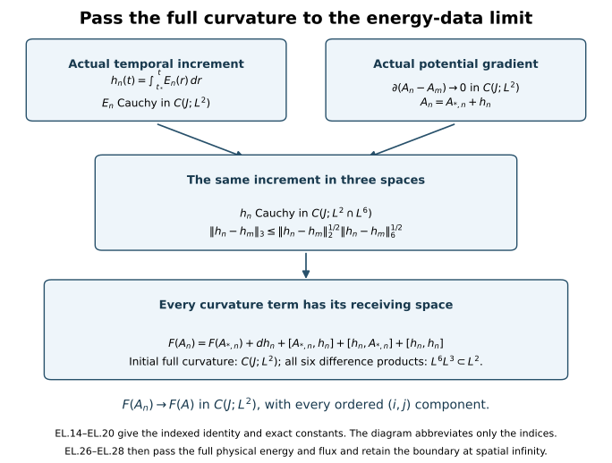

# Constructing solutions from finite-energy data

Smooth initial fields are useful for calculation, but finite energy only
controls square-integrable electric and magnetic fields. This chapter
constructs an actual evolution from data at that energy level. It proves
convergence of the potential, the electric field and the full curvature;
then it passes the equations, constraint and energy identity to the limit.

Read [constrained approximation](../classical-constrained-approximation.html),
[the common regular interval](../classical-common-regular-interval.html)
and [initial-data stability](../classical-initial-data-stability.html).
The connection is its actual \(L^6\) representative with gradient in
\(L^2\). Its full curvature must also be in \(L^2\). The construction
proves uniqueness in the explicitly defined class of limits of regular
solutions. That solution class is part of the theorem.

The diagram follows [EL.14](../classical-energy-data-limit.html#eq-EL-14)–[EL.20](../classical-energy-data-limit.html#eq-EL-20). The initial curvature is retained
separately; the actual time integral of the electric field supplies the
\(L^2\) increment needed for the nonlinear products.

## 1. Original data, norms and interval

Keep the original coordinates \((t,x)\in\mathbb R\times\mathbb R^3\),
metric \(g=\operatorname{diag}(-c^2,1,1,1)\), constants
\(c>0,\ell>0,S>0,H>0\), initial time \(t_*\), fixed unitary
representation, and invariant pairing
\(\kappa(X,Y)=-\operatorname{tr}(XY)\). Every spatial output and
derivative norm is the full ordered tuple norm. In particular,

\[
\begin{aligned}
F_{ij}(A)&=\partial_iA_j-\partial_jA_i+[A_i,A_j],\qquad
D_i^AX=\partial_iX+[A_i,X],\\
B_1&=F_{23},\quad B_2=F_{31},\quad B_3=F_{12},\qquad
\|F\|_2^2=2\|B\|_2^2,\\
\beta(A,X)_i&=\sum_{j,k}\epsilon_{ijk}[A_j,X_k],
\qquad\epsilon_{123}=1,\qquad |[X,Y]|\le2|X||Y|.
\tag{EL.1}
\end{aligned}
\]

The actual initial data, in their original temporal frame, satisfy

\[
\begin{gathered}
A_*\in L^6,\quad\partial A_*\in L^2,\quad E_*\in L^2,
\quad \sum_iD_i^{A_*}E_{*,i}=0\quad\hbox{in distributions},\\
F_*:=F(A_*)\in L^2,\qquad
d_*^2=c^{-2}\|E_*\|_2^2+\tfrac12\|F_*\|_2^2.
\tag{EL.2}
\end{gathered}
\]

The curvature assumption in the second line is separate. The potential
is the actual \(L^6\) representative, with no undetermined additive
constant and no assumed \(L^2\), \(L^3\) or \(L^4\) norm. Sobolev has its original
constant \(C_S=4/\sqrt3\): \(\|A\|_6\le C_S\|\partial A\|_2\).

Choose positive common numerical bounds \(M,D\) for
\(\|\partial A_*\|_2,d_*\), respectively. Use the original heat
reference radius \(R>4M\), for which [HG.5](../classical-caloric-gauge.html#eq-HG-5) gives
\(D_2=18\sqrt3C_MC_S\), \(D_3=12\sqrt3C_S^3\) and
\(S_R=\min\{(32D_2R)^{-4},(48D_3R^2)^{-2}\}\), and the
already selected S with the CP/FC conditions
\(S\le S_R\) and \(S^{1/4}D\le\varepsilon_*\). These are
the same heat-provider conditions as CP Section 1 and [RC.3](../classical-common-regular-interval.html#eq-RC-3). They do
not require a further reduction of S in this proof. Given arbitrary
data [EL.2](../classical-energy-data-limit.html#eq-EL-2), positive M,D and an initial admissible S can always be
selected by those explicit heat providers; the construction below
also handles equality in either of the two data bounds.

Evaluate the complete CP.46--[CP.49](../classical-initial-data-stability.html#eq-CP-49) arithmetic using these same common
individual majorants in both slots. Retain its symbols
\(i,a,b,K,g,\tau_{\rm ind}\), and put

\[
\begin{gathered}
\mu=2cK,\quad\nu=g,\quad L=\nu+\mu(1+b),\\
\tau=\begin{cases}\min(H,\tau_{\rm ind}),&L=0,\\
\min(H,\tau_{\rm ind},(2L)^{-2}),&L>0,\end{cases}
\qquad C_\rho=2\{(b+\nu\sqrt\tau)i+a\},\\
J=[t_*-T_-,t_*+T_+],\quad T_\pm\ge0,\quad
T:=T_-+T_+\le\tau.
\tag{EL.3}
\end{gathered}
\]

Every coefficient is the proved finite evaluation in CP, with its
original c,S,ell,H and both original anchors. It is not a new
stability premise. Its use here is exactly [CP.51](../classical-initial-data-stability.html#eq-CP-51) after RC proves
that the regular solutions exist on an open neighbourhood of J.
Write \(M_J=R_{\rm orig}\) for the common [UD.4a](../classical-uniform-difference.html#eq-UD-4a) upper bound for
\(\sup_J\|\partial A^0\|_2\). In particular this is the
original representative's bound, including \(Q_0\), not the different
identity-anchored FC potential bound.

## 2. Checking and completing the approximation's receiving map

Here are the operations of GA needed in this proof, with their domain
and signs checked. For an actual coefficient \(A\in L^3_{\rm loc}\),
the Hilbert space is

\[
\mathcal V_A=\{\phi\in L^6:D_A\phi\in L^2\},\qquad
\|\phi\|_{\mathcal V_A}=\|D_A\phi\|_2,
\qquad\|\phi\|_6\le C_S\|D_A\phi\|_2.
\tag{EL.4}
\]

The last inequality follows by applying the scalar Sobolev inequality
to \((|\phi|^2+\epsilon^2)^{1/2}-\epsilon\): its derivative is
\(\kappa(\phi,D_A\phi)/(|\phi|^2+\epsilon^2)^{1/2}\).
The commutator contributes zero by invariance. A cutoff \(\chi_R\)
has \(\|\partial\chi_R\|_3=C_\chi\), and its error is bounded
by \(C_\chi\|\phi\|_{L^6(R\le|x|\le2R)}\), which tends to
zero. This proves [EL.4](../classical-energy-data-limit.html#eq-EL-4) without a global \(L^3\) coefficient assumption.
If \(D_A\phi_n\) is Cauchy, [EL.4](../classical-energy-data-limit.html#eq-EL-4) gives an \(L^6\) limit; local
\(L^3\cdot L^6\subset L^2\) identifies its covariant derivative.
This proves completeness. Cutoff followed by mollification gives
density of compact smooth tests in this exact norm, with errors
\((\chi_R-1)D_A\phi+(\partial\chi_R)\phi\) and
\([A,\rho_\epsilon*(\chi_R\phi)-\chi_R\phi]\). Thus no
domain equality with ordinary homogeneous \(H^1\) was assumed.

For \(f\in L^2\), the Hilbert minimization in [GA.17](../classical-constrained-approximation.html#eq-GA-17) uniquely gives

\[
\int\kappa(D_A\phi,D_A\psi)=-\int\kappa(f,D_A\psi),
\quad P_Af=f+D_A\phi,\quad
D_A^iD_i^A\phi=-D_A^if_i.
\tag{EL.5}
\]

Here the inner products sum the full spatial tuple. The range of
\(D_A\) is closed by completeness. Hence \(P_A\) is the orthogonal
projection onto \(\ker D_A^i\), and
\(\|P_Af\|_2^2+\|D_A\phi\|_2^2=\|f\|_2^2\).
For compact smooth \(A_n,f_n\), expanding the elliptic equation gives

\[
\Delta\phi_n=-\partial^if_{n,i}-[A_n^i,f_{n,i}]
-[\partial^iA_{n,i},\phi_n]-2[A_n^i,\partial_i\phi_n]
-[A_n^i,[A_{n,i},\phi_n]].
\tag{EL.6}
\]

Its right side is compactly supported \(L^2\). Since \(A_n\in L^3\),
[EL.4](../classical-energy-data-limit.html#eq-EL-4) gives \(\partial\phi_n\in L^2\). The full Fourier identity
\(\widehat{\partial_j\partial_k\phi_n}
=\xi_j\xi_k|\xi|^{-2}\widehat{\Delta\phi_n}\) gives
\(\|\partial^{(2)}\phi_n\|_2=\|\Delta\phi_n\|_2\).
An \(L^2\) gradient has no hidden distribution supported at zero frequency.
The ordered product rule
\(\partial_J[U,V]=\sum_{I\subset\{1,\ldots,|J|\}}
[\partial_{J_I}U,\partial_{J_{I^c}}V]\), and its full three-labelled
partition version for a nested bracket, now inductively give
\(D_{A_n}\phi_n\in H_\ell^q\) for every q. All five terms and
the coefficient 2 in [EL.6](../classical-energy-data-limit.html#eq-EL-6) are retained in this induction.

The precise convergence mechanism uses the original Gauss law tested
against \(\chi_R\phi_n\), rather than a global \(L^3\) norm of A:

\[
\begin{aligned}
0&=\langle\chi_RE_*,D_{A_n}\phi_n\rangle
 +\langle E_*,(\partial\chi_R)\phi_n\rangle
 +\langle E_*,\chi_R[A_*-A_n,\phi_n]\rangle,\\
\|D_{A_n}\phi_n\|_2
&\le\|f_n-E_*\|_2+(1+C_SC_\chi)\|E_*\|_{L^2(|x|>R)}
 +2C_S\|A_n-A_*\|_{L^3(B_{2R})}\|E_*\|_2.
\tag{EL.7}
\end{aligned}
\]

The signs follow by subtracting \(E_*\) from
\(\|D_{A_n}\phi_n\|_2^2=-\langle f_n,D_{A_n}\phi_n\rangle\).
Each cutoff term is retained. On the fixed ball,

\[
\|A_n-A_*\|_3\le(32\pi/3)^{1/6}R^{1/2}\|A_n-A_*\|_6
\]

.
Choose R for the electric tail and then n. This proves convergence
of the exact Gauss correction independently of \(\|A_n\|_3\).

The separate curvature approximation is essential. Recover the actual
commutator tensor from [EL.2](../classical-energy-data-limit.html#eq-EL-2):
\([A_{*,i},A_{*,j}]=F_{*,ij}-\partial_iA_{*,j}
+\partial_jA_{*,i}\in L^2\). For \(C_R=\chi_RA_*\),

\[
\begin{aligned}
F_{ij}(C_R)-F_{*,ij}
={}&(\chi_R-1)(\partial_iA_{*,j}-\partial_jA_{*,i})
 +(\chi_R^2-1)[A_{*,i},A_{*,j}]\\
&+(\partial_i\chi_R)A_{*,j}-(\partial_j\chi_R)A_{*,i}.
\tag{EL.8}
\end{aligned}
\]

The first two terms tend to zero in full \(L^2\) by dominated convergence;
the last two cost at most
\(2C_\chi\|A_*\|_{L^6(R\le|x|\le2R)}\). For fixed R,
\(C_R\in H^1\cap L^4\), and mollification in \(H^1\) gives

\[
\|F(\rho_\epsilon*C_R)-F(C_R)\|_2
\le2\|\partial(\rho_\epsilon*C_R-C_R)\|_2
+2\|\rho_\epsilon*C_R-C_R\|_4
 (\|\rho_\epsilon*C_R\|_4+\|C_R\|_4)\longrightarrow0.
\tag{EL.9}
\]

Thus the precise cutoff-then-mollification diagonal GA.44--[GA.48](../classical-constrained-approximation.html#eq-GA-48)
does apply to [EL.2](../classical-energy-data-limit.html#eq-EL-2). With \(\delta_n=2^{-n}\ell^{-1/2}\), it gives
regular data \((A_{*,n},E_{*,n})\), with \(A_{*,n}\) compact
smooth, \(E_{*,n}\in H_\ell^\infty\), exact Gauss, and

\[
\|\partial(A_{*,n}-A_*)\|_2\le2\delta_n,\quad
\|E_{*,n}-E_*\|_2\le6c\delta_n,\quad
\|F(A_{*,n})-F_*\|_2\le2\delta_n,\quad
\|E_{*,n}\|_2\le\|E_*\|_2.
\tag{EL.10}
\]

These are precisely [RC.2](../classical-common-regular-interval.html#eq-RC-2) regular data, with separately finite magnetic
curvature and all its derivatives, because the potential is compact
smooth. The elliptic correction is not claimed to have compact support.

There is an endpoint issue if the original common bound M or D is
saturated: [EL.10](../classical-energy-data-limit.html#eq-EL-10) alone permits a small excess. The following exact
operation keeps the original bounds, even at equality. It changes
only the approximating data and tends to the unchanged original datum.
Write \(a_n=\|\partial A_{*,n}\|_2\),
\(d_n^2=c^{-2}\|E_{*,n}\|_2^2+\tfrac12\|F(A_{*,n})\|_2^2\),
and define

\[
\begin{gathered}
\lambda_n=\min\{1,M/a_n,D/d_n\}^{2},
\quad\hbox{a zero denominator contributes }+\infty,\\
\widetilde A_{*,n}(x)=\lambda_n A_{*,n}(\lambda_n x),\qquad
\widetilde E_{*,n}(x)=\lambda_n^2E_{*,n}(\lambda_n x),\\
F_{ij}(\widetilde A_{*,n})(x)
 =\lambda_n^2F_{ij}(A_{*,n})(\lambda_n x),\qquad
D_{\widetilde A_{*,n}}^i\widetilde E_{*,n,i}(x)
 =\lambda_n^3(D_{A_{*,n}}^iE_{*,n,i})(\lambda_n x)=0.
\tag{EL.11}
\end{gathered}
\]

All factors have been retained. The new fields live on the same
original x space; c,ell,S,H and the original datum are unchanged.
This is a map between approximating data, not a replacement of the
physical equation or its coordinates. Under this map the gradient,
electric and curvature \(L^2\) norms each acquire the exact factor
\(\lambda_n^{1/2}\); the potential \(L^6\) norm has the same factor.
Consequently the resulting bounds are at most M and D. The data remain
regular and exactly constrained.

Since \(a_n\to\|\partial A_*\|_2\le M\), \(d_n\to d_*\le D\),
and M,D are positive, \(\lambda_n\to1\). For any fixed \(L^p\) field with 1<=p<infinity,
\(f(\lambda x)\to f(x)\) in \(L^p\) as \(\lambda\to1\): prove it
first for compact smooth f by dominated convergence on a fixed compact
set and then use density and the exact operator norm \(\lambda^{-3/p}\).
For example,

\[
\|\partial\widetilde A_{*,n}-\partial A_*\|_2
\le\lambda_n^{1/2}\|\partial A_{*,n}-\partial A_*\|_2
+\|\lambda_n^2(\partial A_*)(\lambda_n\cdot)-\partial A_*\|_2
\longrightarrow0.
\tag{EL.12}
\]

The identical formula applies to E and F, and the corresponding
\(L^6\) formula to A. Thus [EL.11](../classical-energy-data-limit.html#eq-EL-11) preserves all the convergence needed in
[EL.10](../classical-energy-data-limit.html#eq-EL-10), though no unchanged numerical rate is claimed. From now on use
these tilded data, dropping only the index decoration; the map [EL.11](../classical-energy-data-limit.html#eq-EL-11)
and all its factors remain part of the construction. No original
field has been suppressed or altered by this notation.

## 3. Common regular solutions and the actual potential limit

RC.19--[RC.29](../classical-common-regular-interval.html#eq-RC-29), with RC.4--[RC.18](../classical-common-regular-interval.html#eq-RC-18)'s affine heat-domain construction,
apply to every datum just obtained. They give regular original
temporal solutions on an open neighbourhood of J. This use does not
replace RI's strong restart domain by energy boundedness: [RC.21](../classical-common-regular-interval.html#eq-RC-21)
first obtains the full Hessian bound from [CP.55](../classical-initial-data-stability.html#eq-CP-55); RC.22--[RC.24](../classical-common-regular-interval.html#eq-RC-24) then
give all Xq bounds and strong endpoints; [RC.27](../classical-common-regular-interval.html#eq-RC-27) runs the actual RI
iteration at that endpoint in the same affine chart. Hence the
existence interval in this paragraph has already been proved, with
the same S and anchors and without a uniform higher initial norm.

Set

\[
\epsilon_{nm}=\|\partial(A_{*,n}-A_{*,m})\|_2
+c^{-1}\|E_{*,n}-E_{*,m}\|_2.
\]

The accepted [CP.51](../classical-initial-data-stability.html#eq-CP-51) estimate on the now existing interval gives

\[
\sup_J\|\partial(A_n^0-A_m^0)\|_2
+c^{-1}\sup_J\|E_n^0-E_m^0\|_2
\le C_\rho\epsilon_{nm}\longrightarrow0.
\tag{EL.13}
\]

Sobolev gives C(J;\(L^6\)) convergence of the actual potentials. Completeness
of C(J;\(L^2\)), C(J;\(L^6\)), and distributional testing identify limits
\(A^0,E^0\) with
\(A^0\in C(J;L^6)\), \(\partial A^0\in C(J;L^2)\),
\(E^0\in C(J;L^2)\). The actual initial values are \(A_*\),E* by
[EL.12](../classical-energy-data-limit.html#eq-EL-12) and [EL.13](../classical-energy-data-limit.html#eq-EL-13). Distributional differentiation commutes with these
limits, since testing against a compact smooth derivative is continuous
in the displayed local Lebesgue norms.

The exact temporal increments, including the orientation for t<t*, are

\[
h_n(t)=A_n^0(t)-A_{*,n}=\int_{t_*}^tE_n^0(u)\,du,
\qquad h(t)=\int_{t_*}^tE^0(u)\,du.
\tag{EL.14}
\]

These are Bochner \(L^2\) integrals. Their differences obey

\[
\begin{aligned}
\sup_J\|h_n-h_m\|_2&\le cTC_\rho\epsilon_{nm},\\
\sup_J\|\partial(h_n-h_m)\|_2
 &\le(C_\rho+1)\epsilon_{nm},\\
h_n&\longrightarrow h\quad\hbox{in }C(J;H_\ell^1),
\qquad A^0=A_*+h,\qquad h\in C^1(J;L^2),\quad h_t=E^0.
\tag{EL.15}
\end{aligned}
\]

The \(H^1\) norm is exactly
\(\|v\|_{H_\ell^1}^2=\|v\|_2^2+\ell^2\|\partial v\|_2^2\).
The identity A0=\(A_*\)+h follows by the \(L^6\) limit and distributional
testing of [EL.14](../classical-energy-data-limit.html#eq-EL-14). It does not assert that \(A_*\) or A0 lies in \(L^2\).
The endpoint derivatives of h are the one-sided \(L^2\) derivatives on
the closed interval, equivalently restrictions of its integral formula.

## 4. The global \(L^2\) curvature calculation

This step resolves the missing product on all of R3. For any
\(v\in L^2\cap L^6\), Holder gives
\(\|v\|_3\le\|v\|_2^{1/2}\|v\|_6^{1/2}\).
Energy conservation of the regular solutions and their original
gradient bounds therefore give

\[
\begin{gathered}
p=C_S(M_J+M),\qquad q=cTD,\qquad r=(pq)^{1/2},\\
\sup_J\|h_n\|_6\le p,\quad
\sup_J\|h_n\|_2\le q,\quad\sup_J\|h_n\|_3\le r,\\
z_T=\{cTC_SC_\rho(C_\rho+1)\}^{1/2},\qquad
\sup_J\|h_n-h_m\|_3\le z_T\epsilon_{nm}.
\tag{EL.16}
\end{gathered}
\]

No \(L^4\) bound on \(A_*\) is used. All these statements pass to h by their
strong limits. For T=0 the increments and r,zT are zero.

For two actual paths write \(u=A_*-A_*'\), \(v=h-h'\).
The full ordered curvature difference is

\[
\begin{aligned}
F_{ij}(A_*+h)-F_{ij}(A_*'+h')
={}&F_{*,ij}-F_{*,ij}' +\partial_iv_j-\partial_jv_i\\
&+[u_i,h_j]+[A_{*,i}',v_j]
 +[v_i,A_{*,j}]+[h_i',u_j]\\
&+[v_i,h_j]+[h_i',v_j].
\tag{EL.17}
\end{aligned}
\]

This follows by first retaining the initial full curvature and then
expanding \([A_{*,i},h_j]+[h_i,A_{*,j}]+[h_i,h_j]\).
The two placements in each of those three products give exactly the
six brackets displayed. Their order has not been interchanged.
For full vector tuples the pointwise bracket inequality gives
\(\|[X_i,Y_j]_{ij}\|_2\le2\|X\|_6\|Y\|_3\).
The two derivative placements cost at most \(2\|\partial v\|_2\).
Consequently

\[
\begin{aligned}
\|F(A_*+h)-F(A_*'+h')\|_2
\le{}&\|F_*-F_*'\|_2+2\|\partial v\|_2\\
&+2\|u\|_6(\|h\|_3+\|h'\|_3)\\
&+2\|v\|_3(\|A_*\|_6+\|A_*'\|_6+\|h\|_6+\|h'\|_6).
\tag{EL.18}
\end{aligned}
\]

For the common family this proves the explicit bound

\[
\begin{gathered}
K_F(T)=2(C_\rho+1)+4C_Sr+4(C_SM+p)z_T,\\
\sup_J\|F(A_n^0)-F(A_m^0)\|_2
\le\|F(A_{*,n})-F(A_{*,m})\|_2+K_F(T)\epsilon_{nm}
\longrightarrow0.
\tag{EL.19}
\end{gathered}
\]

The full curvature tuple has unit length to the power -1/2 in \(L^2\);
M,D,MJ and epsilon have that unit. The increment's \(L^2\) norm q has
unit length to the power 1/2; p has unit length to the power -1/2;
r is dimensionless; zT has unit length to the power 1/2. Thus \(K_F\) is
dimensionless and every term in [EL.19](../classical-energy-data-limit.html#eq-EL-19) has the original curvature unit.

The limit is the actual curvature of A0. One direct identification is
[EL.17](../classical-energy-data-limit.html#eq-EL-17) with a single path: all its mixed products are C(J;\(L^2\)), so

\[
F_{ij}(A^0)=F_{*,ij}+\partial_ih_j-\partial_jh_i
 +[A_{*,i},h_j]+[h_i,A_{*,j}]+[h_i,h_j]
\in C(J;L^2).
\tag{EL.20}
\]

Alternatively A_n0 converges in C \(L^6\), so its bracket tensor converges
in C \(L^3\) by the two exact product placements; this identifies the
distributional limit with the strong \(L^2\) limit in [EL.19](../classical-energy-data-limit.html#eq-EL-19). Both routes
give the same original full formula. In particular
\(B^0=(F_{23}^0,F_{31}^0,F_{12}^0)\in C(J;L^2)\), and

\[
\sup_J\|B_n^0-B^0\|_2=2^{-1/2}\sup_J\|F_n^0-F^0\|_2
\]

.

## 5. Every original field equation and constraint

The regular equations, with the original signs and speed, are

\[
\partial_tA_n^0=E_n^0,\qquad
\partial_tE_n^0=-c^2\{\operatorname{curl}B_n^0+\beta(A_n^0,B_n^0)\},
\qquad
\partial_tB_n^0=\operatorname{curl}E_n^0+\beta(A_n^0,E_n^0).
\tag{EL.21}
\]

For X=E or B their nonlinear difference has both actual placements:

\[
\beta(A_n^0,X_n^0)-\beta(A^0,X^0)
=\beta(A_n^0-A^0,X_n^0)+\beta(A^0,X_n^0-X^0).
\tag{EL.22}
\]

Its C(J;\(L^3\)/2) norm tends to zero, bounded by

\[
12\|A_n^0-A^0\|_{C L^6}\|X_n^0\|_{C L^2}
+12\|A^0\|_{C L^6}\|X_n^0-X^0\|_{C L^2}
\]

.
The constant 12 retains all six curl-bracket summands. Testing [EL.21](../classical-energy-data-limit.html#eq-EL-21)
against compact smooth spacetime fields and integrating derivatives
therefore passes every term to the limit. This proves exactly [EL.21](../classical-energy-data-limit.html#eq-EL-21)
with the subscript n removed, in spacetime distributions, and the
first equation also holds strongly in \(L^2\) by [EL.15](../classical-energy-data-limit.html#eq-EL-15).

There is actual time regularity for the other two equations. Let
\(H^{-1}\) denote the dual of the original \(H_\ell^1\), with its full
ordered norm. Sobolev and interpolation give
\(\|\psi\|_3\le C_S^{1/2}\ell^{-1/2}\|\psi\|_{H_\ell^1}\),
while \(\|\operatorname{curl}\psi\|_2
\le\|\partial\psi\|_2\le\ell^{-1}\|\psi\|_{H_\ell^1}\)
by the Fourier cross-product identity. Hence

\[
\begin{aligned}
\|\partial_tE^0(t)\|_{H_\ell^{-1}}
&\le c^2\{\ell^{-1}+12C_S^{1/2}\ell^{-1/2}\|A^0(t)\|_6\}
                           \|B^0(t)\|_2,\\
\|\partial_tB^0(t)\|_{H_\ell^{-1}}
&\le\{\ell^{-1}+12C_S^{1/2}\ell^{-1/2}\|A^0(t)\|_6\}
                           \|E^0(t)\|_2.
\tag{EL.23}
\end{aligned}
\]

The right sides of the equations themselves are continuous \(H^{-1}\)
fields by [EL.22](../classical-energy-data-limit.html#eq-EL-22). The distributional equations and their continuous
initial values consequently give the exact oriented Bochner integral
equations there, and E0,B0 belong to C1(J;\(H^{-1}\)). To see the
identification without assuming it, subtract the integral from the
field, test its zero time derivative against scalar time tests and
spatial \(H^1\) tests, and use continuity: the difference is the constant
initial value.

The constraints pass at every time, not only for almost every time:
the regular solutions obey
\(\sum_iD_i^{A_n^0}E_{n,i}^0=0\) and
\(\sum_iD_i^{A_n^0}B_{n,i}^0=0\). Their linear terms converge in
spatial distributions uniformly in time, and their bracket sums
converge in C \(L^3\)/2 by the same two placements, with constant 2 in
place of the curl bound. Therefore

\[
\sum_iD_i^{A^0}E_i^0=0,\qquad
\sum_iD_i^{A^0}B_i^0=0\quad(t\in J).
\tag{EL.24}
\]

Define \(A_t^0=0\), \(F_{ti}^0=E_i^0\), \(F_{it}^0=-E_i^0\),
\(F_{tt}^0=0\), and retain the spatial curvature [EL.20](../classical-energy-data-limit.html#eq-EL-20). Then

\[
D^\mu F_{\mu\nu}^0=0,\qquad
D_\alpha F_{\beta\gamma}^0+D_\beta F_{\gamma\alpha}^0
 +D_\gamma F_{\alpha\beta}^0=0
\quad\hbox{in distributions}.
\tag{EL.25}
\]

Indeed the spatial Yang--Mills equation is
\(-c^{-2}\partial_tE_i^0+D^jF_{ji}^0=0\), and
\(D^jF_{ji}^0=-(\operatorname{curl}B^0+\beta(A^0,B^0))_i\).
The time component is minus the first constraint in [EL.24](../classical-energy-data-limit.html#eq-EL-24). The
time-spatial Bianchi equation is
\(\partial_tF_{ij}^0=D_iE_j^0-D_jE_i^0\), which is the last
equation of [EL.21](../classical-energy-data-limit.html#eq-EL-21) with each epsilon placement retained; the purely
spatial one is the second constraint. Thus every index case of [EL.25](../classical-energy-data-limit.html#eq-EL-25)
has been checked in the original metric.

## 6. Energy equality, including spatial infinity

Define the original density and flux without changing their factors:

\[
\begin{aligned}
e(t,x)&=\frac{\hbar}{g_{\rm YM}^2}
       \{c^{-1}\sum_i\kappa(E_i^0,E_i^0)
                          +c\sum_i\kappa(B_i^0,B_i^0)\},\\
\mathcal S_i(t,x)&=-\frac{2\hbar c}{g_{\rm YM}^2}
       \sum_{j,k}\epsilon_{ijk}\kappa(E_j^0,B_k^0),
\qquad\mathcal E(t)=\int e(t,x)\,d^3x.
\tag{EL.26}
\end{aligned}
\]

Strong C \(L^2\) convergence of E and B gives strong C L1 convergence of
both \(e_n\) and S_n: for squares use

\[
\||X|^2-|Y|^2\|_1\le(\|X\|_2+\|Y\|_2)\|X-Y\|_2
\]

,
and for the flux use the two product placements and Cauchy--Schwarz.
The regular local energy identity F9.35 therefore passes to

\[
\partial_te+\operatorname{div}\mathcal S=0,
\qquad|\mathcal S\cdot n|\le ce\quad(|n|=1).
\tag{EL.27}
\]

The inequality follows directly from
\(|\mathcal S\cdot n|\le(2\hbar c/g_{\rm YM}^2)|E^0||B^0|\)
and \(2|E^0||B^0|\le c^{-1}|E^0|^2+c|B^0|^2\).

Energy is conserved with equality. One proof is uniform convergence
of its integrals and the already proved regular equality:

\[
\mathcal E(t)=\lim_n\mathcal E_n(t)=\lim_n\mathcal E_n(t_*)
 =\frac{\hbar}{g_{\rm YM}^2}
       \{c^{-1}\|E_*\|_2^2+\tfrac c2\|F_*\|_2^2\}
 =\mathcal E(t_*)\quad(t\in J).
\tag{EL.28}
\]

There is also no unaccounted flux at infinity. Choose a cutoff with
\(\|\partial\chi_R\|_\infty\le C_\chi'/R\). Integrating [EL.27](../classical-energy-data-limit.html#eq-EL-27)
against it between any u,t in J gives a boundary term bounded by
\((cC_\chi'/R)|t-u|\sup_J\mathcal E\), which tends to zero.
The energy terms converge by dominated convergence. This proves the
same equality directly from the limit's local balance. Its global
continuity makes both endpoints legitimate. No lower-semicontinuity
argument has been substituted for the proved strong convergence.

## 7. Exact solution class, approximation independence and stability

Let \(\mathcal D_{\rm curv}\) be [EL.2](../classical-energy-data-limit.html#eq-EL-2)'s constrained data space with
the actual \(L^6\) potential, and define its two metrics

\[
\begin{aligned}
d_c(U_*,U_*')&=\|\partial(A_*-A_*')\|_2+c^{-1}\|E_*-E_*'\|_2,\\
d_{c,F}(U_*,U_*')&=d_c(U_*,U_*')+\|F(A_*)-F(A_*')\|_2.
\tag{EL.29}
\end{aligned}
\]

The graph space with the second metric is complete. A Cauchy sequence
has an \(L^6\)/gradient-\(L^2\) potential limit and an \(L^2\) electric limit.
The local product argument [EL.22](../classical-energy-data-limit.html#eq-EL-22) closes Gauss. The \(L^2\) curvature
limit is its actual curvature because the brackets converge in \(L^3\)
and the derivatives in distributions. This proves every graph
identification rather than adjoining an independent curvature field.

On the bounded data set fixed in Section 1 define the solution class
\(\mathfrak S_{M,D}(J)\) as follows. A path is in the class if it
is a limit in

\[
A_n^0\longrightarrow A^0\text{ in }C(J;L^6),\quad
\partial A_n^0\longrightarrow\partial A^0\text{ in }C(J;L^2),\quad
E_n^0\longrightarrow E^0\text{ in }C(J;L^2)
\tag{EL.30}
\]

of regular original temporal solutions with original initial bounds
M,D and with initial data converging in \(d_{c,F}\). Curvature
convergence, the affine time increment, all equations, energy equality,
and preservation of anchors are conclusions, not additional assumed
properties of the approximation in this definition. Sections 2--6
prove that this class contains a solution for every datum in the
bounded set. The definition is the concrete completion of the regular
solution map on its initial graph topology; it is not an unspecified
existence or uniqueness condition.

Take any two such regular sequences. Their cross pairs satisfy
[EL.13](../classical-energy-data-limit.html#eq-EL-13), so sending both indices to infinity proves

\[
\sup_J\|\partial(A^0-A^{0\prime})\|_2
+c^{-1}\sup_J\|E^0-E^{0\prime}\|_2
\le C_\rho d_c(U_*,U_*').
\tag{EL.31}
\]

Uniform norm convergence justifies the separate suprema in this
passage. In particular identical initial data give identical electric
fields and gradients. Sobolev in the fixed \(L^6\) representatives gives
identical potentials, not merely potentials differing by a constant.
Their actual curvatures are then identical by [EL.20](../classical-energy-data-limit.html#eq-EL-20). Thus any two
regular approximations of the same data give the same path. This
proves approximation independence and uniqueness in the class [EL.30](../classical-energy-data-limit.html#eq-EL-30).
Regular paths themselves are in this class by their constant sequence,
so the construction extends the original regular map exactly.

For the increments and the full curvature, [EL.15](../classical-energy-data-limit.html#eq-EL-15) and [EL.18](../classical-energy-data-limit.html#eq-EL-18) also pass
to any such pair. Writing \(\delta_*=d_c(U_*,U_*')\), they give

\[
\begin{aligned}
\ell^{-1}\sup_J\|(A^0-A_*)-(A^{0\prime}-A_*')\|_2
 &\le(cT/\ell)C_\rho\delta_*,\\
\sup_J\|F(A^0)-F(A^{0\prime})\|_2
 &\le\|F_*-F_*'\|_2+K_F(T)\delta_*.
\tag{EL.32}
\end{aligned}
\]

Consequently the map into the full C-in-time graph topology is
Lipschitz on this bounded set, with coefficient
\(\max\{C_\rho+K_F(T),1\}\) when the output norm is the sum
of the two left-side norms in [EL.31](../classical-energy-data-limit.html#eq-EL-31) and the curvature norm in [EL.32](../classical-energy-data-limit.html#eq-EL-32).
Adding the affine-increment norm costs the displayed
\((cT/\ell)C_\rho\). The actual potential \(L^6\) difference costs
at most \(C_SC_\rho\delta_*\). If the initial potential difference
also belongs to \(L^2\), the full temporal identity gives additionally

\[
\ell^{-1}\sup_J\|A^0-A^{0\prime}\|_2
\le\ell^{-1}\|A_*-A_*'\|_2+(cT/\ell)C_\rho\delta_*.
\tag{EL.33}
\]

Thus the original affine topology has not been replaced by an
inhomogeneous condition on every potential. Initial curvature
convergence is required for the full graph continuity assertion;
gradient/\(L^6\) convergence alone has not been asserted to supply it.

These definitions and estimates also give the exact relation to the
larger weak class: every member of [EL.30](../classical-energy-data-limit.html#eq-EL-30) is a distributional solution
with the regularity in [EL.15](../classical-energy-data-limit.html#eq-EL-15), [EL.20](../classical-energy-data-limit.html#eq-EL-20) and [EL.23](../classical-energy-data-limit.html#eq-EL-23) and energy equality.
No proof here identifies every path satisfying only those weak
equations with this closure. The completed theorem is the existence,
uniqueness and Lipschitz solution map on the explicitly constructed
regular-approximation class, as is appropriate to this limit operation.

## 8. The original heat and temporal anchors survive the limit

This section records the actual connecting maps, rather than erasing
the auxiliary gauges when taking the limit. For each regular member
use exactly the RC.28--[RC.29](../classical-common-regular-interval.html#eq-RC-29) and [CP.43](../classical-initial-data-stability.html#eq-CP-43) construction. Write \(a_n\) for
its caloric-temporal potential on \([0,S]\), \(e_n\) for its heat electric
field, and \(b_n\)=a_{n,t}(0). Use \(V_{0,n}\) only for the original initial
DeTurck-to-caloric heat ODE, and retain

\[
\begin{gathered}
(V_{0,n})_s=V_{0,n}\operatorname{div}D_n(t_*,s),\quad
V_{0,n}(t_*,0)=I,\quad Q_{0,n}=V_{0,n}(t_*,S),\\
(U_n)_t=U_nb_n,\quad U_n(t_*)=I,\qquad
a_{n,s}=0,\quad a_{n,t}(S)=0,\\
A_n^0=Q_{0,n}\cdot(U_n\cdot a_n(0)),\qquad
E_n^0=\operatorname{Ad}(Q_{0,n}U_n)e_n(0).
\tag{EL.34}
\end{gathered}
\]

Here D_n is the original initial DeTurck spatial potential and the
dot action is \(P\cdot a=PaP^{-1}-(\partial P)P^{-1}\).
The group variable U is not the temporal tension W=Fst. Both spatial
and temporal heat endpoints in [EL.34](../classical-energy-data-limit.html#eq-EL-34) are the original ones.

We check convergence of the maps using the already proved providers.
[CP.51](../classical-initial-data-stability.html#eq-CP-51) bounds its actual nine wave norms by a constant times
\(\epsilon_{nm}\). [CP.41](../classical-initial-data-stability.html#eq-CP-41) and [CR.23](../classical-original-gauge-reconstruction.html#eq-CR-23) therefore bound
\(\sup_{t,s}\|\partial_x(a_n-a_m)\|_2\) and
\(\sup_{t,s}c^{-1}\|\partial_t(a_n-a_m)\|_2\)
by a constant times \(\epsilon_{nm}\). Sobolev controls the corresponding
\(L^6\) potentials. These statements include both heat endpoints by the
proved backward heat identity [CR.23](../classical-original-gauge-reconstruction.html#eq-CR-23). Thus \(a_n\) converges in the
continuous \(L^6\) and gradient-\(L^2\) spaces on \(J\times[0,S]\), and its
time derivative converges in continuous \(L^2\). The affine physical-time
increments of a are consequently genuine \(L^2\) Bochner integrals.

For completeness, the field seminorm provider in this use is [CP.41](../classical-initial-data-stability.html#eq-CP-41),
not an asserted inequality between independently evaluated FI upper
arrays. In the other coefficient slots retain the numerical FI/UD
providers, whose actual difference inputs are [EL.13](../classical-energy-data-limit.html#eq-EL-13). In particular
UD.2--[UD.3](../classical-uniform-difference.html#eq-UD-3) give the actual electric \(L^2\) supremum estimate uniformly
on \(J\times[0,S]\), so \(e_n\)
converges there in \(L^2\), including its actual heat-zero value.
The finite recurrences are nonnegative homogeneous degree-one maps
in their difference inputs (CP Section 10); with the fixed common
individual inputs and [EL.13](../classical-energy-data-limit.html#eq-EL-13) every such coefficient tends to zero.

The full temporal component also has a strong heat-zero limit.
Let \(v_0^{nm},v_1^{nm}\) be the actual UD.16--[UD.18](../classical-uniform-difference.html#eq-UD-18) coefficients
for \(V_{nm}=W_n-W_m\). They tend to zero as just shown and give
\(\|V_{nm}(t,s)\|_2\le v_0^{nm}s^{-1/4}\),
\(\|\partial V_{nm}(t,s)\|_2\le v_1^{nm}s^{-3/4}\).
The exact signed identity
\(a_{n,t}(s)-a_{m,t}(s)=-\int_s^S V_{nm}(r)\,dr\) yields

\[
\begin{aligned}
\|a_{n,t}(s)-a_{m,t}(s)\|_2
 &\le\tfrac43 v_0^{nm}(S^{3/4}-s^{3/4}),\\
\|\partial(a_{n,t}(s)-a_{m,t}(s))\|_2
 &\le4v_1^{nm}(S^{1/4}-s^{1/4}),\\
\|a_{n,t}(s)-a_{m,t}(s)\|_3
 &\le2C_S^{1/2}\sqrt{v_0^{nm}v_1^{nm}}(\sqrt S-\sqrt s).
\tag{EL.35a}
\end{aligned}
\]

The last line integrates the pointwise \(L^2\)/\(L^6\) interpolation for V,
whose exact heat power is \(s^{-1/2}\). These estimates are uniform
in t and preserve both finite heat endpoints. Thus a_t converges in
continuous \(L^2\), \(L^3\) and gradient-\(L^2\) on the whole heat-time rectangle;
its value at S is exactly zero, and its value at zero is b. The same
integrable individual bounds show continuity at both endpoints.

The heat spatial curvature has the same global \(L^2\) property as the
physical curvature, with its full original formula. To verify this,
put 

\[
k_n(t,s)=a_n(t,s)-a_n(t,0)=\int_0^sG_n(t,r)\,dr
\]

.
[UD.2](../classical-uniform-difference.html#eq-UD-2) gives \(\|k_n\|_2\le2\sqrt S J_0\) and
\(\|k_n-k_m\|_2\le2\sqrt S J_0^{nm}\), where the difference
coefficient tends to zero. The already proved gradient estimate
gives \(\|\partial(k_n-k_m)\|_2\le2Y_{nm}\to0\).
Thus \(k_n\) is Cauchy in \(L^2\) and \(L^6\), hence \(L^3\), uniformly on the
heat-time rectangle. Its initial full curvature at heat zero
converges by [EL.39](../classical-energy-data-limit.html#eq-EL-39) below and the physical curvature result [EL.19](../classical-energy-data-limit.html#eq-EL-19).
Apply the complete six-placement identity [EL.17](../classical-energy-data-limit.html#eq-EL-17) with base \(a_n\)(t,0)
and increment \(k_n\)(t,s). Each product is again \(L^6\) times \(L^3\). This proves
\(F(a_n)\to F(a)\) in continuous \(L^2\) on \(J\times[0,S]\), with
the actual heat-zero boundary and all its original indices.

The particular boundary estimates needed to pass the group ODEs are
[CR.35](../classical-original-gauge-reconstruction.html#eq-CR-35), [CR.45](../classical-original-gauge-reconstruction.html#eq-CR-45) and [CR.49](../classical-original-gauge-reconstruction.html#eq-CR-49)–[CR.52](../classical-original-gauge-reconstruction.html#eq-CR-52), with TD.25--[TD.27](../classical-temporal-difference.html#eq-TD-27). They state, for
the actual difference \(b_n\)-b_m, convergence in

\[
C(J;L^3),\quad \partial_x(b_n-b_m)\longrightarrow0
 \text{ in }C(J;L^2),\quad
\|b_n-b_m\|_{L^1(J;L^\infty)}\longrightarrow0,
\tag{EL.35}
\]

and convergence to zero of the L1-in-time norms of its spatial
gradient in \(L^3\) and \(L^6\) and its Hessian in \(L^2\). [CR.35](../classical-original-gauge-reconstruction.html#eq-CR-35) retains its two
initial b differences; [CR.45](../classical-original-gauge-reconstruction.html#eq-CR-45) bounds those from the actual initial
data. The four time integrals are exactly [TD.27](../classical-temporal-difference.html#eq-TD-27), with their factor
\(\sqrt T\), not an unproved boundary trace. The individual
FC.20--[FC.22](../classical-finite-wave-bound.html#eq-FC-22) bounds are finite in the same spaces.

[CR.38](../classical-original-gauge-reconstruction.html#eq-CR-38)–[CR.43](../classical-original-gauge-reconstruction.html#eq-CR-43) at the initial physical time, and [CR.49](../classical-original-gauge-reconstruction.html#eq-CR-49)–[CR.52](../classical-original-gauge-reconstruction.html#eq-CR-52) on J,
now give

\[
\begin{gathered}
Q_{0,n}\to Q_0\text{ in }L^\infty,\qquad
\partial Q_{0,n}\to\partial Q_0\text{ in }L^3,\\
U_n\to U\text{ in }C(J;L^\infty),\qquad
K_n=(\partial U_n)U_n^{-1}\to K
 \text{ in }C(J;L^3\cap L^6),\qquad
\partial K_n\to\partial K\text{ in }C(J;L^2).
\tag{EL.36}
\end{gathered}
\]

Uniform limits retain membership in the closed unitary group.
The exact inverse formula identifies K as \((\partial U)U^{-1}\)
by testing derivatives. [EL.35](../classical-energy-data-limit.html#eq-EL-35) and bounded group multiplication pass
\(U_n(t)=I+\int_{t_*}^tU_n b_n\) to its \(L^\infty\) integral
equation. This proves \(U_t=Ub\) and \(U(t_*)=I\), with uniqueness:
the difference of two such integral solutions is bounded by the
integral of its norm times \(\|b(t)\|_\infty\), and iteration of
that integral inequality gives zero. The initial heat ODE is treated
in the same way. FI.8--[FI.9](../classical-fixed-heat-comparison.html#eq-FI-9) and [CR.38](../classical-original-gauge-reconstruction.html#eq-CR-38)–[CR.41](../classical-original-gauge-reconstruction.html#eq-CR-41) give its integrable difference
coefficient proportional to \(s^{-3/4}\) on the original [0,S].
Therefore \(V_0\) has exactly \(V_0\)(t*,0)=I and \(Q_0\)=\(V_0\)(t*,S).

The stronger derivative spaces of \(Q_0\) needed by the affine action
also converge; no initial gauge Hessian hypothesis is needed. The
actual anchor equation is

\[
\partial_iQ_{0,n}=Q_{0,n}a_{n,i}(t_*,0)-A_{*,n,i}Q_{0,n}.
\tag{EL.37}
\]

Its right side converges in \(L^6\) by [EL.12](../classical-energy-data-limit.html#eq-EL-12) and the proved a convergence.
Differentiate it once, retaining the four terms

\[
\partial_j\partial_iQ_{0,n}
=(\partial_jQ_{0,n})a_{n,i}
+Q_{0,n}\partial_ja_{n,i}
-(\partial_jA_{*,n,i})Q_{0,n}
-A_{*,n,i}\partial_jQ_{0,n}\quad\text{at }t_*.
\tag{EL.38}
\]

The first and last products converge in \(L^2\) by \(L^3\) times \(L^6\); the
middle two converge in \(L^2\) directly. Hence \(Q_0\)'s first derivative
converges in \(L^6\) and its full ordered Hessian in \(L^2\). Multiplying
by the inverse gives convergence of
\(K_{0,n}=(\partial Q_{0,n})Q_{0,n}^{-1}\) in \(L^3\) and \(L^6\),
and of \(\partial K_{0,n}\) in \(L^2\), since its extra product is
\(L^3\) times \(L^6\).

Put \(P=Q_0U\). Its exact spatial logarithmic derivative and
the full recovered potential are

\[
\begin{aligned}
(\partial P)P^{-1}&=K_0+\operatorname{Ad}(Q_0)K,\\
A^0&=Q_0Ua(0)U^{-1}Q_0^{-1}
       -Q_0(\partial U)U^{-1}Q_0^{-1}
       -(\partial Q_0)Q_0^{-1},\\
E^0&=Q_0Ue(0)U^{-1}Q_0^{-1}.
\tag{EL.39}
\end{aligned}
\]

Every term is the strong limit of its regular counterpart: potentials
in C \(L^6\), their derivatives in C \(L^2\) using \(L^3\) times \(L^6\), and electric
fields in C \(L^2\). Thus these identities recover precisely the original
physical limit already constructed in Sections 3--5. At t*, P=\(Q_0\),
which is generally not the identity; the original heat anchor has
not been reset. For the heat-zero curvature, the regular identity
\(F(a_n(0))=\operatorname{Ad}(P_n^{-1})F(A_n^0)\) and strong \(L^2\)
convergence give the same identity for the actual limiting curvature,
identified by the \(L^6\)/gradient distributional product formula.

Finally \(a_s=0\) and \(a_t(S)=0\) pass directly from the
regular identities and the temporal boundary integrals. At heat zero
the exact heat equations have
\(W(0)=-D^je_j(0)=0\) and
\(w_i(0)=c^{-2}D_te_i(0)-D^jF_{ji}(a(0))=0\) in distributions.
These equalities follow from EL.24--[EL.25](../classical-energy-data-limit.html#eq-EL-25) and the actual gauge map
[EL.39](../classical-energy-data-limit.html#eq-EL-39); the gauge product rules are legitimate as limits of the strong
products just proved. More explicitly, as s decreases to zero,
\(a(s)\to a(0)\) in C \(L^6\), \(e(s)\to e(0)\) in C \(L^2\),
\(F(a(s))\to F(a(0))\) in C \(L^2\), and
\(a_t(s)\to b\) in C \(L^3\) by [EL.35a](../classical-energy-data-limit.html#eq-EL-35a). Therefore
\(D^je_j(s)\to D^je_j(0)\) in spacetime distributions by the
two bracket placements in \(L^3\)/2. Likewise
\(D^jF_{ji}(s)\to D^jF_{ji}(0)\) in distributions. Finally
\(D_te(s)=\partial_te(s)+[a_t(s),e(s)]\) converges to its
heat-zero value: the derivative passes by testing and the bracket
converges in C \(L^6\)/5. Hence both tension traces are the displayed
zero distributions, rather than presumed \(L^2\) traces. The positive-heat
FI/UD spatial regularity and these same product limits justify the
heat identities for s>0. No \(L^2\) trace of a higher tension derivative
at s=0 is asserted.
Repeating this construction for a primed datum preserves its own
\(Q_0\) prime, U prime and both anchors. Their cross differences are the
same actual paired and reconstruction differences used above.

## 9. Translations and the exact scope of the result

For every displacement y in the original R3, translate both a regular
approximating sequence and its data by \(\mathsf T_yf(x)=f(x+y)\).
The original equations and constraints commute with this operation;
all individual bounds, c,S,ell,H and the interval remain unchanged.
The heat and temporal ODEs have the same translated coefficients and
the same identity anchors, so uniqueness identifies their translated
maps. Approximation independence then proves that the limiting
solution map commutes with every actual translation, including \(Q_0\)
and U. In particular

\[
\sup_J\|\partial(\mathsf T_yA^0-A^0)\|_2
+c^{-1}\sup_J\|\mathsf T_yE^0-E^0\|_2
\le C_\rho\{
\|\partial(\mathsf T_yA_*-A_*)\|_2
+c^{-1}\|\mathsf T_yE_*-E_*\|_2\}.
\tag{EL.40}
\]

The curvature translation difference has the additional initial full
curvature term and coefficient \(K_F\) in [EL.32](../classical-energy-data-limit.html#eq-EL-32). These are exact
persistence statements in the constructed energy class. If
\(\partial_j\partial A_*\) and \(\partial_jE_*\) also belong
to \(L^2\), divide [EL.40](../classical-energy-data-limit.html#eq-EL-40) by the displacement in the j direction. The
initial quotients converge strongly by the Fourier multiplier
\((e^{ih\xi_j}-1)/h\), dominated by \(|\xi_j|\). Bounded
\(L^2\) quotients of the later fields have weak subsequential limits;
testing identifies them as the derivatives. Weak lower
semicontinuity, applied to independent choices of the two time
suprema, proves

\[
\sup_J\|\partial_j\partial A^0\|_2
+c^{-1}\sup_J\|\partial_jE^0\|_2
\le C_\rho\{\|\partial_j\partial A_*\|_2
                         +c^{-1}\|\partial_jE_*\|_2\}.
\tag{EL.41}
\]

This conclusion is a bounded-derivative persistence statement; strong
continuity of these additional derivatives is not inferred from weak
compactness alone.

The exact relation to the human source's additional \(L^3\) data condition
can also be proved. If \(A_*\) belongs to \(L^3\) as well as \(L^6\), interpolation
gives \(\|A_*\|_4^2\le\|A_*\|_3\|A_*\|_6\), so the
original commutator tensor belongs to \(L^2\) and [EL.2](../classical-energy-data-limit.html#eq-EL-2)'s finite-curvature
condition follows from its full formula. The GA cutoff and mollifier
sequence converges in \(L^3\) in this case: its error is bounded by
\(\|\rho_{\epsilon_n}*A_*-A_*\|_3
+\|(\chi_{2r_n}-1)A_*\|_3\), with both terms tending to zero.
The extra [EL.11](../classical-energy-data-limit.html#eq-EL-11) operation retains this convergence by the same
strong dilation argument used in [EL.12](../classical-energy-data-limit.html#eq-EL-12). Together with the proved
C \(L^3\) convergence of \(h_n\), this gives convergence of the actual
regular solutions in C \(L^3\), and

\[
\begin{aligned}
\sup_J\|A^0\|_3&\le\|A_*\|_3+r,\\
\sup_J\|A^0-A^{0\prime}\|_3
 &\le\|A_*-A_*'\|_3+z_Td_c(U_*,U_*')
 \quad\hbox{if }A_*-A_*'\in L^3.
\tag{EL.42}
\end{aligned}
\]

Hence on the \(L^3\) subdomain this construction has the original
admissible-solution topology in Oh's `def:admSol`. For the larger
data class it retains the affine \(L^3\) increment while preserving the
actual \(L^6\) initial potential. This is an explicit inclusion and
extension of the topology, not an assertion that the source proved
the larger domain or used these same lifetime constants.

Thus the common interval [EL.3](../classical-energy-data-limit.html#eq-EL-3) carries a unique solution in the exact
regular-approximation class for every original datum [EL.2](../classical-energy-data-limit.html#eq-EL-2). Its actual
potential, electric field and full curvature converge in the stated
global spaces; all original equations and constraints hold; energy
has equality; both initial gauges and both heat/time endpoints retain
their actual maps. The argument makes no continuation assertion beyond
the explicitly calculated local interval. Existing longer-time
operations remain separate from this completed local limit theorem.

## 10. Worked example: an exact commuting wave

Keep \(T=\operatorname{diag}(i,-i)\), \(\kappa_T=-\operatorname{tr}(T^2)=2\),
the original \(c,\ell>0\), and a dimensionless real \(\epsilon\).
Put \(f(x)=\exp(-|x|^2/(2\ell^2))\) and prescribe

\[
A_*=0,\qquad E_*=\frac{\epsilon c}{\ell}
       (\partial_2f,-\partial_1f,0)T,\qquad B_*=0.
\]

Mixed derivatives commute, so \(\operatorname{div}E_*=0\).
All fields take values in the same commuting line in the Lie algebra;
every nonlinear bracket therefore vanishes. With the original Fourier
convention \(\widehat v(\xi)=\int e^{-ix\cdot\xi}v(x)\,d^3x\), set
\(\theta=t-t_*\), \(\rho=|\xi|\). The exact solution is

\[
\begin{aligned}
\widehat E_*(\xi)&=\frac{i\epsilon c}{\ell}(2\pi)^{3/2}\ell^3
 e^{-\ell^2\rho^2/2}(\xi_2,-\xi_1,0)T,\\
\widehat A(t,\xi)&=\frac{\sin(c\rho\theta)}{c\rho}\widehat E_*(\xi),\\
\widehat E(t,\xi)&=\cos(c\rho\theta)\widehat E_*(\xi),\\
\widehat B(t,\xi)&=\frac{\sin(c\rho\theta)}{c\rho}\,
                         i\xi\times\widehat E_*(\xi).
\end{aligned}
\]

At \(\rho=0\) the quotient has its continuous value \(\theta\).
These multipliers give the same Fourier evolution constructed in
the main lesson. Their derivatives have polynomial bounds on each
bounded time interval; multiplication by the Gaussian thus gives
smooth fields with every required square-integrable derivative.
Differentiating gives \(\partial_tA=E\),
\(\partial_tB=\operatorname{curl}E\) and
\(\partial_tE=-c^2\operatorname{curl}B\): use
\(\xi\cdot\widehat E_*=0\) and
\(\xi\times(\xi\times\widehat E_*)=-\rho^2\widehat E_*\).
Also \(B=\operatorname{curl}A\), so it is the actual curvature.

The full energy is checked at every frequency:

\[
c^{-2}|\widehat E(t,\xi)|^2+|\widehat B(t,\xi)|^2
=c^{-2}\{\cos^2(c\rho\theta)+\sin^2(c\rho\theta)\}
                                      |\widehat E_*(\xi)|^2.
\]

Parseval retains its measure \((2\pi)^{-3}d^3\xi\).
Direct Gaussian integration gives

\[
\|E_*\|_2^2
=\frac{\kappa_T\epsilon^2c^2}{\ell^6}
  \int_{\mathbb R^3}(x_1^2+x_2^2)e^{-|x|^2/\ell^2}\,d^3x
=\frac{\kappa_T\epsilon^2c^2\pi^{3/2}}{\ell},\qquad
\mathcal E_{\rm YM}=\frac{\hbar c}{g_{\rm YM}^2}\,
                         \frac{\kappa_T\epsilon^2\pi^{3/2}}{\ell}.
\]

Indeed each of the two coordinate-square integrals equals
\(\pi^{3/2}\ell^5/2\), by the one-dimensional Gaussian second moment.
For any sequence \(\epsilon_n\to\epsilon\), the same formulas give
strong convergence of the exact solutions. If \(\delta E_*\) denotes
an initial electric difference, then on any finite time interval

\[
\sup_t\|\partial\delta A(t)\|_2\le c^{-1}\|\delta E_*\|_2,\quad
\sup_t\|\delta E(t)\|_2\le\|\delta E_*\|_2,\quad
\sup_t\|\delta F(t)\|_2\le\sqrt2\,c^{-1}\|\delta E_*\|_2.
\]

The first estimate uses \(|\sin|\le1\) and the full gradient
multiplier \(\rho\); the third uses the exact ordered curvature
identity \(\|F\|_2^2=2\|B\|_2^2\). Moreover
\(\|\delta A(t)\|_2\le|\theta|\|\delta E_*\|_2\), since
\(|\sin(c\rho\theta)/(c\rho)|\le|\theta|\). This is a concrete
instance of the increment mechanism used for noncommuting fields above.

## 11. Exercises with full solutions

### Exercise 1. Six ordered curvature products

For two base connections \(A,A'\) and increments \(h,h'\), put
\(\delta A=A-A'\), \(\delta h=h-h'\). Expand
\(F(A+h)-F(A'+h')-F(A)+F(A')\) without commuting matrices.

**Solution.** The derivative part is
\(\partial_i\delta h_j-\partial_j\delta h_i\). The remaining part is

\[
[\delta A_i,h_j]+[A_i',\delta h_j]
+[\delta h_i,A_j]+[h_i',\delta A_j]
+[\delta h_i,h_j]+[h_i',\delta h_j].
\]

Expanding each difference on the right recovers, in order,
\([A_i,h_j]-[A_i',h_j']\),
\([h_i,A_j]-[h_i',A_j']\), and
\([h_i,h_j]-[h_i',h_j']\). This proves the identity.
If each base is in \(L^6\) and each increment in \(L^3\cap L^6\),
every displayed product lies in \(L^2\) by
\(1/6+1/3=1/2\). The separate initial curvature difference remains;
it cannot be replaced by an \(L^6L^6\) product estimate.

### Exercise 2. A saturated data bound

Suppose a regular approximant has gradient size \(a_n\) and energy
size \(d_n\). For fixed \(M,D>0\), use [EL.11](../classical-energy-data-limit.html#eq-EL-11) to prove that its
modified sizes are at most \(M,D\), including zero denominators.

**Solution.** Set
\(\lambda_n=\min(1,M/a_n,D/d_n)^2\), with a zero denominator
interpreted as \(+\infty\). The original maps are
\(\widetilde A_n(x)=\lambda_nA_n(\lambda_nx)\) and
\(\widetilde E_n(x)=\lambda_n^2E_n(\lambda_nx)\).
Differentiation gives \(\partial\widetilde A_n=\lambda_n^2
(\partial A_n)(\lambda_nx)\), and both curvature terms have the
same factor \(\lambda_n^2\). The volume factor is \(\lambda_n^{-3}\),
so each relevant \(L^2\) norm has factor \(\sqrt{\lambda_n}\).
Thus the new sizes are \(\sqrt{\lambda_n}a_n\le M\) and
\(\sqrt{\lambda_n}d_n\le D\); a zero size stays zero.
The Gauss equation has the common factor \(\lambda_n^3\).
If \(a_n\to a\le M\), \(d_n\to d\le D\), every finite limiting
ratio is at least one and a ratio with limiting denominator zero
diverges. Consequently \(\lambda_n\to1\), including \(a=M\) or
\(d=D\). No strict margin is required.

### Exercise 3. Strong continuity of the actual dilation

For \(1\le p<\infty\), \(v\in L^p(\mathbb R^3)\), and real \(a\),
prove \(\lambda^a v(\lambda x)\to v(x)\) in \(L^p\) as \(\lambda\to1\).

**Solution.** The exact norm is
\(\|\lambda^a v(\lambda\,\cdot)\|_p=\lambda^{a-3/p}\|v\|_p\).
For a compactly supported smooth \(w\), pointwise convergence is
uniform on a common compact set when \(1/2\le\lambda\le2\), so its
\(L^p\) convergence follows by integrating that uniform bound.
Choose such a \(w\) with \(\|v-w\|_p<\eta\). The triangle inequality
bounds the desired difference by
\(\lambda^{a-3/p}\eta+\|\lambda^aw(\lambda\,\cdot)-w\|_p+\eta\).
The first coefficient is uniformly bounded near one; take the limit
and then \(\eta\downarrow0\). The proof uses finite \(p\), exactly
as required for the \(p=2,6\) applications in [EL.12](../classical-energy-data-limit.html#eq-EL-12).

### Exercise 4. The nonlinear equation as an \(H^{-1}\) equation

Show that \(A\in L^6\), \(F\in L^2\) gives \([A,F]\in H^{-1}\).
Keep the original length in the test norm \(H_\ell^1\).

**Solution.** Hölder and the bracket bound give
\(\|[A,F]\|_{3/2}\le2\|A\|_6\|F\|_2\).
For a test \(\phi\), interpolation and Sobolev give

\[
\|\phi\|_3\le\|\phi\|_2^{1/2}\|\phi\|_6^{1/2}
\le C_S^{1/2}\|\phi\|_2^{1/2}\|\partial\phi\|_2^{1/2}
\le C_S^{1/2}\ell^{-1/2}\|\phi\|_{H_\ell^1}.
\]

The last step uses separately \(\|\phi\|_2\le\|\phi\|_{H_\ell^1}\)
and \(\ell\|\partial\phi\|_2\le\|\phi\|_{H_\ell^1}\).
Pairing therefore gives the bound
\(2C_S^{1/2}\ell^{-1/2}\|A\|_6\|F\|_2\) in the dual norm.
Likewise a derivative of \(F\) acts continuously on \(H_\ell^1\)
by integration by parts. Applying the two-placement difference
identity to \([A_n,F_n]-[A,F]\) proves strong convergence of this
part of the equation whenever the stated \(L^6,L^2\) fields converge.

### Exercise 5. Strong convergence of physical energy and flux

Prove the \(L^1\) convergence used in [EL.26](../classical-energy-data-limit.html#eq-EL-26) with every physical factor.

**Solution.** The pointwise inner-product identity gives

\[
\||E_n|^2-|E|^2\|_1\le(\|E_n\|_2+\|E\|_2)\|E_n-E\|_2,
\]

and the same for \(B\). Thus

\[
\|e_n-e\|_1\le\frac{\hbar}{g_{\rm YM}^2}\left[
c^{-1}(\|E_n\|_2+\|E\|_2)\|E_n-E\|_2
+c(\|B_n\|_2+\|B\|_2)\|B_n-B\|_2\right].
\]

For the vector flux, the spatial cross product and the matrix
inner product satisfy the full Cauchy–Schwarz bound. Expanding its
two factors in their original order therefore gives

\[
\|\mathcal S_n-\mathcal S\|_1
\le\frac{2\hbar c}{g_{\rm YM}^2}\left[
\|E_n-E\|_2\|B_n\|_2+\|E\|_2\|B_n-B\|_2\right].
\]

Strong convergence in \(C(J;L^2)\) makes both estimates uniform
in time, since convergent sequences are bounded in that norm.

### Exercise 6. The boundary at spatial infinity

Starting from local energy balance, prove that the cutoff boundary
vanishes on a finite physical interval.

**Solution.** Let \(0\le\chi\le1\) be smooth, equal to one on
\(|x|\le1\), zero on \(|x|\ge2\), and let \(\chi_R(x)=\chi(x/R)\).
The integrated balance has boundary term
\(\int_u^t\int\nabla\chi_R\cdot\mathcal S\,d^3x\,dr\).
Its absolute value is at most

\[
\frac{\|\nabla\chi\|_\infty}{R}\int_u^t\|\mathcal S(r)\|_1\,dr
\le\frac{c\|\nabla\chi\|_\infty}{R}|t-u|
                                      \sup_{r\in J}\|e(r)\|_1.
\]

This tends to zero. Dominated convergence applies to both endpoint
energy integrals because \(e(u),e(t)\in L^1\). Their difference is
therefore zero. The argument retains the boundary contribution before
taking its limit and proves equality at each pair of times.

### Exercise 7. Four terms in the initial gauge Hessian

Derive [EL.38](../classical-energy-data-limit.html#eq-EL-38) and identify a valid product space for each term.

**Solution.** Differentiate
\(\partial_iQ_0=Q_0a_i-A_{*,i}Q_0\) at \(t_*\). The product rule gives

\[
\partial_j\partial_iQ_0=(\partial_jQ_0)a_i+Q_0\partial_ja_i
-(\partial_jA_{*,i})Q_0-A_{*,i}\partial_jQ_0.
\]

The first and last products are in \(L^2\) by
\(\partial Q_0\in L^3\) and \(a,A_*\in L^6\). The middle two use
bounded unitary \(Q_0\) and the \(L^2\) gradients. To pass a sequence
to the limit, expand each product difference into two placements;
strong convergence in those same spaces bounds each resulting term.
The anchor equation itself first gives strong \(L^6\) convergence
of \(\partial Q_0\), so differentiating the inverse adds a product
in \(L^3L^6\subset L^2\). All four Hessian terms remain present.

### Exercise 8. A continuous distributional derivative

Let \(v\in C(J;H^{-1})\) have distributional time derivative
\(f\in C(J;H^{-1})\). Prove \(v\in C^1(J;H^{-1})\), including the
one-sided endpoint derivatives.

**Solution.** The Bochner integral
\(w(t)=v(t_*)+\int_{t_*}^tf(r)\,dr\) is continuously differentiable:
the difference quotient differs from \(f(t)\) by an average of
\(f(r)-f(t)\), whose norm tends to zero by continuity.
For every continuous linear functional on \(H^{-1}\), the scalar
distributional derivative of \(v-w\) is zero; testing on scalar
derivatives shows that scalar function is constant. Its value at
\(t_*\) is zero. Continuous linear functionals separate points, so
\(v=w\). The same average proof gives one-sided derivatives at the
two finite endpoints. Apply this to the continuous right sides of
the electric and magnetic equations in [EL.23](../classical-energy-data-limit.html#eq-EL-23).

## 12. Sources and the next theorem

The primary comparison is Sung-Jin Oh,
[*Gauge choice for the Yang–Mills equations using the Yang–Mills heat flow
and local well-posedness in \(H^1\)*](https://arxiv.org/abs/1210.1558v2),
2015 edition. Original author TeX lines 446–490 and 1422–1505 supply
the exact admissible-solution definition, regular local theorem and
constrained approximation comparison. The exposition and calculations
here are independently written; no novelty claim is made.

The full-curvature hypothesis, all original physical constants and the
solution class in [EL.30](../classical-energy-data-limit.html#eq-EL-30) remain part of the statement. This chapter is
local on [EL.3](../classical-energy-data-limit.html#eq-EL-3). [Global classical continuation](../classical-global-continuation.html)
next proves the finite-horizon estimates for regular solutions that a
global energy-data construction must use.
