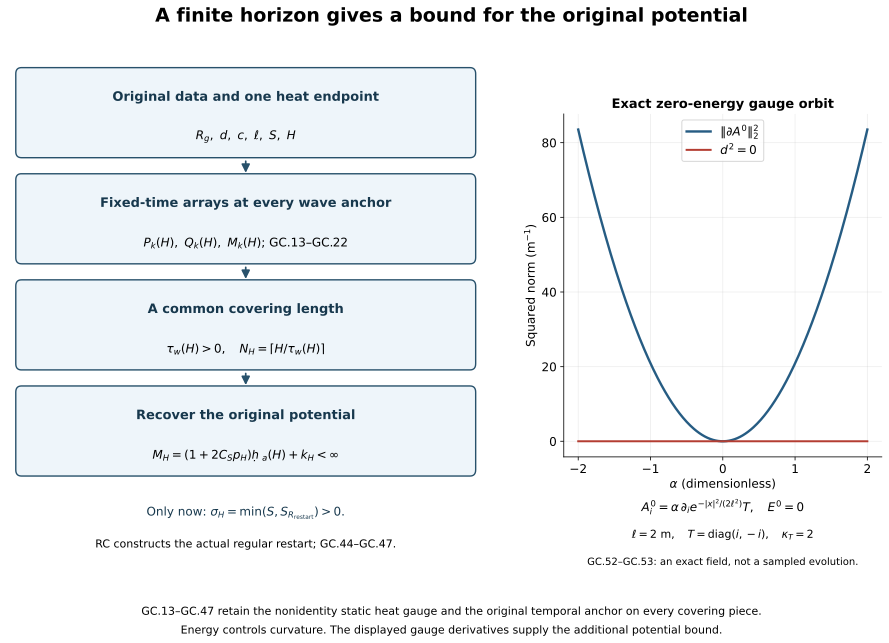

# Global classical continuation in the original temporal gauge

Local existence produces a solution near one initial time. A global
theorem must show why that solution cannot stop at a finite time.
The conserved energy controls curvature; it does not by itself control
the gradient of a particular potential. This chapter derives the missing
potential bound on every finite physical horizon and then constructs a
uniform regular restart interval.

Read [the common regular interval](../classical-common-regular-interval.html),
[the finite wave bound](../classical-finite-wave-bound.html) and
[reconstruction of the original gauge](../classical-original-gauge-reconstruction.html).
The theorem concerns regular data in the precise domain [GC.2](../classical-global-continuation.html#eq-GC-2). It keeps
the original potential and both gauge anchors throughout the argument.

Each arrow names a proved operation in [GC.13](../classical-global-continuation.html#eq-GC-13)–[GC.47](../classical-global-continuation.html#eq-GC-47). The original heat
endpoint \(S\) stays in the finite-horizon estimates; the later
\(\sigma_H\) is an auxiliary heat length for the restart.

## 1. Exact theorem and original data

Keep \(c>0\), \(\ell>0\), the spatial coordinates \(x\in\mathbb R^3\),
physical time \(t\), metric
\(g_{\mu\nu}=\operatorname{diag}(-c^2,1,1,1)\), the fixed closed
matrix group \(G\subset U(N)\), and
\(\kappa(X,Y)=-\operatorname{tr}(XY)\) on its Lie algebra.
All derivative and output norms sum every ordered index and
Hilbert–Schmidt matrix entry. In particular,

\[
\|f\|_{H_\ell^q}^2=(2\pi)^{-3}\int
 (1+\ell^2|\xi|^2)^q|\widehat f(\xi)|^2\,d^3\xi
=\sum_{j=0}^q{q\choose j}\ell^{2j}
                         \|\partial^{(j)}f\|_2^2.
\tag{GC.1}
\]

For integer \(q\ge0\), the final equality follows by the binomial
expansion and the full ordered Fourier derivative sum.

At the original initial time \(t_*\), let

\[
\begin{gathered}
A_*\in L^6,\qquad
\partial A_*,E_*\in\bigcap_{q\ge0}H_\ell^q,\qquad
D_{A_*}^iE_{*,i}=0,\\
F_{*,ij}=\partial_iA_{*,j}-\partial_jA_{*,i}
                         +[A_{*,i},A_{*,j}]\in L^2,\qquad
B_*=(F_{*,23},F_{*,31},F_{*,12}),\\
d^2=c^{-2}\|E_*\|_2^2+\|B_*\|_2^2
=c^{-2}\sum_i\|E_{*,i}\|_2^2+
                         \sum_{i<j}\|F_{*,ij}\|_2^2
=\frac{g_{\rm YM}^2}{\hbar c}\mathcal E_{\rm YM}.
\tag{GC.2}
\end{gathered}
\]

The finite curvature condition is separate. The actual connection
space is \(\{A\in L^6:\partial A\in L^2\}\), with no quotient by
constant fields and no undifferentiated \(L^2\) hypothesis.
The homogeneous Sobolev and Morrey constants are

\[
C_S=\frac4{\sqrt3},\qquad
C_M=2\sqrt{(4\pi/3)^{-1/6}(4\pi)^{-1}(20\pi/3)^{5/6}}.
\tag{GC.3}
\]

In particular \(A_*\) is bounded. Every positive derivative of its
curvature is in \(H_\ell^\infty\): differentiate its displayed
formula, put one positive derivative in \(L^2\), and the other
bounded factor in \(L^\infty\), retaining both bracket placements.
Together with \(F_*\in L^2\), this gives \(B_*\in H_\ell^\infty\).

The existing affine local construction [RI.5](../classical-regular-restart.html#eq-RI-5)–[RI.16](../classical-regular-restart.html#eq-RI-16), completed on
its common regular interval in [RC.1](../classical-common-regular-interval.html#eq-RC-1)–[RC.29](../classical-common-regular-interval.html#eq-RC-29), therefore applies to
exactly these data. Its chart and original equations are

\[
\begin{gathered}
V=(h,E^0,B^0),\qquad A^0=A_*+h,\qquad
V(t_*)=(0,E_*,B_*),\\
\partial_tA^0=E^0,\qquad
\partial_tE^0=-c^2\{\operatorname{curl}B^0+\beta(A^0,B^0)\},
\qquad
\partial_tB^0=\operatorname{curl}E^0+\beta(A^0,E^0),\\
\beta(A,f)_i=\sum_{j,k}\epsilon_{ijk}[A_j,f_k],
\qquad \epsilon_{123}=1,\qquad A_t^0=0 .
\tag{GC.4}
\end{gathered}
\]

The chart norm is

\[
\|V\|_{X_q}^2=\ell^{-2}\|h\|_{H_\ell^q}^2+
c^{-2}\|E^0\|_{H_\ell^q}^2+\|B^0\|_{H_\ell^q}^2
\]

.
RI supplies an actual contraction, uniqueness on every overlap,
constraint propagation and regular persistence; RC constructs the
strong endpoint and restart on the common interval. These are
proved local providers, not global continuation assumptions.
The common-interval theorem is used with its actual affine domain
and the common majorants in both slots of the paired estimate.

Take the union of all overlapping regular original-gauge
extensions through \(t_*\). Uniqueness gives a maximal open interval
\(I_{\max}=(T_-,T_+)\). On every compact part of it,
\(h,E^0,B^0\) are smooth into every \(H_\ell^q\).
The exact energy identity yields

\[
c^{-2}\|E^0(t)\|_2^2+\|B^0(t)\|_2^2=d^2.
\tag{GC.5}
\]

We will prove \(T_-=-\infty,T_+=+\infty\).
If \(d=0\), then \(E^0=B^0=0\), hence
\(\partial_tA^0=0\). The stationary original field \(A^0=A_*\)
is itself a global regular solution. Uniqueness settles this
case without division by \(d\). Henceforth \(d>0\).

## 2. One actual heat interval and its domain

Choose the original gradient radius

\[
R_g=8(\|\partial A_*\|_2+\ell^{-1/2}),\qquad
D_2=18\sqrt3 C_MC_S,\quad D_3=12\sqrt3 C_S^3,
\]

\[
S_{R_g}=\min\{(32D_2R_g)^{-4},(48D_3R_g^2)^{-2}\},
\qquad
0<S\le S_{R_g},\qquad S^{1/4}d\le\varepsilon_*.
\tag{GC.6}
\]

Here \(S\) is the fixed original heat endpoint. One may choose
\(\min(S_{R_g},(\varepsilon_*/d)^4)\); once chosen it stays fixed
in all the global estimates below. Neither fields nor coordinates
are rescaled. The explicit H9/HD threshold is

\[
\begin{gathered}
e_*=2+\sqrt2,\quad K_0^{\rm th}=12\sqrt6 C_S^{3/2},\quad
K_1^{\rm th}=36\sqrt{18}C_S^{3/2},\\
a_*=e_*(1+e_*),\quad
b_*=e_*\{(1+e_*)K_0^{\rm th}+K_1^{\rm th}\},\qquad
\varepsilon_*=(8a_*b_*)^{-1}.
\tag{GC.7}
\end{gathered}
\]

The superscript th distinguishes these threshold constants from
the temporal-curvature constants \(K_l\) below.

RC Sections 2–3 proves the affine-domain extension of [HD.2](../classical-dynamic-heat.html#eq-HD-2).
Its hypothesis is exactly [GC.2](../classical-global-continuation.html#eq-GC-2) on each existing regular physical
slice. Here is the part of that construction needed to ensure that
the fixed \(S\) is available at every physical time, even if the
original potential gradient has not yet been bounded uniformly.
The affine DeTurck equation, frozen at a spatial connection \(F\),
is

\[
\begin{aligned}
D&=F+v,\qquad v(0)=0,\\
v_s&=\Delta v+F_0+N(F+v)-N(F),\qquad F_0=\Delta F+N(F),\\
N(D)_i&=\sum_j\{2[D_j,\partial_jD_i]-[D_j,\partial_iD_j]\}
                      +\sum_j[D_j,[D_j,D_i]] .
\tag{GC.8}
\end{aligned}
\]

Since \(F\in L^6\), its cubic term is in \(L^2\); every
positive derivative is controlled by the complete product rule.
[RC.6](../classical-common-regular-interval.html#eq-RC-6)–[RC.14](../classical-common-regular-interval.html#eq-RC-14) constructs this equation in \(F+H_\ell^\infty\),
proves all orders persist on HG's common gradient-controlled
heat interval, and identifies its actual caloric gauge.
No \(L^2\) norm of \(F\) enters the construction.

For the caloric connection \(C\), the full magnetic identity is

\[
\frac12\sum_{i<j}\|F_{ij}(s_2)\|_2^2+
 \int_{s_1}^{s_2}\sum_i\|F_{si}(s)\|_2^2\,ds
=\frac12\sum_{i<j}\|F_{ij}(s_1)\|_2^2 .
\tag{GC.9}
\]

The cutoff error is bounded by
\(2\|\partial\chi\|_\infty R^{-1}
\int\sum_{i,j}\|F_{ij}\|_2\|F_{sj}\|_2\,ds\),
which tends to zero. Thus the same covariant heat estimates
[H9.40](../classical-heat-analysis.html#eq-H9-40) apply in the affine domain, as RC proves term by term.
Writing \(d_{\rm mag}^2=\sum_{i<j}\|F_{ij}(0)\|_2^2\),
put \(\Theta=(\varepsilon_*/(2d_{\rm mag}))^4\) when
\(d_{\rm mag}>0\). On any existing segment ending by \(\Theta\),
[H9.40](../classical-heat-analysis.html#eq-H9-40) and the exact contraction \(G_i=D^jF_{ji}\) imply, for
fixed \(0<s_0<s<\Theta\),

\[
\begin{aligned}
\|C(s)\|_6
&\le M_6:=\|C(s_0)\|_6+\sqrt6 C_SR_2d_{\rm mag}
                                      \log(\Theta/s_0),\\
\|\partial C(s)\|_2
&\le\|\partial C(s_0)\|_2+
       \sqrt6 R_2d_{\rm mag}\log(s/s_0)\\
&\quad+8\sqrt6 C_S^{1/2}\sqrt{R_1R_2}d_{\rm mag}M_6
                                     (s^{1/4}-s_0^{1/4}).
\tag{GC.10}
\end{aligned}
\]

These are [HD.8](../classical-dynamic-heat.html#eq-HD-8)–[HD.9](../classical-dynamic-heat.html#eq-HD-9) with their original factors. The logarithm
has not been integrated from zero. A radius larger than four
times the resulting gradient supremum gives a common affine
heat restart length by RC/HG. Restarting at interior heat
times contradicts a heat endpoint before \(\Theta\).
Magnetic energy decreases by [GC.9](../classical-global-continuation.html#eq-GC-9), so finitely many such
segments reach the prescribed \(S\). If \(d_{\rm mag}=0\),
the caloric spatial connection is stationary. This proves the
needed global spatial heat operation at each existing physical
time, without a uniform physical gradient bound.

The physical parameter construction [RC.15](../classical-common-regular-interval.html#eq-RC-15)–[RC.18](../classical-common-regular-interval.html#eq-RC-18) gives joint
regularity on every compact physical/heat rectangle. The time
component is constructed, with \(C_t(t,0)=0\), by

\[
\begin{aligned}
(\partial_s-\Delta)C_t={}&
\sum_j\{2[C_j,\partial_jC_t]+[\partial_jC_j,C_t]
                                  +[C_j,[C_j,C_t]]\}\\
&-\sum_j\{\partial_j\partial_tC_j+[C_j,\partial_tC_j]\}.
\tag{GC.11}
\end{aligned}
\]

Its affine multiplier bounds and block contraction are [RC.18](../classical-common-regular-interval.html#eq-RC-18).
The actual physical derivative \(\partial_tC_j\) lies in
\(H_\ell^\infty\), because the original physical increment
does. Heat uniqueness identifies overlapping constructions.
Thus one actual dynamic caloric field \(C\) exists on
\(I_{\max}\times\mathbb R^3\times[0,S]\).

Retain the original DeTurck-to-caloric heat gauge \(V_0\) at
\(t_*\), with \(V_0(t_*,0)=I_N\), and set

\[
Q_0=V_0(t_*,S),\qquad
W_t=W C_t(t,S),\quad W(t_*)=Q_0^{-1},\quad W_s=0,
\]

\[
\begin{aligned}
a_i&=WC_iW^{-1}-(\partial_iW)W^{-1},\qquad a_s=0,\\
a_t(t,s)&=W\{C_t(t,s)-C_t(t,S)\}W^{-1},\\
a_t(t,S)&=0,\qquad
a_i(t_*,S)=A_i^{\rm DeTurck}(t_*,S).
\tag{GC.12}
\end{aligned}
\]

On each compact physical interval, the coefficient \(C_t(S)\)
is regular, and the unitary ODE constructs \(W\) throughout
that interval. Overlap uniqueness glues the same anchored
solution on \(I_{\max}\). The last identity follows by the
actual composed gauge \(Q_0^{-1}V_0(S)=I_N\), including its
zero spatial derivative. The generally nonidentity \(Q_0\)
has not been removed.

## 3. Finite-horizon coefficients anchored at the original time

Fix an arbitrary original physical horizon \(H>0\). All estimates
in this section hold for \(t\in I_{\max}\) with
\(\theta=|t-t_*|\le H\). At the fixed heat endpoint,
\(\partial_ta_i(t,S)=E_i^a(t,S)\).
[H9.40](../classical-heat-analysis.html#eq-H9-40) and covariant Sobolev give the exact coefficient arrays

\[
e_l^{(2)}=cR_ldS^{-l/2},\qquad
e_l^{(\infty)}=
cC_MC_S\sqrt{R_{l+1}R_{l+2}}dS^{-l/2-3/4}.
\tag{GC.13}
\]

The \(R_l\) are the explicit [H9.39](../classical-heat-analysis.html#eq-H9-39)–[H9.47](../classical-heat-analysis.html#eq-H9-47) covariant heat
recurrence, with no dependence on the physical potential
gradient at the time being estimated.

For precision, every reverse ordinary derivative is generated
by the signed rule
\(\partial_r(D_JT)=D_{(r,J)}T-[a_r,D_JT]\), with the ordinary
product rule on every potential factor and bracket. Its complete
nonnegative norm polynomial is

\[
b_0=y_0,\qquad
b_{k+1}=
\sum_{h=0}^{k-1}x_{h+1}\frac{\partial b_k}{\partial x_h}
+\sum_{l=0}^k(y_{l+1}+2x_0y_l)
                                      \frac{\partial b_k}{\partial y_l}.
\tag{GC.14}
\]

It retains every ordered position and its multiplicity. It is
linear in the final tensor variables \(y_l\); a monomial with
potential orders \(h_1,\ldots,h_j\) and final covariant order
\(l\) satisfies \(\sum_\nu(h_\nu+1)+l=k\).

Use the initial DeTurck smoothing numbers of [HP.2](../classical-potential-estimates.html#eq-HP-2)–[HP.16](../classical-potential-estimates.html#eq-HP-16),
\(\Gamma_0=R_g,\Gamma_1=Y_{R_g}\), and its full finite
recurrence \(\Gamma_m=2\sqrt m\,\Gamma_{m-1}
+2\mathcal F_m(\Gamma_0,\ldots,\Gamma_{m-1})\), where
\(\mathcal F_m\) is exactly [HP.13](../classical-potential-estimates.html#eq-HP-13), including every binomial
and ordered three-factor placement. Set

\[
\begin{aligned}
Y_{R_g}&=4R_g+4(K^2+3J)\sqrt S\,R_g^3,\\
K&=54(C_S^{3/2}+C_MC_S),\qquad J=36C_S^3,\\
C_k^0&=C_MC_S\sqrt{\Gamma_k\Gamma_{k+1}}S^{-k/2-1/4},\\
D_k^0&=\Gamma_{k-1}S^{-(k-1)/2}\quad(k\ge1).
\tag{GC.15}
\end{aligned}
\]

These are proved bounds from the original initial gradient
radius; they are not higher unknown physical-data norms.

Integrating \(\partial_ta_i(S)=E_i^a(S)\) in either orientation,
using [GC.14](../classical-global-continuation.html#eq-GC-14), gives the triangular polynomials

\[
\begin{aligned}
P_0(\theta)&=C_0^0+\theta e_0^{(\infty)},\\
P_k(\theta)&=C_k^0+\int_0^\theta
 b_k((P_h(u))_{h<k};(e_l^{(\infty)})_{l\le k})\,du,\\
Q_k(\theta)&=D_k^0+\int_0^\theta
 b_k((P_h(u))_{h<k};(e_l^{(2)})_{l\le k})\,du \quad(k\ge1),\\
\mathsf A_k(\theta)&=3^{(k+1)/2}Q_k(\theta),\\
\mathsf V_{k-1}(\theta)&=3^{k/2}
 b_{k-1}((P_h(\theta))_{h<k-1};(e_l^{(2)})_{l\le k-1}).
\tag{GC.16}
\end{aligned}
\]

They bound the full \(\partial^{(k)}a(S)\) and
\(\partial^{(k-1)}\partial_ta(S)\) in \(L^2\).
The factors \(3^{(k+1)/2}\) retain all outputs after the
intermediate component estimates. The original \(P_k\)
bound each order-\(k\) endpoint component in \(L^\infty\).
Each induction step uses only lower potential orders, so
all polynomials are finite for finite \(H\).

For \(0<s\le S\), keep the exact backward heat identity

\[
a_i(t,s)=a_i(t,S)-\int_s^S G_i(t,r)\,dr,\qquad
G_i=F_{si}=D^jF_{ji}.
\tag{GC.17}
\]

[HT.25](../classical-fixed-time-estimates.html#eq-HT-25)–[HT.31](../classical-fixed-time-estimates.html#eq-HT-31) proves

\[
\begin{aligned}
\gamma_l&=\sqrt6 C_MC_S\sqrt{R_{l+2}R_{l+3}}d,\\
M_0(\theta)&=S^{1/4}P_0(\theta)+4\gamma_0,\\
M_k(\theta)&=S^{k/2+1/4}P_k(\theta)
+\frac{b_k((S^{1/4}M_h(\theta))_{h<k};(\gamma_l)_{l\le k})}
                                    {k/2+1/4}.
\tag{GC.18}
\end{aligned}
\]

Each component of \(\partial^{(k)}a(t,s)\) is bounded by
\(M_k(\theta)s^{-k/2-1/4}\). The exact integral before
this upper bound has the difference
\((s^{-k/2-1/4}-S^{-k/2-1/4})/(k/2+1/4)\).
Both heat endpoints and all signs in [GC.17](../classical-global-continuation.html#eq-GC-17) remain.
All these arrays are nondecreasing in \(\theta\); write
\(M_k[H]=M_k(H)\). Their dependence is only on the
original initial gradient radius, \(d,c,S,\ell,H\).

## 4. A short wave interval beginning at any physical time

This is the needed additional receiving step. FC's displayed
short interval was anchored at \(t_*\). To cover a finite
horizon one must bound its wave initial data at an arbitrary
\(\alpha\), without changing the globally anchored gauge [GC.12](../classical-global-continuation.html#eq-GC-12).
We now do so.

Let \(J=[u,v]\subset I_{\max}\cap[t_*-H,t_*+H]\), with
\(0\le v-u\le H\), and let \(\alpha\in J\).
Evaluate the exact [FC.2](../classical-finite-wave-bound.html#eq-FC-2)–[FC.3](../classical-finite-wave-bound.html#eq-FC-3) formulas at \(M_h[H]\), and
denote the resulting numbers by
\(\widehat J_k^p(H),\widehat T_m^p(H)\), \(p=2,\infty\).
Explicitly, the first array is

\[
\begin{aligned}
\mathcal B_m^H[z]&=
b_m((S^{1/4}M_h[H])_{h<m};(z_l)_{l\le m}),\\
\widehat J_k^2&=3^{(k+1)/2}d\,
                  \mathcal B_k^H[(\sqrt6R_l)_{l\le k}],\\
\widehat J_k^\infty&=3^{(k+1)/2}d\,
                  \mathcal B_k^H[(\sqrt6R_{l+1})_{l\le k}].
\tag{GC.19}
\end{aligned}
\]

The second array is the complete [FC.3](../classical-finite-wave-bound.html#eq-FC-3) evaluation, not a
temporal derivative inferred from a spatial one. Its four
receiving terms come from the unchanged identity

\[
\partial_tG_i=
D_jD_jE_i+2\sum_j[F_{ij},E_j]+D_iW-[a_t,G_i],
\qquad W=F_{st},\qquad W(t,0)=0 .
\tag{GC.20}
\]

Thus all factors \(c,d,S\), the \(2/e\) logarithmic maximum,
the \(h=0\) term and all \(h\ge1\) derivative placements of
[FC.3](../classical-finite-wave-bound.html#eq-FC-3) are retained in \(\widehat T_m^p\).
[HT.40](../classical-fixed-time-estimates.html#eq-HT-40) and [HT.45](../classical-fixed-time-estimates.html#eq-HT-45)–[HT.52](../classical-fixed-time-estimates.html#eq-HT-52) are fixed-time estimates, valid at
this actual \(\alpha\). Consequently

\[
\left\|s^{(k+1)/2}E_{k-1}(G(s);\alpha)\right\|_{L^p(ds/s)}
\le\widehat{\mathsf I}_k^p:=
\sqrt{(\widehat J_k^p)^2+c^{-2}(\widehat T_{k-1}^p)^2}.
\tag{GC.21}
\]

Here \(E_{k-1}\) is the original wave energy, with the full
spatial square and \(c^{-2}\) temporal square.
No wave norm of the physical solution has been assumed.

The endpoint wave input also needs its correct new initial
energy. Define

\[
\widehat{\mathsf E}_k(H)=
\sqrt{\mathsf A_k(H)^2+c^{-2}\mathsf V_{k-1}(H)^2},
\qquad
\widehat\Omega_k(H)=
\widehat{\mathsf E}_k(H)+2cH\mathsf H_{k-1}(H).
\tag{GC.22}
\]

The polynomial \(\mathsf H_{k-1}\) is [EW.17](../classical-endpoint-wave.html#eq-EW-17)'s complete
forcing coefficient
\(\mathsf L_k+\mathsf N_{k-1}+\mathsf T_{k-1}\),
defined in [EW.10](../classical-endpoint-wave.html#eq-EW-10)–[EW.14](../classical-endpoint-wave.html#eq-EW-14) with all its original endpoint,
divergence, quadratic, cubic and tension terms.
At every \(t\in J\), [GC.16](../classical-global-continuation.html#eq-GC-16) bounds its energy by
\(\widehat{\mathsf E}_k(H)\), and [EW.2](../classical-endpoint-wave.html#eq-EW-2), [EW.13](../classical-endpoint-wave.html#eq-EW-13)–[EW.17](../classical-endpoint-wave.html#eq-EW-17) gives

\[
\|\partial^{(k-1)}\Box_ca(S)\|_{L^2(J\times\mathbb R^3)}
\le\sqrt{|J|}\,\mathsf H_{k-1}(H).
\]

Therefore the actual endpoint norm is bounded already by
\(\widehat{\mathsf E}_k(H)+c|J|\mathsf H_{k-1}(H)\),
and hence by [GC.22](../classical-global-continuation.html#eq-GC-22). The factor two is a retained safe upper
bound matching [FC.5](../classical-finite-wave-bound.html#eq-FC-5). Half orders use
\(\widehat\Omega_{k+1/2}=
\sqrt{\widehat\Omega_k\widehat\Omega_{k+1}}\)
by the proved full wave interpolation [HW.32](../classical-wave-estimates.html#eq-HW-32).

In every finite [FC.8](../classical-finite-wave-bound.html#eq-FC-8)–[FC.11](../classical-finite-wave-bound.html#eq-FC-11) evaluation now use:

- the unchanged original \(c,S,\ell\);
- \(M_h[H]\) and the other fixed-time arrays at the original
  distance \(H\) from \(t_*\);
- \(|J|\le H\) in upper coefficients;
- [GC.22](../classical-global-continuation.html#eq-GC-22) for every endpoint wave input;
- a numerical \(X\) for the six heat-wave inputs
  \(\mathcal F_k^p\), \(k=1,2,3,\ p=2,\infty\).

Call the resulting complete finite functions
\(\widehat{\mathsf C}[X;H]\) and
\(\widehat{\mathsf D}_q^p[X;H]\).
This defines actual numerical functions by an already proved
finite recurrence. Their original [CF.28](../classical-curlfree-backward-heat.html#eq-CF-28) input for \(g\),
HS smoothing, ST electric input, TB temporal boundary,
UA products and TW tension inputs are all retained in the
same evaluation order. The ES integer ceilings are taken
after evaluating the fixed-time arrays at \(H\), exactly as
in FC; they do not depend on \(X\).

For clarity, the wave equation being estimated is the full
original equation

\[
\begin{aligned}
\Box_cG_i={}&-2\sum_j[a_j,\partial_jG_i]
-[\sum_j\partial_ja_j,G_i]-\sum_j[a_j,[a_j,G_i]]
-2\sum_j[F_{ij},G_j]\\
&-2c^{-2}[E_i,W]+2c^{-2}[a_t,\partial_tG_i]
+c^{-2}[\partial_ta_t,G_i]+c^{-2}[a_t,[a_t,G_i]]\\
&-\sum_jD_jD_jw_i+D_i\sum_jD_jw_j
-2\sum_j[F_{ij},w_j]-Q_i,\\
Q_i&=-2c^{-2}\sum_j[E_j,D_iE_j-2D_jE_i],
\qquad \Box_c=-c^{-2}\partial_t^2+\Delta .
\tag{GC.23}
\end{aligned}
\]

Time translation of a wave-energy anchor changes none of
these terms. It changes neither \(a_t(S)=0\) nor the
actual Gauss datum \(W(0)=0\). The only initial-energy
inputs in [FC.12](../classical-finite-wave-bound.html#eq-FC-12) are now bounded by [GC.21](../classical-global-continuation.html#eq-GC-21).
All other proofs use the current interval's norms and
the fixed-time coefficients just bounded. Thus the exact
FC receiving inequalities on this \(J\) are

\[
\begin{aligned}
\mathcal F_k^p(J)&\le\widehat{\mathsf I}_k^p+
2c\sqrt{|J|}\{
\widehat{\mathsf C}[X(J);H]\mathcal F_k^p(J)
+\widehat{\mathsf D}_{k-1}^p[X(J);H]\},\\
X(J)&=\sum_{k=1}^3(\mathcal F_k^2(J)+\mathcal F_k^\infty(J)),\\
X(J)&\le\widehat{\mathsf I}+2c\sqrt{|J|}
                                      \widehat\Psi(X(J);H),\\
\widehat{\mathsf I}&=\sum_{k=1}^3
                   (\widehat{\mathsf I}_k^2+\widehat{\mathsf I}_k^\infty),\\
\widehat\Psi(X;H)&=\widehat{\mathsf C}[X;H]X+
\sum_{q=0}^2(\widehat{\mathsf D}_q^2[X;H]
                         +\widehat{\mathsf D}_q^\infty[X;H]).
\tag{GC.24}
\end{aligned}
\]

The complete six-norm sum has one principal coefficient,
not six copies of its product with \(X\).
Every term of this sum has unit \(\mathrm{length}^{-1/2}\).
Endpoint norms in [GC.22](../classical-global-continuation.html#eq-GC-22) retain their own derivative units
and are never added without the original receiving factors.

The functions in [GC.24](../classical-global-continuation.html#eq-GC-24) are finite, nonnegative, continuous
and nondecreasing in \(X\), by FC's explicit construction.
Set

\[
\begin{aligned}
R_H^{\rm wave}&=2(\widehat{\mathsf I}+d),\\
\tau_0(H)&=
\begin{cases}
H,&\widehat\Psi(R_H^{\rm wave};H)=0,\\
\min\left\{H,
\left(\dfrac{R_H^{\rm wave}-\widehat{\mathsf I}}
 {4c\widehat\Psi(R_H^{\rm wave};H)}\right)^2\right\},
&\widehat\Psi(R_H^{\rm wave};H)>0,
\end{cases}\\
\tau_w(H)&=
\begin{cases}
\tau_0(H),&\widehat{\mathsf C}[R_H^{\rm wave};H]=0,\\
\min\{\tau_0(H),(4c\widehat{\mathsf C}[R_H^{\rm wave};H])^{-2}\},
&\widehat{\mathsf C}[R_H^{\rm wave};H]>0 .
\end{cases}
\tag{GC.25}
\end{aligned}
\]

These are positive finite physical times. If \(X(J)\le
R_H^{\rm wave}\) and \(|J|\le\tau_0(H)\), [GC.24](../classical-global-continuation.html#eq-GC-24) gives

\[
X(J)\le\frac{R_H^{\rm wave}+\widehat{\mathsf I}}2
                                      <R_H^{\rm wave}.
\tag{GC.26}
\]

Shrink \(J\) toward its actual wave anchor \(\alpha\).
For a fixed compact regular physical/heat rectangle, the
weighted energy and forcing norms are continuous in the
moving endpoints: dominated convergence applies to the
heat square norm, and uniform continuity of the weighted
fields on the rectangle applies to the heat supremum.
The weights vanish at \(s=0\). At length zero the sum
is at most \(\widehat{\mathsf I}<R_H^{\rm wave}\).
A first crossing of the radius contradicts [GC.26](../classical-global-continuation.html#eq-GC-26).
Hence the bound holds on every such \(J\); it is not a
bootstrap assumption.

The second choice in [GC.25](../classical-global-continuation.html#eq-GC-25) makes the high-order multiplier
at most one half, so the existing regular field satisfies

\[
\mathcal F_k^p(J)\le
2\widehat{\mathsf I}_k^p+
4c\sqrt{|J|}\widehat{\mathsf D}_{k-1}^p[R_H^{\rm wave};H],
\qquad k\ge1,\quad p=2,\infty,\quad |J|\le\tau_w(H).
\tag{GC.27}
\]

Thus the same interval works at every finite order.
Crucially, its size has no dependence on
\(\|\partial A^0(\alpha)\|_2\). This conclusion comes from
[GC.13](../classical-global-continuation.html#eq-GC-13)–[GC.24](../classical-global-continuation.html#eq-GC-24), not from an assumed uniform physical lifespan.

## 5. Boundary estimates on the finite cover

Evaluate the original [PW.8](../classical-potential-wave.html#eq-PW-8)–[PW.12](../classical-potential-wave.html#eq-PW-12) and [TB.2](../classical-temporal-boundary.html#eq-TB-2)–[TB.10](../classical-temporal-boundary.html#eq-TB-10) by the
same completed FC substitution. Define their finite numbers

\[
\mathcal R_a(H)=\widehat\Omega_1(H)
+2\overline P_2[R_H^{\rm wave};H]
+2\mathcal J[R_H^{\rm wave};H],
\qquad D_H^b=D_B[R_H^{\rm wave};H],\quad
H_H^b=H_B[R_H^{\rm wave};H].
\tag{GC.28}
\]

The symbols \(\overline P_2,\mathcal J,D_B,H_B\) keep their
original full PW and TB definitions. In particular

\[
\begin{gathered}
L_W=4e_0^2\mathcal G,\quad
B_W=(1+2\sqrt2U_0S^{1/4})L_W,\quad D_B=\sqrt S B_W,\\
L_N=4\sqrt2U_0S^{1/4}B_W+
 (8\sqrt3U_1S^{1/4}+8U_0^2\sqrt S)L_W+L_W,
\qquad H_B=L_W+L_N .
\tag{GC.29}
\end{gathered}
\]

All entries here are evaluated by the preceding finite
recurrence. For \(b(t)=a_t(t,0)\), TB proves

\[
\begin{aligned}
\sup_{t\in J}\|\partial a_x(t,0)\|_2&\le\mathcal R_a(H),
\qquad \sup_{t\in J}\|a_x(t,0)\|_6\le C_S\mathcal R_a(H),\\
\int_J\|b\|_\infty\,dt&\le
\sqrt{|J|}\,C_MC_S\sqrt{D_H^bH_H^b},\\
\int_J\|\partial b\|_3\,dt&\le
\sqrt{|J|}\,C_S^{1/2}\sqrt{D_H^bH_H^b},\\
\int_J\|\partial^{(2)}b\|_2\,dt&\le\sqrt{|J|}\,H_H^b,
\qquad |J|\le\tau_w(H).
\tag{GC.30}
\end{aligned}
\]

The actual \(L^6\) representative exists on every compact
interval by [GC.12](../classical-global-continuation.html#eq-GC-12) and the affine heat construction.
Thus its Sobolev bound is not a choice of an unspecified
homogeneous representative. The \(s=0\) gradient bound
is the regular boundary limit of PW's full derivative
estimate, as proved in [FC.19](../classical-finite-wave-bound.html#eq-FC-19).

The temporal Hessian bound uses the exact integrated
heat identity

\[
\Delta b=-W(S)+\int_0^S
\{2[a_j,\partial_jW]+[\partial_ja_j,W]
                  +[a_j,[a_j,W]]+2[E_j,G_j]\}\,ds .
\tag{GC.31}
\]

All repeated spatial indices are summed. Its lower
boundary \(W(0)=0\) is the actual Gauss law.
The negative endpoint sign and the full Hessian/Laplacian
norm equality are [TB.7](../classical-temporal-boundary.html#eq-TB-7)–[TB.8](../classical-temporal-boundary.html#eq-TB-8). An absolute integral of
\(\|\partial^{(2)}W\|_2\) is not assumed.

For a segment from \(t_*\) to \(t\), with \(|t-t_*|\le H\),
partition it into \(n\le N_H:=\lceil H/\tau_w(H)\rceil\)
actual closed subintervals \(J_\nu\) of lengths at most
\(\tau_w(H)\). Use the endpoint of each piece as its wave
anchor only; the gauge [GC.12](../classical-global-continuation.html#eq-GC-12) remains fixed. On open maximal
intervals make this argument first for interior \(t\).
For the actual lengths \(L_\nu=|J_\nu|\),

\[
\sum_{\nu=1}^n\sqrt{L_\nu}
\le\sqrt{n\sum_\nu L_\nu}
\le\sqrt{N_H|t-t_*|}\le\sqrt{N_HH}=:\Lambda_H .
\tag{GC.32}
\]

Thus on either oriented side, after taking absolute norm
integrals, the global coefficients are

\[
\begin{aligned}
\mathfrak B_H&=\Lambda_H C_MC_S\sqrt{D_H^bH_H^b},\\
\mathfrak P_H&=\Lambda_H C_S^{1/2}\sqrt{D_H^bH_H^b},\\
\mathfrak H_H&=\Lambda_H H_H^b,\qquad
\mathfrak Q_H=C_S\mathfrak H_H .
\tag{GC.33}
\end{aligned}
\]

They respectively bound the path integrals of
\(\|b\|_\infty,\|\partial b\|_3,
\|\partial^{(2)}b\|_2,\|\partial b\|_6\).
The last estimate follows from the full-tuple Sobolev
inequality at each physical time.
On the whole two-sided horizon the first three integrals
are at most twice these numbers. No factor two is needed
for any individual path from \(t_*\).
The same cover proves
\(\sup\|\partial a_x(t,0)\|_2\le\mathcal R_a(H)\)
throughout the existing part of the horizon.

## 6. The global gauge with both anchors retained

Define the identity-anchored time gauge by its actual ODE

\[
U_t=Ub,\qquad U(t_*)=I_N,\qquad
V=Q_0U=W^{-1}.
\tag{GC.34}
\]

The final equality follows from differentiating \(W^{-1}\)
in [GC.12](../classical-global-continuation.html#eq-GC-12), since \(b=-WC_t(S)W^{-1}\), and checking its
initial value \(W^{-1}(t_*)=Q_0\).
In particular \(V(t_*)=Q_0\), generally not \(I_N\).
The ordered integral series and unitary variation formula
of [GO.8](../classical-physical-gauge.html#eq-GO-8)–[GO.15](../classical-physical-gauge.html#eq-GO-15) construct \(U\) and its derivatives on the
whole existing horizon; [GC.33](../classical-global-continuation.html#eq-GC-33) bounds their coefficients.
For a negative time direction the ordered series retains
its signed \((-1)^m\) factor and reversed physical
arguments. All identities use oriented integrals.

Put \(Y_i=(\partial_iU)U^{-1}\). Direct differentiation gives

\[
\begin{aligned}
Y_i(t)&=\int_{t_*}^t
        U(r)\partial_i b(r)U(r)^{-1}\,dr,\\
\partial_t\partial_jY_i
&=U\partial_j\partial_i b\,U^{-1}
                 +[Y_j,U\partial_i b\,U^{-1}],\qquad
\partial_jY_i(t_*)=0 .
\tag{GC.35}
\end{aligned}
\]

On the unoriented path let \(P,Q,\mathcal H\) be the
integrals of the \(L^3\) gradient, \(L^6\) gradient and
\(L^2\) Hessian of \(b\). Then
\(\|Y\|_3\le P,\ \|Y\|_6\le Q\).
The full commutator term has \(L^2\) norm at most

\[
2\min(P(r)g_6(r),Q(r)g_3(r))
\le P(r)g_6(r)+Q(r)g_3(r),\qquad
g_p(r)=\|\partial b(r)\|_p .
\]

Its time integral is exactly \(P(t)Q(t)\), by the
product rule along the signed path parameter.
This keeps every ordered \((i,j)\) term and gives

\[
\|Y(t)\|_3\le\mathfrak P_H,\quad
\|Y(t)\|_6\le\mathfrak Q_H,\quad
\|\partial Y(t)\|_2\le
\mathfrak H_H+\mathfrak P_H\mathfrak Q_H.
\tag{GC.36}
\]

The same estimate holds for \(\|\partial^{(2)}U\|_2\)
by its two ordered middle forcing terms, as in [GO.16](../classical-physical-gauge.html#eq-GO-16)–[GO.20](../classical-physical-gauge.html#eq-GO-20).

The original static heat anchor has the actual logarithmic
derivative \(K_i^0=(\partial_iQ_0)Q_0^{-1}\).
[HG.22](../classical-caloric-gauge.html#eq-HG-22)–[HG.26](../classical-caloric-gauge.html#eq-HG-26), at the original \(S\), gives explicit bounds

\[
\begin{aligned}
C_\infty&=\sqrt3 C_MC_S3^{3/4},\qquad
C_p=\sqrt3 C_S^{1/2}3^{3/4},\\
p_0&=C_pS^{1/4}Y_{R_g},\\
J_{R_g}&=2\sqrt3R_g+
\sqrt3(KS^{1/4}R_g^2+3J\sqrt S R_g^3),\\
h_0&=J_{R_g}(1+2C_\infty S^{1/4}Y_{R_g})
+2C_p\sqrt3 C_S\sqrt2 S^{1/4}Y_{R_g}^2,\\
q_0&=C_Sh_0,\qquad k_0=h_0+p_0q_0,\\
\|K^0\|_3&\le p_0,\qquad
\|K^0\|_6\le q_0,\qquad
\|\partial K^0\|_2\le k_0 .
\tag{GC.37}
\end{aligned}
\]

The last line follows from
\(\partial_jK_i^0=(\partial_j\partial_iQ_0)Q_0^{-1}
-K_i^0K_j^0\), Sobolev on the full first derivative of
\(Q_0\), and \(L^3L^6\to L^2\).
The signed-primitive argument [HG.24](../classical-caloric-gauge.html#eq-HG-24)–[HG.26](../classical-caloric-gauge.html#eq-HG-26) proves \(h_0\);
it does not require an absolute third-derivative heat
integral. Thus these numbers depend on the original
initial gradient and the actual \(S\), not the gradient
at a later physical time.

For the actual global \(V=Q_0U\), keep every static and
dynamic term:

\[
\begin{aligned}
K_i:=(\partial_iV)V^{-1}
&=K_i^0+\operatorname{Ad}(Q_0)Y_i,\\
\partial_jK_i
&=\partial_jK_i^0+\operatorname{Ad}(Q_0)\partial_jY_i
                     +[K_j^0,\operatorname{Ad}(Q_0)Y_i].
\tag{GC.38}
\end{aligned}
\]

Consequently the complete finite bounds are

\[
\begin{aligned}
p_H&=p_0+\mathfrak P_H,\qquad q_H=q_0+\mathfrak Q_H,\\
k_H&=k_0+\mathfrak H_H+\mathfrak P_H\mathfrak Q_H
                 +2\min(p_0\mathfrak Q_H,q_0\mathfrak P_H),\\
\|K(t)\|_3&\le p_H,\quad \|K(t)\|_6\le q_H,\quad
\|\partial K(t)\|_2\le k_H .
\tag{GC.39}
\end{aligned}
\]

Either Hölder order bounds the last full commutator tuple;
their minimum is legitimate and does not reorder matrices.
One may use either displayed product separately as a
larger upper bound.

The original physical representative is exactly

\[
\begin{aligned}
A_i^0&=Va_i(t,0)V^{-1}-K_i\\
&=Q_0Ua_i(t,0)U^{-1}Q_0^{-1}
 -(\partial_iQ_0)Q_0^{-1}
 -Q_0(\partial_iU)U^{-1}Q_0^{-1},\\
A_t^0&=Va_t(0)V^{-1}-V_tV^{-1}=0,\qquad
E_i^0=VE_i^a(t,0)V^{-1},\qquad
F_{ij}^0=VF_{ij}^a(t,0)V^{-1}.
\tag{GC.40}
\end{aligned}
\]

Gauge composition with \(V=W^{-1}\) proves this is the
given original solution. At \(t_*\) both static affine
terms are retained; no new representative is substituted.
Its full spatial derivative is

\[
\partial_jA_i^0=
V(\partial_ja_i)V^{-1}
+[K_j,Va_iV^{-1}]-\partial_jK_i .
\tag{GC.41}
\]

Using [GC.30](../classical-global-continuation.html#eq-GC-30) and [GC.39](../classical-global-continuation.html#eq-GC-39) yields the explicit finite-horizon
bound

\[
\boxed{\quad
\sup_{\substack{t\in I_{\max}\\|t-t_*|\le H}}
\|\partial A^0(t)\|_2
\le M_H:=(1+2C_Sp_H)\mathcal R_a(H)+k_H<\infty .
\quad}
\tag{GC.42}
\]

Also

\[
\|A^0(t)\|_6\le C_S\mathcal R_a(H)+q_H,\qquad
\|E^0(t)\|_2\le cd,\qquad \|B^0(t)\|_2\le d.
\tag{GC.43}
\]

As \(A^0\) is the actual \(L^6\) representative, Sobolev
also gives \(\|A^0(t)\|_6\le C_SM_H\).
Every number in [GC.42](../classical-global-continuation.html#eq-GC-42) is computed from the original
initial gradient bound, conserved \(d\), and
\(c,S,\ell,H\). None contains the unknown later
gradient or a physical curve norm as an initial datum.

## 7. Constructing the uniform restart after the bound

Suppose \(T_+<\infty\). Choose a fixed \(H>T_+-t_*\).
The preceding proof applies on every compact initial
subinterval with the same numbers, and hence gives
[GC.42](../classical-global-continuation.html#eq-GC-42) uniformly for \(t_* \le t<T_+\).

For this now-proved bounded family of interior data,
choose

\[
R_{\rm restart}=8(M_H+\ell^{-1/2}),\qquad
\sigma_H=\min(S,S_{R_{\rm restart}})>0.
\tag{GC.44}
\]

This is an auxiliary restart heat length. The original
heat endpoint in [GC.6](../classical-global-continuation.html#eq-GC-6)–[GC.43](../classical-global-continuation.html#eq-GC-43) remains \(S\).
Moreover \(\sigma_H^{1/4}d\le\varepsilon_*\).
At every interior time, the original datum and each of
its actual spatial translates have gradient at most
\(M_H<R_{\rm restart}/4\), curvature energy \(d^2\),
and all the regularity in [GC.2](../classical-global-continuation.html#eq-GC-2).

Evaluate the already proved common-interval operation
[RC.3](../classical-common-regular-interval.html#eq-RC-3), namely [CP.46](../classical-initial-data-stability.html#eq-CP-46)–[CP.49](../classical-initial-data-stability.html#eq-CP-49), on this family, using common
individual majorants in both slots, original \(c,\ell\),
heat length \(\sigma_H\), and horizon \(H\). In the
notation of that exact finite evaluation, retain

\[
\mu_H=2cK_H^{\rm CP},\qquad
L_H^{\rm CP}=\nu_H+\mu_H(1+b_H),\qquad
\tau_{\rm restart}(H)=
\begin{cases}
\min(H,\tau_{{\rm ind},H}),&L_H^{\rm CP}=0,\\
\min(H,\tau_{{\rm ind},H},(2L_H^{\rm CP})^{-2}),
                                      &L_H^{\rm CP}>0 .
\end{cases}
\tag{GC.45}
\]

Here \(K_H^{\rm CP},\nu_H,b_H,\tau_{{\rm ind},H}\)
mean the original named CP coefficients evaluated at
[GC.44](../classical-global-continuation.html#eq-GC-44) and the common data bounds \(M_H,d\).
They are defined by CP's complete finite formulas,
including its \(\ell^{k-1}W_k\) endpoint weights,
and are finite numbers, not new assumptions.
RC Sections 4–5 proves actual regular existence through
this interval, with size independent of higher interior
derivatives. In particular its proof does not infer
regular existence from an unconstructed endpoint:
it uses the translation estimate for the Hessian,
the affine \(X_2\) bound, strong endpoints, and the
explicit RI contraction at that endpoint.

Thus \(\tau_{\rm restart}(H)>0\) is uniform for the
interior family only after [GC.42](../classical-global-continuation.html#eq-GC-42) has been proved.
Take an interior \(t_n<T_+\) with
\(T_+-t_n<\tau_{\rm restart}(H)/2\).
Apply that actual local construction to
\((A^0(t_n),E^0(t_n),B^0(t_n))\) in the same
original temporal frame. It produces a regular solution
past \(T_+\). On the overlap, RI uniqueness identifies
it with the previous solution.

The affine charts also agree exactly. If the restart
chart writes \(A=A^0(t_n)+h_n(t)\), then its coordinate
in the original chart is

\[
h(t)=\{A^0(t_n)-A_*\}+h_n(t).
\tag{GC.46}
\]

Both summands lie in \(H_\ell^\infty\) on the overlap
and thereafter, by the proved affine constructions.
This equality does not place either full potential in
\(L^2\). It joins a regular solution in the original
class, contradicting maximality at \(T_+\).

The backward argument uses the same positive norm
coefficients, the oriented mild equation, and an
interior sequence decreasing toward a finite \(T_-\).
It likewise contradicts maximality. Therefore

\[
I_{\max}=\mathbb R .
\tag{GC.47}
\]

At the restart, the auxiliary \(\sigma_H\) construction
does not overwrite any old \(S\)-field. RC Sections
2–3 reconstructs the unique dynamic field on the
original \([0,S]\); heat uniqueness identifies it on
the overlap. Solving [GC.12](../classical-global-continuation.html#eq-GC-12) with the unchanged
\(Q_0^{-1}\) at \(t_*\) retains the old \(W,a,U\) and
all static and temporal anchors. There is no identity
gauge reset at \(t_n\) or at \(T_\pm\).

## 8. Actual increments and comparison with the source class

For any two physical times on a finite horizon,
[GC.4](../classical-global-continuation.html#eq-GC-4)–[GC.5](../classical-global-continuation.html#eq-GC-5) gives the exact original affine increment

\[
A^0(t)-A^0(u)=\int_u^tE^0(r)\,dr
\quad\hbox{in }L^2,\qquad
\|A^0(t)-A^0(u)\|_2\le cd|t-u|.
\tag{GC.48}
\]

It is the difference, not the undifferentiated
connection, that belongs to this space.
Its \(L^6\) norm is at most \(2C_SM_H\) when both
times satisfy \(|t-t_*|,|u-t_*|\le H\). At \(u=t_*\)
one may keep the sharper \(C_S(M_H+\|\partial A_*\|_2)\).
Hölder interpolation consequently gives

\[
\|A^0(t)-A_*\|_3\le
\{cd|t-t_*|\,C_S(M_H+\|\partial A_*\|_2)\}^{1/2}.
\tag{GC.49}
\]

For example, write
\(\int|h|^3\le(\int|h|^2)^{3/4}
(\int|h|^6)^{1/4}\) and take its cube root.

The original Oh global theorem assumes
\(A_*\in\dot H^1\cap L^3\), in its own electric
variable \(E^{\rm Oh}=c^{-1}E_*\).
When that additional hypothesis holds, [GC.49](../classical-global-continuation.html#eq-GC-49) proves
the exact global \(L^3\) relation and bound:

\[
\|A^0(t)\|_3\le\|A_*\|_3+
\{cd|t-t_*|\,C_S(M_H+\|\partial A_*\|_2)\}^{1/2}.
\tag{GC.50}
\]

Conversely, if the present actual representative is
outside \(L^3\) initially, it remains outside \(L^3\)
at every finite time: [GC.49](../classical-global-continuation.html#eq-GC-49) and the vector-space
property of \(L^3\) prove this directly. The exact
relation to the source class is the \(L^3\) increment,
not deletion of the source's hypothesis.

For source comparison only, set
\(y^0=c(t-t_*),y^i=x^i\). The one-form map is
\(A_0^{\rm Oh}=c^{-1}A_t^0=0,\ A_i^{\rm Oh}=A_i^0\),
and \(F_{0i}^{\rm Oh}=c^{-1}E_i^0,\ F_{ij}^{\rm Oh}=F_{ij}^0\).
Thus its Gauss constraint is \(c^{-1}D^iE_i=0\) and

\[
\mathbf E^{\rm Oh}=\frac12
\{c^{-2}\|E^0\|_2^2+\sum_{i<j}\|F_{ij}^0\|_2^2\}
=\frac12d^2,\qquad
\mathcal E_{\rm YM}
=\frac{2\hbar c}{g_{\rm YM}^2}\mathbf E^{\rm Oh}.
\tag{GC.51}
\]

Its time-connection \(L^1\) norms retain the exact
measure factor \(dy^0=c\,dt\) and component factor
\(A_0^{\rm Oh}=c^{-1}a_t\), whose product is one.
The proof above has made no source-coordinate
substitution in any working equation or estimate.

## 9. Worked example: a zero-energy gauge orbit

An exact example tests the tempting but false estimate
of \(\|\partial A^0\|_2\) from \(d\) alone. Retain
\(T=\operatorname{diag}(i,-i)\), \(\kappa_T=2\), and

\[
f(x)=e^{-|x|^2/(2\ell^2)},\qquad
A_i^0(t,x)=\alpha\,\partial_i f(x)T,\qquad
E_i^0=0 .
\tag{GC.52}
\]

All commutators vanish and mixed ordinary derivatives
commute, so \(F_{ij}=0\) and \(d=0\) for every real
dimensionless \(\alpha\). The field is smooth,
stationary, satisfies Gauss law and belongs to the
actual class [GC.2](../classical-global-continuation.html#eq-GC-2). Nevertheless

\[
\|\partial A^0\|_2^2
=\kappa_T\alpha^2\,\frac{15\pi^{3/2}}{4\ell}.
\tag{GC.53}
\]

To verify the constant, the full Hessian of \(f\) is
\((x_ix_j/\ell^4-\delta_{ij}/\ell^2)f\).
Its squared ordered sum is
\((|x|^4/\ell^8-2|x|^2/\ell^6+3/\ell^4)
e^{-|x|^2/\ell^2}\). Radial integration with
\(4\pi r^2dr\) gives [GC.53](../classical-global-continuation.html#eq-GC-53).
The actual gauge \(Q(x)=e^{-\alpha f(x)T}\) sends the
zero connection to this one by
\(-(\partial_iQ)Q^{-1}=\alpha\partial_i fT\).
Thus energy does not control the size of the chosen
potential representative. This exact gauge orbit is
the obstruction to dropping the initial-gradient
and static-anchor terms in [GC.42](../classical-global-continuation.html#eq-GC-42). Their retention,
together with the finite-horizon mechanism above,
is what supplies the required growth bound.

## 10. The forward and inverse maps in the original source

The global author TeX contains a gauge-inversion mismatch in the
sentence at line 1052 following its equation `eq:idEst:0`.
That displayed equation defines the forward gauge, which we denote
by \(V_{\rm src}\) to avoid confusing it with [GC.34](../classical-global-continuation.html#eq-GC-34)'s inverse map:

\[
a_\mu(0)=V_{\rm src}A_\mu^0V_{\rm src}^{-1}
 -(\partial_\mu V_{\rm src})V_{\rm src}^{-1},\qquad
A_t^0=0
\quad\Longrightarrow\quad
\begin{cases}
\partial_tV_{\rm src}=-bV_{\rm src},\\
\partial_t(V_{\rm src}^{-1})=V_{\rm src}^{-1}b .
\end{cases}
\tag{GC.54}
\]

The source sentence assigns the second equation to the forward
map itself. The exact defect of imposing that sentence together
with its displayed gauge relation is
\(b+V_{\rm src}bV_{\rm src}^{-1}\), which does not vanish in
general. Indeed inserting \(\partial_tV_{\rm src}=V_{\rm src}b\)
in that relation would require
\(b=-V_{\rm src}bV_{\rm src}^{-1}\). Even at
\(V_{\rm src}=I_N\), this requires \(2b=0\).
Differentiating \(V_{\rm src}^{-1}V_{\rm src}=I_N\) proves the
second equation in [GC.54](../classical-global-continuation.html#eq-GC-54) from the first, with both matrix orders
fixed. Thus the exact correction is to apply the temporal recovery
ODE to the inverse map. [GC.12](../classical-global-continuation.html#eq-GC-12) uses the forward map \(W\), and
[GC.34](../classical-global-continuation.html#eq-GC-34)–[GC.41](../classical-global-continuation.html#eq-GC-41) uses \(V=W^{-1}=Q_0U\), with its actual initial
value \(Q_0\). This repairs the receiving argument without changing
either original connection or its initial gauge.

## 11. Exercises with full solutions

### Exercise 1. The original energy and the source coordinate

Verify [GC.51](../classical-global-continuation.html#eq-GC-51) from the coordinate map \(y^0=c(t-t_*)\), keeping
the one-form and measure factors.

**Solution.** Since \(dy^0=c\,dt\), equality of the two one-forms
requires \(A_0^{\rm Oh}=c^{-1}A_t\), \(A_i^{\rm Oh}=A_i\).
Curvature transforms as a two-form, so
\(F_{0i}^{\rm Oh}=c^{-1}E_i\) and \(F_{ij}^{\rm Oh}=F_{ij}\).
The source energy is therefore
\(\mathbf E^{\rm Oh}=\tfrac12(c^{-2}\|E\|_2^2+\sum_{i<j}\|F_{ij}\|_2^2)\).
Substitution in the original physical energy gives
\(\mathcal E_{\rm YM}=2\hbar c\,\mathbf E^{\rm Oh}/g_{\rm YM}^2\).
For the time-connection integral the factors cancel exactly:
\(\int|A_0^{\rm Oh}|\,dy^0=\int|c^{-1}A_t|c\,dt=\int|A_t|\,dt\).
This is a comparison map; every working field remains in its original
coordinates in [GC.1](../classical-global-continuation.html#eq-GC-1)–[GC.47](../classical-global-continuation.html#eq-GC-47).

### Exercise 2. The full Gaussian Hessian constant

Calculate the integral in [GC.53](../classical-global-continuation.html#eq-GC-53) with every diagonal and mixed entry.

**Solution.** For \(f=e^{-|x|^2/(2\ell^2)}\),
\(\partial_i\partial_jf=(x_ix_j/\ell^4-\delta_{ij}/\ell^2)f\).
Summing its square over all ordered \(i,j\) gives
\((r^4/\ell^8-2r^2/\ell^6+3/\ell^4)e^{-r^2/\ell^2}\).
The three required radial moments, obtained by the substitution
\(u=r/\ell\) and Gaussian integration by parts, are

\[
\int_{\mathbb R^3}e^{-r^2/\ell^2}\,d^3x=\pi^{3/2}\ell^3,\quad
\int_{\mathbb R^3}r^2e^{-r^2/\ell^2}\,d^3x=\frac32\pi^{3/2}\ell^5,\quad
\int_{\mathbb R^3}r^4e^{-r^2/\ell^2}\,d^3x=\frac{15}{4}\pi^{3/2}\ell^7.
\]

Thus the Hessian integral is
\((15/4-3+3)\pi^{3/2}/\ell=15\pi^{3/2}/(4\ell)\).
Multiplication by \(\kappa_T\alpha^2\) proves [GC.53](../classical-global-continuation.html#eq-GC-53). The nine-entry
sum, rather than only its three diagonal entries, is essential.

### Exercise 3. The next reverse-derivative polynomial

Compute \(b_3\) from [GC.14](../classical-global-continuation.html#eq-GC-14) and check every weighted order.

**Solution.** Applying [GC.14](../classical-global-continuation.html#eq-GC-14) to
\(b_2=y_2+4x_0y_1+2x_1y_0+4x_0^2y_0\) gives

\[
b_3=y_3+6x_0y_2+(6x_1+12x_0^2)y_1
                    +(2x_2+12x_0x_1+8x_0^3)y_0.
\]

The potential derivatives contribute \(4x_1y_1+2x_2y_0+8x_0x_1y_0\).
The tensor derivatives contribute

\[
(y_3+2x_0y_2)+4x_0(y_2+2x_0y_1)
+(2x_1+4x_0^2)(y_1+2x_0y_0)
\]

.
Adding these expressions gives exactly the displayed coefficients.
Assign weight \(h+1\) to \(x_h\) and \(l\) to \(y_l\). Each monomial
has total weight three and one tensor factor; hence each is a valid
receiver for the complete third derivative.

### Exercise 4. A finite cover with unequal last length

Take \(H=5\) seconds and \(\tau_w=2\) seconds. Verify [GC.32](../classical-global-continuation.html#eq-GC-32) for
the natural lengths \(2,2,1\) seconds and prove its general bound.

**Solution.** Here \(N_H=\lceil5/2\rceil=3\) and the sum of square
roots is \((2\sqrt2+1)\,{\rm s}^{1/2}\). Its square is
\((9+4\sqrt2)\,{\rm s}\le15\,{\rm s}\), since \(\sqrt2\le3/2\).
For general lengths \(L_\nu\ge0\), Cauchy–Schwarz for the vectors
\((1,\ldots,1)\) and \((\sqrt{L_1},\ldots,\sqrt{L_n})\) gives
\((\sum\sqrt{L_\nu})^2\le n\sum L_\nu\le N_HH\).
The last piece keeps its actual length; it is not enlarged in
the underlying partition or any gauge integral.

### Exercise 5. Which gauge solves the recovery equation?

Starting with \(a=WA^0W^{-1}-(dW)W^{-1}\) and \(A_t^0=0\),
derive the two time ODEs and the defect of using the inverse equation
for the forward map.

**Solution.** Its time component is \(b=-W_tW^{-1}\), so
\(W_t=-bW\). Differentiating \(W^{-1}W=I\) gives
\((W^{-1})_t=-W^{-1}W_tW^{-1}=W^{-1}b\).
If the forward map were instead required to obey \(W_t=Wb\),
the same time component would impose
\(b=-WbW^{-1}\), whose defect is \(b+WbW^{-1}\).
At \(W=I\) it is \(2b\), so the two requirements are incompatible
for general nonzero \(b\). Inversion gives the exact connecting map.
Its initial value is \(W^{-1}(t_*)=Q_0\), not an assumed identity.

### Exercise 6. Every term in the original-potential bound

Derive [GC.42](../classical-global-continuation.html#eq-GC-42) from the actual affine action, and show why an energy-only
bound for that gradient cannot replace it.

**Solution.** Write \(A_i^0=Va_iV^{-1}-K_i\),
\(K_j=(\partial_jV)V^{-1}\). Then
\(\partial_jA_i^0=V\partial_ja_iV^{-1}+[K_j,Va_iV^{-1}]-\partial_jK_i\).
The three full-tuple norms are bounded by
\(\mathcal R_a(H)\), \(2p_H C_S\mathcal R_a(H)\), and \(k_H\),
using unitarity, \(L^3L^6\subset L^2\), and [GC.39](../classical-global-continuation.html#eq-GC-39).
Their sum is exactly \(M_H\).
In [GC.52](../classical-global-continuation.html#eq-GC-52), \(d=0\) for every \(\alpha\), while [GC.53](../classical-global-continuation.html#eq-GC-53) grows as
\(\alpha^2\). Consequently no finite function of \(d\) alone
can bound the gradient on that family. The initial potential and
the static gauge derivative are actual data of this representative.

### Exercise 7. The affine chart transition at a restart

Prove that the local restart beyond \(T_+\) lies in the original
regular affine class even when \(A_*\notin L^2\).

**Solution.** At an interior \(t_n\), the old chart has
\(A^0(t_n)=A_*+h(t_n)\), with \(h(t_n)\in H_\ell^\infty\).
The new chart has \(A(t)=A^0(t_n)+h_n(t)\), where
\(h_n(t)\in H_\ell^\infty\). Substitution gives
\(A(t)=A_*+\{h(t_n)+h_n(t)\}\). The sum is in every \(H_\ell^q\)
and has the required time regularity. Local uniqueness identifies
the fields on the overlap; the displayed equality extends that same
original chart beyond the alleged endpoint. No full potential has
been placed in \(L^2\).

### Exercise 8. Membership in the source's \(L^3\) class

Prove that the global solution belongs to \(L^3\) at one finite time
if and only if its original initial potential belongs to \(L^3\).

**Solution.** On any finite horizon, [GC.48](../classical-global-continuation.html#eq-GC-48) and Sobolev give
\(h(t)=A^0(t)-A_*\in L^2\cap L^6\), hence
\(\|h(t)\|_3\le\|h(t)\|_2^{1/2}\|h(t)\|_6^{1/2}<\infty\).
If \(A_*\in L^3\), adding \(h(t)\) proves \(A^0(t)\in L^3\),
with exactly [GC.50](../classical-global-continuation.html#eq-GC-50)'s bound. Conversely, if \(A^0(t)\in L^3\),
subtracting that same \(h(t)\in L^3\) proves \(A_*\in L^3\).
Thus the larger affine domain has a precise invariant relation to
the source domain.

## 12. Sources and scope

The primary source is Sung-Jin Oh,
[*Finite energy global well-posedness of the Yang–Mills equations on
\(\mathbb R^{1+3}\): An approach using the Yang–Mills heat flow*](https://arxiv.org/abs/1210.1557v2),
2015 edition. Original author TeX lines 782–850 state the data and
solution classes; lines 959–1057 give the three receiving theorems
and global reduction. [GC.51](../classical-global-continuation.html#eq-GC-51) proves the exact physical-coordinate
and energy comparison. Section 10 preserves the source's forward
gauge definition and identifies the inverse-map correction explicitly.

The course supplies its complete heat, wave, gauge and restart proofs
through the linked preceding chapters. This theorem proves global
continuation for the regular data [GC.2](../classical-global-continuation.html#eq-GC-2). The [global energy-data chapter](../classical-global-energy-data.html)
supplies the finite-horizon convergence and compatibility argument,
using the local construction in
[the energy-data chapter](../classical-energy-data-limit.html).
No novelty or quantum mass-gap conclusion is asserted.
