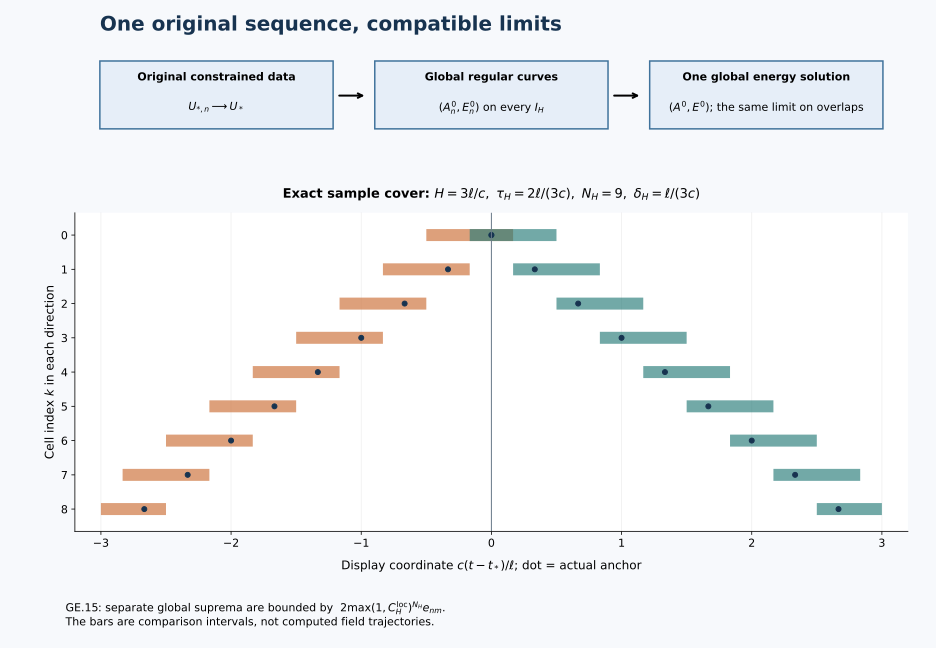

# Global solutions from finite-energy data

The local construction gives one solution on a short interval. To obtain
a global solution, we must show that the same approximating fields converge
on every finite time interval and that the resulting limits agree.
This chapter supplies that argument, including stability, the full
curvature, energy conservation and the original gauge maps.

Read [the local energy-data construction](../classical-energy-data-limit.html),
[global regular continuation](../classical-global-continuation.html) and
[initial-data stability](../classical-initial-data-stability.html).
The data and solution class are stated in Section 1. They are part of
the theorem, including the full-curvature hypothesis and the requirement
of approximation by regular solutions.

The diagram shows the actual cover in [GE.11](../classical-global-energy-data.html#eq-GE-11)–[GE.15](../classical-global-energy-data.html#eq-GE-15) and the compatible
limits in Section 5. Its intervals are a schematic of the proved
construction, with the displayed sample values of the cover parameters.

## 1. Data, metric, and the statement to be proved

Keep the original coordinates \((t,x)\in\mathbb R\times\mathbb R^3\),
the original metric \(\operatorname{diag}(-c^2,1,1,1)\), \(c>0\),
the length parameter \(\ell>0\), the fixed closed matrix group
\(G\subset U(N)\), the invariant pairing
\(\kappa(X,Y)=-\operatorname{tr}(XY)\), and the original time \(t_*\).
All spatial, derivative, and matrix tuples below retain every ordered
index. Define

\[
\begin{aligned}
F_{ij}(A)&=\partial_iA_j-\partial_jA_i+[A_i,A_j],&
D_i^AX&=\partial_iX+[A_i,X],\\
B&=(F_{23},F_{31},F_{12}),&
\|F\|_2^2&=2\|B\|_2^2,\\
\beta(A,X)_i&=\sum_{j,k}\epsilon_{ijk}[A_j,X_k],&
\epsilon_{123}&=1,\qquad |[X,Y]|\le2|X||Y|.
\tag{GE.1}
\end{aligned}
\]

The data space \(\mathcal D_{\rm curv}\) consists of the actual pairs
\(U_*=(A_*,E_*)\) satisfying

\[
A_*\in L^6,\quad \partial A_*\in L^2,\quad E_*\in L^2,
\quad D_{A_*}^iE_{*,i}=0,\quad F(A_*)\in L^2,
\quad d_*^2=c^{-2}\|E_*\|_2^2+\tfrac12\|F(A_*)\|_2^2.
\tag{GE.2}
\]

The Gauss equation is distributional. The curvature is the displayed
curvature of the potential, not an independent field. The potential is
its specified \(L^6\) representative; no additive constant is factored out.
No undifferentiated \(L^2\) or \(L^3\) assumption is inserted. Write

\[
\begin{aligned}
d_c(U,V)&=\|\partial(A-A')\|_2+c^{-1}\|E-E'\|_2,\\
d_{c,F}(U,V)&=d_c(U,V)+\|F(A)-F(A')\|_2,\qquad
I_H=[t_*-H,t_*+H]\quad(H>0).
\tag{GE.3}
\end{aligned}
\]

These are metrics: zero potential-gradient difference gives zero \(L^6\)
difference by \(\|A-A'\|_6\le C_S\|\partial(A-A')\|_2\),
where \(C_S=4/\sqrt3\). The graph metric is complete. Indeed a Cauchy
sequence has a potential limit in \(L^6\) with its gradient limit in \(L^2\),
an electric limit in \(L^2\), and a curvature limit in \(L^2\). Local testing
identifies the gradient; the two bracket placements identify Gauss
and the curvature, because \(L^6\) times \(L^2\) lies in \(L^3\)/2 and \(L^6\) times \(L^6\)
lies in \(L^3\). Thus all limits belong to the original data space.

Here is the exact global class. A path belongs to
\(\mathfrak S_{\rm reg}(\mathbb R)\) if, on every \(I_H\), it is a
limit of regular original temporal solutions, defined on an open
neighbourhood of \(I_H\), in

\[
C(I_H;L^6)\text{ for }A,\qquad
C(I_H;L^2)\text{ for }\partial A\text{ and }E,
\tag{GE.4}
\]

with their data at \(t_*\) converging in \(d_{c,F}\) to the same
\(U_*\). Regular means exactly [GC.2](../classical-global-continuation.html#eq-GC-2) and the affine RC solution class:
\(A_*\in L^6\), \(\partial A_*,E_*\in H_\ell^\infty\),
finite full curvature, exact Gauss, and
\((A-A_*,E,B)\) smooth into every \(H_\ell^q\).
The witnessing sequences may initially depend on H. Initial graph
convergence automatically gives common finite initial gradient and
energy bounds; no later bound is part of this definition.

We prove that every datum [GE.2](../classical-global-energy-data.html#eq-GE-2) has exactly one global path in this
class. One constrained approximation family at \(t_*\) converges on
every finite horizon. The resulting paths have strong continuous
full curvature, the original equations, exact energy equality,
continuous dependence in [GE.3](../classical-global-energy-data.html#eq-GE-3), and consistent restrictions and time
translations. The definition does not claim uniqueness among all
distributional solutions without a regular-approximation requirement.

## 2. One constrained family and a common horizon bound

Fix positive numerical bounds \(M,D\) with
\(\|\partial A_*\|_2\le M\), \(d_*\le D\). Choose, or retain
if already chosen, an original radius R and original heat endpoint S
satisfying

\[
\begin{gathered}
R>4M,\quad D_2=18\sqrt3C_MC_S,\quad D_3=12\sqrt3C_S^3,\\
S_R=\min\{(32D_2R)^{-4},(48D_3R^2)^{-2}\},\qquad
0<S\le S_R,\quad S^{1/4}D\le\varepsilon_*.
\tag{GE.5}
\end{gathered}
\]

Here \(C_M\) is [GC.3](../classical-global-continuation.html#eq-GC-3) and \(\varepsilon_*\) is the full positive
threshold [GC.7](../classical-global-continuation.html#eq-GC-7). The values of c,ell and all physical fields stay fixed.
The same construction works for every datum in this bounded set.

GA and [EL.4](../classical-energy-data-limit.html#eq-EL-4)–[EL.10](../classical-energy-data-limit.html#eq-EL-10) give compact smooth potentials and regular electric
fields with exact Gauss and convergence of the gradient, electric
field, and full curvature. [EL.11](../classical-energy-data-limit.html#eq-EL-11) resolves saturated positive bounds:
for the unadjusted data \((A_{*,n},E_{*,n})\), put

\[
\begin{gathered}
a_n=\|\partial A_{*,n}\|_2,\qquad
d_n^2=c^{-2}\|E_{*,n}\|_2^2+\tfrac12\|F(A_{*,n})\|_2^2,\\
\lambda_n=\min(1,M/a_n,D/d_n)^2,\qquad
\widetilde A_{*,n}(x)=\lambda_n A_{*,n}(\lambda_n x),\qquad
\widetilde E_{*,n}(x)=\lambda_n^2E_{*,n}(\lambda_n x),\\
F_{ij}(\widetilde A_{*,n})(x)
 =\lambda_n^2F_{ij}(A_{*,n})(\lambda_n x),\qquad
D_{\widetilde A_{*,n}}^i\widetilde E_{*,n,i}(x)
 =\lambda_n^3D_{A_{*,n}}^iE_{*,n,i}(\lambda_n x)=0.
\tag{GE.6}
\end{gathered}
\]

A zero denominator contributes \(+\infty\). Every gradient, electric,
and curvature \(L^2\) norm acquires the factor \(\lambda_n^{1/2}\), as
does the potential \(L^6\) norm. The bounds are therefore at most M,D.
Moreover \(\lambda_n\to1\); strong continuity of dilations in \(L^p\),
\(1\le p<\infty\), proves all the required convergence. For example

\[
\begin{aligned}
\|\partial\widetilde A_{*,n}-\partial A_*\|_2
\le{}&\lambda_n^{1/2}\|\partial A_{*,n}-\partial A_*\|_2\\
&+\|\lambda_n^2(\partial A_*)(\lambda_n\cdot)-\partial A_*\|_2
\longrightarrow0.
\tag{GE.7}
\end{aligned}
\]

This is an operation on approximants, with every dilation factor
retained; it does not replace the physical datum or its coordinates.
From now on the subscript n denotes this adjusted family. It is chosen
once, independently of H.

GC gives a global regular original solution for every member. Evaluate
the [GC.13](../classical-global-continuation.html#eq-GC-13)–[GC.42](../classical-global-continuation.html#eq-GC-42) arrays with the common original radius R and the common
energy upper bound D in every individual slot. [GC.6](../classical-global-continuation.html#eq-GC-6)'s particular
\(8(\|\partial A_*\|_2+\ell^{-1/2})\) is one permissible radius;
its use in the proof is solely the strict inequality R greater than
four times the initial gradient and [GE.5](../classical-global-energy-data.html#eq-GE-5)'s initial heat condition.
Thus the already selected R is legitimate in all the same formulas.
Replacing d by D is a majorization in the estimates, not an alteration
of the conserved \(d_n\). In particular use D to define the common
wave radius and its time cutoffs before taking the ceiling in [GC.32](../classical-global-continuation.html#eq-GC-32).
This avoids any unproved monotonicity of an independently computed
ceiling or lifespan.

For clarity, the last part of that common evaluation is

\[
\begin{gathered}
N_H^{\rm GC}=\lceil H/\tau_w(H)\rceil,\qquad
\Lambda_H^{\rm GC}=\sqrt{N_H^{\rm GC}H},\\
\mathfrak P_H=\Lambda_H^{\rm GC}C_S^{1/2}\sqrt{D_H^bH_H^b},
\quad\mathfrak H_H=\Lambda_H^{\rm GC}H_H^b,
\quad\mathfrak Q_H=C_S\mathfrak H_H,\\
p_H=p_0+\mathfrak P_H,\qquad q_H=q_0+\mathfrak Q_H,\\
k_H=k_0+\mathfrak H_H+\mathfrak P_H\mathfrak Q_H
       +2\min(p_0\mathfrak Q_H,q_0\mathfrak P_H),\\
\mathcal M_H=\max\{M,(1+2C_Sp_H)\mathcal R_a(H)+k_H\}.
\tag{GE.8}
\end{gathered}
\]

All of \(\tau_w,D_H^b,H_H^b,\mathcal R_a,p_0,q_0,k_0\) are
the full [GC.13](../classical-global-continuation.html#eq-GC-13)–[GC.39](../classical-global-continuation.html#eq-GC-39) finite recurrences, including their initial
smoothing, endpoint-wave, static-gauge and temporal-boundary terms,
evaluated as just specified. These are definitions by finite explicit
operations from the retained proof, not unnamed later solution norms.
That proof gives, simultaneously for every regular member of the
initial bounded family,

\[
\sup_{I_H}\|\partial A_n^0\|_2\le\mathcal M_H,
\quad\sup_{I_H}\|A_n^0\|_6\le C_S\mathcal M_H,
\quad\sup_{I_H}\|E_n^0\|_2\le cD,
\quad\sup_{I_H}\|B_n^0\|_2\le D.
\tag{GE.9}
\]

The hypotheses were checked at the original time. GC's proof first
obtains its finite wave cover and then retains both terms of the
static gauge in the physical reconstruction; only after that does
it prove [GE.9](../classical-global-energy-data.html#eq-GE-9). Energy alone has not been used to bound the potential.

All constants can be evaluated with positive M,D even when the actual
gradient or energy is zero. No division by an actual zero norm occurs.
The zero-energy conclusion will be verified directly after the limit.

## 3. A single local coefficient and an explicit two-sided cover

After [GE.9](../classical-global-energy-data.html#eq-GE-9), define the auxiliary radius and heat length

\[
R_H^{\rm aux}=8(\mathcal M_H+\ell^{-1/2}),\qquad
\sigma_H=\min(S,S_{R_H^{\rm aux}})>0.
\tag{GE.10}
\]

They obey \(R_H^{\rm aux}>4\mathcal M_H\) and
\(\sigma_H^{1/4}D\le\varepsilon_*\). The original endpoint remains S.
The auxiliary construction is used only to evaluate a local comparison
at a later time. Every regular slice already exists globally.

Evaluate [CP.46](../classical-initial-data-stability.html#eq-CP-46)–[CP.49](../classical-initial-data-stability.html#eq-CP-49) once with \((\mathcal M_H,D)\) in both
individual slots, original c,ell,H, and heat length \(\sigma_H\).
Retain its finite numbers \(i_H,a_H,b_H,K_H,g_H,\tau_{{\rm ind},H}\).
In particular its endpoint inputs keep the factors \(\ell^{k-1}\)
in the nine-norm sum. Define

\[
\begin{gathered}
\mu_H=2cK_H,\quad\nu_H=g_H,\quad
L_H=\nu_H+\mu_H(1+b_H),\\
\tau_H=\begin{cases}
\min(H,\tau_{{\rm ind},H}),&L_H=0,\\
\min(H,\tau_{{\rm ind},H},(2L_H)^{-2}),&L_H>0,
\end{cases}\\
C_H^{\rm loc}=2\{(b_H+\nu_H\sqrt{\tau_H})i_H+a_H\},
\qquad B_H=\max(1,C_H^{\rm loc}),\\
N_H=\lceil2H/\tau_H\rceil,\qquad \delta_H=H/N_H,
\qquad \mathcal C_H=2B_H^{N_H}.
\tag{GE.11}
\end{gathered}
\]

Here \(\delta_H\) is a physical time length, distinct from every data
distance. The numbers are finite, \(\tau_H>0\), and
\(2\delta_H\le\tau_H\). The zero-L branch and a zero local
coefficient need no division; the maximum in \(B_H\) also treats the
case of a vanishing local coefficient.

For \(\epsilon\in\{+1,-1\}\) and \(0\le k<N_H\), take the cell
between \(t_*+\epsilon k\delta_H\) and
\(t_*+\epsilon(k+1)\delta_H\), and enlarge it by
\(\delta_H/2\) at each end, intersecting with \(I_H\).
Call the resulting closed interval \(J_{\epsilon,k}\), and put
\(\alpha_{\epsilon,k}=t_*+\epsilon k\delta_H\).
Its length is at most \(2\delta_H\), it contains its actual
anchor \(\alpha_{\epsilon,k}\), and neighbouring intervals have
an interval of positive length in common. This is a finite cover
in both directions, using no point outside the horizon.

For any two regular members set
\(e_{nm}=d_c(U_{*,n},U_{*,m})\) and

\[
q_{nm}(u)=\|\partial(A_n^0-A_m^0)(u)\|_2
             +c^{-1}\|(E_n^0-E_m^0)(u)\|_2.
\tag{GE.12}
\]

Apply CP at the actual anchor of each \(J_{\epsilon,k}\).
Every receiving datum has the common bounds [GE.9](../classical-global-energy-data.html#eq-GE-9), exact Gauss,
and the GC regularity. The complete paired determinant is
\(1-\sqrt{|J|}\{\nu_H+\mu_H(1+b_H)\}\ge1/2\).
RC guarantees the same local construction at this datum; uniqueness
of regular original temporal solutions identifies it on J with the
already existing global member. Therefore

\[
\sup_J\|\partial(A_n^0-A_m^0)\|_2
+c^{-1}\sup_J\|E_n^0-E_m^0\|_2
\le C_H^{\rm loc}q_{nm}(\alpha_{\epsilon,k}).
\tag{GE.13}
\]

The same estimate applies in the negative direction: CP uses a closed
interval containing its anchor, and its norms are unoriented while
its underlying temporal identities retain their oriented integrals.

Induction in k now gives

\[
q_{nm}(t_*+\epsilon k\delta_H)\le B_H^ke_{nm},
\qquad\sup_{J_{\epsilon,k}}q_{nm}\le B_H^{k+1}e_{nm}.
\tag{GE.14}
\]

The induction begins with \(q_{nm}(t_*)=e_{nm}\); its next endpoint
belongs to the current J. Since the cover contains every time, each
of the two separate global suprema is bounded by \(B_H^{N_H}e_{nm}\).
They can attain their maxima in different cells, so their sum obeys

\[
\boxed{\quad
\rho_{nm,H}:=\sup_{I_H}\|\partial(A_n^0-A_m^0)\|_2
       +c^{-1}\sup_{I_H}\|E_n^0-E_m^0\|_2
\le\mathcal C_He_{nm}.
\quad}\tag{GE.15}
\]

The factor two in \(\mathcal C_H\) explicitly accounts for this
separate-supremum issue. No unknown difference is used to select a
coefficient or a partition. In particular no later-data convergence
or nonsmooth restart was presumed in this induction.

## 4. The actual overlap maps, including the static anchors

This section proves why the later-anchor use of CP compares the same
physical fields. For a regular member let C be the dynamic caloric
extension on the original \([0,S]\), with
\(C_s=0\), \(C_i(t,0)=A_i^0(t)\), \(C_t(t,0)=0\).
[GC.8](../classical-global-continuation.html#eq-GC-8)–[GC.12](../classical-global-continuation.html#eq-GC-12) constructs it throughout the physical line. For an anchor
\(\alpha\) and a heat endpoint \(s_0\in\{S,\sigma_H\}\), write

\[
\begin{gathered}
(V_{\alpha,0})_s=V_{\alpha,0}\operatorname{div}D_\alpha,
\quad V_{\alpha,0}(\alpha,0)=I_N,
\quad Q_{\alpha,s_0}=V_{\alpha,0}(\alpha,s_0),\\
(W_{\alpha,s_0})_t=W_{\alpha,s_0}C_t(t,s_0),
\quad W_{\alpha,s_0}(\alpha)=Q_{\alpha,s_0}^{-1},
\quad (W_{\alpha,s_0})_s=0,\\
a^{\alpha,s_0}=W_{\alpha,s_0}\cdot C,
\quad P_{\alpha,s_0}=W_{\alpha,s_0}^{-1}
                      =Q_{\alpha,s_0}U_{\alpha,s_0},\\
(U_{\alpha,s_0})_t=U_{\alpha,s_0}b_{\alpha,s_0},
\quad U_{\alpha,s_0}(\alpha)=I_N,
\quad b_{\alpha,s_0}=a_t^{\alpha,s_0}(0).
\tag{GE.16}
\end{gathered}
\]

The dot action is \(P\cdot a=PaP^{-1}-(\partial P)P^{-1}\), with
the derivative in the indicated coordinate. It obeys
\(P\cdot(Q\cdot a)=(PQ)\cdot a\), by expanding both affine terms.
Direct substitution gives
\(a_t^{\alpha,s_0}(s)=W_{\alpha,s_0}
\{C_t(s)-C_t(s_0)\}W_{\alpha,s_0}^{-1}\). Hence
\(a_s^{\alpha,s_0}=0\), \(a_t^{\alpha,s_0}(s_0)=0\), and

\[
\begin{aligned}
A_i^0&=Q_{\alpha,s_0}U_{\alpha,s_0}
 a_i^{\alpha,s_0}(0)U_{\alpha,s_0}^{-1}Q_{\alpha,s_0}^{-1}\\
&\quad-(\partial_iQ_{\alpha,s_0})Q_{\alpha,s_0}^{-1}
-Q_{\alpha,s_0}(\partial_iU_{\alpha,s_0})
                  U_{\alpha,s_0}^{-1}Q_{\alpha,s_0}^{-1},\\
E_i^0&=\operatorname{Ad}(P_{\alpha,s_0})E_i^{a^{\alpha,s_0}}(0).
\tag{GE.17}
\end{aligned}
\]

The identity for P follows by differentiating \(W^{-1}\) and
checking its nonidentity initial value Q. Neither affine term has
been omitted at a later anchor.

For two such charts j and k on an overlap define

\[
\begin{gathered}
T_{j\leftarrow k}=W_jW_k^{-1}=P_j^{-1}P_k,
\qquad a^j=T_{j\leftarrow k}\cdot a^k,
\qquad P_j=P_kT_{j\leftarrow k}^{-1},\\
\partial_tT_{j\leftarrow k}
=W_j\{C_t(s_j)-C_t(s_k)\}W_k^{-1},\qquad
\partial_sT_{j\leftarrow k}=0,\\
T_{j\leftarrow k}(\alpha_j)=Q_j^{-1}P_k(\alpha_j),
\quad T_{j\leftarrow k}T_{k\leftarrow l}=T_{j\leftarrow l},
\quad T_{k\leftarrow j}=T_{j\leftarrow k}^{-1}.
\tag{GE.18}
\end{gathered}
\]

These equalities follow from multiplication and the two ODEs, with
their displayed matrix orders. If both endpoints are \(\sigma_H\),
the transition is time independent. Its value is generally not the
identity. The cocycle and inverse identities prove consistency on
all multiple overlaps, including the two charts anchored at \(t_*\)
on opposite time directions. On the affine physical chart the exact
transition is, for any two physical anchors \(\alpha,\gamma\),

\[
A^0(t)-A^0(\alpha)
=\{A^0(\gamma)-A^0(\alpha)\}
 +\{A^0(t)-A^0(\gamma)\},\qquad
A^0(\gamma)-A^0(\alpha)=\int_\alpha^\gamma E^0(u)\,du.
\tag{GE.19}
\]

Both differences are actual \(L^2\) increments. This transition asserts
no \(L^2\) membership for either full potential.

In particular the original S construction is always
\(P_{t_*,S}=Q_0U\), with
\(Q_0=V_{t_*,0}(t_*,S)\), \(U(t_*)=I_N\).
Equation [GE.18](../classical-global-energy-data.html#eq-GE-18) relates every auxiliary chart to that same map;
choosing a local comparison never sets the original \(Q_0\) or U to a
new value.

## 5. One limit on every horizon and the full curvature receiver

The initial family is Cauchy in [GE.3](../classical-global-energy-data.html#eq-GE-3). By [GE.15](../classical-global-energy-data.html#eq-GE-15) and Sobolev, it is
Cauchy in all three spaces [GE.4](../classical-global-energy-data.html#eq-GE-4) on each fixed horizon. Completeness
and testing against compact smooth derivatives give actual limits
\(A^0,E^0\), with \(\partial A^0\) their actual distributional
spatial derivative. Their initial values are exactly \(A_*,E_*\).
Let

\[
h_n(t)=A_n^0(t)-A_{*,n}=\int_{t_*}^tE_n^0(u)\,du,
\qquad h(t)=\int_{t_*}^tE^0(u)\,du .\tag{GE.20}
\]

The integrals are Bochner \(L^2\) integrals, signed for \(t<t_*\).
[GE.15](../classical-global-energy-data.html#eq-GE-15) proves

\[
\begin{gathered}
\sup_{I_H}\|h_n-h_m\|_2\le cH\mathcal C_He_{nm},\qquad
\sup_{I_H}\|\partial(h_n-h_m)\|_2
                           \le(\mathcal C_H+1)e_{nm},\\
h_n\to h\text{ in }C(I_H;H_\ell^1),\qquad
A^0=A_*+h,\quad h\in C^1(I_H;L^2),\quad h_t=E^0.
\tag{GE.21}
\end{gathered}
\]

Here \(\|h\|_{H_\ell^1}^2=\|h\|_2^2+\ell^2\|\partial h\|_2^2\).
Testing [GE.20](../classical-global-energy-data.html#eq-GE-20) identifies the \(L^2\)-increment and \(L^6\)-potential limits.

For this horizon put

\[
\begin{gathered}
p=C_S(\mathcal M_H+M),\quad q=cHD,\quad r=\sqrt{pq},
\quad z_H=\sqrt{cHC_S\mathcal C_H(\mathcal C_H+1)},\\
\sup\|h_n\|_6\le p,\quad\sup\|h_n\|_2\le q,
\quad\sup\|h_n\|_3\le r,
\quad\sup\|h_n-h_m\|_3\le z_He_{nm}.
\tag{GE.22}
\end{gathered}
\]

These follow from [GE.9](../classical-global-energy-data.html#eq-GE-9), [GE.20](../classical-global-energy-data.html#eq-GE-20)–[GE.21](../classical-global-energy-data.html#eq-GE-21) and
\(\|v\|_3\le\|v\|_2^{1/2}\|v\|_6^{1/2}\).
The estimate uses distance at most H from the original anchor,
not the full interval length 2H. All bounds pass to the limits.

For any two paths with initial potentials \(A_*,A_*'\), put
\(u=A_*-A_*'\), \(v=h-h'\). The exact full ordered identity is

\[
\begin{aligned}
F_{ij}(A_*+h)-F_{ij}(A_*'+h')
={}&F_{ij}(A_*)-F_{ij}(A_*')+\partial_iv_j-\partial_jv_i\\
&+[u_i,h_j]+[A_{*,i}',v_j]
  +[v_i,A_{*,j}]+[h_i',u_j]\\
&+[v_i,h_j]+[h_i',v_j].
\tag{GE.23}
\end{aligned}
\]

To prove it, expand the curvature of \(A_*+h\) as its initial full
curvature plus its two derivative increments and the three brackets
\([A_{*,i},h_j]+[h_i,A_{*,j}]+[h_i,h_j]\). Subtract the primed
formula and telescope each of these three products in the displayed
order. Thus every one of the six placements, including each mixed
initial-increment term, is present.

For full tuples \(\|[X_i,Y_j]_{ij}\|_2\le2\|X\|_6\|Y\|_3\);
either order of the two scalar norms is permitted without changing
the matrix order. Hence

\[
\begin{aligned}
\|\delta F(t)\|_2\le{}&\|\delta F_*\|_2+2\|\partial v(t)\|_2
+2\|u\|_6\{\|h(t)\|_3+\|h'(t)\|_3\}\\
&+2\|v(t)\|_3
\{\|A_*\|_6+\|A_*'\|_6+\|h(t)\|_6+\|h'(t)\|_6\}.
\tag{GE.24}
\end{aligned}
\]

In particular, with

\[
\mathcal K_H=2(\mathcal C_H+1)+4C_Sr+4(C_SM+p)z_H,
\qquad
\sup_{I_H}\|F(A_n^0)-F(A_m^0)\|_2
\le\|F(A_{*,n})-F(A_{*,m})\|_2+\mathcal K_He_{nm},
\tag{GE.25}
\]

the full curvature converges strongly in \(C(I_H;L^2)\).
The limit is its original formula, explicitly

\[
F_{ij}(A^0)=F_{*,ij}+\partial_ih_j-\partial_jh_i
 +[A_{*,i},h_j]+[h_i,A_{*,j}]+[h_i,h_j].\tag{GE.26}
\]

All three products are continuous \(L^2\) fields by [GE.22](../classical-global-energy-data.html#eq-GE-22). Alternatively,
\(L^6\) convergence of the potentials identifies their bracket tensor in
\(L^3\) and thus identifies the distributional curvature with the \(L^2\)
limit. Both identifications retain all initial terms. In particular
\(B^0\in C(I_H;L^2)\), and
\(\|\delta B\|_2=2^{-1/2}\|\delta F\|_2\).

In physical units, M,D,\(\mathcal M_H\), and \(e_{nm}\) have unit
length to the power \(-1/2\); q has unit length to the power \(1/2\);
p has unit length to the power \(-1/2\); r is dimensionless; z_H has
unit length to the power \(1/2\). Thus \(\mathcal C_H,\mathcal K_H\)
are dimensionless. The original c and ell have not been suppressed.

Take an exhaustion, for example \(H_j=j\ell/c\), \(j\ge1\).
On overlapping horizons the limits agree because they are limits of
the same original regular sequence in the same Hausdorff spaces.
They therefore define one path on all of \(\mathbb R\). Every other
finite horizon is contained in one of these and has the same limit.
No subsequence or new approximation at a later time is required.

## 6. The original equations, constraints and energy equality

The exact regular equations are

\[
\partial_tA_n^0=E_n^0,\quad
\partial_tE_n^0=-c^2\{\operatorname{curl}B_n^0+\beta(A_n^0,B_n^0)\},
\quad\partial_tB_n^0=\operatorname{curl}E_n^0+\beta(A_n^0,E_n^0).
\tag{GE.27}
\]

For X=E or B the nonlinear difference is precisely

\[
\beta(A_n^0,X_n^0)-\beta(A^0,X^0)
=\beta(A_n^0-A^0,X_n^0)+\beta(A^0,X_n^0-X^0).
\tag{GE.28}
\]

Its \(C(I_H;L^{3/2})\) norm tends to zero; a valid full-tuple bound
is 12 times the sum of the two \(L^6\)/\(L^2\) norm products. Linear terms pass
by distributional testing. Thus [GE.27](../classical-global-energy-data.html#eq-GE-27) holds for the limits everywhere
in spacetime distributions, and its first equation holds strongly as
the \(L^2\) derivative of the affine increment. At every individual time,
the same two placements pass the constraints to

\[
D_{A^0}^iE_i^0=0,\qquad D_{A^0}^iB_i^0=0 .\tag{GE.29}
\]

Set \(A_t^0=0\), \(F_{ti}^0=E_i^0\), \(F_{it}^0=-E_i^0\),
\(F_{tt}^0=0\), with [GE.26](../classical-global-energy-data.html#eq-GE-26) for the spatial components. Then

\[
D^\mu F_{\mu\nu}^0=0,\qquad
D_\alpha F_{\beta\gamma}^0+D_\beta F_{\gamma\alpha}^0
 +D_\gamma F_{\alpha\beta}^0=0.\tag{GE.30}
\]

Indeed the spatial Yang–Mills component is
\(-c^{-2}\partial_tE_i^0+D^jF_{ji}^0=0\), where
\(D^jF_{ji}^0=-(\operatorname{curl}B^0+\beta(A^0,B^0))_i\).
The time component is minus Gauss. The time-spatial Bianchi component
is \(\partial_tF_{ij}^0=D_iE_j^0-D_jE_i^0\), exactly the magnetic
equation in [GE.27](../classical-global-energy-data.html#eq-GE-27); the purely spatial component is the second [GE.29](../classical-global-energy-data.html#eq-GE-29).
These exhaust all index cases, including the skew-symmetric repeats.

The right sides of the electric and magnetic equations are continuous
in \(H_\ell^{-1}=(H_\ell^1)^*\). In fact

\[
\begin{aligned}
\|E_t^0\|_{H_\ell^{-1}}&\le c^2
\{\ell^{-1}+12C_S^{1/2}\ell^{-1/2}\|A^0\|_6\}\|B^0\|_2,\\
\|B_t^0\|_{H_\ell^{-1}}&\le
\{\ell^{-1}+12C_S^{1/2}\ell^{-1/2}\|A^0\|_6\}\|E^0\|_2.
\tag{GE.31}
\end{aligned}
\]

Use \(\|\operatorname{curl}\psi\|_2\le\|\partial\psi\|_2\)
and \(\|\psi\|_3\le C_S^{1/2}\ell^{-1/2}\|\psi\|_{H_\ell^1}\).
Testing the zero derivative of the difference between a field and
its oriented integral proves the corresponding Bochner integral
equations. Therefore E,B are \(C^1(\mathbb R;H_\ell^{-1})\).
No stronger physical differentiability is needed or inferred.

With the original constants \(\hbar>0\) and \(g_{\rm YM}\ne0\),
retain the exact physical density and flux

\[
e=\frac{\hbar}{g_{\rm YM}^2}
 \{c^{-1}\sum_i\kappa(E_i^0,E_i^0)+c\sum_i\kappa(B_i^0,B_i^0)\},
\quad
\mathcal S_i=-\frac{2\hbar c}{g_{\rm YM}^2}
                 \sum_{j,k}\epsilon_{ijk}\kappa(E_j^0,B_k^0).
\tag{GE.32}
\]

Strong continuous \(L^2\) convergence yields continuous L1 convergence
of both the density and flux, using the two product placements and

\[
\||X|^2-|Y|^2\|_1\le(\|X\|_2+\|Y\|_2)\|X-Y\|_2
\]

.
The regular identity therefore gives

\[
\partial_te+\operatorname{div}\mathcal S=0,
\qquad |\mathcal S\cdot n|\le ce\quad(|n|=1),\qquad
\mathcal E(t)=\frac{\hbar}{g_{\rm YM}^2}
 \{c^{-1}\|E_*\|_2^2+\tfrac c2\|F_*\|_2^2\}
=\frac{\hbar c}{g_{\rm YM}^2}d_*^2 .\tag{GE.33}
\]

The equality is the limit of the exact regular energy equalities on
each horizon, not a lower-semicontinuity assertion. There is also no
missing boundary flux: testing against a cutoff with gradient at most
\(C_\chi/R\) makes its integrated flux at most
\(cC_\chi/R)|t-u|\sup_{[u,t]}\mathcal E\), tending to zero.
The endpoint integrals converge by dominated convergence. This proves
the same equality directly from the local balance.

If \(d_*=0\), [GE.33](../classical-global-energy-data.html#eq-GE-33) gives E=B=0 at every time and [GE.20](../classical-global-energy-data.html#eq-GE-20) gives
\(A^0(t)=A_*\). Thus the zero-energy solution is exactly the stationary
flat original representative, even if \(\partial A_*\ne0\).
The positive-majorant approximation did not require flat approximants
or division by zero. If the initial gradient is zero, its actual \(L^6\)
potential is zero by Sobolev; all preceding arguments still apply.

## 7. Cross-family stability, independence and the time maps

Take two data in the same initial bounded set, and any two regular
graph approximations retaining these bounds. [GE.15](../classical-global-energy-data.html#eq-GE-15) and [GE.25](../classical-global-energy-data.html#eq-GE-25) apply
to every cross pair. Pass both indices to infinity in their continuous
norms. With \(\Delta_*=d_c(U_*,U_*')\), obtain

\[
\begin{aligned}
\sup_{I_H}\|\partial(A^0-A^{0\prime})\|_2
 +c^{-1}\sup_{I_H}\|E^0-E^{0\prime}\|_2
 &\le\mathcal C_H\Delta_*,\\
\sup_{I_H}\|F(A^0)-F(A^{0\prime})\|_2
 &\le\|F_*-F_*'\|_2+\mathcal K_H\Delta_*,\\
\sup_{I_H}\|A^0-A^{0\prime}\|_6&\le C_S\mathcal C_H\Delta_*,\\
\ell^{-1}\sup_{I_H}\|h-h'\|_2
 &\le(cH/\ell)\mathcal C_H\Delta_*.
\tag{GE.34}
\end{aligned}
\]

The graph output metric given by the sum of the first two left sides
therefore has Lipschitz constant
\(\max(\mathcal C_H+\mathcal K_H,1)\) relative to \(d_{c,F}\).
Including the affine \(L^2\) increment adds
\((cH/\ell)\mathcal C_H\), and including \(L^6\) adds
\(C_S\mathcal C_H\). If \(A_*-A_*'\in L^2\), the additional exact
estimate is

\[
\ell^{-1}\sup_{I_H}\|A^0-A^{0\prime}\|_2
\le\ell^{-1}\|A_*-A_*'\|_2+(cH/\ell)\mathcal C_H\Delta_*.
\tag{GE.35}
\]

No such assumption is used for [GE.34](../classical-global-energy-data.html#eq-GE-34).

For any convergent initial graph sequence, positive common M,D exist
for its tail. The finite omitted portion is irrelevant to the limit.
For two sequences use common bounds for their union. If they were
originally constructed with different heat choices, compare their
physical regular solutions using an auxiliary common initial radius
and positive heat length allowed by both bounds. GC and CP then give
the preceding inequalities in that comparison; [GE.18](../classical-global-energy-data.html#eq-GE-18) preserves the
already chosen heat charts. Thus the physical limit is independent
of all approximation choices, admissible radii, heat endpoints, and
covers. Such choices change numerical upper bounds, not the path.

In particular equal initial data give identical gradients and E.
Sobolev in the actual \(L^6\) representatives gives identical potentials;
[GE.26](../classical-global-energy-data.html#eq-GE-26) gives identical curvatures. This proves uniqueness in the class
[GE.4](../classical-global-energy-data.html#eq-GE-4), even when its witnessing sequences depend on H. Each of its
regular witnesses extends globally by GC, and regular uniqueness
identifies that extension on its old interval. Its initial graph
convergence supplies the common initial bounds required above.
This proves precisely the stated class result and no larger weak-class
uniqueness claim. Constant regular sequences show that the new map
extends every original regular solution exactly.

Let \(\Phi_r(U_*)=(A^0(t_*+r),E^0(t_*+r))\). This datum belongs
to [GE.2](../classical-global-energy-data.html#eq-GE-2) at every r by [GE.26](../classical-global-energy-data.html#eq-GE-26), [GE.29](../classical-global-energy-data.html#eq-GE-29) and [GE.33](../classical-global-energy-data.html#eq-GE-33). The original regular
sequence at that time converges in the graph metric, by [GE.34](../classical-global-energy-data.html#eq-GE-34).
It is therefore an admissible regular approximation for this new datum,
and its subsequent curves converge on every finite interval. Compare
it with the independently constructed solution from that datum by
the just-proved approximation independence, now anchored there. This
establishes

\[
\Phi_0=\operatorname{id},\qquad
\Phi_r\circ\Phi_s=\Phi_{r+s},\qquad
\Phi_{-r}=\Phi_r^{-1}.\tag{GE.36}
\]

The equality concerns the actual temporal representatives. There is
no gauge quotient. This is a derived restart identity after global
construction, not a premise in the finite-cover proof. It also proves
consistency of restrictions to every interval and agreement with EL's
local map on its original interval. Restrict the common regular
sequence there and use [EL.31](../classical-energy-data-limit.html#eq-EL-31); larger initial bounds, if used by a
second witness, are handled by their common union as above.

The map \((r,U)\mapsto\Phi_r(U)\) is continuous in the graph metric.
For \(r_n\to r\) and \(U_n\to U\), choose one finite horizon
containing these times and common initial bounds. [GE.34](../classical-global-energy-data.html#eq-GE-34) controls
\(\Phi_{r_n}(U_n)-\Phi_{r_n}(U)\); the remaining difference tends
to zero by the strong time continuity of A's gradient, E, and F.
This proves joint continuity, including time zero.

## 8. Strong survival of the original S gauges

The gauge identities above already prove that every regular comparison
uses the same physical field. We now verify their limiting maps and
the unchanged original S endpoint as well.

On each of the finitely many J intervals, the anchor data converge in
the graph metric by [GE.15](../classical-global-energy-data.html#eq-GE-15) and [GE.25](../classical-global-energy-data.html#eq-GE-25). [EL.34](../classical-energy-data-limit.html#eq-EL-34)–[EL.39](../classical-energy-data-limit.html#eq-EL-39), with the common
local bounds from [GE.9](../classical-global-energy-data.html#eq-GE-9)–[GE.11](../classical-global-energy-data.html#eq-GE-11), therefore gives convergence of its local
\(Q_j,U_j,P_j\), of the corresponding a and electric field on
\([0,\sigma_H]\), and of the full heat curvature. Specifically the
gauge converges uniformly in x and t, its first derivatives in \(L^3\)
and \(L^6\), and its full Hessian in \(L^2\). The potential converges in \(L^6\)
with gradient in \(L^2\); all curvature components needed in EL converge
in \(L^2\). The temporal boundary b has convergence in C \(L^3\), gradient
C \(L^2\), and the four L1-in-time coefficient spaces in [EL.35](../classical-energy-data-limit.html#eq-EL-35).

For the fixed common heat endpoint \(\sigma_H\), [GE.18](../classical-global-energy-data.html#eq-GE-18) is static
on an overlap. Its value at an overlap anchor is the product
\(Q_j^{-1}P_k(\alpha_j)\). The just-proved strong gauge limits
therefore give convergence of the transition itself in \(L^\infty\),
of its gradient in \(L^3\) and \(L^6\), and of its Hessian in \(L^2\): the mixed
second product uses \(L^3\) times \(L^6\). The same product rules pass the
cocycle identity. Starting with the chart at \(t_*\), multiply the
next chart by this static transition to retain one time gauge
\(W_{*,\sigma_H}\) with anchor \(Q_{*,\sigma_H}^{-1}\).
Induction over the finite positive and negative chains proves strong
convergence of this globally anchored auxiliary gauge and its fields
on \(I_H\times[0,\sigma_H]\). Overlap cocycles prove independence
of the chosen chain. Every temporal b coefficient has the original
signed integral; the negative chain changes only the integral
orientation, not the product order or anchor.

For the remainder \([\sigma_H,S]\), use the already proved [FI.24](../classical-fixed-heat-comparison.html#eq-FI-24)–[FI.42](../classical-fixed-heat-comparison.html#eq-FI-42)
change-of-endpoint operation. Its physical input is now the controlled
curve difference [GE.15](../classical-global-energy-data.html#eq-GE-15), and its original reference-time input is the
initial difference. Its necessary individual positive-heat jets are
uniformly bounded: [GC.18](../classical-global-continuation.html#eq-GC-18) supplies all finite connection \(L^\infty\)
jets in the original S gauge, H9 and [GC.14](../classical-global-continuation.html#eq-GC-14) supply the corresponding
F,E,G jets, and \(W=-D^jE_j\) supplies the temporal tension jets.
[FI.34](../classical-fixed-heat-comparison.html#eq-FI-34)–[FI.35](../classical-fixed-heat-comparison.html#eq-FI-35) transports these individual arrays to the auxiliary gauge.
The strictly positive lower endpoint \(\sigma_H\) makes all their
finite heat integrals finite, with constants depending only on the
fixed common bounds, c,ell,S,H. No higher physical data norm enters.

Here are the exact controlling operations. In the auxiliary gauge put
\(\eta=a_n-a_m\), \(Z=G_n-G_m\), \(Y=e_n-e_m\). The full
[FI.29](../classical-fixed-heat-comparison.html#eq-FI-29) equations have \(\eta_s=Z\), with both other equations
\((\partial_s-\Delta)X=\mathcal L(a_n)X+\mathcal H(X_m)\), where

\[
\begin{aligned}
\mathcal L(a)X_i={}&2[a_j,\partial_jX_i]+[\partial^ja_j,X_i]
 +[a_j,[a_j,X_i]]+2[F_{ij},X_j],\\
\mathcal H(H)_i={}&2[\eta_j,\partial_jH_i]+[\partial^j\eta_j,H_i]
 +[\eta_j,[a_{n,j},H_i]]+[a_{m,j},[\eta_j,H_i]]
 +2[\delta F_{ij},H_j],\\
\delta F_{ij}={}&\partial_i\eta_j-\partial_j\eta_i
                       +[\eta_i,a_{n,j}]+[a_{m,i},\eta_j].
\tag{GE.37}
\end{aligned}
\]

All j are summed. [FI.25](../classical-fixed-heat-comparison.html#eq-FI-25)–[FI.27](../classical-fixed-heat-comparison.html#eq-FI-27) gives the starting positive-heat jets
as degree-one functions of the physical differences. With its
explicit product constants [FI.30](../classical-fixed-heat-comparison.html#eq-FI-30)–[FI.31](../classical-fixed-heat-comparison.html#eq-FI-31), retain

\[
\begin{gathered}
\mathcal Y_5^2=\|\partial\eta\|_{H_\ell^5}^2
 +\ell^2\|Z\|_{H_\ell^5}^2+c^{-2}\|Y\|_{H_\ell^5}^2,\\
\tfrac12\partial_s\mathcal Y_5^2
 +\tfrac12\ell^2\|\partial Z\|_{H_\ell^5}^2
 +\tfrac34c^{-2}\|\partial Y\|_{H_\ell^5}^2
 \le\Lambda_5\mathcal Y_5^2,\\
\mathcal Y_5(t,s)\le\mathcal Y_5(t,\sigma_H)
       \exp\!\left(\int_{\sigma_H}^{s}\Lambda_5(t,r)\,dr\right).
\tag{GE.38}
\end{gathered}
\]

The uniform common coefficient bound just verified makes the right
side tend uniformly to zero. This proves strong gradient convergence
and electric/G convergence on the positive-heat strip. Sobolev gives
\(L^6\) convergence of the potential. Its full spatial curvature converges
in \(L^2\) as well: start with the known curvature at \(\sigma_H\), write
the increment \(\int_{\sigma_H}^sG(r)dr\), and apply all six
placements [GE.23](../classical-global-energy-data.html#eq-GE-23). The increment differences converge in \(L^2\) and \(L^6\),
hence \(L^3\). Initial and final heat endpoints are both retained.

In this gauge the temporal value at S is
\(\theta_n(t)=\int_{\sigma_H}^S W_n(t,r)dr\), where

\[
W_n-W_m=-\partial^jY_j-[\eta^j,e_{n,j}]-[a_m^j,Y_j].
\tag{GE.39}
\]

[FI.37](../classical-fixed-heat-comparison.html#eq-FI-37) and [GE.38](../classical-global-energy-data.html#eq-GE-38) prove that \(\theta_n-\theta_m\) tends to zero
in \(C(I_H;H_\ell^4)\). Define the transition to the original endpoint
by

\[
R_n=W_{*,S,n}W_{*,\sigma_H,n}^{-1},\qquad
(R_n)_t=R_n\theta_n,\qquad
R_n(t_*)=Q_{*,S,n}^{-1}Q_{*,\sigma_H,n}.
\tag{GE.40}
\]

The anchor is precisely the original backward heat map, not I.
[EL.36](../classical-energy-data-limit.html#eq-EL-36)–[EL.38](../classical-energy-data-limit.html#eq-EL-38) at the original time gives convergence of both Q factors
in \(L^\infty\), their gradients in \(L^3\) and \(L^6\), and their Hessians in \(L^2\).
We spell out the mixed-norm ODE passage, since a bound on the Hessian
in \(L^\infty\) alone would not suffice for the affine potential action.

For R,R' solving this unitary ODE, write \(\delta R=R-R'\) and
\(\delta\theta=\theta-\theta'\). The exact first and second
spatial derivative difference equations are

\[
\begin{aligned}
(\partial_i\delta R)_t={}&(\partial_i\delta R)\theta
 +(\partial_iR')\delta\theta+\delta R\,\partial_i\theta
 +R'\partial_i\delta\theta,\\
(\partial_j\partial_i\delta R)_t={}&
(\partial_j\partial_i\delta R)\theta
 +(\partial_j\partial_iR')\delta\theta
 +\delta R\,\partial_j\partial_i\theta
 +R'\partial_j\partial_i\delta\theta\\
&+(\partial_i\delta R)\partial_j\theta
 +(\partial_iR')\partial_j\delta\theta
 +(\partial_j\delta R)\partial_i\theta
 +(\partial_jR')\partial_i\delta\theta.
\tag{GE.41}
\end{aligned}
\]

The unitary propagator for right multiplication by \(\theta\)
preserves each matrix norm. Thus the zero-order difference is bounded
by its initial supremum plus \(\int\|\delta\theta\|_\infty\).
For either p=3 or p=6 the first equation bounds its norm by the initial
derivative difference plus the integral of

\[
\|\partial R'\|_p\|\delta\theta\|_\infty
+\|\delta R\|_\infty\|\partial\theta\|_p
+\|\partial\delta\theta\|_p
\]

.
The individual first derivatives are bounded by their initial norms
plus the corresponding gradient integrals. In the second equation,
place one derivative factor in \(L^3\) and the other in \(L^6\) for all four
mixed placements. The two unmixed Hessian terms use \(L^2\) and \(L^\infty\).
The individual Hessian has the identical estimate with its two mixed
terms. Finite-horizon \(C H_\ell^4\) control of theta supplies every
needed L1-in-time coefficient; interpolation and Sobolev give its
gradient \(L^3\) and \(L^6\) norms. Consequently all right sides are integrable,
bounded uniformly, and their difference forcings tend to zero.
This proves convergence of R in C \(L^\infty\), of \(\partial R\)
in C \(L^3\) and C \(L^6\), and of \(\partial^{(2)}R\) in C \(L^2\), in both
time directions. No exponential involving an unknown solution
difference is needed.

Pass the full affine action
\(a^{[S]}=R\cdot a^{[\sigma_H]}\), with its derivative, using
these mixed spaces: terms containing a potential use \(L^6\) times \(L^3\),
and Hessian terms use \(L^2\). Curvatures transform by the two conjugation
placements. The temporal component is
\(a_t^{[S]}=R(a_t^{[\sigma_H]}-\theta)R^{-1}\), so its value at
S is exactly zero. At heat zero its local coefficient convergence
and [GE.39](../classical-global-energy-data.html#eq-GE-39)–[GE.41](../classical-global-energy-data.html#eq-GE-41) give the same boundary convergence as [EL.35](../classical-energy-data-limit.html#eq-EL-35).
Finally

\[
P_{*,S}=P_{*,\sigma_H}R^{-1}=Q_0U,\quad U(t_*)=I_N,
\quad Q_0=V_{t_*,0}(t_*,S),\quad
A^0=P_{*,S}\cdot a^{[S]}(0),\quad
E^0=\operatorname{Ad}(P_{*,S})e^{[S]}(0).
\tag{GE.42}
\]

All these identities are strong limits in the spaces just proved.
Thus the original static \(Q_0\), the original time anchor, the actual
physical representative, and both heat endpoints survive on every
finite horizon. Restriction agreement follows from the same regular
maps and their uniqueness. This proves compatibility even when a
larger horizon requires a smaller auxiliary \(\sigma_H\).

## 9. Exact relation to Oh's \(L^3\) admissible global solutions

The original author TeX for Sung-Jin Oh's
*Gauge choice for the Yang–Mills equations using the Yang–Mills heat
flow and local well-posedness in H1*, arXiv:1210.1558v2, defines
admissible data and solutions at `def:admID`, `def:admSol`
(lines 446–466). The global paper, *Finite energy global well-posedness
of the Yang–Mills equations on R^(1+3): An approach using the
Yang–Mills heat flow*, arXiv:1210.1557v2, repeats these definitions
(lines 782–801) and states its global theorem immediately thereafter.
Its approximation/repeated-local-theorem receiving step is at
lines 1038–1040. These original TeX passages, the local source's
approximation proof and main-theorem reduction, were actually read.
The companion source's core estimate proofs are not represented as
a new whole-paper review. The complete construction here
uses the complete course providers identified above.

The extra source datum is \(A_*\in L^3\). On this subdomain

\[
\|A_*\|_4^2\le\|A_*\|_3\|A_*\|_6,\qquad
\|[A_{*,i},A_{*,j}]_{ij}\|_2\le2\|A_*\|_4^2 .\tag{GE.43}
\]

Thus [GE.2](../classical-global-energy-data.html#eq-GE-2)'s curvature assumption follows from the original full
formula and this \(L^3\) condition. For two data in the subdomain the exact
two-placement formula also gives

\[
\begin{aligned}
F(A)-F(A')={}&\partial_i(A_j-A_j')-\partial_j(A_i-A_i')
 +[A_i-A_i',A_j]+[A_i',A_j-A_j'],\\
\|F(A)-F(A')\|_2\le{}&2\|\partial(A-A')\|_2
 +2\|A-A'\|_3(\|A\|_6+\|A'\|_6).
\tag{GE.44}
\end{aligned}
\]

Hence adding the \(L^3\) norm to the graph metric gives precisely the
same data topology as \((\dot H^1\cap L^3)\times L^2\) in the
source's actual representative: one direction forgets curvature,
and the other uses [GE.44](../classical-global-energy-data.html#eq-GE-44) and Sobolev on a convergent sequence.

GA's cutoff and mollification can be chosen to converge in \(L^3\) as
well, since compact cutoff and mollification are strongly continuous
there. [GE.6](../classical-global-energy-data.html#eq-GE-6) retains that convergence by the finite-p dilation
argument. Each approximating potential is compact smooth initially,
so GC's regular affine evolution belongs to \(H_\ell^\infty\)
itself on every compact time interval: add its initial compact
potential to its regular H-infinity increment. It is therefore a
classical regular solution of precisely the type used by the source.
Equations [GE.21](../classical-global-energy-data.html#eq-GE-21)–[GE.22](../classical-global-energy-data.html#eq-GE-22) prove convergence of those solutions also in
\(C(I_H;L^3)\). More explicitly,

\[
\begin{aligned}
\sup_{I_H}\|A^0\|_3&\le\|A_*\|_3+r,\\
\sup_{I_H}\|A^0-A^{0\prime}\|_3
 &\le\|A_*-A_*'\|_3+z_Hd_c(U_*,U_*')
 \quad\text{whenever }A_*-A_*'\in L^3.
\tag{GE.45}
\end{aligned}
\]

Thus our \(L^3\) subdomain maps into exactly the stated admissible-solution
topology, with a global family of classical witnesses. Its image is
the solution map in Oh's global theorem: our constructed solution is
admissible with the same datum, and that theorem's stated uniqueness
within its admissible class identifies it. This last identification
uses the human theorem as a source comparison; it is not needed for
existence, stability, or the independent class uniqueness proved in
Sections 1–7. No claim that every distributional solution belongs to
either approximation class is made, and the source's word
“classical” is not silently redefined to mean the course's regular
space. The constructed witnesses satisfy both meanings explicitly.

The exact source-coordinate map is only for this comparison:

\[
\begin{gathered}
y^0=c(t-t_*),\quad y^i=x^i,\qquad
A_0^{\rm Oh}=c^{-1}A_t^0=0,\quad A_i^{\rm Oh}=A_i^0,\\
F_{0i}^{\rm Oh}=c^{-1}E_i^0,\quad F_{ij}^{\rm Oh}=F_{ij}^0,
\quad D_0^{\rm Oh}=c^{-1}D_t,\quad D_i^{\rm Oh}=D_i,\\
D_{\rm Oh}^{\alpha}F_{\alpha i}^{\rm Oh}
=-c^{-2}D_tE_i^0+D^jF_{ji}^0=0,\qquad
D_{\rm Oh}^{\alpha}F_{\alpha0}^{\rm Oh}
=-c^{-1}D^jE_j^0=0,\\
\mathbf E^{\rm Oh}=\tfrac12\{c^{-2}\|E^0\|_2^2
                                 +\sum_{i<j}\|F_{ij}^0\|_2^2\}
=\tfrac12d_*^2,\qquad
\mathcal E_{\rm YM}=\frac{2\hbar c}{g_{\rm YM}^2}\mathbf E^{\rm Oh}.
\tag{GE.46}
\end{gathered}
\]

The map is invertible, with \(t=t_*+y^0/c\), E=c times the source
electric component, and unchanged spatial coordinates. Its time
measure is \(dy^0=c\,dt\); the temporal connection component has
factor \(c^{-1}\), so its L1 temporal-gauge coefficient integral
has factor one. Source component maxima and full tuple norms give
the same topology by the finite-dimensional inequalities
\(\max_a\|X_a\|\le\|X\|\le\sqrt{m}\max_a\|X_a\|\)
for m components. No numeric source maximum is identified with a full
tuple norm. These operations prove the exact domain, equation,
constraint, energy and topology correspondence with all c factors.

The complement of the \(L^3\) subdomain has a precise relation as well:
[GE.22](../classical-global-energy-data.html#eq-GE-22) gives \(A^0(t)-A_*\in L^3\) at every finite t. Therefore

\[
A^0(t)\in L^3\quad\Longleftrightarrow\quad A_*\in L^3.
\tag{GE.47}
\]

Both implications use the vector-space property of \(L^3\) and the actual
increment. Thus the larger graph-domain theorem does not manufacture
the source's hypothesis or attribute the enlarged domain to Oh.

## 10. Receiving scope and proved consequences

This completes the global graph-data construction from one original
constrained family, with an explicit finite number of comparison
steps for each physical horizon. [GE.8](../classical-global-energy-data.html#eq-GE-8) is evaluated from common
initial bounds, [GE.11](../classical-global-energy-data.html#eq-GE-11) gives one local constant and cover, and
[GE.15](../classical-global-energy-data.html#eq-GE-15)/[GE.25](../classical-global-energy-data.html#eq-GE-25) give the full actual solution and curvature convergence.
Every overlap has the affine and group maps [GE.18](../classical-global-energy-data.html#eq-GE-18)–[GE.19](../classical-global-energy-data.html#eq-GE-19), with strong
preservation of the original endpoint and anchors in [GE.37](../classical-global-energy-data.html#eq-GE-37)–[GE.42](../classical-global-energy-data.html#eq-GE-42).

The theorem includes the following proved improvements over merely
asserting the existence of a pointwise limit: graph-metric Lipschitz
dependence on every bounded initial set and finite horizon; a unique
completion independent of all regular approximants and auxiliary
choices; a continuous group of actual temporal solution maps; and
exact invariance of membership in the source's \(L^3\) domain. Their
complete proofs are [GE.34](../classical-global-energy-data.html#eq-GE-34)–[GE.36](../classical-global-energy-data.html#eq-GE-36) and [GE.43](../classical-global-energy-data.html#eq-GE-43)–[GE.47](../classical-global-energy-data.html#eq-GE-47). They require no
additional differentiability theorem. They do not claim a result
about arbitrary weak solutions or a quantum mass gap.

## 11. Worked example: a global flat field outside the source's \(L^3\) domain

Keep \(T=\operatorname{diag}(i,-i)\), \(\kappa_T=-\operatorname{tr}(T^2)=2\)
and the original \(\ell>0\). Put

\[
\theta(x)=\log(1+|x|^2/\ell^2),\qquad
A_{*,i}(x)=\frac{2x_i}{\ell^2+|x|^2}T,\qquad E_*=0 .
\]

The potential is \(T\,d\theta\). Mixed partial derivatives commute and
all brackets vanish, so its complete curvature is zero. Its derivative is

\[
\partial_j A_{*,i}
=\left(\frac{2\delta_{ij}}{\ell^2+|x|^2}
       -\frac{4x_ix_j}{(\ell^2+|x|^2)^2}\right)T .
\]

Both formulas are smooth at the origin. At infinity the potential
has size proportional to \(r^{-1}\) and its gradient to \(r^{-2}\).
Consequently \(A_*\in L^6\) and \(\partial A_*\in L^2\).
For \(r\ge\ell\), \(2r/(\ell^2+r^2)\ge r^{-1}\), so the
radial \(L^3\) integral dominates
\(4\pi\kappa_T^{3/2}\int_\ell^\infty r^{-1}dr\) and diverges.

The gradient norm can be calculated exactly. The radial Hessian
eigenvalue is \(2(\ell^2-r^2)/(\ell^2+r^2)^2\); the two tangential
eigenvalues are \(2/(\ell^2+r^2)\). Hence

\[
\begin{aligned}
\|\partial A_*\|_2^2
&=4\pi\kappa_T\int_0^\infty r^2
\left\{\frac{8}{(\ell^2+r^2)^2}
       +\frac{4(\ell^2-r^2)^2}{(\ell^2+r^2)^4}\right\}\,dr\\
&=\frac{4\pi\kappa_T}{\ell}
\left\{8\frac{\pi}{4}
       +4\left(\frac{\pi}{32}-2\frac{\pi}{32}
                              +\frac{5\pi}{32}\right)\right\}
=\frac{10\pi^2\kappa_T}{\ell}.
\end{aligned}
\]

For the middle line substitute \(r=\ell u\), then \(u=\tan v\),
\(0<v<\pi/2\). The required integrals are
\(\int_0^{\pi/2}\sin^2v\,dv=\pi/4\) and
\(\int_0^{\pi/2}\sin^{2m}v\cos^{6-2m}v\,dv\), for \(m=1,2,3\).
Integration by parts gives the values \(\pi/32,\pi/32,5\pi/32\);
for example the recurrence
\(I_{a,b}=(a-1)I_{a-2,b+2}/(b+1)\) follows by integrating
\(\sin^{a-1}v\,\sin v\cos^bv\), and
\(I_{0,6}=5\pi/32\) follows from the cosine-square recurrence.
This accounts for every radial and tangential contribution.

The datum lies in [GE.2](../classical-global-energy-data.html#eq-GE-2) and satisfies Gauss law. Its exact solution
is \(A^0(t)=A_*\), \(E^0(t)=B^0(t)=0\) for all real \(t\).
It solves every equation directly and belongs to the completed class
by GE's construction and zero-energy conclusion. It is outside
the source's \(L^3\) domain at every time, exactly as [GE.47](../classical-global-energy-data.html#eq-GE-47) predicts.
The smooth map \(Q(x)=\exp(-\theta(x)T)\) obeys
\(-(\partial_iQ)Q^{-1}=A_{*,i}\), so this same connection is also
the explicit gauge transform \(Q\cdot0\). Its nonzero potential
gradient and its zero curvature energy are both retained.

## 12. Exercises with full solutions

### Exercise 1. The graph data space is complete

Prove completeness of [GE.3](../classical-global-energy-data.html#eq-GE-3)'s graph metric, including the nonlinear
constraint and the identity of the limiting curvature.

**Solution.** For a graph-Cauchy sequence, Sobolev makes the potentials
Cauchy in \(L^6\). Let \(A,G,E,F\) be the limits in \(L^6,L^2,L^2,L^2\).
Testing against a compact smooth function gives \(G=\partial A\).
The identity

\[
[A_{n,i},A_{n,j}]-[A_i,A_j]
=[A_{n,i}-A_i,A_{n,j}]+[A_i,A_{n,j}-A_j]
\]

converges to zero in \(L^3\), by boundedness in \(L^6\).
Testing the full curvature identity thus gives
\(F_{ij}=\partial_iA_j-\partial_jA_i+[A_i,A_j]\).
The two analogous placements for \([A_{n,i},E_{n,i}]\) converge
in \(L^{3/2}\); the linear divergence passes distributionally.
Hence \(D_A^iE_i=0\). All required limits belong to [GE.2](../classical-global-energy-data.html#eq-GE-2),
and convergence in every summand of the graph metric is already proved.

### Exercise 2. Count the comparison intervals

For \(H=3\ell/c\) and \(\tau_H=2\ell/(3c)\), calculate \(N_H,\delta_H\)
and every interval in the positive chain. Identify its overlaps.

**Solution.** [GE.11](../classical-global-energy-data.html#eq-GE-11) gives \(N_H=9\) and \(\delta_H=\ell/(3c)\).
Write \(d=\ell/(3c)\). For \(0\le k\le8\), the positive intervals are

\[
J_{+,k}=[t_*+(k-\tfrac12)d,\,
         t_*+\min(k+\tfrac32,9)d].
\]

Their lengths are \(2d=\tau_H\), except the last length \(3d/2\).
The first extends to \(t_*-d/2\), still inside the original horizon.
The anchor is \(t_*+kd\), and the next endpoint \(t_*+(k+1)d\)
belongs to the interval. Adjacent intersections are
\([t_*+(k+\tfrac12)d,t_*+(k+\tfrac32)d]\), of length \(d>0\).
Reflecting these intervals about \(t_*\) gives the negative chain.
Their union covers both sides of the entire horizon.

### Exercise 3. Why the global coefficient contains two

Derive [GE.15](../classical-global-energy-data.html#eq-GE-15) and show why the induction alone does not remove its factor two.

**Solution.** At step zero the pointwise sum is \(e_{nm}\).
[GE.13](../classical-global-energy-data.html#eq-GE-13) bounds the next endpoint and every point in the cell by
\(C_H^{\rm loc}e_{nm}\le B_He_{nm}\).
Induction bounds the \(k\)-th cell by \(B_H^{k+1}e_{nm}\)
in either direction. Each individual norm has global supremum at
most \(B_H^{N_H}e_{nm}\), so their sum is at most twice this value.
For nonnegative pairs \((f,g)=(1,0)\) at one point and \((0,1)\)
at another, \(\sup(f+g)=1\) but \(\sup f+\sup g=2\).
The induction controls the first quantity on each cell and therefore
does not justify dropping the displayed factor from its conclusion.

### Exercise 4. The exact curvature coefficient

Recover \(\mathcal K_H\) in [GE.25](../classical-global-energy-data.html#eq-GE-25) from the six products in [GE.23](../classical-global-energy-data.html#eq-GE-23).

**Solution.** In [GE.24](../classical-global-energy-data.html#eq-GE-24) use
\(\|\partial v\|_2\le(\mathcal C_H+1)e_{nm}\),
\(\|u\|_6\le C_Se_{nm}\), \(\|h\|_3,\|h'\|_3\le r\),
\(\|v\|_3\le z_He_{nm}\), and
\(\|A_*\|_6,\|A_*'\|_6\le C_SM\),
\(\|h\|_6,\|h'\|_6\le p\). Their sum, retaining the separate
initial curvature term, is

\[
\|\delta F_*\|_2+
\{2(\mathcal C_H+1)+4C_Sr+4(C_SM+p)z_H\}e_{nm}.
\]

This is [GE.25](../classical-global-energy-data.html#eq-GE-25). The first pair of mixed initial-increment products
gives \(4C_Sr\); the other four give \(4(C_SM+p)z_H\).

### Exercise 5. The transition cocycle and its time derivative

Derive [GE.18](../classical-global-energy-data.html#eq-GE-18) for two endpoints \(s_j,s_k\), including its anchor.

**Solution.** Put \(T=W_jW_k^{-1}\). Differentiating the inverse gives
\((W_k^{-1})_t=-C_t(s_k)W_k^{-1}\), while
\((W_j)_t=W_jC_t(s_j)\). Thus
\(T_t=W_j\{C_t(s_j)-C_t(s_k)\}W_k^{-1}\).
Both gauges are independent of heat time, so \(T_s=0\).
At \(\alpha_j\), \(W_j=Q_j^{-1}\) and \(W_k^{-1}=P_k\),
giving \(T(\alpha_j)=Q_j^{-1}P_k(\alpha_j)\).
Multiplication cancels the middle inverse in
\((W_jW_k^{-1})(W_kW_l^{-1})=W_jW_l^{-1}\).
Finally the affine gauge composition rule gives
\(a^j=T\cdot a^k\). Equal heat endpoints make \(T_t=0\),
but impose no identity value on its nonidentity anchor.

### Exercise 6. Source energy and physical energy

Derive the exact relation in [GE.46](../classical-global-energy-data.html#eq-GE-46) from the ordered curvature tensor.

**Solution.** Antisymmetry gives
\(\sum_{i,j}\|F_{ij}\|_2^2=2\sum_{i<j}\|F_{ij}\|_2^2\).
The source time \(y^0=c(t-t_*)\) has
\(F_{0i}^{\rm Oh}=c^{-1}E_i\), so

\[
\mathbf E^{\rm Oh}
=\frac12\left(c^{-2}\|E\|_2^2+\frac12\|F\|_2^2\right)
=\frac12d_*^2.
\]

Multiplying by \(2\hbar c/g_{\rm YM}^2\) gives
\((\hbar/g_{\rm YM}^2)(c^{-1}\|E\|_2^2+c\|F\|_2^2/2)\),
the exact physical energy. Neither the ordered double counting
nor the conversion of the time component can be omitted.

### Exercise 7. A group of time maps

Prove the composition identity and joint continuity in [GE.36](../classical-global-energy-data.html#eq-GE-36).

**Solution.** At time \(t_*+s\), [GE.34](../classical-global-energy-data.html#eq-GE-34)–[GE.25](../classical-global-energy-data.html#eq-GE-25) give graph convergence
of the same regular sequence to \(\Phi_s(U)\).
The shifted regular curves are therefore witnesses for a solution
from that datum. Approximation independence identifies their limit
at further time \(r\) with \(\Phi_r(\Phi_s(U))\).
The original sequence at that time converges to \(\Phi_{r+s}(U)\).
This proves composition; evaluation at zero gives the identity and
setting \(r=-s\) gives the inverse. For \(r_n\to r\), \(U_n\to U\),
put all times in one finite horizon and choose common initial bounds.
The graph triangle inequality splits the difference into the
uniform [GE.34](../classical-global-energy-data.html#eq-GE-34) data estimate and the time-continuity difference for
the fixed solution from \(U\). Both tend to zero.

### Exercise 8. Invariance of the \(L^3\) subdomain

Prove both directions of [GE.47](../classical-global-energy-data.html#eq-GE-47) and determine what happens to its complement.

**Solution.** [GE.20](../classical-global-energy-data.html#eq-GE-20)–[GE.22](../classical-global-energy-data.html#eq-GE-22) give \(h(t)\in L^2\cap L^6\subset L^3\)
at every finite time and \(A(t)=A_*+h(t)\).
Addition proves that \(A_*\in L^3\) implies \(A(t)\in L^3\).
Subtraction proves the converse. Thus the subdomain and its complement
are each invariant under every \(\Phi_r\).
For the worked example, the explicit logarithmically divergent radial
\(L^3\) integral puts the datum in the complement; the stationary
solution verifies this same invariance directly.

## 13. Human sources and the theorem's scope

Sung-Jin Oh's original author sources for
[*local well-posedness using the Yang–Mills heat flow*](https://arxiv.org/abs/1210.1558v2)
and [*finite-energy global well-posedness*](https://arxiv.org/abs/1210.1557v2)
provide the primary comparison. Section 9 gives their exact admissible
classes, physical-coordinate map and source locators. The entire proof
of the course's receiving construction is supplied above and in the
linked heat, wave, approximation and gauge chapters.
The numerical cover diagram illustrates this proof and does not
represent a numerical simulation of a Yang–Mills field.
No novelty or quantum mass-gap claim is made.
