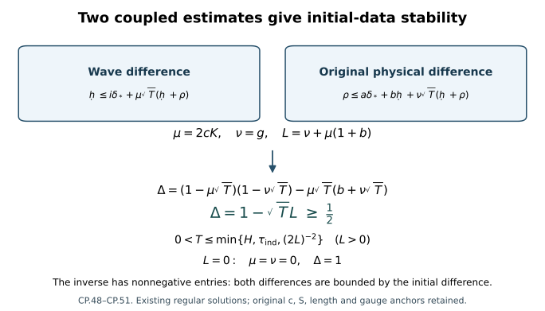

# Stability with respect to the original initial data

Two nearby initial data sets should give nearby solutions for a common
positive time. The word nearby here has an exact meaning: the spatial
gradient of the potential is measured in \(L^2\), and the electric field
is measured in \(c^{-1}L^2\). This chapter proves that estimate for existing
regular solutions, evaluates a positive interval, and proves uniform
spatial translation continuity and persistence of one extra derivative.

The proof combines the [finite individual wave bound](../classical-finite-wave-bound.html),
[fixed heat comparison](../classical-fixed-heat-comparison.html),
[temporal differences](../classical-uniform-difference.html),
[spatial tension differences](../classical-spatial-tension-difference.html),
and [original-gauge reconstruction](../classical-original-gauge-reconstruction.html).
The last chapter uses the prefix CR. In particular [CR.12](../classical-original-gauge-reconstruction.html#eq-CR-12) defines the
ordered quadratic and cubic maps, [CR.28](../classical-original-gauge-reconstruction.html#eq-CR-28)–[CR.30](../classical-original-gauge-reconstruction.html#eq-CR-30) give the full potential
receiver, and [CR.33](../classical-original-gauge-reconstruction.html#eq-CR-33)–[CR.57](../classical-original-gauge-reconstruction.html#eq-CR-57) supply the boundary and physical reconstruction.
In these cross-references the present \(U_j\) coefficient for the
individual potential is written \(A_j\) in CR; the underlying bound is
the same weighted derivative norm, with each solution's values retained.

[CP.48](../classical-initial-data-stability.html#eq-CP-48)–[CP.51](../classical-initial-data-stability.html#eq-CP-51) prove the displayed implications. Existence on a longer
interval requires the continuation argument; the estimate here holds
on the original common interval of the two regular solutions.

## 1. Original domains, units, and the exact finite system

Retain the original \(c>0\), \(S>0\), length parameter \(\ell>0\),
horizon \(H>0\), physical interval \(J=[t_-,t_+]\) containing
\(t_*\), and \(T=|J|\le H\). The spatial domain is \(\mathbb R^3\). The gauge group has its original fixed
unitary representation. Every derivative tuple is the full ordered tuple,
with all spatial output and Hilbert--Schmidt matrix entries. Keep

\[
\begin{gathered}
\Box_c=-c^{-2}\partial_t^2+\Delta,\qquad
E_i=F_{ti},\quad G_i=F_{si},\quad W=F_{st},\quad
w_i=c^{-2}D_tE_i-G_i,\\
\eta=a-a',\quad u=E-E',\quad Z=G-G',\quad
V=W-W',\quad z=w-w',\quad\theta=a_t-a_t',\\
a_s=a_s'=0,\qquad a_t(S)=a_t'(S)=0,\qquad
W(0)=W'(0)=w(0)=w'(0)=0.
\tag{CP.1}
\end{gathered}
\]

The original physical temporal representatives are \(A^0,E^0\) and
\(A^{0\prime},E^{0\prime}\). The exact data class used here consists
of existing regular temporal-gauge Yang--Mills solutions whose data at
\(t_*\) satisfy

\[
A^0(t_*)\in\dot H^1(\mathbb R^3)\cap L^6(\mathbb R^3),\qquad
E^0(t_*)\in L^2(\mathbb R^3),\qquad D^iE_i^0(t_*)=0,
\]

and, separately, whose original spatial curvature

\[
F_{ij}^0=\partial_iA_j^0-\partial_jA_i^0+[A_i^0,A_j^0]
\quad(i<j)
\]

belongs to \(L^2\). The same conditions hold for the primed solution.
Their two conserved positive curvature norms are exactly

\[
d^2=c^{-2}\sum_i\|E_i^0(t_*)\|_2^2
       +\sum_{i<j}\|F_{ij}^0(t_*)\|_2^2
 =\frac{g_{\mathrm{YM}}^2}{\hbar c}\mathcal E_{\mathrm{YM}},
\qquad d'^2=c^{-2}\sum_i\|E_i^{0\prime}(t_*)\|_2^2
       +\sum_{i<j}\|F_{ij}^{0\prime}(t_*)\|_2^2.
\]

The individual data inputs retain both gradient norms and both d values.
Thus a common bounded data set has separate finite bounds for them;
an \(L^6\) connection alone does not supply its quadratic curvature
in \(L^2\). The original heat construction already selected
\(S\le\min(S_R,S_{R'})\) and
\(S^{1/4}\max(d,d')\le\varepsilon_*\), as in [FC.1](../classical-finite-wave-bound.html#eq-FC-1) and [HP.19](../classical-potential-estimates.html#eq-HP-19).
No further reduction of this S is made below. Regularity here is that
of the existing smooth representatives used in the heat construction
and wave identities; all integrations by parts and finite ordered
derivative tuples below exist. The resulting constants depend only on
the stated individual data bounds and the original c,S,ell,H, by the
explicit FC and UD providers, rather than on higher physical derivatives.
Set

\[
\begin{aligned}
\delta_*&=\|\partial\delta A^0(t_*)\|_2
                        +c^{-1}\|\delta E^0(t_*)\|_2,\\
\rho&=\sup_J\|\partial\delta A^0\|_2
                        +c^{-1}\sup_J\|\delta E^0\|_2,\\
\mathcal R&=\sum_{k=1}^3\ell^{k-1}W_k(\eta;S)
       +\sum_{k=1}^3(\mathcal F_k^{\delta,2}
                              +\mathcal F_k^{\delta,\infty}).
\tag{CP.2}
\end{aligned}
\]

Here \(W_k\) and \(\mathcal F_k\) are the complete [PD.5](../classical-potential-difference.html#eq-PD-5)/[PD.8](../classical-potential-difference.html#eq-PD-8) norms,
including their wave-forcing terms, with the original measures
\(dt\,d^3x\) and \(ds/s\). All terms in [CP.2](../classical-initial-data-stability.html#eq-CP-2) have unit
length\(^{-1/2}\): \(W_k(a;S)\) has unit
length\(^{1/2-k}\), whereas every \(\mathcal F_k\) has unit
length\(^{-1/2}\). Thus the factors \(\ell^{k-1}\) are required in
this scalar sum. They change no norm, coordinate, field, or derivative.

The individual coefficients in what follows are evaluated by FC.18--[FC.22](../classical-finite-wave-bound.html#eq-FC-22),
HT, ES, and UD.4--[UD.5](../classical-uniform-difference.html#eq-UD-5) at the fixed original horizon H. Both solutions'
values are retained; a maximum is used only when the formula says so.
The original common heat construction has \(S\le S_R\) at the original
anchor as in [FI.2](../classical-fixed-heat-comparison.html#eq-FI-2). FI's auxiliary \(\sigma\) construction is available
for the curve coefficients when their radius changes; it restores the
original S representative with its actual transition anchor.

For numerical finite sums write

\[
\begin{aligned}
\omega_2(\alpha)&=S^\alpha/\sqrt{2\alpha},&
\omega_\infty(\alpha)&=S^\alpha\quad(\alpha>0),\\
(x\star y)_q&=\sum_{l=0}^q{q\choose l}x_ly_{q-l},&
(x\star y\star v)_q&=\sum_{r+h+n=q}{q!\over r!h!n!}x_ry_hv_n.
\tag{CP.3}
\end{aligned}
\]

These are operations on numerical bounds. They group all subsets or
ordered partitions of the derivative positions; they do not reorder
matrix factors. For a bilinear expression its difference always means
the two placements \(\delta x\,y+x'\delta y\). For a trilinear
expression it means \(\delta x\,y,v+x'\delta y,v+x'y'\delta v\),
or another explicitly displayed complete telescoping order.

## 2. A heat-square bound for the spatial heat curvature

This calculation is valid at each fixed physical time where FI.7--[FI.23](../classical-fixed-heat-comparison.html#eq-FI-23)
apply. At the original anchor they apply on all of `[0,S]`. Let
\(\gamma_j,\gamma_j',d_j\) be the actual FI.7--[FI.11](../classical-fixed-heat-comparison.html#eq-FI-11) arrays. Write
\(v_j=C_MC_S\sqrt{\gamma_j\gamma_{j+1}}\), and similarly for
\(v_j'\); write \(v_j^\delta=C_MC_S\sqrt{d_jd_{j+1}}\).
In CP.5--[CP.6](../classical-initial-data-stability.html#eq-CP-6) use the common individual majorant \(\gamma\) of [FI.9](../classical-fixed-heat-comparison.html#eq-FI-9),
so \(\gamma'=\gamma\) and \(v'=v\) there. This covers both placements
of the divergence factor without comparing the two solutions' arrays.
The exact DeTurck curvature formula is

\[
G^B=(\Delta-\nabla\operatorname{div})B
 +Q(B,B)+[\operatorname{div}B,B]+C_3(B,B,B).
\tag{CP.4}
\]

For each \(q\ge0\), define

\[
\begin{aligned}
g_q^{\delta,2}={}&d_q
 +(6+2\sqrt3)\omega_2(1/4)
       \sum_{h=0}^q{q\choose h}
           (v_h^\delta\gamma_{q-h}+v_h'd_{q-h})\\
&+4C_S^3\omega_2(1/2)
 \sum_{h+j+n=q}{q!\over h!j!n!}
 (d_h\gamma_j\gamma_n+\gamma_h'd_j\gamma_n
                                       +\gamma_h'\gamma_j'd_n).
\tag{CP.5}
\end{aligned}
\]

Its individual counterpart has first term \(\gamma_q\), one quadratic
product, and one cubic product. Its heat-supremum counterpart replaces
the first term by \(d_{q+1}\), \(\omega_2(1/4)\) by \(S^{1/4}\),
and \(\omega_2(1/2)\) by \(\sqrt S\); this is [FI.23](../classical-fixed-heat-comparison.html#eq-FI-23) with both
individual orders retained.

Indeed the Fourier symbol of the first operator in [CP.4](../classical-initial-data-stability.html#eq-CP-4) has norm
\(|\xi|^2\), and [FI.7](../classical-fixed-heat-comparison.html#eq-FI-7) bounds
\(\int_0^Ss^q\|\partial^{(q+2)}\delta B\|_2^2ds\) by \(d_q^2\).
For the quadratic terms put the undifferentiated coefficient jet in
\(L^\infty\), and the other jet, of order \(q-h+1\), in \(L^2\).
Their weight leaves \(s^{1/4}\). The full transport contraction costs
six and the pointwise divergence contraction costs \(2\sqrt3\).
For the cubic put all three factors in \(L^6\), apply Sobolev separately
to their full tuples, and retain the remaining \(s^{1/2}\). These
arguments prove

\[
\|s^{(q+1)/2}\partial^{(q)}\delta G^B\|_{L^p(ds/s;L^2_x)}
                  \le g_q^{\delta,p},\qquad p=2,\infty.
\tag{CP.6}
\]

In particular the term \(d_q\) in the square estimate is essential.
Replacing it by the pointwise estimate and integrating a constant in
\(ds/s\) would be invalid.

Use [FI.20](../classical-fixed-heat-comparison.html#eq-FI-20)'s actual gauges \(U=TV\) and their inverse adjoints. If
\(s^{h/2}\|\partial^{(h)}U\|_\infty\le r_h\), with primed and
difference arrays \(r_h',\epsilon_h\), product differentiation gives

\[
\begin{aligned}
J_q^{\delta,p}=
 \sum_{h+j+n=q}{q!\over h!j!n!}
 \{r_hg_j^{\delta,p}r_n
            +\epsilon_hg_j^{\prime,p}r_n
            +r_h'g_j^{\prime,p}\epsilon_n\},\\
\|s^{(q+1)/2}\partial^{(q)}Z\|_{L^p(ds/s;L^2_x)}
                        \le J_q^{\delta,p}.
\tag{CP.7}
\end{aligned}
\]

The first term uses \(U\delta G^BU^{-1}\); the remaining terms use
\(\delta U G^{B\prime}U^{-1}\) and
\(U'G^{B\prime}\delta U^{-1}\). Thus each factor and its order is
accounted for. The powers of s add exactly to \((q+1)/2\).
At \(t_*\), \(T=T'=I\), with all its spatial derivatives zero.
All [CP.7](../classical-initial-data-stability.html#eq-CP-7) difference arrays are therefore degree one in the original
initial spatial distance.

For later physical times where FI uses \(\sigma<S\), this same proof
applies on `[0,sigma]` to its local auxiliary representative.
On `[sigma,S]`, FI.31--[FI.35](../classical-fixed-heat-comparison.html#eq-FI-35) provides
\(\|\partial^{(j)}Z^{[\sigma]}\|_2\le\ell^{-j-1}\mathcal D_q\)
for the chosen finite order \(q\ge j\), because the energy contains
\(\ell^2\|Z^{[\sigma]}\|_{H_\ell^q}^2\). Use its supremum and the exact norm

\[
\left\|s^{(j+1)/2}\right\|_{L^2((\sigma,S],ds/s)}
 =\sqrt{{S^{j+1}-\sigma^{j+1}\over j+1}}.
\tag{CP.8}
\]

Add the two interval bounds (or add their squares) to define
\(\widehat J_j^{\delta,2}\) in the auxiliary representative. Its
positive-interval contribution is exactly
\(\ell^{-j-1}\sup\mathcal D_q\) times [CP.8](../classical-initial-data-stability.html#eq-CP-8). The individual
\(\widehat J_j^{\prime,2}\) uses [FI.35](../classical-fixed-heat-comparison.html#eq-FI-35)'s actual individual auxiliary
G supremum jet times [CP.8](../classical-initial-data-stability.html#eq-CP-8), added to the local individual bound.
For p=infinity use the corresponding maximum, including
\(S^{(j+1)/2}\ell^{-j-1}\sup\mathcal D_q\).

The target curvature is
\(R(t)G^{[\sigma]}R(t)^{-1}\), with the actual [FI.38](../classical-fixed-heat-comparison.html#eq-FI-38) gauge and
its generally nonidentity anchor. Apply the complete three-placement
formula [CP.7](../classical-initial-data-stability.html#eq-CP-7) to these hatted arrays, with
\(r_0=r_0'=1\), \(\epsilon_0=d_R\),
\(r_h=S^{h/2}\|\partial^{(h)}R\|_\infty\) and
\(\epsilon_h=S^{h/2}\|\partial^{(h)}\delta R\|_\infty\) for h>=1,
using [FI.39](../classical-fixed-heat-comparison.html#eq-FI-39) and its all-order extension. These are upper bounds because
\(s^{h/2}\le S^{h/2}\). This proves [CP.7](../classical-initial-data-stability.html#eq-CP-7) for the target on the original
interval with every affine gauge contribution retained in R's proved
inputs. No additional difference datum is required.
Consequently, uniformly in physical time,

\[
\begin{aligned}
\mathscr G_j^{\delta,p}&:=\sqrt T J_j^{\delta,p},\qquad
\|s^{(j+1)/2}\partial^{(j)}Z\|_{L^p(ds/s;L^2_{t,x})}
                         \le\mathscr G_j^{\delta,p},\\
\delta G_2&\le\sqrt T J_0^{\delta,2}.
\tag{CP.9}
\end{aligned}
\]

For p=2 this is Tonelli after squaring. For p=infinity it is the
pointwise heat bound followed by physical-time integration. No time
supremum is moved through a heat integral. [CP.9](../classical-initial-data-stability.html#eq-CP-9) supplies precisely the
formerly separate input in LG.28--[LG.30](../classical-spatial-difference.html#eq-LG-30).

## 3. Weighted electric energy at the initial physical time

In this section all fields are evaluated at \(t_*\). Write
\(a_j^\delta,U_j,U_j',C_j,C_j^\delta\) for the FI/TDI weighted
coefficient arrays, and \(e_j,e_j',e_j^\delta\) for the fixed-time
electric \(L^2\) smoothing arrays in [UD.10](../classical-uniform-difference.html#eq-UD-10)/[TDI.14](../classical-spatial-tension-difference.html#eq-TDI-14). Thus
\(\|\partial^{(j)}u(s)\|_2\le e_j^\delta s^{-j/2}\).
Throughout Sections 3--8, \(a_j^\delta,C_j^\delta\) denote these
numerically evaluated FI providers. Section 9 constructs a second
provider for the actual order-zero/one connection and order-zero
curvature seminorms. No comparison between the numerical values of
the two providers is asserted.
Use [TDI.14](../classical-spatial-tension-difference.html#eq-TDI-14) at every finite order needed below; its proof works in
\(L^2_x\), its integer depends only on individual coefficient maxima,
and it introduces no higher electric datum. The actual lower electric
datum is

\[
f=\operatorname{Ad}(V_0(t_*,S)^{-1})E^0(t_*)
 -\operatorname{Ad}(V_0'(t_*,S)^{-1})E^{0\prime}(t_*),\qquad
\|f\|_2\le\rho_E^*+2q_0e_*'.
\tag{CP.10}
\]

Here \(q_0\) is the initial gauge difference [CR.38](../classical-original-gauge-reconstruction.html#eq-CR-38), not a time-curve input.

The exact equation is
\((\partial_s-D^jD_j)u=2[F_{ij},u_j]+\mathcal H(E')\),
where all five terms of \(\mathcal H\) are [FI.29](../classical-fixed-heat-comparison.html#eq-FI-29). Set

\[
\begin{aligned}
h_{3/4}&=4a_0^\delta e_1'+2\sqrt3a_1^\delta e_0'
                                               +4C_0^\delta e_0',\\
h_{1/2}&=4a_0^\delta(U_0+U_0')e_0',\qquad
L_H=4S^{1/4}h_{3/4}+2\sqrt S h_{1/2},\\
\Phi(s)&=16C_0s^{1/4},\qquad
L_E=e^{\Phi(S)}(\|f\|_2+2L_H),\qquad
B_1^E=(1+2\sqrt2U_0S^{1/4})L_E.
\tag{CP.11}
\end{aligned}
\]

Every product in H is estimated in \(L^2\) with its actual order.
The drift has exponent 3/4, the divergence and curvature do too, and
the two nested products have exponent 1/2. Their integrals prove
\(\int\|H\|_2\le L_H\). Covariant integration by parts and
\(|2\langle u,[F,u]\rangle|\le4\|F\|_\infty\|u\|_2^2\)
give, after multiplying by \(e^{-2\Phi}\),

\[
{d\over ds}(e^{-2\Phi}\|u\|_2^2)
 +2e^{-2\Phi}\|Du\|_2^2
 \le2e^{-2\Phi}\|u\|_2\|H\|_2.
\tag{CP.12}
\]

The regularized norm gives \(\sup e^{-\Phi}\|u\|_2\le\|f\|_2+L_H\).
Integrating [CP.12](../classical-initial-data-stability.html#eq-CP-12) bounds the squared weighted covariant gradient by
\((\|f\|_2^2+2(\|f\|_2+L_H)L_H)/2\), hence by
\((\|f\|_2+2L_H)^2\). Removing the exponential and using
\(\partial u=Du-[a,u]\) proves
\(\|\partial u\|_{L^2(ds;L^2_x)}\le B_1^E\).
All zero cases follow by regularization; no division by a difference
occurs.

Define the two finite source coefficients

\[
\begin{aligned}
n_{j,3/4}={}&4\sum_l{j\choose l}
   (U_le_{j-l+1}^\delta+a_l^\delta e_{j-l+1}')
 +2\sqrt3\sum_l{j\choose l}
   (U_{l+1}e_{j-l}^\delta+a_{l+1}^\delta e_{j-l}')\\
&+4\sum_l{j\choose l}(C_le_{j-l}^\delta+C_l^\delta e_{j-l}'),\\
n_{j,1/2}={}&4\sum_{r+h+n=j}{j!\over r!h!n!}
 (U_rU_he_n^\delta+a_r^\delta U_he_n'+U_r'a_h^\delta e_n'),\\
N_j^E&=\omega_2(1/4)n_{j,3/4}+\omega_2(1/2)n_{j,1/2},\\
B_{j+2}^E&=\sqrt{(j+1)(B_{j+1}^E)^2+(N_j^E)^2}
                                      \qquad(j=0,1,2,\ldots).
\tag{CP.13}
\end{aligned}
\]

The complete ordinary source satisfies

\[
\|\partial^{(j)}N_u(s)\|_2\le
n_{j,3/4}s^{-j/2-3/4}+n_{j,1/2}s^{-j/2-1/2}
\]

.
Pairing its equation with \(-s^{j+1}\Delta\partial^{(j)}u\),
and applying Young with coefficients one half, proves

\[
\begin{aligned}
s^{j+1}\|\partial^{(j+1)}u(s)\|_2^2
 +\int_0^s r^{j+1}\|\partial^{(j+2)}u(r)\|_2^2dr
\le (j+1)\int_0^s r^j\|\partial^{(j+1)}u\|_2^2dr
                         +\int_0^s r^{j+1}\|\partial^{(j)}N_u\|_2^2dr.
\tag{CP.14}
\end{aligned}
\]

Its last integral is bounded by \((N_j^E)^2\); the remaining heat
powers are exactly 1/4 and 1/2 in `ds/s`. Induction gives
\(\|s^{r/2}\partial^{(r)}u\|_{L^2(ds/s;L^2_x)}\le B_r^E\)
for every r>=1. The initial weighted term vanishes by regularity.
All coefficients are degree one in the actual original initial data.

## 4. The complete initial time derivative of G

Retain [CR.12](../classical-original-gauge-reconstruction.html#eq-CR-12)'s original ordered maps B and C. Their derivative at the
connection a, in direction E, is

\[
\begin{aligned}
\partial_tG={}&(\Delta-\nabla\operatorname{div})E
 +\mathcal B(E,a)+\mathcal B(a,E)\\
&+\mathcal C(E,a,a)+\mathcal C(a,E,a)+\mathcal C(a,a,E)
                                                    -[a_t,G].
\tag{CP.15}
\end{aligned}
\]

To prove its last sign, \(G(a)=D^jF_{ji}\) is gauge covariant.
For \(g_\varepsilon=\exp(\varepsilon b)\),
\(\partial_\varepsilon(g_\varepsilon\cdot a)|_0=-D_ab\)
and \(\partial_\varepsilon\operatorname{Ad}(g_\varepsilon)G|_0=[b,G]\).
Therefore \(dG_a(D_ab)=-[b,G]\). Since the exact physical equation is
\(\partial_ta=E+D_aa_t\), differentiation of the full polynomial
[CP.4](../classical-initial-data-stability.html#eq-CP-4) in caloric gauge proves [CP.15](../classical-initial-data-stability.html#eq-CP-15), including every Gauss/divergence
contribution. This is also [HT.36](../classical-fixed-time-estimates.html#eq-HT-36) after using \(W=-D^jE_j\).

Here are explicit numerical bounds for all its products. For electric
array e and connection array U define

\[
\begin{aligned}
\mathcal B_m^E(e,U)&=
 \sum_{l=0}^m{m\choose l}
       (6e_lU_{m-l+1}+2\sqrt3e_{l+1}U_{m-l}),\\
\mathcal B_m^A(U,e)&=
 \sum_{l=0}^m{m\choose l}
       (6U_le_{m-l+1}+2\sqrt3U_{l+1}e_{m-l}),\\
\mathcal C_m(e,U,V)&=4\sum_{r+h+n=m}{m!\over r!h!n!}e_rU_hV_n.
\tag{CP.16}
\end{aligned}
\]

The argument order in C denotes which of the three original factors
supplies the electric norm; changing it in a scalar product does not
change its original matrix order. Let \(b_m^\delta\) be the sum of
both two-placement differences of B in [CP.15](../classical-initial-data-stability.html#eq-CP-15) using [CP.16](../classical-initial-data-stability.html#eq-CP-16). Let
\(c_m^\delta\) be the sum of all three-placement differences of its
three C terms, using [CP.16](../classical-initial-data-stability.html#eq-CP-16) in the actual electric slot. Explicitly
the B placements are
\(B(u,a),B(E',\eta),B(\eta,E),B(a',u)\).
The C placements are
\(C(u,a,a),C(E',\eta,a),C(E',a',\eta)\),
\(C(\eta,E,a),C(a',u,a),C(a',E',\eta)\), and
\(C(\eta,a,E),C(a',\eta,E),C(a',a',u)\).
Thus there are four quadratic and nine cubic placements, all present.

UD.12--[UD.18](../classical-uniform-difference.html#eq-UD-18) supplies, at this same physical time, all finite W and V
derivatives. Put

\[
\begin{aligned}
t_l&=C_MC_S\sqrt{w_{l+1}w_{l+2}},&
t_l^\delta&=C_MC_S\sqrt{v_{l+1}^{(2)}v_{l+2}^{(2)}},\\
\widehat t_0&=(8/\mathrm e)S^{1/8}t_0,&
\widehat t_l&=(2/l)S^{1/8}t_l\quad(l\ge1),
\tag{CP.17}
\end{aligned}
\]

with identical difference and primed definitions. The exact signed
integral \(a_t(s)=-\int_s^SW\) gives
\(\|a_t\|_\infty\le t_0\log(S/s)\) and
\(\|\partial^{(l)}a_t\|_\infty\le(2t_l/l)
(s^{-l/2}-S^{-l/2})\) for l>=1. Since
\(\sup_{0<s\le S}s^{1/8}\log(S/s)=8S^{1/8}/\mathrm e\),

\[
\|\partial^{(l)}a_t(s)\|_\infty
       \le\widehat t_ls^{-l/2-1/8},
\qquad
\|\partial^{(l)}\theta(s)\|_\infty
       \le\widehat t_l^\delta s^{-l/2-1/8}.
\tag{CP.18}
\]

The exact upper-endpoint zero remains in the preceding signed identity;
[CP.18](../classical-initial-data-stability.html#eq-CP-18) is only its numerical upper bound.

Define \(E_{r,2}^\delta=B_r^E\), \(E_{r,\infty}^\delta=e_r^\delta\).
Then, for m=0,1,2 and p=2,infinity,

\[
\begin{aligned}
T_m^{\delta,p}={}&E_{m+2,p}^\delta
 +\omega_p(1/4)b_m^\delta+\omega_p(1/2)c_m^\delta\\
&+2\omega_p(3/8)\sum_{l=0}^m{m\choose l}
       (\widehat t_lJ_{m-l}^{\delta,\infty}
                    +\widehat t_l^\delta J_{m-l}^{\prime,\infty}),\\
\|s^{m/2+1}\partial^{(m)}\partial_tZ(t_*,s)\|_{L^p(ds/s;L^2_x)}
 &\le T_m^{\delta,p},\\
\mathsf I_k^{\delta,p}
 &\le I_k^{\delta,p}:=
       \sqrt{(J_k^{\delta,p})^2+c^{-2}(T_{k-1}^{\delta,p})^2}
                       \quad(k=1,2,3).
\tag{CP.19}
\end{aligned}
\]

The linear projection has Fourier norm one after its two derivatives.
The quadratic and cubic weights leave 1/4 and 1/2. In the last term

\[
(l/2+1/8)+(m-l+1)/2=m/2+5/8
\]

, leaving 3/8. The bracket costs
two. Heat-square or supremum triangle inequalities prove every line.
The two energy components are kept jointly before their final upper
bound; their factor \(c^{-2}\) is unchanged.

At the original heat endpoint and anchor, \(a(t_*,S)=B(t_*,S)\)
and \(\partial_ta(S)=E(S)\). Hence the other three initial wave data obey

\[
I_k^{S,\delta}=
 \sqrt{d_{k-1}^2S^{-(k-1)}+c^{-2}(e_{k-1}^\delta)^2S^{-(k-1)}},
\qquad E_{k-1}(\eta(S);t_*)\le I_k^{S,\delta}.
\tag{CP.20}
\]

CP.10--[CP.20](../classical-initial-data-stability.html#eq-CP-20) prove all nine initial wave quantities from \(\delta_*\).
In particular no physical-curve difference has been substituted for its
initial value. These are evaluations of the fixed-time heat construction
at exactly t*.

## 5. Paired spatial smoothing and every positive potential derivative

Return to the full original J. All FI curve coefficients now receive
\(\rho_A,\rho_E\), and are not identified with initial data.
Evaluate LG.12--[LG.21](../classical-spatial-difference.html#eq-LG-21) with these coefficients and retain its two actual
wave interpolants. This gives the explicit lowest bounds
\(g_\delta^p=\mathcal G_\delta^p\). Its endpoint is bounded by
\(T^{1/4}C_S^{3/4}(J_0^{\delta,\infty})^{1/4}
(J_1^{\delta,\infty})^{3/4}S^{-7/8}\).
All original powers in LG.12--[LG.21](../classical-spatial-difference.html#eq-LG-21) remain.

Apply the proof of TDI.12--[TDI.14](../classical-spatial-tension-difference.html#eq-TDI-14) to the exact [FI.29](../classical-fixed-heat-comparison.html#eq-FI-29) equation for Z
in \(L^4_{t,x}\), replacing its electric pair by the actual pair
\((Z,G')\). The differential operator and all five coefficient
difference groups are identical. Its finite constants b,c,lambda,N
are consequently exactly TDI.12--[TDI.14](../classical-spatial-tension-difference.html#eq-TDI-14), with their required finite
coefficient orders. Its only changed outer weight is 3/4. Therefore

\[
\begin{aligned}
\Gamma_0^{\delta,p}&=g_\delta^p,\qquad
\Gamma_j^{\delta,p}=2^{3/4}\mathcal S_j
                       (g_\delta^p+\lambda_Q g^{\prime,p})
                         \quad(1\le j\le Q),\\
\|s^{j/2+3/4}\partial^{(j)}Z\|_{L^p(ds/s;L^4_{t,x})}
                  &\le\Gamma_j^{\delta,p},\qquad p=2,\infty.
\tag{CP.21}
\end{aligned}
\]

For clarity the paired proof forms only the scalar sums
\(J_m^\delta+\lambda_QJ_m'\) and
\(G_m^\delta+\lambda_QG_m'\). Their forcing is bounded by
\((b+1)\mathcal G_m/\sqrt s+(c_m+1)\mathcal J_m/s\).
The four Duhamel integrals on a slab of length h are
\(2\sqrt h,h,\pi\sqrt h,2h\). The displayed integer in [TDI.14](../classical-spatial-tension-difference.html#eq-TDI-14)
makes each of the two self-coefficients at most 1/4. Its finite
propagation and derivative-gain steps then give \(\mathcal S_j\).
No division by lambda occurs, including at zero difference. Multiplying
by the actual heat weight and substituting r=s/2 in its scalar integral
gives the factor \(2^{3/4}\) in [CP.21](../classical-initial-data-stability.html#eq-CP-21). Q=3 suffices here; larger Q
will be used for the electric and tension arrays below.

The positive endpoint derivative bounds needed in this step are also
constructed. For l>=1 set

\[
\begin{aligned}
A_l^{S,\delta}&=d_{l-1}^*S^{-(l-1)/2}
                            +H e_l^\delta S^{-l/2},\qquad
U_l^{S,\delta}=a_l^\delta S^{-l/2-1/4},\\
Z_l^{S,\delta}&=T^{1/4}\sqrt{A_l^{S,\delta}U_l^{S,\delta}},
\qquad \alpha_l=l/2-1/4,\\
\mathfrak A_l^{\delta,2}
 &=\omega_2(\alpha_l)Z_l^{S,\delta}
                                     +\Gamma_l^{\delta,2}/\alpha_l,\\
\mathfrak A_l^{\delta,\infty}
 &=S^{\alpha_l}Z_l^{S,\delta}
                              +\Gamma_l^{\delta,2}/\sqrt{2\alpha_l}.
\tag{CP.22}
\end{aligned}
\]

The star on d means the actual initial FI array; it can be bounded by
the same array receiving the larger curve input when computing a curve
coefficient. The identity \(\partial_t\eta(S)=u(S)\) and integration
from the original t* prove its \(L^2\) endpoint bound. Its supremum bound
is FI's actual coefficient difference. The inequality
\(\|f\|_4^4\le\|f\|_2^2\|f\|_\infty^2\), followed by the actual
time integral, proves Z. Finally differentiate
\(\eta(s)=\eta(S)-\int_s^SZ\). The exact backward kernel
\((s/r)^{\alpha_l}\,dr/r\) has \(L^2\)-to-\(L^2\) norm \(1/\alpha_l\)
and \(L^2\)-to-supremum norm \((2\alpha_l)^{-1/2}\), with finite squared
row integral \((1-(s/S)^{2\alpha_l})/(2\alpha_l)\). This proves

\[
\|s^{l/2-1/4}\partial^{(l)}\eta\|_{L^p(ds/s;L^4_{t,x})}
                          \le\mathfrak A_l^{\delta,p}.
\tag{CP.23}
\]

The individual \(\mathfrak A_l^p,\Gamma_j^p\) are HS.15--[HS.20](../classical-spatial-smoothing.html#eq-HS-20).
For a pair x=(x2,xinf), y=(y2,yinf), define
\(P_2(x,y)=\min(x^2y^\infty,x^\infty y^2)\) and
\(P_\infty(x,y)=x^\infty y^\infty\), where superscripts label norms.
Then the complete positive-derivative product difference obeys

\[
\Pi_{l,j}^{\delta,p}
 =P_p(\mathfrak A_l^\delta,\Gamma_j)
                       +P_p(\mathfrak A_l',\Gamma_j^\delta),
\qquad l\ge1,\ j\ge0.
\tag{CP.24}
\]

Its weight is \(s^{(l+j)/2+1/2}\). Physical \(L^4\) times \(L^4\) gives \(L^2\),
then heat Holder proves both displayed product orders. Thus [CP.24](../classical-initial-data-stability.html#eq-CP-24)
includes the two actual placements, not a difference of upper bounds.

## 6. Space-time temporal tension at every required order

Use [TD.19](../classical-temporal-difference.html#eq-TD-19) for the actual base values
\(A_0^V=L_V\), \(B_1^V=B_V\). For an individual W use its TB base
values \(A_0^W=L_W\), \(B_1^W=B_W\). Let
\(e_j^p,e_j^{\delta,p},\Gamma_j^p,\Gamma_j^{\delta,p}\) be the
electric and G physical-\(L^4\) arrays. [UD.21](../classical-uniform-difference.html#eq-UD-21) supplies the actual lowest
electric difference, and TDI.14--[TDI.16](../classical-spatial-tension-difference.html#eq-TDI-16) supplies its derivatives.
Define the complete temporal source bounds

\[
P_q^{V,p}=4\sum_{l=0}^q{q\choose l}
 \{P_p(e_l^\delta,\Gamma_{q-l})
                              +P_p(e_l',\Gamma_{q-l}^\delta)\}.
\tag{CP.25}
\]

The exact source is \(2([u_j,G_j]+[E_j',Z_j])\); the coefficient
four is its two times the bracket's two. The heat weights add to
\(q/2+1\). For p=1 use the two heat-square norms, as in [TD.9](../classical-temporal-difference.html#eq-TD-9).
Thus [CP.25](../classical-initial-data-stability.html#eq-CP-25) proves its actual weighted Lp heat norm.

For q>=0 set

\[
\begin{aligned}
N_q^{V,2}={}&4S^{1/4}\sum_l{q\choose l}
              (U_lB_{q-l+1}^V+a_l^\delta B_{q-l+1}^{W'})\\
&+2\sqrt6S^{1/4}\sum_l{q\choose l}
              (U_{l+1}A_{q-l}^V+a_{l+1}^\delta A_{q-l}^{W'})\\
&+4\sqrt S\sum_{r+h+n=q}{q!\over r!h!n!}
 (U_rU_hA_n^V+a_r^\delta U_hA_n^{W'}+U_r'a_h^\delta A_n^{W'})
                                                     +P_q^{V,2},\\
A_{q+1}^V=B_{q+2}^V
 &:=\sqrt{(q+1)(B_{q+1}^V)^2+(N_q^{V,2})^2}.
\tag{CP.26}
\end{aligned}
\]

The individual recurrence deletes the coefficient-difference placements
and uses \(P_q^{W,2}=4\sum_l{q\choose l}P_2(e_l,\Gamma_{q-l})\).
It bounds the actual norms
\(\sup_s s^{j/2}\|\partial^{(j)}V\|_{L^2_{t,x}}\le A_j^V\)
and \(\|s^{j/2}\partial^{(j)}V\|_{L^2(ds/s;L^2_{t,x})}\le B_j^V\)
for j>=1. Indeed expand [TD.20](../classical-temporal-difference.html#eq-TD-20) and all four coefficient-difference
groups before differentiating. Drift uses B, divergence uses A and
\(\omega_2(1/4)=\sqrt2S^{1/4}\), and nested terms use
\(\omega_2(1/2)=\sqrt S\). Pairing with
\(-s^{q+1}\Delta\partial^{(q)}V\) gives exactly [CP.14](../classical-initial-data-stability.html#eq-CP-14) in
\(L^2_{t,x}\), proving [CP.26](../classical-initial-data-stability.html#eq-CP-26). There is no time integration by parts.
Every derivative needed on its right was obtained at the preceding
step. This is the curvature-free version of [TDI.20](../classical-spatial-tension-difference.html#eq-TDI-20), with its full
new electric--G source displayed rather than assumed.

For spatial tension use TDI.17--[TDI.20](../classical-spatial-tension-difference.html#eq-TDI-20) with precisely the electric
arrays just constructed. Extend its same finite recurrence through
q=4, giving \(A_j^z,A_j^{w'}\) through j=5. Its proof in [TDI.21](../classical-spatial-tension-difference.html#eq-TDI-21) is
valid for every finite q. To evaluate q=4, [TDI.17](../classical-spatial-tension-difference.html#eq-TDI-17) uses electric
derivatives through order five, and [TDI.16](../classical-spatial-tension-difference.html#eq-TDI-16) then uses through order
six. TDI.12--[TDI.14](../classical-spatial-tension-difference.html#eq-TDI-14) with Q=6 supplies these from the same lowest
electric difference. The coefficient arrays through \(a_5^\delta\)
and \(C_4^\delta\) follow by the all-order product/gauge recurrences
[FI.20](../classical-fixed-heat-comparison.html#eq-FI-20), [FI.25](../classical-fixed-heat-comparison.html#eq-FI-25), FI.32--[FI.42](../classical-fixed-heat-comparison.html#eq-FI-42) and TDI.8--[TDI.10](../classical-spatial-tension-difference.html#eq-TDI-10); [UD.5](../classical-uniform-difference.html#eq-UD-5) evaluates their
positive-heat individual jets. All lists remain finite. No higher
physical difference datum or additional unknown wave order is inserted.

Here are explicit bounds for the time derivative of the time potential.
Define

\[
\begin{aligned}
M_j^z&=C_MC_S\sqrt{A_{j+1}^zA_{j+2}^z},\qquad
M_j^{w'}=C_MC_S\sqrt{A_{j+1}^{w'}A_{j+2}^{w'}},\\
M_j^V&=C_MC_S\sqrt{A_{j+1}^VA_{j+2}^V},\qquad
C_0^V=4S^{1/4}M_0^V,\quad
C_j^V={S^{1/4}M_j^V\over j/2-1/4}\ (j\ge1),\\
k_0&=4S^{1/4}/\mathrm e,\qquad
k_l=2S^{1/4}/l\ (l\ge1).
\tag{CP.27}
\end{aligned}
\]

Use identical individual definitions for \(C_j^{W'}\).
Morrey at each t followed by Cauchy--Schwarz in dt proves
\(\|\partial^{(j)}z\|_{L^2_tL^\infty_x}
\le M_j^z s^{-j/2-3/4}\). The exact signed heat integral then gives
\(\|\partial^{(j)}\theta\|_{L^2_tL^\infty_x}\le C_j^V s^{-j/2}\).
For j=0 integrate \(r^{-3/4}\) to
\(4(S^{1/4}-s^{1/4})\). For j>=1 integrate to
\((s^{-j/2+1/4}-S^{-j/2+1/4})/(j/2-1/4)\), then use
\(s^{1/4}\le S^{1/4}\). Both endpoints have been retained.

The contracted Yang--Mills identity with the original metric is
\(D_tW=-c^2D^jw_j\). Thus, with its original signs,

\[
\partial_t\theta(s)=c^2\int_s^S
    \{\operatorname{div}z+[a,z]+[\eta,w']\}dr
       +\int_s^S\{[\theta,W]+[a_t',V]\}dr.
\tag{CP.28}
\]

Let t_j and t_j^delta retain [CP.17](../classical-initial-data-stability.html#eq-CP-17)'s fixed-time W and V supremum
coefficients, now uniform on J. For l=0,1,2 define

\[
\begin{aligned}
D_l^\delta={}&c^2\left\{
 {\sqrt3M_{l+1}^z\over l/2+1/4}
 +2k_l\sum_{h=0}^l{l\choose h}
          (U_hM_{l-h}^z+a_h^\delta M_{l-h}^{w'})\right\}\\
&+2k_l\sum_{h=0}^l{l\choose h}
                 (C_h^Vt_{l-h}+C_h^{W'}t_{l-h}^\delta),\\
\|\partial^{(l)}\partial_t\theta(s)\|_{L^2_tL^\infty_x}
 &\le D_l^\delta s^{-l/2-1/4}.
\tag{CP.29}
\end{aligned}
\]

The individual D_l uses only div w, [a,w], and [a_t,W], with their
individual arrays. To check every integral, the differentiated div z
has exponent \(l/2+5/4\), and all other integrands in [CP.28](../classical-initial-data-stability.html#eq-CP-28) have
exponent \(l/2+1\). For the latter,
\(\sup_s s^{1/4}\log(S/s)=4S^{1/4}/\mathrm e\) at l=0,
whereas at l>=1 the bound is \((2/l)S^{1/4}\).
These are exactly k_l. The coefficient \(\sqrt3\) retains the
pointwise divergence contraction. [CP.29](../classical-initial-data-stability.html#eq-CP-29) consequently includes the
spatial-tension and both temporal commutator contributions.

## 7. Every term of the full paired wave forcing

The equation being estimated is the entire [TDI.31](../classical-spatial-tension-difference.html#eq-TDI-31) equation. In
particular \(\delta\mathscr T\) is its full [TDI.23](../classical-spatial-tension-difference.html#eq-TDI-23) spatial-tension
operator, including \(-\delta Q\). Define the other forcing by
\(\mathscr R=\Box_cZ-\delta\mathscr T\); a reference to a number of
typeset lines is not its definition. We now give the complete numerical
bound for q=0,1,2 and p=2,infinity.

For the undifferentiated spatial coefficient use its actual endpoint,
curl-free and divergence-free parts, as in [PI.1](../classical-wave-interactions.html#eq-PI-1). The individual bounds
are U_A,Bcf,D_a. The differences are

\[
\begin{aligned}
U_A^\delta&=a_0^\delta S^{-1/4},\qquad
B_{\rm cf}^\delta=K_*(C_2^\delta)^{1/3}(C_4^\delta)^{2/3},\\
C_2^\delta&=2\sqrt2S^{1/4}
          (a_0^\delta G_2+U_0'\sqrt T J_0^{\delta,2}),\\
C_4^\delta&=4S^{1/8}
          (\mathcal A_\delta g+\mathcal A'g_\delta^2).
\tag{CP.30}
\end{aligned}
\]

Here K* and \(\mathcal A_\delta\) are the exact LG.26--[LG.30](../classical-spatial-difference.html#eq-LG-30)
expressions, and [CP.9](../classical-initial-data-stability.html#eq-CP-9) supplies the new integral in C2. The Newton
gradient map acts on the actual \(L^2\) heat increment \(\eta(s)-\eta(S)\),
so no undetermined constant is introduced. Let \(D_\delta\) be [PD.20](../classical-potential-difference.html#eq-PD-20),
with its complete nonlinear source evaluated by [CR.13](../classical-original-gauge-reconstruction.html#eq-CR-13)–[CR.29](../classical-original-gauge-reconstruction.html#eq-CR-29) as verified
in Section 9 below. The entire empty-subset contribution is

\[
P_{q,0}^{\delta,p}=
4\{(\sqrt T U_A+B_{\rm cf})\mathcal F_{q+1}^{\delta,p}
 +(\sqrt T U_A^\delta+B_{\rm cf}^\delta)\mathcal F_{q+1}^{\prime,p}\}
 +2C_{\rm null}\{D_a\mathcal F_{q+1}^{\delta,p}
                         +D_\delta\mathcal F_{q+1}^{\prime,p}\}.
\tag{CP.31}
\]

Here \(C_{\rm null}=2\sqrt3\sqrt{2/(\pi c)}\); its multiplier two
is the original coefficient in the wave equation. [CP.31](../classical-initial-data-stability.html#eq-CP-31) follows by
the exact two-placement difference [PI.2](../classical-wave-interactions.html#eq-PI-2)/[PD.22](../classical-potential-difference.html#eq-PD-22) and the proved full-tuple
null estimate. No other part of the connection is projected.

For nonempty derivative subsets retain [PI.7](../classical-wave-interactions.html#eq-PI-7) rather than introduce any
higher wave order. Let
\(\overline P_k^{\delta,\infty}
=S^{(k-1)/2}W_k(\eta;S)
 +\mathcal F_k^{\delta,2}/\sqrt{k-1}\) for k>1, and its individual
counterparts. These are the exact backward \(L^2\)-to-supremum bounds [PI.5](../classical-wave-interactions.html#eq-PI-5).
Then

\[
P_{q,+}^{\delta,p}=4d_c^2\sum_{l=1}^q{q\choose l}
 \{\overline P_{l+1/2}^{\infty}\mathcal F_{q-l+3/2}^{\delta,p}
       +\overline P_{l+1/2}^{\delta,\infty}
                                     \mathcal F_{q-l+3/2}^{\prime,p}\}.
\tag{CP.32}
\]

Its only fractional orders are 3/2 and 5/2. They are bounded by the
geometric means of the adjacent actual difference wave norms, including
forcing, as proved in [PD.11](../classical-potential-difference.html#eq-PD-11). Space-time \(L^4\) Holder gives d_c squared,
and the heat weights add exactly to q/2+1.

The divergence and both curvature derivatives, together with every
spatial nested coefficient, have the complete bound

\[
\begin{aligned}
L_q^{\delta,p}={}&(2\sqrt3+4+4)
                    \sum_{l=0}^q{q\choose l}\Pi_{l+1,q-l}^{\delta,p}\\
&+(4+8)\sum_{r+h+n=q}{q!\over r!h!n!}
  \{U_rU_h\mathscr G_n^{\delta,p}
       +a_r^\delta U_h\mathscr G_n^{\prime,p}
       +U_r'a_h^\delta\mathscr G_n^{\prime,p}\}.
\tag{CP.33}
\end{aligned}
\]

Expand the original \(-2[F_{ij},G_j]\) as its positive and negative
connection derivatives and its full bracket \(-2[[a_i,a_j],G_j]\).
The derivative contributions each cost four; divergence costs
\(2\sqrt3\). The original \(-[a,[a,G]]\) costs four, and the
curvature bracket costs eight. Each differentiated trilinear term has
all three telescope placements in the second line. The weights are

\[
(r/2+1/4)+(h/2+1/4)+(n+1)/2=q/2+1
\]

; [CP.9](../classical-initial-data-stability.html#eq-CP-9) therefore proves
the cubic heat norms. Thus [CP.33](../classical-initial-data-stability.html#eq-CP-33) retains every original curvature term.

Define \(\varepsilon_l^\delta=C_MC_S
\sqrt{e_{l+1}^\delta e_{l+2}^\delta}\), with the individual primed
counterpart. They bound the fixed-time electric supremum jets with
weight \(s^{l/2+3/4}\). The electric--temporal-curvature pair has

\[
Z_q^{\delta,p}=4c^{-2}\omega_p(1/4)
 \sum_{l=0}^q{q\choose l}
   (\varepsilon_l^\delta A_{q-l}^W
                           +\varepsilon_l' A_{q-l}^V).
\tag{CP.34}
\]

This estimates exactly \(-2c^{-2}([u,W]+[E',V])\). Put the electric
factor in \(L^\infty_{t,x}\) and W or V in \(L^2_{t,x}\). Its
remaining heat power is 1/4. In particular no divergent constant heat
integral arises from the fixed-time W envelope.

For the temporal principal term let Btemp and Btempdelta be the exact
[UA.3](../classical-wave-interactions.html#eq-UA-3) and TD.19--[TD.21](../classical-temporal-difference.html#eq-TD-21) bounds
\(C_MC_SS^{1/4}\sqrt{B_W(2L_W+L_N)}\) and
\(C_MC_SS^{1/4}\sqrt{B_V(2L_V+L_N^\delta)}\).
For l>=1 put \(T_l=2t_l/l\), \(T_l^\delta=2t_l^\delta/l\),
with t from [CP.17](../classical-initial-data-stability.html#eq-CP-17). Its complete estimate is

\[
\begin{aligned}
M_q^{\delta,p}=4c^{-1}\{&B_{\rm temp}\mathcal F_{q+1}^{\delta,p}
              +B_{\rm temp}^\delta\mathcal F_{q+1}^{\prime,p}\\
&+\sqrt T\sum_{l=1}^q{q\choose l}
 (T_l\mathcal F_{q-l+1}^{\delta,p}
                    +T_l^\delta\mathcal F_{q-l+1}^{\prime,p})\}.
\tag{CP.35}
\end{aligned}
\]

The empty subset uses \(L^2\) in physical time on the temporal coefficient
and Linfinity in time on the physical wave energy; the nonempty subsets
use the fixed-time coefficient and the exact inclusion of norm sqrt(T).
The wave energy supplies the original c, leaving c inverse in [CP.35](../classical-initial-data-stability.html#eq-CP-35).
Its heat exponent identity is q/2+1=l/2+(q-l+2)/2.

The time derivative of the temporal coefficient and its full nested
term have respectively

\[
\begin{aligned}
D_q^{\delta,p}&=2c^{-2}\omega_p(1/4)
 \sum_{l=0}^q{q\choose l}
 (D_lJ_{q-l}^{\delta,\infty}
                         +D_l^\delta J_{q-l}^{\prime,\infty}),\\
C_q^{t,\delta,p}&=4c^{-2}\sqrt T\,\omega_p(1/4)
 \sum_{r+h+n=q}{q!\over r!h!n!}
 \{\widehat t_r\widehat t_hJ_n^{\delta,\infty}
   +\widehat t_r^\delta\widehat t_hJ_n^{\prime,\infty}
   +\widehat t_r'\widehat t_h^\delta J_n^{\prime,\infty}\}.
\tag{CP.36}
\end{aligned}
\]

For the first line use [CP.29](../classical-initial-data-stability.html#eq-CP-29) in \(L^2_tL^\infty_x\) and [CP.7](../classical-initial-data-stability.html#eq-CP-7) in
\(L^\infty_tL^2_x\). Its exponent is

\[
(l/2+1/4)+(q-l+1)/2=q/2+3/4
\]

, leaving 1/4.
For the second line use [CP.18](../classical-initial-data-stability.html#eq-CP-18) twice and the fixed-time G bound; the
two 1/8 losses together still leave 1/4. The original two brackets
cost four. All three nested difference placements remain.

Finally let \(\Theta_q^{\delta,p}\) be the fully evaluated [TDI.25](../classical-spatial-tension-difference.html#eq-TDI-25)
with the present electric, coefficient and spatial-tension arrays.
Define

\[
\begin{aligned}
\mathcal K_q^{\delta,p}={}&P_{q,0}^{\delta,p}+P_{q,+}^{\delta,p}
 +L_q^{\delta,p}+Z_q^{\delta,p}+M_q^{\delta,p}
                     +D_q^{\delta,p}+C_q^{t,\delta,p}
                     +\Theta_q^{\delta,p},\\
\|s^{q/2+1}\partial^{(q)}\Box_cZ\|_{L^p(ds/s;L^2_{t,x})}
                    &\le\mathcal K_q^{\delta,p},
                 \qquad q=0,1,2,\quad p=2,\infty.
\tag{CP.37}
\end{aligned}
\]

The order of these eight summands is: empty spatial principal,
nonempty spatial principal, spatial lower terms, electric--W pair,
temporal principal, differentiated temporal coefficient, nested temporal
coefficient, full spatial tension. This is exactly every term of [TDI.31](../classical-spatial-tension-difference.html#eq-TDI-31).
The tension and its electric Q term occur once. For q=0 each nonempty
sum is empty; for q=1,2 the binomial rows are (1,1) and (1,2,1), and
the trilinear sums keep all ordered partitions.

## 8. The actual endpoint wave equation and its data

At S, both temporal potentials vanish. The exact endpoint equation is

\[
\Box_c\eta(S)=\nabla\operatorname{div}\eta(S)
                  -N_\delta(S)-z(S),\qquad\partial_t\eta(S)=u(S),
\tag{CP.38}
\]

where \(N_\delta\) is the two B and three C placements in [CR.12](../classical-original-gauge-reconstruction.html#eq-CR-12).
Use [CP.22](../classical-initial-data-stability.html#eq-CP-22)'s \(A_j^{S,\delta},U_j^{S,\delta}\) for positive derivative
\(L^2\) and supremum norms, \(U_0^{S,\delta}=a_0^\delta S^{-1/4}\), and
\(L_6^{S,\delta}=C_S A_1^{S,\delta}\). The individual endpoint
profiles are the actual EW.10--[EW.12](../classical-endpoint-wave.html#eq-EW-12) polynomials at H. Evaluate each
of \(N_\delta\)'s five placements by the following finite formula:

\[
\begin{aligned}
B_q^S(X,Y)&=\sum_{l=0}^q{q\choose l}
 \{6U_l(X)A_{q-l+1}(Y)+2A_{l+1}(X)U_{q-l}(Y)\},\\
C_0^S(X,Y,Z)&=4L_6(X)L_6(Y)L_6(Z),\\
C_q^S(X,Y,Z)&=4\sum_{r+h+n=q}{q!\over r!h!n!}
 A_{\nu_j}(X_j)\prod_{i\ne j}U_{\nu_i}(X_i),\quad q\ge1,\\
&(X_1,X_2,X_3)=(X,Y,Z),\quad \nu=(r,h,n),\quad
j=\min\{i:\nu_i>0\}.
\tag{CP.39}
\end{aligned}
\]

Call their sum \(N_q^{S,\delta}\). Each B divergence factor is put
in \(L^2\); its Fourier divergence contraction has norm one, giving two
instead of the pointwise \(2\sqrt3\). C at order zero uses three \(L^6\)
factors. At positive order the indicated positive-order factor supplies
\(L^2\) and the others Linfinity. All subsets remain. This is [PD.27](../classical-potential-difference.html#eq-PD-27) with
every input now supplied, and proves the full endpoint source estimate.

The Fourier multiplier of \(\nabla\operatorname{div}\), after q
derivatives, has norm bounded by the full q+2 derivative tuple. Thus

\[
\begin{aligned}
K_k^{S,\delta}
 &=\sqrt T(A_{k+1}^{S,\delta}+N_{k-1}^{S,\delta})
                           +S^{-(k-1)/2}A_{k-1}^z,\\
\|\partial^{(k-1)}\Box_c\eta(S)\|_{L^2_{t,x}}
 &\le K_k^{S,\delta},\\
W_k(\eta;S)&\le I_k^{S,\delta}+2c\sqrt T K_k^{S,\delta},
                                         \qquad k=1,2,3.
\tag{CP.40}
\end{aligned}
\]

Wave energy from t* to either endpoint contributes at most
\(c\sqrt T\) times the displayed forcing norm; the forcing already
in W contributes the identical factor. Both original endpoints and the
original c therefore remain in the coefficient two. This proof uses
neither an unproved endpoint difference wave bound nor a physical
Hessian difference at zero heat time.

## 9. The potential and gauge maps back to physical fields

The reconstruction estimate has the following form, with every original length factor retained. Set \(X=\partial_c\eta\),
\(Y=\|X\|_2\), \(Z_X=\|\partial_xX\|_2\) at a fixed t.
Differentiating the full five-term \(N_\delta\) gives [CR.14](../classical-original-gauge-reconstruction.html#eq-CR-14)–[CR.16](../classical-original-gauge-reconstruction.html#eq-CR-16):
\(\|\partial_cN_\delta\|_2\le A(s)Z_X+B(s)Y\).
This can be checked without a new estimate: B's transport terms have
coefficients six and its divergence term \(2\sqrt3\); for a derivative
on an individual factor put eta in \(L^6\) and that derivative in \(L^3\).
The nine differentiated C placements each cost four. [CR.10](../classical-original-gauge-reconstruction.html#eq-CR-10) supplies
the \(L^3\) derivatives including both \([\partial a,a_t]\) and
\([a,\partial a_t]\). Its exact scalar integrals [CR.11](../classical-original-gauge-reconstruction.html#eq-CR-11) give
\(\int_0^SA^2=\mathfrak A\), \(\int_0^SB=\mathfrak B\), so
\(C_E=\exp(\mathfrak A/2+\mathfrak B)\) is an individual coefficient.

For completeness the backward sign and the full interval estimate are

\[
\begin{aligned}
\tfrac12(Y^2)'&=-Z_X^2+\|\operatorname{div}_xX\|_2^2
                       +\langle X,\partial_cN_\delta\rangle,\\
Y(s)^2&\le Y(S)^2+3\int_s^SZ_X^2dr
                         +\int_s^S(A^2+2B)Y^2dr,\\
\sup_{t,s}\|\partial_c\eta(t,s)\|_2
 &\le C_E\sqrt{W_1(\eta;S)^2+3(P_2^\delta)^2},\qquad
P_2^\delta=\sqrt S W_2(\eta;S)+2\mathcal F_2^{\delta,2}.
\tag{CP.41}
\end{aligned}
\]

Backward integration changes the divergence square to a nonpositive
term. Young's inequality \(2AYZ_X\le Z_X^2+A^2Y^2\) gives the
coefficient three. For the scalar backward inequality put
\(F(s)=M+\int_s^S(A^2+2B)Y^2\), with
\(M=Y(S)^2+3\int_0^SZ_X^2\); integrate
\(-F'\le(A^2+2B)F\). [PD.9](../classical-potential-difference.html#eq-PD-9) gives
\(\int_0^S\sup_tZ_X^2\le(P_2^\delta)^2\). Apply the scalar
inequality before the t supremum. Regularity gives the actual trace
at s=0. This proves the needed backward heat estimate.

With [CP.2](../classical-initial-data-stability.html#eq-CP-2) the correct numerical substitutions are

\[
\begin{gathered}
p_1=10S^{1/8},\quad p_2=\sqrt S/\ell+2,\quad
p_{3/2}=\sqrt2S^{1/4}\ell^{-1/2}+4,\quad
p_{5/2}=\sqrt{2/3}S^{3/4}\ell^{-3/2}+4/3,\\
y=C_E\sqrt{1+3p_2^2},\qquad k_2=\sqrt S/\ell+2,
\quad k_3=S/\ell^2+1,\\
\alpha_0=C_MC_S\sqrt{yk_2},\quad
\alpha_1=C_MC_S\sqrt{k_2k_3},\quad
\alpha_F=2\alpha_1+2S^{1/4}\alpha_0(U_0+U_0').
\tag{CP.42}
\end{gathered}
\]

Define the actual field seminorms

\[
\mathfrak a_j^\delta
 =\sup_{t\in J,\,0<s\le S}s^{j/2+1/4}
                       \|\partial^{(j)}\eta(t,s)\|_\infty
 \quad(j=0,1),\qquad
\mathfrak c_0^\delta
 =\sup_{t\in J,\,0<s\le S}s^{3/4}\|\delta F(t,s)\|_\infty.
\]

Then \(Y_\delta\le y\mathcal R\),
\(\mathfrak a_0^\delta\le\alpha_0\mathcal R\),
\(\mathfrak a_1^\delta\le\alpha_1\mathcal R\), and
\(\mathfrak c_0^\delta\le\alpha_F\mathcal R\).
Independently FI gives
\(\mathfrak a_j^\delta\le a_j^\delta\) and
\(\mathfrak c_0^\delta\le C_0^\delta\). These two bounds of
each actual seminorm do not compare their right sides. The wave
provider \((\alpha_0\mathcal R,\alpha_1\mathcal R,
\alpha_F\mathcal R)\) is used in the coefficient slots of
PD.14--[PD.20](../classical-potential-difference.html#eq-PD-20) and hence the [CR.28](../classical-original-gauge-reconstruction.html#eq-CR-28)–[CR.29](../classical-original-gauge-reconstruction.html#eq-CR-29) null receiver \(D_\delta\) in [CP.31](../classical-initial-data-stability.html#eq-CP-31).
The FI provider is retained in CP.5--[CP.40](../classical-initial-data-stability.html#eq-CP-40)'s other coefficients,
including the electric, temporal-tension and spatial-tension recurrences.
The first two coefficient bounds follow by integrating
\(\eta_s=Z\) to obtain the actual second and third derivative bounds
with both endpoints, then applying Morrey to eta and its full gradient.
Curvature is the exact two derivative plus two bracket expression.
Every p value follows from [PD.10](../classical-potential-difference.html#eq-PD-10) and the actual interpolation [PD.11](../classical-potential-difference.html#eq-PD-11).
Substitution of [CP.42](../classical-initial-data-stability.html#eq-CP-42) into all five PD.14--[PD.16](../classical-potential-difference.html#eq-PD-16) placements proves
[CR.28](../classical-original-gauge-reconstruction.html#eq-CR-28)–[CR.29](../classical-original-gauge-reconstruction.html#eq-CR-29) with these corrected numerical p values. In particular
\(D_\delta\le(2+2p_2+2j)\mathcal R\), including the entire
potential wave forcing. This supplies [CP.31](../classical-initial-data-stability.html#eq-CP-31) and contains no residual
curve term without a time factor.

The original physical gauge reconstruction is also checked explicitly.
The two temporal gauges solve
\(U_t=Ub\), \(U_t'=U'b'\), with b=at(0), and
\(U(t_*)=U'(t_*)=I\). Their actual original heat anchors are
\(Q_0=V_0(t_*,S)\), \(Q_0'=V_0'(t_*,S)\). The maps are

\[
\begin{aligned}
A^{\rm phys}&=U\cdot a(0),\quad E^{\rm phys}=\operatorname{Ad}U E(0),\\
A^0&=Q_0\cdot A^{\rm phys},\quad
E^0=\operatorname{Ad}Q_0 E^{\rm phys},
\tag{CP.43}
\end{aligned}
\]

and the primed identities have their own original anchors. Both sides
satisfy the same temporal ODE and agree at t*, proving these maps.
The affine part of Q0 cancels from the exact physical-time increment.
Differentiating its conjugation adds precisely the bracket with
\(K_0=(\partial Q_0)Q_0^{-1}\). The three resulting coefficients are
\(2q_0\), \(4C_SP_0q_0\), and \(2C_Sq_K\), as in [CR.48](../classical-original-gauge-reconstruction.html#eq-CR-48);
there is no second spatial derivative difference of Q0 in this map.

The other necessary boundary derivative follows by integrating the
exact heat equation before taking its norm:

\[
\nabla\operatorname{div}\int_0^Sz\,ds
 =P_{\rm cf}\left(z(S)-z(0)-\int_0^SN_z\,ds\right),\qquad z(0)=0.
\tag{CP.44}
\]

On `[epsilon,S]` this is an identity. [TDI.19](../classical-spatial-tension-difference.html#eq-TDI-19) and [TDI.33](../classical-spatial-tension-difference.html#eq-TDI-33) give its
strong \(L^2\) limit as epsilon tends to zero, so no absolute Hessian
integral is presumed. [CP.28](../classical-initial-data-stability.html#eq-CP-28) at s=0, [CP.44](../classical-initial-data-stability.html#eq-CP-44), and the four full products
in \(\nabla([\theta,W]+[a_t',V])\) give exactly [CR.33](../classical-original-gauge-reconstruction.html#eq-CR-33)–[CR.35](../classical-original-gauge-reconstruction.html#eq-CR-35)'s
\(K_0^\delta,K_1^\delta\). Their initial boundary values are
the actual \(-\int_0^SV(t_*,s)ds\); [UD.18](../classical-uniform-difference.html#eq-UD-18) gives [CR.45](../classical-original-gauge-reconstruction.html#eq-CR-45)'s two
degree-one initial bounds. In particular they are not set to zero.

Finally

\[
u(0)=\partial_t\eta(0)-\partial\theta(0)
-[\eta(0),b]-[a'(0),\theta(0)]
\]

.
Its \(L^2\) estimate uses eta in \(L^6\), b and theta in \(L^3\), and the gradient
of theta including its actual initial value. The two subsequent
unitary conjugations produce the separate errors
\(2e_0'\|U-U'\|_\infty\) and
\(2e_0'\|Q_0-Q_0'\|_\infty\). These are exactly [CR.55](../classical-original-gauge-reconstruction.html#eq-CR-55)'s two
gauge terms. Differentiating the temporal ODE twice keeps both
mixed gauge placements and gives [CR.49](../classical-original-gauge-reconstruction.html#eq-CR-49)–[CR.52](../classical-original-gauge-reconstruction.html#eq-CR-52); this verifies the
remaining physical potential coefficients. Consequently [CR.56](../classical-original-gauge-reconstruction.html#eq-CR-56)–[CR.57](../classical-original-gauge-reconstruction.html#eq-CR-57)
holds with its original quantities and the corrected [CP.42](../classical-initial-data-stability.html#eq-CP-42):

\[
\rho\le A_*^\delta+B_*y\mathcal R+\sqrt T G_*^\delta.
\tag{CP.45}
\]

Every term in \(A_*^\delta\) receives only [CP.10](../classical-initial-data-stability.html#eq-CP-10)'s original initial data;
\(G_*^\delta\) receives the actual wave and curve differences through the
finite maps just proved. [CR.46](../classical-original-gauge-reconstruction.html#eq-CR-46)–[CR.48](../classical-original-gauge-reconstruction.html#eq-CR-48) gives an independent check of
the same initial affine cancellation. [CR.74](../classical-original-gauge-reconstruction.html#eq-CR-74)–[CR.78](../classical-original-gauge-reconstruction.html#eq-CR-78)'s alternative increment
receiver is also valid, but is not needed to absorb a static residual
after CP.41--[CP.42](../classical-initial-data-stability.html#eq-CP-42).

## 10. Finite numerical coefficients and an explicit coupled estimate

This section specifies the constants without a quotient by an unknown
difference or an unproved stability premise. All individual inputs are
fixed at their FC/UD values for the original H,c,S,ell and original data
radius. Any capped gauge difference is replaced by its uncapped upper
expression. Any minimum may retain either complete proved upper
expression. The arithmetic maps are then nonnegative, nondecreasing,
and homogeneous of degree one in all difference inputs taken together.
For roots this follows because their two factors or squared terms have
the same total degree. The integer smoothing choices depend only on
individual coefficients. These facts can also be checked in order
from [CP.5](../classical-initial-data-stability.html#eq-CP-5) through [CP.45](../classical-initial-data-stability.html#eq-CP-45).

Fix the reference quantity \(r_0=\ell^{-1/2}>0\), with the same
unit as \(\rho\). It is a number used to evaluate numerical functions, not
a datum or a rescaled field. Define:

1. Evaluate the initial arrays at
   \((\rho_A^*,\rho_E^*)=(r_0,cr_0)\), with the initial gauge maps
   [CP.10](../classical-initial-data-stability.html#eq-CP-10) and [CR.38](../classical-original-gauge-reconstruction.html#eq-CR-38)–[CR.45](../classical-original-gauge-reconstruction.html#eq-CR-45). Set

   \[
   i={1\over r_0}\left\{\sum_{k=1}^3\ell^{k-1}I_k^{S,\delta}
                  +\sum_{k=1}^3(I_k^{\delta,2}+I_k^{\delta,\infty})\right\},
   \qquad a=A_*^\delta/r_0.
   \tag{CP.46}
   \]

   Every displayed quantity in braces here is the evaluation at these
   numerical inputs, and so is \(A_*^\delta\). Since
   \(\rho_A^*\le\delta_*\), \(\rho_E^*\le c\delta_*\),
   homogeneity proves the actual initial bounds by \(i\delta_*\) and
   \(a\delta_*\), including when \(\delta_*=0\).

2. Evaluate all curve difference providers FI/UD/TDI and CP.7--[CP.40](../classical-initial-data-stability.html#eq-CP-40)
   at \((\rho_A,\rho_E)=(r_0,cr_0)\), replacing each actual difference
   wave input \(\mathcal F_k^{\delta,p}\) by \(r_0\) and each endpoint
   \(W_k(\eta;S)\) by \(\ell^{1-k}r_0\). Use the actual adjacent
   interpolation for half orders. In upper coefficients replace T by H.
   Use [CP.42](../classical-initial-data-stability.html#eq-CP-42)'s wave provider for the actual coefficient seminorm
   slots in the [CR.28](../classical-original-gauge-reconstruction.html#eq-CR-28)–[CR.29](../classical-original-gauge-reconstruction.html#eq-CR-29) null receiver, and use \(Y_\delta\le y\mathcal R\)
   in the original gauge reconstruction. Retain the FI providers in
   the other [CR.33](../classical-original-gauge-reconstruction.html#eq-CR-33), [CR.49](../classical-original-gauge-reconstruction.html#eq-CR-49)–[CR.56](../classical-original-gauge-reconstruction.html#eq-CR-56) curve coefficients; these also have
   degree-one majorants in the numerical inputs being evaluated. Set

   \[
   K={1\over r_0}\left\{
      \sum_{q=0}^2(\mathcal K_q^{\delta,2}
                          +\mathcal K_q^{\delta,\infty})
       +\sum_{k=1}^3\ell^{k-1}K_k^{S,\delta}\right\},\qquad
   g=G_*^\delta/r_0,\qquad b=B_*y.
   \tag{CP.47}
   \]

   The right side is a finite evaluation of the complete displayed
   formulas, not a newly assumed norm bound. All source arrays use at
   most the finite orders specified in Section 6. Its inputs can be
   calculated in this order: FI coefficient and [CP.7](../classical-initial-data-stability.html#eq-CP-7) heat-square maps;
   LG lowest G; [UD.21](../classical-uniform-difference.html#eq-UD-21) electric; TDI paired electric and [CP.21](../classical-initial-data-stability.html#eq-CP-21) paired G
   smoothing; TD/[CP.26](../classical-initial-data-stability.html#eq-CP-26) temporal tension; TDI spatial tension; [CP.29](../classical-initial-data-stability.html#eq-CP-29);
   CP.30--[CP.40](../classical-initial-data-stability.html#eq-CP-40) and [CR.33](../classical-original-gauge-reconstruction.html#eq-CR-33),[CR.49](../classical-original-gauge-reconstruction.html#eq-CR-49)–[CR.56](../classical-original-gauge-reconstruction.html#eq-CR-56). The null coefficient uses
   CP.41--[CP.42](../classical-initial-data-stability.html#eq-CP-42) and does not feed a new unknown into any earlier step.

For any actual pair set \(r=\mathcal R+\rho\). Each input replaced in step 2
is at most its corresponding value with r replacing \(r_0\). Thus the
proved nondecreasing homogeneous maps give

\[
\begin{aligned}
\sum_{q,p}\mathcal K_q^{\delta,p}
               +\sum_k\ell^{k-1}K_k^{S,\delta}
       &\le K(\mathcal R+\rho),\qquad
G_*^\delta\le g(\mathcal R+\rho),\\
\mathcal R&\le i\delta_*+2c\sqrt T K(\mathcal R+\rho),\\
\rho&\le a\delta_*+b\mathcal R+\sqrt T g(\mathcal R+\rho).
\tag{CP.48}
\end{aligned}
\]

The wave inequality in its second line is [HW.31](../classical-wave-estimates.html#eq-HW-31) applied to the actual
Z and [CP.19](../classical-initial-data-stability.html#eq-CP-19)/[CP.37](../classical-initial-data-stability.html#eq-CP-37), added to [CP.40](../classical-initial-data-stability.html#eq-CP-40). The sum has precisely the nine
norms in [CP.2](../classical-initial-data-stability.html#eq-CP-2); no factor six is introduced on a common principal
coefficient. Both complete forcing and initial data have now been
estimated. In dimensions, i,a,b are dimensionless,
K has unit time\(^{1/2}\) length\(^{-1}\), and g has unit
time\(^{-1/2}\), so every term of [CP.48](../classical-initial-data-stability.html#eq-CP-48) has \(\rho\)'s original unit.

Put \(\mu=2cK\), \(\nu=g\), and
\(L=\nu+\mu(1+b)\). Let \(\tau_{\rm ind}>0\) be the smaller of
the two original individual [FC.17](../classical-finite-wave-bound.html#eq-FC-17) intervals. Define

\[
\tau=\begin{cases}
\min(H,\tau_{\rm ind}),&L=0,\\
\min(H,\tau_{\rm ind},(2L)^{-2}),&L>0.
\end{cases}
\tag{CP.49}
\]

Every input is already a finite numerical coefficient, so \(\tau>0\).
For an actual interval J containing t* with \(T\le\tau\), write \(x=\sqrt T\).
The determinant of the coupled pair is exactly

\[
\begin{aligned}
\Delta&=(1-\mu x)(1-\nu x)-\mu x(b+\nu x)
              =1-x\{\nu+\mu(1+b)\}\ge\tfrac12,\\
1-\mu x&\ge\tfrac12,\qquad1-\nu x\ge\tfrac12.
\tag{CP.50}
\end{aligned}
\]

Thus multiply the first [CP.48](../classical-initial-data-stability.html#eq-CP-48) inequality by \(1-\nu x\) and the second by
\(\mu x\) and add. The \(\rho\) terms cancel and the remaining coefficient is
\(\Delta\). Multiply them instead by \(b+\nu x\) and \(1-\mu x\) and add to cancel
\(\mathcal R\). All multiplying numbers are nonnegative, so the directions
of both inequalities are preserved. This proves

\[
\boxed{\begin{aligned}
\mathcal R&\le { (1-\nu\sqrt T)i+\mu\sqrt T a\over\Delta}\,\delta_*,\\
\rho&\le { (b+\nu\sqrt T)i+(1-\mu\sqrt T)a\over\Delta}\,\delta_*.
\end{aligned}}
\tag{CP.51}
\]

In particular the uniform upper coefficient
\(C_\rho=2\{(b+\nu\sqrt\tau)i+a\}\) is finite. Equation [CP.49](../classical-initial-data-stability.html#eq-CP-49) proves
the exact time condition used in the inversion. The original positive
S was not decreased. All actual fields, both physical endpoints, and
both original heat and temporal gauge anchors were retained throughout.
When \(\delta_*=0\) the right sides vanish, proving uniqueness of the
regular original temporal-gauge pair on this interval.

The statement is an initial local estimate. Applying it on a later slab
requires its actual data at that slab's anchor and the corresponding
proved gauge transition; setting the old gauge to identity at that
point would change a map. No such reset, nor an unjustified assertion
about a longer interval, is part of [CP.51](../classical-initial-data-stability.html#eq-CP-51).

## 11. Original spatial translations and persistence

For an arbitrary actual spatial displacement h define
\((\mathsf T_hf)(x)=f(x+h)\). This is the original translation, not
a change of scale. Translation commutes with every spatial derivative,
the original heat and wave kernels, all bracket products, and physical
time differentiation. Apply it to the original solution. The translated
connection is again a regular solution, with translated original data.
Its initial heat ODE has the same constant identity anchor; translating
that ODE and using uniqueness proves
\(V_{0,h}(t,s,x)=V_0(t,s,x+h)\). The backward endpoint heat gauge and
the original t* temporal gauge satisfy the identical statement.
Consequently the full map [CP.43](../classical-initial-data-stability.html#eq-CP-43) is translation equivariant, including
its two affine derivative terms and both anchors.

All individual norms and all numerical providers are translation
invariant. A common choice of the constants CP.46--[CP.49](../classical-initial-data-stability.html#eq-CP-49) therefore
works for every h, and [CP.51](../classical-initial-data-stability.html#eq-CP-51) gives

\[
\begin{aligned}
\sup_{t\in J}\|\partial(\mathsf T_hA^0-A^0)(t)\|_2
 +c^{-1}\sup_{t\in J}\|(\mathsf T_hE^0-E^0)(t)\|_2
\le C_\rho\{\|\mathsf T_h\partial A^0(t_*)-\partial A^0(t_*)\|_2
            +c^{-1}\|\mathsf T_hE^0(t_*)-E^0(t_*)\|_2\}.
\tag{CP.52}
\end{aligned}
\]

Strong translation continuity in \(L^2\) follows directly from the original
Fourier identity

\[
\|\mathsf T_hf-f\|_2^2=(2\pi)^{-3}\int
|e^{i\xi\cdot h}-1|^2|\widehat f(\xi)|^2d^3\xi
\]

: its integrand
tends to zero and is bounded by \(4|\widehat f|^2\). Dominated
convergence proves that the right side of [CP.52](../classical-initial-data-stability.html#eq-CP-52) tends to zero. Thus the
actual spatial translation modulus persists uniformly in physical time.
For a family of initial data with a common modulus and common bounded
individual data radius, the same inequality proves a common modulus
on J. This is stronger than pointwise continuity of each fixed regular
solution.

If the original potential also has an \(L^2\) difference, retain its exact
temporal-gauge identity

\[
\delta A^0(t)=\delta A^0(t_*)+\int_{t_*}^t\delta E^0(r)dr.
\tag{CP.53}
\]

Therefore

\[
\begin{aligned}
\ell^{-1}\sup_J\|\delta A^0\|_2+\rho
 &\le\ell^{-1}\|\delta A^0(t_*)\|_2
                         +(1+cT/\ell)C_\rho\delta_*.
\tag{CP.54}
\end{aligned}
\]

This supplies the original inhomogeneous energy-data topology with all
length factors; it does not impose an \(L^2\) condition in the homogeneous
statement. Apply [CP.53](../classical-initial-data-stability.html#eq-CP-53) to spatial translations and the same Fourier
argument to the initial potential to obtain uniform inhomogeneous
translation persistence as well.

There is a further exact derivative consequence when the original
initial data possess one additional derivative. For h=r e_j,
the fundamental theorem in \(L^2\) gives
\(\|\mathsf T_hf-f\|_2\le |r|\|\partial_jf\|_2\).
Divide [CP.52](../classical-initial-data-stability.html#eq-CP-52) by |r|. Weak compactness in \(L^2\) and distributional
convergence of these actual difference quotients identify
\(\partial_j\partial A^0(t)\) and \(\partial_jE^0(t)\), with the
bound

\[
\sup_J\|\partial_j\partial A^0\|_2
       +c^{-1}\sup_J\|\partial_jE^0\|_2
\le C_\rho\{\|\partial_j\partial A^0(t_*)\|_2
                           +c^{-1}\|\partial_jE^0(t_*)\|_2\}.
\tag{CP.55}
\]

To justify the sum of suprema, first fix one physical time for each
summand and use the bound for both difference quotients at once; weak
lower semicontinuity gives their sum, and taking the independent
suprema gives [CP.55](../classical-initial-data-stability.html#eq-CP-55). For the original regular pair the derivatives
already exist, so this also follows by strong difference-quotient
convergence at each pair of times. This establishes the stated one
derivative persistence without a physical-Hessian coefficient in the
constant. No further differentiability of the nonlinear solution map
is inferred solely from its Lipschitz estimate.

## 12. Worked example with commuting electric data

Fix a skew-Hermitian matrix \(T_0\), choose a real
\(\psi\in C_c^\infty(\mathbb R^3)\), and define

\[
f=(\partial_2\psi,-\partial_1\psi,0),\qquad
A^0(t_*)=0,\qquad E^0(t_*)=fT_0.
\]

The divergence of \(f\) is zero because mixed derivatives commute.
All commutators vanish in the line spanned by \(T_0\); the Gauss
constraint holds and the initial magnetic curvature is zero. With
\(\sigma=t-t_*\), the exact solution has Fourier transforms

\[
\widehat A_i^0(t,\xi)=
 \frac{\sin(c|\xi|\sigma)}{c|\xi|}\widehat f_i(\xi)T_0,
\qquad
\widehat E_i^0(t,\xi)=\cos(c|\xi|\sigma)\widehat f_i(\xi)T_0.
\]

The first multiplier is defined as \(\sigma\) at \(\xi=0\).
Differentiation proves \(\partial_tA^0=E^0\) and
\(\partial_tE^0=c^2\Delta A^0\), while divergence remains zero.
These are the original Yang–Mills equations in this commuting sector.
All fields are regular for every finite physical interval.

Let the primed initial electric datum be \((f+\epsilon g)T_0\), where
\(g=(\partial_2\chi,-\partial_1\chi,0)\) and
\(\chi\in C_c^\infty\). Parseval and
\(|\sin|,|\cos|\le1\) give

\[
\delta_*=c^{-1}|\epsilon|\|gT_0\|_2,\qquad
\sup_J\|\partial\delta A^0\|_2\le\delta_*,\qquad
c^{-1}\sup_J\|\delta E^0\|_2\le\delta_*.
\]

Thus \(\rho\le2\delta_*\). The full nonlinear estimate [CP.51](../classical-initial-data-stability.html#eq-CP-51)
applies to the same pair on its specified interval; this exact example
also exhibits stability on longer intervals because its commutators vanish.

## 13. Exercises with full solutions

### Exercise 1. Ordered cubic differences

For a trilinear map \(C\), expand the difference
\(C(a,a,a)-C(a',a',a')\) without commuting factors.

**Solution.** Insert and subtract \(C(a',a,a)\) and
\(C(a',a',a)\). With \(\eta=a-a'\), trilinearity gives

\[
C(a,a,a)-C(a',a',a')
=C(\eta,a,a)+C(a',\eta,a)+C(a',a',\eta).
\]

Each insertion cancels exactly once. This argument applies in particular
to the nested bracket map [CR.12](../classical-original-gauge-reconstruction.html#eq-CR-12) and uses no symmetry of its slots.

### Exercise 2. The heat weight

Compute the two norms of \(s^\alpha\) in [CP.3](../classical-initial-data-stability.html#eq-CP-3) and find the admissible
range for the square norm.

**Solution.** For \(\alpha>0\),

\[
\int_0^S s^{2\alpha}\frac{ds}{s}=\frac{S^{2\alpha}}{2\alpha},
\qquad \sup_{0<s\le S}s^\alpha=S^\alpha.
\]

Taking the square root gives \(\omega_2(\alpha)\).
The integral diverges for \(\alpha=0\) logarithmically and for
\(\alpha<0\) by a negative power at zero. A supremum bound with the
critical heat exponent therefore does not by itself give a heat-square bound.

### Exercise 3. Homogeneous numerical bounds at zero

Let \(F\) be finite, nondecreasing in each nonnegative input, and
homogeneous of degree one. Prove the evaluation step [CP.46](../classical-initial-data-stability.html#eq-CP-46) without
dividing by the actual difference \(\delta_*\).

**Solution.** Let the reference input vector be \(v_0\), with
\(r_0>0\), and let the actual vector satisfy
\(0\le v\le(\delta_*/r_0)v_0\) entry by entry.
Monotonicity and homogeneity give

\[
F(v)\le F((\delta_*/r_0)v_0)
       =(\delta_*/r_0)F(v_0).
\]

For \(\delta_*=0\), the vector \(v\) is zero and degree-one
homogeneity gives \(F(0)=0\). Only the fixed positive \(r_0\)
occurs in a denominator. This also applies to the finite square-root
expressions when both factors have the same difference degree.

### Exercise 4. The exact determinant

Expand the determinant in [CP.50](../classical-initial-data-stability.html#eq-CP-50) and prove all three lower bounds there.

**Solution.** Put \(x=\sqrt T\). Full multiplication gives

\[
(1-\mu x)(1-\nu x)-\mu x(b+\nu x)
=1-\mu x-\nu x+\mu\nu x^2-\mu bx-\mu\nu x^2
=1-x[\nu+\mu(1+b)].
\]

For \(L>0\), [CP.49](../classical-initial-data-stability.html#eq-CP-49) gives \(xL\le1/2\). Since
\(L\ge\mu\) and \(L\ge\nu\), each diagonal entry is at least
\(1/2\), as is the determinant. If \(L=0\), nonnegativity implies
\(\mu=\nu=0\), so all three values are one.

### Exercise 5. Inverting inequalities without changing their signs

Derive both bounds [CP.51](../classical-initial-data-stability.html#eq-CP-51) directly from [CP.48](../classical-initial-data-stability.html#eq-CP-48).

**Solution.** Move the unknown terms to the left:

\[
(1-\mu x)\mathcal R-\mu x\rho\le i\delta_*,\qquad
-(b+\nu x)\mathcal R+(1-\nu x)\rho\le a\delta_*.
\]

Multiply the first by \(1-\nu x\), the second by \(\mu x\),
and add. The \(\rho\) terms cancel and the coefficient of
\(\mathcal R\) is \(\Delta>0\). This gives the first numerator
in [CP.51](../classical-initial-data-stability.html#eq-CP-51). Instead multiply the first by \(b+\nu x\), the second
by \(1-\mu x\), and add. The \(\mathcal R\) terms cancel and
the coefficient of \(\rho\) is \(\Delta\), giving the second
numerator. All four multipliers are nonnegative by Exercise 4.

### Exercise 6. What uniqueness gives for the actual potential

Suppose \(\delta_*=0\). Prove equality of the original potentials,
not only of their spatial gradients.

**Solution.** [CP.51](../classical-initial-data-stability.html#eq-CP-51) gives \(\rho=0\); hence
\(\partial\delta A^0(t)=0\) and \(\delta E^0(t)=0\).
A distribution with zero spatial gradient on connected
\(\mathbb R^3\) is spatially constant: convolution with an approximate
identity is constant on every ball, and passage to distributions gives
the assertion. The actual potential difference belongs to \(L^6\).
A nonzero constant on \(\mathbb R^3\) has infinite \(L^6\) norm,
so that constant is zero. Thus both original fields agree.

### Exercise 7. Uniform translation continuity

Explain why [CP.52](../classical-initial-data-stability.html#eq-CP-52) gives a modulus uniform in physical time.

**Solution.** Apply the Fourier identity in Section 11 to
\(\partial A^0(t_*)\) and \(E^0(t_*)\), both in \(L^2\).
Dominated convergence makes their translation differences tend to zero.
The constant \(C_\rho\) is independent of the displacement because
the original kernels, norms, brackets and gauge anchors commute with
translation. [CP.52](../classical-initial-data-stability.html#eq-CP-52) places the supremum over the entire interval on
the left, while its right side contains only those initial translation
differences. Therefore one displacement bound works at every time in
the interval. No supremum is passed through a pointwise limit.

### Exercise 8. The factor in the inhomogeneous estimate

Derive [CP.54](../classical-initial-data-stability.html#eq-CP-54) from [CP.53](../classical-initial-data-stability.html#eq-CP-53), retaining the length parameter.

**Solution.** The oriented integral in [CP.53](../classical-initial-data-stability.html#eq-CP-53) satisfies

\[
\sup_J\|\delta A^0(t)\|_2
\le\|\delta A^0(t_*)\|_2+T\sup_J\|\delta E^0\|_2.
\]

Multiply by \(\ell^{-1}\), use
\(\sup_J\|\delta E^0\|_2\le c\rho\), and add \(\rho\).
The right side becomes
\(\ell^{-1}\|\delta A^0(t_*)\|_2+(1+cT/\ell)\rho\).
Finally apply \(\rho\le C_\rho\delta_*\). The initial \(L^2\)
difference is needed for this additional conclusion, while the
homogeneous estimate [CP.51](../classical-initial-data-stability.html#eq-CP-51) remains valid without it.

## 14. Source and proof references

The heat-flow approach to local Yang–Mills evolution is developed by
Sung-Jin Oh in [*Gauge choice for the Yang–Mills equations using the
Yang–Mills heat flow and local well-posedness in H1*, arXiv:1210.1558v2](https://arxiv.org/abs/1210.1558v2).
The explicit constants, exercises and full calculations here are
independently written course exposition. The original speed, heat endpoint,
length parameter and physical interval remain explicit.

