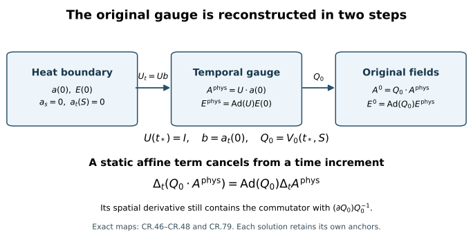

# Reconstructing the original gauge and its initial anchors

Heat flow makes the spatial connection easier to estimate. To compare
the physical solutions, we must carry those estimates through the actual
gauge transformations. This chapter proves the two maps back to the
original temporal gauge, retains their initial anchors, and bounds the
resulting differences. It also derives a potential-increment estimate
whose remaining curve coefficient tends to zero with the physical interval.

Read the [fixed heat comparison](../classical-fixed-heat-comparison.html),
[potential wave comparison](../classical-potential-difference.html),
[temporal boundary estimates](../classical-temporal-difference.html),
and [gauge comparison](../classical-gauge-difference.html) first.
The [temporal difference chapter](../classical-uniform-difference.html)
and [spatial tension chapter](../classical-spatial-tension-difference.html)
supply the electric and boundary inputs. These are arguments for existing
regular solutions on the stated intervals.

The arrows are the maps in [CR.46](../classical-original-gauge-reconstruction.html#eq-CR-46)–[CR.48](../classical-original-gauge-reconstruction.html#eq-CR-48). Their order matters. The lower
identity compares two physical times using the same static gauge.

## 1. Objects and the receiving domains

The original physical interval is \(J=[t_-,t_+]\), containing the
original \(t_*\), with \(T=|J|\le H\). The heat interval is \([0,S]\);
\(c,S,\ell,H>0\) retain their original values. Spatial coordinates
are the original \(x\in\mathbb R^3\), and

\[
g_{\mu\nu}=\operatorname{diag}(-c^2,1,1,1),\qquad
\Box_c=-c^{-2}\partial_t^2+\Delta,\qquad
\partial_c=(c^{-1}\partial_t,\partial_1,\partial_2,\partial_3).
\tag{CR.1}
\]

All derivative arrays include every ordered derivative, spatial
output and matrix label. Matrices carrying derivatives and all fields
use Hilbert–Schmidt norm; an undifferentiated gauge uses operator
norm. Potentials are their actual derivative-regular \(L^6_x\)
representatives. We use the original constants

\[
C_S=4/\sqrt3,\qquad
C_M=2\sqrt{(4\pi/3)^{-1/6}(4\pi)^{-1}(20\pi/3)^{5/6}},
\qquad d_B=2\sqrt3.
\tag{CR.2}
\]

The Sobolev and Morrey inequalities on these full tuples are

\[
\|f\|_6\le C_S\|\partial f\|_2,\quad
\|f\|_3\le C_S^{1/2}\sqrt{\|f\|_2\|\partial f\|_2},\quad
\|f\|_\infty\le C_MC_S
       \sqrt{\|\partial f\|_2\|\partial^{(2)}f\|_2}.
\tag{CR.3}
\]

The same formulas hold for a tuple treated as a field. The bracket
bound is \(2|X||Y|\), with full-tuple Cauchy–Schwarz for contracted
indices.

For the two caloric-temporal connections set

\[
\eta=a-a',\quad Z=G-G',\quad u=E-E',\quad
\theta=a_t-a_t',\quad V=W-W',\quad z=w-w',
\]

\[
G_i=F_{si},\quad E_i=F_{ti},\quad W=F_{st},\quad
w_i=c^{-2}D_tE_i-G_i.
\tag{CR.4}
\]

The original gauges give \(a_s=a_s'=0\) and \(a_t(S)=a_t'(S)=0\).
Consequently

\[
a(s)=a(S)-\int_s^SG(r)\,dr,\qquad
a_t(s)=-\int_s^SW(r)\,dr,
\tag{CR.5}
\]

and the primed and difference identities hold with exactly these
signs and endpoints. The Yang–Mills boundary equations give
\(W(0)=W'(0)=w(0)=w'(0)=0\).

## 2. Individual coefficient functions and their exact heat integrals

The individual FC/ES/UD providers on this original interval are

\[
\begin{aligned}
\|\partial^{(j)}a(s)\|_\infty&\le A_js^{-j/2-1/4},\quad j=0,1,
&\|\partial a(s)\|_2&\le R_a,\\
\|\partial^{(j)}G(s)\|_2&\le J_js^{-(j+1)/2},\quad j=2,3,\\
\|\partial^{(j)}E(s)\|_2&\le e_js^{-j/2},\quad j=0,1,2,\\
\|\partial^{(j)}W(s)\|_2&\le w_js^{-j/2-1/4},\quad 0\le j\le3.
\end{aligned}\tag{CR.6}
\]

All norms are uniform in original physical time when that variable
is not displayed. Primes denote the corresponding second providers.
Define

\[
\begin{aligned}
B_2&=S^{1/2}\|\partial^{(2)}a(S)\|_{L^\infty_tL^2_x}+2J_2,
&B_3&=S\|\partial^{(3)}a(S)\|_{L^\infty_tL^2_x}+J_3,\\
a_{13}&=C_S^{1/2}\sqrt{R_aB_2},
&a_{23}&=C_S^{1/2}\sqrt{B_2B_3},\\
\varepsilon_\infty&=C_MC_S\sqrt{e_1e_2},
&\varepsilon_3&=C_S^{1/2}\sqrt{e_0e_1},
&\varepsilon_{13}&=C_S^{1/2}\sqrt{e_1e_2},\\
T_0&=C_MC_S\sqrt{w_1w_2},
&T_1&=C_MC_S\sqrt{w_2w_3},\\
L_0&=C_S^{1/2}\sqrt{w_0w_1},
&L_1&=C_S^{1/2}\sqrt{w_1w_2},
&L_2&=C_S^{1/2}\sqrt{w_2w_3}.
\end{aligned}\tag{CR.7}
\]

Direct integration of [CR.5](../classical-original-gauge-reconstruction.html#eq-CR-5) gives

\[
\begin{aligned}
\|\partial^{(2)}a(s)\|_2
&\le\|\partial^{(2)}a(S)\|_2
       +2J_2(s^{-1/2}-S^{-1/2})\le B_2s^{-1/2},\\
\|\partial^{(3)}a(s)\|_2
&\le\|\partial^{(3)}a(S)\|_2
       +J_3(s^{-1}-S^{-1})\le B_3s^{-1}.
\end{aligned}\tag{CR.8}
\]

No upper endpoint term is set to zero. [CR.3](../classical-original-gauge-reconstruction.html#eq-CR-3) then gives the spatial
\(L^3\) bounds with coefficients \(a_{13},a_{23}\), and the electric
\(L^\infty,L^3,\partial L^3\) bounds with coefficients
\(\varepsilon_\infty,\varepsilon_3,\varepsilon_{13}\), with powers
\(s^{-3/4},s^{-1/4},s^{-3/4}\), respectively.

For \(W\), the same operations give
\(\|W\|_\infty\le T_0s^{-1}\),
\(\|\partial W\|_\infty\le T_1s^{-3/2}\), and the \(L^3\) powers
\(L_0s^{-1/2},L_1s^{-1},L_2s^{-3/2}\).
Thus the signed second identity in [CR.5](../classical-original-gauge-reconstruction.html#eq-CR-5) implies

\[
\begin{aligned}
\|a_t(s)\|_\infty&\le T_0\log(S/s),&
\|\partial a_t(s)\|_\infty&\le2T_1(s^{-1/2}-S^{-1/2}),\\
\|a_t(s)\|_3&\le2L_0(\sqrt S-\sqrt s),&
\|\partial a_t(s)\|_3&\le L_1\log(S/s),\\
\|\partial^{(2)}a_t(s)\|_3&\le2L_2(s^{-1/2}-S^{-1/2}).
\end{aligned}\tag{CR.9}
\]

These coefficients vanish at the correct upper endpoint.

Since \(E_i=\partial_ta_i-\partial_ia_t+[a_t,a_i]\),
\(\partial_ta=E+\partial a_t+[a,a_t]\). Differentiating once in
space gives the two separate brackets
\([\partial a,a_t]\) and \([a,\partial a_t]\).
The sum of the temporal and spatial norms bounds the combined tuple,
so valid coefficient functions are exactly

\[
\begin{aligned}
b_\infty(s)={}&(A_1+c^{-1}\varepsilon_\infty)s^{-3/4}
 +c^{-1}\{2T_1(s^{-1/2}-S^{-1/2})
              +2A_0T_0s^{-1/4}\log(S/s)\},\\
b_3(s)={}&(a_{13}+c^{-1}\varepsilon_3)s^{-1/4}
 +c^{-1}\{L_1\log(S/s)
              +4A_0L_0s^{-1/4}(\sqrt S-\sqrt s)\},\\
b_{13}(s)={}&(a_{23}+c^{-1}\varepsilon_{13})s^{-3/4}
 +c^{-1}\{2L_2(s^{-1/2}-S^{-1/2})
       +4A_1L_0s^{-3/4}(\sqrt S-\sqrt s)
       +2A_0L_1s^{-1/4}\log(S/s)\}.
\end{aligned}\tag{CR.10}
\]

They bound \(\|\partial_ca\|_\infty,\|\partial_ca\|_3,
\|\partial_x\partial_ca\|_3\), respectively.

For \(p<1\),
\(\int_0^Ss^{-p}\log(S/s)\,ds=S^{1-p}/(1-p)^2\).
This follows by differentiating the convergent integral
\(\int_0^Ss^{-p}ds=S^{1-p}/(1-p)\) in \(p\) and subtracting
its \(\log S\) term. Also,

\[
\int_0^Ss^{-p}(\sqrt S-\sqrt s)ds
=S^{3/2-p}\{(1-p)^{-1}-(3/2-p)^{-1}\}
\]

.
Applying these exact formulas gives

\[
\begin{aligned}
I_\infty={}&4S^{1/4}(A_1+c^{-1}\varepsilon_\infty)
  +2c^{-1}T_1\sqrt S+\tfrac{32}{9}c^{-1}A_0T_0S^{3/4},\\
I_{13}={}&4S^{1/4}(a_{23}+c^{-1}\varepsilon_{13})
 +c^{-1}\{2L_2\sqrt S+\tfrac{32}{3}A_1L_0S^{3/4}
                              +\tfrac{32}{9}A_0L_1S^{3/4}\},\\
I_{3w}={}&2\sqrt S(a_{13}+c^{-1}\varepsilon_3)
            +\tfrac{16}{9}c^{-1}L_1S^{3/4}+4c^{-1}A_0L_0S.
\end{aligned}\tag{CR.11}
\]

They equal, respectively, \(\int b_\infty ds,\int b_{13}ds\),
and \(\int s^{-1/4}b_3ds\). These are the exact integrals used below.

## 3. Full-tuple derivative of the original heat nonlinearity

Retain

\[
\begin{aligned}
\mathcal B(v,w)_i&=2[v_j,\partial_jw_i]-[v_j,\partial_iw_j]
                                      +[\partial^jv_j,w_i],\\
\mathcal C(v,w,z)_i&=[v_j,[w_j,z_i]],\\
L_0v&=\Delta v-\nabla\operatorname{div}v,\\
N_\delta&=\mathcal B(\eta,a)+\mathcal B(a',\eta)
 +\mathcal C(\eta,a,a)+\mathcal C(a',\eta,a)
 +\mathcal C(a',a',\eta),\qquad
\partial_s\eta=L_0\eta+N_\delta .
\end{aligned}\tag{CR.12}
\]

Repeated spatial indices run over \(1,2,3\). Expanding \(a=a'+\eta\)
recovers all three nonempty quadratic and all seven nonempty cubic
difference placements. The ordered telescoping expression deletes none.

Put \(X=\partial_c\eta\), \(Y=\|X\|_2\),
\(Z_X=\|\partial_xX\|_2\) at each original physical time.
For the first two terms of \(\mathcal B\), bracket constant two
and Cauchy–Schwarz in \(j\) give coefficient \(4+2=6\).
For its divergence bracket, pointwise
\(|\operatorname{div}v|\le\sqrt3|\partial v|\) gives \(d_B\).
Therefore the four differentiated bilinear placements give

\[
\begin{aligned}
\|\partial_c\mathcal B(\eta,a)\|_2
&\le d_B\|a\|_\infty Z_X+
 (6\|\partial a\|_\infty+d_B\|\partial_ca\|_\infty
                 +6C_S\|\partial_x\partial_ca\|_3)Y,\\
\|\partial_c\mathcal B(a',\eta)\|_2
&\le6\|a'\|_\infty Z_X+
 (d_B\|\partial a'\|_\infty+6\|\partial_ca'\|_\infty
                 +d_BC_S\|\partial_x\partial_ca'\|_3)Y.
\end{aligned}\tag{CR.13}
\]

For example, \(\mathcal B(\eta,\partial_ca)\) contributes

\[
6\|\eta\|_6\|\partial_x\partial_ca\|_3+
d_B\|\partial\eta\|_2\|\partial_ca\|_\infty
\]

.
Here \(\|\eta\|_6\le C_SY\) uses the same actual representative.

Every derivative of a cubic factor gives coefficient four. When
the derivative hits \(\eta\), put it in \(L^2\) and both individual
factors in \(L^\infty\). In the other two placements put \(\eta\)
in \(L^6\), the differentiated individual factor in \(L^3\), and
the remaining factor in \(L^\infty\). This proves

\[
\|\partial_cN_\delta(s)\|_2\le A(s)Z_X(s)+B(s)Y(s),
\tag{CR.14}
\]

where

\[
\begin{aligned}
A(s)={}&(d_BA_0+6A_0')s^{-1/4},\\
B(s)={}&(6A_1+d_BA_1')s^{-3/4}
 +d_Bb_\infty+6b_\infty'+6C_Sb_{13}+d_BC_Sb_{13}'\\
&+4(A_0^2+A_0A_0'+(A_0')^2)s^{-1/2}\\
&+4C_Ss^{-1/4}\{
      2A_0b_3+A_0b_3'+A_0'b_3+2A_0'b_3'\}.
\end{aligned}\tag{CR.15}
\]

The two differentiated individual slots of each outer cubic
placement produce the factors two in the braces. The middle
placement produces the two mixed terms in their displayed order.

In particular the two integrals are

\[
\begin{aligned}
\mathfrak A={}&2\sqrt S(d_BA_0+6A_0')^2,\\
\mathfrak B={}&4S^{1/4}(6A_1+d_BA_1')
 +d_BI_\infty+6I_\infty'+6C_SI_{13}+d_BC_SI_{13}'\\
&+8\sqrt S(A_0^2+A_0A_0'+(A_0')^2)\\
&+4C_S\{2A_0I_{3w}+A_0I_{3w}'+A_0'I_{3w}
                                      +2A_0'I_{3w}'\}.
\end{aligned}\tag{CR.16}
\]

Thus \(\int A^2=\mathfrak A\) and \(\int B=\mathfrak B\);
these depend only on the original individual providers.

There is a verified strengthening of [CR.13](../classical-original-gauge-reconstruction.html#eq-CR-13). The divergence is
in an \(L^2\) slot in \(\mathcal B(X,a)\) and
\(\mathcal B(\eta,\partial_ca)\). Fourier transformation, retaining
the spatial output and every other tuple index, gives

\[
\|\operatorname{div}v\|_2^2
=(2\pi)^{-3}\int|\xi^j\widehat v_j|^2d\xi
\le(2\pi)^{-3}\int|\xi|^2\sum_j|\widehat v_j|^2d\xi
=\|\partial v\|_2^2.
\tag{CR.17}
\]

Hence in the first line of [CR.13](../classical-original-gauge-reconstruction.html#eq-CR-13) the two occurrences of \(d_B\)
may be replaced by \(2\). This proves the alternative

\[
\begin{aligned}
A^\sharp(s)&=(2A_0+6A_0')s^{-1/4},\\
B^\sharp(s)&=B(s)-(d_B-2)b_\infty(s),\\
\mathfrak A^\sharp&=2\sqrt S(2A_0+6A_0')^2,\qquad
\mathfrak B^\sharp=\mathfrak B-(d_B-2)I_\infty .
\end{aligned}\tag{CR.18}
\]

These are nonnegative sums when written by [CR.15](../classical-original-gauge-reconstruction.html#eq-CR-15) with that
coefficient replaced. No replacement is made in the \(L^3\) or
\(L^\infty\) divergence slots. The larger coefficients in [CR.15](../classical-original-gauge-reconstruction.html#eq-CR-15) remain valid.

## 4. Backward heat energy and its actual endpoint

Since \(\partial_c\) commutes with \(L_0\), integration by parts
in the original spatial variables gives

\[
\frac12\partial_sY^2
=-Z_X^2+\|\operatorname{div}_xX\|_2^2
                  +\operatorname{Re}\langle X,\partial_cN_\delta\rangle.
\tag{CR.19}
\]

The divergence acts on the output vector for each of the four
physical derivative labels. It does not act on that label.
Integrating from \(s\) to \(S\) preserves the exact identity

\[
Y(s)^2=Y(S)^2+
2\int_s^S\{Z_X^2-\|\operatorname{div}_xX\|_2^2\}\,dr
-2\int_s^S\operatorname{Re}\langle X,\partial_cN_\delta\rangle\,dr .
\tag{CR.20}
\]

For any chosen \(\varepsilon>0\),
\(2AYZ_X\le\varepsilon Z_X^2+\varepsilon^{-1}A^2Y^2\).
After using the negative divergence contribution to obtain an
upper bound, [CR.14](../classical-original-gauge-reconstruction.html#eq-CR-14) therefore gives

\[
Y(s)^2\le Y(S)^2+(2+\varepsilon)\int_s^SZ_X^2dr
              +\int_s^S(\varepsilon^{-1}A^2+2B)Y^2dr.
\tag{CR.21}
\]

For \(k=\varepsilon^{-1}A^2+2B\), let
\(M=Y(S)^2+(2+\varepsilon)\int_0^SZ_X^2\) and
\(F(s)=M+\int_s^SkY^2\). Then \(Y^2\le F\) and
\(-F'\le kF\). Multiplication by the exact integrating factor, or
integration of this scalar inequality after reversing only its
integration parameter, yields \(F(s)\le M\exp(\int_s^Sk)\).
Do the argument first on \([\sigma,S]\); all coefficients are
integrable by [CR.16](../classical-original-gauge-reconstruction.html#eq-CR-16), so the actual regular heat trace gives the
limit at zero. This is a proof of the backward inequality with
its required positive heat-energy input, not backward parabolic
existence.

The complete wave quantity is

\[
W_k(U;s)=
\sup_{t\in J}\left(c^{-2}\||D|^{k-1}\partial_tU\|_2^2
             +\||D|^{k-1}\partial_xU\|_2^2\right)^{1/2}
+c\sqrt T\||D|^{k-1}\Box_cU(s)\|_{L^2_{t,x}(J)}.
\tag{CR.22}
\]

Let
\(\mathcal F_k^{\delta,p}
=\|s^{(k+1)/2}\|Z(s)\|_{\mathsf S_c^k(J)}\|_{L^p(ds/s)}\).
Commutation with [CR.5](../classical-original-gauge-reconstruction.html#eq-CR-5), Minkowski in the full wave norm and the
finite backward Hardy integral prove

\[
P_2^\delta=\sqrt S\,W_2(\eta;S)+2\mathcal F_2^{\delta,2},
\qquad
\left(\int_0^S W_2(\eta;s)^2ds\right)^{1/2}\le P_2^\delta.
\tag{CR.23}
\]

For completeness the relevant kernel is
\(s^{1/2}\int_s^S r^{-3/2}f(r)\,dr\) in \(L^2(ds/s)\).
Writing \(s=Se^{-x},r=Se^{-y}\) identifies convolution on
\(0\le y\le x\) with \(e^{-(x-y)/2}\); its \(L^1\) norm is two.
The endpoint term has \(L^2(ds/s)\) norm \(\sqrt S\).
Parseval on the full spatial tuples identifies the energy
component of \(W_2\) with \(Z_X\). Apply [CR.21](../classical-original-gauge-reconstruction.html#eq-CR-21) separately at
each physical time, then take its supremum. Thus

\[
\sup_{t\in J,\,0\le s\le S}\|\partial_c\eta(t,s)\|_2
\le
Y_{\delta,\varepsilon}:=
e^{\mathfrak A/(2\varepsilon)+\mathfrak B}
\sqrt{W_1(\eta;S)^2+(2+\varepsilon)(P_2^\delta)^2}.
\tag{CR.24}
\]

Write \(Y_\delta=Y_{\delta,1}\) for the choice \(\varepsilon=1\).
The sharp coefficients [CR.18](../classical-original-gauge-reconstruction.html#eq-CR-18) give a second valid expression by
replacing \(\mathfrak A,\mathfrak B\). The full exchanged product
order gives another. Their minimum, or the infimum over fixed
positive \(\varepsilon\), still bounds the same actual norm.
No field, coordinate, metric, endpoint or gauge has changed.

## 5. Difference coefficients and the full potential receiver

Integration of \(\partial_s\eta=Z\) gives

\[
\begin{aligned}
W_2(\eta;s)&\le W_2(\eta;S)
 +2\mathcal F_2^{\delta,\infty}(s^{-1/2}-S^{-1/2}),\\
W_3(\eta;s)&\le W_3(\eta;S)
 +\mathcal F_3^{\delta,\infty}(s^{-1}-S^{-1}),\\
K_2^\delta&=\sqrt S\,W_2(\eta;S)+2\mathcal F_2^{\delta,\infty},\\
K_3^\delta&=S W_3(\eta;S)+\mathcal F_3^{\delta,\infty}.
\end{aligned}\tag{CR.25}
\]

In this chapter \(\delta A_j\) and \(\delta C_F\) mean the actual
weighted coefficient seminorms:

\[
\delta A_j=\sup_{t\in J,\,0<s\le S}s^{j/2+1/4}
                  \|\partial^{(j)}\eta(t,s)\|_\infty\quad(j=0,1),
\qquad
\delta C_F=\sup_{t\in J,\,0<s\le S}s^{3/4}\|F(t,s)-F'(t,s)\|_\infty.
\]

FI gives numerical upper bounds for these seminorms. The wave estimates
below give another choice of upper bounds. Comparing two bounds for a
seminorm does not compare their numerical right sides.
[CR.3](../classical-original-gauge-reconstruction.html#eq-CR-3), [CR.24](../classical-original-gauge-reconstruction.html#eq-CR-24) at \(\varepsilon=1\), and [CR.25](../classical-original-gauge-reconstruction.html#eq-CR-25) therefore prove

\[
\begin{aligned}
\delta A_0&\le\widehat A_0^\delta=C_MC_S\sqrt{Y_\delta K_2^\delta},\\
\delta A_1&\le\widehat A_1^\delta=C_MC_S\sqrt{K_2^\delta K_3^\delta},\\
\delta C_F&\le2\widehat A_1^\delta
                 +2S^{1/4}\widehat A_0^\delta(A_0+A_0').
\end{aligned}\tag{CR.26}
\]

Indeed \(F_{ij}-F'_{ij}=\partial_i\eta_j-\partial_j\eta_i+
[\eta_i,a_j]+[a_i',\eta_j]\). Its two derivative placements
cost two and its two bracket placements cost the displayed
two, with the remaining heat power \(s^{1/4}\le S^{1/4}\).
All these receivers are degree one in the actual wave difference
inputs.

Endpoint wave norms of different derivative orders have different units.
Multiplying the order-\(k\) endpoint norm by the original factor
\(\ell^{k-1}\) gives a sum with one common unit. Every original norm
and every term of its wave forcing remain in this sum.
For exact substitution into the full potential-wave products, put

\[
\begin{gathered}
R_\delta^\ell=\sum_{k=1}^3
  \{\ell^{k-1}W_k(\eta;S)+\mathcal F_k^{\delta,2}+
                         \mathcal F_k^{\delta,\infty}\},\\
p_1=10S^{1/8},\quad p_2=\sqrt S/\ell+2,\quad
p_{3/2}=\sqrt2S^{1/4}/\sqrt\ell+4,\quad
p_{5/2}=\sqrt{2/3}S^{3/4}/\ell^{3/2}+4/3,\\
y=e^{\mathfrak A/2+\mathfrak B}\sqrt{1+3p_2^2},\quad
k_2=\sqrt S/\ell+2,\quad k_3=S/\ell^2+1,\\
\alpha_0=C_MC_S\sqrt{yk_2},\quad
\alpha_1=C_MC_S\sqrt{k_2k_3},\quad
\alpha_F=2\alpha_1+2S^{1/4}\alpha_0(A_0+A_0'),\\
\lambda=c\sqrt T,\qquad d_c=\sqrt2(2\pi c)^{-1/4}.
\end{gathered}\tag{CR.27}
\]

The actual difference quantities obey
\(Y_\delta\le yR_\delta^\ell,\delta A_j\le\alpha_jR_\delta^\ell\),
\(\delta C_F\le\alpha_FR_\delta^\ell\) and
\(P_k[\eta]\le p_kR_\delta^\ell\). The latter statements follow
from [PD.10](../classical-potential-difference.html#eq-PD-10)'s exact Hardy bounds and interpolation of the
actual difference, including its forcing. Individual values
\(P_k,P_k'\) retain their full FC definitions.

Substitution into each of [PD.14](../classical-potential-difference.html#eq-PD-14)'s two bilinear and three cubic
placements gives the following exact finite upper coefficients:

\[
\begin{aligned}
j_2={}&12S^{1/8}A_1p_1+d_B\sqrt2S^{1/4}A_0p_2
 +6\sqrt2S^{1/4}A_0'p_2+2d_BS^{1/8}A_1'p_1\\
&+6\sqrt2S^{1/4}\alpha_0P_2
 +2d_BS^{1/8}\alpha_1P_1+12S^{1/8}\alpha_1P_1'
 +d_B\sqrt2S^{1/4}\alpha_0P_2'\\
&+\lambda d_c^2\{12p_{3/2}P_{5/2}+2d_Bp_{5/2}P_{3/2}
                   +12P_{3/2}'p_{5/2}+2d_BP_{5/2}'p_{3/2}\},\\
j_3={}&\tfrac8{\sqrt3}S^{3/8}
 \{p_1(A_0^2+A_0'A_0+(A_0')^2)
 +\alpha_0(2A_0P_1+A_0P_1'+A_0'P_1+2A_0'P_1')\}\\
&+8\lambda d_c^2S^{1/4}
 \{p_{3/2}(2A_0P_{3/2}+A_0P_{3/2}'+A_0'P_{3/2}
                                      +2A_0'P_{3/2}')\\
&\hspace{31mm}+\alpha_0(P_{3/2}^2+P_{3/2}'P_{3/2}
                                      +(P_{3/2}')^2)\},\qquad j=j_2+j_3.
\end{aligned}\tag{CR.28}
\]

To check the integration factors directly, the single-wave
bilinear placements use residual heat powers \(s^{1/8}\) and
\(s^{1/4}\) in \(L^2(ds/s)\), whose norms are
\(2S^{1/8}\) and \(\sqrt2S^{1/4}\). The single-wave cubic
placements have residual power \(s^{3/8}\), norm
\(2S^{3/8}/\sqrt3\). The cross-wave terms retain the product-rule
factor two for \(\Box_c\), so their coefficients remain
\(12,2d_B,8\), including the temporal contraction \(c^{-2}\).
This accounts for every energy and forcing placement with the length factors in [CR.27](../classical-original-gauge-reconstruction.html#eq-CR-27).

Consequently the full forcing and potential receivers are

\[
\mathcal J_\delta\le jR_\delta^\ell,\qquad
\mathcal U_\delta\le(1+2p_2+2j)R_\delta^\ell,\qquad
D_\delta\le(2+2p_2+2j)R_\delta^\ell .
\tag{CR.29}
\]

Their proof is [PD.18](../classical-potential-difference.html#eq-PD-18)–[PD.20](../classical-potential-difference.html#eq-PD-20) applied to both the physical energy
tuple and the \(\Box_c\) tuple, with [CR.28](../classical-original-gauge-reconstruction.html#eq-CR-28) in its actual source
integral. In particular the improvement of the coefficient
provider does not remove a temporal cross product from
\(\Box_cN_\delta\).

The null bilinear difference has its two exact telescoping
orders. With \(C_{\rm null}=2\sqrt3\sqrt{2/(\pi c)}\),
each \(m\ge1,p=2,\infty\) therefore has the receiver

\[
C_{\rm null}\min\{
D_\delta\mathcal F_m^p+D_{a'}\mathcal F_m^{\delta,p},
\ D_a\mathcal F_m^{\delta,p}+D_\delta\mathcal F_m^{\prime,p}\}.
\tag{CR.30}
\]

The factor two in the original wave equation multiplies this
whole bound. The initial-data bound for \(R_\delta^\ell\) is proved in
[the next chapter](../classical-initial-data-stability.html#eq-CP-51).

## 6. The original temporal boundary derivative

The covariant identities, with the original raising of the
time index, are

\[
D^jG_j=0,\qquad D_tW=-c^2D^jw_j,\qquad
\partial_ta_i=E_i+D_ia_t.
\tag{CR.31}
\]

For the second identity, the original dynamic heat equation gives
\(W=D^jF_{jt}=-D^jE_j\), with no power of \(c\) inserted
into that identity. Covariant differentiation in physical time gives
\(D_tW=-D^jD_tE_j-\sum_j[E_j,E_j]\). The last sum is
zero term by term. Substituting the exact definition
\(D_tE_j=c^2(w_j+G_j)\) and using \(D^jG_j=0\) proves
\(D_tW=-c^2D^jw_j\) with its original sign and factor.
The latter is
\(D^jD^kF_{kj}=\tfrac12[F^{jk},F_{kj}]=0\).
The sign can thus be checked without changing \(c\) or the
definition of \(w\).

Let \(b=a_t(0)\), \(b^\delta=\theta(0)=b-b'\). Subtract the
second identity and integrate its negative heat primitive:

\[
\begin{aligned}
\partial_tb^\delta
={}&c^2\int_0^S\{\operatorname{div}z+[\eta,w]+[a',z]\}ds
       +\int_0^S\{[\theta,W]+[a_t',V]\}ds,\\
\partial_x\partial_tb^\delta
={}&c^2\mathbf P_{\rm cf}
 \{z(S)-z(0)-\int_0^SN_zds\}
 +c^2\int_0^S\partial_x\{[\eta,w]+[a',z]\}ds\\
&+\int_0^S\partial_x\{[\theta,W]+[a_t',V]\}ds,\qquad
N_z=(\partial_s-\Delta)z,\quad z(0)=0.
\end{aligned}\tag{CR.32}
\]

Here \(\mathbf P_{\rm cf}=\nabla\Delta^{-1}\operatorname{div}\)
has multiplier \(\xi\xi^{\mathsf T}/|\xi|^2\), of operator norm
one; its value at the single point \(\xi=0\) is immaterial in
\(L^2\). The identity
\(\nabla\operatorname{div}=\mathbf P_{\rm cf}\Delta\)
and the heat equation prove the first integral on
\([\sigma,S]\). Its strong \(L^2_{t,x}\) limit follows from
the actual zero heat trace and the integrable ordinary source,
so no absolute heat integral of the Hessian is assumed.

Write

\[
L_z=\sup_s\|z(s)\|_{L^2_{t,x}},\quad
B_z=\|\partial z\|_{L^2(ds;L^2_{t,x})},\quad
Q_z=\int_0^S\|\delta Q(s)\|_{L^2_{t,x}}ds,
\]

and use their evaluated [TDI.17](../classical-spatial-tension-difference.html#eq-TDI-17)–[TDI.20](../classical-spatial-tension-difference.html#eq-TDI-20) providers, with individual
\(L_w,B_w,L_w',B_w'\). Use TD's evaluated
\(L_V,B_V,L_N^\delta\) and set \(H_+=2L_V+L_N^\delta\).
The complete expansion of \(N_z\), followed by the original
heat Hölder inequalities, gives

\[
\begin{aligned}
N_z^*={}&4\sqrt2S^{1/4}(A_0B_z+\delta A_0B_w')
 +8\sqrt3S^{1/4}(A_1L_z+\delta A_1L_w')\\
&+8\sqrt S\{A_0^2L_z+\delta A_0(A_0+A_0')L_w'\}
 +16S^{1/4}(C_FL_z+\delta C_FL_w')+Q_z,\\
J_{aw,0}&=\tfrac83S^{3/4}(\delta A_0L_w+A_0'L_z),\\
J_{aw,1}&=2\sqrt2S^{1/4}(\delta A_0B_w+A_0'B_z)
                    +8S^{1/4}(\delta A_1L_w+A_1'L_z),\\
J_{tW,0}&=2C_MC_Sw_0S\,\mathrm B(3/4,5/4)\sqrt{B_VH_+}
                                         +2T_0'S L_V,\\
J_{tW,1}&=4C_S^{3/2}\sqrt{w_0w_1}\sqrt S H_+
 +2C_MC_Sw_1\sqrt S\,\mathrm B(1/4,5/4)\sqrt{B_VH_+}\\
&\quad+4T_1'\sqrt S L_V+2T_0'\sqrt{2S}B_V,\\
K_0^\delta&=c^2(\sqrt S B_z+J_{aw,0})+J_{tW,0},\\
K_1^\delta&=c^2(L_z+N_z^*+J_{aw,1})+J_{tW,1}.
\end{aligned}\tag{CR.33}
\]

Each coefficient has the following integral calculation.
The drift uses
\(\int s^{-1/4}\|\partial z\|_2ds\le\sqrt2S^{1/4}B_z\);
the divergence and curvature use
\(\int s^{-3/4}ds=4S^{1/4}\); the nested terms use
\(\int s^{-1/2}ds=2\sqrt S\). The signs of those original
source groups are retained in their defining equation before
the norm bound. Bracket constant two gives the two \(J_{aw}\)
expressions.

For the temporal products, the signed heat-boundary identity
gives

\[
\|\theta(s)\|_{L^2_tL^\infty_x}
 \le C_MC_S(S-s)^{1/4}\sqrt{B_VH_+},\quad
\|\partial\theta(s)\|_{L^2_tL^6_x}\le C_SH_+.
\tag{CR.34}
\]

The four differentiated product placements are
\([\partial\theta,W],[\theta,\partial W],
[\partial a_t',V],[a_t',\partial V]\).
They integrate, respectively, with
\(2\sqrt S\),
\(\sqrt S\,\mathrm B(1/4,5/4)\),
\(\sqrt S\), and
\((\int_0^S\log(S/s)^2ds)^{1/2}=\sqrt{2S}\),
after their [CR.6](../classical-original-gauge-reconstruction.html#eq-CR-6)–[CR.9](../classical-original-gauge-reconstruction.html#eq-CR-9) prefactors are retained.
The undifferentiated first product uses
\(\int_0^Ss^{-1/4}(S-s)^{1/4}ds
=S\,\mathrm B(3/4,5/4)\); the second uses
\(\int_0^S\log(S/s)ds=S\).
This proves all of [CR.33](../classical-original-gauge-reconstruction.html#eq-CR-33).

Thus

\[
\begin{aligned}
\|\partial_tb^\delta\|_{L^2_{t,x}}&\le K_0^\delta,\qquad
\|\partial_x\partial_tb^\delta\|_{L^2_{t,x}}\le K_1^\delta,\\
\sup_J\|\partial b^\delta\|_2
&\le B_{*,1}^\delta+\sqrt T K_1^\delta,\\
\sup_J\|b^\delta\|_3
&\le B_{*,3}^\delta+
               \sqrt T C_S^{1/2}\sqrt{K_0^\delta K_1^\delta}.
\end{aligned}\tag{CR.35}
\]

The anchors are the actual
\(B_{*,1}^\delta=\|\partial b^\delta(t_*)\|_2\) and
\(B_{*,3}^\delta=\|b^\delta(t_*)\|_3\).
To prove the last line, the Bochner increment has \(L^2\)
norm at most \(\sqrt T K_0^\delta\) and gradient norm at
most \(\sqrt T K_1^\delta\); [CR.3](../classical-original-gauge-reconstruction.html#eq-CR-3) applies to that same
increment. This also proves the time trace and its
representative. It does not convert a time-integrated bound
into a supremum without its anchored value.

## 7. Initial heat anchors, with a smaller derivative coefficient

The original initial distance is

\[
\delta_*=\|\partial\delta A^0(t_*)\|_2+
                                  c^{-1}\|\delta E^0(t_*)\|_2.
\tag{CR.36}
\]

At this one physical time [FI.7](../classical-fixed-heat-comparison.html#eq-FI-7)–[FI.11](../classical-fixed-heat-comparison.html#eq-FI-11) constructs the actual
DeTurck difference with
\(\mathsf T_m(\delta B)\le d_m^*\); all \(d_m^*\) are
degree one in \(\rho_A^*=\|\partial\delta A^0(t_*)\|_2\).
No supremum along the physical curve is inserted here.
For example the exact finite first coefficients are

\[
\begin{aligned}
d_0^*&=\tfrac83\rho_A^*,\\
d_1^*&=(4+4K^2\sqrt S R^2+
4KS^{1/4}\sqrt{R\gamma_1}+36J_0\sqrt S R^2)d_0^*,\\
K&=54(C_S^{3/2}+C_MC_S),\qquad J_0=36C_S^3 .
\end{aligned}\tag{CR.37}
\]

The finite [FI.9](../classical-fixed-heat-comparison.html#eq-FI-9) recursion supplies \(d_2^*\), with the
original \(S\le S_R\); this computation is evaluated at
the initial datum, with the same individual reference radius.

Let \(V_s=Vq,\ V(0)=I_N,\ q=\operatorname{div}B\), only in
this paragraph, and let \(Q_0=V(S)\); use primes for the
second initial heat flow. Define

\[
\begin{aligned}
P_0&=4\sqrt3C_S^{1/2}\sqrt{\gamma_1\gamma_2}S^{1/4},&
P_0'&=4\sqrt3C_S^{1/2}\sqrt{\gamma_1'\gamma_2'}S^{1/4},\\
q_0&=4\sqrt3C_MC_S\sqrt{d_1^*d_2^*}S^{1/4},&
q_3&=4\sqrt3C_S^{1/2}\sqrt{d_1^*d_2^*}S^{1/4}.
\end{aligned}\tag{CR.38}
\]

[CR.3](../classical-original-gauge-reconstruction.html#eq-CR-3) and the full divergence contraction give
\(\|\delta q(s)\|_\infty\le q_0s^{-3/4}/(4S^{1/4})\),
\(\|\partial\delta q(s)\|_3\le q_3s^{-3/4}/(4S^{1/4})\),
and the analogous \(P_0,P_0'\) bounds for
\(\|\partial q\|_3,\|\partial q'\|_3\).
Unitarity removes the homogeneous right multiplication in
the difference ODE. At every intermediate heat value,

\[
\|\delta V(s)\|_\infty\le q_0(s/S)^{1/4},\quad
\|\partial V(s)\|_3\le P_0(s/S)^{1/4},\quad
\|\partial V'(s)\|_3\le P_0'(s/S)^{1/4}.
\tag{CR.39}
\]

The full differentiated difference equation is

\[
(\partial_i\delta V)_s
=(\partial_i\delta V)q'+\delta V\,\partial_iq'
                  +(\partial_iV)\delta q+V\partial_i\delta q.
\tag{CR.40}
\]

Integrating its three inhomogeneous terms with [CR.39](../classical-original-gauge-reconstruction.html#eq-CR-39) gives

\[
\|\partial(Q_0-Q_0')\|_3
\le q_1^\sharp:=q_3+\tfrac12q_0(P_0+P_0').
\tag{CR.41}
\]

Indeed each cross term integrates \(s^{-1/2}\) to
\(2\sqrt S\), giving exactly one half of the endpoint
product.

There is a still more direct receiver for the quantity that
the physical map actually uses. Put
\(K_0=(\partial Q_0)Q_0^{-1}\). For the intermediate heat
gauge \(K(s)=(\partial V(s))V(s)^{-1}\), differentiation
without commuting any matrices gives

\[
K_s=\operatorname{Ad}(V)\partial q,\qquad
(\delta K)_s=
\operatorname{Ad}(V)\partial\delta q+
(\operatorname{Ad}(V)-\operatorname{Ad}(V'))\partial q'.
\tag{CR.42}
\]

Since the conjugation difference costs
\(2\|\delta V\|_{\infty;\mathrm{op}}\), the same partial
heat integrals give

\[
\|\delta K_0\|_3\le q_3+q_0P_0',\qquad
\|\delta K_0\|_3\le q_3+q_0P_0.
\]

Therefore

\[
q_K^\sharp=q_3+q_0\min(P_0,P_0')
\tag{CR.43}
\]

is valid. The estimate \(q_K=q_3+q_0(P_0+2P_0')\) is larger
and remains valid. The gauge difference itself also obeys
\(\|Q_0-Q_0'\|_{\infty;\mathrm{op}}\le\min(2,q_0)\).
Using its uncapped bound preserves a degree-one numerical
provider at zero initial difference.

The other initial anchors in [CR.35](../classical-original-gauge-reconstruction.html#eq-CR-35) use the actual temporal
tension difference at \(t_*\). Its equation is

\[
\begin{aligned}
(\partial_s-\Delta)V={}&2\partial_j[a_j,V]-[\partial_ja_j,V]
   +[a_j,[a_j,V]]\\
&+2\partial_j[\eta_j,W']-[\partial_j\eta_j,W']
   +[\eta_j,[a_j,W']]+[a_j',[\eta_j,W']]\\
&+2[u_j,G_j]+2[E_j',Z_j],\qquad V(0)=0.
\end{aligned}\tag{CR.44}
\]

[UD.14](../classical-uniform-difference.html#eq-UD-14)–[UD.18](../classical-uniform-difference.html#eq-UD-18) constructs the actual fixed-time bounds
\(\|V(t_*,s)\|_2\le v_0^*s^{-1/4}\) and
\(\|\partial V(t_*,s)\|_2\le v_1^*s^{-3/4}\).
Its electric datum includes the actual initial heat-gauge
conjugation, as required by FI/ED. Integrating the negative
primitive and then applying [CR.3](../classical-original-gauge-reconstruction.html#eq-CR-3) gives

\[
B_{*,1}^\delta\le4S^{1/4}v_1^*,\qquad
B_{*,3}^\delta\le
                 2C_S^{1/2}\sqrt S\sqrt{v_0^*v_1^*}.
\tag{CR.45}
\]

These are degree one in \(\delta_*\).
The precise direct locators for these \(L^2\) coefficients
are [UD.16](../classical-uniform-difference.html#eq-UD-16) and [UD.18](../classical-uniform-difference.html#eq-UD-18); [UD.19](../classical-uniform-difference.html#eq-UD-19) is the subsequent \(L^4\)
interpolation.

## 8. The static affine gauge action cancels exactly

Let \(U_t=Ub,\ U(t_*)=I_N\), and use the primed equation.
The physical representatives associated with these temporal
gauges are

\[
A^{\rm phys}=U\cdot a(0),\qquad
E^{\rm phys}=\operatorname{Ad}(U)E(0),\qquad
A^0=Q_0\cdot A^{\rm phys},\qquad
E^0=\operatorname{Ad}(Q_0)E^{\rm phys}.
\tag{CR.46}
\]

Here \(Q\cdot a_i=Qa_iQ^{-1}-(\partial_iQ)Q^{-1}\).
[FI.4](../classical-fixed-heat-comparison.html#eq-FI-4)–[FI.5](../classical-fixed-heat-comparison.html#eq-FI-5) shows that the caloric connection at \(t_*\)
is \(Q_0^{-1}\cdot A^0(t_*)\). The time gauge makes the
time potential zero; multiplication by the time-independent
\(Q_0\) preserves this property and restores the original
initial value. Uniqueness of the matrix ODE fixes [CR.46](../classical-original-gauge-reconstruction.html#eq-CR-46)
in its stated order. \(Q_0\) need not equal the identity.

For \(h=A^{\rm phys}(t)-A^{\rm phys}(t_*)\), and similarly
\(h'\), subtraction of the affine action at the same two
physical times gives the exact relation

\[
\delta A^0(t)=\delta A^0(t_*)+
 \operatorname{Ad}(Q_0)(h-h')
 +(\operatorname{Ad}(Q_0)-\operatorname{Ad}(Q_0'))h'.
\tag{CR.47}
\]

The two occurrences of \(-(\partial Q_0)Q_0^{-1}\)
cancel before any spatial differentiation. For any \(X\),

\[
\partial\operatorname{Ad}(Q)X=
\operatorname{Ad}(Q)\partial X+
[(\partial Q)Q^{-1},\operatorname{Ad}(Q)X]
\]

.
Subtract this formula for \(Q_0,Q_0'\), preserving both
inverse-matrix terms. [CR.3](../classical-original-gauge-reconstruction.html#eq-CR-3) therefore gives

\[
\begin{aligned}
\|\partial\delta A^0(t)\|_2\le{}&
\|\partial\delta A^0(t_*)\|_2+
M_0\|\partial(h-h')\|_2+
C_Q^\delta\|\partial h'\|_2,\\
M_0={}&1+2C_SP_0,\qquad
C_Q^\delta=2q_0+4C_SP_0q_0+2C_Sq_K .
\end{aligned}\tag{CR.48}
\]

One may use the larger \(q_K\) just displayed or [CR.43](../classical-original-gauge-reconstruction.html#eq-CR-43).
The three difference terms are respectively the ordinary
conjugated gradient, the commutator of \(K_0\) with the
conjugation difference, and the commutator of \(\delta K_0\)
with the primed field. Each has the coefficient displayed.
No second derivative of \(Q_0-Q_0'\) is required.

## 9. The physical-time gauge, including every Hessian term

The zero-heat signed boundary equation gives the improved
[TD.25](../classical-temporal-difference.html#eq-TD-25) coefficients

\[
D^\delta=\sqrt S B_V,\qquad H^\delta=L_V+L_N^\delta,
\]

\[
\beta_0^\delta=C_MC_S\sqrt{D^\delta H^\delta},\quad
\beta_3^\delta=C_S^{1/2}\sqrt{D^\delta H^\delta},\quad
\beta_6^\delta=C_SH^\delta,\quad \beta_2^\delta=H^\delta .
\tag{CR.49}
\]

They are \(L^2_t\) providers for \(b^\delta\) in \(L^\infty_x\),
for \(\partial b^\delta\) in \(L^3_x,L^6_x\), and for
\(\partial^{(2)}b^\delta\) in \(L^2_x\), respectively.
To prove the Hessian coefficient, integrate
\(\Delta\theta(0)=-V(S)+\int_0^SN_V\) using \(V(0)=0\);
the full-tuple Fourier equality
\(\|\partial^{(2)}\theta(0)\|_2=\|\Delta\theta(0)\|_2\)
has no lost mixed entries. The gradient coefficient is
\(\sqrt S B_V\) by heat Cauchy–Schwarz. [CR.3](../classical-original-gauge-reconstruction.html#eq-CR-3) followed by
time Cauchy–Schwarz proves the four mixed norms. Integrating
over each original segment from \(t_*\) gives
\(D_i\le\sqrt T\,\beta_i^\delta\), \(i=0,3,6,2\).
The boundary bound uses \(L_V+L_N^\delta\); the bound
\(2L_V+L_N^\delta\) valid at all positive heat times is also an upper bound.

Let \(P,Q,H_b,P',Q',H_b'\) be the individual integrals of
\(\|\partial b\|_3,\|\partial b\|_6,\|\partial^{(2)}b\|_2\)
on the original physical segment, bounded uniformly on
\(J\). The exact variation equations for \(Z_U=U-U'\) are

\[
\begin{aligned}
(Z_U)_t&=Z_Ub'+Ub^\delta,\\
(\partial_iZ_U)_t&=(\partial_iZ_U)b'
 +Z_U\partial_ib'+(\partial_iU)b^\delta+U\partial_ib^\delta,\\
(\partial_j\partial_iZ_U)_t
&=(\partial_j\partial_iZ_U)b'
 +(\partial_iZ_U)\partial_jb'+(\partial_jZ_U)\partial_ib'
 +Z_U\partial_j\partial_ib'\\
&\quad+(\partial_j\partial_iU)b^\delta
 +(\partial_iU)\partial_jb^\delta
 +(\partial_jU)\partial_ib^\delta
 +U\partial_j\partial_ib^\delta .
\end{aligned}\tag{CR.50}
\]

Every anchored spatial derivative of \(Z_U\) is zero.
Multiplication on the right by \((U')^{-1}\) removes the
homogeneous term. All integrals keep their orientation,
so the same estimates hold on either side of \(t_*\).
Substitution of \(D_i\le\sqrt T\beta_i^\delta\) gives

\[
\begin{aligned}
g_3&=\beta_3^\delta+\beta_0^\delta(P+P'),&
g_6&=\beta_6^\delta+\beta_0^\delta(Q+Q'),\\
g_2&=\beta_2^\delta+\beta_0^\delta(H_b'+H_b+PQ)
                           +2g_3Q'+2P\beta_6^\delta,\\
k_3&=g_3+\beta_0^\delta P',&
k_6&=g_6+\beta_0^\delta Q',\\
k_2&=g_2+\beta_0^\delta(H_b'+P'Q')+k_3Q+P'k_6.
\end{aligned}\tag{CR.51}
\]

Here \(\|Z_U\|_\infty\le\sqrt T\beta_0^\delta\),
\(\|\delta K\|_3\le\sqrt T k_3\),
\(\|\delta K\|_6\le\sqrt T k_6\), and
\(\|\partial\delta K\|_2\le\sqrt T k_2\), for
\(K=(\partial U)U^{-1}\).
Indeed
\(\partial_jK_i=(\partial_j\partial_iU)U^{-1}-K_iK_j\);
its difference has the two ordered product placements
\(-(\delta K_i)K_j-K_i'\delta K_j\). Together with the
inverse difference and [CR.50](../classical-original-gauge-reconstruction.html#eq-CR-50) these give precisely [CR.51](../classical-original-gauge-reconstruction.html#eq-CR-51).

Differentiate \(A^{\rm phys}=\operatorname{Ad}(U)a-K\).
The full difference has the gradient receiver

\[
\begin{aligned}
G_A^\delta={}&2\beta_0^\delta R_a'
       +2C_SR_ak_3+4C_SP'R_a'\beta_0^\delta+k_2,\\
\sup_J\|\partial\delta A^{\rm phys}\|_2
&\le(1+2C_SP')Y_\delta+\sqrt T G_A^\delta,\\
\sup_J\|\partial(h-h')\|_2
&\le(2+2C_SP')Y_\delta+\sqrt T G_A^\delta .
\end{aligned}\tag{CR.52}
\]

At the anchor, \(U=U'=I_N\), \(K=K'=0\), so the actual
initial gradient difference contributes \(Y_\delta\) in
the second line for increments. It is not zeroed.
Individually
\(\|\partial h'\|_2\le2R_{\rm phys}'\).

There is a second, smaller direct Hessian receiver using
\(K_t=\operatorname{Ad}(U)\partial b\). Let \(P,Q,H_b\)
in the next display be maxima of both individual integrals.
Then

\[
\|\delta K\|_3\le D_3+2PD_0,\qquad
\|\delta K\|_6\le D_6+2QD_0,
\]

\[
\|\partial\delta K\|_2
\le D_2+2QD_3+2PD_6+(2H_b+4PQ)D_0 .
\tag{CR.53}
\]

To verify the coefficient four, integrate the exact equation
\(\partial K_t=\operatorname{Ad}(U)\partial^{(2)}b+
[K,\operatorname{Ad}(U)\partial b]\).
The first part costs \(D_2+2H_bD_0\).
The quadratic part is the ordered double integral of
\([\operatorname{Ad}(U(v))\partial b(v),
\operatorname{Ad}(U(r))\partial b(r)]\).
Replacing the two \(b\) entries first gives
\(2QD_3+2PD_6\). Replacing the two conjugations then costs
\(8D_0\) times either of the ordered integrals of
\(g_3'(v)g_6'(r)\) and \(g_6'(v)g_3'(r)\), with
\(g_p'=\|\partial b'\|_p\). Their sum is the product of
the two one-variable integrals, at most \(PQ\), so their
minimum is at most \(PQ/2\). The contribution is at most
\(4PQD_0\). For \(t<t_*\), the reversed ordered triangle
has the same two complementary regions. Thus [CR.53](../classical-original-gauge-reconstruction.html#eq-CR-53)
proves the coefficient four; replacing it by six also gives an upper bound. One can use either full receiver,
or their minimum, without assuming an ordering between
different choices of individual upper bounds.

## 10. Electric reconstruction and the physical difference bound

At the actual heat boundary, subtraction of the last identity
in [CR.31](../classical-original-gauge-reconstruction.html#eq-CR-31) gives

\[
u(0)=\partial_t\eta(0)-\partial b^\delta
                        -[\eta(0),b]-[a'(0),b^\delta].
\tag{CR.54}
\]

[CR.9](../classical-original-gauge-reconstruction.html#eq-CR-9) gives \(\sup_J\|b\|_3\le2L_0\sqrt S\).
[CR.24](../classical-original-gauge-reconstruction.html#eq-CR-24) bounds the first term with the original factor \(c\).
[CR.35](../classical-original-gauge-reconstruction.html#eq-CR-35) bounds the second and fourth; [CR.3](../classical-original-gauge-reconstruction.html#eq-CR-3) bounds both
spatial potentials in \(L^6\). Finally the two separate
electric conjugation differences in
\(E^0=\operatorname{Ad}(Q_0U)E(0)\) cost
\(2e_0'q_0\) and \(2e_0'\sqrt T\beta_0^\delta\), where
\(e_0'=\sup_J\|E'(0)\|_2\le cd'\).
This proves

\[
\begin{aligned}
c^{-1}\sup_J\|\delta E^0\|_2\le{}&
(1+4c^{-1}C_SL_0\sqrt S)Y_\delta\\
&+c^{-1}(B_{*,1}^\delta+2C_SR_a'B_{*,3}^\delta)
 +2c^{-1}q_0e_0'\\
&+\sqrt T c^{-1}
 \{K_1^\delta+2C_S^{3/2}R_a'\sqrt{K_0^\delta K_1^\delta}
                                    +2e_0'\beta_0^\delta\}.
\end{aligned}\tag{CR.55}
\]

An individual upper bound \(e_0'=cd'\) is sufficient;
equality between an actual electric supremum and its
conserved full-energy upper bound is not required.

Set

\[
\begin{aligned}
A_*^\delta={}&\|\partial\delta A^0(t_*)\|_2
   +2R_{\rm phys}'C_Q^\delta
   +c^{-1}(B_{*,1}^\delta+2C_SR_a'B_{*,3}^\delta)
   +2c^{-1}q_0e_0',\\
B_*={}&M_0(2+2C_SP')+1+4c^{-1}C_SL_0\sqrt S,\\
G_*^\delta={}&M_0G_A^\delta+c^{-1}
 \{K_1^\delta+2C_S^{3/2}R_a'\sqrt{K_0^\delta K_1^\delta}
                                    +2e_0'\beta_0^\delta\}.
\end{aligned}\tag{CR.56}
\]

Adding [CR.48](../classical-original-gauge-reconstruction.html#eq-CR-48), [CR.52](../classical-original-gauge-reconstruction.html#eq-CR-52) and [CR.55](../classical-original-gauge-reconstruction.html#eq-CR-55) proves, for the actual
\(\rho=\sup_J\|\partial\delta A^0\|_2+
c^{-1}\sup_J\|\delta E^0\|_2\),

\[
\boxed{\rho\le A_*^\delta+B_*Y_\delta+\sqrt T G_*^\delta.}
\tag{CR.57}
\]

The bound permits the
smaller \(q_K^\sharp\). Every summand of \(A_*^\delta\)
is a proved degree-one function of the original \(\delta_*\).

To obtain a finite numerical coefficient,
hold every individual provider fixed on the original upper
interval of length \(H\). Evaluate FI's connection difference
functions at numerical \(\rho_A=1,\rho_E=c\); monotonicity
and degree-one homogeneity then bound their actual values
by that result times \(\rho\). Evaluate the wave inputs
at their displayed [CR.27](../classical-original-gauge-reconstruction.html#eq-CR-27) coefficients times \(R_\delta^\ell\).
All subsequent UD, LG, TD and TDI difference operations
are finite sums of these entries times individual coefficients,
geometric means of degree-one entries, complete minima,
or Volterra constructions whose exponential and subdivision
parameters depend only on individuals. In taking a uniform
upper expression, use one complete minimum branch and
the uncapped gauge bound. Replace each of \(R_\delta^\ell,\rho\)
by a common factor \(R_\delta^\ell+\rho\), then evaluate that
factor at one. This gives a definite finite number \(g_*\)
and proves

\[
G_*^\delta\le g_*(R_\delta^\ell+\rho),\qquad
\rho\le A_*^\delta+(B_*y+\sqrt T g_*)R_\delta^\ell+
                                      \sqrt T g_*\rho.
\tag{CR.58}
\]

No division by a difference is used; the zero case is included.
The value \(g_*\) uses \(c,S,H,\ell\) and the original
individual providers, never a reciprocal power of the
variable short interval length. This is a
reconstruction inequality. Bounding \(R_\delta^\ell\) by
initial data remains the separate wave calculation.

## 11. Anchored increments and a smaller curve coefficient

A second estimate uses the spatial, physically anchored increment
\(v_t(s)=\eta(t,s)-\eta(t_*,s)\), instead of the full
absolute physical tuple in [CR.24](../classical-original-gauge-reconstruction.html#eq-CR-24). Its equation is

\[
\partial_sv_t=L_0v_t+N_\delta(t,s)-N_\delta(t_*,s).
\tag{CR.59}
\]

For the complete differentiated quadratic map, [CR.17](../classical-original-gauge-reconstruction.html#eq-CR-17) in
its \(L^2\) slots gives

\[
\|\partial\mathcal B(v,w)\|_2
\le6\|v\|_\infty\|\partial^{(2)}w\|_2
 +6\|\partial v\|_\infty\|\partial w\|_2
 +2\|\partial^{(2)}v\|_2\|w\|_\infty
 +2\|\partial v\|_2\|\partial w\|_\infty .
\tag{CR.60}
\]

Each cubic derivative placement again costs four. Consequently
the coefficients

\[
\begin{aligned}
C_P&=\sqrt2(2A_0+6A_0'),& C_U&=4(2A_1+6A_1'),\\
C_0&=\sqrt2(6P_2+2P_2'),& C_1&=4(6R_a+2R_a'),\\
C_3&=8(A_0^2+A_0'A_0+(A_0')^2),\\
C_4&=8(2A_0R_a+A_0R_a'+A_0'R_a+2A_0'R_a')
\end{aligned}\tag{CR.61}
\]

satisfy, for \(0<h\le S\),

\[
\sup_t\int_0^h\|\partial N_\delta(t,s)\|_2ds
\le F_h^\delta:=
h^{1/4}(C_PP_2^\delta+C_U\mathcal U_\delta+
                         C_0\delta A_0+C_1\delta A_1)
+\sqrt h(C_3\mathcal U_\delta+C_4\delta A_0).
\tag{CR.62}
\]

Every bilinear heat factor is either
\((\int_0^hs^{-1/2}ds)^{1/2}=\sqrt2h^{1/4}\)
or \(\int_0^hs^{-3/4}ds=4h^{1/4}\).
The nine cubic derivative placements integrate
\(4s^{-1/2}\) to \(8\sqrt h\), retaining the two identical
individual-factor placements in each outer cubic term.

The signed energy identity is [CR.20](../classical-original-gauge-reconstruction.html#eq-CR-20) for \(\partial v_t\)
on \([s,h]\). Since its Hessian heat norm is at most
\(2P_2^\delta\), and its source integral is at most
\(2F_h^\delta\), its supremum \(Y_h\) satisfies
\(Y_h^2\le A_h^2+8(P_2^\delta)^2+4F_h^\delta Y_h\).
The nonnegative quadratic root therefore gives exactly

\[
Y_h\le2F_h^\delta+
\sqrt{4(F_h^\delta)^2+A_h^2+8(P_2^\delta)^2}
\le A_h+2\sqrt2P_2^\delta+4F_h^\delta .
\tag{CR.63}
\]

At \(S\), \(\partial_t\eta(S)=u(S)\), and [CR.5](../classical-original-gauge-reconstruction.html#eq-CR-5) gives
the exact oriented endpoint identity

\[
\partial v_t(h)=\int_{t_*}^{t}\partial u(r,S)dr
 -\int_h^S\int_{t_*}^{t}\partial_t\partial Z(r,s)dr\,ds.
\]

Thus

\[
A_h=TS^{-1/2}u_1^\delta+
2cT(h^{-1/2}-S^{-1/2})\mathcal F_2^{\delta,\infty}
\tag{CR.64}
\]

is valid, because the actual wave energy component bounds
\(c^{-1}\|\partial_t\partial Z(s)\|_2\) by
\(s^{-3/2}\mathcal F_2^{\delta,\infty}\).
Both finite heat endpoints are retained.

Let \(\bar\beta_i\) be individual maxima of the four
\(L^2_t\) boundary norms from [CR.49](../classical-original-gauge-reconstruction.html#eq-CR-49), and write

\[
d=\sqrt T\bar\beta_0,P=\sqrt T\bar\beta_3,
Q=\sqrt T\bar\beta_6,H_b=\sqrt T\bar\beta_2
\]

.
The physical gauge correction is exactly

\[
C=A^{\rm phys}-a(0)=(\operatorname{Ad}U-I)a(0)-K,
\]

\[
\delta C=(\operatorname{Ad}U-I)\eta(0)
 +(\operatorname{Ad}U-\operatorname{Ad}U')a'(0)-\delta K .
\tag{CR.65}
\]

It vanishes at \(t_*\). For
\(V_a=\sup_t\max(\|a(0)\|_6,\|a'(0)\|_6)\) and
\(R=\max(R_a,R_a')\), differentiation of [CR.65](../classical-original-gauge-reconstruction.html#eq-CR-65), [CR.53](../classical-original-gauge-reconstruction.html#eq-CR-53),
and the two commutator placements prove

\[
\begin{aligned}
\mathfrak I_{\rm phys}^\delta
\le{}&A_h+2\sqrt2P_2^\delta+4F_h^\delta
       +(2d+2C_SP)\mathcal U_\delta\\
&+D_2+2(V_a+Q)D_3+2PD_6
                  +(2R+8PV_a+2H_b+4PQ)D_0 .
\end{aligned}\tag{CR.66}
\]

The coefficient four follows from the complete ordered
integral proved in [CR.53](../classical-original-gauge-reconstruction.html#eq-CR-53).

To evaluate the difference boundary inputs, retain the original
electric and heat \(L^4\) coefficients \(e,g,e',g'\) and their
actual differences \(\delta e,\delta g\). TD gives the finite
forcing expression

\[
\begin{aligned}
L_\delta={}&4\sqrt2S^{1/4}\delta A_0B_W'
 +8\sqrt3S^{1/4}\delta A_1L_W'
 +8\sqrt S\delta A_0(A_0+A_0')L_W'
 +4(g\delta e+e'\delta g),\\
k&=1+2\sqrt2A_0S^{1/4},\qquad
n=4\sqrt2A_0S^{1/4}k+8\sqrt3A_1S^{1/4}+8A_0^2\sqrt S,\\
B_V&\le kL_\delta,\qquad
L_V\le L_\delta,\qquad L_N^\delta\le(n+1)L_\delta .
\end{aligned}\tag{CR.67}
\]

The final bracket forcing is the complete
\(2([u,G]+[E',Z])\); physical \(L^4\) Hölder followed by
heat \(L^2(ds/s)\) Hölder gives \(4(g\delta e+e'\delta g)\).
The drift, divergence and nested terms give the first three
summands with their original numerical factors.
At the zero heat boundary [CR.49](../classical-original-gauge-reconstruction.html#eq-CR-49) therefore permits the
improvement

\[
\begin{aligned}
d_0^b&=C_MC_SS^{1/4}\sqrt{k(n+2)},&
d_3^b&=C_S^{1/2}S^{1/4}\sqrt{k(n+2)},\\
d_6^b&=C_S(n+2),&d_2^b&=n+2,\qquad
\beta_i^\delta\le d_i^bL_\delta .
\end{aligned}\tag{CR.68}
\]

The alternative \(n+3\) comes from the larger all-positive-heat
Hessian bound \(2L_V+L_N^\delta\); it is valid. [CR.68](../classical-original-gauge-reconstruction.html#eq-CR-68)
uses the actual zero Gauss datum and is smaller for the
boundary input used here.

Substituting into [CR.66](../classical-original-gauge-reconstruction.html#eq-CR-66) gives

\[
\begin{aligned}
\Gamma^\sharp(T)={}&
\sqrt T(d_2^b+2V_ad_3^b+2Rd_0^b)\\
&+T\{2\bar\beta_6d_3^b+2\bar\beta_3d_6^b+
                         (8\bar\beta_3V_a+2\bar\beta_2)d_0^b\}\\
&+4T^{3/2}\bar\beta_3\bar\beta_6d_0^b .
\end{aligned}\tag{CR.69}
\]

The individual \(\bar\beta_i\) may also use their smaller
zero-boundary TD providers; the larger positive-heat values are valid.

Combining the full physical derivative estimate with this increment estimate gives a smaller curve coefficient.
In [CR.62](../classical-original-gauge-reconstruction.html#eq-CR-62) and the first correction term of [CR.66](../classical-original-gauge-reconstruction.html#eq-CR-66), the
quantity \(\mathcal U_\delta\) was used only for
\(\sup\|\partial_x\eta\|_2\). Replace it by the proved
\(Y_\delta\), which already bounds that actual component.
Replace \(\delta A_i\) by [CR.26](../classical-original-gauge-reconstruction.html#eq-CR-26). Define

\[
\begin{aligned}
\widehat F_h^\delta={}&
h^{1/4}(C_PP_2^\delta+C_UY_\delta+
                     C_0\widehat A_0^\delta+C_1\widehat A_1^\delta)
 +\sqrt h(C_3Y_\delta+C_4\widehat A_0^\delta).
\end{aligned}\tag{CR.70}
\]

Every term remains the same original source term with a
different, proved receiver. [CR.63](../classical-original-gauge-reconstruction.html#eq-CR-63) and [CR.66](../classical-original-gauge-reconstruction.html#eq-CR-66) remain valid
with these replacements.

For an entirely numerical form use the following homogeneous slopes
on the original upper interval
of length \(H\):

\[
u_1^\delta\le L_E\rho,\quad
\delta e\le e_RR_\delta^\ell+e_\rho\rho,\quad
\delta g\le g_RR_\delta^\ell+g_\rho\rho.
\tag{CR.71}
\]

These are fixed-time/heat/wave difference providers, not
additional premises. In particular their evaluation uses
FI/TDI difference functions at \((\rho_A,\rho_E)=(1,c)\)
with individuals fixed; homogeneity and monotonicity give
[CR.71](../classical-original-gauge-reconstruction.html#eq-CR-71) for the actual curve inputs. Equations
[LG.21](../classical-spatial-difference.html#eq-LG-21)–[LG.26](../classical-spatial-difference.html#eq-LG-26), [UD.21](../classical-uniform-difference.html#eq-UD-21) and [TDI.12](../classical-spatial-tension-difference.html#eq-TDI-12)–[TDI.15](../classical-spatial-tension-difference.html#eq-TDI-15) give their full
finite expressions and original endpoint contributions.
Here are the numerical expressions, with the original
length factor propagated into the endpoint wave coefficient.
Let \(\Lambda_i\) be FI's degree-one slopes for
\(\delta A_i\), let \(\xi_j\) be its slopes for \(J_j^\delta\),
and let \(\tau_j\) be [UD.19](../classical-uniform-difference.html#eq-UD-19)'s slopes for \(t_j^\delta\).
Every such slope is obtained by evaluating its already
proved numerical provider at \((\rho_A,\rho_E)=(1,c)\).
Let \(L_E\) be [TDI.12](../classical-spatial-tension-difference.html#eq-TDI-12)–[TDI.15](../classical-spatial-tension-difference.html#eq-TDI-15)'s slope for \(u_1^\delta\),
with [ED.25b](../classical-electric-difference.html#eq-ED-25b) and [FI.42](../classical-fixed-heat-comparison.html#eq-FI-42) included. Use
\(v_j=C_S^{3/4}\xi_j^{1/4}\xi_{j+1}^{3/4}\), \(j=0,1\),
and retain the original individual \(V_j'\), \(C_F\),
\(t_0'\), and \(\mathcal A\) from LG and UD. Then

\[
\begin{aligned}
D_\rho={}&4A_0v_1+4\Lambda_0V_1'
 +2\sqrt3A_1v_0+2\sqrt3\Lambda_1V_0'
 +4C_Fv_0+4\Lambda_1V_0'+4\Lambda_1V_0',\\
E_\rho={}&4A_0A_0v_0+
 4\Lambda_0A_0V_0'+4A_0'\Lambda_0V_0'
 +8\Lambda_0A_0V_0'+8A_0'\Lambda_0V_0',\\
g_R={}&\tfrac43\sqrt3d_c,\\
g_\rho={}&\sqrt{2/3}H^{1/4}v_0S^{-1/8}
 +\tfrac43H^{1/4}
       (2D_\rho S^{1/8}+\tfrac2{\sqrt3}E_\rho S^{3/8}),\\
C_4^{\rm Mor}={}&4\,3^{-3/4}
  \left(\frac3{4\pi}\right)^{1/16}
  \left(\frac{(12\pi)^{3/4}}{4\pi}\right)^{3/4},\\
\alpha_R^{(4)}={}&\tfrac12C_4^{\rm Mor}(g_R+3d_c),\\
\alpha_\rho^{(4)}={}&H^{1/4}\Lambda_0S^{-1/8}
                       +\tfrac12C_4^{\rm Mor}g_\rho,\\
H_{1,2}={}&8\sqrt{2/3}S^{1/8},\qquad
H_{0,2}=8S^{1/2}/\sqrt5,\\
e_R={}&cd_c(\sqrt2S^{1/4}/\sqrt\ell+4)
                       +2t_0'H_{0,2}\alpha_R^{(4)},\\
e_\rho={}&H^{1/4}\tau_1H_{1,2}
       +2\mathcal A\tau_0H_{0,2}
       +2t_0'H_{0,2}\alpha_\rho^{(4)}.
\end{aligned}\tag{CR.71a}
\]

The repeated curvature-derivative placements in \(D_\rho\)
are deliberately retained separately. LG's full source
has bound
\(H^{1/4}(2D_\rho S^{1/8}
+2E_\rho S^{3/8}/\sqrt3)\rho\), and its actual \(S\)
endpoint has bound \(H^{1/4}v_0S^{-7/8}\rho\).
[LG.21](../classical-spatial-difference.html#eq-LG-21) gives \(g_R,g_\rho\) because its remaining
\(\mathcal F_{5/2}^{\delta,2}\) is at most
\(\sqrt{\mathcal F_2^{\delta,2}\mathcal F_3^{\delta,2}}
\le R_\delta^\ell\). [LG.26](../classical-spatial-difference.html#eq-LG-26) and
\(x^{1/4}y^{3/4}\le(x+3y)/4\) give the two
\(\alpha^{(4)}\) coefficients. Finally [UD.21](../classical-uniform-difference.html#eq-UD-21) uses
\(\Pi_2\le p_{3/2}R_\delta^\ell\), proving the last
two lines. The term \(1/\sqrt\ell\) in \(e_R\) is
therefore required by the same original-length correction
as [CR.27](../classical-original-gauge-reconstruction.html#eq-CR-27). Heat-only interpolation and \(g_R\) do not
acquire an additional length factor.
Inserting [CR.27](../classical-original-gauge-reconstruction.html#eq-CR-27) into the first three terms of [CR.67](../classical-original-gauge-reconstruction.html#eq-CR-67) gives
the improved explicit slopes

\[
\begin{aligned}
\widehat l_R={}&4\sqrt2S^{1/4}\alpha_0B_W'
 +8\sqrt3S^{1/4}\alpha_1L_W'
 +8\sqrt S\alpha_0(A_0+A_0')L_W'
 +4(ge_R+e'g_R),\\
\widehat l_\rho={}&4(ge_\rho+e'g_\rho),\qquad
L_\delta\le\widehat l_RR_\delta^\ell+\widehat l_\rho\rho .
\end{aligned}\tag{CR.72}
\]

Thus even the three temporal forcing coefficient-difference
placements can be assigned to the wave receiver. Keeping
the larger coefficients obtained directly from FI instead remains valid if those
three placements are retained there with their FI providers.

Choose only the joining point

\[
h(T)=\min(S,c\ell T),\qquad H_0=\min(H,S/(c\ell)).
\tag{CR.73}
\]

No heat endpoint, original field or coordinate is changed.
Equations [CR.27](../classical-original-gauge-reconstruction.html#eq-CR-27) and [CR.64](../classical-original-gauge-reconstruction.html#eq-CR-64)–[CR.72](../classical-original-gauge-reconstruction.html#eq-CR-72) prove

\[
\mathfrak I_{\rm phys}^\delta
\le\widehat K_R(T)R_\delta^\ell+\widehat\varepsilon_\rho(T)\rho,
\tag{CR.74}
\]

where

\[
\begin{aligned}
\widehat K_R(T)={}&2\sqrt2p_2+
2cT(h^{-1/2}-S^{-1/2})\\
&+4h^{1/4}(C_Pp_2+C_Uy+C_0\alpha_0+C_1\alpha_1)
 +4\sqrt h(C_3y+C_4\alpha_0)\\
&+\sqrt T(2\bar\beta_0+2C_S\bar\beta_3)y
 +\Gamma^\sharp(T)\widehat l_R,\\
\widehat\varepsilon_\rho(T)
={}&TS^{-1/2}L_E+\Gamma^\sharp(T)\widehat l_\rho .
\end{aligned}\tag{CR.75}
\]

In particular the remaining curve coefficient is bounded by a constant
times \(T^{1/2}\). This follows from substituting the full physical
derivative estimate into every indicated term of [CR.62](../classical-original-gauge-reconstruction.html#eq-CR-62) and [CR.66](../classical-original-gauge-reconstruction.html#eq-CR-66).

Write \(\Gamma^\sharp(T)=a\sqrt T+bT+dT^{3/2}\), with
the three displayed coefficients in [CR.69](../classical-original-gauge-reconstruction.html#eq-CR-69). Then for
\(0<T\le H_0\),

\[
\widehat\varepsilon_\rho(T)
\le\widehat M\sqrt T,\qquad
\widehat M=\widehat l_\rho a+
\sqrt{H_0}(S^{-1/2}L_E+\widehat l_\rho b)
 +H_0\widehat l_\rho d .
\tag{CR.76}
\]

All coefficients are finite on the fixed original upper
interval. Consequently \(M_0\widehat\varepsilon_\rho(T)\le1/4\)
whenever

\[
0<T\le\min\{H_0,(4M_0\widehat M)^{-2}\}
\quad(\widehat M>0);
\tag{CR.77}
\]

if \(\widehat M=0\), every \(T\le H_0\) satisfies it.
This is an evaluated small coefficient, with no claim
that a finite coefficient on an already fixed interval
is automatically small.

The actual original-gauge potential therefore obeys

\[
\begin{aligned}
\sup_J\|\partial\delta A^0(t)\|_2
\le{}&\rho_A^*+2R_{\rm phys}'C_Q^\delta+
 M_0\widehat K_R(T)R_\delta^\ell+
 M_0\widehat\varepsilon_\rho(T)\rho,\\
\sup_J\|\delta A^0(t)-\delta A^0(t_*)\|_6
\le{}&C_S\{2R_{\rm phys}'C_Q^\delta+
 M_0\widehat K_R(T)R_\delta^\ell+
 M_0\widehat\varepsilon_\rho(T)\rho\},\\
\delta A^0(t)-\delta A^0(t_*)&=\int_{t_*}^t\delta E^0(r)dr,\\
\sup_J\|\delta A^0(t)-\delta A^0(t_*)\|_2
&\le T\sup_J\|\delta E^0\|_2 .
\end{aligned}\tag{CR.78}
\]

The last two lines use the original physical temporal gauge.
They give an \(L^2\) increment without assuming the
undifferentiated potentials themselves belong to \(L^2\).
The \(L^6\) and \(L^2\) increments are the same
distributional field; their actual representatives are
fixed by the integral identity.

For completeness, a later segment with a nonidentity
physical-time gauge anchor has the exact factorization
\(U(t)=R_*\widetilde U(t)\), where
\(R_*=U(t_j)\), \(\widetilde U(t_j)=I_N\), and
\(\widetilde U_t=\widetilde U b\).
Its affine action satisfies

\[
\Delta_t(U\cdot a)=\operatorname{Ad}(R_*)
                                  \Delta_t(\widetilde U\cdot a).
\tag{CR.79}
\]

The static affine term cancels again. Its first derivative
enters through exactly [CR.48](../classical-original-gauge-reconstruction.html#eq-CR-48), with the accumulated
static product \(Q_0R_*\) and its actual derivative.
This proves the transition map; setting \(R_*=I_N\)
without this transformation would change the connection.

## 12. Worked example with a nonconstant static gauge

Let \(T\) be a fixed skew-Hermitian matrix, let
\(\phi\in C_c^\infty(\mathbb R^3;\mathbb R)\), and set
\(Q_0(x)=\exp(\phi(x)T)\). For any regular potential \(a(t)\), its
static transform is exactly

\[
(Q_0\cdot a)_i(t,x)=Q_0a_i(t,x)Q_0^{-1}-(\partial_i\phi)T.
\]

Because \(T\) commutes with its own exponential,
\((\partial_iQ_0)Q_0^{-1}=(\partial_i\phi)T\). Subtracting the
values at \(t\) and \(t_*\), and writing
\(h_i=a_i(t)-a_i(t_*)\), gives

\[
\Delta_t(Q_0\cdot a)_i=Q_0h_iQ_0^{-1},\qquad
\partial_j\Delta_t(Q_0\cdot a)_i
=Q_0(\partial_jh_i)Q_0^{-1}
 +[(\partial_j\phi)T,Q_0h_iQ_0^{-1}].
\]

This is [CR.47](../classical-original-gauge-reconstruction.html#eq-CR-47)–[CR.48](../classical-original-gauge-reconstruction.html#eq-CR-48) in a concrete gauge. The affine derivative term
cancels from the time increment, but its first derivative still enters
the spatial derivative through the commutator. If \(h_i=\psi_iT\),
the commutator vanishes. For a field in another matrix direction it
need not vanish. The formula covers both cases without changing the map.

## 13. Exercises with full solutions

### Exercise 1. The divergence constant

Prove [CR.17](../classical-original-gauge-reconstruction.html#eq-CR-17) for a matrix-valued vector field with square-integrable
gradient. Characterize equality in its Fourier estimate.

**Solution.** For each matrix entry and almost every frequency,
Cauchy–Schwarz gives

\[
\left|\sum_j\xi_j\widehat v_j\right|^2
\le |\xi|^2\sum_j|\widehat v_j|^2.
\]

Sum over matrix entries and integrate with the factor \((2\pi)^{-3}\).
Parseval gives [CR.17](../classical-original-gauge-reconstruction.html#eq-CR-17). Equality holds precisely when each vector of
Fourier coefficients is parallel to \(\xi\), for almost every
nonzero frequency. In particular gradients attain equality. This is
an integrated Fourier bound; the pointwise bound on a general matrix
of derivatives still has the dimension factor \(\sqrt3\).

### Exercise 2. A logarithmic heat integral

Evaluate \(\int_0^S s^{-p}\log(S/s)\,ds\), specifying its domain.

**Solution.** For \(p<1\), put \(s=Se^{-u}\), retaining the Jacobian
\(ds=-Se^{-u}du\). The integral is

\[
S^{1-p}\int_0^\infty u e^{-(1-p)u}du
=\frac{S^{1-p}}{(1-p)^2}.
\]

Integration by parts gives the last equality; both boundary terms
vanish. At \(p=1\) the integrand in the new variable is \(u\),
and for \(p>1\) it grows exponentially, so both integrals diverge.

### Exercise 3. The backward heat kernel

Prove that \(Tf(s)=s^{1/2}\int_s^S r^{-3/2}f(r)dr\) has operator
norm at most two on \(L^2((0,S),ds/s)\).

**Solution.** Put \(s=Se^{-x}\), \(r=Se^{-y}\), and
\(F(y)=f(Se^{-y})\). Then

\[
Tf(Se^{-x})=\int_0^x e^{-(x-y)/2}F(y)dy.
\]

Both measures become ordinary Lebesgue measure. Extend \(F\) by zero
to negative arguments. Minkowski's integral inequality bounds this
convolution in \(L^2\) by
\(\int_0^\infty e^{-u/2}du\,\|F\|_2=2\|F\|_2\).
The upper endpoint term in [CR.23](../classical-original-gauge-reconstruction.html#eq-CR-23) remains separate and contributes
\(\sqrt S W_2(\eta;S)\).

### Exercise 4. The backward energy sign

Derive [CR.21](../classical-original-gauge-reconstruction.html#eq-CR-21) directly from [CR.20](../classical-original-gauge-reconstruction.html#eq-CR-20) for every \(\varepsilon>0\).

**Solution.** The divergence contribution in [CR.20](../classical-original-gauge-reconstruction.html#eq-CR-20) is nonpositive.
The remaining source has absolute value at most
\(AYZ_X+BY^2\). Therefore

\[
Y(s)^2\le Y(S)^2+2\int_s^S Z_X^2dr
 +2\int_s^S AYZ_Xdr+2\int_s^S BY^2dr.
\]

Use \(2AYZ_X\le\varepsilon Z_X^2+\varepsilon^{-1}A^2Y^2\).
The resulting gradient coefficient is \(2+\varepsilon\) and the
coefficient of \(Y^2\) is \(\varepsilon^{-1}A^2+2B\), exactly
[CR.21](../classical-original-gauge-reconstruction.html#eq-CR-21). In particular the positive heat-energy term cannot be deleted.

### Exercise 5. The half coefficient in the initial gauge

Derive the factor \(1/2\) in [CR.41](../classical-original-gauge-reconstruction.html#eq-CR-41) from the partial-heat bounds [CR.39](../classical-original-gauge-reconstruction.html#eq-CR-39).

**Solution.** The term \(\delta V\,\partial q'\) in [CR.40](../classical-original-gauge-reconstruction.html#eq-CR-40) has
integral bounded by

\[
\int_0^S q_0(s/S)^{1/4}\frac{P_0'}{4S^{1/4}}s^{-3/4}ds
=\frac{q_0P_0'}{4\sqrt S}\,2\sqrt S
=\tfrac12q_0P_0'.
\]

The term \((\partial V)\delta q\) gives
\(\tfrac12P_0q_0\) by the same calculation. The third term has
integral at most \(q_3\). Unitary right multiplication removes the
homogeneous term, so their sum is exactly the upper bound [CR.41](../classical-original-gauge-reconstruction.html#eq-CR-41).

### Exercise 6. The later temporal anchor

Prove [CR.79](../classical-original-gauge-reconstruction.html#eq-CR-79) with the full affine gauge action.

**Solution.** For static \(R_*\) and time-dependent \(\widetilde U\),
the product rule gives

\[
(R_*\widetilde U)\cdot a
=\operatorname{Ad}(R_*)(\widetilde U\cdot a)
  -(\partial R_*)R_*^{-1}.
\]

Subtract its values at the two physical times. The final term is
identical at both times and cancels, proving [CR.79](../classical-original-gauge-reconstruction.html#eq-CR-79). Differentiating
the remaining conjugation adds
\([(\partial R_*)R_*^{-1},\operatorname{Ad}(R_*)\Delta_t(\widetilde U\cdot a)]\),
which is the static derivative term in [CR.48](../classical-original-gauge-reconstruction.html#eq-CR-48) for the accumulated anchor.

### Exercise 7. An (L^2) increment without an (L^2) potential

Prove the last two lines of [CR.78](../classical-original-gauge-reconstruction.html#eq-CR-78) and identify the representative.

**Solution.** The original temporal gauge has
\(\partial_t\delta A^0=\delta E^0\). Since the electric difference
is continuous into \(L^2\) on the regular interval, its Bochner integral
exists and has norm at most
\(|t-t_*|\sup_J\|\delta E^0\|_2\). Integrating the differential
equation in distributions identifies this integral with
\(\delta A^0(t)-\delta A^0(t_*)\). Taking the supremum and using
\(|t-t_*|\le T\) proves the bound. The equality fixes the same
increment as the actual \(L^6\) representatives; no additive constant
or separate choice of representative is introduced.

### Exercise 8. A quantified small coefficient

Use [CR.76](../classical-original-gauge-reconstruction.html#eq-CR-76) to prove [CR.77](../classical-original-gauge-reconstruction.html#eq-CR-77), including the zero-coefficient case.

**Solution.** If \(\widehat M>0\), then
\(T\le(4M_0\widehat M)^{-2}\) gives
\(M_0\widehat M\sqrt T\le1/4\). Together with \(T\le H_0\),
[CR.76](../classical-original-gauge-reconstruction.html#eq-CR-76) gives \(M_0\widehat\varepsilon_\rho(T)\le1/4\).
If \(\widehat M=0\), [CR.76](../classical-original-gauge-reconstruction.html#eq-CR-76) and nonnegativity give
\(\widehat\varepsilon_\rho(T)=0\) for every \(0<T\le H_0\).
There is no division by zero and no change to the heat endpoint \(S\).

## 14. Source and proof references

The heat-flow approach to local Yang–Mills evolution is developed by
Sung-Jin Oh in [*Gauge choice for the Yang–Mills equations using the
Yang–Mills heat flow and local well-posedness in H1*, arXiv:1210.1558v2](https://arxiv.org/abs/1210.1558v2).
The explicit constants, exercises and full calculations here are
independently written course exposition. The original speed, heat endpoint,
length parameter and physical interval remain explicit.

