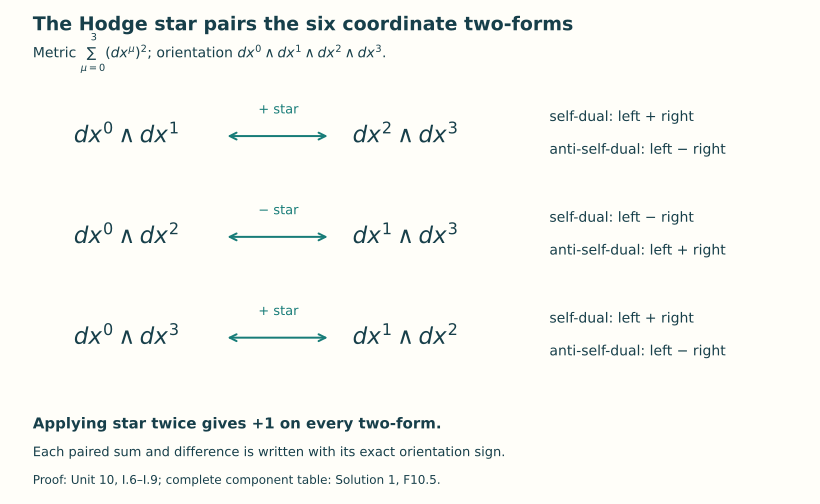
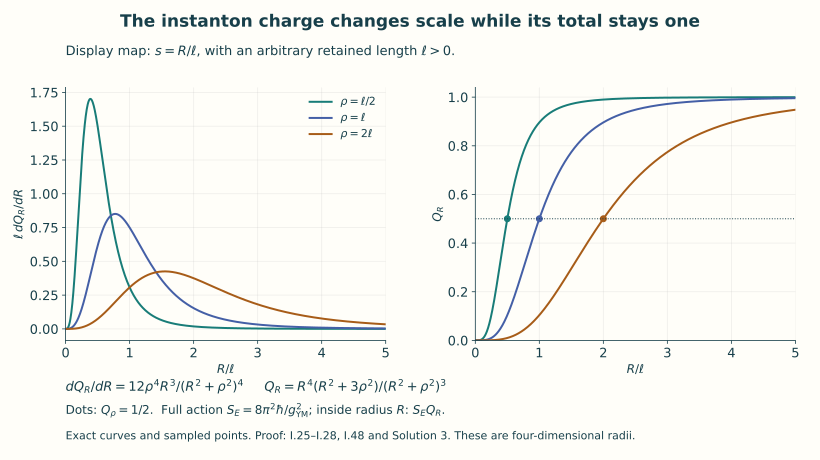
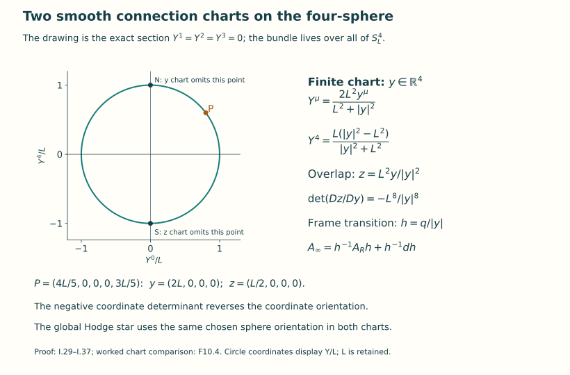

# Euclidean Yang–Mills and instantons

Lesson YM-F10 · Geometry and states in Yang–Mills theory

A gauge field can solve a time-evolution problem, or it can be a geometric
object on a four-dimensional space with a positive metric. This lesson
develops the second question. We will construct a smooth, nonflat connection,
calculate every curvature component, integrate its action, and extend it
over a compact four-sphere. The construction gives a concrete meeting point
of differential equations, matrix algebra and bundle topology.

The preparation is [curvature and differential forms](../covariant-derivatives-and-curvature.html),
[bundles and their transition functions](../bundles-transport-holonomy.html)
and [the action and its field equations](../action-and-field-equations.html).
The Hodge star and the topological integral needed here are developed below.
The long evolution proof in Lesson 9 is not a prerequisite for this lesson.

## 0. The questions and the reading route

An **instanton**, as used in this lesson, is a smooth finite-action connection
on an oriented Riemannian four-manifold whose curvature obeys
\(F=*F\) or \(F=-*F\). The star will be defined in Section 2 from the metric
and orientation. These first-order equations imply the second-order
Yang–Mills equation; we will prove that implication rather than assume it.
Our main example is an \(SU(2)\) connection on \(\mathbb R^4\) that extends
smoothly over \(S^4\).

Begin with Sections 1–6 to see the complete field and action calculation.
Sections 7–10 explain why two connection charts are needed, how they glue,
and how the curvature integral records the bundle. Section 11 determines
which of this family's parameters survive a specified notion of gauge
equivalence. Section 12 matches the conventions of a human source exactly.
Sections 13–15 provide worked examples and eight exercises with full solutions.

The equation's analytical character also changes with the metric.
The [operator calculation](../euclidean-lorentzian-operators.html) derives
the full linearization about a smooth connection, its infinitesimal gauge
directions and the principal symbol. It shows precisely how a gauge-fixed
Euclidean operator is elliptic and a Lorentzian operator has lightlike
characteristics. Physical time retains \(c>0\).

Euclidean geometry supplies classical solutions and an action. A quantum
theory additionally requires states, observables and a rule for their
probabilities or correlations. The following units construct the first
quantum examples; the continuum reconstruction question comes later.
Here every field, integral and equivalence relation is classical.

## 1. Original data, units, and orientation

Keep the coordinates of F07, indexed by \(\mu=0,1,2,3\). On \(\mathbb R^4\) take

\[
 g=\sum_{\mu=0}^3dx^\mu\otimes dx^\mu,
 \qquad \operatorname{vol}=dx^0\wedge dx^1\wedge dx^2\wedge dx^3.
 \tag{I.1}
\]

Every \(x^\mu\) has length units. Fix a centre \(a\in\mathbb R^4\), a length \(\rho>0\), a real dimensionless coupling \(g_{\mathrm{YM}}\ne0\), and an action unit \(\hbar>0\). Write \(y^\mu=x^\mu-a^\mu\), \(r^2=\sum_{\mu=0}^3(y^\mu)^2\), and \(D=r^2+\rho^2\). No coordinate or scale is set to one.

For \(G=SU(2)\subset U(2)\), the connection is a skew-Hermitian trace-zero matrix one-form \(A\). Its curvature and action are exactly

\[
 F=dA+A\wedge A
  =\frac12\sum_{\mu,\nu=0}^3F_{\mu\nu}\,dx^\mu\wedge dx^\nu,
 \qquad \kappa(X,Y)=-\operatorname{tr}(XY),
 \tag{I.2}
\]

\[
 S_E[A]=\frac{\hbar}{2g_{\mathrm{YM}}^2}
   \int_{\mathbb R^4}\sum_{\mu,\nu=0}^3
                 \kappa(F_{\mu\nu},F_{\mu\nu})\,d^4x.
 \tag{I.3}
\]

The sum in (I.3) has sixteen ordered terms, including both orders of each nonzero antisymmetric component. The connection coefficients have units length\(^{-1}\), curvature coefficients length\(^{-2}\), and the action has the unit of \(\hbar\). We write \(A\) for precisely the object denoted \(\Gamma\) in F05–F07. Its gauge rule is

\[
 A^k=kAk^{-1}-(dk)k^{-1},\qquad F^k=kFk^{-1}.
 \tag{I.4}
\]

For frames with \(s_j=s_i h_{ij}\), F06 instead writes this same law as

\[
 A_j=h_{ij}^{-1}A_i h_{ij}+h_{ij}^{-1}dh_{ij}.
 \tag{I.5}
\]

## 2. Hodge star, including the factors in the square

At a point of an oriented Euclidean four-manifold choose a positively oriented orthonormal covector basis \(\theta^0,\ldots,\theta^3\). On exterior powers declare the increasing wedges \(\theta^{i_1}\wedge\cdots\wedge\theta^{i_p}\) orthonormal. The Hodge star is the unique linear map determined by

\[
 \alpha\wedge *\beta=\langle\alpha,\beta\rangle\operatorname{vol}_g.
 \tag{I.6}
\]

Existence and uniqueness follow because, for an increasing index list \(I\), its complementary increasing list \(I^c\) is the only basis wedge that can make a nonzero top wedge with \(\theta^I\): explicitly
\(*\theta^I=\epsilon(I,I^c)\theta^{I^c}\), where the sign is the sign of the permutation listing \(I\) and then \(I^c\). Applying the operation twice swaps a block of length \(p\) past one of length \(4-p\). Therefore

\[
 *^2=(-1)^{p(4-p)}I\quad\hbox{on }\Lambda^p,
 \qquad *^2=I\quad\hbox{on }\Lambda^2.
 \tag{I.7}
\]

This basis argument also proves that star preserves the exterior inner product. The definition (I.6) depends only on the metric and orientation, so the basis construction agrees under every change of oriented orthonormal basis. Extend star to matrix-valued forms by acting on their form part. In the coordinates (I.1), put \(\epsilon_{0123}=1\). Then

\[
 (*F)_{\mu\nu}=\frac12\sum_{\rho,\sigma=0}^3
                   \epsilon_{\mu\nu\rho\sigma}F_{\rho\sigma}.
 \tag{I.8}
\]

For example \(*(dy^0\wedge dy^1)=dy^2\wedge dy^3\), \(*(dy^0\wedge dy^2)=-dy^1\wedge dy^3\), and \(*(dy^0\wedge dy^3)=dy^1\wedge dy^2\). Hence the following three forms are self-dual:

\[
 \begin{aligned}
 \Omega_1&=dy^0\wedge dy^1+dy^2\wedge dy^3,\\
 \Omega_2&=dy^0\wedge dy^2-dy^1\wedge dy^3,\\
 \Omega_3&=dy^0\wedge dy^3+dy^1\wedge dy^2.
 \end{aligned}\tag{I.9}
\]

The three differences of the paired terms give the anti-self-dual basis. These six independent forms span all two-forms. Thus
\(F^+=(F+*F)/2\) and \(F^-=(F-*F)/2\) give the exact orthogonal splitting. Orthogonality follows from the isometry of star: \(\langle F^+,F^-\rangle=\langle *F^+,*F^-\rangle=-\langle F^+,F^-\rangle\).

Define \(\kappa(F\wedge H)=-\operatorname{tr}(F\wedge H)\). Expanding (I.6) in any orthonormal basis gives

\[
 \begin{aligned}
 \kappa(F\wedge *F)
   &=\frac12\sum_{\mu,\nu}\kappa(F_{\mu\nu},F_{\mu\nu})\operatorname{vol},\\
 \kappa(F\wedge F)
   &=\frac12\sum_{\mu,\nu}\kappa(F_{\mu\nu},(*F)_{\mu\nu})\operatorname{vol}.
 \end{aligned}\tag{I.10}
\]

The second identity uses \(*^2=1\). The factors \(1/2\) remain because ordered pairs occur twice. On a general metric, the upper indices and volume density of F07 replace their Euclidean values in these equations.

**Figure 1.** The full six-dimensional two-form space splits into three star pairs. The signs follow from the specified orientation; I.6–I.9 prove every arrow and the self-dual and anti-self-dual combinations.

## 3. Charge, completed square, and the field equation

For a finite-action connection define the charge, with its sign fixed here, by

\[
 Q[A]=-\frac1{8\pi^2}\int\operatorname{tr}(F\wedge F)
     =\frac1{16\pi^2}\int\sum_{\mu,\nu}
           \kappa(F_{\mu\nu},(*F)_{\mu\nu})\operatorname{vol}.
 \tag{I.11}
\]

This integral converges absolutely: in the orthogonal splitting its integrand before the factor \(8\pi^2\) is \((|F^+|^2-|F^-|^2)\operatorname{vol}\), whose absolute value is at most \((|F^+|^2+|F^-|^2)\operatorname{vol}\). Finite action alone is not used to assert a boundary framing, an integer value, or smooth extension to the compactification. Those properties will be constructed for our example.

For either \(s=1\) or \(s=-1\), expanding the square and using the star isometry gives the exact identity

\[
 \boxed{\quad
 S_E[A]=\frac{\hbar}{4g_{\mathrm{YM}}^2}
    \int\sum_{\mu,\nu}
       \kappa(F_{\mu\nu}-s(*F)_{\mu\nu},
              F_{\mu\nu}-s(*F)_{\mu\nu})\operatorname{vol}
       +s\frac{8\pi^2\hbar}{g_{\mathrm{YM}}^2}Q[A].\quad}
 \tag{I.12}
\]

Indeed the squared ordered sum is twice the original ordered norm sum minus twice \(s\) times its star pairing. Multiplying by \(\hbar/(4g_{\mathrm{YM}}^2)\) leaves the cross term \(-s\hbar/(2g_{\mathrm{YM}}^2)\int\kappa(F_{\mu\nu},(*F)_{\mu\nu})\), which (I.11) cancels with the displayed charge term. Positivity of \(-\operatorname{tr}(X^2)\) for skew-Hermitian \(X\) now gives

\[
 S_E[A]\geq\frac{8\pi^2\hbar}{g_{\mathrm{YM}}^2}|Q[A]|.
 \tag{I.13}
\]

If \(Q>0\), equality is equivalent to \(F=*F\); if \(Q<0\), it is equivalent to \(F=-*F\). A continuous nonnegative integrand with zero integral vanishes at every point, which proves the equality assertions for smooth connections. If \(Q=0\), equality means \(S_E=0\) and hence \(F=0\).

Self-dual and anti-self-dual connections solve the Euclidean Yang–Mills equation. Here is the complete form calculation. Define \(D_A F=dF+A\wedge F-F\wedge A\). Substitution of \(F=dA+A\wedge A\), the graded product rule, and \(d^2A=0\) gives

\[
 dF=dA\wedge A-A\wedge dA,
 \qquad A\wedge F-F\wedge A=A\wedge dA-dA\wedge A,
 \tag{I.14}
\]

so \(D_AF=0\). If \(*F=sF\), this implies \(D_A*F=0\). In the Cartesian coordinates, contracting the component Bianchi identity with \(\epsilon_{\mu\nu\rho\sigma}/2\) gives \(\mathcal D_\mu(*F)_{\mu\nu}=0\): the three cyclic Bianchi terms give the same contraction after even cyclic permutations of their three summed indices, so each is zero. It follows that \(\mathcal D_\mu F_{\mu\nu}=0\), exactly the source-free F07 equation. This is also the coordinate expression of \(D_A*F=0\) on an oriented Riemannian manifold.

## 4. The matrices and the connection on all of the finite chart

Use the three Pauli matrices and their specified skew-Hermitian multiples:

\[
 \sigma_1=\begin{pmatrix}0&1\\1&0\end{pmatrix},\quad
 \sigma_2=\begin{pmatrix}0&-i\\i&0\end{pmatrix},\quad
 \sigma_3=\begin{pmatrix}1&0\\0&-1\end{pmatrix},\quad
 e_j=-i\sigma_j=2T_j.
 \tag{I.15}
\]

Multiplication of these displayed matrices proves

\[
 e_i e_j=-\delta_{ij}I_2+\sum_{k=1}^3\epsilon_{ijk}e_k,
 \quad[e_i,e_j]=2\sum_k\epsilon_{ijk}e_k,
 \quad\operatorname{tr}(e_i e_j)=-2\delta_{ij},
 \quad\operatorname{tr}(e_i e_j e_k)=-2\epsilon_{ijk}.
 \tag{I.16}
\]

Thus the course's \(T_i=e_i/2\) still satisfy \(\kappa(T_i,T_j)=\delta_{ij}/2\); no orthonormal rescaling of the trace pairing is made.

Set

\[
 q=y^0I_2+\sum_{i=1}^3 y^i e_i,
 \qquad \bar q=q^\dagger=y^0I_2-\sum_i y^i e_i.
 \tag{I.17}
\]

Equation (I.16) gives \(q\bar q=\bar q q=r^2I_2\), and direct evaluation of the determinant gives \(\det q=r^2\). Consequently \(u=q/r\) is a smooth map \(\mathbb R^4\setminus\{a\}\to SU(2)\), with inverse \(\bar q/r\). Put

\[
 B=q\,d\bar q-\tfrac12d(r^2)I_2,
 \qquad A_R=\frac{B}{r^2+\rho^2}.
 \tag{I.18}
\]

Since \(d(q\bar q)=d(r^2)I_2\), taking adjoints shows \(B^\dagger=-B\). Its trace is zero by (I.16), or by the next explicit formula:

\[
 B=\sum_{i=1}^3e_i\left(y^i\,dy^0-y^0\,dy^i
                  -\sum_{j,k=1}^3\epsilon_{ijk}y^j\,dy^k\right).
 \tag{I.19}
\]

The denominator in (I.18) is at least \(\rho^2>0\). Thus \(A_R\) is a smooth connection on every finite point, including the centre \(a\), where its coefficient matrices vanish. In components,

\[
 (A_R)_0=\frac{\sum_i y^i e_i}{D},\qquad
 (A_R)_i=\frac{-y^0e_i+\sum_{b,j}\epsilon_{bij}y^j e_b}{D}.
 \tag{I.20}
\]

The numerator coefficients have length units and \(D\) has length squared, as required. For \(r>0\), (I.18) can also be written as

\[
 A_R=\frac{r^2}{D}u\,du^{-1}
     =-\frac{r^2}{D}(du)u^{-1}.
 \tag{I.21}
\]

To prove this without discarding the radial term, substitute \(q=ru\) in \(q\,d\bar q\): it equals \(r\,dr\,I_2+r^2u\,du^{-1}\). The first term is exactly the subtracted \(\tfrac12d(r^2)I_2\). Formula (I.21) is used only where \(r>0\); (I.18) is the actual extension at \(r=0\).

## 5. All curvature components and their duality sign

Let \(C=q\,d\bar q\). Then \(dB=dq\wedge d\bar q\). The full quadratic term is computed as follows:

\[
 \begin{aligned}
 C\wedge C
   &=q(d\bar q\,q)\wedge d\bar q\\
   &=q\bigl(d(r^2)I_2-\bar q\,dq\bigr)\wedge d\bar q\\
   &=d(r^2)\wedge C-r^2dq\wedge d\bar q.
 \end{aligned}\tag{I.22}
\]

The middle identity differentiates \(\bar q q=r^2I_2\). Since a scalar one-form anticommutes with every one-form and its square is zero, subtracting \(\tfrac12d(r^2)I_2\) from \(C\) makes no change to \(C\wedge C\). It also makes no change to \(d(r^2)\wedge C\). Hence
\(B\wedge B=d(r^2)\wedge B-r^2dq\wedge d\bar q\). Now retain both derivative terms and this entire quadratic term:

\[
 \begin{aligned}
 F_R&=\frac{dB}{D}-\frac{d(r^2)\wedge B}{D^2}
                                     +\frac{B\wedge B}{D^2}\\
    &=\boxed{\frac{\rho^2}{(r^2+\rho^2)^2}\,dq\wedge d\bar q}\\
    &=-\frac{2\rho^2}{D^2}\sum_{i=1}^3e_i\Omega_i.
 \end{aligned}\tag{I.23}
\]

The last equality follows by multiplying (I.17) using (I.16): the \(dy^0\wedge dy^i\) coefficient is \(-2e_i\), while the \(dy^i\wedge dy^j\) coefficient for \(i<j\) is \(-2\epsilon_{ijk}e_k\). Explicitly, the six independent components are

\[
 \begin{array}{lll}
 F_{01}=-2\rho^2e_1/D^2,&F_{02}=-2\rho^2e_2/D^2,&F_{03}=-2\rho^2e_3/D^2,\\
 F_{12}=-2\rho^2e_3/D^2,&F_{13}=+2\rho^2e_2/D^2,&F_{23}=-2\rho^2e_1/D^2.
 \end{array}\tag{I.24}
\]

Every diagonal component is zero and \(F_{\nu\mu}=-F_{\mu\nu}\). These statements specify all sixteen ordered components. By (I.9), \(*F_R=F_R\), with respect to exactly the orientation (I.1). Section 3 proves that this connection solves the Euclidean Yang–Mills equation. At the centre the six coefficients in (I.24) are finite, of magnitude proportional to \(\rho^{-2}\), and are nonzero.

## 6. Full radial integration, action, and charge

Each of the six matrices in (I.24) has squared \(\kappa\)-norm \(8\rho^4/D^4\), since \(\kappa(e_i,e_i)=2\). Therefore

\[
 \sum_{\mu,\nu=0}^3\kappa(F_{\mu\nu},F_{\mu\nu})
     =\frac{96\rho^4}{(r^2+\rho^2)^4},\qquad
 \operatorname{tr}(F_R\wedge F_R)
     =-\frac{48\rho^4}{(r^2+\rho^2)^4}\operatorname{vol}.
 \tag{I.25}
\]

For the second formula one may use (I.10) and self-duality, or directly use \(\Omega_i\wedge\Omega_j=2\delta_{ij}\operatorname{vol}\), which follows by expanding the paired terms in (I.9).

The radial measure is \(2\pi^2r^3dr\). One direct proof of its constant uses
\((y^0,y^1)=r\cos\chi(\cos\theta,\sin\theta)\),
\((y^2,y^3)=r\sin\chi(\cos\phi,\sin\phi)\), with \(0<\chi<\pi/2\) and both angles of period \(2\pi\). The absolute Jacobian is \(r^3\sin\chi\cos\chi\). The omitted coordinate boundary has zero volume, and integrating the three angular variables gives \((2\pi)^2\int_0^{\pi/2}\sin\chi\cos\chi\,d\chi=2\pi^2\).

Retaining \(\rho\) in the substitution \(t=r^2/\rho^2\),

\[
 \begin{aligned}
 \int_{\mathbb R^4}\frac{\rho^4\,d^4y}{(r^2+\rho^2)^4}
 &=2\pi^2\int_0^\infty\frac{\rho^4r^3}{(r^2+\rho^2)^4}\,dr\\
 &=\pi^2\int_0^\infty\frac{t}{(1+t)^4}\,dt\\
 &=\pi^2\left[-\frac1{2(1+t)^2}+\frac1{3(1+t)^3}\right]_0^\infty
 =\frac{\pi^2}{6}.
 \end{aligned}\tag{I.26}
\]

This proves convergence at both endpoints and all constants. Substitution into (I.3) and (I.11) gives

\[
 \boxed{S_E[A_R]=\frac{8\pi^2\hbar}{g_{\mathrm{YM}}^2},\qquad Q[A_R]=1.}
 \tag{I.27}
\]

The charge and action fraction inside the actual radius \(R\geq0\) is

\[
 Q_R=\frac{R^4(R^2+3\rho^2)}{(R^2+\rho^2)^3}
       =3f_R^2-2f_R^3,\qquad f_R=\frac{R^2}{R^2+\rho^2}.
 \tag{I.28}
\]

Indeed integrate the same antiderivative only to \(t=R^2/\rho^2\) and multiply by six. Thus \(Q_0=0\), \(Q_\infty=1\), and \(Q_\rho=1/2\). These equalities describe the spatial concentration without interpreting Euclidean action density as a Lorentzian energy density.

**Figure 2.** The display uses \(R/\ell\) and \(\ell\,dQ_R/dR\), with \(\ell>0\) an arbitrary length; the underlying field retains its actual centre and scale. The dots show half the charge inside \(R=\rho\). Equations I.25–I.28 and I.48 prove the formulas and the limiting concentration. This is a four-dimensional Euclidean integral.

## 7. The second chart and smoothness at infinity

Fix another length \(L>0\), used only to describe the compactifying sphere. Set \(S_L^4=\{(Y^0,Y^1,Y^2,Y^3,Y^4):\sum(Y^A)^2=L^2\}\). The chart from all finite \(y\) is

\[
 Y^\mu=\frac{2L^2y^\mu}{L^2+r^2},\qquad
 Y^4=L\frac{r^2-L^2}{r^2+L^2}.
 \tag{I.29}
\]

It omits \(N=(0,0,0,0,L)\). Its inverse is \(y^\mu=LY^\mu/(L-Y^4)\). The second chart, omitting \(S=(0,0,0,0,-L)\), uses length coordinates \(z\) with

\[
 Y^\mu=\frac{2L^2z^\mu}{L^2+|z|^2},\qquad
 Y^4=L\frac{L^2-|z|^2}{L^2+|z|^2},\qquad
 z^\mu=\frac{LY^\mu}{L+Y^4}.
 \tag{I.30}
\]

On the overlap \(y\ne0\) these give the exact transition

\[
 z=\frac{L^2y}{r^2},\quad y=\frac{L^2z}{|z|^2},\quad
 |z|^2=\frac{L^4}{r^2},\quad
 Dz/Dy=\frac{L^2}{r^2}\left(I_4-\frac{2yy^T}{r^2}\right),\quad
 \det(Dz/Dy)=-\frac{L^8}{r^8}.
 \tag{I.31}
\]

The parenthesized matrix is \(-1\) on the radial line and \(+1\) on its three-dimensional orthogonal complement, which proves its determinant. In particular the \(z^0,z^1,z^2,z^3\) ordering is negatively oriented relative to the global orientation defined by the \(y\) chart. This sign is retained below.

Take the frame transition

\[
 h_{R\infty}(y)=u(y)=q/r\quad(y\ne0).
 \tag{I.32}
\]

On the two-chart overlap the second connection is, by (I.5) and (I.21),

\[
 A_\infty=u^{-1}A_Ru+u^{-1}du
       =\frac{\rho^2}{r^2+\rho^2}u^{-1}du.
 \tag{I.33}
\]

Let \(Z=z^0I_2+\sum_i z^ie_i\). Since (I.31) multiplies the four components by a positive scalar, \(u=Z/|z|\). Direct differentiation retains the scalar term:
\(u^{-1}du=(\bar Z\,dZ-\tfrac12d|z|^2I_2)/|z|^2\). Hence

\[
 \boxed{A_\infty(z)=
 \frac{\rho^2}{L^4+\rho^2|z|^2}
      \left(\bar Z\,dZ-\tfrac12d|z|^2I_2\right).}
 \tag{I.34}
\]

This formula is smooth on all \(z\in\mathbb R^4\), including \(z=0\), which represents infinity. There the coefficient matrices vanish. Its curvature, by the calculation of §5 with \(q\) and \(\bar q\) exchanged, is

\[
 F_\infty(z)=\frac{\rho^2L^4}{(L^4+\rho^2|z|^2)^2}\,d\bar Z\wedge dZ.
 \tag{I.35}
\]

For completeness, write \(R_*^2=L^4/\rho^2\). Formula (I.34) is exactly \((\bar Z\,dZ-\tfrac12d|z|^2I_2)/(|z|^2+R_*^2)\), and (I.22) gives \(R_*^2d\bar Z\wedge dZ/(|z|^2+R_*^2)^2\), which is (I.35) with every original factor restored. Its six increasing components are
\(F^z_{0i}=2c(z)e_i\) and \(F^z_{ij}=-2c(z)\epsilon_{ijk}e_k\), where \(c(z)=\rho^2L^4/(L^4+\rho^2|z|^2)^2\). They are anti-self-dual relative to the coordinate orientation \(dz^0\wedge\cdots\wedge dz^3\), and self-dual relative to the global orientation, whose sign in this chart is its negative. On the overlap their pullback equals \(u^{-1}F_Ru\), because (I.33) is the exact connection transformation and the curvature rule (I.4) has already been proved.

The transition defines an actual principal bundle: identify \((y,b)_R\) with \((z,u(y)^{-1}b)_\infty\) for each overlap point and \(b\in SU(2)\). These maps are smooth inverse fibrewise bijections and commute with right multiplication. The product charts, overlap law, and their inverses give the smooth principal bundle construction of F06. Equations (I.18), (I.34), and (I.33) then give a smooth global connection. The singular expression (I.33) in finite coordinates is not a connection chart at the centre; the regular expression (I.18) supplies that point.

## 8. Conformal geometry and the four-manifold meaning

Differentiating (I.29) and summing the five squares gives the pulled-back round metric

\[
 g_{S_L^4}=\frac{4L^4}{(L^2+r^2)^2}\sum_{\mu=0}^3dy^\mu\otimes dy^\mu.
 \tag{I.36}
\]

Here are the derivative terms that verify it. For a displacement \(v\), write \(t=y\cdot v\). The first four derivative components are \(2L^2[(L^2+r^2)v-2ty]/(L^2+r^2)^2\), and the last is \(4L^3t/(L^2+r^2)^2\). The numerator of their squared length is

\[
4L^4[(L^2+r^2)^2|v|^2-4(L^2+r^2)t^2+4r^2t^2+4L^2t^2]
\]

. The last three terms cancel exactly, leaving (I.36). The same formula in \(z\) follows from (I.30).

Under \(\widetilde g=\Omega^2g\), the inner product on \(p\)-covectors is multiplied by \(\Omega^{-2p}\), while the volume form is multiplied by \(\Omega^4\). Applying (I.6) therefore proves

\[
 *_{\widetilde g}|_{\Lambda^p}=\Omega^{4-2p}*_g,
 \qquad *_{\widetilde g}|_{\Lambda^2}=*_g.
 \tag{I.37}
\]

Thus self-duality and the action integral \(\hbar g_{\mathrm{YM}}^{-2}\int\kappa(F\wedge *F)\) are preserved by this conformal change in dimension four. Equivalently, the two raised curvature indices supply \(\Omega^{-4}\) and the density supplies \(\Omega^4\) in the full F07 coordinate action. This proves that the smooth sphere connection above is self-dual for the round metric and still has the action and charge (I.27). A point has zero four-dimensional volume, so including the omitted point changes neither integral.

On any oriented Riemannian four-manifold, the same pointwise star splitting exists for adjoint-bundle-valued two-forms: the frame transformations affect the matrix factor and commute with star. The trace expressions in §§2–3 agree on overlaps by cyclicity. Consequently the same action identity holds for every smooth finite-action connection there. This is the exact relation between the Euclidean field calculation and four-manifold geometry, without a claim that arbitrary four-manifolds or arbitrary bundles admit self-dual connections.

**Figure 3.** The circle is the exact section \(Y^1=Y^2=Y^3=0\) of \(S_L^4\), drawn in coordinates \(Y^0/L,Y^4/L\). The four-dimensional coordinate and frame transitions are written beside it. Equations I.29–I.37 prove those maps; F10.4 checks the marked point.

## 9. The clutching degree and the boundary integral

Identify \(SU(2)\) with the unit sphere in the real four-dimensional space \(\{v^0I_2+v^ie_i\}\). This identification is a diffeomorphism: a matrix in \(SU(2)\) has the form \(\begin{pmatrix}\alpha&\beta\\-\bar\beta&\bar\alpha\end{pmatrix}\) with \(|\alpha|^2+|\beta|^2=1\), and comparison of its four real entries with (I.15) gives the inverse linear coordinates. Orient the target sphere as the boundary of the ball with coordinate order \((v^0,v^1,v^2,v^3)\). At \(I_2\), its positive tangent basis is \((e_1,e_2,e_3)\).

On any sphere \(r=R>0\), orient the boundary by outward-normal-first relative to (I.1). The transition (I.32) is precisely \(y/R\mapsto y^0/R+e_i y^i/R\) in these coordinates. It is an orientation-preserving diffeomorphism. Therefore its degree, defined for this diffeomorphism by the signed count of the preimage of any point, is the integer \(+1\).

The trace formula verifies the same orientation and constant. Let \(\vartheta=u^{-1}du\) on the unit target sphere. Left multiplication by a unit quaternion preserves the ambient Euclidean norm, and hence the sphere metric; it preserves orientation since the unit sphere is connected and the determinant is \(+1\) at the identity. At the identity,

\[
 \operatorname{tr}(\vartheta^3)(e_1,e_2,e_3)
 =\sum_{\pi\in S_3}\operatorname{sgn}(\pi)
       \operatorname{tr}(e_{\pi(1)}e_{\pi(2)}e_{\pi(3)})=-12.
\]

Both this form and the round volume are left invariant, so

\[
 \operatorname{tr}(\vartheta^3)=-12\operatorname{vol}_{S^3},
 \qquad \int_{S_R^3}\operatorname{tr}((u^{-1}du)^3)=-24\pi^2,
 \qquad \deg u=-\frac1{24\pi^2}\int_{S_R^3}\operatorname{tr}((u^{-1}du)^3)=1.
 \tag{I.38}
\]

The round sphere volume is \(2\pi^2\), as already derived in §6. Conjugating the Maurer form shows that \(\operatorname{tr}(((du)u^{-1})^3)\) has the same value.

Here is the complete transgression calculation connecting this transition to curvature. For a matrix one-form put

\[
 \operatorname{CS}(A)=\operatorname{tr}\left(A\wedge dA+\tfrac23A\wedge A\wedge A\right).
 \tag{I.39}
\]

The graded cyclic rule is \(\operatorname{tr}(\alpha\wedge\beta)=(-1)^{pq}\operatorname{tr}(\beta\wedge\alpha)\) for degrees \(p,q\). Expanding the derivative of \(A^3\) and moving the leading \(A\) past total degree three shows \(d\operatorname{tr}(A^3)=3\operatorname{tr}(dA\wedge A^2)\). The same cyclic rule gives \(\operatorname{tr}(A^4)=-\operatorname{tr}(A^4)=0\). It follows that

\[
 d\operatorname{CS}(A)=\operatorname{tr}(dA\wedge dA+2dA\wedge A^2)
                   =\operatorname{tr}(F\wedge F).
 \tag{I.40}
\]

On \(r=R\), write \(\eta=(du)u^{-1}\). Differentiating \(u^{-1}u=I\) gives \(d\eta=\eta\wedge\eta\). The tangential restriction of \(A_R\) is \(-f_R\eta\), with \(f_R\) constant on that sphere. Thus every term of (I.39) gives

\[
 \operatorname{CS}(A_R)|_{S_R^3}
       =(f_R^2-\tfrac23f_R^3)\operatorname{tr}(\eta^3),
 \qquad \int_{S_R^3}\operatorname{CS}(A_R)
       =-8\pi^2(3f_R^2-2f_R^3).
 \tag{I.41}
\]

Stokes' formula on the ball gives the integral of (I.40) as (I.41), agreeing exactly with the radial calculation (I.28), including its sign. The use of Stokes here is its coordinate integration-by-parts identity: express a three-form as \(\sum_\mu(-1)^\mu b_\mu\,dy^0\wedge\cdots\widehat{dy^\mu}\cdots\wedge dy^3\), so its derivative is \((\sum_\mu\partial_\mu b_\mu)\operatorname{vol}\); integration over slices of the ball gives the outward flux by the fundamental theorem of calculus. No singularity is present inside the ball.

Taking \(R\to\infty\) in the already evaluated convergent integral proves

\[
 Q[A_R]=\deg h_{R\infty}=1.
 \tag{I.42}
\]

The nonzero degree also proves that this transition cannot extend smoothly from \(S^3\) to its ball. Indeed the target volume three-form is closed, since the target has dimension three. An extension would make its boundary integral zero by Stokes, whereas (I.38) makes it \(2\pi^2\). Nor can the transition be homotopic to a constant: apply the same Stokes identity on \([0,1]\times S^3\) to a proposed smooth homotopy. For continuous homotopies one may use the equivalent elementary fact that a continuous extension can be uniformly approximated by a smooth one into \(\mathbb R^4\), relative to a small collar where the given boundary map is smooth, and then projected radially to \(S^3\); sufficiently close approximation stays away from zero. The approximation follows from convolution in finitely many coordinate charts and a partition of unity, and the collar interpolation retains the boundary value.

In particular the bundle has no global frame. If a global frame existed, write it on the two closed hemispheres as \(s_Rb_R=s_\infty b_\infty\), where both \(b\)'s extend smoothly over their respective balls. On their equator, \(h_{R\infty}=b_Rb_\infty^{-1}\). Radially contracting each ball gives homotopies of both factors to constants, hence a homotopy of their product to a constant. This contradicts (I.38). The geometry has therefore produced an explicit nontrivial bundle, with a smooth connection and an integer clutching degree, rather than merely an asymptotic gauge expression.

## 10. Which topological sign is called the second Chern number

There is a genuine convention to record. With the Chern-form convention

\[
 c(E,A)=\det\left(I_2+\frac{iF}{2\pi}\right),
 \tag{I.43}
\]

the determinant is computed in the commutative algebra of even differential forms. For any two-by-two matrix \(M\) over a commutative algebra,
\(\det(I+tM)=1+t\operatorname{tr}M+\tfrac{t^2}{2}[(\operatorname{tr}M)^2-\operatorname{tr}(M^2)]\), by expanding its entries. Our curvature is trace-free. Inserting \(t=i/(2\pi)\) gives

\[
 c_2(E,A)=+\frac1{8\pi^2}\operatorname{tr}(F\wedge F),
 \qquad \int_{S^4}c_2(E,A)=-1,\qquad Q=-\int_{S^4}c_2(E,A).
 \tag{I.44}
\]

Thus the self-dual charge convention (I.11) and the Chern-form convention (I.43) have opposite signs. The explicit degree (I.38), the global orientation, and the choice \(s_\infty=s_R h_{R\infty}\) fix the comparison. Changing any sign convention must transport these formulas, rather than replacing one name by another. Formula (I.44) evaluates the Chern form directly for the exhibited bundle; a classification theorem for all bundles is not needed for this evaluation.

The characteristic integral is independent of the connection on any fixed bundle over a closed oriented four-manifold. To prove precisely the part used here, let \(A_t=A_0+t\alpha\), where the difference \(\alpha\) is a global adjoint-bundle one-form. Expansion gives \(\dot F_t=D_{A_t}\alpha\). Graded cyclicity, Bianchi, and the product rule give

\[
 \frac d{dt}\operatorname{tr}(F_t\wedge F_t)
   =2\operatorname{tr}(D_{A_t}\alpha\wedge F_t)
   =2d\operatorname{tr}(\alpha\wedge F_t).
 \tag{I.45}
\]

For the last equality, expand both sides: \(d\operatorname{tr}(\alpha\wedge F)=\operatorname{tr}(d\alpha\wedge F-\alpha\wedge dF)\); insert \(dF=-A\wedge F+F\wedge A\) and move the last \(A\) by graded cyclicity. The result is \(\operatorname{tr}((d\alpha+A\wedge\alpha+\alpha\wedge A)\wedge F)\), which is \(\operatorname{tr}(D_A\alpha\wedge F)\). These trace forms agree on overlaps. Integrating the exact form on a closed manifold gives zero. Chartwise, a partition of unity reduces this Stokes identity to compactly supported Euclidean integration by parts; the derivatives of the weights cancel because their sum is one. Integrating in \(t\) proves connection independence. In particular the nonzero value in (I.44) cannot be removed by changing the connection on this bundle.

## 11. Parameters, gauge identifications, rotations, and the shrinking limit

The family has the specified four translation parameters \(a\), the positive scale \(\rho\), and optional internal conjugation \(C\in SU(2)\). Their roles can be proved without asserting that this list classifies all charge-one solutions.

For a translation vector \(d\), let \(\tau_d(x)=x-d\). Substitution in (I.18) gives \(\tau_d^*A_{a,\rho}=A_{a+d,\rho}\). For \(\lambda>0\), let \(\delta_{a,\lambda}(x)=a+(x-a)/\lambda\). Both \(q\) and \(dq\) acquire a factor \(1/\lambda\), while the denominator becomes \(r^2/\lambda^2+\rho^2\). Consequently

\[
 \delta_{a,\lambda}^*A_{a,\rho}=A_{a,\lambda\rho}.
 \tag{I.46}
\]

These are maps of the base coordinates, not gauge transformations covering the identity. Different centres or scales cannot be related by such an internal gauge transformation, since the invariant ordered contraction (I.25), now as a function of \(x\), has its unique maximum at \(x=a\), and that maximum is \(96/\rho^4\). Equality of the scalar functions forces the same centre and then the same positive scale.

Define \(A^C=CAC^{-1}\) for constant \(C\). These connections are gauge equivalent when all smooth internal gauge transformations on \(\mathbb R^4\) are allowed. The two connections \(A^C\) and \(A^{C'}\) are literally equal exactly when \(C'=\pm C\). More generally, suppose a gauge map \(k(x)\) satisfies \((A^C)^k=A^{C'}\). Applying its curvature law to the three nonzero \(F_{0i}\) in (I.24) shows that \(C'^{-1}k(x)C\) commutes with all three \(e_i\). A two-by-two complex matrix commuting with \(e_3\) is diagonal, and commuting with \(e_1\) makes its diagonal entries equal. If also in \(SU(2)\), it is \(\pm I_2\). Smoothness and connectedness of \(\mathbb R^4\) force a constant choice of sign. Thus

\[
 k(x)=\pm C'C^{-1}.
 \tag{I.47}
\]

If the permitted gauge maps are required to approach \(I_2\) at infinity in these specified finite-chart gauges, (I.47) is allowed exactly when \(C'=\pm C\). The distinct internal parameters in this quotient are therefore exactly \(SU(2)/\{\pm I_2\}\). This is a statement about this exhibited family and this specified gauge group.

A formulation with an actual frame at the compactification point removes any reliance on informal boundary wording. Keep the regular connection \(A_R\) unchanged, use transition \(h_C=uC^{-1}\), and put \(A_{\infty,C}=C A_\infty C^{-1}\) on the second chart. Equation (I.5) proves these glue. In each bundle designate its infinity-chart frame at \(N\). An isomorphism preserving connections from the \(C\)-bundle to the \(C'\)-bundle has regular-chart coefficient \(b_R\) preserving \(A_R\); the curvature argument just given forces \(b_R=\pm I_2\). The gluing equation \(b_Rh_C=h_{C'}b_\infty\) then gives \(b_\infty=\pm C'C^{-1}\). Preserving the designated frame means \(b_\infty(N)=I_2\), again equivalent to \(C'=\pm C\). If the frame condition is dropped, every \(C,C'\) pair has the displayed connection-preserving isomorphism. This proves exactly why retaining a frame can retain three internal parameters, while forgetting the frame removes them.

Orientation-preserving rotations can also be compared exactly. For unit quaternions \(\ell,b\), the real-linear map \(q\mapsto\ell q b^{-1}\) preserves \(r^2\), and substitution in (I.18) gives the pullback \(A\mapsto\ell A\ell^{-1}\). These maps exhaust \(SO(4)\): given an oriented orthogonal map \(R\), first multiply on the left by \(R(1)^{-1}\) so the resulting map fixes \(1\). It restricts to an element of \(SO(3)\) on the imaginary three-space. Every such element fixes an axis and rotates its perpendicular plane: a real orthogonal three-by-three matrix of determinant one has a real eigenvalue one (its remaining nonreal eigenvalues occur as a conjugate pair, or all its real eigenvalues are \(\pm1\)); its restriction to the perpendicular plane is an oriented planar rotation. If its angle is \(\theta\) around unit imaginary axis \(n\), multiplication using (I.16) shows that conjugation by \(b=\cos(\theta/2)+n\sin(\theta/2)\) fixes the axis and rotates the perpendicular plane by \(\theta\). This gives the required \(\ell,b\). Thus rotations of this centred example yield internal conjugations and add no further parameters after quotienting by unrestricted gauge maps.

If an orthogonal base map has determinant \(-1\), its pullback changes the star relation to \(*R^*F=-R^*(*F)\). This follows directly from (I.6), since the metric is preserved and the oriented volume changes sign. Its pullback of (I.23) is an anti-self-dual example with \(Q=-1\) and the same action. Changing orientation in this way is different from internal conjugation, which cannot change \(Q\).

Finally \(\rho=0\) is not a member of the smooth family. On every compact subset avoiding \(a\), (I.23) tends smoothly to zero and (I.21) tends to \(u\,du^{-1}\). At the centre (I.24) diverges like \(\rho^{-2}\). The charge density nevertheless converges as a measure to a unit point mass at \(a\): for each bounded continuous test function \(\varphi\), substitute \(y=\rho z\) to obtain

\[
 \int_{\mathbb R^4}\varphi(x)
      \frac{6\rho^4}{\pi^2(|x-a|^2+\rho^2)^4}\,d^4x
 =\int_{\mathbb R^4}\varphi(a+\rho z)
      \frac6{\pi^2(1+|z|^2)^4}\,d^4z
 \longrightarrow\varphi(a).
 \tag{I.48}
\]

The dominating function is \(\|\varphi\|_\infty6/[\pi^2(1+|z|^2)^4]\), integrable with total one by (I.26). One can avoid invoking a convergence theorem by first making its tail integral small uniformly in \(\rho\), and then using uniform continuity of \(\varphi\) near \(a\) on the remaining bounded \(z\)-ball. This proves the limit directly. The concentration describes a singular limiting measure, not a smooth zero-size instanton.

## 12. Exact receiving map from the source and limits of source use

The original author source read is David Tong, *TASI Lectures on Solitons*, arXiv:hep-th/0509216v5 (19 December 2005), `tasi.tex`, lines 269–510, with historical reference lines 6613–6616. Stable links: [version identity](https://arxiv.org/abs/hep-th/0509216v5) and [original author source archive](https://arxiv.org/src/hep-th/0509216v5). The original source archive identifies the version; the course provenance records the exact author-source hashes and bounded reading coverage.

Tong uses Hermitian matrices and curvature \(F^{\mathrm T}_{\mu\nu}=\partial_\mu A^{\mathrm T}_\nu-\partial_\nu A^{\mathrm T}_\mu-i[A^{\mathrm T}_\mu,A^{\mathrm T}_\nu]\). As proved already in F07, the exact map is \(A=-iA^{\mathrm T}\), \(F=-iF^{\mathrm T}\), \(g_{\mathrm{YM}}=e\), and \(S_E/\hbar=S^{\mathrm T}\). Neither the factor \(1/(2e^2)\) nor the trace of two Pauli matrices is dropped.

For the displayed source solution labelled `sol1` (lines 423–427), use source coordinates

\[
 (x^{\mathrm T}_1,x^{\mathrm T}_2,x^{\mathrm T}_3,x^{\mathrm T}_4)
        =(x^1,x^2,x^3,-x^0),\quad
 (X_1,X_2,X_3,X_4)=(a^1,a^2,a^3,-a^0).
 \tag{I.49}
\]

The map has determinant \(+1\) relative to the source order \((1,2,3,4)\) and our order \((0,1,2,3)\): the cyclic permutation has sign \(-1\) and the additional minus sign in \(x^{\mathrm T}_4\) contributes another \(-1\). It preserves the Euclidean metric and \(r^2\). From Tong's three explicitly displayed matrices `antithooft` (lines 434–442),
\(\bar\eta^b_{ij}=\epsilon_{bij}\), \(\bar\eta^b_{i4}=-\delta_{bi}\), and \(\bar\eta^b_{4i}=\delta_{bi}\). Taking his constant internal matrix to be \(I_2\), pulling back `sol1`, and multiplying by \(-i\) gives exactly

\[
 \begin{aligned}
 (A_{\rm sing})_0&=-\frac{\rho^2}{r^2D}\sum_i y^ie_i,\\
 (A_{\rm sing})_i&=\frac{\rho^2}{r^2D}
           \left(y^0e_i+\sum_{b,j}\epsilon_{bij}y^je_b\right).
 \end{aligned}\tag{I.50}
\]

Expansion of \(u^{-1}du\) from (I.17) proves that (I.50) is precisely the finite-coordinate expression (I.33), defined for \(r>0\). Equation (I.33), not merely a comparison of action densities, gives the exact gauge map from the source's singular gauge to the smooth finite chart. Its curvature components are all those in (I.24) conjugated by \(u^{-1}\); thus their self-duality is proved even though the source's connection is written using anti-self-dual constant matrices. A source internal parameter \(C\) gives \(C A_{\rm sing}C^{-1}\), which is the framed-bundle description in §11.

The historical construction is credited in Tong's bibliography to A. A. Belavin, A. M. Polyakov, A. S. Schwartz, and Y. S. Tyupkin, “Pseudoparticle Solutions of the Yang-Mills Equations,” *Physics Letters B* **59**, 85 (1975). The original 1975 author TeX was not available in the checked disk index or retained course source holdings; no reading of that paper's body is claimed and no PDF was used. Tong's accessible original author TeX is the comparison source, with the complete receiving proof supplied above.

The source discussion's unrestricted phrase relating finite action to a pointwise pure-gauge limit is not used as a theorem here. Our own boundary map and smooth compactification are explicitly constructed in §§7–9. The source's statement that three global gauge parameters are physical is interpreted only after a gauge group or framing has been specified, as proved in §11. No eight-dimensional classification or full moduli-space theorem follows from counting this family's parameters. Finally these are classical solutions on a positive-definite four-manifold; the derivation constructs neither a quantum theory nor its Hamiltonian spectrum and establishes no quantum mass gap.

## 13. Three worked examples

### 13.1. A self-dual field can have infinite action

Let \(T=-i\,\operatorname{diag}(1,-1)/2\), let \(b\ne0\) be a real constant
with units length\(^{-2}\), and keep the metric and orientation (I.1).
Define on all of \(\mathbb R^4\)

\[
 A=bT(x^0\,dx^1+x^2\,dx^3).
 \tag{F10.1}
\]

Every coefficient is a multiple of the same matrix, so \(A\wedge A=0\).
Differentiation gives \(F=bT(dx^0\wedge dx^1+dx^2\wedge dx^3)\).
Equation (I.9) proves self-duality. Its four nonzero ordered components
are \(F_{01}=F_{23}=bT\), \(F_{10}=F_{32}=-bT\). Because
\(\kappa(T,T)=1/2\), the full ordered norm is \(2b^2\). On
the coordinate box \(\prod_{\mu=0}^3[\alpha_\mu,\beta_\mu]\), the action is

\[
 S_{E,\mathrm{box}}
 =\frac{\hbar b^2}{g_{\mathrm{YM}}^2}
      \prod_{\mu=0}^3(\beta_\mu-\alpha_\mu).
 \tag{F10.2}
\]

It tends to infinity on expanding boxes. Thus the field solves the
self-duality and Yang–Mills equations but fails the finite-action part
of the definition on \(\mathbb R^4\). Smoothness alone does not decide
that integral. The decaying curvature in (I.23) is what makes our
instanton's action finite.

### 13.2. What is inside twice the scale radius?

Keep the centre \(a\) and scale \(\rho>0\) of (I.18). Substituting
\(R=2\rho\) into (I.28), without changing the field's coordinates, gives

\[
 Q_{2\rho}=\frac{16(4+3)}{(4+1)^3}=\frac{112}{125},
 \qquad
 S_{E,\{|x-a|\le2\rho\}}
   =\frac{896\pi^2\hbar}{125g_{\mathrm{YM}}^2}.
 \tag{F10.3}
\]

The exterior carries charge \(13/125\) and action
\(104\pi^2\hbar/(125g_{\mathrm{YM}}^2)\). The sum of the two actions
is (I.27). These are Euclidean action integrals over four-dimensional
regions. Their radial variable includes all four Euclidean coordinates.

### 13.3. A point in both sphere charts

Take \(y=(2L,0,0,0)\), retaining arbitrary \(L>0\). The point in the
five-dimensional ambient space is

\[
 (Y^0,Y^1,Y^2,Y^3,Y^4)
   =(4L/5,0,0,0,3L/5),\qquad
 z=(L/2,0,0,0).
 \tag{F10.4}
\]

Its squared ambient length is \(16L^2/25+9L^2/25=L^2\).
Both chart formulas (I.29)–(I.30) give this same point.
The transition matrix \(u\) has value \(I_2\) at this point, but its
derivative is nonzero: for a tangent displacement in the \(y^i\)
direction, \(u^{-1}du=e_i\,dy^i/(2L)\). Therefore the overlap rule
still has its derivative term. Substitution into (I.33) gives the
tangential coefficient
\(\rho^2 e_i/[2L(4L^2+\rho^2)]\) in the \(y\) coordinates.
The coordinate change has \(dz^i=dy^i/4\) here. Formula (I.34) gives
the coefficient \(2\rho^2 e_i/[L(4L^2+\rho^2)]\) in \(z\), whose
product with \(dz^i\) agrees exactly. A transition's value at one
point cannot replace its derivative in the connection rule.

## 14. Exercises

1. In the orientation (I.1), compute the Hodge star of all six increasing
   coordinate two-forms. For real \(b,d\) with units length\(^{-2}\), split
   \(T(b\,dx^0\wedge dx^1+d\,dx^2\wedge dx^3)\) into its self-dual and
   anti-self-dual parts. Compute both the ordered curvature norm and
   \(\operatorname{tr}(F\wedge F)\).
2. Starting from \(A_R=B/D\), retain every term in \(dA_R+A_R\wedge A_R\)
   and prove (I.23). Calculate \(F_{13}\), its reverse component and the
   two diagonal components \(F_{11},F_{33}\) explicitly.
3. Derive the radial charge derivative \(dQ_R/dR\) and its maximum for
   \(R\ge0\). Give the exact tail charge \(1-Q_R\). Keep \(\rho\).
4. Prove the action identity (I.12) using the ordered-component sum.
   Explain the equality cases for positive, negative and zero charge.
5. Check the determinant in (I.31). Compute the six increasing curvature
   components of (I.35), and explain why their coordinate duality sign
   and global duality sign differ.
6. For two connections on a fixed bundle over a closed oriented
   four-manifold, derive (I.45) and prove that their charges agree.
   Evaluate the resulting Chern number for our bundle using (I.43).
7. Determine all gauge maps taking \(A^C\) to \(A^{C'}\) for the exhibited
   fixed-centre, fixed-scale family. State the answers for unrestricted
   gauge equivalence and for maps tending to \(I_2\) at infinity.
8. Let \(\rho\downarrow0\) with centre \(a\) fixed. Prove convergence of
   the charge measures to a point mass, and calculate the charge outside
   a fixed ball of radius \(R>0\). Explain which limit fails to be a
   smooth member of the family.

## 15. Complete solutions

### Solution 1

Writing \(d x^{\mu\nu}=dx^\mu\wedge dx^\nu\) only for the six individual
basis wedges in this solution, (I.6) gives

\[
 \begin{array}{lll}
 *d x^{01}=d x^{23},&*d x^{02}=-d x^{13},&*d x^{03}=d x^{12},\\
 *d x^{12}=d x^{03},&*d x^{13}=-d x^{02},&*d x^{23}=d x^{01}.
 \end{array}
 \tag{F10.5}
\]

Each sign makes a basis wedge times its star equal to the positive
volume form; the negative signs in the middle pair come from
interchanging coordinates 1 and 2. Thus

\[
 F^+=\frac{b+d}{2}T(dx^0\wedge dx^1+dx^2\wedge dx^3),\qquad
 F^-=\frac{b-d}{2}T(dx^0\wedge dx^1-dx^2\wedge dx^3).
 \tag{F10.6}
\]

The four nonzero ordered components give
\(\sum_{\mu,\nu}\kappa(F_{\mu\nu},F_{\mu\nu})=b^2+d^2\).
The two cross products in \(F\wedge F\) have the same sign, since
two-forms commute with two-forms. As \(\operatorname{tr}(T^2)=-1/2\),
their trace is \(-bd\,\operatorname{vol}\). This also checks the
factor \(1/2\) in both parts of (I.10).

### Solution 2

The derivative of \(D^{-1}\) is \(-D^{-2}d(r^2)\);
\(dB=dq\wedge d\bar q\) and (I.22) gives
\(B\wedge B=d(r^2)\wedge B-r^2dq\wedge d\bar q\). Hence

\[
 \begin{aligned}
 dA_R+A_R\wedge A_R
 &=D^{-1}dq\wedge d\bar q
   -D^{-2}d(r^2)\wedge B
   +D^{-2}d(r^2)\wedge B
   -r^2D^{-2}dq\wedge d\bar q\\
 &=\frac{D-r^2}{D^2}\,dq\wedge d\bar q
  =\frac{\rho^2}{D^2}\,dq\wedge d\bar q.
 \end{aligned}
 \tag{F10.7}
\]

No derivative or quadratic contribution has been omitted. In the
\(dy^1\wedge dy^3\) position, multiplying the matrices gives
\(-e_1e_3+e_3e_1=2e_2\). Thus
\(F_{13}=2\rho^2e_2/D^2\), \(F_{31}=-2\rho^2e_2/D^2\), and
\(F_{11}=F_{33}=0\). These signs agree with the negative middle
pair of (I.9) and (F10.5).

### Solution 3

Multiplying the charge density from (I.25) by the spherical shell
measure gives

\[
 \frac{dQ_R}{dR}=\frac{12\rho^4R^3}{(R^2+\rho^2)^4},\qquad
 1-Q_R=\frac{\rho^4(3R^2+\rho^2)}{(R^2+\rho^2)^3}.
 \tag{F10.8}
\]

The first identity can also be checked by differentiating (I.28).
For \(R>0\), the logarithmic derivative of \(dQ_R/dR\) is
\(3/R-8R/(R^2+\rho^2)\). It vanishes exactly at
\(R=\rho\sqrt{3/5}\), is positive before that point and negative
after it. The endpoints both have shell density zero, so this is
the unique maximum. Its value is

\[
 \max_{R\ge0}\frac{dQ_R}{dR}
 =\frac{1875}{1024\,\rho}\left(\frac35\right)^{3/2}.
 \tag{F10.9}
\]

The tail expression follows by subtracting
\(R^4(R^2+3\rho^2)\) from the expanded numerator
\((R^2+\rho^2)^3\); its remaining terms are
\(3R^2\rho^4+\rho^6\). The shell maximum is not the maximum of the
pointwise charge density: the latter is at \(R=0\). The shell
includes the four-dimensional volume factor \(2\pi^2R^3\).

### Solution 4

Set \(N=\int\sum_{\mu,\nu}\kappa(F_{\mu\nu},F_{\mu\nu})\operatorname{vol}\)
and \(P=\int\sum_{\mu,\nu}\kappa(F_{\mu\nu},(*F)_{\mu\nu})\operatorname{vol}\).
Star preserves the full ordered norm, so the squared sum in (I.12)
has integral \(2N-2sP\). Multiplying it by
\(\hbar/(4g_{\mathrm{YM}}^2)\), then using \(P=16\pi^2Q\),
gives \(S_E-s8\pi^2\hbar Q/g_{\mathrm{YM}}^2\). Rearrangement is
exactly (I.12).

Choose \(s=1\) for \(Q>0\) and \(s=-1\) for \(Q<0\).
Positivity gives the bound and a zero square gives \(F=s*F\).
Conversely that equation makes the square vanish. If \(Q=0\),
equality in the bound means \(S_E=0\). Every curvature component
then vanishes: a nonzero value at a point would, by smoothness,
give a positive integral on a neighbourhood. Thus the zero-charge
equality case is flat. Self-duality alone with nonzero curvature
cannot attain that zero-charge equality.

### Solution 5

The derivative is the positive scalar \(L^2/r^2\) times the reflection
that is \(-1\) radially and \(+1\) on the three perpendicular directions.
Its determinant is therefore \(-L^8/r^8\). Put
\(c_z=\rho^2L^4/(L^4+\rho^2|z|^2)^2\), with this entire coefficient
retained. Expansion of \(d\bar Z\wedge dZ\) gives

\[
 \begin{array}{lll}
 F^z_{01}=2c_z e_1,&F^z_{02}=2c_z e_2,&F^z_{03}=2c_z e_3,\\
 F^z_{12}=-2c_z e_3,&F^z_{13}=2c_z e_2,&F^z_{23}=-2c_z e_1.
 \end{array}
 \tag{F10.10}
\]

Comparing the three pairs in (F10.5) makes this two-form
anti-self-dual for positive \(dz^0\wedge dz^1\wedge dz^2\wedge dz^3\).
The global orientation is the opposite in this chart. Reversing
orientation multiplies star by \(-1\) in (I.6), so its global star
eigenvalue is \(+1\). The positive conformal metric factor changes
neither eigenvalue on two-forms, by (I.37). At \(z=0\) the
coefficient \(c_z=\rho^2/L^4\) is finite, verifying smooth curvature
at the compactification point.

### Solution 6

The difference \(\alpha=A_1-A_0\) transforms by conjugation, because
the derivative term in the two connection rules cancels. Thus it
is a global adjoint-bundle one-form. For \(A_t=A_0+t\alpha\),
direct expansion of the full curvature gives
\(\dot F_t=d\alpha+A_t\wedge\alpha+\alpha\wedge A_t=D_{A_t}\alpha\).
Since two-forms commute in the graded trace,

\[
 \frac{d}{dt}\operatorname{tr}(F_t\wedge F_t)
 =2\operatorname{tr}(D_{A_t}\alpha\wedge F_t)
 =2d\operatorname{tr}(\alpha\wedge F_t).
 \tag{F10.11}
\]

To check the second equality, expand the last derivative as
\(\operatorname{tr}(d\alpha\wedge F_t-\alpha\wedge dF_t)\),
insert \(dF_t=-A_t\wedge F_t+F_t\wedge A_t\), and cyclically move
the last \(A_t\) past the degree-three product with its minus sign.
The result is the middle expression. The traced three-form is
global, so its derivative integrates to zero on the closed manifold.
Integrating in \(t\) proves equality of charges.

For the convention (I.43), the trace-free determinant calculation
gives \(c_2=\operatorname{tr}(F\wedge F)/(8\pi^2)\).
Our charge is \(+1\), so the characteristic integral is \(-1\)
for every connection on this fixed bundle. A flat connection on it
would give integral zero. Consequently this bundle admits no flat
connection, a stronger conclusion than saying our displayed
connection is nonflat.

### Solution 7

The three components \(F_{0i}=-2\rho^2e_i/D^2\) have nonzero
coefficients everywhere. If \((A^C)^k=A^{C'}\), curvature covariance
forces \(C'^{-1}k(x)C\) to commute with all \(e_i\).
Commutation with \(e_3\) makes it diagonal; commutation with \(e_1\)
makes both diagonal entries equal. Unitarity and determinant one
leave precisely \(I_2\) and \(-I_2\). Continuity on connected
\(\mathbb R^4\) makes the sign constant. Hence

\[
 k(x)=C'C^{-1}\quad\hbox{or}\quad k(x)=-C'C^{-1}.
 \tag{F10.12}
\]

Both constant maps do satisfy the connection rule, which proves
sufficiency as well as necessity. With no frame restriction every
\(C,C'\) pair is equivalent. With limit \(I_2\) required, one of
these maps is allowed exactly when \(C'=\pm C\). Therefore the
internal parameters of this family's framed quotient are
\(SU(2)/\{\pm I_2\}\). The invariant scalar density separately
distinguishes centres and positive scales by its unique maximum
and maximum value \(96/\rho^4\). This proves the identifications
inside the displayed family without presuming a classification
of every solution.

### Solution 8

For a bounded continuous test function \(\varphi\), substitute
\(x=a+\rho z\) in the full charge integral. Its Jacobian is
\(\rho^4\), and the density becomes exactly the right-hand side
of (I.48). The weight \(6/[\pi^2(1+|z|^2)^4]\) has total one.
For any \(\varepsilon>0\), choose a bounded \(z\)-ball whose
weight outside is smaller than
\(\varepsilon/[4(1+\|\varphi\|_\infty)]\). On that fixed ball
continuity at \(a\) gives
\(|\varphi(a+\rho z)-\varphi(a)|<\varepsilon/2\) for small
enough \(\rho\). The weighted integral of the difference is
then less than \(\varepsilon\), proving weak convergence to
\(\delta_a\).

For fixed \(R>0\), the exterior charge is the exact expression
in (F10.8), tending to zero. At \(a\), however,
\(F_{0i}(a)=-2e_i/\rho^2\), and the ordered norm is \(96/\rho^4\).
Thus convergence cannot be smooth on a neighbourhood of \(a\).
Away from \(a\), (I.23) and each of its derivatives tend to zero
on compact sets, while (I.21) tends to the specified pure gauge.
The missing charge in that pointwise curvature limit is accounted
for by the point mass. The value \(\rho=0\) is outside the smooth
family's domain.

## 16. Reading, scope and the next step

The historical name **BPST instanton** credits Belavin, Polyakov,
Schwartz and Tyupkin's 1975 construction. The source actually read
for this lesson is David Tong's [TASI Lectures on Solitons,
version 5](https://arxiv.org/abs/hep-th/0509216v5), Section 1.1.
Section 12 gives the exact map from its matrices, coordinates and
coupling to ours. The lesson's wording, full receiving calculations,
exercises and figures are independent CC0 exposition.

The exhibited connection proves existence in its specific \(SU(2)\)
bundle and establishes the action bound, characteristic integral
and gauge identifications stated above. The broader moduli problem
asks for **all** self-dual connections on a specified bundle,
quotiented by a specified gauge group. Formally its set is
\(\{A:F_A=*F_A\}/\mathcal G\); gauge covariance makes this quotient
well-defined. The example gives explicit elements and an exactly
analyzed family in that set. A dimension formula, a classification
or existence on a different four-manifold requires further theorems.

The next unit starts quantum theory from the harmonic oscillator
and free fields. It will supply Hilbert spaces and Hamiltonians,
so that later statements about a spectrum and a mass gap refer
to fully specified mathematical objects.

Mathematical text, exercises, solutions and reproducible figures:
CC0 1.0. No independent human review is claimed.
