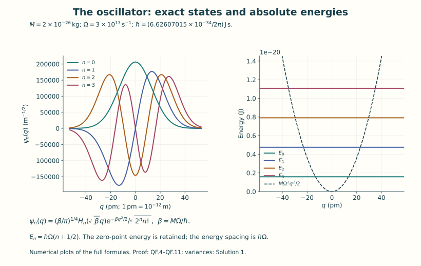
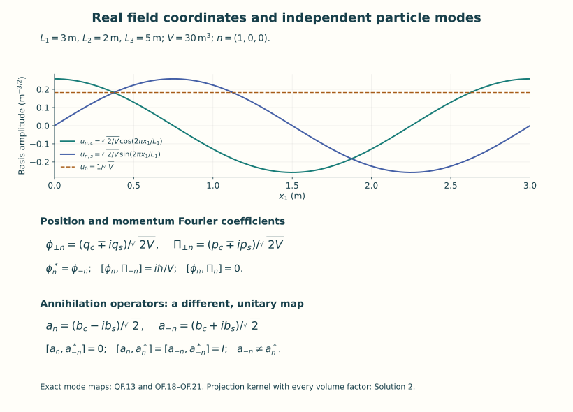
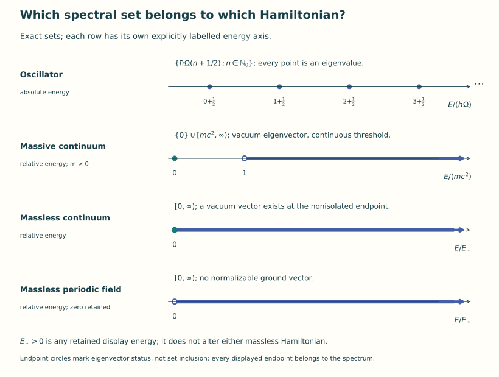

# Oscillators and free quantum fields

Lesson YM-F11 · Geometry and states in Yang–Mills theory

Classical evolution assigns a field to each time once its initial data
are given. A quantum description assigns probabilities to measurements
using a state and observables. The first purpose of this lesson is to
make those words mathematical. Its second purpose is to construct a
quantum field whose states, observables and Hamiltonian we can write
and analyze completely.

We start with one harmonic oscillator. Its full solution supplies a
family of states and the operators that move between them. Fourier
coordinates then turn a finite free scalar field into finitely many
oscillators. Finally we construct the spaces and operators needed when
the number of modes becomes infinite. Every passage specifies its
space, measure and operator domain.

Read the field, coordinate and unit conventions in
[Lesson 1](../fields-coordinates-quantities.html) and the scalar action
in [Lesson 7](../action-and-field-equations.html). The needed Fourier
and Hilbert-space arguments are provided below. The earlier
[measure and integration chapter](../analysis-measure-prerequisites.html)
supplies the complete integral convergence results used in those arguments.
The scalar field is a first quantum example; its action is the explicitly
specified free neutral real restriction of F7.41. Gauge constraints
enter the next lesson.

## 0. States, observables and probabilities

A complex Hilbert space is a complete complex vector space with a
positive inner product. We take the inner product to be conjugate-linear
in its first slot and linear in its second. A **pure quantum state**
is represented by a vector \(\psi\) of norm one. Multiplying that vector
by a complex number of modulus one represents the same state.

For a particle coordinate \(q\), the space used below is
\(L^2(\mathbb R,dq;\mathbb C)\). We specify the position measurement rule
by assigning to a measurable set \(B\subset\mathbb R\) the probability

\[
 {\mathbb P}_\psi(q\in B)=\int_B|\psi(q)|^2\,dq.
 \tag{F11.1}
\]

This is the Born rule in the position representation. It is part of
the quantum model, rather than a theorem deduced from a classical
equation. It does define a probability measure: the integral is
nonnegative, the whole-line value is one, and countable additivity
follows by applying monotone convergence to disjoint indicator
functions. A constant phase leaves every such probability unchanged.

An **observable** will be a self-adjoint operator on a specified dense
domain in the Hilbert space. For a bounded diagonal operator with
orthonormal basis \(e_n\), real diagonal entries \(o_n\) and state
\(\psi=\sum_n c_n e_n\), its measurement probabilities and expectation
are

\[
 {\mathbb P}_\psi(o\in B)=\sum_{\{n:o_n\in B\}}|c_n|^2,\qquad
 \langle o\rangle_\psi=\langle\psi,O\psi\rangle
                       =\sum_n o_n|c_n|^2.
 \tag{F11.2}
\]

Orthonormality proves that the squared coefficients sum to one and
proves the expectation identity by expanding the inner product.
Repeated eigenvalues contribute the sum of their probabilities.
For the unbounded Hamiltonians below, their exact domains ensure
that the displayed operator and expectation exist. A finite variance
is expressed as
\(\|(O-\langle o\rangle_\psi)\psi\|^2\) for a state in \(D(O)\);
this definition does not presume that \(O^2\psi\) exists.

Here a domain \(D(T)\) is a linear subspace on which an operator \(T\)
is defined. It is dense if every Hilbert-space vector is a norm limit
of domain vectors. For a densely defined \(T\), its adjoint domain
consists of those \(f\) for which there is a vector \(g\) satisfying
\(\langle f,Tv\rangle=\langle g,v\rangle\) for every \(v\in D(T)\);
then \(T^*f=g\). Density makes \(g\) unique. The operator is
**self-adjoint** when \(D(T)=D(T^*)\) and their values agree.
Checking an integration-by-parts identity on some smooth functions
establishes symmetry there, but the domain equality needs its own
proof. Sections 1–3 provide that proof for the actual operators used.

A **mixed state** may already be illustrated by a finite ensemble:
choose unit vectors \(\psi_j\) and numbers \(p_j\ge0\) with
\(\sum_jp_j=1\), and average their measurement probabilities using
those weights. Its operator is
\(\varrho f=\sum_jp_j\psi_j\langle\psi_j,f\rangle\).
For any \(f\), its quadratic form is
\(\langle f,\varrho f\rangle=\sum_jp_j|\langle\psi_j,f\rangle|^2\ge0\).
Taking a complete orthonormal basis and summing diagonal entries
gives trace one, by each \(\psi_j\)'s squared-coefficient identity.
For any bounded observable \(O\), direct expansion gives
\(\operatorname{tr}(\varrho O)=\sum_jp_j\langle\psi_j,O\psi_j\rangle\).
This makes the probability mixture precise without treating it
as a superposition vector.

Time evolution below is a strongly continuous unitary group
\(U(t)=e^{-itH/\hbar}\), with \(H\) its specified self-adjoint
Hamiltonian. We will construct this group from explicit diagonal
or multiplication formulas. Unitarity preserves total probability;
the factor \(\hbar\) turns energy times time into a dimensionless
phase. A state's probabilities can change because different
energy components acquire different phases.

Sections 1–3 solve the oscillator, including completeness and domains.
Sections 4–6 construct the finite scalar regulator and retain its
zero mode. Sections 7–10 construct the infinite-mode spaces, spectra
and smeared fields. Section 11 provides the exact human-source
comparison. The worked examples and complete exercises then let
you use each construction on explicit states and test functions.

The notation \(L^2\) means square-integrable functions identified
when they agree almost everywhere, with norm
\(\|f\|_2=(\int|f|^2)^{1/2}\).
A **Schwartz function** on \(\mathbb R^d\) is smooth and has
\(\sup_x|x_1^{a_1}\cdots x_d^{a_d}
\partial_1^{b_1}\cdots\partial_d^{b_d}f(x)|<\infty\)
for every choice of nonnegative integer powers \(a_j,b_j\).
This requires every derivative to decrease faster than any prescribed
inverse power at infinity. \(H^k(\mathbb R^d)\) consists of \(L^2\)
functions whose distributional partial derivatives of total order
at most \(k\) are also in \(L^2\). A distributional derivative is
specified by integration against smooth compactly supported tests:
\(\langle\partial_j f,\eta\rangle=-\langle f,\partial_j\eta\rangle\).
These definitions let us state both a convenient smooth domain and
the full operator domain without identifying them prematurely.

## 1. Hilbert spaces, Fourier facts and multiplication operators

The one-particle quantum oscillator Hilbert space is
\(\mathcal H=L^2(\mathbb R,dq;\mathbb C)\), with
\(\langle f,g\rangle=\int\overline f g\,dq\), linear in the second
slot. Vectors agreeing almost everywhere are identified. Completeness
can be seen directly: from a Cauchy sequence choose a subsequence whose
successive L2 differences have summable norms. The sum of their absolute
values has finite L2 norm by the triangle inequality and monotone
convergence, hence is finite almost everywhere. The pointwise series
defines a limit, and the same tail bound proves L2 convergence. The
original Cauchy sequence has this limit too.

We use the full Fourier conventions

\[
\widehat f(k)=\int_{\mathbb R^d}e^{-ik\cdot x}f(x)\,d^dx,
\quad\mathcal Ff=(2\pi)^{-d/2}\widehat f,
\quad\|f\|_2^2=(2\pi)^{-d}\|\widehat f\|_2^2.
\tag{QF.1}
\]

Here is a sufficient proof of the Fourier facts used below. The
one-dimensional Gaussian integral is \(\int e^{-a x^2}dx=\sqrt{\pi/a}\),
\(a>0\): square the integral, integrate in polar coordinates, then
take its positive square root. Differentiation and completing the
square, or the differential equation obtained by integrating a
derivative in x, give
\(\widehat{e^{-a|x|^2}}(k)=(\pi/a)^{d/2}e^{-|k|^2/(4a)}\).
For Schwartz f,g, insert \(e^{-\epsilon|k|^2}\) in
\((2\pi)^{-d}\int\overline{\widehat f}\widehat g\).
Fubini and the Gaussian formula turn this into
\(\langle f,G_\epsilon*g\rangle\), where
\(G_\epsilon(x)=(4\pi\epsilon)^{-d/2}e^{-|x|^2/(4\epsilon)}\).
Translation continuity and its unit integral give
\(G_\epsilon*g\to g\) in L2. Dominated convergence on the Fourier
side proves QF.1 on Schwartz functions. Integration by parts makes
their transforms Schwartz, and the same Gaussian argument proves
Fourier inversion. Smooth compact functions are dense in L2, by
cutoff and mollification. Thus the transform extends to a unitary
map on L2, since its isometric range contains the dense Schwartz
space and is closed. The same Gaussian convolution proves L1
Fourier uniqueness: if an L1 function has zero transform, all its
Gaussian convolutions vanish, and their L1 approximate-identity
limit is the function itself.

For any real measurable finite function b on a sigma-finite measure space, define

\[
D(M_b)=\{f\in L^2:bf\in L^2\},\qquad M_bf=bf.
\tag{QF.2}
\]

This is densely defined, because truncating to \(|b|\le n\) gives
domain vectors converging to every f. It is self-adjoint: symmetry
is direct, and testing an adjoint-domain vector against functions
supported where \(|b|\le n\) identifies its adjoint image as bf;
letting n increase shows bf lies in L2. If z has positive distance
from the essential range of b, multiplication by \((b-z)^{-1}\)
is a bounded inverse, whose image lies in D(M_b) since
\(b/(b-z)=1+z/(b-z)\). Conversely, every neighbourhood of a point
in that essential range has a positive-measure preimage. A unit
vector supported in a finite positive-measure part of this preimage
is an approximate eigenvector. A bounded inverse there is impossible.
This proves the spectrum is the closed essential range, and an
eigenvalue occurs precisely when its level set has positive measure.
The same proof applies to a counting measure and to a direct sum of
measure spaces. It supplies all self-adjointness and spectral claims
about multiplication operators used in this lesson.

The position operator Q is multiplication by q on \(\{f:qf\in L^2\}\).
For physical momentum use the unitary transform

\[
(\mathcal F_\hbar f)(p)=(2\pi\hbar)^{-1/2}
                  \int e^{-ipq/\hbar}f(q)\,dq,
\qquad P=\mathcal F_\hbar^{-1}M_p\mathcal F_\hbar.
\tag{QF.3}
\]

It follows from QF.1 by the exact change of integration variable
\(p=\hbar k\), with its Jacobian. Thus P is self-adjoint on
\(H^1(\mathbb R)=\{f\in L^2:f'\in L^2\}\), acting as
\(-i\hbar f'\) distributionally. On the invariant Schwartz domain
\([Q,P]f=i\hbar f\). This commutator is a domain statement about
unbounded operators, not an identity of bounded operators on all L2.

## 2. The oscillator and every Hermite state

Let M>0 and \(\Omega>0\). If q is a length coordinate, M is the
mechanical mass. More generally the same calculation holds for an
inertia whose dimension is energy times time squared divided by q
squared; this distinction matters for the field coordinates below.
On Schwartz functions put

\[
\begin{gathered}
H_{\rm diff}=-\frac{\hbar^2}{2M}\frac{d^2}{dq^2}
                   +\frac{M\Omega^2q^2}{2},
\qquad \beta=\frac{M\Omega}{\hbar},\\
a=\sqrt{\frac{M\Omega}{2\hbar}}Q
        +\frac{i}{\sqrt{2M\hbar\Omega}}P,
\qquad
a^\dagger=\sqrt{\frac{M\Omega}{2\hbar}}Q
        -\frac{i}{\sqrt{2M\hbar\Omega}}P,\\
a=\frac{\beta q+d/dq}{\sqrt{2\beta}},\quad
a^\dagger=\frac{\beta q-d/dq}{\sqrt{2\beta}},\quad
[a,a^\dagger]=I,\quad
H_{\rm diff}=\hbar\Omega(a^\dagger a+\tfrac12 I).
\tag{QF.4}
\end{gathered}
\]

Expanding the two ordered products gives the commutator and the
Hamiltonian identity, using \((d/dq)q-q(d/dq)=1\).
Integration by parts gives the adjoint relation on Schwartz functions.

The equation \(a\psi_0=0\) gives

\[
\psi_0(q)=\left(\frac\beta\pi\right)^{1/4}e^{-\beta q^2/2},
\qquad
\psi_n=\frac{(a^\dagger)^n}{\sqrt{n!}}\psi_0
=\frac{(\beta/\pi)^{1/4}}{\sqrt{2^n n!}}
 H_n(\sqrt\beta q)e^{-\beta q^2/2},
\tag{QF.5}
\]

where the polynomial is explicitly
\(H_n(z)=(-1)^ne^{z^2}(d/dz)^ne^{-z^2}\).
The last identity follows by applying

\[
(\beta q-d/dq)e^{-\beta q^2/2}p(\sqrt\beta q)
=\sqrt\beta e^{-\beta q^2/2}(2zp-p')
\]

repeatedly; the Rodrigues polynomials obey
\(H_{n+1}=2zH_n-H_n'\), as follows by differentiating their definition.
Their leading coefficient is \(2^n\), so they span all polynomials.
No change of working coordinate or oscillator parameter is made by
evaluating the displayed polynomial at \(\sqrt\beta q\).

The commutator gives
\(a(a^\dagger)^n=(a^\dagger)^na+n(a^\dagger)^{n-1}\).
It follows that

\[
a\psi_n=\sqrt n\,\psi_{n-1},\quad
a^\dagger\psi_n=\sqrt{n+1}\,\psi_{n+1},\quad
H_{\rm diff}\psi_n=\hbar\Omega(n+\tfrac12)\psi_n.
\tag{QF.6}
\]

For n=0 the first expression means zero. The ground-state norm is
one by the Gaussian integral. The adjoint relation and commutator
give \(\|(a^\dagger)^n\psi_0\|^2=n!\) inductively. For different
n,m symmetry of \(H_{\rm diff}\) and its two distinct real
eigenvalues gives \(\langle\psi_m,\psi_n\rangle=0\).
This proves orthonormality, including all constants in QF.5.

Completeness requires an argument beyond the ladder identities.
Suppose f is orthogonal to every \(\psi_n\). Polynomial spanning gives
\(\int f(q)q^n e^{-\beta q^2/2}dq=0\) for all n, after conjugating
the orthogonality identity if necessary. Define
\(F(z)=\int f(q)e^{-\beta q^2/2}e^{zq}dq\).
For every R, Cauchy–Schwarz bounds this integral and its power-series
absolute majorant by
\(\|f\|_2(\int e^{-\beta q^2+2R|q|}dq)^{1/2}<\infty\)
uniformly on \(|z|\le R\). Thus the exponential series may be
integrated term by term; every coefficient is zero, so F(z)=0 for
all z. At \(z=-ik\) this is the Fourier transform of the L1 function
\(f(q)e^{-\beta q^2/2}\). QF.1's L1 uniqueness makes it zero
almost everywhere, and the strictly positive Gaussian makes f zero.
Therefore the Hermite functions are a complete orthonormal basis.

Figure 1. Equations QF.4–QF.6 evaluated at the displayed physical parameters.
The coordinate remains q; the tick labels express it in picometres.
The wavefunctions are plotted as amplitudes, without vertical offsets.
The second panel shows the actual potential and the first four energies.
Both panels are numerical plots of the exact formulas, with their units.

## 3. Closed ladders, the Hamiltonian domain and its full spectrum

The coefficient map \(\mathcal U f=(c_n)_{n\ge0}\),
\(c_n=\langle\psi_n,f\rangle\), is unitary onto \(\ell^2\).
Define the closed ladders by their full coefficient domains:

\[
\begin{aligned}
D(a)&=\{c:\sum_{n\ge0}n|c_n|^2<\infty\},&
(ac)_n&=\sqrt{n+1}\,c_{n+1},\\
D(a^\dagger)&=\{c:\sum_{n\ge0}(n+1)|c_n|^2<\infty\},&
(a^\dagger c)_n&=\sqrt n\,c_{n-1}\quad(c_{-1}=0).
\tag{QF.7}
\end{aligned}
\]

Both domains are the same set, with different displayed graph norms.
Coordinate testing proves these are adjoints of each other; convergence
of each coordinate and of the output in \(\ell^2\) proves closedness.
Finite sequences approximate in each graph norm, so the finite Hermite
span is a core. Testing against \(\psi_n\) identifies these operators
with the differential expressions on Schwartz functions. Moreover

\[
D(a)=D(a^\dagger)=H^1(\mathbb R)\cap\{f:qf\in L^2\},
\quad
\|af\|^2+\tfrac12\|f\|^2
=\frac1{2\beta}\|f'\|^2+\frac\beta2\|qf\|^2.
\tag{QF.8}
\]

For finite Hermite sums this is integration by parts in QF.4.
Graph approximation then proves one inclusion and the identity:
the right side makes derivatives and q-multiples Cauchy and testing
identifies their limits. Conversely, for f in the right-hand domain,
the differential expression a f lies in L2; testing it against the
Hermite basis identifies its coefficients as QF.7, which supplies the
other inclusion. Boundary integrations can equivalently be justified
by cutoff and H1 approximation, whose weighted errors tend to zero.

Define the Hamiltonian by

\[
\begin{gathered}
D(H)=\{f:\sum_{n=0}^\infty
           [\hbar\Omega(n+\tfrac12)]^2|c_n|^2<\infty\},\qquad
Hf=\sum_{n=0}^\infty\hbar\Omega(n+\tfrac12)c_n\psi_n,\\
H=\hbar\Omega(a^\dagger a+\tfrac12 I),\qquad
\sigma(H)=\{\hbar\Omega(n+\tfrac12):n=0,1,2,\ldots\}.
\tag{QF.9}
\end{gathered}
\]

The equality of domains with the product domain of \(a^\dagger a\)
is immediate from QF.7. QF.2 for counting measure proves
self-adjointness. If z is not in the displayed set, the reciprocal
diagonal sequence is bounded, because the eigenvalues tend to
infinity and no finite member equals z; it is an inverse with the
correct image domain. Every displayed value has its Hermite
eigenvector, and each eigenspace is one dimensional by coefficient
comparison. Thus there is no further spectrum. The finite Hermite
span is a Hamiltonian core by weighted sequence truncation.
The two product domains are both D(H): QF.7 gives weights n² for
\(a^\dagger a\) and (n+1)² for \(aa^\dagger\), which define the
same set because the input is already square summable. Hence
\([a,a^\dagger]f=f\) on D(H). The resolvent is compact: its finite
coordinate truncations converge in operator norm since
\(\sup_{n>R}|\hbar\Omega(n+1/2)-z|^{-1}\to0\).

This is also the self-adjoint differential Hamiltonian on its exact
maximal domain, and that domain is

\[
D(H)=H^2(\mathbb R)\cap\{f:q^2f\in L^2\}
=\{f\in L^2:H_{\rm diff}f\in L^2\text{ distributionally}\}.
\tag{QF.10}
\]

To prove the first equality, put \(L=-d^2/dq^2+\beta^2q^2\).
For every finite Hermite sum integration by parts gives the exact
identity

\[
\|Lf\|^2=\|f''\|^2+\beta^4\|q^2f\|^2
 +2\beta^2\|qf'\|^2-2\beta^2\|f\|^2.
\tag{QF.11}
\]

Thus an H-graph Cauchy sequence from the core has both f'' and q²f
Cauchy in L2. Their limits are the actual distributional derivative
and product. QF.1 then gives f in H2, including its first derivative.
Conversely f in the first displayed domain has an L2 differential
image. For any f with that image, pair its distributional identity
with each Schwartz \(\psi_n\): \(H_{\rm diff}f\), f and q²f are
tempered distributions, so this testing is legitimate. It yields
\(\langle\psi_n,H_{\rm diff}f\rangle
=\hbar\Omega(n+1/2)c_n\). Bessel's equality proves the spectral
domain condition in QF.9 and identifies its image. This proves both
remaining inclusions and establishes the maximal-domain assertion.

The finite Hermite span is also a core for Q. Here is a proof that
will be used for the field. Fix the coordinate scale
\(\eta=\sqrt{\hbar/(M\Omega)}>0\), which has the same unit as q.
If g lies in either deficiency kernel
of Q restricted to that span, its tests say that
\((q\mp i\eta)g(q)e^{-\beta q^2/2}\) has all polynomial moments zero.
The same Gaussian exponential bound used above, with its extra
linear factor, proves its Fourier transform zero. Hence
\((q\mp i\eta)g=0\) and g=0. A densely defined symmetric operator
with these two zero kernels is essentially self-adjoint: the ranges
of its shifts by \(\pm i\eta\) are dense by the adjoint identity, and
the ranges of the shifts of its closure are closed because
\(\|(T\pm i\eta)f\|^2=\|Tf\|^2+\eta^2\|f\|^2\). They are therefore
onto; solving one shift shows the adjoint domain equals the closure
domain. Its closure must be the multiplication operator Q, already
known to be a self-adjoint extension. This closure matters:
\(Q=\sqrt{\hbar/(2M\Omega)}(a+a^\dagger)\) initially holds on
QF.8's common domain; Q has its larger maximal multiplication domain.
For instance \(1_{[-\eta,\eta]}\) lies in D(Q), while its derivative
\(\delta_{-\eta}-\delta_\eta\) is not L2, so it does not lie in
D(a). The operator sum on the common ladder domain has closure Q,
because it lies between the finite Hermite restriction and Q.

Time evolution is explicitly
\(e^{-itH/\hbar}f=\sum_ne^{-it\Omega(n+1/2)}c_n\psi_n\).
The coefficients have modulus one, giving a unitary group;
dominated convergence gives strong continuity and its derivative
\(-iHf/\hbar\) on D(H). The oscillator ground energy is
\(\hbar\Omega/2\), and the energy difference to the next state is
\(\hbar\Omega\). Both quantities have been retained.

## 4. The original real scalar action and a finite torus regulator

Take m≥0 and keep the free neutral restriction of F07 exactly:
the connection is zero, the quartic coupling is zero, and the single
complex component is restricted to its real component \(\psi=\phi\).
This real subspace is preserved by the free equation. The specified
action, canonical density and Hamiltonian are

\[
\begin{gathered}
\mu=mc/\hbar,\qquad
S[\phi]=\hbar\int\{c^{-1}(\partial_t\phi)^2
        -c\sum_{j=1}^3(\partial_j\phi)^2-c\mu^2\phi^2\}\,dt\,d^3x,
\qquad \alpha=2\hbar/c,\\
\Pi=\frac{\partial\mathcal L}{\partial(\partial_t\phi)}
     =\alpha\partial_t\phi,\qquad
H_{\rm cl}=\int\left\{\frac{\Pi^2}{2\alpha}
       +\frac{\alpha c^2}{2}(|\nabla\phi|^2+\mu^2\phi^2)\right\}d^3x,\\
\partial_t^2\phi-c^2\Delta\phi+\frac{m^2c^4}{\hbar^2}\phi=0.
\tag{QF.12}
\end{gathered}
\]

The equation follows by varying the action and integrating derivatives
against compactly supported time variations and periodic spatial
variations. The temporal boundary term is \([\int\Pi\,\delta\phi]\)
at the two time endpoints; it vanishes for fixed temporal data.
The Legendre identity \(\Pi\partial_t\phi-\mathcal L\) gives
the displayed Hamiltonian. The coefficient α is a named original
factor, not a new mass m and not a discarded factor of two.
There is no Yang–Mills coupling in this explicitly decoupled free
scalar model; no quantization of a Yang–Mills action is being asserted.

Let the spatial torus be
\(\mathbb T_L^3=\prod_{j=1}^3(\mathbb R/L_j\mathbb Z)\), with
\(L_j>0\), \(V=L_1L_2L_3\), and
\(k_n=(2\pi n_1/L_1,2\pi n_2/L_2,2\pi n_3/L_3)\).
Choose integers \(N_j\ge0\) and the finite symmetric set
\(\Lambda_N=\{n\in\mathbb Z^3:|n_j|\le N_j\}\).
It contains zero. Select \(\Lambda_N^+\) by taking exactly the
nonzero n whose first nonzero component is positive. Define

\[
e_0=V^{-1/2},\quad
e_{n,c}(x)=\sqrt{2/V}\cos(k_n\cdot x),\quad
e_{n,s}(x)=\sqrt{2/V}\sin(k_n\cdot x),\qquad n\in\Lambda_N^+.
\tag{QF.13}
\]

Integrating \(e^{i(k_n-k_m)\cdot x}\) over the three intervals gives
\(V\delta_{nm}\). Expanding sine and cosine in exponentials proves
that QF.13 is a real orthonormal basis for the real cutoff space,
with exactly \(d_N=1+2|\Lambda_N^+|=|\Lambda_N|\) coordinates.
There are no additional fixed points of n↦−n in this integer
Fourier lattice: an endpoint of a chosen cutoff is not a point of
a discretized spatial grid and creates no extra Nyquist mode.

Write, with r ranging over that complete real basis,

\[
\begin{gathered}
\phi_N(x)=\sum_rq_re_r(x),\quad \Pi_N(x)=\sum_rp_re_r(x),\quad
\omega_n=c\sqrt{|k_n|^2+\mu^2},\quad\omega_{n,c}=\omega_{n,s}=\omega_n,\\
S_N=\int\sum_r\frac\alpha2(\dot q_r^2-\omega_r^2q_r^2)dt,
\quad p_r=\alpha\dot q_r,\qquad
H_N^{\rm cl}=\sum_r\left(\frac{p_r^2}{2\alpha}
                                 +\frac{\alpha\omega_r^2q_r^2}{2}\right).
\tag{QF.14}
\end{gathered}
\]

This follows from orthonormality and
\(-\Delta e_r=|k_r|^2e_r\), with integration by parts on the torus.
In particular the exact symplectic one-form is
\(\int\Pi_N\,d\phi_N\,d^3x=\sum_rp_r\,dq_r\).

Quantize this finite system on
\(\mathcal H_N=L^2(\mathbb R^{d_N},\prod_rdq_r)\), with q_r
multiplication and \(p_r=-i\hbar\partial_{q_r}\).
On the common invariant Schwartz space all canonical commutators are

\[
[q_r,q_s]=[p_r,p_s]=0,\qquad[q_r,p_s]=i\hbar\delta_{rs}I,
\quad[\phi_N(x),\Pi_N(y)]=i\hbar K_N(x,y)I,
\tag{QF.15}
\]

where

\[
K_N(x,y)=\sum_re_r(x)e_r(y)
=\frac1V\sum_{n\in\Lambda_N}e^{ik_n\cdot(x-y)}.
\tag{QF.16}
\]

Also \([\phi_N(x),\phi_N(y)]=[\Pi_N(x),\Pi_N(y)]=0\).
The function K_N is the orthogonal projection kernel onto the actual
cutoff space; replacing it by a full delta distribution at a finite
cutoff would be incorrect. For a periodic test f the bracket with
\(\Pi_N(f)\) is \(i\hbar(P_Nf)(x)\), with the same projection.

Units make the modal inertia distinct from physical particle mass:
\([\phi]=\mathsf L^{-1}\), \([e_r]=\mathsf L^{-3/2}\),
\([q_r]=\mathsf L^{1/2}\), \([p_r]=[\hbar]\mathsf L^{-1/2}\),
\([\alpha]=[\hbar]/[c]\), and \([\omega_r]=\mathsf T^{-1}\).
Thus p_r q_r has the action unit and every QF.14 term has the energy
unit. The mass m in ω has its original mass unit.

## 5. The exact map to complex Fourier and particle modes

Use the full Fourier coefficients, including the volume:

\[
\phi_n=\frac1V\int_{\mathbb T_L^3}\phi_N(x)e^{-ik_n\cdot x}d^3x,
\qquad\Pi_n=\frac1V\int_{\mathbb T_L^3}\Pi_N(x)e^{-ik_n\cdot x}d^3x.
\tag{QF.17}
\]

For each n in \(\Lambda_N^+\) the exact maps and their inverses are

\[
\begin{gathered}
\phi_n=\frac{q_{n,c}-iq_{n,s}}{\sqrt{2V}},\quad
\phi_{-n}=\frac{q_{n,c}+iq_{n,s}}{\sqrt{2V}},\quad
\phi_0=q_0/\sqrt V,\\
\Pi_n=\frac{p_{n,c}-ip_{n,s}}{\sqrt{2V}},\quad
\Pi_{-n}=\frac{p_{n,c}+ip_{n,s}}{\sqrt{2V}},\quad
\Pi_0=p_0/\sqrt V,\\
q_{n,c}=\sqrt{V/2}(\phi_n+\phi_{-n}),\quad
q_{n,s}=i\sqrt{V/2}(\phi_n-\phi_{-n}),
\quad q_0=\sqrt V\phi_0,
\quad\text{the identical formulas hold for }p\text{ and }\Pi.
\tag{QF.18}
\end{gathered}
\]

For classical real fields these are conjugate pairs; for quantum
operators \(\phi_n^*=\phi_{-n}\) and \(\Pi_n^*=\Pi_{-n}\)
on the common core, with their closures related in the same way.
Direct substitution gives

\[
[\phi_n,\Pi_m]=\frac{i\hbar}{V}\delta_{n,-m}I,
\quad[\phi_n,\phi_m]=[\Pi_n,\Pi_m]=0,
\quad\sum_rp_r\,dq_r=V\sum_{n\in\Lambda_N}\Pi_{-n}\,d\phi_n.
\tag{QF.19}
\]

These formulas prove the canonical nature of the real-to-complex map
on its real subspace. No two members of a conjugate pair are counted
as two independent complex position coordinates.

Assume for this section m>0, so every ω_r is positive. Apply QF.4–QF.10
with M=α separately to every real coordinate. Let \(b_{n,c},b_{n,s}\)
be its two real-coordinate annihilation operators and b_0 the zero
mode annihilation operator. Define

\[
a_n=\frac{b_{n,c}-ib_{n,s}}{\sqrt2},\quad
a_{-n}=\frac{b_{n,c}+ib_{n,s}}{\sqrt2},\quad a_0=b_0,
\qquad
\begin{cases}
b_{n,c}=(a_n+a_{-n})/\sqrt2,\\
b_{n,s}=i(a_n-a_{-n})/\sqrt2.
\end{cases}
\tag{QF.20}
\]

This is a unitary transformation of the two annihilation modes;
its matrix times its adjoint is I2. Consequently
\([a_n,a_m^*]=\delta_{nm}I\) and the two other annihilation/creation
commutators vanish. In particular \(a_{-n}\ne a_n^*\): reality of
the position field has already been imposed in QF.18 and does not
impose that false relation on its particle annihilation operators.
The full inverse field formulas are

\[
\phi_n=\sqrt{\frac{\hbar}{2\alpha V\omega_n}}
                  (a_n+a_{-n}^*),\qquad
\Pi_n=-i\sqrt{\frac{\alpha\hbar\omega_n}{2V}}
                  (a_n-a_{-n}^*).
\tag{QF.21}
\]

At n=0 these are exactly the one real oscillator formulas, not a
second copy of that oscillator. Expanding QF.20 proves QF.21 from
the two real-coordinate formulas including their signs.

The tensor products of the complete Hermite bases are a complete
orthonormal basis of \(\mathcal H_N\). To prove completeness, Fubini
and one-dimensional completeness applied successively to each
coordinate make every vector orthogonal to these products zero.
The Hamiltonian is the self-adjoint diagonal operator

\[
\begin{gathered}
H_N^{\rm abs}=\sum_{n\in\Lambda_N}\hbar\omega_n a_n^*a_n
                  +E_{0,N}I,
\qquad E_{0,N}=\frac12\sum_{n\in\Lambda_N}\hbar\omega_n,\\
D(H_N^{\rm abs})=\left\{\sum_{\boldsymbol j}c_{\boldsymbol j}\Psi_{\boldsymbol j}:
\sum_{\boldsymbol j}\left[\sum_r\hbar\omega_r(j_r+\tfrac12)\right]^2
                       |c_{\boldsymbol j}|^2<\infty\right\},\\
\sigma(H_N^{\rm abs})=
\left\{E_{0,N}+\sum_{n\in\Lambda_N}\hbar\omega_n\nu_n:
                                     \nu_n\in\mathbb N_0\right\}.
\tag{QF.22}
\end{gathered}
\]

Self-adjointness and the absence of additional spectrum follow from
QF.2: below a fixed energy, every occupation is bounded because
all frequencies are positive, so only finitely many occupation tuples
occur. Frequencies may agree, and the formula retains the resulting
degeneracies. The ground state is the product of all Gaussian ground
states; the unitary mode change preserves that vacuum. The shifted
operator is explicitly
\(H_N^{\rm rel}=H_N^{\rm abs}-E_{0,N}I\), and its gap is
\(\min_n\hbar\omega_n=mc^2\), because the zero spatial mode is included.
The unshifted ground energy E0 has not been omitted.

On the core, the exact Heisenberg equations and solutions are

\[
\begin{gathered}
\dot q_r=p_r/\alpha,\quad\dot p_r=-\alpha\omega_r^2q_r,
\quad a_n(t)=e^{-i\omega_nt}a_n,\\
\phi_N(t,x)=\frac1{\sqrt V}\sum_{n\in\Lambda_N}
\sqrt{\frac{\hbar}{2\alpha\omega_n}}
\{a_ne^{ik_n\cdot x-i\omega_nt}+a_n^*e^{-ik_n\cdot x+i\omega_nt}\},\\
\Pi_N(t,x)=\frac{-i}{\sqrt V}\sum_{n\in\Lambda_N}
\sqrt{\frac{\alpha\hbar\omega_n}{2}}
\{a_ne^{ik_n\cdot x-i\omega_nt}-a_n^*e^{-ik_n\cdot x+i\omega_nt}\}.
\tag{QF.23}
\end{gathered}
\]

They follow from \(\dot O=(i/\hbar)[H_N^{\rm abs},O]\) or the
explicit diagonal phases. E0 commutes with every operator, so the
same equations use \(H_N^{\rm rel}\). Differentiating the finite
sums proves the exact cutoff Klein–Gordon equation, \(\Pi_N=\alpha\dot\phi_N\),
and preservation of all equal-time commutators. Each mode still has
energy \(\hbar\omega_n=\sqrt{\hbar^2c^2|k_n|^2+m^2c^4}\).

Figure 2. The real basis and the two maps in QF.13 and QF.18–QF.21.
The plotted torus has lengths 3 m, 2 m and 5 m, so V=30 m³;
the integer mode is (1,0,0). The first map acts on position coordinates,
and the second on annihilation operators. The opposite particle modes
are independent, while real position coefficients have the stated
adjoint relation.

## 6. The massless periodic zero mode

When m=0, QF.4's ladder definitions cannot be used for n=0, because
\(\omega_0=0\). Retain it instead as the exact Schrödinger factor

\[
\mathcal H_N=L^2(\mathbb R,dq_0)\otimes\mathcal H_{N,\ne0},
\qquad H_{0}=\frac{p_0^2}{2\alpha},\quad
D(H_0)=H^2(\mathbb R),\quad
H_N^{\rm abs}=H_0\otimes I+I\otimes(H_{N,\ne0}^{\rm rel}+E_{0,N}^{\ne0}I),
\tag{QF.24}
\]

where \(E_{0,N}^{\ne0}=\frac12\sum_{n\in\Lambda_N\setminus\{0\}}
\hbar c|k_n|\). The second factor is built from the positive-frequency
oscillators exactly as above. In the zero-mode momentum representation
and the occupation basis, the full operator is multiplication by
\(p_0^2/(2\alpha)+E_{0,N}^{\ne0}+\sum_{n\ne0}\hbar c|k_n|\nu_n\),
on the domain where that product is square integrable. This explicitly
defines the tensor sum and proves its self-adjointness.

QF.2 gives \(\sigma(H_0)=[0,\infty)\). Every level set of
\(p_0^2/(2\alpha)\) has Lebesgue measure zero, so it has no eigenvalues.
It follows, by the same multiplication argument with countably many
occupation sectors, that

\[
\sigma(H_N^{\rm abs})=[E_{0,N}^{\ne0},\infty),\qquad
\sigma(H_N^{\rm rel})=[0,\infty),\qquad
\text{there is no normalizable ground-state vector.}
\tag{QF.25}
\]

The assertion holds even when the cutoff has only n=0, in which case
the second factor is \(\mathbb C\) and its vacuum sum is empty.
No positive-energy gap is generated by the smallest nonzero spatial
frequency while this zero factor is retained.

Its exact contribution to the field is

\[
q_0(t)=q_0+t p_0/\alpha,\quad p_0(t)=p_0,\qquad
\phi_{N,0}(t,x)=\frac{q_0+t p_0/\alpha}{\sqrt V},\quad
\Pi_{N,0}(t,x)=p_0/\sqrt V.
\tag{QF.26}
\]

These identities follow either by Fourier momentum evolution or by
the two commutators on Schwartz functions. The zero contribution to
\([\phi_N(x),\Pi_N(y)]\) is exactly \(i\hbar/V\), so the full
projector kernel QF.16 is restored. The remaining modes use QF.23 with
n≠0. The resulting field satisfies the massless equation, including
its spatially constant solution. Dropping this factor defines a
different system with a projected canonical commutator.

## 7. The bosonic Fock construction with actual domains

For a complex Hilbert space \(\mathfrak h\), let
\(\mathfrak h^{\otimes_s n}\) be the closed symmetric subspace of
the n-fold Hilbert tensor product. Its orthogonal projection is
\(S_n=(n!)^{-1}\sum_{\pi\in\mathfrak S_n}U_\pi\); multiplication
of permutations proves \(S_n^2=S_n=S_n^*\). Define

\[
\mathcal F_s(\mathfrak h)=\bigoplus_{n=0}^\infty\mathfrak h^{\otimes_s n},
\quad\mathfrak h^{\otimes_s0}=\mathbb C,\quad
\|\Psi\|^2=\sum_n\|\Psi_n\|^2,\quad\Omega=(1,0,\ldots),
\tag{QF.27}
\]

and \((N\Psi)_n=n\Psi_n\) on \(\sum n^2\|\Psi_n\|^2<\infty\).
QF.2 proves self-adjointness of N. The finite-particle domain
\(\mathcal D_{\rm fin}\) consists of vectors with finitely many
nonzero sectors; it is dense by truncating the displayed sum.

For \(h\in\mathfrak h\), first define on that domain

\[
\begin{aligned}
(a(h)\Psi)_n&=\sqrt{n+1}\,\langle h,\cdot\rangle_1\Psi_{n+1},\\
(a^*(h)\Psi)_{n+1}&=\sqrt{n+1}\,S_{n+1}(h\otimes\Psi_n),
\qquad (a^*(h)\Psi)_0=0.
\tag{QF.28}
\end{aligned}
\]

The first map contracts the first tensor factor and is antilinear
in h; the second is linear. Tensor inner products prove the adjoint
identity on the finite domain. Applying the symmetrization sum shows
that the contraction of a creation has one term
\(\langle h,g\rangle\Psi_n\) and n terms in which the contraction
acts on an old factor. Those n terms are exactly the reverse
composition. The same counting shows two contractions commute and
two symmetrized insertions commute. Consequently

\[
[a(h),a^*(g)]=\langle h,g\rangle I,\quad
[a(h),a(g)]=[a^*(h),a^*(g)]=0
\quad\text{on }\mathcal D_{\rm fin},
\tag{QF.29}
\]

and

\[
\|a(h)\Psi\|\le\|h\|\|N^{1/2}\Psi\|,\qquad
\|a^*(h)\Psi\|^2=\|a(h)\Psi\|^2+\|h\|^2\|\Psi\|^2
\le\|h\|^2\|(N+1)^{1/2}\Psi\|^2.
\tag{QF.30}
\]

The first bound is Cauchy–Schwarz for contraction. The equality is
QF.29 paired with Ψ and the adjoint identity. Truncation extends both
operators to \(D(N^{1/2})\); QF.29 extends to D(N) by the same
weighted estimates, which put each first output in D(N1/2).
For precision their maximal closed domains are those Ψ for which
the corresponding squared output norms in QF.28 are summable.
Coordinatewise testing and completeness prove closedness and mutual
adjointness on these maximal domains. QF.30 shows the two maximal
domains coincide, but they need not equal D(N1/2): particles in
modes orthogonal to h may have an infinite expected total count.
Thus D(N1/2) is a common sufficient domain, not a falsely asserted
maximal domain.

Given an orthonormal basis \((e_j)\) of \(\mathfrak h\), the vectors

\[
|\boldsymbol\nu\rangle=
\prod_j\frac{a^*(e_j)^{\nu_j}}{\sqrt{\nu_j!}}\Omega,
\qquad \nu_j\in\mathbb N_0,\quad\sum_j\nu_j<\infty,
\tag{QF.31}
\]

are an orthonormal basis: QF.29 gives their norms and orthogonality,
and symmetrized elementary tensors of the e_j span densely in every
symmetric tensor sector. For finite-dimensional \(\mathfrak h\)
this gives a unitary map from the tensor Hermite basis to the
occupation basis. Applied to QF.20, it proves the entire finite real
Schrödinger regulator and its complex-mode Fock notation are unitarily
the same quantum system, with the original vacuum term QF.22.

The Segal field \(a(h)+a^*(h)\) is essentially self-adjoint on
\(\mathcal D_{\rm fin}\). If h=0 this is immediate. Otherwise let
\(e=h/\|h\|\) and choose an orthonormal basis of its orthogonal
complement. Splitting the occupation labels in QF.31 proves the exact
unitary factorization
\(\mathcal F_s(\mathfrak h)\cong
\mathcal F_s(\mathbb Ce)\otimes\mathcal F_s(e^\perp)\).
The field is \(\|h\|(a_e+a_e^*)\otimes I\).
On the ladder domain the one-mode Hermite map makes it
\(\|h\|\sqrt{2M\Omega/\hbar}\,Q\otimes I\); its closure
has the full multiplication domain of this operator, which can exceed
the common ladder domain QF.8. The comparison retains any fixed
positive M,Ω retained in the map. QF.10's subsequent deficiency
proof shows the finite Hermite span is a core for Q. Tensor that
core with finite occupation vectors of the complement and truncate
the complement's orthonormal expansion; this approximates the
direct-sum multiplication graph norm. It is therefore a core for
the displayed self-adjoint tensor operator and is contained in
\(\mathcal D_{\rm fin}\). On each finite sector QF.30 passes the
identity from finite basis tensors to arbitrary sector vectors.
This proves the field's asserted essential self-adjointness,
including its unique self-adjoint closure, without an unstated
analytic-vector theorem.

## 8. Removing the Fourier cutoff at fixed volume

For m>0 take \(\mathfrak h_L=\ell^2(\mathbb Z^3)\) and the
one-particle energy multiplication operator
\(h_Le_n=\epsilon_ne_n\),
\(\epsilon_n=\hbar\omega_n=\sqrt{\hbar^2c^2|k_n|^2+m^2c^4}\),
on \(\sum\epsilon_n^2|f_n|^2<\infty\).
On the Fock occupation basis define

\[
H_L^{\rm rel}=d\Gamma(h_L),\quad
H_L^{\rm rel}|\boldsymbol\nu\rangle
 =\left(\sum_n\epsilon_n\nu_n\right)|\boldsymbol\nu\rangle,
\quad
D(H_L^{\rm rel})=\left\{c:\sum_{\boldsymbol\nu}
\left(\sum_n\epsilon_n\nu_n\right)^2|c_{\boldsymbol\nu}|^2<\infty\right\}.
\tag{QF.32}
\]

QF.2 gives self-adjointness. Below an energy bound E there are at
most E/(mc²) particles, and only finitely many allowed modes because
\(\epsilon_n\to\infty\) as \(|n|\to\infty\). Thus only finitely
many occupations occur below E. The full spectrum is precisely all
these finite occupation sums; it is discrete, with simple vacuum at
zero and gap mc². This assertion concerns relative energy.

The finite-mode Fock embedding adjoins the vacuum in the orthogonal
complement. On the full Fock space set
\(H_{L,N}^{\rm rel}=d\Gamma(h_L1_{\Lambda_N})\) and explicitly
\(H_{L,N}^{\rm abs}=H_{L,N}^{\rm rel}+E_{0,N}I\) on its domain.
Under the finite-mode vacuum embedding, their restrictions are
exactly QF.22's finite relative and absolute Hamiltonians. For an increasing
sequence of rectangular cutoffs exhausting \(\mathbb Z^3\), each
occupation multiplier converges to its QF.32 value. The resolvent
multiplier \((\lambda_N-z)^{-1}\) is bounded by \(|\operatorname{Im}z|^{-1}\)
for nonreal z; dominated convergence proves strong resolvent convergence.
The unitary phases converge strongly by the same argument. Finite
occupation vectors converge also in the Hamiltonian graph on their
eventually included support. This constructs the free Fock limit
without asserting convergence of an infinite-dimensional Lebesgue
Schrödinger measure.

The original vacuum sums cannot be passed to a finite scalar:

\[
E_{0,N}=\tfrac12\sum_{n\in\Lambda_N}\epsilon_n
\ge\tfrac12mc^2|\Lambda_N|\longrightarrow+\infty\quad(m>0).
\tag{QF.33}
\]

Thus \(H_{L,N}^{\rm abs}\Omega=E_{0,N}\Omega\) diverges. In fact
these absolute operators have nonreal resolvents tending strongly
to zero, because their lower bounds tend to infinity; zero is not
the resolvent of a self-adjoint operator. The explicitly defined
subtraction \(H_{L,N}^{\rm abs}-E_{0,N}I\) is what yields QF.32.
Its removed scalar is recorded in QF.33, not assigned a finite value
by manipulating an infinite sum. At every finite regulator the
absolute and relative operators differ exactly by that scalar and
generate the same field equations.

For m=0 use \(\ell^2(\mathbb Z^3\setminus\{0\})\) for the positive
modes and retain \(L^2(dq_0)\) as a separate tensor factor.
The least positive one-particle energy is
\(\epsilon_{\min}=2\pi\hbar c/\max(L_1,L_2,L_3)>0\): a nonzero
integer vector has a nonzero coordinate, giving this lower bound,
and the unit vector on a longest side attains it. The positive-mode
occupation operator has discrete spectrum by the same finite-count
argument. The full relative operator is again the multiplication
sum of \(p_0^2/(2\alpha)\) and that operator. Its spectrum is
[0,∞), with no eigenvalue at zero and no normalizable ground state.
The nonzero-mode vacuum sum diverges, for instance along the modes
\((n,0,0)\), each contributing \(\pi\hbar c|n|/L_1\).
The subtraction and zero factor remain separate operations.

For a smooth real periodic f write
\(\widetilde f_n=V^{-1/2}\int f(x)e^{-ik_n\cdot x}d^3x\).
The smeared massive field uses the square-summable vector
\(h_{t,f,n}=\sqrt{\hbar/(2\alpha\omega_n)}e^{i\omega_nt}\widetilde f_n\)
in QF.28. Smoothness gives arbitrarily fast coefficient decay by
integration by parts, so its time and spatial derivatives also have
the required square sums. QF.30 proves convergence of cutoff smeared
fields on D(N1/2), and QF.29 proves the smeared equal-time CCR. In the
massless case this construction covers n≠0 and QF.26 supplies the
remaining term \(V^{-1/2}\int f\) times the zero coordinate or
momentum. The zero-factor Schwartz space tensor the finite-particle
positive-mode domain is a dense domain invariant
under these smeared fields and their unitary time evolution. For
Hamiltonian differentiation restrict each positive-mode kernel further
to the intersection of all frequency-power domains, exactly as in
Section 10. Thus no
periodic zero contribution is lost while removing the cutoff.

## 9. Independent continuum construction and its full spectrum

Infinite-volume conclusions are now constructed directly; they are
not inferred from the change in finite-box mode spacing. Let

\[
\mathfrak h_\infty=L^2(\mathbb R^3,d^3k),\qquad
\omega(k)=c\sqrt{|k|^2+(mc/\hbar)^2},\qquad
\epsilon(k)=\hbar\omega(k)=\sqrt{\hbar^2c^2|k|^2+m^2c^4},
\quad D(h)=\{f:\epsilon f\in L^2\},\quad hf=\epsilon f.
\tag{QF.34}
\]

QF.2 makes h self-adjoint. Its essential range is [mc²,∞):
continuity and radial variation give a positive-volume preimage of
every relative neighbourhood of every value, including the threshold.
Each exact level is a sphere or the origin, of Lebesgue measure zero,
so h has no eigenvalues, including no one-particle rest eigenvector
in infinite volume. This does not remove the spectral threshold.

Realize the n-particle sector as symmetric
\(L^2((\mathbb R^3)^n,\prod_jd^3k_j)\). Define

\[
E_n(k_1,\ldots,k_n)=\sum_{j=1}^n\epsilon(k_j),\quad E_0=0,
\quad (H_\infty^{\rm rel}\Psi)_n=E_n\Psi_n,
\quad
D(H_\infty^{\rm rel})=\{\Psi:\sum_n\|E_n\Psi_n\|_2^2<\infty\}.
\tag{QF.35}
\]

This is the second quantization \(d\Gamma(h)\). The multiplication
resolvents preserve symmetry; applying QF.2 on the full direct sum
therefore proves self-adjointness also on its symmetric subspace.
For n≥1 its spectrum is [nmc²,∞). The lower bound follows pointwise.
For any target E≥nmc² choose a normalized wavepacket f supported
where \(|\epsilon-E/n|<\delta/n\); the symmetric tensor \(f^{\otimes n}\)
is normalized and has energy within δ of E. Such support has
positive measure, including arbitrarily close to the threshold.
These are approximate eigenvectors. Nonreal and below-threshold
resolvents give the reverse inclusion. No sector eigenvalues occur:
for fixed \(k_2,\ldots,k_n\), an exact sum level restricts k1 to
a sphere or a point; Fubini makes the total level set null.

Taking the orthogonal sector sum gives the exact full energy spectrum

\[
\sigma(H_\infty^{\rm rel})=
\begin{cases}
\{0\}\cup[mc^2,\infty),&m>0,\\
[0,\infty),&m=0.
\end{cases}
\qquad\ker H_\infty^{\rm rel}=\mathbb C\Omega.
\tag{QF.36}
\]

The direct-sum resolvent has a common bound whenever its argument is
outside the displayed closed union, proving that no additional
spectrum appears. On every n≥1 sector the energy is strictly
positive almost everywhere, even when m=0, proving the kernel claim.
For m>0 the energy gap is mc² and the angular-frequency gap is mc²/ℏ.
For m=0 one-particle packets near k=0 have arbitrarily small positive
energy, so the vacuum eigenvalue is not isolated. The periodic
massless zero coordinate and this continuum vacuum are compatible
facts about different one-particle measures: the torus has an atom
at n=0; Lebesgue momentum space has no atom at k=0. No Schrödinger
zero factor is silently deleted from the torus construction to
obtain this independently defined continuum representation.

The physical momentum is also explicit:
\(\boldsymbol P_n=\hbar\sum_jk_j\), with each component on its
maximal multiplication domain. These operators and H strongly
commute because all their spectral projections multiply by
indicator functions. If mass gap is expressed as invariant mass,
define the nonnegative multiplication operator

\[
\mathsf M_n=\frac1{c^2}\sqrt{E_n^2-c^2|\boldsymbol P_n|^2},
\quad\mathsf M_0=0,
\quad D(\mathsf M)=\{\Psi:\sum_n\|\mathsf M_n\Psi_n\|^2<\infty\}.
\tag{QF.37}
\]

For \(p_j=\hbar k_j\), Euclidean Cauchy–Schwarz on
\((mc^2,cp_i)\) and \((mc^2,cp_j)\) gives
\(\epsilon_i\epsilon_j-c^2p_i\cdot p_j\ge m^2c^4\).
Summing every diagonal and off-diagonal term proves
\(E_n^2-c^2|\boldsymbol P_n|^2\ge n^2m^2c^4\).
For one particle \(\mathsf M_1=m\) exactly. For two particles
with opposite momenta, \(\mathsf M_2=2\epsilon(k)/c^2\), which
ranges over [2m,∞); continuity makes all its neighbourhoods have
positive measure in the full pair space, not only on the opposite-
momentum submanifold. Symmetrized packets give the same essential
range argument on the symmetric sector. All n≥2 sectors have lower
bound nm≥2m, so

\[
\sigma(\mathsf M)=\begin{cases}
\{0,m\}\cup[2m,\infty),&m>0,\\
[0,\infty),&m=0.
\end{cases}
\tag{QF.38}
\]

For m>0 the mass-m eigenspace is the entire one-particle space and
the zero eigenspace is the vacuum. For m=0 the one-particle space
already has invariant mass zero although its energies are positive
almost everywhere. These statements follow from the explicit
multipliers and do not infer an interacting mass spectrum.

Figure 3. Exact spectral sets proved in QF.9, QF.26, QF.34 and QF.36.
Each row uses its explicitly labelled energy axis. The oscillator row
shows its absolute energy; the field rows use the relative Hamiltonian.
Dots identify eigenvalues and thick rays identify continuous spectral
sets. The continuum massless vacuum is an eigenvector at a nonisolated
spectral point; the periodic massless Schrödinger zero factor has no
ground vector. These are independently specified representations.

## 10. Smeared continuum fields and their operator meaning

For a real spatial test f let \(\widetilde f=\mathcal Ff\) use
QF.1 in three dimensions. Define

\[
\begin{gathered}
r(k)=\sqrt{\frac{\hbar}{2\alpha\omega(k)}},\qquad
s(k)=\sqrt{\frac{\alpha\hbar\omega(k)}2},\\
h_{t,f}(k)=r(k)e^{i\omega(k)t}\widetilde f(k),\qquad
j_{t,f}(k)=i s(k)e^{i\omega(k)t}\widetilde f(k),\\
\phi(t,f)=a(h_{t,f})+a^*(h_{t,f}),\qquad
\Pi(t,f)=a(j_{t,f})+a^*(j_{t,f}).
\tag{QF.39}
\end{gathered}
\]

They are initially operators on Dfin, with unique self-adjoint
closures for real f whenever their displayed one-particle vectors
belong to L2, by Section 7. Exact sufficient and necessary kernel
conditions for an L2 spatial test are

\[
\int\frac{|\widetilde f(k)|^2}{\omega(k)}d^3k<\infty
\quad\text{for }\phi,\qquad
\int\omega(k)|\widetilde f(k)|^2d^3k<\infty
\quad\text{for }\Pi.
\tag{QF.40}
\]

They are necessary already for applying the field to Ω, because
its one-particle component is exactly h or j. For m>0 the first
condition holds for every L2 f; the second is the domain of
\(\omega^{1/2}\) in Fourier space. For m=0 the first also controls
the actual infrared weight \(|k|^{-1}\). Every real Schwartz f
satisfies both: near zero \(d^3k/\omega\) has radial factor
proportional to \(r\,dr\), and at infinity Schwartz decay controls
every power. A value at k=0 may be assigned arbitrarily to these
Lebesgue kernel representatives; it contributes zero measure.

For complex test functions define the field by complex-linear
extension from the real and imaginary parts. One must not apply
\(a(h_f)+a^*(h_f)\) as a complex-linear formula without that rule,
because a is antilinear. On the common domain the exact relation is
\(\langle\Psi,\phi(t,f)\Xi\rangle
=\langle\phi(t,\overline f)\Psi,\Xi\rangle\),
with the analogous momentum relation. This gives the adjoint inclusion
for the operator restrictions; an equality of maximal adjoint domains
for a complex smear is not needed or asserted. For real f the unique
self-adjoint closure has already been proved.

For real Schwartz f,g, QF.29 and the evenness of ω give the full
equal-time canonical relations

\[
[\phi(t,f),\phi(t,g)]=[\Pi(t,f),\Pi(t,g)]=0,
\qquad [\phi(t,f),\Pi(t,g)]=i\hbar\int f(x)g(x)d^3x\,I.
\tag{QF.41}
\]

Indeed the field commutator is \(2i\operatorname{Im}\langle h_f,h_g\rangle\),
whose imaginary part vanishes by k↦−k and real-test conjugation.
The momentum case is identical. The mixed inner product is
\(i\int r s\,\overline{\widetilde f}\widetilde g
=i\hbar\langle f,g\rangle/2\), because \(rs=\hbar/2\)
and QF.1 preserves the spatial inner product. This proves every
factor in QF.41 on Dfin or D(N).

For time differentiation and the Hamiltonian commutator, a common
invariant domain can be specified explicitly. Put
\(\mathscr K=\bigcap_{r=0}^\infty D(\omega^r)\subset\mathfrak h_\infty\)
and let \(\mathscr D\) be the finite linear span of
\(a^*(f_1)\cdots a^*(f_n)\Omega\) with all \(f_j\in\mathscr K\).
Smooth compact momentum functions supported away from zero belong
to \(\mathscr K\) and are dense in L2 by truncation and mollification,
so \(\mathscr D\) is dense. It lies in every Hamiltonian and number
power domain, is invariant under those operators, and under a,a*
with kernels in \(\mathscr K\). These statements follow by the
finite tensor product rule for sums of the ω factors and QF.29.
For Schwartz f the kernels in QF.39 and all their time derivatives
belong to \(\mathscr K\), including when m=0. The maps are smooth
as L2-valued functions by dominated convergence with additional
powers of ω. QF.30 therefore justifies differentiating on
\(\mathscr D\), giving

\[
\partial_t\phi(t,f)=\alpha^{-1}\Pi(t,f),\qquad
\partial_t\Pi(t,f)=\alpha c^2\phi(t,\Delta f)
                         -\alpha\frac{m^2c^4}{\hbar^2}\phi(t,f).
\tag{QF.42}
\]

The kernel identities are \(j=i\alpha\omega h\) and
\(\mathcal F(\Delta f)=-|k|^2\widetilde f\); they retain the
antilinearity of the annihilation term. Thus
\(\partial_t^2\phi(t,f)-c^2\phi(t,\Delta f)
+m^2c^4\phi(t,f)/\hbar^2=0\).

Sectorwise multiplication proves
\([H_\infty^{\rm rel},a^*(h)]=a^*(\epsilon h)\) and
\([H_\infty^{\rm rel},a(h)]=-a(\epsilon h)\) on \(\mathscr D\),
whenever h∈\(\mathscr K\). Hence the fields are exactly

\[
\phi(t,f)=e^{itH_\infty^{\rm rel}/\hbar}\phi(0,f)
                    e^{-itH_\infty^{\rm rel}/\hbar},
\quad
\Pi(t,f)=e^{itH_\infty^{\rm rel}/\hbar}\Pi(0,f)
                    e^{-itH_\infty^{\rm rel}/\hbar}.
\tag{QF.43}
\]

One can check the conjugation directly on each creation product:
the unitary multiplies a one-particle kernel by \(e^{i\omega t}\),
and antilinearity supplies the opposite annihilation phase. This
proves the identities without interchanging a merely formal series
of unbounded operators.

The displayed sharp-position notation is only a distributional
mnemonic for QF.39:

\[
\begin{aligned}
\phi(t,x)&=\int\frac{d^3k}{(2\pi)^{3/2}}\,r(k)
 \{a(k)e^{ik\cdot x-i\omega t}+a^*(k)e^{-ik\cdot x+i\omega t}\},\\
\Pi(t,x)&=-i\int\frac{d^3k}{(2\pi)^{3/2}}\,s(k)
 \{a(k)e^{ik\cdot x-i\omega t}-a^*(k)e^{-ik\cdot x+i\omega t}\}.
\tag{QF.44}
\end{aligned}
\]

Here a(k) denotes the distribution whose smearing gives QF.28,
with \([a(k),a^*(k')]=\delta^3(k-k')\). A point value f=δx would
make \(|\widetilde f|\) constant. Its field-vacuum norm would contain
\((2\pi)^{-3}\int\hbar/(2\alpha\omega(k))d^3k\), which diverges
at infinity, since the radial integrand grows proportionally to |k|.
Thus no operator value \(\phi(t,x)\) with Ω in its domain is defined
by that expression. The rigorous objects here are the smeared
operators and their common-domain matrix elements.

For a real Schwartz spacetime test F(t,x), define

\[
h_F(k)=r(k)(2\pi)^{-3/2}\int_{\mathbb R}dt\,e^{i\omega(k)t}
                      \widehat{F(t,\cdot)}(k),\qquad
\phi(F)=a(h_F)+a^*(h_F).
\tag{QF.45}
\]

Schwartz decay controls this kernel and every polynomial ω factor
at large k; near zero its possible singularity is only
\(|k|^{-1/2}\), square integrable in three dimensions. These bounds
are controlled by finitely many Schwartz seminorms at each desired
ω order, so F↦hF is continuous into \(\mathscr K\) with those
seminorms. QF.30 makes the field an operator-valued distribution
on the stated common domain. Integrating by parts in t and x,
with vanishing Schwartz boundary terms, proves
\(\phi((\partial_t^2-c^2\Delta+m^2c^4/\hbar^2)F)=0\).
The vacuum two-point function is exactly

\[
\langle\Omega,\phi(t,f)\phi(s,g)\Omega\rangle
=\frac{\hbar}{2\alpha}\int\frac{d^3k}{\omega(k)}
e^{i\omega(k)(s-t)}\overline{\widetilde f(k)}\widetilde g(k).
\tag{QF.46}
\]

It follows directly from one contraction and retains the original
field action coefficient. Smooth momentum cutoffs converge in all
the needed kernel L2 norms, so QF.30 proves strong convergence on
D(N1/2) of the corresponding smeared fields. This ultraviolet
operator-distribution construction does not assign a finite value
to the absolute vacuum energy density
\(\tfrac12\int(2\pi)^{-3}\epsilon(k)d^3k\), which diverges.
The continuum Hamiltonian constructed in QF.35 is explicitly the
relative-energy operator.

## 11. Exact comparison with the original human source

The original author TeX of Christopher J. Fewster and Kasia Rejzner,
*Algebraic Quantum Field Theory — an introduction*,
[arXiv:1904.04051v2](https://arxiv.org/abs/1904.04051v2), was read in
the bounded ranges recorded in [this lesson’s provenance](../src/YM-F11-provenance.json). The pertinent
locators are its free-mode formulas and `eq:aCCRs` (lines 500–514),
the free-field specialization of `eq:HvH`, its smeared Fock
representation `eq:qfF`, `eq:qfpi`, `eq:CCRs` (lines 1004–1023),
the vacuum mass-shell representation (lines 1049–1079), and the
complete Fock appendix `sec:Fock` (lines 1922–1982). Its explicit
statement that some field-domain details are omitted at lines
1025–1027 is not treated as a proved domain lemma; Sections 7–10
above supply the needed domain proofs directly.

The source uses units and field conventions in which the displayed
canonical commutator has coefficient i, the time coordinate has
length unit, and its free scalar kinetic action has coefficient 1/2.
The exact comparison to the literal F07 real restriction is

\[
y^0=ct,\quad y^j=x^j,\quad m_{\rm source}=mc/\hbar=\mu,
\qquad\chi(y)=\sqrt2\,\phi(t,x),\qquad
\pi_{\rm source}(y)=\frac{\Pi(t,x)}{\sqrt2\hbar}
                    =\partial_{y^0}\chi(y),
\tag{QF.47}
\]

under which the original action becomes, with its full multiplier,

\[
S=\frac\hbar2\int\{(\partial_{y^0}\chi)^2
                          -|\nabla_y\chi|^2-\mu^2\chi^2\}\,d^4y,
\quad[\chi(y^0,f),\pi_{\rm source}(y^0,g)]
                  =i\int fg\,I,
\quad H_{\rm source}=H_\infty^{\rm rel}/(\hbar c).
\tag{QF.48}
\]

In the y coordinates the original metric is
\(- (dy^0)^2+\sum_j(dy^j)^2\). The source explicitly uses the
opposite signature \((+---)\), together with its positive kinetic
Lagrangian sign, so its contracted kinetic expression is exactly the
one in QF.48. Its external source is set to zero in this free
comparison. The time Jacobian, both field factors, and the momentum factor prove
these identities; the time-evolution phases agree because
\(H_{\rm source}y^0=H_\infty^{\rm rel}t/\hbar\).
The source's momentum-labelled distribution is
\(a_{\rm source}(k)=(2\pi)^{3/2}a(k)\), so its commutator is
\((2\pi)^3\delta^3(k-k')\) and its \((2\pi)^{-3}\) integration
measure produces exactly QF.44 for χ with
\(\omega_{\rm source}=\omega/c\).
Equivalently its mass-shell one-particle space with measure
\(d^3k/((2\pi)^3\,2\omega_{\rm source})\) maps unitarily to our
L2(d³k) by multiplication by
\(((2\pi)^3\,2\omega_{\rm source})^{-1/2}\), with inverse
the reciprocal multiplier on the corresponding weighted space.
These formulas give the Hilbert-space and Fourier maps. Denote this one-particle
unitary by U. Its Fock lift is
\(\Gamma_s(U)=\bigoplus_{n\ge0}U^{\otimes n}|_{\otimes_s n}\),
with the identity on the vacuum sector. Tensor inner products and
commutation with every permutation prove it is unitary; QF.28 gives
\(\Gamma_s(U)a^*(h)\Gamma_s(U)^*=a^*(Uh)\), and the analogous
annihilation identity. The squared-output domain definitions show
that these identities also preserve the full closed-operator domains.
For the spacetime smear the exact test-function map is

\[
G(y^0,y)=\frac1{\sqrt2\,c}F(y^0/c,y),\qquad
\int d^4y\,G(y)\chi(y)=\int dt\,d^3x\,F(t,x)\phi(t,x),
\quad
(U\widehat G|_{H_\mu^+})(k)=h_F(k).
\tag{QF.49}
\]

The first integral identity uses both the Jacobian c and the field
factor \(\sqrt2\). For the kernel identity, the source convention is
\(\widehat G(k)=\int e^{i(k^0y^0-k\cdot y)}G(y)d^4y\).
On \(k^0=\omega/c\), it equals
\(2^{-1/2}\int e^{i\omega t}\widehat{F(t,\cdot)}(k)dt\).
Multiplying by U's displayed weight retains the full product
\((2\pi)^{-3/2}(2\omega/c)^{-1/2}2^{-1/2}
=(2\pi)^{-3/2}\sqrt{c/(4\omega)}\) in front of
\(\int e^{i\omega t}\widehat{F(t,\cdot)}(k)dt\).
This is exactly QF.45 because \(\alpha=2\hbar/c\). Thus the source's real smeared Fock field is
unitarily intertwined with the original-field smear, including its
test space, measure, signs, time coordinate and original action units.

These are explicit comparison maps to a different presentation.
All working oscillator and field formulas retain the original
q,t,x,ℏ,c,m,L1,L2,L3,V, α and both vacuum-energy descriptions.
The periodic massless zero factor is a proved additional receiving
detail for the regulator, not an attribution to an omitted source
calculation. The source's interacting examples and any claims about
them are outside this bounded use. Its original archive remains
intact; no PDF or machine transcription was used.

## 12. Three worked examples

### 12.1. Three real field coordinates

Take the actual cutoff \((N_1,N_2,N_3)=(1,0,0)\) on the torus
of Section 4, with \(m>0\). Its integer modes are
\(0,(1,0,0),(-1,0,0)\). The corresponding real configuration
space has three coordinates: \(q_0,q_{(1,0,0),c},q_{(1,0,0),s}\).
The cosine and sine are different real oscillators, both with frequency
\(\omega_1=c\sqrt{(2\pi/L_1)^2+(mc/\hbar)^2}\).
The constant mode has frequency \(mc^2/\hbar\).
Consequently the actual vacuum energy is

\[
 E_{0,(1,0,0)}
 =\frac{mc^2}{2}
  +\sqrt{\left(\frac{2\pi\hbar c}{L_1}\right)^2+m^2c^4}.
 \tag{F11.3}
\]

There is one zero oscillator and two equal-frequency oscillators.
The two nonzero annihilation modes \(a_{(1,0,0)}\) and
\(a_{(-1,0,0)}\) are the unitary mixture of those cosine and sine
oscillators in QF.20. They are independent particle modes. Reality
relates position coefficients by \(\phi_n^*=\phi_{-n}\), but
does not turn one annihilation operator into the other's adjoint.
The lowest excitation above the displayed vacuum energy is
\(mc^2\), because exciting the retained zero oscillator costs less
than exciting either nonzero oscillator.

### 12.2. Opposite momenta and invariant mass

Take \(L_1=2L\), \(L_2=L_3=L\), with the actual length \(L>0\).
In the massive finite system, occupy each of the two distinct
modes \(n=(1,0,0)\) and \(-n\) once. The state
\(a_n^*a_{-n}^*\Omega\) has norm one: moving the annihilation
operators through the two creations by the canonical commutators
gives one, and the cross commutators vanish. Its relative energy
and momentum are

\[
 E=2\sqrt{(\pi\hbar c/L)^2+m^2c^4},\qquad
 {\boldsymbol P}=0,\qquad
 \mathsf M=2\sqrt{\left(\frac{\pi\hbar}{Lc}\right)^2+m^2}.
 \tag{F11.4}
\]

Here the momentum in each occupied mode is
\(\pm(\pi\hbar/L,0,0)\); adding them gives zero.
The energy is the sum of the two original one-particle energies,
and \(\mathsf M=E/c^2\) in this zero-total-momentum state.
The same two positive modes can be used in the massless system,
with its separate zero-mode state also specified. For the
positive-mode subsystem, each quantum then has invariant mass
zero, but the pair has invariant mass \(2\pi\hbar/(Lc)>0\).
The subsystem calculation does not suppress the massless
zero Schrödinger factor of the full periodic theory.

### 12.3. Averaging a field over a real length scale

At \(m=0\) in the independently constructed continuum theory, use
the spatial test

\[
 f_\ell(x)=\frac{1}{(2\pi\ell^2)^{3/2}}
              \exp\left(-\frac{|x|^2}{2\ell^2}\right),\qquad \ell>0.
 \tag{F11.5}
\]

Its spatial integral is one, by the three one-dimensional Gaussian
integrals. Thus \(\phi(t,f_\ell)\) averages the original field
against a weight of width \(\ell\), instead of asking for a
point value. Equation QF.1 gives the unitary Fourier transform
\(\widetilde f_\ell(k)=(2\pi)^{-3/2}e^{-\ell^2|k|^2/2}\).
The field-vacuum variance, calculated completely in Solution 6, is

\[
 \|\phi(t,f_\ell)\Omega\|^2
     =\frac{\hbar}{8\alpha c\pi^2\ell^2}
     =\frac{1}{16\pi^2\ell^2},\qquad \alpha=\frac{2\hbar}{c}.
 \tag{F11.6}
\]

Every \(\ell>0\) defines an operator with the stated vacuum-domain
property. As \(\ell\) decreases to zero the variance diverges,
in agreement with the precise point-evaluation obstruction in
Section 10. Its coefficient comes from the original real-field
action, including its factor two.

## 13. Exercises

1. Calculate the position and momentum expectations and variances
   in every oscillator state \(\psi_n\). Prove the uncertainty bound
   for Schwartz unit vectors and identify the ground-state equality.
2. For one retained nonzero torus pair \(n,-n\), derive the maps from
   \(q_{n,c},q_{n,s},p_{n,c},p_{n,s}\) to \(\phi_n,\Pi_n\).
   Calculate their canonical commutator and recover that pair's
   contribution to the actual cutoff projection kernel.
3. In the massless periodic zero factor, take
   \(\psi_\sigma(q_0)=(\pi\sigma^2)^{-1/4}
   e^{-q_0^2/(2\sigma^2)}\), where \(\sigma>0\) has the unit
   of \(q_0\). Calculate its energy and prove that energy zero
   is an infimum that no unit vector attains.
4. For the three-coordinate massive regulator of Example 12.1,
   write the full absolute spectrum, the relative spectrum and
   the lowest excitation gap. Then show why the original
   vacuum energies diverge as a rectangular cutoff exhausts
   the integer modes at fixed volume.
5. Start the oscillator in
   \(\psi(0)=(\psi_0+\psi_1)/\sqrt2\).
   Find its time-evolved state, mean position, mean momentum
   and energy measurement probabilities. Compare it with the
   equal-probability mixture of \(\psi_0\) and \(\psi_1\).
6. Compute both vacuum variances for the massless continuum
   operators \(\phi(t,f_\ell)\) and \(\Pi(t,f_\ell)\), retaining
   \(\alpha,\hbar,c\) until the last substitution. Check their
   commutator and uncertainty bound with the full Gaussian factors.
7. Let \(f\) be a unit vector of the massive continuum
   one-particle space with finite energy expectation. Compute
   its invariant mass and energy expectation. Explain why it
   cannot be an exact energy-\(mc^2\) eigenvector, although it
   is an exact invariant-mass-\(m\) eigenvector.
8. On the oscillator basis define the unit vector whose only
   nonzero coefficients are \(c_{2^j}=\sqrt3/2^{j+1}\),
   \(j=0,1,\ldots\). Calculate its energy probability mean,
   and decide whether it belongs to \(D(H)\). Separately,
   test whether the continuum field's sharp-position kernel
   lies in its required one-particle space.

## 14. Complete solutions

### Solution 1

The inverse of the exact ladder formulas is

\[
 Q=\sqrt{\frac{\hbar}{2M\Omega}}(a+a^\dagger),\qquad
 P=-i\sqrt{\frac{M\hbar\Omega}{2}}(a-a^\dagger).
 \tag{F11.7}
\]

Both ladders send \(\psi_n\) to an orthogonal basis vector or zero,
so the two expectations vanish. Squaring the expressions, the
terms \(a^2\) and \((a^\dagger)^2\) have zero diagonal expectation.
The terms \(a^\dagger a\) and \(aa^\dagger\) contribute \(n\)
and \(n+1\). Therefore

\[
 (\Delta Q)^2_{\psi_n}=\frac{\hbar}{M\Omega}\left(n+\frac12\right),
 \qquad
 (\Delta P)^2_{\psi_n}=M\hbar\Omega\left(n+\frac12\right),
 \qquad
 \Delta Q\,\Delta P=\hbar\left(n+\frac12\right).
 \tag{F11.8}
\]

For any Schwartz unit vector \(\psi\), put
\(u=(Q-\langle Q\rangle)\psi\) and
\(v=(P-\langle P\rangle)\psi\). Cauchy–Schwarz gives
\(\|u\|\|v\|\ge|\langle u,v\rangle|
\ge|\operatorname{Im}\langle u,v\rangle|\).
All products are defined on Schwartz space, and symmetry gives
\(2i\operatorname{Im}\langle u,v\rangle
=\langle\psi,[Q,P]\psi\rangle=i\hbar\).
Thus \(\Delta Q\,\Delta P\ge\hbar/2\).
Equation (F11.8) attains equality at \(n=0\) and is larger
for every excited basis state.

### Solution 2

The integrals of the complex exponential against the cosine
and sine give the full volume factors

\[
 \phi_n=\frac{q_c-iq_s}{\sqrt{2V}},\qquad
 \phi_{-n}=\frac{q_c+iq_s}{\sqrt{2V}},\qquad
 \Pi_n=\frac{p_c-ip_s}{\sqrt{2V}},\qquad
 \Pi_{-n}=\frac{p_c+ip_s}{\sqrt{2V}}.
 \tag{F11.9}
\]

Here the abbreviated subscripts \(c,s\) refer exactly to this
fixed pair \(n,-n\); other modes have not been merged with it.
The inverse maps are
\(q_c=\sqrt{V/2}(\phi_n+\phi_{-n})\) and
\(q_s=i\sqrt{V/2}(\phi_n-\phi_{-n})\), and the same expressions
with \(q,\phi\) replaced by \(p,\Pi\).
Using \([q_c,p_c]=[q_s,p_s]=i\hbar\) and zero cross commutators,

\[
 [\phi_n,\Pi_{-n}]
   =\frac{i\hbar+i\hbar}{2V}=\frac{i\hbar}{V},
 \qquad
 [\phi_n,\Pi_n]
   =\frac{i\hbar-i\hbar}{2V}=0.
 \tag{F11.10}
\]

The pair's real projection kernel is

\[
 \frac2V\{\cos(k_n\cdot x)\cos(k_n\cdot y)
            +\sin(k_n\cdot x)\sin(k_n\cdot y)\}
 =\frac1V\{e^{ik_n\cdot(x-y)}+e^{-ik_n\cdot(x-y)}\}.
 \tag{F11.11}
\]

Adding the other actual pairs and the zero term \(1/V\)
gives QF.16. This verifies the kernel in the finite regulator;
it is not a full spatial delta distribution.

### Solution 3

The Gaussian square integrates to one, and
\(\psi_\sigma'=-q_0\psi_\sigma/\sigma^2\).
The Gaussian second moment is \(\sigma^2/2\), obtained by
differentiating the Gaussian integral with respect to its
positive exponent coefficient. Hence

\[
 \langle H_0\rangle_{\psi_\sigma}
   =\frac{\hbar^2}{2\alpha}\|\psi_\sigma'\|^2
   =\frac{\hbar^2}{4\alpha\sigma^2}
   =\frac{\hbar c}{8\sigma^2}.
 \tag{F11.12}
\]

These are legitimate Schwartz domain vectors. Their energies
approach zero as \(\sigma\to\infty\), while nonnegativity of
the momentum-square multiplier bounds every energy below by
zero. If a unit vector attained zero, its momentum-space
representative would vanish almost everywhere outside
\(p_0=0\), since the integral of
\(p_0^2|\widehat\psi(p_0)|^2/(2\alpha)\) would be zero.
The set \(p_0=0\) has Lebesgue measure zero, so that vector
would be the zero vector in \(L^2\), a contradiction.
Adding the positive-mode vacuum preserves this conclusion
for the full relative periodic massless Hamiltonian.

### Solution 4

Put
\(\epsilon_1=\sqrt{(2\pi\hbar c/L_1)^2+m^2c^4}\).
The two equal-frequency real oscillators can be labelled by
their cosine/sine occupations \(j_c,j_s\), or by their
unitarily related particle occupations. In either description,
the full absolute spectrum is

\[
 \left\{
 \frac{mc^2}{2}+\epsilon_1
   +mc^2j_0+\epsilon_1(j_c+j_s):
       j_0,j_c,j_s\in\mathbb N_0
 \right\}.
 \tag{F11.13}
\]

Subtracting the displayed scalar \(E_0=mc^2/2+\epsilon_1\)
gives the relative spectrum. Its vacuum value is zero and
its lowest positive value is \(mc^2\), because
\(\epsilon_1>mc^2>0\) and the tuple \(j_0=1,j_c=j_s=0\)
attains it. The sums with \(j_c+j_s=r\) contain \(r+1\)
occupation vectors, before accounting for any further
coincidences with the zero-mode energy.

For any rectangular cutoff,
\(|\Lambda_N|=\prod_{j=1}^3(2N_j+1)\), and each original
one-particle energy is at least \(mc^2\). Consequently

\[
 E_{0,N}\ge\frac{mc^2}{2}\prod_{j=1}^3(2N_j+1).
 \tag{F11.14}
\]

An exhausting sequence makes this bound diverge. The
relative Hamiltonian is defined by an explicit finite-cutoff
subtraction before its limit. The inequality does not assign
a finite value to the original diverging vacuum sum.

### Solution 5

The diagonal phases give

\[
 \psi(t)=\frac{
 e^{-i\Omega t/2}\psi_0+e^{-3i\Omega t/2}\psi_1}{\sqrt2}.
 \tag{F11.15}
\]

The only nonzero matrix elements of \(Q\) between these
two states are
\(\langle\psi_0,Q\psi_1\rangle
=\langle\psi_1,Q\psi_0\rangle
=\sqrt{\hbar/(2M\Omega)}\).
The corresponding momentum elements are
\(\langle\psi_0,P\psi_1\rangle=-i\sqrt{M\hbar\Omega/2}\)
and its complex conjugate in the reverse order.
Substituting the two phase coefficients yields

\[
 \langle Q\rangle_{\psi(t)}
      =\sqrt{\frac{\hbar}{2M\Omega}}\cos(\Omega t),\qquad
 \langle P\rangle_{\psi(t)}
      =-\sqrt{\frac{M\hbar\Omega}{2}}\sin(\Omega t).
 \tag{F11.16}
\]

Energy measurements give \(\hbar\Omega/2\) and
\(3\hbar\Omega/2\), each with probability \(1/2\), at every
time; the mean is \(\hbar\Omega\).
The equal-probability mixture has the same energy probabilities
but zero mean position and momentum at every time. Its
expectations average the two diagonal expectations from
Solution 1. The cross terms present in the superposition
are absent from that statistical mixture. Differentiating
(F11.16) also verifies the exact mean equations
\(d\langle Q\rangle/dt=\langle P\rangle/M\) and
\(d\langle P\rangle/dt=-M\Omega^2\langle Q\rangle\).

### Solution 6

The Fourier transform in Example 12.3 is real and radial.
At mass zero, \(\omega(k)=c|k|\). The two squared kernel
norms in QF.39 give

\[
 \begin{aligned}
 \|\phi(t,f_\ell)\Omega\|^2
 &=\frac{\hbar}{2\alpha c(2\pi)^3}
       4\pi\int_0^\infty r e^{-\ell^2r^2}\,dr
   =\frac{\hbar}{8\alpha c\pi^2\ell^2},\\
 \|\Pi(t,f_\ell)\Omega\|^2
 &=\frac{\alpha\hbar c}{2(2\pi)^3}
       4\pi\int_0^\infty r^3 e^{-\ell^2r^2}\,dr
   =\frac{\alpha\hbar c}{8\pi^2\ell^4}.
 \end{aligned}
 \tag{F11.17}
\]

The first radial integral is \(1/(2\ell^2)\), by
substitution \(u=\ell^2r^2\); the second is
\((2\ell^4)^{-1}\int_0^\infty u e^{-u}du
=1/(2\ell^4)\), with the last integral evaluated by
integration by parts. The vacuum expectations of both
operators vanish because their images are in the
orthogonal one-particle sector. Thus these norms are their
variances.

Inserting the actual \(\alpha=2\hbar/c\) gives

\[
 (\Delta\phi)^2=\frac1{16\pi^2\ell^2},\qquad
 (\Delta\Pi)^2=\frac{\hbar^2}{4\pi^2\ell^4},\qquad
 \Delta\phi\,\Delta\Pi=\frac{\hbar}{8\pi^2\ell^3}.
 \tag{F11.18}
\]

The squared Gaussian has spatial integral
\((2\pi\ell^2)^{-3}\pi^{3/2}\ell^3
=1/(8\pi^{3/2}\ell^3)\). Equation QF.41 therefore gives

\[
 [\phi(t,f_\ell),\Pi(t,f_\ell)]
       =\frac{i\hbar}{8\pi^{3/2}\ell^3}\,I.
 \tag{F11.19}
\]

The uncertainty lower bound is half the absolute
commutator coefficient:
\(\hbar/(16\pi^{3/2}\ell^3)\).
The ratio of (F11.18)'s product to this bound is
\(2/\sqrt\pi>1\). The inequality follows, for example,
from \(\pi<4\), since the area of a unit disk is strictly
less than that of its circumscribed square.
The operators and their products act on the vacuum in
the common finite-particle domain, so the
Cauchy–Schwarz argument of Solution 1 applies.

### Solution 7

On the one-particle sector,

\[
 \langle E\rangle_f
   =\int_{\mathbb R^3}
       \sqrt{\hbar^2c^2|k|^2+m^2c^4}\,|f(k)|^2\,d^3k,
 \qquad
 (\mathsf M_1f)(k)=m f(k).
 \tag{F11.20}
\]

The energy mean is understood by this probability integral,
which exists under the stated finite-mean assumption.
If \(f\) is also in \(D(h)\), it equals the operator
inner product \(\langle f,hf\rangle\).
The exact multiplier identity
\(\epsilon(k)^2-c^2|\hbar k|^2=m^2c^4\)
proves the invariant-mass statement on the whole
one-particle space, because this multiplier is constant.

An energy-\(mc^2\) eigenvector would have to be supported
where \(\epsilon(k)=mc^2\), namely \(k=0\).
That single point has zero Lebesgue measure, so it cannot
support a nonzero \(L^2\) vector. Nevertheless, unit
wavepackets supported in balls of radius tending to zero
have energies approaching \(mc^2\): on such a ball the
energy lies between \(mc^2\) and
\(\sqrt{\hbar^2c^2r^2+m^2c^4}\).
This proves the threshold property and the distinction
between the two observables directly.

### Solution 8

The squared coefficients sum to
\((3/4)\sum_{j=0}^\infty4^{-j}=1\).
Their mean occupation is
\((3/4)\sum_{j=0}^\infty2^{-j}=3/2\),
so their energy probability mean is
\(\hbar\Omega(3/2+1/2)=2\hbar\Omega\).
But the squared-energy domain sum has terms bounded below by

\[
 [\hbar\Omega\,2^j]^2\,\frac3{4^{j+1}}
       =\frac34(\hbar\Omega)^2.
 \tag{F11.21}
\]

Its sum diverges. Thus this state is outside \(D(H)\),
despite its finite energy probability mean. The vector
\(H\psi\) and hence the literal inner product
\(\langle\psi,H\psi\rangle\) are not defined; the
probability mean is still the stated convergent series.
This illustrates why a moment condition and an operator
domain must be specified precisely.

For the separate continuum question, the Fourier
representative of a point test has constant magnitude
\((2\pi)^{-3/2}\). Its candidate field-vacuum norm is

\[
 \frac{\hbar}{2\alpha(2\pi)^3}
       \int_{\mathbb R^3}\frac{d^3k}
       {c\sqrt{|k|^2+(mc/\hbar)^2}}.
 \tag{F11.22}
\]

For \(r=|k|\ge mc/\hbar\), the denominator is at most
\(\sqrt2\,c r\). The radial integral is therefore
bounded below by a positive constant times
\(\int_{mc/\hbar}^{\infty}r\,dr\), which diverges.
For \(m=0\) the same bound holds for every \(r>0\).
The proposed kernel is not in \(L^2\), so the creation
term cannot send the vacuum into the Hilbert space.
The Gaussian tests in Example 12.3 do give actual
operators; point evaluation is outside the domain of
this construction.

## 15. What this free theory supplies

The oscillator has a complete state basis, a self-adjoint
Hamiltonian and exact unitary evolution. The free scalar field
extends that construction through explicitly defined modes
and symmetric tensor spaces. Its regulated vacuum energies,
relative Hamiltonians, smeared observables and continuum
spectral sets are all specified, including the periodic
massless zero mode.

The source comparison in Section 11 explains the relationship
to Christopher J. Fewster and Kasia Rejzner's
[Algebraic Quantum Field Theory — an introduction,
version 2](https://arxiv.org/abs/1904.04051v2).
The lesson's calculations and teaching are independent CC0
exposition, with the exact original source and bounded
reading recorded in its provenance.

The next lesson introduces quantum gauge constraints.
It must specify which states and observables survive gauge
equivalence and what a gauge-fixing calculation computes.
The free scalar spectrum established here serves as an
exact example; interacting Yang–Mills requires its own
construction and analysis.

Mathematical text, exercises, solutions and reproducible
figures: CC0 1.0. No independent human review is claimed.
