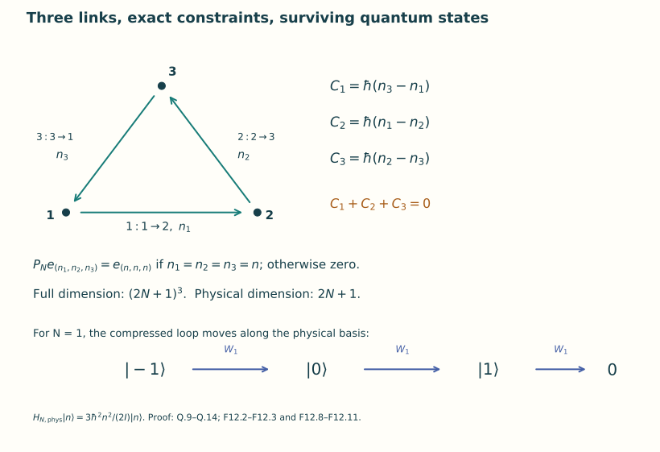
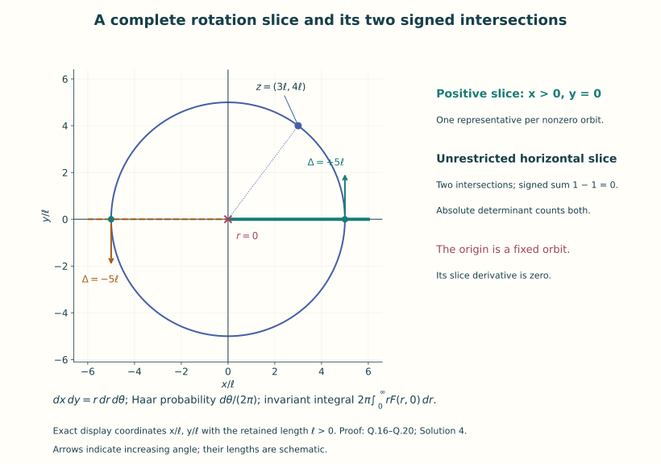
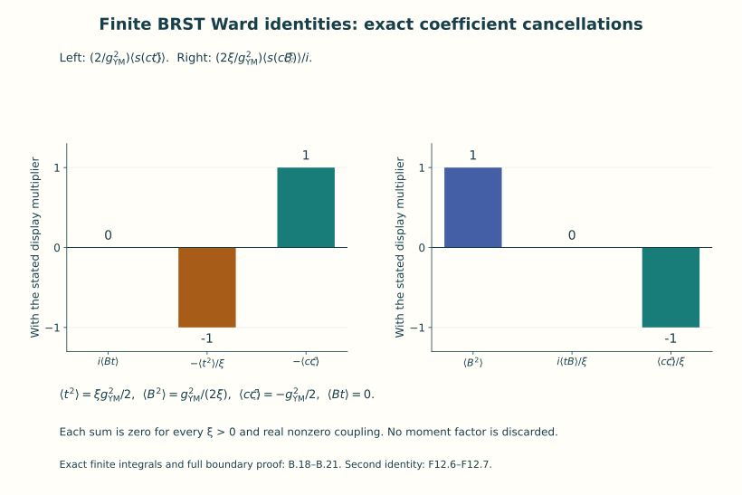

# Quantum gauge symmetry

Lesson YM-F12 · Geometry and states in Yang–Mills theory

The preceding lesson constructed quantum states, observables and dynamics
for a free scalar field. A gauge theory adds a constraint: different
field descriptions can refer to the same physical configuration. We now
calculate how this affects the state space and the integrals used in
quantum calculations.

Our first quantum model has only three links and finitely many Fourier
states. Its gauge transformations, constraints, Hamiltonian and
observables are actual finite matrices. A second model is a rotating
point in the plane. It makes the orbit, gauge slice, Jacobian and repeated
intersections visible. These constructions give a direct route to
Grassmann variables, BRST symmetry and Ward identities.

Read the original connection and action in
[Lesson 7](../action-and-field-equations.html), the Gauss constraint in
[Lesson 8](../constraints-initial-data-energy.html), and quantum states
and domains in [Lesson 11](../oscillators-and-free-quantum-fields.html).
The full elliptic operator used in background gauge was calculated in
[the Unit 10 operator chapter](../euclidean-lorentzian-operators.html).
All new algebraic and finite-integral constructions are given below.

## 0. What a quantum gauge constraint specifies

Let a gauge group act by unitary operators \(U(g)\) on a Hilbert space
\(\mathcal H\). In the charge-free constraint model studied here, the
physical Hilbert space is

\[
 \mathcal H_{\rm phys}
   =\{\psi\in\mathcal H:U(g)\psi=\psi\text{ for every }g\in G\}.
 \tag{F12.1}
\]

This is a closed linear space: each condition is the kernel of the
bounded operator \(U(g)-I\), and an intersection of closed sets is
closed. Its unit vectors define physical pure states with the same
constant-phase identification as in Lesson 11. Equation (F12.1) states
which constraint sector this lesson chooses. A different charge sector
would need its own definition.

An operator preserving this space can act on physical states. A bounded
self-adjoint operator commuting with every \(U(g)\) restricts to a
self-adjoint physical observable. To prove the last statement directly,
its restriction is bounded and symmetric on all of the physical Hilbert
space; the inner-product definition of the adjoint gives the same
operator on that entire space. The averaging projection constructed in
Section 3 makes this restriction explicit.

For a differentiable one-parameter group written
\(U(e^{tX})=e^{-itC_X/\hbar}\), differentiating an invariant vector
gives \(C_X\psi=0\) on the generator domain. The converse for the
identity component, and the additional condition for disconnected
groups, will be proved below. The continuum Gauss formula in Section 1
first identifies the original classical generator. The finite triangle
then supplies fully defined quantum matrices for the corresponding
constraint calculation.

**Gauge fixing** chooses a representative of each group orbit on a
specified domain. A **Jacobian** records how the integration density
changes under that choice. A **Grassmann algebra** supplies
anticommuting variables whose coefficient integrals represent signed
determinants. **BRST** names an odd, square-zero operation that encodes
the gauge transformation in that algebra. A **Ward identity** is a
relation among integrals obtained from a symmetry and its actual
boundary behaviour. Each definition is followed by a construction and
calculation, including cases where a proposed global gauge slice has
multiple intersections.

The ghost symbol \(c\) denotes an odd algebra element in the BRST
sections. Where the physical speed appears there, it is written
\(c_{\rm phys}\), with the exact identification stated. The connection
\(A\) is the original connection \(\Gamma\) of the earlier lessons;
its active rule remains \(A^u=uAu^{-1}-du\,u^{-1}\).

The field-level BRST formulas are identities in the defined algebra of
fields and their derivatives. The finite models provide the actual
integrals and proved Ward identities. The final Gaussian calculation
shows precisely what a finite-order perturbative expansion computes,
including a numerical coefficient and an explicit error bound.

## 1. The original Gauss generator and its signs

Retain F07–F08's closed matrix Lie group \(G\subset U(N)\), skew-Hermitian Lie algebra, and \(\kappa(X,Y)=-\operatorname{tr}(XY)\). Use physical time \(t\), speed \(c>0\), action unit \(\hbar>0\), and coupling \(g_{\mathrm{YM}}\ne0\). The actual connection is \(A=\Gamma\), with \(D_iX=\partial_iX+[A_i,X]\) and \(E_i=F_{ti}\). F8.4 and F8.22 give the momentum identified by the original trace pairing:

\[
 \Pi_i=\frac{2\hbar}{g_{\mathrm{YM}}^2c}E_i,\qquad
 \mathscr C=D_i\Pi_i=\frac{2\hbar}{g_{\mathrm{YM}}^2c}D_iE_i.
 \tag{Q.1}
\]

The momentum for \(A_t\) is zero because the original action has no \(\partial_tA_t\). The pure Gauss constraint is \(\mathscr C=0\). For the following differentiations take smooth fields on a three-torus, or take test parameters and variations compactly supported in a coordinate region, so the stated integration-by-parts terms vanish. In a fixed real Lie-algebra basis \(T_a\), write \(\kappa_{ab}=\kappa(T_a,T_b)\), \(A_i=A_i^aT_a\), and \(p_{ia}=\kappa_{ab}\Pi_i^b\). The canonical pairing is exactly
\(\int p_{ia}\delta A_i^a\,d^3x=\int\kappa(\Pi_i,\delta A_i)\,d^3x\).

Define the canonical bracket for differentiable functionals with these smooth functional derivatives by

\[
 \{F,H\}=\int\left(
  \frac{\delta F}{\delta A_i^a}\frac{\delta H}{\delta p_{ia}}
 -\frac{\delta F}{\delta p_{ia}}\frac{\delta H}{\delta A_i^a}
 \right)d^3x,
 \qquad \delta_HF=\{F,H\}.
 \tag{Q.2}
\]

This is a statement about these classical integrals, not about quantum operator distributions. For a fixed smooth \(\chi\) define

\[
 \mathcal G[\chi]=\int\kappa(\chi,D_i\Pi_i)\,d^3x
              =-\int\kappa(D_i\chi,\Pi_i)\,d^3x.
 \tag{Q.3}
\]

Trace invariance proves the second equality by integration by parts. Variation in \(\Pi_i\) gives \(-D_i\chi\). Variation in \(A_i\) uses
\(\kappa(\chi,[\delta A_i,\Pi_i])=\kappa([\Pi_i,\chi],\delta A_i)\). Thus (Q.2) gives the exact active infinitesimal maps

\[
 \delta_\chi A_i=-D_i\chi,\qquad
 \delta_\chi\Pi_i=[\chi,\Pi_i],\qquad
 \delta_\chi\mathscr C=[\chi,\mathscr C].
 \tag{Q.4}
\]

For the last equation, expand \(D_i[\chi,\Pi_i]+[-D_i\chi,\Pi_i]\); the two \([D_i\chi,\Pi_i]\) terms cancel, leaving \([\chi,D_i\Pi_i]\). These are precisely the derivatives of \(A^u=uAu^{-1}-du\,u^{-1}\) and \(\Pi^u=u\Pi u^{-1}\), with \(u=\exp(\varepsilon\chi)\). Applying (Q.4) to (Q.3) gives

\[
 \{\mathcal G[\chi],\mathcal G[\eta]\}
                   =\mathcal G[[\chi,\eta]].
 \tag{Q.5}
\]

Indeed \(\delta_\chi\mathcal G[\eta]=\int\kappa(\eta,[\chi,\mathscr C])=\mathcal G[[\eta,\chi]]\), and \(\delta_\chi\mathcal G[\eta]=\{\mathcal G[\eta],\mathcal G[\chi]\}\). In the vector-field convention \(\delta_HF=\{F,H\}\), this also gives \([\delta_\chi,\delta_\eta]=-\delta_{[\chi,\eta]}\), consistent with differentiating (Q.4) directly. These signs will fix the BRST calculation in Sections 7–13.

## 2. A normalized invariant measure for the compact groups used here

Since \(G\) is a closed matrix Lie subgroup of the compact group \(U(N)\), it is a compact smooth manifold. For \(v,w\in T_gG\), define a Riemannian metric

\[
 m_g(v,w)=\kappa(g^{-1}v,g^{-1}w).
 \tag{Q.6}
\]

Left translation preserves \(g^{-1}v\). Under right translation by \(h\), it becomes \(h^{-1}(g^{-1}v)h\); trace cyclicity proves that (Q.6) is unchanged. Hence both translations are isometries. In a chart its Riemannian density is \(\sqrt{\det(m_{ij})}\,|dx^1\cdots dx^d|\). The determinant transformation law and ordinary finite-dimensional change of variables show that these chart densities agree. A partition of unity therefore defines a global positive measure \(\operatorname{vol}_m\). The partition construction uses finitely many charts on this compact manifold; each weight can be supported in a chart with compact closure, where its smooth density is bounded. This proves \(\operatorname{vol}_m(G)<\infty\). A smaller coordinate ball has a strictly positive lower density bound, proving \(\operatorname{vol}_m(G)>0\).

For every point of the compact
smooth group, choose a chart containing concentric coordinate balls
whose closed outer ball stays inside that chart. The inverse images of
the smaller balls cover the group; compactness selects finitely many.
In each outer ball, a smooth bump is obtained by scaling and translating
\(b(z)=\exp[-1/(1-|z|^2)]\) for \(|z|<1\), with value zero outside.
Every derivative extends continuously as zero across the boundary:
successive derivatives are finite sums of powers of
\((1-|z|^2)^{-1}\) and coordinate polynomials times the same exponential,
and \(u^k e^{-u}\to0\) as \(u\to\infty\) for every integer k≥0.
These bumps are strictly positive on the smaller balls. Their finite sum
is therefore a positive smooth function on the whole group. Divide each
bump by that sum. The resulting smooth weights sum to one and have
compact support inside their charts. This is the partition used to
integrate the metric density. Independence of the chosen partition
follows by inserting a second partition, expanding the finite double
sum, and applying the density change-of-variables formula on each
overlap. Consequently the measure used by Q.7 is defined without an
unintroduced global construction.

Thus

\[
 d\mu(g)=\operatorname{vol}_m(G)^{-1}d\operatorname{vol}_m(g)
 \tag{Q.7}
\]

is a probability measure invariant under left and right translation. Inversion is an isometry too: at \(g\), its differential is \(v\mapsto-g^{-1}vg^{-1}\), and the left-trivialized vector at \(g^{-1}\) is \(-vg^{-1}=-g(g^{-1}v)g^{-1}\). Trace invariance again preserves its norm and all pairings. Therefore inversion preserves \(\mu\).

For a zero-dimensional compact Lie group there are finitely many points, since its discrete open point-cover has a finite subcover; take normalized counting measure instead. For a disconnected positive-dimensional group the same density construction applies to every component and translations permute components with their volume. There are finitely many components: a finite collection of connected chart neighbourhoods covers the compact manifold and each lies in one component. This construction supplies all measure properties used below, without an unproved appeal to an invariant averaging symbol.

For \(U(1)=\{e^{i\theta}\}\) the metric induced by \(\kappa(i,i)=1\) is \(d\theta^2\), with period \(2\pi\). Its normalized measure is exactly \(d\theta/(2\pi)\). Product groups use the product measures; repeated change of variables proves their invariance. This is the measure in the finite model below.

## 3. Averaging is an orthogonal projection, with its domain specified

Let \(\mathcal H\) be a complex Hilbert space and \(U:G\to\mathcal U(\mathcal H)\) a strongly continuous unitary representation. For every \(\psi\in\mathcal H\), the map \(g\mapsto U(g)\psi\) is continuous on compact \(G\). Define its vector integral by uniformly approximating it with finite-valued measurable functions: cover \(G\) by finitely many sets on which its oscillation is at most \(\epsilon\), disjointize that cover, choose a value on each nonempty set, and sum that value times its measure. Any two such approximations differ in integral norm by at most the sum of their uniform errors. Completeness gives a limit independent of the approximation. Scalar products with a fixed vector pass through these finite sums and their norm limit. Thus the bounded linear operator

\[
 P\psi=\int_GU(g)\psi\,d\mu(g),\qquad
 \operatorname{Dom}P=\mathcal H,\qquad \|P\psi\|\leq\|\psi\|
 \tag{Q.8}
\]

is well defined. Left invariance gives \(U(h)P\psi=P\psi\) for every \(h\). Conversely an invariant vector has \(P\psi=\psi\). Hence the range is exactly the closed invariant subspace \(\mathcal H^G\), and \(P^2=P\). Finally unitarity and inversion invariance give \(P^*=P\), by moving \(U(g)\) across the Hilbert inner product and replacing \(g\) by \(g^{-1}\). Therefore \(P\) is the orthogonal projection onto \(\mathcal H^G\).

A bounded observable \(O\) commuting with every \(U(g)\) commutes with the finite sums defining \(P\), and hence with \(P\). Its physical action is its restriction to \(\mathcal H^G\). For an unbounded operator this argument alone is insufficient: its domain must also be invariant and appropriate limits must belong to that domain. The finite model below has bounded operators and an explicit full domain, so this issue does not arise there.

For a strongly differentiable vector, vanishing infinitesimal generators imply invariance under the identity component: if \((d/dt)_0U(e^{tX})\psi=0\), the representation property gives zero derivative at every \(t\), so \(U(e^{tX})\psi\) is constant. Products of these exponentials generate the identity component. To see the latter, the exponential map has derivative the identity at zero, hence contains an identity neighbourhood by the finite-dimensional inverse function theorem; products of that neighbourhood form an open subgroup, whose cosets are open, so its intersection with the connected identity component is the whole component. For disconnected groups, invariance under the other components remains an additional condition. Group averaging imposes it automatically.

## 4. An explicit finite quantum gauge system

Take a directed triangle with vertices \(1,2,3\) and edges \(1:1\to2\), \(2:2\to3\), \(3:3\to1\). Its link variables are \(U_e=e^{i\theta_e}\). A vertex gauge \(g_v=e^{i\alpha_v}\) acts by the same endpoint rule as parallel transport:

\[
 U_e\longmapsto g_{t(e)}U_eg_{s(e)}^{-1},\qquad
 \theta_e\longmapsto\theta_e+\alpha_{t(e)}-\alpha_{s(e)}\pmod{2\pi}.
 \tag{Q.9}
\]

This is a finite group action defined independently of any continuum limit. Choose an integer cutoff \(N\geq1\). Let \(\mathcal H_N\) be the span of the \((2N+1)^3\) orthonormal functions

\[
 e_{\boldsymbol n}(\boldsymbol\theta)
     =e^{i(n_1\theta_1+n_2\theta_2+n_3\theta_3)},
 \qquad -N\leq n_e\leq N,
 \tag{Q.10}
\]

with inner product given by the product probability measure \(\prod_e d\theta_e/(2\pi)\). Orthogonality is the elementary identity \(\int_0^{2\pi}e^{im\theta}d\theta/(2\pi)=\delta_{m0}\). On this finite space define

\[
 (\mathcal U(\boldsymbol\alpha)\psi)(\boldsymbol\theta)
  =\psi(\theta_e-\alpha_{t(e)}+\alpha_{s(e)}),
 \quad
 \begin{cases}
 C_1e_{\boldsymbol n}=\hbar(n_3-n_1)e_{\boldsymbol n},\\
 C_2e_{\boldsymbol n}=\hbar(n_1-n_2)e_{\boldsymbol n},\\
 C_3e_{\boldsymbol n}=\hbar(n_2-n_3)e_{\boldsymbol n}.
 \end{cases}\tag{Q.11}
\]

Then \(\mathcal U(\alpha)=\exp[-i\sum_v\alpha_vC_v/\hbar]\). The three \(C_v\) are commuting self-adjoint operators on the entire \(\mathcal H_N\), and \(C_1+C_2+C_3=0\). This last identity records the diagonal vertex transformation that acts trivially on all links. Integrating each phase in (Q.11) with normalized \(U(1)^3\) measure proves

\[
 P_Ne_{\boldsymbol n}
  =\begin{cases}e_{(n,n,n)},&n_1=n_2=n_3=n,\\0,&\text{otherwise},\end{cases}
 \quad
 \mathcal H_{N,\mathrm{phys}}=\bigcap_{v=1}^3\ker C_v
        =\operatorname{span}\{e_{(n,n,n)}:-N\leq n\leq N\}.
 \tag{Q.12}
\]

Thus the invariant state space has dimension \(2N+1\), and the averaging projection is computed completely. The redundant diagonal gauge causes no spurious infinite volume because its probability measure has total one.

For a positive parameter \(I\) with units action\(\times\)time, define the Hamiltonian

\[
 H_Ne_{\boldsymbol n}=\frac{\hbar^2}{2I}(n_1^2+n_2^2+n_3^2)e_{\boldsymbol n}.
 \tag{Q.13}
\]

It is a nonnegative self-adjoint finite matrix, commutes with all gauges, and restricts to eigenvalues \(3\hbar^2n^2/(2I)\) on physical states. This is the specified finite Hamiltonian; it is not asserted to be a uniquely selected regulator of the continuum action.

The loop product \(W=U_1U_2U_3=e^{i(\theta_1+\theta_2+\theta_3)}\) is invariant because the three vertex differences cancel. Let \(\mathsf R_N\) be the orthogonal Fourier cutoff onto \(\mathcal H_N\), and define \(W_N=\mathsf R_N M_W\mathsf R_N\), where \(M_W\) is multiplication by \(W\). Both factors commute with the gauge action, so \(W_N\) is a bounded gauge-invariant operator. Explicitly

\[
 W_Ne_{(n,n,n)}=
 \begin{cases}e_{(n+1,n+1,n+1)},&n<N,\\0,&n=N.
 \end{cases}\tag{Q.14}
\]

Its adjoint shifts down with the corresponding zero at \(-N\). The self-adjoint observable \((W_N+W_N^*)/2\) acts nontrivially within the physical space. The imaginary part \((W_N-W_N^*)/(2i)\) is self-adjoint too, and the two self-adjoint parts determine the original operator exactly. The operator \(W_N\) itself is not self-adjoint: on the top physical basis vector it vanishes, while its adjoint gives the preceding vector for N≥1. These are observables in the exact sense defined in Lesson 11. All constraints, domains, gauge transformations and observables have been exhibited as finite matrices.

Figure 1. The directed finite system of Q.9–Q.14. The three signed
charges sum to zero. Their common kernel keeps the actual states with
equal edge labels. The cutoff retains the endpoint states; its Wilson
operator is compressed and has the boundary commutator in F12.10.

## 5. Gauge fixing with the full Jacobian, singular orbit, and residual copies

Consider the different finite configuration space \(\mathbb R^2\), with coordinates \((x,y)\) of length units, group action \(z=x+iy\mapsto e^{i\theta}z\), and a fixed length \(\ell>0\). Define

\[
 S_0(x,y)=\frac{\hbar}{2\ell^2}(x^2+y^2),\qquad
 Z=\int_{\mathbb R^2}e^{-S_0/\hbar}\,dx\,dy=2\pi\ell^2.
 \tag{Q.15}
\]

The integral is the product of two ordinary Gaussian integrals; alternatively the polar calculation below proves its value. The origin is fixed by the entire group. Every other orbit is a circle with trivial stabilizer.

Use the slice \(f(x,y)=y=0\), with the additional restriction \(x>0\). The map

\[
 \Phi:(0,\infty)\times U(1)\longrightarrow\mathbb R^2\setminus\{0\},
 \quad\Phi(r,e^{i\theta})=(r\cos\theta,r\sin\theta)
 \tag{Q.16}
\]

is a smooth bijection with smooth inverse \((x,y)\mapsto(r,(x+iy)/r)\). In angular charts its derivative matrix is
\(\begin{pmatrix}\cos\theta&-r\sin\theta\\\sin\theta&r\cos\theta\end{pmatrix}\), whose determinant is exactly \(r\). Therefore, for every integrable gauge-invariant \(F(x,y)=F(r,0)\),

\[
 \int_{\mathbb R^2}F(x,y)\,dx\,dy
      =2\pi\int_0^\infty rF(r,0)\,dr.
 \tag{Q.17}
\]

The origin has zero two-dimensional Lebesgue measure; deleting it changes this integral by zero, but does not make its stabilizer or its gauge derivative regular.

The infinitesimal derivative of the slice function is

\[
 \Delta(x,y)=\left.\frac{d}{d\theta}\right|_0 f(e^{i\theta}(x+iy))=x.
 \tag{Q.18}
\]

On the positive slice it is \(r>0\). For a fixed nonzero \(z\), the function \(\theta\mapsto\operatorname{Im}(e^{i\theta}z)\) has two simple zeros in one period. Precisely one has positive real part; its derivative there is \(r\). The one-variable substitution formula for delta distributions therefore gives

\[
 \int_0^{2\pi}d\theta\,
   \delta\bigl(f(e^{i\theta}z)\bigr)
   \Delta(e^{i\theta}z)\,\mathbf1_{\operatorname{Re}(e^{i\theta}z)>0}=1.
 \tag{Q.19}
\]

With normalized Haar measure \(d\theta/(2\pi)\), the right side is \(1/(2\pi)\). This factor must be retained when inserting the identity. The delta substitution rule used here follows by splitting the circle into small intervals around its simple zeros, using the invertible variable \(u=f(\theta)\) on each, and applying \(\int\delta(u)h(u)du=h(0)\). Outside these intervals the distribution has no support.

Insert (Q.19) into the integral of an integrable invariant function. For fixed \(\theta\), rotate the Cartesian variables; this change has determinant one and preserves the function. The angular integral is then \(2\pi\), proving the exact finite Faddeev–Popov formula

\[
 \int_{\mathbb R^2}F\,dx\,dy
   =2\pi\int_{\mathbb R^2}F\,\delta(y)\,x\,\mathbf1_{x>0}\,dx\,dy
   =2\pi\int_0^\infty rF(r,0)\,dr.
 \tag{Q.20}
\]

For arbitrary integrable functions one may apply this after averaging the function over rotations; no invariance is silently assumed. For (Q.15), \(\int_0^\infty r e^{-r^2/(2\ell^2)}dr=\ell^2\), proving the partition value and all Jacobian factors.

If the restriction \(x>0\) is removed, the two slice intersections \((r,0)\) and \((-r,0)\) remain as residual copies. The integral in (Q.19) with \(|\Delta|\) and both intersections is two; a factor \(1/2\) is required. With the signed determinant \(\Delta\) and both intersections, the two contributions are \(+1\) and \(-1\), giving zero. At the zero orbit \(\Delta=0\), the simple-root formula does not apply at all. These are exact statements about the slice's domain and multiplicities, not an assertion that a single gauge function is globally valid.

The ghost determinant in the next section represents the signed determinant. It does not automatically supply its absolute value or remove the second intersection. Thus the positive slice, the multiplicity correction on the unrestricted slice, and the signed cancellation are mathematically different integrals whose comparisons have been calculated explicitly.

Figure 2. Exact slice maps Q.16–Q.20 for the point (3ℓ,4ℓ), radius 5ℓ,
with the retained length ℓ>0. The displayed coordinates are x/ℓ and y/ℓ.
The origin is a separate fixed orbit with zero slice derivative. The
Jacobian and angular probability-measure factor are stated explicitly.
Arrows indicate increasing angle; their lengths are schematic.

## 6. Grassmann algebra, integration order, and the determinant

For \(n\geq1\), form the complex exterior algebra on \(2n\) ordered generators
\(c_1,\bar c_1,c_2,\bar c_2,\ldots,c_n,\bar c_n\). Products are associative and each pair of odd generators anticommutes; each generator squares to zero. Every element has a unique finite expansion in increasing products of distinct generators, since these products define a basis. A left derivative \(\partial_\theta\) is the odd derivation with \(\partial_\theta\theta=1\), derivative zero on the other generators, and
\(\partial_\theta(ab)=(\partial_\theta a)b+(-1)^{|a|}a\partial_\theta b\) for homogeneous \(a\).

Define the Berezin integral to be the coefficient of
\(\Omega=c_1\bar c_1c_2\bar c_2\cdots c_n\bar c_n\). Our measure notation is

\[
 \int d\bar c_n\,dc_n\cdots d\bar c_1\,dc_1\;\Omega=1.
 \tag{Q.21}
\]

The rightmost written variable is differentiated first, so (Q.21) agrees with successive left derivatives. In particular \(\int d\bar c\,dc\;\bar c c=-1\). Integration of a left derivative in any generator is zero: the derivative has no term containing that generator and cannot contain the top monomial.

For any ordinary complex \(n\times n\) matrix \(M\),

\[
 \boxed{\int d\bar c_n\,dc_n\cdots d\bar c_1\,dc_1\;
             e^{-\sum_{i,j}\bar c_iM_{ij}c_j}=\det M.}
 \tag{Q.22}
\]

The exponential is a finite polynomial. To prove the formula with its signs, rewrite its exponent as \(\sum_i K_i\), where \(K_i=\sum_jM_{ij}c_j\bar c_i\). These even quadratic elements commute, and \(K_i^2=0\), so the exponential is \(\prod_{i=1}^n(1+K_i)\). Only the product of all \(K_i\) can contribute to \(\Omega\). Terms repeating a \(c_j\) vanish. For a permutation \(\pi\), the remaining product is \(\prod_iM_{i\pi(i)}c_{\pi(1)}\bar c_1\cdots c_{\pi(n)}\bar c_n\); reordering only its \(c\) labels relative to the fixed bar labels changes the top coefficient by \(\operatorname{sgn}\pi\). One way to check the sign is to exchange two \(c\) positions in the full ordered list: it is an odd permutation regardless of the intervening bar positions. This proves precisely the determinant expansion.

If \(M\) is invertible, differentiating the finite polynomial identity in its entry \(M_{ij}\) gives

\[
 \langle c_j\bar c_i\rangle_M=(M^{-1})_{ji},\qquad
 \langle\bar c_i c_j\rangle_M=-(M^{-1})_{ji},
 \tag{Q.23}
\]

where the brackets divide the integral by \(\det M\). Indeed differentiating the exponential inserts \(-\bar c_i c_j=c_j\bar c_i\), and the derivative of the determinant is its cofactor, \(\det M(M^{-1})_{ji}\). At \(\det M=0\), the unnormalized identity (Q.22) remains true, but these normalized ratios are undefined.

The determinant includes the chosen pairing and all coupling factors. If a finite regulator has a positive pairing matrix \(H_{IJ}\), and its ghost action is

\[
 S_{\rm gh}=\frac{\hbar}{g_{\mathrm{YM}}^2}
                 \bar c^I H_{IK}\Delta^K{}_Jc^J,
\]

the coefficient measure (Q.21) gives

\[
 \int D\bar c\,Dc\,e^{-S_{\rm gh}/\hbar}
       =(g_{\mathrm{YM}}^2)^{-n}\det H\det\Delta.
 \tag{Q.24}
\]

If instead one defines antighost covector variables \(\bar\gamma_K=\bar c^I H_{IK}\) and chooses their coefficient measure, the answer is \((g_{\mathrm{YM}}^2)^{-n}\det\Delta\). The comparison of measures is \(D\bar c=(\det H)D\bar\gamma\): an odd linear change \(\eta=M\theta\) multiplies the top monomial by \(\det M\), so its integration measure transforms by the reciprocal determinant. This proves the stated comparison. The original trace matrix, quadrature weights, and metric density may occur in \(H\); they cannot be removed without recording this actual coordinate and measure change.

For the positive rotation slice, (Q.22) with \(n=1\) and \(M=r\) produces exactly the positive Jacobian \(r\). On the negative slice it produces \(-r\), exactly the signed contribution already found in (Q.20). This makes the determinant's geometric meaning and its global limitation explicit.

## 7. A defined graded algebra and the original active BRST differential

Choose a real basis \(T_a\) of the skew-Hermitian matrix Lie algebra, with \([T_a,T_b]=f_{ab}{}^dT_d\), and retain \(\kappa_{ab}=-\operatorname{tr}(T_aT_b)\). Work over the complex numbers in the graded-commutative differential algebra generated by the even variables \(A_\mu^a,b^a\), the odd variables \(c^a,\bar c^a\), and their formal derivatives \(\partial_I\) for all finite multiindices \(I\). Every element is a polynomial in finitely many generators; odd generators anticommute and square to zero. The total derivatives \(\partial_\mu\) shift the derivative multiindex, are even derivations, and commute. Smooth metric and background-connection coefficients can be adjoined as even functions with their actual derivatives. This defines the algebra without any integral over fields.

Assign ghost numbers \(0,0,+1,-1\) to \(A,b,c,\bar c\), respectively. Let \(s\) be an odd derivation of ghost number one, commuting with every \(\partial_\mu\). Its product convention is

\[
 s(XY)=(sX)Y+(-1)^{|X|}X(sY).
 \tag{B.1}
\]

For differential forms, the exterior-product signs and ghost-parity signs are accounted for separately; the coefficient derivation \(s\) commutes with the exterior derivative. The following component proof avoids any ambiguity about total-degree conventions.

Write \(c=c^aT_a\) and similarly for the other matrix-valued generators. The derivative of the course's active rule is \(\delta_\chi A_\mu=-D_\mu\chi\), as proved in Q.4. Define

\[
 sA_\mu=-D_\mu c=-\partial_\mu c-[A_\mu,c],\qquad
 sc=c^2=\tfrac12c^ac^b[T_a,T_b],\qquad
 s\bar c=i b,\qquad sb=0.
 \tag{B.2}
\]

Here \([A_\mu,c]=A_\mu c-cA_\mu\), since \(A_\mu\) is even. The equality for \(c^2\) follows by exchanging the two odd coefficients in half the sum, so \(sc\) is Lie-algebra valued. In components,
\(sc^d=\tfrac12f_{ab}{}^dc^ac^b\). The plus sign is fixed by the active convention and is not borrowed from another convention.

Here is the full nilpotence calculation. By (B.1),

\[
 s(D_\mu c)=D_\mu(sc)+(sA_\mu)c+c(sA_\mu).
\]

Substitution gives

\[
 \begin{aligned}
 s^2A_\mu&=-D_\mu(c^2)+(D_\mu c)c+c(D_\mu c)=0,\\
 s^2c&=s(c^2)=(sc)c-c(sc)=c^2c-cc^2=0,\\
 s^2\bar c&=i\,sb=0,\qquad s^2b=0.
 \end{aligned}\tag{B.3}
\]

The first equality uses that the even operator \(D_\mu\) obeys \(D_\mu(c^2)=(D_\mu c)c+c(D_\mu c)\); the second uses associativity. The square of an odd derivation is an even derivation: expanding \(s^2(XY)\) by (B.1) makes the two cross terms cancel. Since it vanishes on all generators and commutes with their derivatives, (B.3) proves \(s^2=0\) on the entire algebra, without imposing the field equation or eliminating \(b\).

The curvature and any even matter column in a fixed representation transform by

\[
 sF_{\mu\nu}=[c,F_{\mu\nu}],\qquad s\psi=\rho_*(c)\psi.
 \tag{B.4}
\]

For the first, differentiate \(F\) using \(sA=-Dc\): its variation is \(-[D_\mu,D_\nu]c=-[F_{\mu\nu},c]\), where the derivative commutator follows by expanding both products and using Jacobi. For the second, this is the derivative of the given group action on a column. The representation preserves brackets, so \(\rho_*(c^2)=\rho_*(c)^2\); hence \(s^2\psi=\rho_*(c^2)\psi-\rho_*(c)^2\psi=0\). No matter-field Lagrangian or scalar-field quantization is chosen here.

As a direct check on curvature nilpotence,
\(s^2F=[c^2,F]-c[c,F]-[c,F]c=0\), with the three terms canceling after expansion. Since \(F\) is even, trace cyclicity gives
\(s\kappa(F_{\mu\nu},F^{\mu\nu})=-\operatorname{tr}[c,F_{\mu\nu}F^{\mu\nu}]=0\). Thus the original Yang–Mills action is BRST invariant coefficient by coefficient in this algebra.

## 8. Gauge fixing, the exact ghost operator, and every original factor

Take a fixed oriented Euclidean metric on a compact four-manifold without boundary, or work with the varied fields and test fields compactly supported in a coordinate domain. Set \(w=\sqrt{\det g}\). Keep a specified background connection \(\bar A\) fixed under \(s\), and define the gauge function

\[
 f(A)=\frac1w\bar D_\mu\bigl(wg^{\mu\nu}(A_\nu-\bar A_\nu)\bigr),
 \quad \bar D_\mu X=\partial_\mu X+[\bar A_\mu,X].
 \tag{B.5}
\]

It is an adjoint scalar under simultaneous background and field frame changes, with all metric derivatives included. Indeed \(A^u-\bar A^u=u(A-\bar A)u^{-1}\), and expanding the derivative of \(uXu^{-1}\) gives \(\bar D^u_\mu(uXu^{-1})=u\bar D_\mu X u^{-1}\); the derivatives of \(u\) cancel the two inhomogeneous connection terms. These identities inserted into (B.5) give \(f^u=u f u^{-1}\). Its actual Faddeev–Popov derivative with the background held fixed is

\[
 \boxed{\Delta_A\chi=\left.\frac d{d\varepsilon}\right|_0
             f(A^{e^{\varepsilon\chi}})
       =-\frac1w\bar D_\mu\bigl(wg^{\mu\nu}D^A_\nu\chi\bigr),
        \qquad sf(A)=\Delta_Ac.}
 \tag{B.6}
\]

This proves the sign of the ghost operator, not only its principal part. For example, inside the derivative the entire expression is \(wg^{\mu\nu}(\partial_\nu\chi+[A_\nu,\chi])\); the outer operator differentiates these metric, density and connection coefficients and adds \([\bar A_\mu,\cdot]\). No first- or zero-order term is omitted.

At \(A=\bar A\), integration by parts with the stated boundary condition gives

\[
 \int w\kappa(\chi,\Delta_{\bar A}\chi)\,d^4x
    =\int wg^{\mu\nu}\kappa(\bar D_\mu\chi,\bar D_\nu\chi)\,d^4x\geq0.
 \tag{B.7}
\]

For real smooth \(\chi\), its kernel under these conditions consists exactly of covariantly constant \(\chi\), since a continuous nonnegative integrand with zero integral vanishes pointwise. Thus on a flat torus at \(\bar A=0\), constant ghosts are genuine zero modes. Inverses and determinants must be taken on a stated complement if these modes are removed; an unexplained determinant over all modes would be zero. No positivity claim is made for the general off-background operator.

Let \(\xi>0\) be a specified gauge parameter. Define the odd gauge fermion

\[
 \Psi=-\frac{2\hbar}{g_{\mathrm{YM}}^2}
          \int w\,\kappa\left(\bar c,f(A)+\frac{i\xi}{2}b\right)d^4x.
 \tag{B.8}
\]

The pairing means its original ordered bilinear extension to Grassmann coefficients; odd factors cannot be interchanged without their signs. By (B.1)–(B.2),

\[
 \boxed{\begin{aligned}
 S_{\mathrm{tot}}={}&S_E[A]+s\Psi,\\
 S_E[A]={}&\frac{\hbar}{2g_{\mathrm{YM}}^2}
       \int w\,\kappa(F_{\mu\nu},F^{\mu\nu})\,d^4x,\\
 s\Psi={}&\frac{2\hbar}{g_{\mathrm{YM}}^2}\int w
      \left[-i\kappa(b,f(A))+\frac{\xi}{2}\kappa(b,b)
                      +\kappa(\bar c,\Delta_Ac)\right]d^4x.
 \end{aligned}}
 \tag{B.9}
\]

All curvature contractions are the complete ordered sums of F07. In particular there is no change from the defining trace to an orthonormal Lie-algebra pairing. The ghost term's plus sign comes from the minus sign in front of \(\bar c\) in (B.8) and the odd Leibniz rule. The auxiliary quadratic term is positive for real \(b\) in Euclidean signature, while its coupling to \(f\) is imaginary. Equation (B.3) and pointwise invariance of \(S_E\) prove \(sS_{\mathrm{tot}}=0\) as an exact algebraic identity.

When all four coordinates have length units, \(A_\mu\) has units length\(^{-1}\), \(c\) is dimensionless, and \(f,b,\bar c\) have units length\(^{-2}\). Thus every integrand in (B.9), after the four-volume factor, is dimensionless before multiplication by \(\hbar\). Ghost number of each action term is zero. The factor two in (B.8) is specified so that after auxiliary integration the gauge term is \(\hbar/(\xi g_{\mathrm{YM}}^2)\int w\kappa(f,f)\); at \(\xi=1\) its quadratic contribution gives exactly the minimal operator \(L+D^\nu G\) derived in the F10 analytical bridge. It is not silently inherited from another action convention.

The ghost \(c\) in this file is distinct from the physical speed in Q.1. Denote that same physical speed here by \(c_{\rm phys}>0\) to display the coordinate comparison without a collision of symbols. On flat Euclidean space set \(x^0=c_{\rm phys}\tau\), leaving the three spatial coordinates unchanged. Then \(g_{\tau\tau}=c_{\rm phys}^2\), \(w=c_{\rm phys}\), \(A_\tau=c_{\rm phys}A_0\), and \(F_{\tau i}=c_{\rm phys}F_{0i}\), by the transformation laws for a one-form and a two-form. Consequently the exact formulas become

\[
 \begin{aligned}
 f(A)&=c_{\rm phys}^{-2}\bar D_\tau(A_\tau-\bar A_\tau)
              +\sum_{i=1}^3\bar D_i(A_i-\bar A_i),\\
 \Delta_A&=-c_{\rm phys}^{-2}\bar D_\tau D^A_\tau
                         -\sum_{i=1}^3\bar D_iD^A_i,\\
 S_E&=\frac{\hbar}{2g_{\mathrm{YM}}^2}\int c_{\rm phys}
     \left[\frac{2}{c_{\rm phys}^2}\sum_{i=1}^3
                    \kappa(F_{\tau i},F_{\tau i})
           +2\sum_{1\leq i<j\leq3}\kappa(F_{ij},F_{ij})\right]
                   d\tau\,d^3x,\\
 s\Psi&=\frac{2\hbar}{g_{\mathrm{YM}}^2}\int c_{\rm phys}
       \left[-i\kappa(b,f)+\frac\xi2\kappa(b,b)
                         +\kappa(\bar c,\Delta_Ac)\right]d\tau\,d^3x.
 \end{aligned}
\]

Each factor two in the action is the sum of its two ordered antisymmetric curvature components; the displayed change has not set the speed, the coupling, or the action unit to one. In particular \(A_\tau\) has units time\(^{-1}\), \(F_{\tau i}\) has units time\(^{-1}\)length\(^{-1}\), while \(f,b,\bar c\) retain units length\(^{-2}\). Substitution of \(d x^0=c_{\rm phys}d\tau\) and \(D_\tau=c_{\rm phys}D_0\) gives exactly the preceding length-coordinate formulas. This is a real coordinate change within Euclidean signature, not an assertion about analytic continuation of a quantum theory.

The auxiliary integration can be proved for a finite regulator with positive real pairing matrix \(H\), real column \(f\), and \(n\) auxiliary coefficients. Its exact value is

\[
 \begin{aligned}
 &\int_{\mathbb R^n}d^n b\,
   \exp\left[-\frac{2}{g_{\mathrm{YM}}^2}
          \left(\frac\xi2 b^THb-i b^THf\right)\right]\\
 &\hspace{12mm}=
   \left(\frac{\pi g_{\mathrm{YM}}^2}{\xi}\right)^{n/2}
   (\det H)^{-1/2}
   \exp\left[-\frac{f^THf}{\xi g_{\mathrm{YM}}^2}\right].
 \end{aligned}\tag{B.10}
\]

Diagonalize the positive matrix by an orthogonal real transformation, keeping its determinant, and apply the one-variable Fourier Gaussian in each direction. To prove that Gaussian without an unverified complex contour shift, differentiate \(I(a)=\int e^{-\beta b^2/2+iab}db\) for \(\beta>0\). Dominated differentiation and real integration by parts give \(I'(a)=-aI(a)/\beta\), while the elementary Gaussian integral gives \(I(0)=\sqrt{2\pi/\beta}\). Solving this ordinary differential equation gives \(I(a)=\sqrt{2\pi/\beta}e^{-a^2/(2\beta)}\), proving (B.10).

In the original coefficient ghost measure, (Q.22) gives the additional factor

\[
 \int D\bar c\,Dc\,
     e^{-(2/g_{\mathrm{YM}}^2)\bar c^TH\Delta_Ac}
       =\left(\frac2{g_{\mathrm{YM}}^2}\right)^n\det H\det\Delta_A.
 \tag{B.11}
\]

Equations (B.10) and (B.11) retain their full constants. They are finite-dimensional identities. A spacetime functional determinant requires a further defined limiting or regularization procedure; neither equation asserts one.

## 9. Introductory cohomology and the auxiliary pair

Because \(s^2=0\), its image at ghost number zero lies in its kernel there. The algebraic cohomology is the actual quotient \(H^0(s)=\ker(s:\mathcal A^0\to\mathcal A^1)/s\mathcal A^{-1}\). This definition alone does not identify it with an unspecified quantum Hilbert space.

A complete elementary example uses complex polynomial functions of \((x,y)\) from Q.15 and a single ghost \(c\):

\[
 sx=-yc,\qquad sy=xc,\qquad sc=0.
 \tag{B.12}
\]

For polynomials of ghost number zero, \(sF=c(-y\partial_x+x\partial_y)F\). Thus closed polynomials are exactly the rotation-invariant polynomials. Put \(z=x+iy\), \(\bar z=x-iy\), now viewed as independent polynomial coordinates over \(\mathbb C\). Every polynomial is a sum of \(z^m\bar z^n\), and the rotation derivative multiplies this monomial by \(i(m-n)\). Hence the kernel is exactly \(\mathbb C[z\bar z]=\mathbb C[x^2+y^2]\). The minimal algebra has no negative ghost-number elements, so

\[
 H^0(s)=\mathbb C[x^2+y^2]
 \tag{B.13}
\]

in this defined example.

Adding the independent pair \(s\bar c=i b\), \(sb=0\) does not alter this cohomology. Define the odd operator \(h=(\bar c/i)\partial_b\), and let \(N\) count the number of \(b\) and \(\bar c\) factors. On the two generators, direct evaluation gives \((sh+hs)b=b\) and \((sh+hs)\bar c=\bar c\); on every other generator both sides vanish. Both sides are even derivations, so

\[
 sh+hs=N.
 \tag{B.14}
\]

For an \(s\)-closed polynomial of positive homogeneous pair-degree \(m\), this gives \(F=s(hF/m)\). Splitting a polynomial by its finite pair-degrees proves that its cohomology class has a representative independent of the pair. Evaluation at \(b=\bar c=0\) commutes with \(s\), so an exact element cannot create a new relation among pair-independent classes. This proves the claimed cohomology isomorphism. The same proof applies to finitely many such pairs, including the finitely many derivative pairs occurring in an individual polynomial. Keeping the auxiliary field also preserves off-shell nilpotence; eliminating it in favour of a field-dependent expression is a different operation whose induced differential is not assumed nilpotent without checking it.

## 10. A finite bosonic Ward identity with all boundaries controlled

Use exactly the convergent integral Q.15. Let \(V=-y\partial_x+x\partial_y\), the infinitesimal rotation vector field. It has \(\operatorname{div}V=0\), satisfies \(VS_0=0\), and is tangent to every boundary circle. For every polynomial \(O(x,y)\), apply the two-dimensional divergence theorem on a radius-\(R\) disk to \(Oe^{-S_0/\hbar}V\). Its boundary flux is zero because the normal component of \(V\) is zero, for each finite \(R\). The volume divergence is \((VO)e^{-S_0/\hbar}\). Letting \(R\to\infty\) is legitimate since a polynomial times the Gaussian is absolutely integrable. Therefore

\[
 \langle VO\rangle=0,
 \quad -m\langle x^{m-1}y^{n+1}\rangle
       +n\langle x^{m+1}y^{n-1}\rangle=0
 \quad(m,n\geq0),
 \tag{B.15}
\]

where terms with zero prefactor are omitted. In particular \(\langle x^2\rangle=\langle y^2\rangle=\ell^2\).

For real sources \(J_x,J_y\) of units length\(^{-1}\), completing two real squares gives

\[
 Z(J_x,J_y)=2\pi\ell^2
    \exp\left[\frac{\ell^2}{2}(J_x^2+J_y^2)\right],\qquad
 (-J_x\partial_{J_y}+J_y\partial_{J_x})Z=0.
 \tag{B.16}
\]

The source-dependent integrand and all polynomial derivatives still have Gaussian decay. Applying the same divergence identity to the exponential source proves the displayed differential Ward identity independently of the explicit evaluation. Thus both the measure invariance and boundary step are verified in an actual finite integral.

## 11. A nonzero, convergent finite BRST integral

The signed determinant on the full compact rotation orbit gives the two-copy cancellation of Q.20. A nonzero normalized expectation must not divide that zero by itself. Here is a separate finite system in which the complete BRST integration argument is valid and nonzero.

The cancellation can also be seen in an entirely convergent auxiliary-field integral. For this rotation model take a separate parameter \(\zeta>0\) of units length squared, and give \(b,\bar c\) units length\(^{-1}\), with \(c\) dimensionless. Use (B.12), \(s\bar c=i b\), \(sb=0\), and the gauge function \(f=y\). The gauge contribution from \(\Psi=-(2\hbar/g_{\mathrm{YM}}^2)\bar c(y+i\zeta b/2)\) is \((2\hbar/g_{\mathrm{YM}}^2)(-iby+\zeta b^2/2+\bar c x c)\). Together with Q.15's radial Gaussian, each coefficient of its exponential is absolutely integrable in real \(x,y,b\). Integrating ghosts and then \(b\) produces the full factor \((2x/g_{\mathrm{YM}}^2)\sqrt{\pi g_{\mathrm{YM}}^2/\zeta}\) times \(\exp[-(x^2+y^2)/(2\ell^2)-y^2/(\zeta g_{\mathrm{YM}}^2)]\). Its integral is zero because the integrand is odd in \(x\). Thus in this compact rotation model the vanishing signed gauge-fixed normalization is an explicitly proved cancellation, even though the original gauge-invariant partition Q.15 is positive. The positive slice in Q.20 and the separately defined model below are the actual nonzero constructions used here.

Take \(r\in(0,\infty)\) of length units, dimensionless real variables \(t,B\), dimensionless odd variables \(c,\bar c\), and \(\xi>0\). Define

\[
 sr=0,\quad st=c,\quad sc=0,\quad
 sB=-\frac{i}{\xi}c,\quad s\bar c=iB-\frac{t}{\xi}.
 \tag{B.17}
\]

Then \(s^2t=s^2B=0\), and \(s^2\bar c=i(-ic/\xi)-c/\xi=0\); hence \(s^2=0\) by the derivation argument of Section 7. These formulas are the exact change of auxiliary coordinate
\(b=B+i t/\xi\) in the rules \(st=c\), \(s\bar c=i b\), \(sb=0\). We define (B.17) directly on real \(t,B\) with complex polynomial coefficients; no contour argument is needed to define the integral.

The action and integration functional are

\[
 \begin{aligned}
 S_{\rm fin}&=\frac{\hbar r^2}{2\ell^2}
  +\frac{2\hbar}{g_{\mathrm{YM}}^2}
       \left(\frac{t^2}{2\xi}+\frac\xi2B^2+\bar c c\right),\\
 \mathcal I(O)&=\int_0^\infty r\,dr\int_{\mathbb R^2}\frac{dt\,dB}{2\pi}
            \int d\bar c\,dc\;O\,e^{-S_{\rm fin}/\hbar}.
 \end{aligned}\tag{B.18}
\]

It is defined by first taking the finite Grassmann coefficient and then ordinary Lebesgue integrals. Every coefficient for polynomial \(O\) is a polynomial times strictly decaying real Gaussians in \(r,t,B\); it is absolutely integrable. Different orders of these ordinary integrals therefore agree.

The gauge part is \(s\)-exact. With
\(\Psi_{\rm fin}=-(2\hbar/g_{\mathrm{YM}}^2)\bar c(t/2+i\xi B/2)\), direct use of (B.17) gives
\(s\Psi_{\rm fin}=(2\hbar/g_{\mathrm{YM}}^2)(t^2/(2\xi)+\xi B^2/2+\bar c c)\). Equivalently, before the exact variable change it is the action \((2\hbar/g_{\mathrm{YM}}^2)(-ibt+\xi b^2/2+\bar c c)\), obtained from the gauge function \(f=t\), its derivative \(\Delta=1\), and the gauge fermion \(-(2\hbar/g_{\mathrm{YM}}^2)\bar c(t+i\xi b/2)\). These two expressions agree after substitution \(b=B+i t/\xi\). The specified real integration domain in (B.18) is part of this finite model.

Compute its normalization with all factors:

\[
 \begin{aligned}
 \int_{\mathbb R}e^{-t^2/(\xi g_{\mathrm{YM}}^2)}dt
       &=\sqrt{\pi\xi g_{\mathrm{YM}}^2},\\
 \int_{\mathbb R}e^{-\xi B^2/g_{\mathrm{YM}}^2}dB
       &=\sqrt{\pi g_{\mathrm{YM}}^2/\xi},\\
 \int d\bar c\,dc\,e^{-2\bar c c/g_{\mathrm{YM}}^2}
       &=2/g_{\mathrm{YM}}^2.
 \end{aligned}
 \quad\Longrightarrow\quad \mathcal I(1)=\ell^2>0.
 \tag{B.19}
\]

The \(t,B\) product is \(\pi g_{\mathrm{YM}}^2\); multiplication by the ghost factor and the stated \(1/(2\pi)\) leaves one. Thus the radial measure is exactly the quotient integral \(Z/(2\pi)\) in Q.17. For every integrable radial observable \(O(r)\), its normalized expectation in (B.18) equals the normalized expectation of \(O(|z|)\) in Q.15. This equality is an explicit integral comparison.

Geometrically \((r,t)\mapsto re^{it}\) is a covering map onto the punctured plane. In this finite model the gauge transformations translate \(t\) by arbitrary real amounts; their group is \(\mathbb R\), with deck transformations \(2\pi\mathbb Z\) in the comparison map. The quotient in both descriptions is the same positive radius. We do not identify the \(\mathbb R\) gauge volume with normalized compact Haar measure, nor replace the global two-copy calculation by a local assertion.

The BRST Ward identity is exact for every polynomial observable:

\[
 \boxed{\mathcal I(sO)=0,\qquad \langle sO\rangle_{\rm fin}=0.}
 \tag{B.20}
\]

To prove it, write the derivation with left derivatives as
\(s=c\partial_t-(i/\xi)c\partial_B+(iB-t/\xi)\partial_{\bar c}\). Each coefficient is independent of its own differentiated variable. Integration of the first two derivatives vanishes by ordinary integration by parts, since their coefficient integrands have Gaussian decay. Integration of the last vanishes by Q.21's Berezin derivative identity. There is no radial derivative and hence no radial boundary term at zero. Thus the unweighted coefficient integral of \(s(Oe^{-S_{\rm fin}/\hbar})\) vanishes. Finally \(sS_{\rm fin}=0\): the three gauge terms have derivatives \(tc/\xi\), \(-iBc\), and \((iB-t/\xi)c\), which cancel. Therefore \(s(Oe^{-S_{\rm fin}/\hbar})=(sO)e^{-S_{\rm fin}/\hbar}\), proving (B.20).

For a visible nontrivial instance, take \(O=\bar c t\). Then

\[
 s(\bar c t)=iBt-\frac{t^2}{\xi}-\bar c c,
 \quad \langle Bt\rangle=0,\quad
 \langle t^2\rangle=\frac{\xi g_{\mathrm{YM}}^2}{2},\quad
 \langle\bar c c\rangle=-\frac{g_{\mathrm{YM}}^2}{2}.
 \tag{B.21}
\]

The last sign follows from Q.21 and the normalization (B.19). These three values sum to zero as required. The normalization and every radial expectation are independent of \(\xi\) by their explicit evaluation in (B.19), supplying actual gauge-parameter independence in this finite system.

Figure 3. Exact moments in B.18–B.21 and F12.6–F12.7. Each row uses
its own stated display multiplier while retaining the original moment
formula. The coefficient integrals can have either sign; the physical
radial probability measure is the positive measure in F12.4.

## 12. Finite Gaussian perturbation theory, with a remainder bound

Let \(q\in\mathbb R^n\), with every coordinate having the same specified unit \(Q\), and let \(K\) be a real symmetric positive definite matrix whose entries have units action divided by \(Q^2\), so that \(q^TKq\) has units of action. The common coordinate unit makes the orthogonal transformations below dimensionally meaningful. Fix \(\hbar>0\). For a source covector \(J\) whose entries have units \(Q^{-1}\), so that \(J^Tq\) is dimensionless, the exact generating integral is

\[
 Z_0(J)=\int_{\mathbb R^n}
          e^{-q^TKq/(2\hbar)+J^Tq}\,d^nq
   =(2\pi\hbar)^{n/2}(\det K)^{-1/2}
       e^{\hbar J^TK^{-1}J/2}.
 \tag{B.22}
\]

For real \(J\), complete the real square by translating \(q\) by \(\hbar K^{-1}J\), then diagonalize \(K\) orthogonally and integrate each real Gaussian. This proves the full determinant coefficient. Polynomial differentiation in \(J\) is justified by a Gaussian majorant on each compact source set. Expanding the last exponential therefore gives the exact moment rule

\[
 \langle q_{i_1}\cdots q_{i_{2m}}\rangle_0
    =\hbar^m\sum_{\text{pairings }\mathcal P}
                 \prod_{(a,b)\in\mathcal P}(K^{-1})_{i_ai_b},
 \qquad \langle q_{i_1}\cdots q_{i_{2m+1}}\rangle_0=0.
 \tag{B.23}
\]

To check the multiplicity, the \(m\)-th term of \(\exp(\hbar J^TK^{-1}J/2)\) contains \(m\) unordered pairs; differentiating labels them in every order and within each pair in both orders. These \(2^m m!\) choices cancel the exponential denominator \(2^m m!\), leaving each pairing once. Thus (B.23) is proved without suppressing a combinatorial factor.

Now specify a real polynomial \(V(q)\geq0\), with action units, a real dimensionless \(\lambda\geq0\), and a polynomial observable \(O\). The interacting finite integral

\[
 I_O(\lambda)=\int O(q)e^{-[q^TKq/2+\lambda V(q)]/\hbar}\,d^nq
 \tag{B.24}
\]

exists absolutely. For every fixed integer \(N\geq0\), Taylor's formula for \(e^{-x}\) at \(x\geq0\), with its integral remainder, gives

\[
 \begin{aligned}
 I_O(\lambda)&=\sum_{j=0}^{N}\frac{(-\lambda)^j}{j!\hbar^j}
      \int O(q)V(q)^j e^{-q^TKq/(2\hbar)}\,d^nq+R_{O,N}(\lambda),\\
 |R_{O,N}(\lambda)|&\leq
  \frac{\lambda^{N+1}}{(N+1)!\hbar^{N+1}}
      \int |O(q)|V(q)^{N+1}e^{-q^TKq/(2\hbar)}\,d^nq.
 \end{aligned}\tag{B.25}
\]

The last integral is finite because a polynomial times a positive Gaussian is integrable. This proves an asymptotic expansion to every prescribed finite order. It does not claim convergence of the infinite series. Normalized expectations are also defined, since \(I_1(\lambda)>0\); their finite-order coefficients follow by division by the nonzero constant term, with the resulting finite remainder controlled on a sufficiently small nonnegative \(\lambda\)-interval.

Equations (B.22)–(B.25) and the finite Grassmann determinant are the mathematical operations behind perturbative Gaussian coefficients. In a specified finite collection of modes, they compute actual integrals or rigorously bounded asymptotic coefficients. At the field level, B.1–B.9 provide the exact differential algebra that is used to organize the corresponding formal coefficients. A finite Fourier cutoff of nonlinear fields is not automatically closed under this algebra: for example two retained ghost modes can have a sum frequency outside the cutoff in \(sc=c^2\). Thus no exact finite BRST Ward identity is inferred merely by naming a cutoff. The exact Ward identities proved here are B.15–B.21, with their actual measures and boundary analysis. A continuum Ward or perturbative identity additionally requires a specified regularization and a proof that its algebraic operations and integration rules preserve the identity; an interacting continuum measure or its limit has not been asserted.

## 13. Source comparison with the active sign retained

Original author TeX read: Glenn Barnich and Fabrizio Del Monte, *Introduction to Classical Gauge Field Theory and to Batalin–Vilkovisky Quantization*, [arXiv:1810.00442v1](https://arxiv.org/abs/1810.00442v1), [original source](https://arxiv.org/src/1810.00442v1). The intact arXiv response is a gzip-compressed single author file named `ms.tex`, not a tar archive; both compressed bytes and exact extracted author file are retained privately. Exact source identity and read ranges are in [the lesson provenance](../src/YM-F12-provenance.json).

The relevant source locators are its `eq:26`–`eq:28`, `eq:4BRSTghost1`, `eq:3ActionGauge1`, nonminimal-pair equations, and `eq:4GFermionYM1`, in the bounded ranges 1939–1978 and 2201–2485. The source's infinitesimal convention uses \(\delta A=D\epsilon\) and a ghost \(C\) with \(sC=-C^2\). The exact receiving substitution is \(C=-c\), with the connection unchanged: it gives \(sA=-Dc\) and \(-sc=-(-c)^2\), hence \(sc=+c^2\). For the nonminimal pair set the source auxiliary variable to \(B_{\mathrm{source}}=i b\), so its \(s\bar C=B_{\mathrm{source}}\), \(sB_{\mathrm{source}}=0\) become B.2. These substitutions compare the differential algebra. The Euclidean gauge fermion B.8, its factor \(2\hbar/g_{\mathrm{YM}}^2\), its original trace pairing, and its convergent finite auxiliary integral are independently specified and proved here; they are not identified with the source's differently arranged gauge-fixed action by deleting its factors or continuation choices.

The source's full BV existence results, continuum integration arguments, renormalization statements and anomaly results are not used as proof providers for this lesson. The exact finite Ward calculations and the Gaussian remainder estimate above supply the asserted integral statements. The earlier Haar construction and finite link Hilbert space are likewise complete constructions, not consequences imported from an unread source.

## 14. Three worked examples

### 14.1. A physical three-state system

Take the triangle cutoff \(N=1\). Its original Hilbert space has
\(3^3=27\) states in the Fourier basis. The constraints retain exactly
the three vectors \(|-1\rangle=e_{(-1,-1,-1)}\),
\(|0\rangle=e_{(0,0,0)}\), \(|1\rangle=e_{(1,1,1)}\).
In that order, the Hamiltonian and compressed Wilson loop are

\[
 H_{1,\rm phys}=\frac{3\hbar^2}{2I}
       \begin{pmatrix}1&0&0\\0&0&0\\0&0&1\end{pmatrix},\qquad
 W_1=\begin{pmatrix}0&0&0\\1&0&0\\0&1&0\end{pmatrix}.
 \tag{F12.2}
\]

The matrix \(W_1\) is a gauge-invariant operator. Its real and
imaginary parts, in the operator sense, are the self-adjoint observables

\[
 X_1=\frac{W_1+W_1^*}{2}
  =\frac12\begin{pmatrix}0&1&0\\1&0&1\\0&1&0\end{pmatrix},\qquad
 Y_1=\frac{W_1-W_1^*}{2i}
  =\frac12\begin{pmatrix}0&i&0\\-i&0&i\\0&-i&0\end{pmatrix}.
 \tag{F12.3}
\]

In particular \(W_1=X_1+iY_1\). The operator is fully retained while
the actual measurements have real spectra. Direct matrix multiplication
gives eigenvalues \(1/\sqrt2,0,-1/\sqrt2\) for \(X_1\), with unit
eigenvectors \((1,\sqrt2,1)^T/2\),
\((1,0,-1)^T/\sqrt2\), and \((1,-\sqrt2,1)^T/2\), respectively.
They are mutually orthogonal, so they give its complete spectral basis.
The Hamiltonian ground vector \(|0\rangle=(0,1,0)^T\) has squared
overlaps \(1/2,0,1/2\) with them. A measurement of \(X_1\) therefore
gives either \(1/\sqrt2\) or \(-1/\sqrt2\), each with probability
one half. Gauge constraints leave nontrivial physical measurements.

### 14.2. The measure on the orbit space

For the rotation model Q.15, the positive-radius quotient carries the
probability density

\[
 p(r)\,dr=\frac r{\ell^2}e^{-r^2/(2\ell^2)}\,dr,
 \qquad r>0.
 \tag{F12.4}
\]

The factor \(r\) is the exact orbit Jacobian. The substitution
\(u=r^2/(2\ell^2)\), with \(r\,dr=\ell^2du\), proves that this
density integrates to one. It also proves

\[
 \langle r^{2k}\rangle=(2\ell^2)^k k!,\qquad k\in\mathbb N_0.
 \tag{F12.5}
\]

Indeed the remaining integral is \(\int_0^\infty u^ke^{-u}du=k!\):
the value at k=0 is one, and integration by parts gives the recurrence
from k to k−1, with both endpoint terms zero. Thus
\(\langle r^2\rangle=2\ell^2\),
\(\langle r^4\rangle=8\ell^4\), and
\(\operatorname{Var}(r^2)=4\ell^4\).
These are the same expectations computed by the Cartesian Gaussian
and by the finite BRST model, because their exact integral comparisons
were proved in Q.17 and B.19.

### 14.3. A Ward identity with an auxiliary field

In the convergent finite model B.18, take the polynomial insertion
\(O=\bar c B\). The odd product rule and B.17 give

\[
 s(\bar c B)=iB^2-\frac{tB}{\xi}+\frac{i}{\xi}\bar c c.
 \tag{F12.6}
\]

The two even Gaussians factor, so \(\langle tB\rangle=0\), and
their second moments and the signed ghost coefficient are

\[
 \langle B^2\rangle=\frac{g_{\rm YM}^2}{2\xi},\qquad
 \langle\bar c c\rangle=-\frac{g_{\rm YM}^2}{2}.
 \tag{F12.7}
\]

The first identity follows by differentiating the Gaussian integral
with exponent \(-\xi B^2/g_{\rm YM}^2\). The second follows by taking
the coefficient of \(c\bar c\) and dividing by \(2/g_{\rm YM}^2\),
as in Q.21 and B.19. Inserting them into (F12.6) gives zero exactly.
The negative ghost coefficient is a value of the specified exterior-
algebra integration functional. The physical radial probabilities are
the positive density (F12.4).

## 15. Exercises

1. For the triangle with any cutoff \(N\ge1\), compute the full and
   physical dimensions, averaging projection, physical Hamiltonian
   spectrum and lowest excitation. Explain the redundant constraint.
2. Compute \([W_N,W_N^*]\) and \([X_N,Y_N]\) on the physical space.
   Find the complete spectrum and unit eigenvectors of \(X_N\).
   Retain the actual endpoint states created by the Fourier cutoff.
3. Give a compact gauge group and unitary representation for which
   every infinitesimal constraint vanishes but some vectors are not
   invariant. Calculate the full averaging projection.
4. Gauge-fix \(z=3\ell+4i\ell\) by the rotation slice \(y=0\).
   Compute both intersections and determinants. Then use (F12.4) to
   find the radial moments and compare with the integral obtained by
   omitting its Jacobian.
5. Evaluate the two-pair Grassmann integral for
   \(M=\begin{pmatrix}2&1\\3&2\end{pmatrix}\), including
   \(\langle c_1\bar c_2\rangle\) and
   \(\langle\bar c_2c_1\rangle\). For a separate two-coefficient
   regulator with \(H=\operatorname{diag}(h_1,h_2)\), \(h_1,h_2>0\),
   retain the full product of auxiliary and ghost factors in B.10–B.11.
6. Keep \(sA=-Dc\) but write \(sc=a c^2\) with a constant a.
   Determine a from nilpotence in a nonabelian algebra with a nonzero
   bracket. Then prove the exact source-convention substitution.
7. Verify the finite Ward identity for \(O=\bar c t^3\) in B.18.
   Compute all moments used, with their \(\xi\) and coupling factors.
8. Take one real coordinate q, \(\kappa>0\), \(v>0\), and the actual
   action \(S(q)=\kappa q^2/2+\lambda vq^4/24\), \(\lambda\ge0\).
   The units of \(\kappa\) and v are action/q² and action/q⁴.
   Compute the partition expansion through \(\lambda^2\), with a
   complete remainder bound. Determine whether its full power series
   converges at any positive \(\lambda\).

## 16. Complete solutions

### Solution 1

The full Fourier labels form the cube \([-N,N]^3\cap\mathbb Z^3\),
with \((2N+1)^3\) elements. The three gauge phases average separately
to zero unless the three charges in Q.11 vanish. The first two charge
equations give \(n_3=n_1=n_2\); the third then follows. Their sum
vanishes for every input label, which is the redundancy caused by the
diagonal vertex transformation acting trivially on the links. Thus, for
\(\psi=\sum a_{n_1n_2n_3}e_{(n_1,n_2,n_3)}\),

\[
 P_N\psi=\sum_{n=-N}^N a_{nnn}e_{(n,n,n)},\qquad
 \dim\mathcal H_{N,\rm phys}=2N+1.
 \tag{F12.8}
\]

Q.13 restricted to these vectors has the complete eigenvalue list

\[
 E_n=\frac{3\hbar^2n^2}{2I},\qquad -N\le n\le N.
 \tag{F12.9}
\]

The ground vector n=0 is unique; each positive level with a specified
\(|n|\) has multiplicity two. The smallest positive energy is
\(3\hbar^2/(2I)\), attained at n=±1. This is the gap of the finite
Hamiltonian actually defined in Q.13. No continuum action or limiting
identification was imposed on its independent parameter I.

### Solution 2

Write \(|n\rangle=e_{(n,n,n)}\). Q.14 and its adjoint give
\(W_NW_N^*=I-|-N\rangle\langle-N|\) and
\(W_N^*W_N=I-|N\rangle\langle N|\), where
\(|n\rangle\langle n|\) means the rank-one orthogonal projection.
Consequently

\[
 [W_N,W_N^*]=|N\rangle\langle N|-|-N\rangle\langle-N|,
 \qquad
 [X_N,Y_N]=\frac i2\bigl(|N\rangle\langle N|-|-N\rangle\langle-N|\bigr).
 \tag{F12.10}
\]

The second formula follows by expanding both products in
\([W_N+W_N^*,W_N-W_N^*]/(4i)\). In particular the cutoff's endpoint
terms survive exactly; replacing W_N by an unrestricted unitary shift
would change this commutator.

Put \(d=2N+1\), and label vector coordinates by
\(k=n+N+1\), so \(1\le k\le d\). The matrix X_N averages the two
neighbouring coordinates, with zero boundary values at k=0 and k=d+1.
For \(j=1,\ldots,d\), define

\[
 \theta_j=\frac{j\pi}{d+1},\qquad
 (v^{(j)})_k=\sqrt{\frac2{d+1}}\sin(k\theta_j),\qquad
 X_Nv^{(j)}=\cos(\theta_j)v^{(j)}.
 \tag{F12.11}
\]

The boundary values vanish because \(\sin0=0\) and
\(\sin((d+1)\theta_j)=\sin(j\pi)=0\). The trigonometric identity
\(\sin((k-1)\theta)+\sin((k+1)\theta)
=2\cos\theta\sin(k\theta)\) proves every coordinate equation.
The finite geometric series of \(e^{2i\theta_j}\) from power 0 to d
is zero, since its ratio is not one but its (d+1)-st power is one.
Taking real parts gives \(\sum_{k=1}^d\cos(2k\theta_j)=-1\).
The identity \(\sin^2 u=(1-\cos2u)/2\) now gives norm one with
the exact factor in (F12.11). The d eigenvalues are distinct because
cosine is strictly decreasing on (0,π). Symmetry of X_N makes their
eigenvectors orthogonal, and d nonzero orthogonal vectors exhaust
the d-dimensional space. This proves the complete spectral statement.

### Solution 3

Take \(G=\{1,-1\}\subset U(1)\) and \(\mathcal H=\mathbb C^2\),
with \(U(1)=I\) and \(U(-1)=\operatorname{diag}(1,-1)\).
This is a unitary representation of the two-element compact group.
Its Lie algebra is zero, so there are no nonzero infinitesimal
generators and every infinitesimal condition holds on all vectors.
Counting measure assigns each group element probability one half,
giving

\[
 P=\frac12\bigl(U(1)+U(-1)\bigr)
   =\begin{pmatrix}1&0\\0&0\end{pmatrix},\qquad
 \mathcal H^G=\mathbb C(1,0)^T.
 \tag{F12.12}
\]

The vector \((0,1)^T\) changes sign and is not invariant in the
chosen charge-free sector. This is precisely the additional component
condition in Section 3. It does not replace the full gauge projection
by a condition only on the Lie algebra.

### Solution 4

Let \(\gamma\in(0,\pi/2)\) satisfy
\(\cos\gamma=3/5\), \(\sin\gamma=4/5\).
The point has radius 5ℓ and angle γ. The two rotations giving y=0
are \(\theta=-\gamma\) and \(\theta=\pi-\gamma\), modulo 2π.
Their images are \((5\ell,0)\) and \((-5\ell,0)\), and the
derivative of the gauge function at them is respectively 5ℓ and −5ℓ.
Thus the two signed delta contributions are +1 and −1. The positive
slice retains exactly the first, and the absolute determinant counts
both unless the factor one half is included. With probability Haar
measure every angular value also carries the factor \(1/(2\pi)\)
already displayed in Q.19.

The exact moments of the actual quotient are (F12.5), proved by its
explicit substitution. If the r factor were instead omitted and the
remaining half-line Gaussian were made into a probability measure,
its density would be

\[
 \widetilde p(r)=\sqrt{\frac2\pi}\,\ell^{-1}
                  e^{-r^2/(2\ell^2)},\qquad r>0,
 \qquad \int_0^\infty r^2\widetilde p(r)dr=\ell^2.
 \tag{F12.13}
\]

Its integral is one by half the even Gaussian integral. Differentiating
that Gaussian with respect to its exponent coefficient gives the
displayed second moment. It differs from the true quotient value
2ℓ², so the Jacobian affects the physical expectation. The origin
is still a fixed orbit with zero FP derivative; its zero measure in
the Cartesian integral does not give it a regular slice derivative.

### Solution 5

The top coefficient in the declared order
\(c_1\bar c_1c_2\bar c_2\) is \(\det M=4-3=1\), by the full
expansion Q.22. Since

\[
 M^{-1}=\begin{pmatrix}2&-1\\-3&2\end{pmatrix},\qquad
 \langle c_1\bar c_2\rangle=-1,\qquad
 \langle\bar c_2c_1\rangle=1,
 \tag{F12.14}
\]

the two insertions differ by their odd ordering sign. One can obtain
the first directly by differentiating \(\det M\) in entry M21:
the cofactor is −M12=−1. Division by the determinant one does not
alter it; exchanging the two odd factors supplies the second value.

For the separate original-pairing regulator, write
\(f=(f_1,f_2)^T\). Multiplying B.10 by B.11 at n=2 gives

\[
 \begin{aligned}
 &\left(\frac{\pi g_{\rm YM}^2}{\xi}\right)
       (h_1h_2)^{-1/2}
       e^{-(h_1f_1^2+h_2f_2^2)/(\xi g_{\rm YM}^2)}
       \left(\frac2{g_{\rm YM}^2}\right)^2h_1h_2\det\Delta\\
 &\hspace{7mm}=
 \frac{4\pi\sqrt{h_1h_2}}{\xi g_{\rm YM}^2}
       \det\Delta\,
       e^{-(h_1f_1^2+h_2f_2^2)/(\xi g_{\rm YM}^2)}.
 \end{aligned}
 \tag{F12.15}
\]

The first line displays both original factors before multiplication.
If det Δ=0 the unnormalized coefficient integral is zero; it cannot
be used as a denominator to define an expectation. Neither trace
weights nor coupling powers have been absorbed into an unspecified
measure.

### Solution 6

The same odd differentiation as in B.3 now gives

\[
 s^2A_\mu=-aD_\mu(c^2)+(D_\mu c)c+c(D_\mu c)
                    =(1-a)D_\mu(c^2).
 \tag{F12.16}
\]

In a nonabelian algebra choose \(T_1,T_2\) with
\([T_1,T_2]\ne0\). In the free differential algebra at A=0, take
the independent ghost generators c¹,c² and derivative generator
\(\partial_\mu c^1\). The coefficient of
\((\partial_\mu c^1)c^2[T_1,T_2]\) in \(D_\mu(c^2)\) is one,
so this polynomial is not identically zero. Nilpotence on this
specified algebra forces a=1. With a=1 the full cancellation in B.3
proves nilpotence on every generator and derivative. In an abelian
algebra c²=0 and this coefficient comparison carries no information;
the transformation is then sc=0 directly.

For the source convention \(sA=DC\), \(sC=-C^2\), set C=−c
and keep A unchanged. Then \(sA=-Dc\) and
\(-sc=-(-c)^2=-c^2\), so sc=c². For the source nonminimal pair,
\(\bar C=\bar c\) and \(B_{\rm source}=ib\) give
\(s\bar c=ib\), \(sb=0\). These equalities intertwine the
derivations on generators; the common odd product rule and commutation
with derivatives extend the equality to the whole differential algebra.

### Solution 7

The odd product rule gives

\[
 s(\bar c t^3)=iBt^3-\frac{t^4}{\xi}-3\bar c t^2c.
 \tag{F12.17}
\]

The t and B factors have independent centered Gaussian integrals,
so \(\langle Bt^3\rangle=0\). The t variance is
\(\sigma_t^2=\xi g_{\rm YM}^2/2\). Two differentiations of its
Gaussian generating function, or the three pairings in B.23, give
\(\langle t^4\rangle=3\sigma_t^4
=3\xi^2g_{\rm YM}^4/4\). Even t commutes with the ghosts, and
the coefficient integrals factor, so

\[
 \langle\bar c t^2c\rangle
   =\left(-\frac{g_{\rm YM}^2}{2}\right)
      \left(\frac{\xi g_{\rm YM}^2}{2}\right)
   =-\frac{\xi g_{\rm YM}^4}{4}.
 \tag{F12.18}
\]

The expectation of (F12.17) is therefore
\(-3\xi g_{\rm YM}^4/4+3\xi g_{\rm YM}^4/4=0\).
All integrals are coefficientwise absolutely convergent by B.18;
the factorization and integrations used here retain that same domain.

### Solution 8

The unperturbed partition is \(Z_0=\sqrt{2\pi\hbar/\kappa}\),
and its Gaussian variance is \(\sigma^2=\hbar/\kappa\).
The even moments satisfy
\(\langle q^{2r}\rangle_0=(2r-1)!!\sigma^{2r}\).
This follows by integrating the derivative of
\(q^{2r-1}e^{-q^2/(2\sigma^2)}\), whose boundary values vanish;
the recurrence is \((2r-1)\sigma^2\) times the preceding moment,
starting from one. B.25 applied to \(V(q)=vq^4/24\) now gives

\[
 \frac{Z(\lambda)}{Z_0}
 =1-\frac{v\hbar}{8\kappa^2}\lambda
       +\frac{35v^2\hbar^2}{384\kappa^4}\lambda^2
       +\mathcal R_2(\lambda),\qquad
 |\mathcal R_2(\lambda)|
 \le\frac{385v^3\hbar^3}{3072\kappa^6}\lambda^3.
 \tag{F12.19}
\]

The first coefficient uses \(\langle q^4\rangle_0=3\sigma^4\);
the second uses \(\langle q^8\rangle_0=105\sigma^8\) and the
factor \(1/(2!24^2\hbar^2)\). For the bound use
\(\langle q^{12}\rangle_0=10395\sigma^{12}\) and the exact
denominator \(3!24^3\hbar^3\). The fraction
\(10395/(3!24^3)=385/3072\) accounts for the last constant.
These dimensionless coefficients preserve the actual action units.

At general order the coefficient is

\[
 a_j=(-1)^j\left(\frac{v\hbar}{24\kappa^2}\right)^j
           \frac{(4j-1)!!}{j!},\qquad
 \left|\frac{a_{j+1}}{a_j}\right|
 =\frac{v\hbar}{24\kappa^2}
           \frac{(4j+3)(4j+1)}{j+1}.
 \tag{F12.20}
\]

Here \((-1)!!=1\) at j=0. For any fixed positive λ the ratio of
successive absolute terms \(|a_j\lambda^j|\) tends to infinity.
It eventually exceeds two, so those terms grow and cannot tend to
zero. The full series therefore diverges for every λ>0. Nevertheless
the actual integral exists for every λ≥0, and (F12.19), or B.25 at
any fixed order, gives a valid error bound as λ decreases to zero.
This is a complete example of an asymptotic expansion with zero
radius of convergence.

## 17. What enters the next lesson

We have constructed invariant quantum state spaces, actual gauge slices,
signed determinant integrals and a square-zero BRST operation with the
course's original active sign. The finite Ward identities follow from
explicit integration and boundary calculations. Their field-algebra
counterparts organize formal perturbative expressions.

The next lesson studies how regulated coefficients depend on scale and
how renormalized parameters are defined. The finite Gaussian and
Grassmann calculations here supply their algebraic ingredients; the
calculation of an actual field-theory coefficient needs its own
regulator, source convention and derivation.

The human-source comparison is to Glenn Barnich and Fabrizio Del Monte,
[Introduction to Classical Gauge Field Theory and to Batalin–Vilkovisky
Quantization, version 1](https://arxiv.org/abs/1810.00442v1).
Its exact ghost substitution is proved above. Source identity and
bounded original-author TeX reading are recorded in the provenance.

Mathematical exposition, exercises, solutions and reproducible figures:
CC0 1.0. No independent human review or research novelty is claimed.
