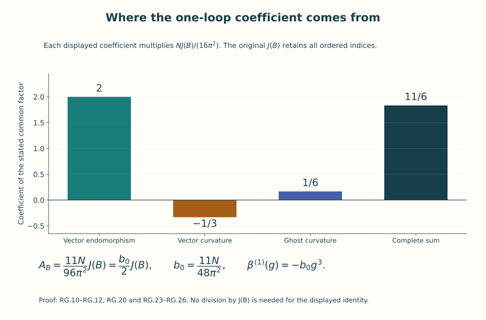
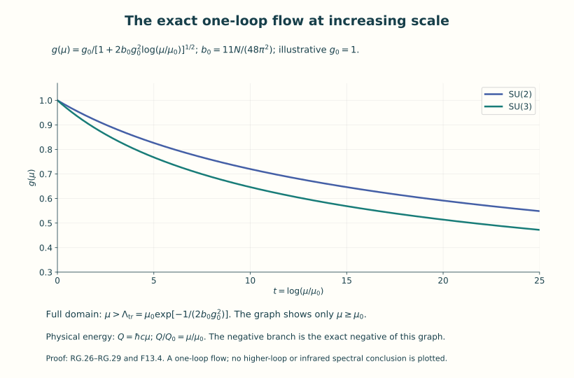
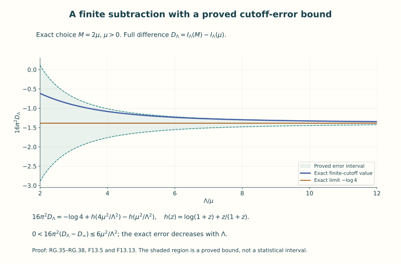

# Renormalization and asymptotic freedom

A regulator makes a calculation definite at a chosen resolution. A
renormalization condition tells us which measured or specified quantity
is to remain fixed when that resolution changes. Those are operations
on an actual formula. This lesson carries them out for ordinary integrals
and for the one-loop coefficient of pure SU(N) Yang–Mills theory.

The result is the negative cubic coefficient in the beta function. We
derive its group factor, vector and ghost weights, sign, units and
scale dependence. The underlying heat operators and regulated integrals
exist as mathematical objects. The interpretation as one loop refers
to the formal expansion described below; it does not supply the full
interacting quantum theory.

Prerequisites are the action and its second variation in Lessons 7 and
10, the operator and spectral constructions in Lesson 11, and the gauge
and ghost algebra in Lesson 12. The Fourier and Sobolev preparation from
Lesson 9 is used in the heat-kernel proof. The ordinary-integral example
in Section 8 can be read before the operator details in Section 4.

After this lesson you can compute the actual gauge/ghost coefficient,
perform a finite subtraction with its error retained, solve the stated
one-loop flow on its exact domain, and compare scale and coupling
conventions without losing their factors.

## 0. Resolution, a subtraction condition, and a beta function

An inverse length Λ specifies a short-distance resolution Λ⁻¹. It is a
regulator parameter. The positive inverse length μ is a subtraction
scale: a reference at which a renormalized parameter is specified.
Changing μ changes that parameter according to the rule that preserves
the stated renormalized expression. Neither symbol denotes the same
operation as sending the spatial volume to infinity.

For a differentiable coupling g(μ), its beta function is its derivative
with respect to the logarithm of a dimensionless scale ratio:

\[
 \beta(g(\mu))=\frac{d g(\mu)}{d\log(\mu/\mu_0)}
                 =\mu\frac{d g(\mu)}{d\mu},\qquad \mu_0>0.
 \tag{F13.1}
\]

The chain rule proves the second equality. The reference μ₀ makes the
logarithm dimensionless and does not affect the derivative. If an energy
scale is used, Q=ℏcμ and Q₀=ℏcμ₀ give exactly the same ratio and derivative.

A positive parameter can approach zero at increasing μ while still
growing at decreasing μ. For the cubic differential equation derived
here, that statement will be proved by solving the equation, including
its finite lower endpoint. The endpoint is a feature of that differential
equation; a physical mass requires a separately constructed spectral
statement.

The notation O(Λ⁻²) below always concerns a specified limit and fixed
other parameters. It means an absolute bound CΛ⁻² beyond a stated cutoff,
with C independent of that cutoff. A formal series in g is a different
object: its coefficients can be computed without asserting that the
series converges. Lesson 12 supplied a convergent integral with a
divergent series, so that distinction already has an exact example.

## 1. Original action, coordinates, and the coefficient space

Fix N≥2, c>0, ℏ>0 and four lengths L0,L1,L2,L3>0. Work first on the flat
oriented torus

\[
 X_L=\prod_{\mu=0}^3(\mathbb R/L_\mu\mathbb Z),\qquad
 g_E=\sum_{\mu=0}^3dx^\mu\otimes dx^\mu,\qquad
 dV=dx^0dx^1dx^2dx^3,\qquad V_4=\prod_{\mu=0}^3L_\mu.
 \tag{RG.1}
\]

All x coordinates have length units. Let B=Bμdxμ be a smooth periodic
connection on the trivial SU(N) bundle, with skew-Hermitian trace-zero
coefficients. It is the original connection called Γ in F07 and A in F10;
B labels the chosen background and does not absorb a coupling. Retain

\[
 \begin{gathered}
 \kappa(X,Y)=-\operatorname{tr}_{\mathbb C^N}(XY),\qquad
 D_\mu X=\partial_\mu X+[B_\mu,X],\\
 F_{\mu\nu}=\partial_\mu B_\nu-\partial_\nu B_\mu+[B_\mu,B_\nu],
 \quad F=\tfrac12F_{\mu\nu}dx^\mu\wedge dx^\nu,\\
 J(B)=\int_{X_L}\sum_{\mu,\nu=0}^3
                 \kappa(F_{\mu\nu},F_{\mu\nu})\,dV,\qquad
 S_E(B)=\frac{\hbar}{2g^2}J(B),\qquad g=g_{\rm YM}\in\mathbb R\setminus\{0\}.
 \end{gathered}
 \tag{RG.2}
\]

The contraction is the full ordered sum. In particular each nonzero
antisymmetric pair occurs twice, and each diagonal component is zero.
The units are [Bμ]=length⁻¹, [Fμν]=length⁻², [J]=1 and [\(S_E\)]=[ℏ].
The action is exactly F7.5 with σ=+1 and F10 I.3.

Choose Hermitian traceless matrices Ha with tr(HaHb)=δab/2 and set Ta=−iHa.
Such a basis is obtained from the real and imaginary matrix units together
with a basis of traceless real diagonal matrices, followed by the ordinary
positive inner-product Gram procedure. Write

\[
 [T_a,T_b]=f_{ab}{}^cT_c,\quad \kappa(T_a,T_b)=\delta_{ab}/2,
 \quad B_\mu=g A_\mu^aT_a,\quad
 F_{\mu\nu}=g f_{\mu\nu}^aT_a,
 \quad f_{\mu\nu}^a=\partial_\mu A_\nu^a-\partial_\nu A_\mu^a
                              +g f_{bc}{}^aA_\mu^bA_\nu^c.
 \tag{RG.3}
\]

Invariance of κ makes the all-lowered structure constants totally
antisymmetric. Thus \(S_E\)=ℏ∫∑a,μ,ν(fμνa)²/4 in these canonical component
variables, with g retained in the nonlinear term. Equivalently, if Fμν=FμνaTa
are the original connection coefficients, \(S_E\)=ℏ∫∑(Fμνa)²/(4g²).
These two component arrays satisfy Fμνa=g fμνa and must not be interchanged.

Physical Euclidean time can be retained by the exact coordinate map x0=cτ,
with period \(T_E\)=L0/c. The pulled-back metric, connection and curvature are

\[
 g_E=c^2d\tau^2+\sum_j(dx^j)^2,\quad
 B_\tau=cB_0,\quad F_{\tau j}=cF_{0j},\quad dV=c\,d\tau\,d^3x,
 \quad
 J=\int c\,d\tau\,d^3x\left\{
 \frac2{c^2}\sum_j\kappa(F_{\tau j},F_{\tau j})
      +\sum_{i,j}\kappa(F_{ij},F_{ij})\right\}.
 \tag{RG.4}
\]

The full magnetic ordered sum remains. This is a real coordinate map of
Euclidean geometries; it asserts no analytic continuation of an interacting
Lorentzian theory. All following proper-time variables s have length² units,
and are different from τ or physical Lorentzian time.

## 2. The complete quadratic operator and the ghost weight

For a smooth adjoint-valued one-form a, the exact curvature polynomial is

\[
 F(B+a)=F(B)+C(a)+Q(a),\qquad
 C(a)_{\mu\nu}=D_\mu a_\nu-D_\nu a_\mu,\qquad
 Q(a)_{\mu\nu}=[a_\mu,a_\nu].
 \tag{RG.5}
\]

Its full action polynomial consists of J(B), the linear term
2(F,C), the quadratic term (C,C)+2(F,Q), the cubic term 2(C,Q)
and the quartic term (Q,Q), all multiplied by ℏ/(2g²). Parentheses here
mean the integral of the full ordered κ contraction. Integration by parts
has no boundary term on XL. Since D is skew with respect to the L² κ
pairing, the linear term is −(2ℏ/g²)∫κ(aν,DμFμν).

Add precisely the background Feynman gauge quadratic term
\(S_{\rm gf}(a)\)=ℏ∫κ(Dμaμ,Dνaν)/g², which agrees with F10 E.22. Expanding the
quadratic part of RG.5 and commuting DμDν−DνDμ=ad(Fμν) gives

\[
 \begin{gathered}
 S_{E,2}(B;a)+S_{\rm gf}(a)
       =\frac{\hbar}{g^2}\int\kappa(a_\nu,(L_1a)_\nu)\,dV,\\
 (L_1a)_\nu=-D_\mu D_\mu a_\nu-2[F_{\nu\rho},a_\rho],\qquad
 L_0\chi=-D_\mu D_\mu\chi.
\end{gathered}
 \tag{RG.6}
\]

Here is the index calculation for the potentially ambiguous sign. The
linearized equation is
\(D_\mu(D_\mu a_\nu-D_\nu a_\mu)+[a_\mu,F_{\mu\nu}]\).
Moving Dν past Dμ gives
\(D^2a_\nu-D_\nu D_\mu a_\mu-2[F_{\mu\nu},a_\mu]\).
Adding DνDμaμ and negating yields L1 in RG.6 because Fμν=−Fνμ.
The original Hessian is −2ℏ/g² times the linearized equation, so its
quadratic Taylor term has precisely the factor displayed in RG.6.
No on-shell condition on B was used.

The actual gauge convention is Bᵘ=uBu⁻¹−(du)u⁻¹. Holding the background
fixed, an infinitesimal quantum transformation of B+a by exp(χ) gives
\(\delta a=-D_{B+a}\chi\). Therefore the variation of \(G_B(a)=D_B^\mu a_\mu\) is

\[
 \delta G_B(a)=M_B(a)\chi,
 \qquad M_B(a)=-D_B^\mu D_{B+a,\mu},\qquad M_B(0)=L_0.
 \tag{RG.7}
\]

This proves the Faddeev–Popov operator and its sign for the actual course
gauge map. It is a local differential of this gauge condition; no global
gauge slice or globally valid determinant change of variables is inferred.

The determinant powers can be proved in finite dimensions. If K is a real
positive definite d1 by d1 symmetric matrix, diagonalize it by an orthogonal
matrix and use the one-dimensional Gaussian integral to obtain

\[
 \int_{\mathbb R^{d_1}}e^{-a^TKa/(2g^2)}\,d^{d_1}a
       =(2\pi g^2)^{d_1/2}(\det K)^{-1/2}.
 \tag{RG.8}
\]

For this finite spectral assertion, a maximum of the Rayleigh quotient
on the unit sphere gives an eigenvector; symmetry preserves its orthogonal
complement, so induction gives the orthogonal diagonalization. For the
Gaussian factor, squaring ∫R exp(−x²/2)dx and using two-dimensional polar
coordinates gives 2π∫0∞r exp(−r²/2)dr=2π. The positive square root and the
substitution x=√λ a/|g| give √(2πg²/λ) for each positive eigenvalue λ.
Their product proves RG.8 with its full measure factor.
For a d0 by d0 matrix M introduce independent Grassmann variables
c1,…,cd0, c̄1,…,c̄d0. Define their integration as extraction of the top
coefficient, with the orientation chosen so that
∫exp(−∑i c̄ici)=1. In expanding exp(−c̄Mc), only its degree 2d0 term
survives. Terms using any repeated row or column vanish. Ordering the
remaining c̄ and c variables gives the permutation sign, hence exactly
∑πsgn(π)∏iMi,π(i)=det M. Thus one independent ghost/antighost pair gives
det M, not its square root. For fixed finite ranks, the effective logarithm
is therefore

\[
 \frac12\log\det K-\log\det M
                 -\frac{d_1}{2}\log(2\pi g^2).
 \tag{RG.9}
\]

The last scalar has been displayed. In the relative functional at B and
B=0 with the same finite ranks and g it cancels exactly. In RG.6 the
κ=δ/2 basis makes the quadratic exponent aᵀL1a/(2g²), matching RG.8.
The four vector components have rank 4(N²−1); the ghost pair has complex
Grassmann rank N²−1, and the corresponding real differential operator
has the same matrix trace as its complexification.

The original ghost measure from Lesson 12 has a further factor that
must be compared explicitly. In the \(\kappa(T_a,T_b)=\delta_{ab}/2\) basis its exponent
is \(-\bar c M c/g^2\). Introduce \(\bar c'_i=\bar c_i/g^2\) and \(c'_i=c_i\) for each
of the d₀ pairs. Coefficient extraction gives

\[
 D\bar c\,Dc=(g^2)^{-d_0}D\bar c'\,Dc',\qquad
 \int D\bar c\,Dc\ e^{-\bar cMc/g^2}
                    =(g^2)^{-d_0}\det M.
 \tag{F13.2}
\]

Substitution multiplies the top monomial coefficient by \((g^2)^{d_0}\);
the displayed inverse factor restores exactly the original integral.
Thus the original ghost variables add d₀ log(g²) to the negative
logarithm (RG.9). If the original auxiliary b variables are included,
their exponent at ξ=1 is \(-(b^Tb/2-i b^Tf)/g^2\). Their Gaussian Fourier
integral is \((2\pi g^2)^{d_0/2}\) \(\exp[-f^Tf/(2g^2)]\). One proof differentiates
the transform in each component of f, integrates the b derivative by
parts using Gaussian decay, and checks its value at f=0. The resulting
exponential is the gauge term already included in K.

For positive definite real K and M, retaining these original measures
therefore gives

\[
 \begin{aligned}
 Z_{\rm orig}(K,M)
  &=(2\pi g^2)^{(d_1+d_0)/2}(g^2)^{-d_0}
                     (\det K)^{-1/2}\det M,\\
 -\log\frac{Z_{\rm orig}(K_B,M_B)}{Z_{\rm orig}(K_0,M_0)}
  &=\frac12\log\frac{\det K_B}{\det K_0}
                         -\log\frac{\det M_B}{\det M_0}.
 \end{aligned}\tag{F13.3}
\]

Choose the same fixed coordinate units on both backgrounds. Any products
of these units multiply the absolute integrals explicitly and cancel
in their ratio, just as the displayed g and 2π factors do. Each determinant
ratio compares matrices of equal rank and identical units. The ghost
determinant formula itself holds for any M; the real logarithm just
written uses positive determinants. This finite comparison proves the
weights used below while retaining the factors in the absolute model.

An arbitrary background may have a negative L1 eigenvalue, and L0 can have
zero modes. RG.8 is not invoked as a convergent Gaussian integral for such
an operator. Instead Section 4 defines a finite proper-time spectral
functional with a finite upper endpoint, retaining all these modes.
Its weights 1/2 and −1 are those established by the finite Gaussian and
Grassmann algebra. This defines the one-loop perturbative coefficient.
To see the loop order, cancel the linear background term by the linear
source used in the background effective-action expansion and put a=gq in
the displayed action polynomial. The quadratic term becomes independent
of g, while its cubic and quartic terms have factors g and g². The ghost
vertex \(M_B(gq)-L_0\) has factor g. This is an algebraic formal expansion;
no infinite-dimensional integration measure has been introduced.

## 3. Lie algebra and bundle traces, with every index retained

Let r=N²−1. On End(CN), write \(\operatorname{ad}_X=L_X-R_X\). In the matrix-unit basis,
\(\operatorname{Tr}(L_XL_Y)=N\operatorname{tr}(XY)\), \(\operatorname{Tr}(R_XR_Y)=N\operatorname{tr}(XY)\) and
\(\operatorname{Tr}(L_XR_Y)=\operatorname{tr}(X)\operatorname{tr}(Y)\). Thus for traceless X,Y,
\(\operatorname{Tr}_{\rm End}(\operatorname{ad}_X\operatorname{ad}_Y)=2N\operatorname{tr}(XY)\). The scalar-matrix line is annihilated;
its traceless complement is the complexification of su(N). Complexifying
a real matrix leaves its trace unchanged. Consequently

\[
 \operatorname{Tr}_{\rm ad}(\operatorname{ad}_X\operatorname{ad}_Y)
        =2N\operatorname{tr}(XY)=-2N\kappa(X,Y),\qquad
 f_{acd}f_{bcd}=N\delta_{ab},\qquad C_A=N.
 \tag{RG.10}
\]

For the second identity, the adjoint matrix of Ta has entries fa b c;
total antisymmetry shows its product trace is −∑c,d facdfbcd. The first
identity gives −Nδab. This proves the group factor rather than importing
it as an unexplained number.

Write a Laplace-type operator in the convention
L=−(DμDμ+E) and denote its connection curvature by Ωμν=[Dμ,Dν]. For RG.6,

\[
 \begin{array}{c|c|c|c}
 &\text{fibre}&E&\Omega_{\mu\nu}\\ \hline
 L_0&\mathfrak{su}(N)_\mathbb C&0&\operatorname{ad}F_{\mu\nu}\\
 L_1&\mathbb C^4\otimes\mathfrak{su}(N)_\mathbb C
       &E_{\nu\rho}=2\operatorname{ad}F_{\nu\rho}
       &I_4\otimes\operatorname{ad}F_{\mu\nu}
 \end{array}
 \tag{RG.11}
\]

The connection is unitary because \(\operatorname{ad}_X\) is skew with respect to κ. E for
L1 is self-adjoint: taking its fibre adjoint also transposes ν,ρ, so the
two minus signs from \(\operatorname{ad}_X^*\) and Fρν cancel. The exact scalar contraction
\(T(B,x)=\sum_{\mu,\nu}\operatorname{Tr}_{\rm ad}
(\operatorname{ad}F_{\mu\nu}\operatorname{ad}F_{\mu\nu})\)
equals −2N∑μ,νκ(Fμν,Fμν). Directly taking the complete vector/colour trace gives

\[
 \begin{gathered}
 \operatorname{tr}_{1}E=0,\quad
 \operatorname{tr}_{1}E^2
   =4\sum_{\nu,\rho}\operatorname{Tr}_{\rm ad}
      (\operatorname{ad}F_{\nu\rho}\operatorname{ad}F_{\rho\nu})=-4T,\\
 \operatorname{tr}_{1}\Omega_{\mu\nu}\Omega_{\mu\nu}=4T,
 \qquad \operatorname{tr}_{0}\Omega_{\mu\nu}\Omega_{\mu\nu}=T.
\end{gathered}
 \tag{RG.12}
\]

The number four is the spacetime vector rank, not a colour factor.
These identities also show why replacing the real Killing form by the
positive defining trace without its factor −2N would reverse a sign.

## 4. The heat coefficient and the exact proper-time regulator

For a smooth unitary matrix connection D on XL and a smooth self-adjoint
endomorphism E, give L=−(D²+E) its self-adjoint domain H² of periodic vector
functions. Here H² means that all distributional coordinate derivatives
through order two lie in L². The heat-kernel proof below includes this
domain assertion, the existence of its trace, and the expansion

\[
 \operatorname{Tr}e^{-sL}
 =\frac1{(4\pi s)^2}\int_{X_L}\operatorname{tr}
 \left[I+sE+s^2\left(\frac12E^2+\frac1{12}\Omega_{\mu\nu}\Omega_{\mu\nu}
                          +\frac16D_\mu D_\mu E\right)\right]dV+O(s).
 \tag{RG.13}
\]

The remainder is bounded in absolute value by C s for 0<s≤s0, with C
depending on the fixed lengths and finitely many smooth coefficient
bounds. This is an actual small-s asymptotic statement. It is not a
formal expansion of an undefined functional integral.

Here are the coefficient calculations and the analytic construction.
Fix a point y and choose the connection frame by parallel transport
along the short radial segments from y. The transport ODE exists by
successive integration of its smooth matrix coefficient; its iterated
integrals are bounded by Cⁿ/n! on each fixed segment, giving convergence,
uniqueness and differentiability with respect to its endpoints. The
skew-Hermitian connection coefficient preserves the fibre inner product,
so this frame change is unitary. With z=x−y its connection Aμ satisfies
zμAμ(z)=0 and Aμ(0)=0. Differentiating the radial condition and using the
curvature definition gives

\[
 A_\mu(z)=\int_0^1 t z^\nu\Omega_{\nu\mu}(tz)\,dt.
 \tag{RG.14}
\]

Indeed zνΩνμ=zν∂νAμ+Aμ; the commutator zν[Aν,Aμ] vanishes, and integration
of d[tAμ(tz)]/dt proves RG.14. In this frame the leading transport matrix
is u0=I. Substitution of
\((4\pi s)^{-2}e^{-|z|^2/(4s)}\sum_{j=0}^M s^j u_j(x,y)\)
in the heat equation gives the exact transport recurrence

\[
 (j+z^\mu D_\mu)u_j=(D_\mu D_\mu+E)u_{j-1},\quad
 u_j(z)=\int_0^1t^{j-1}
                 [(D^2+E)u_{j-1}](tz)\,dt\quad(j\ge1).
 \tag{RG.15}
\]

The Gaussian derivative supplies z·D/s and its scalar heat equation
cancels the other leading terms. These formulas prove every recurrence
factor and also define smooth uj near the diagonal.

Put P=∂μAμ+AμAμ+E. Then u1(z)=∫0¹P(tz)dt, so u1(0)=E(0) and
∂²u1(0)=∂²P(0)/3. The j=2 recurrence at zero gives
u2(0)=E²/2+∂²P/6. RG.14 gives

\[
 \partial_\rho A_\mu(0)=\tfrac12\Omega_{\rho\mu},\quad
 \partial_\mu A_\mu(0)=0,\quad
 \partial^2(A_\mu A_\mu)(0)=\tfrac12\Omega_{\rho\mu}\Omega_{\rho\mu},
 \quad \partial^2\partial_\mu A_\mu(0)=0.
 \tag{RG.16}
\]

For the last zero the cubic Taylor term of Aμ is
zνzρzσ∂ρ∂σΩνμ(0)/8. The contraction ∂²∂μ yields
\(\tfrac12\sum_{\nu,\mu}\partial_\nu\partial_\mu\Omega_{\nu\mu}=0\)
by antisymmetry. The lower-degree terms give no third derivative. At zero
D²E=∂²E, since A=0 and ∂μAμ=0. Thus
u2=E²/2+Ω²/12+D²E/6, as in RG.13. This radial-frame proof keeps the
noncommuting matrix order and derives the coefficient 1/12 explicitly.

The analytic remainder can be proved with the finite transport sum and
an independently constructed spectral heat kernel. Here are the required
operator details. Write Lfree=−∂² on the periodic Fourier basis
\(V_4^{-1/2}\exp(i\sum_\mu2\pi k_\mu x^\mu/L_\mu)\), k∈Z⁴.
Its completeness follows by convolution with the product of the four
Fejer kernels: each kernel is nonnegative, has integral 2π, and has mass
outside any neighborhood of zero tending to zero by the finite geometric
sum. Uniform continuity proves convergence on continuous functions;
density of continuous functions in L² proves completeness. Thus Lfree
is self-adjoint with domain H², by testing the adjoint on individual
Fourier coordinates. Its eigenvalues are
\(p(k)^2=\sum_\mu(2\pi k_\mu/L_\mu)^2\).

Expand L=Lfree+\(\mathcal B\), where
\(\mathcal B=-2A_\mu\partial_\mu-\partial_\mu A_\mu-A_\mu A_\mu-E\).
Put \(a_*^2=\sum_\mu\|A_\mu\|_\infty^2\),
\(b_* =\|\partial_\mu A_\mu+A_\mu A_\mu+E\|_\infty\), and
\(e_* =\|E\|_\infty\). Fourier multiplication gives
\(\|\mathcal B(L_{\rm free}+\lambda)^{-1}\|
\le a_*/\sqrt\lambda+b_*/\lambda\).
Indeed the combined gradient multiplier is bounded by
\(\sup_{u\ge0}\sqrt u/(u+\lambda)=1/(2\sqrt\lambda)\), which cancels
the displayed coefficient 2. For large positive λ this norm is less
than one. The Neumann inverse
\((L+\lambda)^{-1}=(L_{\rm free}+\lambda)^{-1}
[I+\mathcal B(L_{\rm free}+\lambda)^{-1}]^{-1}\)
is bounded and compact, since the free inverse multipliers tend to zero.
Integration by parts proves symmetry on H². For v∈D(L*), solve
(L+λ)u=(L*+λ)v; then v−u is orthogonal to the range of L+λ, so v=u.
This proves self-adjointness on exactly H². The quadratic identity
\(\langle f,Lf\rangle=\|Df\|^2-\langle f,Ef\rangle\)
gives the lower bound \(-e_*\).

For \(\lambda>e_*\) the compact inverse is positive and injective. It has a
complete eigenbasis: compactness turns a maximizing sequence for its
positive Rayleigh quotient into a maximizer; varying that quotient
gives an eigenvector. Repeat on its invariant orthogonal complement.
Its nonzero eigenvalues tend to zero, since otherwise the images of
orthonormal eigenvectors contradict compactness. A remaining nonzero
orthogonal subspace would have a positive maximizer too. Its kernel is
zero, proving completeness. Hence L has eigenvectors fj and real
eigenvalues λj≥\(-e_*\) tending to infinity with finite multiplicities.

The count and smoothness needed for the heat series require no assumed
heat estimate. The identity
\(|u+v|^2-\tfrac12|u|^2+|v|^2=\tfrac12|u+2v|^2\)
implies \(L\ge\tfrac12L_{\rm free}-(a_*^2+e_*)I\) as quadratic forms.
If the span of eigenvalues λj≤q exceeded the number of free modes
with \(p(k)^2\le2(q+a_*^2+e_*)\), a nonzero vector orthogonal to those free
modes would contradict this inequality. Thus, for fibre rank d,
 
\[
N_L(q)\le d\prod_{\mu=0}^3
[1+(L_\mu/\pi)\sqrt{2\max(q+a_*^2+e_*,0)}].
\]

This is at most quadratic growth in q. When the threshold is negative
the actual count is zero.

Retain an inverse reference length η=1/minμLμ in the Fourier Sobolev
weights \((\eta^2+p(k)^2)^m\). Leibniz's rule bounds multiplication by smooth
coefficients, so \(\|\mathcal B f\|_{H^m}\le C_m\|f\|_{H^{m+1}}\).
The scalar Fourier interpolation inequality
\(\|f\|_{H^{m+1}}\le\epsilon\|f\|_{H^{m+2}}+C_{\epsilon,\eta}\|f\|_{H^m}\)
and the inverse of Lfree+η² yield, after absorbing ε,
\(\|f\|_{H^{m+2}}\le C_m'(\|Lf\|_{H^m}+\eta^2\|f\|_{H^m})\).
For eigenvectors initially in H², the equation
Lfree f=λj f−\(\mathcal B\)f first increases the Sobolev order one
step at a time, justifying that estimate at every order. Their Sobolev
norms therefore have polynomial bounds in η²+|λj|. Fourier
Cauchy–Schwarz gives \(\|\partial^\alpha f\|_\infty\le C\|f\|_{H^m}\)
for m>|α|+2; the defining four-dimensional lattice sum then converges.
The polynomial count and these polynomial eigenfunction bounds prove
uniform convergence of
\(K(s;x,y)=\sum_j e^{-s\lambda_j}f_j(x)f_j(y)^*\)
and all its prescribed derivatives on every compact positive s interval.
It is a smooth heat kernel, tends strongly to the identity by Parseval
and dominated convergence, and is trace class with
\(\operatorname{Tr}e^{-sL}=\int\operatorname{tr}K(s;x,x)dV\).

For smooth initial f, spectral convergence applied to \((L+\lambda)^m f\),
the elliptic estimate and the Sobolev bound give convergence to f
uniformly at s=0. The smooth solution \(u=e^{-sL}f\) satisfies
\((\partial_s-\Delta)|u|^2
=-2|Du|^2+2\langle u,Eu\rangle\le2e_*|u|^2\).
Applying the scalar maximum test to \(e^{-2e_*s}|u|^2-\epsilon s\) and then taking
ε down to zero proves
\(\|e^{-sL}f\|_\infty\le e^{e_*s}\|f\|_\infty\).
Uniform approximation extends this estimate and strong continuity to
continuous sections.

Now choose 0<δ<minμLμ/4 and a smooth cutoff 0≤χ≤1 equal to one for
|z|≤δ/2 and zero for |z|≥δ. In the original frame let
\(K_2=\chi(z)(4\pi s)^{-2}e^{-|z|^2/(4s)}
(u_0+s u_1+s^2u_2)\), extended by zero off this neighborhood.
Here u0 is parallel transport, and RG.15 is transported back to the
original frame. Write \(g_s=(4\pi s)^{-2}\exp(-|z|^2/(4s))\). Its exact residual is

\[
 R=(\partial_s+L_x)K_2
 =\chi g_s s^2L_xu_2+
 g_s\sum_{j=0}^2s^j\left[
 s^{-1}z^\mu(\partial_\mu\chi)u_j
 -2(\partial_\mu\chi)D_\mu u_j-(\Delta\chi)u_j\right].
 \tag{RG.17}
\]

The first term is uniformly bounded, and each cutoff derivative has
|z|≥δ/2. Here is an explicit finite residual constant. On |z|≤δ let
\(U_j=\sup\|u_j\|\), \(V_j=\sup(\sum_\mu\|D_\mu u_j\|^2)^{1/2}\), \(W_2=\sup\|L_xu_2\|\),
c1=sup|∇χ| and c2=sup|Δχ|. Set
\(S_p=\sup_{0<s\le s_0}s^p e^{-\delta^2/(16s)}\)
for p=−3,−2,−1,0. These are finite: S0=exp(−δ²/(16s0)); for
m=1,2,3, \(S_{-m}=\tau_m^{-m}\exp(-\delta^2/(16\tau_m))\) with
τm=min(s0,δ²/(16m)), as direct differentiation proves. Then

\[
 \begin{gathered}
 C_R=(4\pi)^{-2}\left[W_2+\sum_{j=0}^2
 \{\delta c_1U_jS_{j-3}+(2c_1V_j+c_2U_j)S_{j-2}\}\right],\\
 \sup_{x,y}\|R(s;x,y)\|\le C_R,\qquad
 \sup_{x,y}\|K(s;x,y)-K_2(s;x,y)\|
       \le C_R s e^{e_*s}.
 \end{gathered}
 \tag{RG.18}
\]

Every term of CR has units length⁻⁶. To prove the second bound, the
Gaussian integral and bounded transport coefficients give uniform
Schur bounds for K2(s), and its approximate-identity property gives
strong convergence K2(s)→I. Differentiating
\(e^{-(s-t)L}K_2(t)\) for ε≤t≤s, integrating and taking ε down to zero
therefore proves the exact Duhamel identity
\(e^{-sL}-K_2(s)=-\int_0^s e^{-(s-t)L}R(t)dt\).
The residual operator norm is at most V4 CR, so this integral converges.
For every fixed y and unit fibre vector v, apply the preceding supremum
semigroup bound to x↦R(t;x,y)v; integration proves RG.18. First
integrating on ε≤t≤s−ε gives continuous kernels; the omitted endpoints
tend to zero uniformly by that bound. Equality of the limiting operators
thus gives equality of their continuous kernels. On the diagonal χ=1,
so RG.18 and the computed u0,u1,u2 prove RG.13 with absolute trace
remainder at most \(dV_4C_R e^{e_*s_0}s\). All fixed lengths remain in the
constants. No positivity of L or infinite-volume uniformity was used.

Apply RG.13 to RG.11. The integral of tr D²E is zero: the trace removes
commutators, leaving an ordinary periodic divergence. In the vector case
tr E vanishes already pointwise. Put

\[
 K_B(s)=\tfrac12\operatorname{Tr}e^{-sL_1(B)}
                    -\operatorname{Tr}e^{-sL_0(B)},\qquad
 k_B(s)=K_B(s)-K_0(s).
 \tag{RG.19}
\]

The rank term of KB is rV4/(4πs)², since 4r/2−r=r. It cancels with the
same term at zero background. Both sE terms are zero. RG.12 gives the
remaining coefficient by the following full arithmetic:

\[
 \begin{aligned}
 \operatorname{tr}_1(\tfrac12E^2+\tfrac1{12}\Omega^2)
       &=-2T+\tfrac13T=-\tfrac53T,\\
 \operatorname{tr}_0(\tfrac12E^2+\tfrac1{12}\Omega^2)&=\tfrac1{12}T,\\
 \tfrac12(-\tfrac53T)-\tfrac1{12}T&=-\tfrac{11}{12}T,\\
 k_B(s)&=A_B+O(s),\qquad
 A_B=\frac1{(4\pi)^2}\frac{11N}{6}J(B)
        =\frac{b_0}{2}J(B),\qquad
 b_0=\frac{11C_A/3}{16\pi^2},\quad C_A=N.
 \end{aligned}\tag{RG.20}
\]

This is the actual one-loop coefficient calculation, including the vector
rank, curvature endomorphism, scalar ghost, factor 1/2 and real adjoint
trace. The factor (4π)⁻² follows from the Gaussian Fourier/heat measure
in four dimensions. For an abelian algebra, ad F=0, so both operators
equal their background-free counterparts and kB=0; the same calculation
then yields a zero pure-gauge one-loop coefficient.

Figure 1. The arithmetic in RG.12 and RG.20. The displayed coefficients
multiply N J(B)/(16π²). The endomorphism, vector-curvature and ghost
terms retain their different signs and weights. The beta coefficient
uses the further factor \(2A_B/J\) in RG.23–RG.26 when J is nonzero; the
functional identity \(A_B=b_0J/2\) remains valid when J=0.

Fix an upper proper-time endpoint T>0 of length² dimension, and a UV
inverse-length cutoff Λ>T⁻¹ᐟ². Define the exact spectral regulator

\[
 W_{\Lambda,T}(B)=-\int_{\Lambda^{-2}}^T\frac{ds}{s}\,k_B(s).
 \tag{RG.21}
\]

Every term here exists for every smooth B. No eigenvalue is removed: zero
and negative modes are retained, and the finite upper endpoint avoids any
large-s convergence assumption. The reference B=0 is on the same torus,
with the same vector and ghost ranks, lengths and domains. The function
is invariant under every smooth periodic gauge map u, since multiplication
by Ad(u) is unitary, intertwines both L operators and their heat kernels,
and hence leaves every trace unchanged.

For any subtraction scale μ>0 with inverse-length unit, RG.20 proves

\[
 \begin{aligned}
 W_R(B;\mu,T)
  &:=\lim_{\Lambda\to\infty}
       \left[W_{\Lambda,T}(B)+A_B\log(\Lambda^2/\mu^2)\right]\\
  &=-A_B\log(T\mu^2)
           -\int_0^T\frac{ds}{s}\,[k_B(s)-A_B],\\
 W_{\Lambda,T}(B)
  &=-b_0J(B)\log(\Lambda/\mu)+W_R(B;\mu,T)+O(\Lambda^{-2}).
 \end{aligned}\tag{RG.22}
\]

Near zero the remaining integrand is bounded by RG.20; on every compact
positive interval it is continuous. The omitted integral from zero to
Λ⁻² is bounded by CΛ⁻². Thus this is a proved finite subtraction with an
explicit remainder. The negative sign in the divergent one-loop term
comes from RG.21, not from a chosen convention for the beta function.

## 5. Counterterm, bare/renormalized map and the beta coefficient

At the specified background the tree plus one-loop effective action has
the precise meaning
\(\hbar[J(B)/(2g_B^2)+W_{\Lambda,T}(B)]\), as a formal one-loop
coefficient calculation with the exact regulated W already constructed.
Substitute RG.22. The logarithm is cancelled by exactly

\[
 \begin{gathered}
 \frac1{g_B(\Lambda)^2}
     =\frac1{g_R(\mu)^2}+2b_0\log(\Lambda/\mu),\qquad
 \delta S=\hbar b_0J(B)\log(\Lambda/\mu),\\
 \Gamma_{\rm 1\ loop,R}(B;\mu,T)
     =\hbar\left[\frac{J(B)}{2g_R(\mu)^2}+W_R(B;\mu,T)\right].
\end{gathered}
 \tag{RG.23}
\]

The finite-cutoff action converges to the last expression with error
O(ℏΛ⁻²) at this perturbative order. Equation RG.23 is a subtraction
relation, with a defined domain. For any real gR≠0 and positive μ,
choose Λ with both Λ>T⁻¹ᐟ² and
1+2b0gR²log(Λ/μ)>0, and take the same-sign branch

\[
 g_B=\frac{g_R}{\sqrt{1+2b_0g_R^2\log(\Lambda/\mu)}}.
 \tag{RG.24}
\]

This defines an exact map for the one-loop subtraction model. Its
algebraic powers beyond first order are not new computed loop
coefficients. The cancellation concerns the functional J(B) for every
smooth background, not one selected constant-field numerical example.

Hold the original connection B fixed when comparing canonical component
coordinates. RG.3 gives the exact maps

\[
 B=g_B A_B^aT_a=g_R A_R^aT_a,\qquad
 A_B^a=\frac{g_R}{g_B}A_R^a,\qquad
 Z_g=\frac{g_B}{g_R},\quad Z_{B,\mathrm{component}}^{1/2}
       =\frac{g_R}{g_B},\quad Z_g Z_{B,\mathrm{component}}^{1/2}=1.
 \tag{RG.25}
\]

The final identity is the proved background-variable relation. It is
not a claim about every quantum gauge-field renormalization constant.
It also records which field is held fixed while differentiating a
renormalized coupling. In particular the different uses of the letter A
in F07 and F10 are resolved by the actual connection B and RG.3.

Differentiate RG.23 at fixed bare coupling and cutoff. Since
d(gR⁻²)/dlogμ=−2gR⁻³ dgR/dlogμ and dlog(Λ/μ)/dlogμ=−1, one obtains

\[
 \boxed{\quad \beta^{(1)}(g)
       :=\frac{dg}{d\log\mu}=-b_0g^3
        =-\frac{11C_A}{3(16\pi^2)}g^3,\qquad C_A=N.\quad}
 \tag{RG.26}
\]

The same sign follows independently from the finite functional:
μ∂μWR=−2AB=−b0J, so differentiating Γ in RG.23 gives
ℏJ[−β/g³−b0], which vanishes precisely for RG.26. This verifies the
cutoff logarithm, factor two and beta sign against two exact scale
identities. The notation β(1) means the one-loop truncation. Equivalently
the computed formal perturbative coefficient is
β(g)=−b0g³+terms of degree at least five. This sentence specifies a
coefficient of a formal expansion; it supplies no analytic error bound
on a fully constructed interacting continuum theory.

The original ℏ has not vanished from the action: the entire Γ in RG.23
has the prefactor ℏ. The original action was itself ℏJ/(2g²), so its
dimensionless exponent S/ℏ has coupling g and the coefficient in RG.26
has no additional ℏ. Inserting an extra ℏ there would change the original
coupling convention. All inverse-length ratios may instead be expressed
using energy scales Q=ℏcμ and QΛ=ℏcΛ; their ratio is exactly Λ/μ, and
Q d/dQ=μ d/dμ because c and ℏ are fixed positive parameters.

## 6. Exact solution and domain of the one-loop scale equation

Let g(μ0)=g0≠0 with μ0>0. The polynomial vector field −b0g³ is locally
Lipschitz: on |g|≤R, |g³−h³|≤3R²|g−h|. The integral equation and this
bound prove uniqueness by the elementary exponential integrating-factor
estimate for the difference; its explicit solution below proves
existence. On an interval where g≠0, integration of d(g⁻²)/dlogμ=2b0 gives

\[
 \begin{gathered}
 g(\mu)=\frac{g_0}{\sqrt{1+2b_0g_0^2\log(\mu/\mu_0)}},\\
 \Lambda_{\rm tr}=\mu_0\exp\!\left[-\frac1{2b_0g_0^2}\right]
       =\mu_0\exp\!\left[-\frac{8\pi^2}{(11C_A/3)g_0^2}\right],\\
 \mu\in(\Lambda_{\rm tr},\infty),\qquad
 g(\mu)^2=\frac1{2b_0\log(\mu/\Lambda_{\rm tr})}.
\end{gathered}
 \tag{RG.27}
\]

The displayed denominator is positive exactly on this interval, which
contains μ0. Differentiation verifies the differential equation and the
initial value. The solution preserves the sign of g0, tends to zero as
μ→∞ and has unbounded magnitude as μ decreases to Λtr. It therefore
cannot extend as a finite real solution across that endpoint. Uniqueness
also prevents crossing g=0, since the zero solution is unique through a
zero value. These facts prove the maximal domain for both signs of g0.
The polynomial zero-coupling extension has g≡0 for every μ>0; the original
connection action RG.2 is undefined at g=0, while the canonical component
action in RG.3 has the zero-coupling polynomial extension already described
in F07. No inverse connection-coordinate map at zero is asserted.

The exact partial scale flow is

\[
 R_t(g)=\frac{g}{\sqrt{1+2b_0g^2t}},\qquad
 D_t=\{g\in\mathbb R:1+2b_0g^2t>0\},\qquad t=\log(\mu/\mu_0).
 \tag{RG.28}
\]

Substitution shows R0(g)=g and Rt(Rs(g))=Rt+s(g) whenever both successive
maps are defined. The successive-domain condition is
1+2b0g²s>0 and 1+2b0g²(s+t)>0. On that domain R−t is the inverse of Rt.
The zero value is included as the stated polynomial extension.
The asymptotic statement |g(μ)|→0 at large μ is thus an exact theorem
about this one-loop flow. Its use in perturbation theory is restricted
to the region where the running coupling is small; no controlled
infrared extrapolation follows from the blow-up of the truncated ODE.

The parameter Λtr is independent of the reference point along this flow:
differentiate logμ−1/(2b0g(μ)²) and use RG.26 to get zero. Conversely,
Λtr>0 and a sign determine precisely the nonzero solution on μ>Λtr.
This is the exact dimensional-transmutation map: the original pair
(μ0,g0) is replaced by an inverse-length scale and a branch sign, modulo
the proven scale-flow relation. Its associated dimensional quantities are

\[
 \ell_{\rm tr}=\Lambda_{\rm tr}^{-1},\qquad
 E_{\rm tr}=\hbar c\Lambda_{\rm tr},\qquad
 M_{\rm tr}=\frac{\hbar}{c}\Lambda_{\rm tr},\qquad
 \omega_{\rm tr}=c\Lambda_{\rm tr}.
 \tag{RG.29}
\]

These definitions retain c and ℏ and give their length, energy, mass and
angular-frequency units. Mtr is a scale obtained from the flow, not a
proved eigenvalue, threshold, or Yang–Mills mass gap.

Figure 2. Exact one-loop solutions RG.27, displayed with g₀=1 and
t=log(μ/μ₀)≥0. The specified initial value is an illustrative choice.
The curves do not include uncomputed higher-loop terms or establish
an infrared spectral claim. The original scales and domains are given
in RG.27–RG.29 and Example 11.1.

## 7. Exact changes of coupling and subtraction convention

First compare the actual Lie-algebra pairings. Let κs=sκ for a fixed
positive dimensionless constant s. The same original action is written
\(S_E=\hbar\int\kappa_s(F,F)/(2g_s^2)\) precisely when

\[
 g_s=\sqrt{s}\,g,\qquad
 \beta_s^{(1)}(g_s)=-\frac{b_0}{s}g_s^3.
 \tag{RG.30}
\]

This follows by substitution and differentiation, with the branch sign
preserved. In particular the positive adjoint pairing is
\(-\operatorname{Tr}_{\rm ad}(\operatorname{ad}_X\operatorname{ad}_Y)=2N\kappa(X,Y)\), so its coupling is √(2N)g and its cubic
coefficient is b0/(2N). The unscaled coefficient b0 belongs to the
defining trace convention RG.2 with κ(Ta,Tb)=δab/2.

For two common dimensionless component parameters, with N fixed, define

\[
 \alpha_s=\frac{g^2}{4\pi},\quad\lambda_{\rm tH}=Ng^2,\qquad
 \frac{d\alpha_s}{d\log\mu}=-\frac{11C_A}{6\pi}\alpha_s^2,
 \qquad\frac{d\lambda_{\rm tH}}{d\log\mu}
                  =-\frac{11}{24\pi^2}\lambda_{\rm tH}^2.
 \tag{RG.31}
\]

They follow by the chain rule from RG.26. These square maps identify the
two signs of g; on either selected sign branch their inverse is explicit.
No large-N limit is being taken.

A finite subtraction change can be described without any unspecified
counterterm. Given a real dimensionless number σf, define
WR′=WR+σfJ. Equality of the complete expression Γ in RG.23 then requires

\[
 \frac1{g'^2}=\frac1{g^2}-2\sigma_f,\qquad
 g'=\frac{g}{\sqrt{1-2\sigma_fg^2}},\qquad
 1-2\sigma_fg^2>0.
 \tag{RG.32}
\]

The same-sign inverse uses −σf. Direct differentiation proves
β′(1)(g′)=−b0g′³ exactly on this domain. Finite subtractions compose by
addition of their σf values wherever the intermediate denominators are
positive. Their transmutation scales satisfy the exact identity

\[
 \Lambda'_{\rm tr}=e^{\sigma_f/b_0}\Lambda_{\rm tr}.
 \tag{RG.33}
\]

It follows by inserting RG.32 into μexp[−1/(2b0g²)]. Thus the one-loop
scale is independent of μ along a fixed flow but depends on the stated
finite subtraction convention. Its physical dimensional multipliers
ℏc and ℏ/c remain those in RG.29.

The scheme-coefficient statement can also be proved as exact formal
algebra. In the formal power-series ring with real indeterminates
b0,b1,b2,a1,a2, set
β(g)=−b0g³−b1g⁵−b2g⁷+O(g⁹) and
g′=g+a1g³+a2g⁵+O(g⁷). The formal inverse, determined recursively by
coefficient comparison, is g=g′−a1g′³+(3a1²−a2)g′⁵+O(g′⁷).
Multiplying (dg′/dg)β(g) before substituting this inverse gives

\[
 b_0'=b_0,\qquad b_1'=b_1,\qquad
 b_2'=b_2-2a_1b_1+(2a_2-3a_1^2)b_0.
 \tag{RG.34}
\]

For verification, before inversion the three coefficients of −β′ are
b0, b1+3a1b0 and b2+3a1b1+5a2b0. Expanding g³,g⁵,g⁷ in g′ yields RG.34.
This is a polynomial identity about formal series. It neither assigns
uncomputed Yang–Mills values to b1,b2 nor assumes existence of a convergent
all-order beta function. A linear leading change g′=sg with s>0 instead
changes b0 to b0/s² and b1 to b1/s⁴, in agreement with RG.30. For an
analytic same-leading scheme g′=g+a1g³+O(g⁵), the inverse-square difference
is −2a1+O(g²); along RG.27 at μ→∞ this proves the one-loop exponential
scale ratio tends to exp(a1/b0). Equation RG.33 is the finite-subtraction
case in which that relation is exact at every scale in the domain.

## 8. A regulated integral with a proved finite subtraction

Let M>0 be an inverse-length infrared parameter and Λ>0 an inverse-length
UV cutoff. This M is an integration parameter, not a generated Yang–Mills
particle mass. Define the concrete convergent integral

\[
 I_\Lambda(M)=\int_{|k|\le\Lambda}\frac{d^4k}{(2\pi)^4}
                    \frac1{(|k|^2+M^2)^2}.
 \tag{RG.35}
\]

The unit-three-sphere area is 2π²: evaluate the product of four Gaussian
integrals, π², in radial coordinates, using ∫0∞r³e⁻ʳ²dr=1/2.
Therefore the full radial measure is 2π²r³dr/(2π)⁴=r³dr/(8π²).
Substituting u=r², so r³dr=u du/2, and integrating
u/(u+M²)²=(u+M²)⁻¹−M²(u+M²)⁻² gives

\[
 I_\Lambda(M)=\frac1{16\pi^2}
 \left[\log\frac{\Lambda^2+M^2}{M^2}
                  +\frac{M^2}{\Lambda^2+M^2}-1\right].
 \tag{RG.36}
\]

The endpoint −1 is retained. It is needed for the exact regulated
integral even though it cancels in the following subtraction. For μ>0,

\[
 \lim_{\Lambda\to\infty}[I_\Lambda(M)-I_\Lambda(\mu)]
       =\frac1{16\pi^2}\log\frac{\mu^2}{M^2}.
 \tag{RG.37}
\]

Indeed the log of (Λ²+M²)/(Λ²+μ²) tends to zero and each remaining rational
endpoint tends to zero. This is also a convergent integral of the
difference on R⁴: at infinity it is O(|k|⁻⁶), whose radial tail is
integrable, and both positive denominators are bounded away from zero
near the origin. The limit follows either from this domination or from
RG.36. At M=0 the original integral has a logarithmic infrared divergence;
RG.36–RG.37 were stated with M>0 and do not suppress that exception.

The physical momentum map is p=ℏk. Set mIR=ℏM/c and PΛ=ℏΛ. Its exact
Jacobian and propagator factors give

\[
 I_\Lambda(M)
 =\int_{|p|\le P_\Lambda}\frac{d^4p}{(2\pi\hbar)^4}
       \left[\frac{\hbar^2}{|p|^2+m_{\rm IR}^2c^2}\right]^2
 =\int_{|p|\le P_\Lambda}\frac{d^4p}{(2\pi)^4}
                    \frac1{(|p|^2+m_{\rm IR}^2c^2)^2}.
 \tag{RG.38}
\]

In Euclidean components p0=E/c. The equality explicitly retains the four
Jacobian powers and the two factors ℏ² before their cancellation. The
finite logarithm is equally log(μ²/M²)=log[(ℏcμ)²/(mIRc²)²].
This example shows what a regulated integral, a subtraction condition and
a remaining scale logarithm mean as ordinary integration statements. It
is not substituted for the gauge/ghost calculation RG.20.

## 9. Spatial scale maps and the retained cutoff parameters

An exact homothety compares all four box lengths. For r>0 let
hr:XL/r→XL be x=ry and define the pulled-back connection

\[
 B^{(r)}_\mu(y)=rB_\mu(ry),\qquad
 F^{(r)}_{\mu\nu}(y)=r^2F_{\mu\nu}(ry),\qquad
 J_{L/r}(B^{(r)})=J_L(B).
 \tag{RG.39}
\]

The equality follows from the two curvature factors r² and the Jacobian
d⁴y=r⁻⁴d⁴x. Both sides use their displayed flat identity metrics.
The map hr pulls back the old metric to r²∑dyμ²; replacing that by the
specified target metric ∑dyμ² is an actual homothety between the two
geometries, and the cancellation in RG.39 proves the four-dimensional
action relation. It is not a coordinate change with an omitted metric
factor. Every period changes from Lμ to Lμ/r, including TE to TE/r in
the Euclidean-time description, while c and ℏ remain fixed.

On coefficient Hilbert spaces define Urf(y)=r²f(ry). The measure Jacobian
proves Ur is unitary for scalars and for the four-component coefficient
arrays. For actual one-forms the pullback coefficients are r aμ(ry),
so Ur on those arrays is r times the one-form pullback; the extra r is
specified rather than suppressed. Direct differentiation yields

\[
 L_i(B^{(r)})U_r=r^2U_rL_i(B),\qquad
 \operatorname{Tr}e^{-sL_i(B^{(r)})}
                =\operatorname{Tr}e^{-r^2sL_i(B)}\quad(i=0,1).
 \tag{RG.40}
\]

The domain H² maps onto H², so the operator intertwining includes the
domains. Uniqueness of the heat equation proves the exponential identity.
It follows by the substitution t=r²s, with ds/s=dt/t, that

\[
 \begin{gathered}
 W_{r\Lambda,T/r^2}(B^{(r)};L/r)=W_{\Lambda,T}(B;L),\\
 W_R(B^{(r)};r\mu,T/r^2,L/r)=W_R(B;\mu,T,L),\\
 W_R(B^{(r)};\mu,T/r^2,L/r)
       =W_R(B;\mu,T,L)+b_0J(B)\log r.
\end{gathered}
 \tag{RG.41}
\]

The last equality keeps the subtraction scale fixed instead of changing
it to rμ; it uses the exact μ dependence in RG.22. All lower endpoints,
upper endpoints, box lengths and comparison scales are displayed. These
are equalities of regulated or subtracted spectral functionals, independent
of a claim about a continuum Yang–Mills measure.

## 10. Exact source comparison and the scope of the conclusion

D. V. Vassilevich's [Heat kernel expansion: user's manual,
arXiv:hep-th/0306138v3](https://arxiv.org/abs/hep-th/0306138v3)
provides the human-source comparison for this calculation. The exact
original author TeX version and bounded reading coverage are recorded in
[the lesson provenance](../src/YM-F13-provenance.json). The following
maps retain the original course action and each source convention.

The source's equation `YMaction` in ch3.tex uses the component action
¼∫FαμνFαμν with coupling absent from its displayed overall coefficient.
Its component connection is exactly the coefficient Bμa of B=BμaTa in
RG.2; it is not the canonical Aμa with Bμa=gAμa. The receiving identity is

\[
 \frac{S_E(B)}{\hbar}=g^{-2}S_{\rm source}(B^a),\qquad
 S_{\rm source}=\frac14\int\sum_{a,\mu,\nu}(F_{\mu\nu}^a)^2dV.
 \tag{RG.42}
\]

The source's quadratic action `S2vector`, specialized to the flat closed
torus, equals g²/ℏ times the quadratic action used above. Its boundary
term is zero because ∂XL is empty; no boundary expression is discarded
on a manifold that has a boundary. Adding its `Svgf` with its gauge
parameter equal to one gives RG.6 in the κ=δ/2 component basis. The
source prose definition of ∇νAμα at ch3.tex line 530 has Aνγ in its gauge
term; the free covector index requires Aμγ. The connection matrix in
`omegaYM` and the explicit expansion RG.5–RG.6 give that corrected
component directly. This index correction does not change the source's
trace coefficient or its determinant weights.

The scalar connection `ghostcon` is ad B, matching RG.7. The source's
Feynman-gauge determinant `p-int-g2` has precisely the powers −1/2 for
the full vector operator and +1 for the ghost determinant. Its
`atot` therefore defines \(a_k^{\rm tot}=a_k^{\rm vec}-2a_k^{\rm gh}\); our K in RG.19 uses
one half of that combination. These weights must be compared before
reading a numerical heat coefficient as a beta coefficient.

The positive matrix called Kδγ in the source's `Killform` is
∑α,β cδαβcγαβ. In our real compact Lie algebra it is exactly
\(-\operatorname{Tr}_{\rm ad}(\operatorname{ad}_{T_\delta}\operatorname{ad}_{T_\gamma})=N\delta_{\delta\gamma}=2N\kappa(T_\delta,T_\gamma)\), the negative of the real Killing
form. Substituting this identity in its equation `YMa4` gives

\[
 a_4^{\rm tot}
  =\frac{11}{96\pi^2}\int F_{\mu\nu}^aF_{\mu\nu}^b\,C_A\delta_{ab}\,dV
  =\frac{11C_A}{48\pi^2}J(B)=2A_B.
 \tag{RG.43}
\]

This proves the exact agreement with RG.20, including the factor two
between the source's total heat coefficient and the coefficient in our
proper-time integrand. The source convention L=−(∇²+E), `laplaceb`, and
the flat specialization of `a4nobou` have E²/2 and Ω²/12 as in RG.13.
Sections 3–4 above derive the actual matrix contractions, coefficients
and remainder independently, with the original quadratic action fixing
the endomorphism sign. Their proof is not replaced by a citation to the
source's invariant list or its formal symbol expansion.

The source's `lnlam` explicitly allows an infinite eigenvalue-independent
constant. The receiving formula used here is instead the convergent
finite-dimensional identity, for λ,λ0>0,

\[
 \log(\lambda/\lambda_0)
       =-\int_0^\infty\frac{ds}{s}
                       (e^{-s\lambda}-e^{-s\lambda_0}).
 \tag{RG.44}
\]

Near zero the numerator is O(s), while at infinity both exponentials
decay. Differentiating the absolutely convergent expression in λ gives
1/λ, and its value at λ=λ0 is zero, proving the identity. RG.21 then
retains both finite integration endpoints and the explicit reference
heat kernel, so the calculation never subtracts unspecified infinities
or assumes positivity of every background Hessian.

The proved mathematical content consists of the operator/heat expansion,
the finite spectral regulator and its subtraction, the complete gauge
and ghost algebra, the coefficient and parameter maps, and the exact
one-loop flow. Calling the coefficient a Yang–Mills one-loop beta
coefficient refers to the explicitly described formal background-field
expansion. It does not establish convergence of that expansion, gauge
fixing on all field configurations, existence of an interacting continuum
measure, reflection positivity, confinement, or a Yang–Mills mass gap.
The infrared scale in RG.29 and the blow-up endpoint in RG.27 remain
precisely the mathematical objects their definitions construct.

## 11. Three worked examples

### 11.1. The scale change that halves the squared coupling

For pure SU(3), (RG.26) gives b₀=11/(16π²). Specify g(μ₀)=g₀>0.
Solving g(μ)²=g₀²/2 in (RG.27) gives

\[
 \frac{\mu}{\mu_0}=\exp\!\left(\frac{8\pi^2}{11g_0^2}\right),
 \qquad g(\mu)=\frac{g_0}{\sqrt2},\qquad
 \Lambda_{\rm tr}=\mu_0
                  \exp\!\left(-\frac{8\pi^2}{11g_0^2}\right).
 \tag{F13.4}
\]

Every ratio is dimensionless. Replacing μ and μ₀ by Q/(ℏc) and Q₀/(ℏc)
leaves the scale ratio unchanged. The same computation on the negative
branch gives g(μ)=g₀/√2 with g₀<0. These are exact values in the stated
one-loop flow. The initial value need not be treated as a controlled
physical approximation when its magnitude is large.

### 11.2. A logarithm with a quantitative cutoff error

Use the actual integral (RG.35), with M>0 and μ>0. Set
\(D_\Lambda=I_\Lambda(M)-I_\Lambda(\mu)\) and \(D_\infty=\log(\mu^2/M^2)/(16\pi^2)\). Equation (RG.36) gives

\[
 \begin{aligned}
 D_\Lambda-D_\infty
   &=\frac{h(M^2/\Lambda^2)-h(\mu^2/\Lambda^2)}{16\pi^2},\\
 h(z)&=\log(1+z)+\frac{z}{1+z},\qquad
 h'(z)=\frac{2+z}{(1+z)^2},\\
 |D_\Lambda-D_\infty|
   &\le\frac{2|M^2-\mu^2|}{16\pi^2\Lambda^2}.
 \end{aligned}\tag{F13.5}
\]

For z≥0, h'(z)>0 and h'(z)≤2, since
2(1+z)²−(2+z)=3z+2z²≥0. Integrating h' between the two arguments proves
the bound. It is valid at every positive cutoff, with the exact original
parameters. It also proves that the error has the sign of M²−μ².
The finite endpoint −1 in each \(I_\Lambda\) cancels in \(D_\Lambda\) because it is present
on both sides.

For M=2μ, the limiting value is −log4/(16π²), and the error is positive
and at most 6μ²/(16π²Λ²). The regulator can therefore be selected from a
desired absolute error, rather than from a visual impression of a graph.

Figure 3. The exact example M=2μ in F13.5. The horizontal coordinate is
Λ/μ; the vertical display multiplier is 16π². The two dashed bounds
are the exact limiting value plus or minus 6μ²/Λ². The curve retains
both rational endpoint contributions from RG.36. No simulation is used.

### 11.3. A nonabelian constant connection

Let N=2 and take the exact matrices

\[
 T_1=-\frac{i}{2}\begin{pmatrix}0&1\\1&0\end{pmatrix},\quad
 T_2=-\frac{i}{2}\begin{pmatrix}0&-i\\i&0\end{pmatrix},\quad
 T_3=-\frac{i}{2}\begin{pmatrix}1&0\\0&-1\end{pmatrix}.
 \tag{F13.6}
\]

Matrix multiplication gives [T₁,T₂]=T₃, together with its cyclic
companions, and \(\kappa(T_a,T_b)=\delta_{ab}/2\). On the original torus put
B₁=aT₁, B₂=bT₂, B₀=B₃=0, with real a,b of inverse-length units.
It is a smooth periodic connection. Its nonzero curvature coefficients
are F₁₂=abT₃ and F₂₁=−abT₃. Consequently

\[
 \begin{gathered}
 J=V_4a^2b^2,\qquad S_E=\frac{\hbar V_4a^2b^2}{2g^2},\qquad
 T(B,x)=-4a^2b^2,\\
 A_B=\frac{11}{48\pi^2}V_4a^2b^2,\qquad
 W_{\Lambda,T}
 =-\frac{11}{24\pi^2}V_4a^2b^2\log(\Lambda/\mu)
                          +W_R+O(\Lambda^{-2}).
 \end{gathered}\tag{F13.7}
\]

The two ordered curvature slots each contribute a²b²/2 to J's density.
The full adjoint trace then gives the displayed negative T(B,x), and
(RG.20) gives the positive \(A_B\). A constant connection need not have
zero curvature: the noncommuting coefficient matrices produce it here.
No classical field equation was assumed in this calculation, and no
positive-Hessian assertion is needed for its finite proper-time integral.

## 12. Exercises

1. Retain the original finite measures in (F13.3). Let d₁=2, d₀=1,
   \(K_B=\operatorname{diag}(\lambda,4\lambda)\), \(M_B=(3\lambda)\), K₀=diag(λ,λ), M₀=(λ), where λ>0 has
   inverse-length-squared units. Calculate both complete partition
   factors and their ratio. Identify every cancelled factor.
2. For the connection in Example 11.3, compute separately the E²,
   vector-curvature and ghost contributions to \(A_B\), with their actual
   weights. Include the cases a=0 or b=0.
3. For pure SU(N), find every scale at which |g(μ)|=r|g₀|, for a given
   r>0 and g₀≠0. Prove that it lies in the maximal domain, and determine
   its behavior as r tends to zero or infinity.
4. Choose \(\sigma_f\)=b₀ log2 in (RG.32). Determine the domain, the transformed
   transmutation scale, and the result of two successive such finite
   subtractions. Track the inverse map and every domain restriction.
5. Expand the same finite-subtraction map through fifth order and apply
   it to a formal beta series through seventh order. Give the exact
   transformed coefficients; do not assign uncomputed Yang–Mills values.
6. For M=2μ, find a sufficient Λ for
   \(|D_\Lambda-D_\infty|\le\epsilon/(16\pi^2)\), where ε>0 is dimensionless. Prove the sign and
   monotonicity of the actual error as the cutoff increases. What fails
   if M is set equal to zero?
7. For a,b,d>0 with inverse-length-squared units, examine the three
   finite proper-time differences with spectra (−a), (0), and (b),
   each compared with the reference (d). Prove convergence at the
   lower endpoint zero for all three; determine which have a finite
   limit at upper endpoint infinity. Keep the reference terms.
8. Apply the homothety x=ry to Example 11.3. Track the connection,
   curvature, every box length, both proper-time endpoints, the
   subtraction scale and the physical energy scale. Verify the action
   and subtracted-functional identities directly.

## 13. Complete solutions

### Solution 1

The determinants are \(\det K_B=4\lambda^2\), \(\det M_B=3\lambda\), det K₀=λ² and det M₀=λ.
Since λ>0, their square roots are 2λ and λ. Therefore

\[
 Z_B=\frac32(2\pi g^2)^{3/2}(g^2)^{-1},\qquad
 Z_0=(2\pi g^2)^{3/2}(g^2)^{-1},\qquad
 \frac{Z_B}{Z_0}=\frac32,\quad
 -\log\frac{Z_B}{Z_0}=-\log(3/2).
 \tag{F13.8}
\]

The displayed absolute expressions use the fixed coordinate-unit
convention of (F13.3); restoring the same coordinate-unit products
multiplies both by that same product. The bosonic/auxiliary Gaussian
factor \((2\pi g^2)^{3/2}\), the original-ghost factor \((g^2)^{-1}\), and those unit
products cancel in the ratio. The λ factors cancel here even within
each determinant quotient. The weighted log ratio gives
(1/2)log4−log3=−log(3/2), independently checking the sign.

### Solution 2

For N=2, T=−4a²b². The weighted vector E² contribution is
(1/2)(1/2)tr₁E²=−T=4a²b². The vector-curvature contribution is
(1/2)(1/12)tr₁Ω²=T/6=−2a²b²/3. The ghost contribution is
−(1/12)tr₀Ω²=−T/12=a²b²/3. Each must be multiplied by V₄/(4π)².
Their sum is

\[
 \frac{V_4}{16\pi^2}
 \left(4-\frac23+\frac13\right)a^2b^2
       =\frac{11V_4a^2b^2}{48\pi^2}=A_B.
 \tag{F13.9}
\]

The separate vector terms have opposite signs. A count of ghost modes
alone would miss both these contributions. If a=0 or b=0, every displayed
term and J is zero. That conclusion concerns this local curvature
coefficient; it does not assert that every flat connection has the same
global heat spectrum as the zero connection.

### Solution 3

Squaring the prescribed magnitude ratio and using (RG.27) gives
1+2b₀g₀² log(μ/μ₀)=\(r^{-2}\), hence exactly one scale:

\[
 \mu_r=\mu_0\exp\!\left(\frac{r^{-2}-1}{2b_0g_0^2}\right),
 \qquad
 \frac{\mu_r}{\Lambda_{\rm tr}}
      =\exp\!\left(\frac{r^{-2}}{2b_0g_0^2}\right)>1,
 \qquad g(\mu_r)=r g_0.
 \tag{F13.10}
\]

The last sign follows from the original sign-preserving branch. The
positive ratio proves membership in the maximal domain. As r decreases
to zero, \(\mu_r\) tends to infinity. As r tends to infinity, \(\mu_r\) decreases
to \(\Lambda_{\rm tr}\) from above. The latter limit says where this one-loop solution
diverges; it does not identify an infrared particle state.

### Solution 4

Here \(\sigma_f\)>0. The first map is defined exactly when
g²<1/(2b₀ log2), and preserves the sign. It gives \(\Lambda'_{\rm tr}=2\Lambda_{\rm tr}\).
Writing \(y=g^{-2}>0\), the map is y↦y−2\(\sigma_f\). Two successive maps require
y−2\(\sigma_f\)>0 and y−4\(\sigma_f\)>0, which reduce to y>4\(\sigma_f\). Thus

\[
 g''=\frac{g}{\sqrt{1-4b_0(\log2)g^2}},\qquad
 g^2<\frac1{4b_0\log2},\qquad
 \Lambda''_{\rm tr}=4\Lambda_{\rm tr}.
 \tag{F13.11}
\]

The inverse single map has parameter −\(\sigma_f\) and formula
\(g=g'/\sqrt{1+2\sigma_fg'^2}\); its denominator is positive for every real g'.
Its image has \(g^2<1/(2\sigma_f)\), exactly the forward domain. The inverse
double map replaces 2\(\sigma_f\) by 4\(\sigma_f\) and has the analogous image. The
zero-coupling polynomial extension is included if desired; the original
connection action continues to require g≠0.

### Solution 5

Taylor expansion of \((1-2\sigma_fg^2)^{-1/2}\), or two differentiations at zero,
gives \(g'=g+\sigma_fg^3+(3/2)\sigma_f^2g^5+O(g^7)\). In the formal ring this means
a₁=\(\sigma_f\) and \(a_2=3\sigma_f^2/2\). Substitution into (RG.34) yields

\[
 b'_0=b_0,\qquad b'_1=b_1,\qquad b'_2=b_2-2\sigma_f b_1.
 \tag{F13.12}
\]

The b₀ contribution cancels because 2a₂−3a₁²=0. To see the comparison
without invoking a convergence argument, multiply the formal derivative
\(1+3\sigma_fg^2+(15/2)\sigma_f^2g^4\) by −b₀g³−b₁g⁵−b₂g⁷, then substitute the inverse
\(g=g'-\sigma_fg'^3+(3/2)\sigma_f^2g'^5+O(g'^7)\). Coefficients of g'³, g'⁵ and g'⁷
give precisely the three displayed expressions. In the exact one-loop
model b₁=b₂=0, all three agree with the exact transformed cubic equation.
No two-loop or three-loop Yang–Mills coefficient has been computed here.

### Solution 6

Equation (F13.5) gives the sufficient cutoff Λ≥μ√(6/ε). This is an
absolute error statement about D, with all lengths retained. For the
monotonicity put z=μ²/Λ²>0. The error times 16π² is h(4z)−h(z), which
is positive since h increases. Its derivative in z is

\[
 4h'(4z)-h'(z)
 =\frac{6+15z}{(1+4z)^2(1+z)^2}>0.
 \tag{F13.13}
\]

Expanding the numerator gives
4(2+4z)(1+z)²−(2+z)(1+4z)²=6+15z. Since dz/dΛ=−2μ²/Λ³<0,
the error strictly decreases with Λ. It tends to zero by the bound.

At M=0, the radial integrand of \(I_\Lambda\) becomes 1/(8π²r) near r=0,
whose integral diverges. Subtracting \(I_\Lambda(\mu)\), which is finite there,
does not remove that divergence. The positive-M limit of \(D_\infty\) also
diverges as M decreases to zero. The hypotheses M,μ>0 are therefore
part of both the regulated example and its finite subtraction.

### Solution 7

For λ∈{−a,0,b}, define

\[
 W_\lambda(\epsilon,T)
   =-\int_{\epsilon^2}^{T}
               \frac{e^{-s\lambda}-e^{-sd}}s\,ds,
 \qquad 0<\epsilon^2<T.
 \tag{F13.14}
\]

The numerator is s(d−λ)+O(s²) by the scalar Taylor formula on a fixed
small interval. Its quotient therefore has a continuous extension at
zero, with value d−λ. This proves the lower-endpoint limit for every
listed λ, including zero and the negative one.

If λ=b>0, both exponential tails divided by s are integrable at
infinity, and (RG.44) gives \(W_b(0,\infty)=\log(b/d)\). If λ=0, fix an upper
comparison point T₀>0. Then

\[
 W_0(0,T)=W_0(0,T_0)-\log(T/T_0)
                      +\int_{T_0}^T\frac{e^{-sd}}s\,ds
       \longrightarrow-\infty.
 \tag{F13.15}
\]

The last integral has a finite limit, since s≥T₀ and \(e^{-sd}\) is
integrable. For λ=−a, the positive exponential yields, for T≥2T₀,
\(\int_{T/2}^T e^{as}\,ds/s\ge e^{aT/2}/2\). The reference integral from T₀
to infinity is finite. Thus \(W_{-a}(0,T)\) also tends to −infinity.
The failure is at the upper endpoint; it does not invalidate the
proved ultraviolet subtraction with fixed finite T. No mode was removed.

### Solution 8

The transformed lengths are \(L_\mu/r\) and their product is V₄/r⁴.
The constant coefficients become \(B_1^{(r)}=raT_1\), \(B_2^{(r)}=rbT_2\), so
\(F_{12}^{(r)}=r^2abT_3\) and \(F_{21}^{(r)}=-r^2abT_3\). Therefore
(V₄/r⁴)(ra)²(rb)²=V₄a²b² proves J's equality with every factor retained.
The same g and ℏ give the same \(S_E\).

The lower proper-time endpoint \(\Lambda^{-2}\) becomes \((r\Lambda)^{-2}\), and the upper
one becomes T/r². Under t=r²s, the integrand ds/s becomes dt/t and the
operator equality (RG.40) gives the first identity in (RG.41). With
μ↦rμ, both subtraction ratios agree. Holding μ fixed instead produces

\[
 W_R(B^{(r)};\mu,T/r^2,L/r)
       -W_R(B;\mu,T,L)
       =\frac{11V_4a^2b^2}{24\pi^2}\log r.
 \tag{F13.16}
\]

This is b₀J log r with N=2. Physical energy scales Q=ℏcμ and
\(Q_\Lambda=\hbar c\Lambda\) both multiply by r when their inverse lengths do; c and ℏ do
not change. The Euclidean-time period L₀/c divides by r. These are
the precise comparisons between the two specified box geometries.

## 14. What the next lesson constructs

The calculation here gives the complete one-loop ultraviolet coefficient
and exact mathematical meanings for its regulator, subtraction and scale
maps. A lattice regulator provides a different finite construction:
compact link variables, a genuine finite probability measure, Wilson
loops and a transfer operator. The next lesson constructs those objects
and derives their relation to the original continuum action, retaining
the lattice spacings and physical time conversion.
