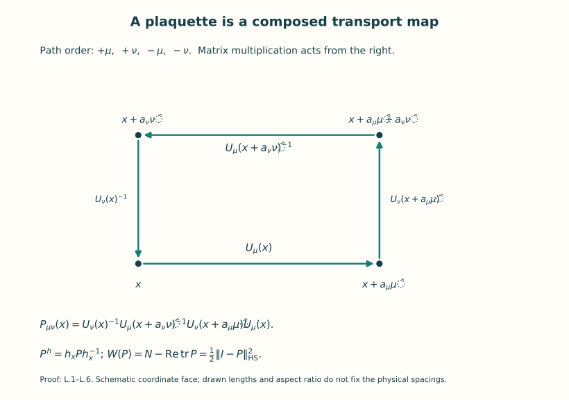
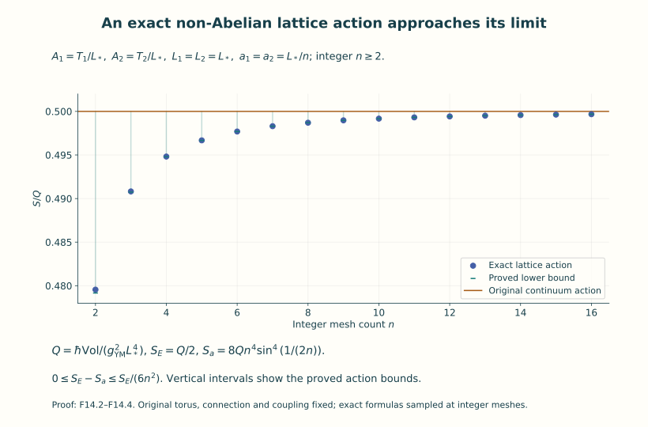
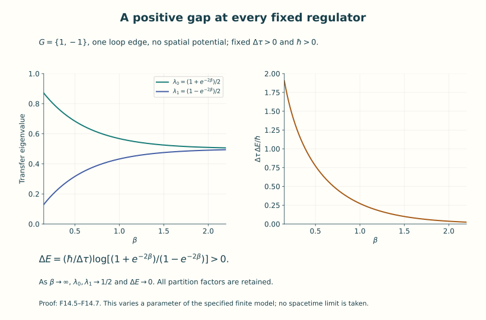

# Yang–Mills theory on a lattice

A lattice replaces spacetime by vertices and edges. A gauge field assigns
a transport matrix to each edge. Products around loops record curvature,
and a finite product of compact group measures makes expectation values
actual integrals. This unit constructs those objects, proves their relation
to the original classical action, and obtains a Hilbert space and time
evolution from the finite Euclidean model.

The route has two parts. Part I builds links, plaquettes, the Wilson action
and its finite probability measure. It proves a quantitative comparison
with a fixed smooth continuum connection. Part II constructs the transfer
operator, its physical subspace, trace, Hamiltonian domain and reflection
form. These constructions provide the starting point for simulations and
the later study of continuum limits.

Read [transport and holonomy](../bundles-transport-holonomy.html),
[action and field equations](../action-and-field-equations.html),
[Euclidean theory](../euclidean-yang-mills-instantons.html), and
[quantum gauge symmetry](../quantum-gauge-symmetry.html) first. The compact
group measure and averaging projection are proved in Unit 12. This unit
proves the additional approximation and compact-operator facts it uses.
Matrix products follow the course's active gauge convention: the first
edge traversed supplies the rightmost factor.

Keep the physical speed \(c\), Planck constant \(\hbar\), coupling
\(g_{\mathrm{YM}}\), edge lengths and temporal step \(\Delta\tau\)
visible. A lattice spacing is a length. An energy extracted from a transfer
eigenvalue has the factor \(\hbar/\Delta\tau\). A finite number of links
with a continuous compact group still gives an infinite-dimensional
space of wavefunctions.

By the end, you can write the exact lattice action in unequal spacings,
control its error on a fixed smooth field, evaluate a compact plaquette
integral, construct the gauge-projected transfer operator and determine
what its spectrum proves at that fixed regulator.

## Part I. Links, curvature and finite probability

### 1. Links are maps between vertex fibres

Let \(G\subset U(N)\) be a closed matrix Lie subgroup, with its given faithful defining representation and \(\kappa(X,Y)=-\operatorname{tr}(XY)\). Let a finite graph have vertex set \(V\), a set \(E_+\) of chosen directed edges, and formal reversed edges \(\bar e\), with \(s(\bar e)=t(e)\), \(t(\bar e)=s(e)\). Different edges may have the same endpoints. A configuration is

\[
 U\in\mathcal Q=G^{E_+},\qquad U_{\bar e}=U_e^{-1}.
 \tag{L.1}
\]

It represents a linear isometry from the copy of \(\mathbb C^N\) at \(s(e)\) to the copy at \(t(e)\). For a path \(\gamma=(e_1,\ldots,e_m)\), traversed in that order, define

\[
 U_\gamma=U_{e_m}\cdots U_{e_1}:
 \mathbb C^N_{s(e_1)}\longrightarrow\mathbb C^N_{t(e_m)}.
 \tag{L.2}
\]

The empty path has the identity matrix. Concatenating paths multiplies their transport matrices in the same composition order; reversing a path gives the inverse matrix. Both assertions follow by writing the finite products, with adjacent inverse factors cancelling in a backtrack.

The vertex gauge group \(\mathcal G=G^V\) acts by

\[
 (h\cdot U)_e=h_{t(e)}U_eh_{s(e)}^{-1}.
 \tag{L.3}
\]

This preserves the reversal rule. Direct multiplication proves \(h\cdot(k\cdot U)=(hk)\cdot U\), with pointwise product in \(\mathcal G\). Intermediate vertex factors cancel in (L.2), giving

\[
 U_\gamma^{\,h}=h_{t(\gamma)}U_\gamma h_{s(\gamma)}^{-1}.
 \tag{L.4}
\]

For a closed path, \(\operatorname{tr}U_\gamma\) is gauge invariant. We will distinguish the full trace, its real part, and the optionally divided trace \(N^{-1}\operatorname{tr}U_\gamma\); they are different specified observables. Reversal conjugates the complex trace because \(U_\gamma^{-1}=U_\gamma^*\). Changing the starting vertex conjugates the loop matrix, hence preserves its trace. A loop that winds around a periodic direction is included; it need not bound plaquettes.

### 2. The periodic rectangular four-dimensional lattice

Fix lengths \(L_\mu>0\), integers \(n_\mu\geq2\), and spacings \(a_\mu=L_\mu/n_\mu\), for \(\mu=0,1,2,3\). The vertices are \(\prod_\mu\mathbb Z/n_\mu\mathbb Z\); vertex \(j\) represents \(x_j=(a_\mu j_\mu)_\mu\) on the flat torus \(\prod_\mu\mathbb R/L_\mu\mathbb Z\). Each \((j,\mu)\) is a chosen edge from \(j\) to \(j+\hat\mu\). Even when an endpoint pair also occurs elsewhere, these edge labels remain distinct. Set \(v_a=\prod_\rho a_\rho\) and \(h=\max_\rho a_\rho\).

For \(\mu<\nu\), take the plaquette path \(+\mu,+\nu,-\mu,-\nu\), starting at \(j\). Its transport is exactly

\[
 P_{\mu\nu}(j)=U_\nu(j)^{-1}U_\mu(j+\hat\nu)^{-1}
                         U_\nu(j+\hat\mu)U_\mu(j).
 \tag{L.5}
\]

Figure 1. The coordinate face of (L.5), shown schematically in two
dimensions. Edge labels retain the actual lengths and transport matrices;
the drawn aspect ratio does not prescribe the physical spacing ratio.

The last path edge is the leftmost matrix, in agreement with (L.2). Its gauge transformation is conjugation by \(h_j\). The reversed plaquette has inverse transport. There are six chosen plaquette labels at each vertex. Define the nonnegative class function

\[
 W(g)=N-\operatorname{Re}\operatorname{tr}g
       =\tfrac12\|I-g\|_{\rm HS}^2,
       \qquad 0\leq W(g)\leq2N.
 \tag{L.6}
\]

The equality follows by expanding \(\operatorname{tr}[(I-g)^*(I-g)]\), using \(g^*g=I\). It proves all bounds, as well as \(W(g)=0\) exactly when \(g=I\). It also proves invariance under conjugation and inversion.

With \(g_{\mathrm{YM}}\ne0\) real and \(\hbar>0\), the Wilson action matching the course is

\[
 \boxed{S_a(U)=\frac{2\hbar}{g_{\mathrm{YM}}^2}
     \sum_j\sum_{\mu<\nu}
           \frac{v_a}{a_\mu^2a_\nu^2}\,W(P_{\mu\nu}(j)).}
 \tag{L.7}
\]

Every coefficient is retained. The gauge invariance follows from (L.4) and (L.6). In the isotropic case \(a_\mu=a\), the volume divided by the squared area equals one, so the action is \((2\hbar/g_{\mathrm{YM}}^2)\sum W(P)\). If a convention uses \(1-N^{-1}\operatorname{Re}\operatorname{tr}P\), its dimensionless coefficient is exactly \(\beta_{\rm conventional}=2N/g_{\mathrm{YM}}^2\). This is an explicit equality, not a change to the defining trace.

For physical Euclidean time \(\tau\), put \(x^0=c\tau\), where the original physical speed \(c>0\) has units length/time. Let \(a_0=c\Delta\tau\), and take the three spatial spacings equal to \(a_s>0\). Equation (L.7) is then

\[
 \frac{S_a}{\hbar}=
 \underbrace{\frac{2a_s}{g_{\mathrm{YM}}^2c\Delta\tau}}_{\beta_t}
        \sum_{j,i=1}^3 W(P_{0i}(j))
 +\underbrace{\frac{2c\Delta\tau}{g_{\mathrm{YM}}^2a_s}}_{\beta_s}
        \sum_{j,1\leq i<k\leq3}W(P_{ik}(j)).
 \tag{L.8}
\]

Both \(\beta_t,\beta_s\) are dimensionless and positive. The coordinate metric is \(c^2d\tau^2+\sum_i(dx^i)^2\), its density is \(c\), \(A_\tau=cA_0\), and \(F_{\tau i}=cF_{0i}\). The receiving continuum action is therefore exactly

\[
 S_E[A]=\frac{\hbar}{g_{\mathrm{YM}}^2}
  \int c\left[c^{-2}\sum_i\kappa(F_{\tau i},F_{\tau i})
           +\sum_{i<k}\kappa(F_{ik},F_{ik})\right]d\tau\,d^3x.
 \tag{L.9}
\]

This is F07's \(\hbar/(2g_{\mathrm{YM}}^2)\) times the full ordered contraction, since each independent antisymmetric component occurs twice. It is a coordinate expression in Euclidean signature; no quantum analytic-continuation theorem is used.

### 3. Actual holonomy and an explicit curvature remainder

First take a \(C^3\), periodic, skew-Hermitian connection \(A=\sum_\mu A_\mu dx^\mu\) on the trivial bundle over the fixed flat torus. Its curvature is the original
\(F_{\mu\nu}=\partial_\mu A_\nu-\partial_\nu A_\mu+[A_\mu,A_\nu]\).
Define each link by actual parallel transport, the unique solution of

\[
 \frac{dU(s)}{ds}=-A_\mu(x+s\hat\mu)U(s),\quad U(0)=I,
                    \quad U_\mu(x)=U(a_\mu).
 \tag{L.10}
\]

Existence follows from the uniformly convergent iterated-integral series on a bounded interval: its degree \(r\) term has norm at most \((a_\mu M_0)^r/r!\). Differentiation verifies the integral equation, and iteration of the difference equation proves uniqueness. Differentiating \(U^*U\) gives zero, hence unitarity. The solution lies in \(G\): approximate the coefficient by step functions in \(\mathfrak g\), whose solution is a product of group exponentials. For two skew-Hermitian coefficients \(A,B\), differentiate \(U_B^{-1}U_A\) to obtain \(-U_B^{-1}(A-B)U_A\). Its integral gives \(\|U_A(s)-U_B(s)\|\leq\int_0^s\|A(r)-B(r)\|dr\), since both propagators are unitary. Thus the step-function solutions converge, and closedness of \(G\) gives the limit in \(G\). Under the course's active rule \(A^u=uAu^{-1}-du\,u^{-1}\), direct differentiation proves the transformed transport is \(u(x+s\hat\mu)U(s)u(x)^{-1}\), establishing exactly (L.3).

Use operator norms for the following constants, on the fixed torus:

\[
 M_0=\max_\mu\sup\|A_\mu\|,\quad
 A_1=\max_{\mu,\rho}\sup\|\partial_\rho A_\mu\|,\quad
 A_2=\max_{\mu,\rho,\sigma}\sup\|\partial_\rho\partial_\sigma A_\mu\|,
\]

\[
 M_F=\max_{\mu<\nu}\sup\|F_{\mu\nu}\|,\quad
 M_1=\max_{\mu<\nu,\rho}\sup\|\partial_\rho F_{\mu\nu}\|,\quad
 M_2=\max_{\mu<\nu,\rho,\sigma}\sup\|\partial_\rho\partial_\sigma F_{\mu\nu}\|.
 \tag{L.11}
\]

All are finite and keep their actual length units. Choose a fixed length \(h_0>0\), and consider meshes with \(h\leq h_0\). Set

\[
 C_D=M_1+2M_0M_F,\quad
 U_1=M_0+h_0A_1,\quad
 U_2=M_0^2+A_1+2h_0U_1A_1+h_0A_2,
\]

\[
 C_2=2U_2M_F+4U_1M_1+2U_1^2M_F+M_2,
 \qquad C_R=2C_2+\tfrac12M_F^2.
 \tag{L.12}
\]

Here is the required local calculation, including its sign. In a plaquette rectangle use coordinates \((s,t)\in[0,a]\times[0,b]\), with \(a=a_\mu,b=a_\nu\). Choose a gauge \(u\) by first transporting along the left vertical side, taking the inverse, and then solving \(\partial_su=uA_\mu\). Thus \(u(0,0)=I\), \(\partial_tu(0,t)=u(0,t)A_\nu(0,t)\), and the transformed connection \(B=A^u\) satisfies

\[
 B_\mu=0,\quad B_\nu(0,t)=0,\quad
 B_\nu(a,t)=\int_0^a u(s,t)F_{\mu\nu}(s,t)u(s,t)^{-1}\,ds.
 \tag{L.13}
\]

The last equality is the fundamental theorem applied to \(F^u_{\mu\nu}=\partial_sB_\nu\). Three sides now have identity transport, so the whole positively oriented loop is transport up the right side, with coefficient \(-B_\nu(a,t)\). Its basepoint gauge is the identity, so this is the original matrix (L.5), not merely a matrix with the same trace.

Write \(\widetilde F(s,t)=u(s,t)F_{\mu\nu}(s,t)u(s,t)^{-1}\). At the origin,
\(\partial_s\widetilde F=D_\mu F\) and \(\partial_t\widetilde F=D_\nu F\), where \(D_\rho F=\partial_\rho F+[A_\rho,F]\). The derivative bounds needed for Taylor's theorem follow directly from the defining ODE. Namely

\[
 \|u_s\|\leq M_0,\quad \|u_t\|\leq M_0+aA_1\leq U_1,
\]

\[
 \|u_{ss}\|\leq M_0^2+A_1,\quad
 \|u_{st}\|\leq U_1M_0+A_1,\quad
 \|u_{tt}\|\leq M_0^2+A_1+2aU_1A_1+aA_2\leq U_2.
\]

For the bounds in \(t\), differentiate \(u_s=uA_\mu\), use the stated initial data on the left side, and integrate the inhomogeneous linear ODE; the homogeneous propagator is unitary and has norm one. The number \(U_2\) also bounds the first two second derivatives displayed. Since \(u^{-1}=u^*\), its derivatives have the same norms. Differentiating \(uFu^*\) twice now gives the bound \(C_2\) in (L.12): there are two terms with a second derivative of \(u\), four with one derivative each of \(u\) and \(F\), two with first derivatives on both outer factors, and the one second derivative of \(F\).

Taylor's theorem along the segment from \((0,0)\) to \((s,t)\) therefore gives

\[
 \|\widetilde F(s,t)-F(0)-sD_\mu F(0)-tD_\nu F(0)\|
                       \leq\tfrac12 C_2(s+t)^2.
\]

Integrate over the rectangle. The transport ODE up its right side satisfies
\(\|P-I+\int_0^b B_\nu(a,t)dt\|\leq (abM_F)^2/2\): in the integral equation insert \(\|U(t)-I\|\leq\int_0^t\|B_\nu(a,r)\|dr\), which follows from unitarity. Thus

\[
 \boxed{P_{\mu\nu}(x)=I-ab\left[F_{\mu\nu}(x)
        +\frac a2D_\mu F_{\mu\nu}(x)
        +\frac b2D_\nu F_{\mu\nu}(x)\right]+R,\qquad
       \|R\|\leq ab\,h^2C_R.}
 \tag{L.14}
\]

In particular the leading sign is minus. No commuting-field assumption has entered the argument.

### 4. A second-order action estimate, with its hypotheses

Let \(q_{\mu\nu}(x)=\kappa(F_{\mu\nu}(x),F_{\mu\nu}(x))\). Trace invariance gives
\(\partial_\rho q=2\kappa(F,D_\rho F)\), because \(\kappa(F,[A_\rho,F])=0\). Define

\[
 B_q=2N(M_1^2+M_FM_2),\qquad
 C_W=N\left[\frac{C_D^2}{2}+(M_F+h_0C_D)C_R
                         +\frac{h_0^2 C_R^2}{2}\right]+\frac{B_q}{4}.
 \tag{L.15}
\]

Each second coordinate derivative of every \(q_{\mu\nu}\) has absolute value at most \(B_q\), by differentiating \(-\operatorname{tr}F^2\) twice and using \(|\operatorname{tr}XY|\leq N\|X\|\|Y\|\).

Let \(x_c=x+(a/2)\hat\mu+(b/2)\hat\nu\), the centre of the plaquette. Equations (L.6) and (L.14) imply the fully quantified estimate

\[
 \boxed{\left|W(P_{\mu\nu}(x))-
       \frac{a_\mu^2a_\nu^2}{2}q_{\mu\nu}(x_c)\right|
                 \leq a_\mu^2a_\nu^2h^2 C_W.}
 \tag{L.16}
\]

To verify the constants, put \(K=(a/2)D_\mu F+(b/2)D_\nu F\), so \(\|K\|\leq hC_D\). The square norm of \(-ab(F+K)+R\) differs from \((ab)^2\|F+K\|_{\rm HS}^2\), after division by two, by at most
\((ab)^2N[(M_F+h_0C_D)C_R h^2+C_R^2h^4/2]\).
The quadratic \(K\) term is at most \((ab)^2Nh^2C_D^2/2\). Its linear term gives precisely the first derivatives in the Taylor expansion of \(q(x_c)\). The second-order Taylor error of that scalar is at most \(B_qh^2/2\); multiplication by \((ab)^2/2\) gives the final \(B_q/4\) in (L.15). This proves (L.16).

The required periodic quadrature estimate also has a short complete proof. For a \(C^2\), period-\(L\) scalar function with \(|f''|\leq B\), sample at \(x_j=(j+\theta)a\), \(0\leq\theta\leq1\), \(na=L\). Taylor expansion on each interval gives

\[
 \int_{ja}^{(j+1)a}f(x)dx-a f(x_j)
 =a^2(1/2-\theta)f'(x_j)+r_j,\quad |r_j|\leq Ba^3/6.
\]

Here \(\int_0^1(s-\theta)^2ds\leq1/3\). Periodicity gives \(\int_0^L f'=0\), while the Lipschitz bound for \(f'\) gives
\(|a\sum_j f'(x_j)|\leq BLa/2\). Summing the preceding identity therefore yields

\[
 \left|a\sum_jf((j+\theta)a)-\int_0^L f\right|
                         \leq\frac5{12}BL a^2.
 \tag{L.17}
\]

Apply this successively in four coordinates. The difference between the product quadrature and the product integral is the sum of four terms obtained by replacing one factor at a time; all the remaining quadrature and integration factors preserve positivity and have mass their interval length. Hence each \(q_{\mu\nu}\), sampled at its own face centre (offsets \(1/2\) in its two directions and zero in the other two), obeys error at most \((5/12)B_q\operatorname{Vol}\sum_\rho a_\rho^2\), where \(\operatorname{Vol}=\prod_\rho L_\rho\).

Combining this with (L.7) and (L.16), and retaining all six independent curvature pairs, proves

\[
 \boxed{|S_a(U[A])-S_E[A]|
 \leq\frac{\hbar}{g_{\mathrm{YM}}^2}\operatorname{Vol}\,h^2
                      (12C_W+10B_q).}
 \tag{L.18}
\]

The continuum action here is exactly \(\hbar/g_{\mathrm{YM}}^2\int\sum_{\mu<\nu}q_{\mu\nu}\), equivalently F07's ordered formula. The parameters \(L_\mu,\hbar,g_{\mathrm{YM}}\) and the connection are fixed during this estimate. There is no bounded-aspect-ratio assumption: the factors \(a_\mu^2a_\nu^2\) cancel against their actual coefficient in (L.7). Every constant has the units needed for (L.18) to be an action.

This also applies to a smooth connection on a possibly nontrivial principal \(G\)-bundle over the same flat torus. Choose a finite collection of trivializing coordinate neighbourhoods with smaller neighbourhoods still covering the torus. Compactness gives a positive length below which each cell and its edge paths fit in one larger neighbourhood: otherwise a sequence of arbitrarily small cells outside every such neighbourhood would have centres converging to a point in one of the smaller neighbourhoods, a contradiction. Choose frames at the finitely many vertices and define links by the actual parallel transport between these frames. In the neighbourhood of each small cell compare to its smooth local frame. Equation (L.4) conjugates the cell holonomy at its base and preserves its real trace. Take maxima of the constants (L.11) over finitely many compact neighbourhood closures. The gauge-invariant scalars \(q_{\mu\nu}\) agree on overlaps and are globally periodic, so (L.17) applies to them. These facts give the same estimate (L.18), with the finite local-frame maxima. This is a local curvature-to-holonomy statement, not a claim that arbitrary lattice configurations have smooth continuum representatives or fixed topological charges.

#### A sharper periodic quadrature bound

The periodic setting actually improves (L.17) while keeping every sample
point. Extend the original function periodically to the real line and
partition the interval from \(\theta a\) to \(L+\theta a\) into intervals
\([x_j,x_{j+1}]\). Its integral is still the original integral over
\([0,L]\). On one such interval let \(\ell\) be the affine interpolant of
the endpoint values. For \(r=f-\ell\), we have zero endpoint values and
\(-B\leq r''\leq B\). Write
\(q(x)=B(x-x_j)(x_{j+1}-x)/2\). The function \(r-q\) has nonnegative
second derivative and zero endpoint values, so it lies below its zero
chord. The function \(r+q\) has nonpositive second derivative and lies
above its zero chord. Hence \(|r|\leq q\). Integration gives
\(\left|\int f-a(f(x_j)+f(x_{j+1}))/2\right|\leq Ba^3/12\).
The endpoint contributions telescope cyclically into the original sample
sum. Thus, for every original offset \(\theta\),

\[
 \left|a\sum_j f((j+\theta)a)-\int_0^L f(x)\,dx\right|
 \leq \frac{BL a^2}{12},
 \qquad
 |S_a(U[A])-S_E[A]|
 \leq\frac{\hbar}{g_{\mathrm{YM}}^2}\operatorname{Vol}\,h^2
            (12C_W+2B_q).
 \tag{F14.1}
\]

The four-coordinate comparison uses the same positive quadrature and
integration factors as in (L.17). It gives
\(B_q\operatorname{Vol}\sum_\rho a_\rho^2/12\) for each curvature pair.
There are six pairs, and \(\sum_\rho a_\rho^2\leq4h^2\), yielding the
displayed \(2B_q\). The local holonomy error remains exactly the
\(12C_W\) contribution of (L.18). All hypotheses, coordinate lengths,
couplings and local-frame extensions of (L.18) are unchanged. This is
a strengthening of the bound already proved, not a replacement of the
original action or sampling rule.

### 5. Finite-volume probability is an actual measure

Use Haar probability \(\mu\) on \(G\). A complete construction for this class of groups is Q.6–Q.7 of the F12 proof: the metric \(m_g(v,w)=-\operatorname{tr}(g^{-1}v\,g^{-1}w)\) is bi-invariant; its coordinate volume densities glue by change of variables; compactness makes the total volume finite and positive; dividing by that number gives \(\mu\). Inversion is an isometry and preserves \(\mu\). A zero-dimensional compact Lie group is finite and uses counting measure divided by its number of elements. These proofs are retained in [Unit 12, Q.6–Q.8](../quantum-gauge-symmetry.html#eq-Q-6).

For any finite graph with finitely many specified plaquette words and positive dimensionless coefficients \(\beta_p\), put

\[
 S(U)=\hbar\sum_p\beta_pW(P_p(U)),\quad
 Z=\int_{G^{E_+}}e^{-S(U)/\hbar}\prod_e d\mu(U_e),\quad
 d\nu=Z^{-1}e^{-S/\hbar}\prod_e d\mu(U_e).
 \tag{L.19}
\]

These are finite product integrals of continuous bounded functions. Since

\[
 e^{-2N\sum_p\beta_p}\leq e^{-S/\hbar}\leq1,
 \qquad e^{-2N\sum_p\beta_p}\leq Z\leq1,
 \tag{L.20}
\]

\(\nu\) is a well-defined positive probability measure with full support. Each nonempty open product neighbourhood has positive Haar volume by the coordinate-density construction, and the density has the positive lower bound in (L.20). Gauge transformations preserve product Haar measure by its left and right invariance, and preserve the action, so they preserve \(\nu\). Every bounded measurable observable is integrable. Its expectation is unchanged by gauge transformation, and the expectation of its gauge average equals its expectation by the finite probability integrals and Fubini. This includes nongauge-invariant observables after averaging; invariant observables require no gauge-fixing determinant for this finite measure.

The same construction works with fixed boundary links: integrate only over the remaining links, and restrict vertex gauge transformations to those preserving the specified boundary data. The integration domain is compact in either case. None of these assertions constructs an infinite product interacting continuum measure.

### 6. One plaquette of U(1), evaluated exactly

Take a square with four distinct directed boundary edges, all oriented along the loop. Set \(G=U(1)\subset U(1)\), \(U_j=e^{i\theta_j}\), and \(\phi=\theta_1+\theta_2+\theta_3+\theta_4\pmod{2\pi}\). Here the defining matrix size is \(N=1\). The graph's links are dimensionless; if this is a plaquette of (L.7), its parameter is the precise \(\beta=2v_a/(g_{\mathrm{YM}}^2a_\mu^2a_\nu^2)>0\). We also admit \(\beta=0\) as a separately stated limiting finite model. The action is

\[
 S_\square=\hbar\beta(1-\cos\phi).
 \tag{L.21}
\]

The map \((\theta_1,\theta_2,\theta_3,\theta_4)\mapsto(\phi,\theta_2,\theta_3,\theta_4)\) is a torus group automorphism with inverse \(\theta_1=\phi-\theta_2-\theta_3-\theta_4\); integrating the first angle by translation proves it preserves product probability measure. Thus its holonomy has uniform Haar distribution before weighting, and

\[
 Z_\square=e^{-\beta}I_0(\beta),\qquad
 I_m(\beta):=\int_0^{2\pi}e^{\beta\cos\phi}e^{im\phi}\frac{d\phi}{2\pi}
 =\sum_{r=0}^{\infty}\frac{(\beta/2)^{2r+|m|}}{r!(r+|m|)!}.
 \tag{L.22}
\]

To prove the series, multiply the two absolutely uniformly convergent expansions of \(\exp[(\beta/2)e^{i\phi}]\) and \(\exp[(\beta/2)e^{-i\phi}]\). Their integrated term is zero unless the total Fourier exponent is zero, leaving exactly the displayed terms. Uniform absolute convergence follows from the majorant \(e^{|\beta|}\); it justifies multiplication and integration. These functions are the modified Bessel coefficients, but the series and integral here define all quantities used.

For every integer \(m\), the exact Wilson moment and action expectation are

\[
 \langle e^{im\phi}\rangle=\frac{I_m(\beta)}{I_0(\beta)},\qquad
 \langle S_\square\rangle=\hbar\beta\left(1-\frac{I_1(\beta)}{I_0(\beta)}\right).
 \tag{L.23}
\]

The imaginary moments vanish by \(\phi\mapsto-\phi\). Also

\[
 \operatorname{Var}(\cos\phi)=
 \frac{I_0(\beta)+I_2(\beta)}{2I_0(\beta)}
                  -\left(\frac{I_1(\beta)}{I_0(\beta)}\right)^2>0
 \tag{L.24}
\]

for finite \(\beta\geq0\), because \(\cos\phi\) is nonconstant and the density is strictly positive everywhere. At \(\beta=0\), \(I_0=1\), \(I_m=0\) for \(m\ne0\), so all exceptional values are determined. For \(\beta>0\), every \(I_m>0\) by the series. The vertex gauge action changes individual edge phases but not \(\phi\); conversely, three vertex transformations can set three successive edge phases to zero, and the last becomes \(\phi\), by recursively choosing the vertex phases. Thus \(\phi\) describes the actual orbit quotient of this square. The common vertex phase is a stabilizer of all configurations, and its Haar probability is one rather than an infinite gauge volume.

### 7. Exact source comparison

Rajan Gupta, *Introduction to Lattice QCD*,
[arXiv:hep-lat/9807028v1](https://arxiv.org/abs/hep-lat/9807028v1),
supplies the standard lattice context. The exact original author version,
bounded reading and comparison are recorded in
[the lesson provenance](../src/YM-F14-provenance.json).

The source's endpoint rule `eq:13.5` is \(U^{\rm src}_{x,\mu}\mapsto h_xU^{\rm src}_{x,\mu}h_{x+\hat\mu}^{-1}\). The exact comparison to (L.3) is \(U_{x,\mu}=(U^{\rm src}_{x,\mu})^{-1}\). Under this substitution the source plaquette matrix is the inverse of (L.5); their real traces agree. For \(SU(3)\), its dimensionless action \((6/g^2)\sum\operatorname{Re}\operatorname{tr}[(I-P)/3]\) is precisely \(S_a/\hbar\) in the isotropic case with \(g=g_{\mathrm{YM}}\). At the midpoint exponential level its Hermitian coefficient \(A^{\rm src}\) corresponds to the course coefficient \(A=i g_{\mathrm{YM}}A^{\rm src}\), after the link inversion just specified. The exact transport in (L.10) is defined by its ODE; a midpoint exponential is not substituted for a path-ordered solution at finite spacing. The independent noncommutative calculation (L.13)–(L.18) supplies the retained constants and the quantified remainder.

The source's statement at `lqcd.tex` line 557 that matrix elements belong to the real interval \([0,1]\) is not true for unitary matrices. The needed statement is \(|U_{ij}|\leq1\), since each column has squared norm one; for example \(\operatorname{diag}(i,-i)\in SU(2)\). Compactness and the Haar-volume proof above supply the actual integration argument. The source's broad continuum and reconstruction discussion is not a provider for such a claim here. The transfer construction below is proved for the specified finite lattice and retains \(\hbar,c,\Delta\tau\).

## Part II. Physical transfer and time evolution

### 1. The Wilson kernel is positive in the operator sense

For the fixed faithful inclusion \(G\subset U(N)\), let \(\beta>0\) and define

\[
 k_\beta(g)=\exp[-\beta(N-\operatorname{Re}\operatorname{tr}g)],\qquad
 (K_\beta f)(x)=\int_G k_\beta(xy^{-1})f(y)d\mu(y),
 \quad f\in L^2(G,\mu).
 \tag{T.1}
\]

The scalar function is continuous, central, real, inverse-invariant, and lies in \([e^{-2\beta N},1]\). Its pointwise positivity is not by itself the proof that \(\langle f,K_\beta f\rangle\geq0\); the following expansion proves that stronger statement.

For nonnegative integers \(p,q\), let
\(\rho_{pq}(g)=g^{\otimes p}\otimes\bar g^{\otimes q}\), a unitary representation of dimension \(d_{pq}=N^{p+q}\), with \(\rho_{00}=1\). In fixed tensor-product orthonormal bases,

\[
 \begin{aligned}
 k_\beta(xy^{-1})&=e^{-\beta N}
 \sum_{p,q\geq0}\frac{(\beta/2)^{p+q}}{p!q!}
              \operatorname{tr}\bigl(\rho_{pq}(x)\rho_{pq}(y)^*\bigr)\\
 &=\sum_{p,q,i,j}a_{pq}\,\rho_{pq}(x)_{ij}
                  \overline{\rho_{pq}(y)_{ij}},\qquad
 a_{pq}=e^{-\beta N}\frac{(\beta/2)^{p+q}}{p!q!}>0.
 \end{aligned}
 \tag{T.2}
\]

To derive the first line, expand independently the exponentials of \((\beta/2)\operatorname{tr}(xy^{-1})\) and its complex conjugate; a product of traces is the trace of the tensor product. For the second, expand the matrix trace and use unitarity. The sum of the absolute values of the matrix-entry products at fixed \(p,q,x,y\) is at most \(d_{pq}\), by Cauchy–Schwarz and \(\sum_{ij}|\rho(x)_{ij}|^2=d_{pq}\). Therefore the whole series converges absolutely and uniformly, with bound

\[
 \sum_{p,q}a_{pq}d_{pq}
           =e^{-\beta N}e^{\beta N/2}e^{\beta N/2}=1.
 \tag{T.3}
\]

Finite sums are positive kernels: for any finite points \(x_1,\ldots,x_m\) and complex coefficients \(z_1,\ldots,z_m\), the quadratic sum of their kernel entries is a sum of the nonnegative numbers \(a_{pq}|\sum_j z_j\overline{\rho_{pq}(x_j)_{ik}}|^2\). The uniform limit preserves this property. Integration of the uniformly convergent sum, using \(\|f\|_1\leq\|f\|_2\), gives

\[
 \boxed{\langle f,K_\beta f\rangle
   =\sum_{p,q,i,j}a_{pq}
       \left|\int_G\overline{\rho_{pq}(y)_{ij}}f(y)d\mu(y)\right|^2\geq0.}
 \tag{T.4}
\]

Here \(\langle f,g\rangle=\int\bar f g\). This is a complete positivity mechanism for the Wilson kernel; it does not depend on an uncomputed character coefficient.

For comparison with character language, every finite-dimensional unitary representation decomposes into an orthogonal sum of irreducibles: if it has a proper invariant subspace, its orthogonal complement is invariant by unitarity; induction on the dimension terminates. Thus each trace in (T.2) is a sum of irreducible characters with nonnegative integer multiplicities. The coefficients \(a_{pq}\) are positive, so grouping any such finite decomposition gives nonnegative character coefficients; (T.3) controls the sum of their dimensions. The proof of (T.4) itself requires no character classification or completeness theorem.

### 2. Strict positivity requires a density argument

We prove the needed density here. Matrix entries of the tensor representations \(\rho_{pq}\) include every monomial in the entries of \(g\) and their conjugates. Their linear span is therefore the restrictions to \(G\), embedded in \(\mathbb R^{2N^2}\), of complex polynomials in those real coordinates.

First, real coordinate polynomials are uniformly dense in continuous real functions on any compact subset \(X\) of a finite-dimensional cube. A direct argument avoids assuming this approximation step. Let \(f\in C(X,\mathbb R)\), \(|f|\leq M\), and choose \(\delta>0\) with oscillation below \(\epsilon\) at distances below \(\delta\). If \(M=0\) there is nothing to prove. Otherwise set \(L=2M/\delta\) and

\[
 F_L(z)=\inf_{x\in X}\{f(x)+L|z-x|\}.
\]

The triangle inequality proves \(F_L\) is \(L\)-Lipschitz. For \(z\in X\), it is at most \(f(z)\); terms with \(|x-z|<\delta\) are at least \(f(z)-\epsilon\), and terms with \(|x-z|\geq\delta\) are at least \(-M+2M\geq f(z)\). Hence \(f-\epsilon\leq F_L\leq f\) on \(X\).

Choose \(R>0\) with \(X\subset[-R,R]^d\). The affine map \(z\mapsto(z+R\mathbf1)/(2R)\) takes this cube to \([0,1]^d\), with inverse \(t\mapsto2Rt-R\mathbf1\). Thus \(F(t)=F_L(2Rt-R\mathbf1)\) has Lipschitz constant at most \(2RL\). A Lipschitz function \(F\) on \([0,1]^d\) is approximated by its multivariate Bernstein polynomial

\[
 B_mF(z)=\sum_{0\leq j_1,\ldots,j_d\leq m}F(j/m)
          \prod_{r=1}^d {m\choose j_r}z_r^{j_r}(1-z_r)^{m-j_r}.
\]

To verify convergence, the product weights are the probabilities of independent binomial random variables \(J_r\) with parameters \(m,z_r\). The binomial identities give \(\mathbb E(J_r/m)=z_r\) and variance \(z_r(1-z_r)/m\leq1/(4m)\). Thus Cauchy–Schwarz yields
\(|B_mF(z)-F(z)|\leq\operatorname{Lip}(F)\sqrt{d/(4m)}\), uniformly. Pulling the polynomial back to the original cube proves the assertion. Apply it to real and imaginary parts for complex functions. The coordinates of the group are not rescaled in any action: this affine comparison is used only in the proof of approximation.

Continuous functions are dense in \(L^2(G,\mu)\) for the particular measure constructed here. Indeed use finitely many charts and a smooth partition of unity with compact chart support. On each compact chart support the volume density is bounded above and below by positive numbers, so the \(L^2\) norm is equivalent to the ordinary Lebesgue \(L^2\) norm there. Bounded step functions on boxes approximate integrable square functions: truncate the function and approximate it by simple functions, then approximate measurable sets of finite measure by finite unions of boxes using the defining regularity of Lebesgue measure. A box indicator is approximated in \(L^2\) by continuous piecewise-linear ramps, whose discrepancy is confined to strips of volume tending to zero. Multiplication by the chart partition functions and extension by zero give continuous functions on the group. This proves the stated density. For finite groups every function is already continuous.

Consequently (T.4) vanishes only if \(f=0\): otherwise vanishing of every displayed coefficient would make \(f\) orthogonal to a dense subspace. We have proved

\[
 \langle f,K_\beta f\rangle>0\quad(f\ne0),\qquad \ker K_\beta=\{0\}.
 \tag{T.5}
\]

The assumption \(\beta>0\) is essential. At \(\beta=0\), the kernel is one and the operator is projection onto constants, generally with a large kernel.

### 3. Boundedness, compactness, and trace, with distinct meanings of positivity

The continuous kernel in (T.1) satisfies

\[
 \|K_\beta f\|_2\leq\|f\|_2,\qquad
 K_\beta^*=K_\beta,
 \tag{T.6}
\]

the first by \(|k|\leq1\), Cauchy–Schwarz and total measure one; the second by \(k(xy^{-1})=k(yx^{-1})\). Finite partial sums in (T.2) are finite-rank operators, and the uniform remainder bounds their operator norm difference from \(K_\beta\). A norm limit of finite-rank operators is compact: a bounded sequence has a subsequence Cauchy after each of a countable family of finite-rank approximations, by diagonal extraction; the uniform approximation then makes its images Cauchy for the limit operator. This proves compactness directly.

There is also a stronger summability statement. Write the kernel as \(\sum_r v_r(x)\bar v_r(y)\), where \(v_r=\sqrt{a_{pq}}\rho_{pq,ij}\). Then

\[
 \sum_r\|v_r\|_2^2=\int_G\sum_{p,q}a_{pq}d_{pq}\,d\mu=1.
 \tag{T.7}
\]

For any orthonormal basis \((e_j)\), nonnegative summation and Parseval give

\[
\sum_j\langle e_j,K_\beta e_j\rangle=\sum_r\sum_j|\langle v_r,e_j\rangle|^2=\sum_r\|v_r\|^2=1
\]

.
Thus this positive compact operator is trace class, with trace one. This computation also proves basis independence of the trace being used. Finite products over edges have the corresponding product feature expansion, again with total feature norm-squared one; all conclusions hold on \(L^2(G^E)\), with possibly different positive \(\beta_e\) on different edges.

Pointwise positivity gives a further, different property: if \(f\geq0\) and \(f\ne0\) in \(L^2\), then \((K_\beta f)(x)\geq e^{-2\beta N}\int f>0\) for every \(x\). The operator improves nonnegative nonzero functions to strictly positive functions. This property and the quadratic positivity (T.5) have both been proved; neither asserts a uniform quadratic lower bound.

In fact, if the Hilbert space is infinite-dimensional, a compact operator cannot satisfy \(\|Kf\|\geq m\|f\|\) with \(m>0\) when it is positive and self-adjoint with a corresponding spectral lower bound. An orthonormal sequence would then have images separated by at least \(m\sqrt2\), contradicting compactness. In the spectral description below, its eigenvalues approach zero. Strict positivity in (T.5) therefore means no zero eigenvector, not that zero is absent from the spectrum.

### 4. The gauge-projected transfer kernel on a spatial lattice

Fix a periodic three-dimensional spatial lattice with spacing \(a_s\), finitely many vertices \(V_s\), and chosen spatial edges \(E_s\). Let
\(\mathcal Q_s=G^{E_s}\), \(dU=\prod_e d\mu(U_e)\), and \(\mathcal H=L^2(\mathcal Q_s,dU)\). The vertex group \(\mathcal G_s=G^{V_s}\) acts as in (L.3), and

\[
 (\mathcal U(h)f)(U)=f(h^{-1}\cdot U),\qquad
 Pf=\int_{\mathcal G_s}\mathcal U(h)f\,dh.
 \tag{T.8}
\]

This representation is unitary by Haar invariance. It is strongly continuous: for continuous \(f\), uniform continuity on the compact product gives convergence in the uniform norm under \(h\to e\); the just-proved continuous-function density and the norm-one bound extend it to all \(L^2\) vectors. The F12 averaging proof Q.8 therefore applies exactly: \(P=P^*=P^2\), on the whole Hilbert space, with range \(\mathcal H_{\rm phys}=\{f:\mathcal U(h)f=f\ \forall h\}\). One can also verify these equalities directly by two Haar integrations and inversion, as in that proof.

Use the coefficients \(\beta_t,\beta_s\) from (L.8). Define a dimensionless spatial potential and multiplication operator

\[
 V(U)=\beta_s\sum_{p\ {\rm spatial}}W(P_p(U)),\qquad
 M(U)=e^{-V(U)/2},\quad
 (Kf)(U')=\int\prod_{e\in E_s}k_{\beta_t}(U'_eU_e^{-1})f(U)dU.
 \tag{T.9}
\]

The function \(M\) is continuous, invariant and satisfies \(e^{-\beta_sN\#p_s}\leq M\leq1\); multiplication by \(M\) is bounded, positive, self-adjoint and invertible with a bounded inverse. The kernel of \(K\) is invariant under simultaneous gauge action on \(U',U\): its edge argument becomes \(h_{t(e)}U'_eU_e^{-1}h_{t(e)}^{-1}\). Hence \(K\) commutes with \(\mathcal U(h)\) and \(P\); so does \(M\). Define

\[
 T_0=MKM,\qquad T=PT_0P=T_0P,
 \qquad T_{\rm phys}=T|_{\mathcal H_{\rm phys}}=T_0|_{\mathcal H_{\rm phys}}.
 \tag{T.10}
\]

Its exact full-space kernel is

\[
 \boxed{t(U',U)=M(U')M(U)
     \int_{\mathcal G_s}\prod_{e\in E_s}
       k_{\beta_t}\!\left(U'_e(h_{t(e)}U_eh_{s(e)}^{-1})^{-1}\right)dh.}
 \tag{T.11}
\]

To derive it, insert (T.8) into \(T_0P\) and change the integration variable by the gauge action. Haar invariance and inversion of the gauge parameter give exactly (T.11). All measures are probability measures; no discarded group-volume constant occurs.

The kernel is continuous and real. It is symmetric, either by self-adjointness of the commuting factors in (T.10) or directly by changing \(h\) to \(h^{-1}\) in (T.11), using gauge invariance and inversion invariance of \(k\). It has a uniform positive lower bound

\[
 t(U',U)\geq
       e^{-2\beta_sN\#p_s-2\beta_tN\#E_s}>0.
 \tag{T.12}
\]

This also proves positivity improvement on nonzero nonnegative functions.

The product feature expansion in §3 shows \(T_0\) is positive trace class and compact: replace each feature \(v_r\) by \(Mv_r\), whose total norm-squared is at most one. For \(T\), replace it by \(PMv_r\). This proves, without a formal determinant, that

\[
 T=T^*\geq0,\quad \|T\|\leq1,\quad \operatorname{Tr}T\leq1.
 \tag{T.13}
\]

It has kernel exactly \(\ker P=\mathcal H_{\rm phys}^{\perp}\). Indeed
\(\langle f,Tf\rangle=\langle MPf,KMPf\rangle\), which vanishes precisely when \(MPf=0\), by (T.5) for the product configuration space, and hence precisely when \(Pf=0\). On \(\mathcal H_{\rm phys}\), the operator is strictly positive and injective. The feature-density proof works on the product by the same real-coordinate polynomial argument, so no tensor completeness assumption has been omitted.

### 5. Why transfer powers are exactly a finite temporal lattice integral

Let \(n_t\geq1\) and choose spatial configurations \(U_j\), \(j=0,\ldots,n_t-1\), with \(U_{n_t}=U_0\). Introduce temporal links \(h_{j,x}\in G\), from vertex \(x\) at time \(j\) to vertex \(x\) at time \(j+1\). For a spatial edge \(e:x\to y\), the loop spatial-forward, temporal-forward, spatial-backward, temporal-backward has matrix

\[
 Q_{j,e}=h_{j,x}^{-1}(U_{j+1,e})^{-1}h_{j,y}U_{j,e}.
 \tag{T.14}
\]

Its real trace agrees with that of the argument in (T.11): cyclically permute \(h_{j,x}^{-1}\) to the end, and use inverse/conjugation invariance of \(k\). It also agrees with the real trace of the other plaquette orientation used in (L.8). These are exact matrix equalities of the required class functions.

Multiplying (T.11) around the time circle makes the two half factors \(M(U_j)\) at every slice into \(e^{-V(U_j)}\). Integrating all intermediate configurations and all temporal links therefore gives

\[
 \boxed{Z_{n_t}^{\rm periodic}
 =\int\prod_j dU_j\prod_{j,x}d\mu(h_{j,x})\,
    e^{-\sum_jV(U_j)-\beta_t\sum_{j,e}W(Q_{j,e})}
 =\operatorname{Tr}_{\mathcal H_{\rm phys}}T_{\rm phys}^{\,n_t}.}
 \tag{T.15}
\]

For \(n_t\geq2\), the integral kernel composition follows from ordinary Fubini, since the bounded integrands are absolutely integrable. The trace as the integral of the diagonal is also justified at \(n_t=1\): the feature expansion \(T=\sum_r|w_r\rangle\langle w_r|\), with \(w_r=PMv_r\), converges uniformly as a kernel. Indeed multiplication by \(M\) and the two gauge averages preserve the uniform absolute remainder bound in (T.2). Integrating its diagonal termwise gives \(\sum_r\|w_r\|^2\), which is its trace by (T.7). For an integer \(n\geq2\), the operator-norm convergence and \(\sum_r\|w_r\|^2<\infty\) give \(\operatorname{Tr}T^n=\sum_r\langle w_r,T^{n-1}w_r\rangle\); its series is absolutely bounded by \(\|T\|^{n-1}\sum_r\|w_r\|^2\). Substitute the bounded integral kernel of \(T^{n-1}\) and sum the uniformly convergent feature expansion to obtain \(\int t^{(n-1)}(U,V)t(V,U)dU\,dV\), exactly the cyclic integral in (T.15). The zero action on \(\mathcal H_{\rm phys}^{\perp}\) makes the full-space trace equal to the physical trace.

Thus (T.15) is precisely the finite Wilson partition in (L.8), with periodic time boundary conditions, including the constants in \(W=N-\operatorname{Re}\operatorname{tr}\). The case \(n_t=1\) is defined by this finite graph with temporal self-links; for an ordinary time lattice with distinct neighbouring slices use \(n_t\geq2\). Temporal links have been integrated, not all set equal to the identity. On a time circle their product can carry a nontrivial holonomy; dropping \(P\) and declaring every temporal link trivial would in general change (T.15).

For an open interval of \(n\) steps with fixed endpoint configurations, the kernel of \(T^n\) is the same integral with \(U_0,U_n\) fixed. Each internal slice has full spatial potential \(V\), and the two endpoints have \(V/2\). If the desired boundary convention gives full spatial potential to the endpoints too, multiply the kernel by the additional factors \(M(U_0)M(U_n)\). For boundary wavefunctions \(f,g\in\mathcal H_{\rm phys}\), its integrated amplitude is \(\langle f,T^ng\rangle\); boundedness makes this defined for all such vectors. These statements specify the boundary convention rather than hiding it in the word partition.

For bounded invariant multiplication observables \(O_1,O_2\), a periodic two-slice insertion at separation \(m\), \(0\leq m\leq n_t\), is exactly

\[
 \frac{\operatorname{Tr}_{\rm phys}
       (T^{n_t-m}O_2T^mO_1)}{\operatorname{Tr}_{\rm phys}T^{n_t}}.
 \tag{T.16}
\]

Insert the two multiplication factors into the same cyclic kernel integral to prove this formula. Products with bounded operators remain trace class: this follows from the summable rank-one expansion and the bound on the norms of the transformed features, or by Cauchy–Schwarz for two such factors. Hence all traces in (T.16) exist.

### 6. Spectral construction and the exact Hamiltonian domain

For completeness, the compact spectral fact used next has the following proof. Let \(B\) be a nonzero positive compact self-adjoint operator on a separable Hilbert space. Put \(\lambda=\sup_{\|f\|=1}\langle f,Bf\rangle>0\). Positivity of the quadratic form gives its Cauchy–Schwarz inequality, by expanding \(\langle x+ty,B(x+ty)\rangle\geq0\) and choosing complex \(t\). Consequently
\(\|Bf\|^2\leq\lambda\langle f,Bf\rangle\); take the supremum of \(|\langle g,Bf\rangle|^2\) over unit \(g\). In particular \(\|B\|=\lambda\). For unit \(f_j\) with \(\langle f_j,Bf_j\rangle\to\lambda\),

\[
 \|(B-\lambda I)f_j\|^2
 \leq\lambda\langle f_j,Bf_j\rangle
       -2\lambda\langle f_j,Bf_j\rangle+\lambda^2\longrightarrow0.
\]

Compactness gives a convergent subsequence of \(Bf_j\); the displayed bound then gives a convergent subsequence of \(f_j\), whose unit limit is a \(\lambda\)-eigenvector. The orthogonal complement of this eigenspace is invariant. Every positive eigenvalue has finite multiplicity, since infinitely many orthonormal eigenvectors with the same nonzero eigenvalue would contradict compactness. Repeat the maximization on successive orthogonal complements. If infinitely many eigenvalues occur, they tend to zero, again by compactness applied to their orthonormal eigenvectors. The remaining orthogonal complement is the kernel: otherwise the same maximum argument would produce another nonzero eigenvector there. Separability follows here from the countable set of real-coordinate polynomials with rational complex coefficients, dense by §2. This proves the full spectral statement required below.

Apply it to \(T_{\rm phys}\). Its kernel is zero, so there is an orthonormal basis \((\psi_j)\) with

\[
 T_{\rm phys}\psi_j=\lambda_j\psi_j,\qquad
             0<\lambda_j\leq1,\qquad \sum_j\lambda_j\leq1.
 \tag{T.17}
\]

A finite list is allowed when the physical space is finite-dimensional. A nonzero physical space always exists because constants are invariant. Define, at this fixed temporal spacing,

\[
 E_j=-\frac{\hbar}{\Delta\tau}\log\lambda_j,\qquad
 \operatorname{Dom}H=\left\{\sum_j f_j\psi_j:
                           \sum_jE_j^2|f_j|^2<\infty\right\},\qquad
 H\sum_j f_j\psi_j=\sum_jE_jf_j\psi_j.
 \tag{T.18}
\]

This is a densely defined nonnegative self-adjoint operator. Finite linear combinations lie in its domain and are dense. Symmetry follows by the real diagonal coefficients. If a vector is in the adjoint domain, testing against each \(\psi_j\) forces its adjoint image to have coefficients \(E_jf_j\); the image must be square summable, which is exactly the displayed domain. Thus the adjoint has the same domain and action, proving self-adjointness without assuming a logarithm of a zero eigenvalue.

The bounded operator defined spectrally by \(e^{-tH/\hbar}\) has coefficients \(e^{-tE_j/\hbar}\) for \(t\geq0\). Therefore

\[
 T_{\rm phys}=e^{-\Delta\tau H/\hbar},\qquad
 T_{\rm phys}^{\,n}=e^{-n\Delta\tau H/\hbar},\qquad
 Z_{n_t}^{\rm periodic}=\sum_je^{-\mathcal T E_j/\hbar},
               \quad\mathcal T=n_t\Delta\tau.
 \tag{T.19}
\]

For integer \(n_t\geq1\) the trace is finite by (T.17). The continuous parameter \(t\) in the spectral semigroup does not assert that every such \(t\) has a Wilson-action integral with the same simple kernel; the established lattice identity is at integer numbers of steps. If one uses the thermodynamic inverse-energy parameter \(\beta_{\rm therm}\), the dictionary is \(\beta_{\rm therm}=\mathcal T/\hbar\), or \(k_BT_{\rm therm}=\hbar/\mathcal T\). It is distinct from the dimensionless plaquette parameters \(\beta_s,\beta_t\). The Euclidean temporal length is \(c\mathcal T\).

The logarithm is defined only on the physical space in (T.18). On the full Hilbert space, \(T\) has the kernel \(\ker P\), and no finite real spectral logarithm is defined on those vectors. At \(\beta_t=0\) the kinetic operator also loses injectivity; (T.18) then applies only to its positive spectral subspace, if that separately specified model is used. These are exact exceptional cases.

### 7. What compactness does and does not imply about gaps

The largest physical eigenvalue \(\lambda_0=\|T_{\rm phys}\|>0\) is simple and has a strictly positive continuous eigenfunction. Here is a proof adapted to the actual kernel. For an eigenvector attaining the maximum, replacing it by its modulus cannot decrease the quadratic form because \(t(U',U)>0\). The maximum cannot increase, so the modulus is also a maximizing eigenvector, by the equality case of the spectral argument. Applying \(T\) to this nonzero nonnegative vector gives a strictly positive continuous function by (T.12) and continuity of the kernel; the eigenvalue equation supplies a strictly positive continuous representative. If there were a second real eigenvector at \(\lambda_0\) orthogonal to this positive one, it would have positive and negative parts both of nonzero measure. Strict positivity of the kernel would then give \(\langle |f|,T|f|\rangle>\langle f,Tf\rangle\), a contradiction. Since the kernel is real, taking real and imaginary parts reduces the complex case to this argument. Simplicity follows.

If the physical space has dimension at least two, its next eigenvalue \(\lambda_1\) is positive and strictly below \(\lambda_0\), by compactness, injectivity and simplicity. Thus this fixed regulator has the positive energy separation

\[
 E_1-E_0=\frac{\hbar}{\Delta\tau}\log(\lambda_0/\lambda_1)>0.
 \tag{T.20}
\]

This is compatible with the absence of a positive lower bound on the eigenvalues of \(T\) in an infinite-dimensional physical space: then \(\lambda_j\to0\), so the high energies tend to infinity. The lower bound on the kernel in (T.12) is not a coercive bound \(T\geq mI\). Nor is (T.20) a bound uniform in the number of vertices, \(a_s\), \(\Delta\tau\), or the coupling.

For example, in the normalized ground-state convention set \(\widehat H=H-E_0I\) and \(\widehat T=T/\lambda_0\). These are exact comparisons, with \(\widehat T=e^{-\Delta\tau\widehat H/\hbar}\) and \(\operatorname{Tr}T^{n_t}=\lambda_0^{n_t}\operatorname{Tr}\widehat T^{n_t}\); the Wilson partition constant has not disappeared. For a bounded physical observable \(O\) with \(\langle\psi_0,O\psi_0\rangle=0\), the ground-state discrete-time correlation has the exact positive expansion

\[
 \langle O\psi_0,\widehat T^{\,n}O\psi_0\rangle
  =\sum_{j\geq1}|\langle\psi_j,O\psi_0\rangle|^2
               e^{-n\Delta\tau(E_j-E_0)/\hbar}
  \leq\|O\psi_0\|^2e^{-n\Delta\tau(E_1-E_0)/\hbar}.
 \tag{T.21}
\]

This statement concerns the defined finite spatial regulator. No continuum or infinite-volume existence theorem, uniform spectral estimate, or quantum Yang–Mills mass gap follows from it.

### 8. A fully diagonal U(1) transfer example

As an additional explicit finite graph, take one vertex and one spatial loop edge, \(G=U(1)\), with no spatial plaquette potential. The vertex gauge action is conjugation and is trivial for this group, so the whole \(L^2(U(1),d\theta/(2\pi))\) is physical. Choose \(\beta>0\) (it may be \(\beta_t\) from (L.8)) and temporal step \(\Delta\tau>0\). Equation (T.1) acts on \(e_n(\theta)=e^{in\theta}\) by

\[
 K_\beta e_n=\lambda_n e_n,\qquad
            \lambda_n=e^{-\beta}I_n(\beta)>0,
 \quad n\in\mathbb Z.
 \tag{T.22}
\]

Substitute \(\phi=\theta-\eta\) in its integral to obtain this formula from (L.22). The exponentials are orthonormal by direct integration and complete because their span is the coordinate-polynomial span in \(z=e^{i\theta},\bar z\), dense by §2. The absolute Fourier expansion evaluated at zero gives \(\sum_n\lambda_n=1\), consistent with the trace calculation. For \(n\ne0\),
\(I_0-I_n=\int e^{\beta\cos\phi}(1-\cos(n\phi))d\phi/(2\pi)>0\).
Moreover

\[
 0<I_n(\beta)\leq\frac{(\beta/2)^{|n|}}{|n|!}e^{\beta^2/4},
 \tag{T.23}
\]

because \((r+|n|)!\geq|n|!\) in each term of (L.22). This proves \(\lambda_n\to0\) explicitly. At \(\beta=0\), only \(\lambda_0=1\) remains, showing concretely why strict positivity required \(\beta>0\).

The Hamiltonian and periodic partition are consequently

\[
 E_n=\frac{\hbar}{\Delta\tau}\,[\beta-\log I_n(\beta)],\quad
 E_n-E_0=\frac{\hbar}{\Delta\tau}\log\frac{I_0(\beta)}{I_n(\beta)},\quad
 Z_m=\sum_{n\in\mathbb Z}[e^{-\beta}I_n(\beta)]^m\quad(m\geq1).
 \tag{T.24}
\]

Its domain is exactly the weighted square-summability domain in (T.18). This graph example is not substituted for the four-dimensional spatial lattice; it is an exactly diagonal instance of the same kernel construction. It shows simultaneously a positive finite partition, positive transfer eigenvalues, eigenvalues tending to zero, and a well-defined unbounded spectral logarithm.

### 9. A finite time-reflection identity proved from the kernel

The operator positivity above also proves an actual finite reflection statement. Let \(m\geq1\). Use slice labels \(-m+1,\ldots,0,1,\ldots,m\), the same kernel \(t\) at each adjacent pair, and the same nonzero nonnegative continuous boundary function \(w\) at the two endpoints. The unnormalized measure is

\[
 w(U_{-m+1})w(U_m)
       \prod_{j=-m+1}^{m-1}t(U_{j+1},U_j)\prod_{j=-m+1}^{m}dU_j.
\]

It is finite and has strictly positive normalization, by (T.12), compactness and \(\int w>0\). For any bounded measurable function \(F\) of the left-half configurations, define its antilinear reflected function by
\(\Theta F(U)=\overline{F(U_m,U_{m-1},\ldots,U_1)}\), where the arguments are listed in the order corresponding to left labels \(-m+1,\ldots,0\). Define

\[
 A_F(U_0)=\int w(U_{-m+1})F(U_{-m+1},\ldots,U_0)
              \prod_{j=-m+1}^{-1}t(U_{j+1},U_j)
              \prod_{j=-m+1}^{-1}dU_j.
\]

For \(m=1\), this means \(A_F(U_0)=w(U_0)F(U_0)\). It is a bounded measurable function, hence belongs to \(\mathcal H\). Integrate the left and right halves, using symmetry of \(t\) on the right. Fubini is valid because all factors are bounded on finite probability spaces. The exact result is

\[
 \boxed{\int(\Theta F)F\;d\nu_{\rm unnormalized}
       =\int\overline{A_F(U_1)}t(U_1,U_0)A_F(U_0)dU_1dU_0
       =\langle A_F,T A_F\rangle\geq0.}
 \tag{T.25}
\]

Dividing by the proved positive normalization preserves the inequality. This is reflection across the temporal link between slices zero and one. It uses the positive-operator property, beyond pointwise nonnegativity of Boltzmann weights. The involution is a specified reversal of a finite real Euclidean chain, with physical time step \(\Delta\tau\). No continuum reconstruction axiom or analytic continuation has been assumed.

The supplied literature comparison is Gupta's original `chap-connection.tex` lines 91–119, where transfer powers and a logarithm are discussed with units suppressed. Here (T.15) proves the finite integral identity, (T.18) defines the actual fixed-spacing logarithm with its domain and \(\hbar/\Delta\tau\), and (T.25) proves the specified finite reflection statement. No limit \(\Delta\tau\to0\), reconstruction theorem, or source citation to an unread proof is used. Equations (T.2)–(T.7) supply the Wilson positivity proof directly.

## Worked examples

### Example 1. A noncommuting constant connection

Use \(SU(2)\), \(T_j=-i\sigma_j/2\),
\([T_1,T_2]=T_3\), and \(\kappa(T_j,T_k)=\delta_{jk}/2\).
On the original rectangular four-torus set
\(A_1=\alpha T_1\), \(A_2=\eta T_2\), \(A_0=A_3=0\), with
real \(\alpha,\eta\) of units inverse length. Only
\(F_{12}=\alpha\eta T_3\) is nonzero. Put \(a=a_1\), \(b=a_2\).
The actual constant-coefficient transport gives

\[
 P_{12}=e^{b\eta T_2}e^{a\alpha T_1}e^{-b\eta T_2}e^{-a\alpha T_1},
 \qquad
 W(P_{12})=4\sin^2(\alpha a/2)\sin^2(\eta b/2).
 \tag{F14.2}
\]

Here is a direct trace calculation. Since \(T_j^2=-I/4\), its exponential
is \(\cos(v/2)I+2\sin(v/2)T_j\). Conjugation by \(e^{wT_2}\)
preserves \(T_1^2=-I/4\) and sends \(T_1\) to
\(\cos w\,T_1-\sin w\,T_3\): differentiate the conjugation and use
\([T_2,T_1]=-T_3\), \([T_2,T_3]=T_1\). Multiplying the two exponentials
with parameters \(v\) and \(-v\), and taking their trace, gives
\(2\cos^2(v/2)+2\sin^2(v/2)\cos w\).
Set \(v=\alpha a,w=\eta b\) and subtract this trace from two to obtain
(F14.2), including its full defining trace.

There are \(\operatorname{Vol}/v_a\) plaquettes of this orientation. Thus

\[
 \begin{aligned}
 S_a&=\frac{8\hbar\operatorname{Vol}}{g_{\mathrm{YM}}^2a^2b^2}
           \sin^2(\alpha a/2)\sin^2(\eta b/2),\\
 S_E&=\frac{\hbar\operatorname{Vol}}{2g_{\mathrm{YM}}^2}
                 \alpha^2\eta^2,\\
 S_a&=S_E\left(\frac{\sin(\alpha a/2)}{\alpha a/2}\right)^2
          \left(\frac{\sin(\eta b/2)}{\eta b/2}\right)^2.
 \end{aligned}
 \tag{F14.3}
\]

Every sine quotient takes its continuous value one at zero; the first two
formulas determine the action there without division. The third formula
is an exact comparison, not a replacement of either action. Integrating
\(|\cos t-1|\leq t^2/2\) gives
\(|\sin z-z|\leq |z|^3/6\), while \(|\sin z|\leq |z|\).
Consequently \(0\leq1-(\sin z/z)^2\leq z^2/3\) for all real \(z\),
with the continuous interpretation at zero. For numbers \(r,s\in[0,1]\),

\[
1-rs=(1-r)+r(1-s)\leq(1-r)+(1-s)
\]

. Apply this to the two squared
quotients to obtain

\[
 0\leq S_E-S_a\leq
       S_E\frac{\alpha^2a^2+\eta^2b^2}{12}.
 \tag{F14.4}
\]

This example uses a non-Abelian group and actual ordered transport. Its
explicit bound sharpens the general estimate for this particular field.

Figure 2. Example 1 on the fixed torus with \(L_1=L_2=L_*\),
\(\alpha=\eta=1/L_*\), and \(n_1=n_2=n\). Only integer meshes are
sampled. The display divides actions by the explicitly stated
\(Q=\hbar\operatorname{Vol}/(g_{\mathrm{YM}}^2L_*^4)\); the full
actions remain (F14.3). The lower bounds are those proved in (F14.4).

### Example 2. A complete two-state transfer model

Take the subgroup \(G=\{1,-1\}\subset U(1)\), one vertex, one loop edge
and no spatial plaquette potential. The vertex gauge action is trivial.
For \(\beta>0\), write \(q=e^{-2\beta}\in(0,1)\). On functions of the
two link values the measure is counting measure divided by two, and

\[
 K=\frac12\begin{pmatrix}1&q\\q&1\end{pmatrix},\qquad
 \psi_0=(1,1),\quad \psi_1=(1,-1),\qquad
 \lambda_0=\frac{1+q}{2},\quad\lambda_1=\frac{1-q}{2}.
 \tag{F14.5}
\]

The two displayed eigenfunctions are orthonormal in that probability
measure: their squared norms are one and their inner product is zero.
Matrix multiplication proves the eigenvalue equations. The exact energy
gap, keeping the temporal step fixed, is

\[
 \Delta E=\frac{\hbar}{\Delta\tau}
               \log\frac{1+e^{-2\beta}}{1-e^{-2\beta}}>0,
 \qquad
 Z_m=\left(\frac{1+q}{2}\right)^m+
     \left(\frac{1-q}{2}\right)^m\quad(m\geq1).
 \tag{F14.6}
\]

The original energies are \(E_j=-(\hbar/\Delta\tau)\log\lambda_j\);
neither is discarded in the partition. Multiplication by the loop value,
\((Of)(u)=u f(u)\), sends \(\psi_0\) to \(\psi_1\). Its ground-state
expectation is zero. Thus its exact correlation is

\[
 \langle O\psi_0,(K/\lambda_0)^mO\psi_0\rangle
   =\left(\frac{1-q}{1+q}\right)^m
   =e^{-m\Delta\tau\Delta E/\hbar}.
 \tag{F14.7}
\]

For every finite positive \(\beta\) the gap is positive. At fixed
\(\Delta\tau\) it tends to zero as \(\beta\to\infty\). Thus the exact
finite-regulator gap statement alone supplies no parameter-independent
positive lower bound. The configuration space and every operator in this
example are specified; it is a finite compact-group example of (T.1),
with no claim that it constructs four-dimensional Yang–Mills theory.

Figure 3. The actual two-state model (F14.5)–(F14.7). The temporal step
is fixed, and the energy axis states its multiplier \(\Delta\tau/\hbar\).
The positive gap shrinks with \(\beta\). This parameter comparison
does not take a spacetime continuum limit.

### Example 3. Response of the one-plaquette measure

Keep the original square measure of (L.21). Differentiation under the
finite integral is valid to every order on compact \(\beta\) intervals:
each derivative inserts a bounded power of \(1-\cos\phi\), and the
remaining exponential has a uniform bound. Differentiate the quotient
defining the expectation to find

\[
 \frac{d}{d\beta}\langle\cos\phi\rangle_\beta
     =\operatorname{Var}_\beta(\cos\phi)>0,\qquad
 \frac{d}{d\beta}\log Z_\square
     =-1+\frac{I_1(\beta)}{I_0(\beta)},\qquad
 \frac{d^2}{d\beta^2}\log Z_\square
     =\operatorname{Var}_\beta(\cos\phi).
 \tag{F14.8}
\]

Strict positivity follows from the full-support density and the
nonconstant cosine, as proved in (L.24). At \(\beta=0\) the expectation
is zero and its right derivative is \(1/2\), since the uniform integrals
of cosine and its square are zero and \(1/2\). For positive finite
\(\beta\), the expectation is strictly between zero and one. The lower
bound follows by strict increase, and the upper bound follows because
cosine is below one on a set of positive measure. This makes precise how
the Wilson weight favours plaquettes closer to identity.

## Exercises

1. A loop follows edges \(e_1,e_2,e_3,e_4\) in that order. Prove its
   complete vertex gauge law, its reversed-loop law, and the equality of
   its real trace with the source convention using inverse link matrices.
   Keep the product order explicit.
2. Recover \(|g_{\mathrm{YM}}|\) and \(a_s/(c\Delta\tau)\) from the
   two positive coefficients \(\beta_t,\beta_s\). What are they when
   \(\beta_t=8,\beta_s=2\)? Determine the coefficient changes when only
   the temporal spacing is halved.
3. For Example 1, give a sufficient explicit mesh condition for
   \(0\leq S_E-S_a\leq\epsilon S_E\), with \(\epsilon>0\). Explain
   the cases \(\alpha=0\) or \(\eta=0\) using the original formulas.
4. On an arbitrary finite lattice let \(X=W(P_{p_0})\) and vary only its
   coefficient \(\beta_{p_0}\). Prove the exact derivative of the
   expectation of a bounded observable \(O\), and the first two
   derivatives of \(\log Z\). Give a uniform absolute bound for the
   derivative of \(\langle O\rangle\).
5. In Example 2 prescribe an energy \(E_*>0\). Find the exact positive
   \(\beta(\Delta\tau)\) that makes the gap equal to \(E_*\) for every
   \(\Delta\tau>0\), and compute its one-step correlation and
   ground-energy partition factor.
6. Let \(k(x,y)=1\) on a probability space whose \(L^2\) space has
   dimension at least two. Compute its operator, kernel and positive
   spectral subspace. Identify exactly why a logarithm on all of
   \(L^2\) fails, despite strict pointwise positivity of the kernel.
7. In Example 2 use three time slices with periodic boundary conditions.
   Evaluate the original integral by enumerating the eight sign
   configurations, including every Haar factor, and compare it with the
   transfer trace.
8. Prove the reflected two-slice identity for an arbitrary complex
   function \(F\) in Example 2 and boundary function \(w=1\). Find the
   least reflected expectation among functions of probability norm one,
   both with and without division by the chain partition.

## Complete solutions

### Solution 1

Write vertices \(v_0,v_1,v_2,v_3,v_4=v_0\), with
\(e_j:v_{j-1}\to v_j\). Then

\[
 \begin{aligned}
 U_\gamma^h
 &=(h_{v_0}U_4h_{v_3}^{-1})(h_{v_3}U_3h_{v_2}^{-1})
   (h_{v_2}U_2h_{v_1}^{-1})(h_{v_1}U_1h_{v_0}^{-1})\\
 &=h_{v_0}(U_4U_3U_2U_1)h_{v_0}^{-1},\\
 U_{\bar\gamma}&=U_1^{-1}U_2^{-1}U_3^{-1}U_4^{-1}
                    =(U_4U_3U_2U_1)^{-1}.
 \end{aligned}
 \tag{F14.9}
\]

No noncommuting factors were permuted. Trace is invariant under the
displayed conjugation. Unitarity implies that the inverse trace is the
complex conjugate of the original trace, so their real parts agree.
With \(V_j=U_j^{-1}\), the source-ordered product is
\(V_1V_2V_3V_4=U_\gamma^{-1}\), proving exactly the required comparison.
The gauge law for \(V_j\) is
\(V_j^h=h_{v_{j-1}}V_jh_{v_j}^{-1}\), matching the source endpoints.

### Solution 2

Multiplication and division of the full coefficients in (L.8) give

\[
 \beta_t\beta_s=\frac4{g_{\mathrm{YM}}^4},\qquad
 \frac{\beta_t}{\beta_s}=\frac{a_s^2}{c^2\Delta\tau^2},\qquad
 |g_{\mathrm{YM}}|=\left(\frac4{\beta_t\beta_s}\right)^{1/4},\quad
 \frac{a_s}{c\Delta\tau}=\sqrt{\frac{\beta_t}{\beta_s}}.
 \tag{F14.10}
\]

Positivity selects the positive roots. The sign of the real coupling is
not determined because the action uses its square. For the stated
coefficients, \(|g_{\mathrm{YM}}|=1/\sqrt2\) and the spacing ratio is
two. The two coefficients do not determine a common physical length:
replacing both \(a_s\) and \(c\Delta\tau\) by \(r\) times themselves
preserves them for every \(r>0\). At fixed spatial spacing and coupling,
\(\Delta\tau\mapsto\Delta\tau/2\) sends
\((\beta_t,\beta_s)\mapsto(2\beta_t,\beta_s/2)\).
At fixed temporal extent the number of temporal steps also doubles.

### Solution 3

It suffices that \(\alpha^2 a_1^2+\eta^2 a_2^2\leq12\epsilon\),
by (F14.4). In terms of the fixed lengths and integer mesh counts,
the exact condition is
\(\alpha^2 L_1^2/n_1^2+\eta^2 L_2^2/n_2^2\leq12\epsilon\).
For example, requiring each summand to be at most \(6\epsilon\)
provides a separate sufficient bound on each integer. The two remaining
spacings do not enter this particular error because the connection is
constant and its only nonzero curvature component is \(F_{12}\).
If \(\alpha=0\) or \(\eta=0\), the original plaquette in (F14.2) is
the identity, so \(S_a=S_E=0\) for every mesh. No ratio of zero actions
is needed.

### Solution 4

Write the original integrand as \(e^{-\beta X}R(U)\), where \(R\)
contains all the other fixed weights, and \(0\leq X\leq2N\).
Finite product Haar measure and boundedness justify differentiation.
The quotient rule gives, for real or complex bounded \(O\),

\[
 \frac{d\langle O\rangle}{d\beta}
   =-\langle OX\rangle+\langle O\rangle\langle X\rangle,
 \qquad
 \frac{d\log Z}{d\beta}=-\langle X\rangle,
 \qquad
 \frac{d^2\log Z}{d\beta^2}=\operatorname{Var}(X)\geq0.
 \tag{F14.11}
\]

The first identity is minus the covariance as displayed, with no
implicit conjugation of \(O\). Since
\(\langle O(X-\langle X\rangle)\rangle=
\langle(O-\langle O\rangle)(X-\langle X\rangle)\rangle\),
Cauchy–Schwarz bounds its absolute value by
\(\sqrt{\langle|O-\langle O\rangle|^2\rangle}
\sqrt{\operatorname{Var}(X)}\).
The first factor is at most \(\|O\|_\infty\). For the second,
\(X^2\leq2NX\), so with \(m=\langle X\rangle\),
\(\operatorname{Var}(X)\leq2Nm-m^2=N^2-(m-N)^2\leq N^2\).
Therefore \(|d\langle O\rangle/d\beta|\leq N\|O\|_\infty\).
All these assertions keep the full \(W=N-\operatorname{Re}\operatorname{tr}\).

### Solution 5

Set \(z=\Delta\tau E_*/(2\hbar)>0\). Equation (F14.6) requires
\((1+q)/(1-q)=e^{2z}\), so

\[
 q=\tanh z,\qquad
 \beta(\Delta\tau)=-\tfrac12\log\tanh z>0,\qquad
 \frac{\lambda_1}{\lambda_0}=e^{-2z},\qquad
 \lambda_0=\frac{e^z}{2\cosh z}.
 \tag{F14.12}
\]

The first equation has a unique \(q\in(0,1)\), and the exponential
\(e^{-2\beta}\) is a bijection from positive \(\beta\) to that interval.
Thus this is the unique positive coefficient. The one-step correlation
is \(e^{-\Delta\tau E_*/\hbar}\). At an integer \(m\geq1\), the
partition retains the full ground-energy factor:

\[
 Z_m=\left(\frac{e^z}{2\cosh z}\right)^m
                   \left(1+e^{-m\Delta\tau E_*/\hbar}\right),
 \qquad
 E_0=\frac{\hbar}{\Delta\tau}
                    [\log(2\cosh z)-z].
 \tag{F14.13}
\]

This is an exact family of the specified two-state models. It illustrates
why specifying how parameters vary matters even before a spacetime limit.

### Solution 6

The integral operator is \((Kf)(x)=\int f\,d\mu\). Its range consists
of constants, its kernel consists of mean-zero functions, and
\(K^2=K=K^*\). Constants have eigenvalue one. Every mean-zero vector
has eigenvalue zero, and such nonzero vectors exist by the dimension
assumption. The positive spectral subspace is precisely the constants;
the logarithm there is zero. There is no self-adjoint operator on the
entire space with \(K=e^{-\Delta\tau H/\hbar}\): by the spectral
calculus, the squared norm of this exponential applied to a nonzero
vector is the integral of the strictly positive function
\(e^{-2\Delta\tau E/\hbar}\) against its nonzero positive spectral
measure, so cannot vanish. This proves the obstruction at the actual
zero eigenvectors. Pointwise positivity of the kernel still holds.

### Solution 7

Let \(u_0,u_1,u_2\in\{1,-1\}\), with \(u_3=u_0\). The unweighted
measure of each configuration is \(1/8\). Two configurations have all
signs equal and contribute weight one. The other six have exactly two
sign changes around the circle and contribute weight \(q^2\). Hence

\[
 Z_3=\frac{2+6q^2}{8}
     =\left(\frac{1+q}{2}\right)^3+
      \left(\frac{1-q}{2}\right)^3.
 \tag{F14.14}
\]

The equality follows by expanding both cubes. It is exactly the trace
of \(K^3\) in the two-dimensional physical Hilbert space. The factor
\(1/8\) came from the three Haar measures and is part of the original
partition, not an adjustable constant.

### Solution 8

Let \(F(1)=a,F(-1)=b\), with \(a,b\in\mathbb C\). The two-slice
unweighted product measure has mass \(1/4\) at each pair. Therefore

\[
 \int \overline{F(u_1)}F(u_0)k(u_1,u_0)\,d\mu(u_1)d\mu(u_0)
   =\frac{|a|^2+|b|^2+2q\operatorname{Re}(\bar a b)}4
   =\lambda_0|f_0|^2+\lambda_1|f_1|^2,
 \tag{F14.15}
\]

where \(f_0=(a+b)/2\), \(f_1=(a-b)/2\) are coefficients in the
probability-orthonormal eigenbasis of (F14.5). Direct substitution proves
the last equality. Also \(\|F\|^2=|f_0|^2+|f_1|^2\).
For norm one the minimum is \(\lambda_1\), attained exactly when
\(f_0=0\). The chain partition is
\(\int k\,d\mu d\mu=(1+q)/2=\lambda_0\). After division by this
positive number the minimum is \(\lambda_1/\lambda_0>0\).
This checks the reflection form with its original normalization.

## Sources and next step

The standard lattice context is Rajan Gupta's
[Introduction to Lattice QCD, arXiv:hep-lat/9807028v1](https://arxiv.org/abs/hep-lat/9807028v1).
The exact author-source version, bounded reading and receiving comparisons
are recorded in [the lesson provenance](../src/YM-F14-provenance.json).
The proofs here retain the course's original matrix trace, active gauge
law, physical constants and boundary conventions. They are independently
written exposition of established finite-lattice methods; no novelty
claim is made.

The next unit develops strong-coupling calculations, sampling algorithms
and their errors. Later units ask how correlations detect a spectrum and
what convergence is needed to obtain a continuum quantum theory.
